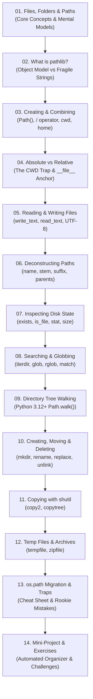
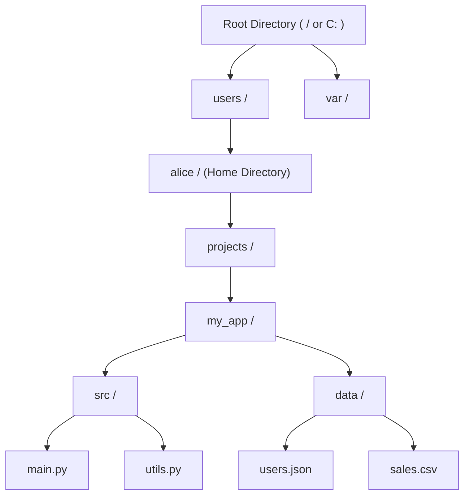
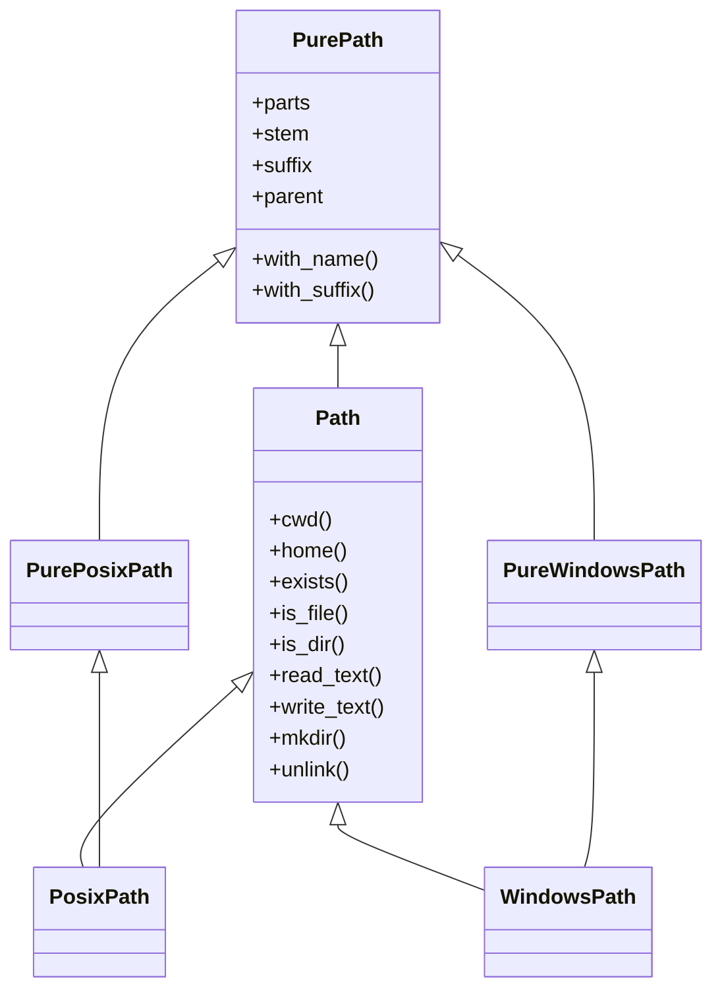
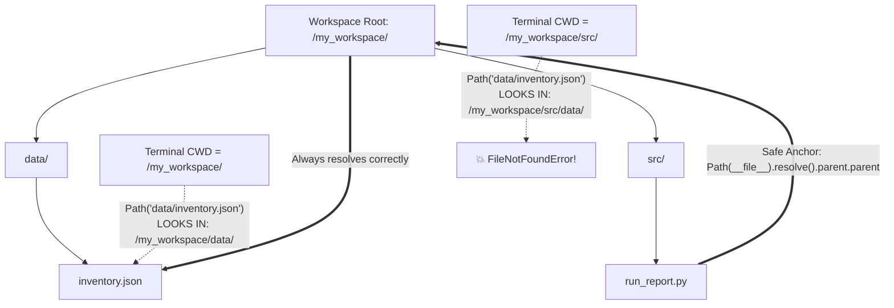

import { Callout } from "fumadocs-ui/components/callout";
import { Tabs, Tab } from "fumadocs-ui/components/tabs";
import { Accordion, Accordions } from "fumadocs-ui/components/accordion";

Whenever you write a Python script that loads a dataset, writes a log file, processes an image, or generates an automated report, your program must interact with the **operating system's filesystem**.

Historically, handling file paths in Python was notorious for introducing frustrating cross-platform bugs. Developers concatenated raw strings with backslashes (`"folder\\" + filename`) or forward slashes (`"folder/" + filename`). Code written on Windows would fail on Linux servers; scripts executed from a subfolder would crash with `FileNotFoundError`; and escaping backslashes produced bizarre syntax errors.

Python solved this once and for all with the **`pathlib` module** (introduced in Python 3.4 and enhanced through Python 3.12 and 3.13). Instead of treating file paths as fragile, error-prone strings, `pathlib` represents filesystem paths as **first-class, intelligent objects** with built-in methods for navigation, inspection, modification, and file I/O.

In this beginner-friendly, comprehensive masterclass, you will build an ironclad mental model of files, folders, and paths, and master every tool `pathlib` offers for real-world development.

---

## The Learning Roadmap



---

## Chapter 1: Understanding Files, Folders, and Paths

Before writing a single line of Python, let's establish crystal-clear terminology for how operating systems store and organize data.

### 1.1 What is a File?

A **file** is a named, continuous sequence of bytes stored permanently on a non-volatile storage device (such as an SSD, hard drive, or USB drive).

Files fall into two primary categories:

1. **Text Files**: Sequences of characters encoded into bytes (e.g. using UTF-8). Examples include `.py` scripts, `.txt` notes, `.csv` spreadsheets, and `.json` configs. You can open and read them directly in a plain text editor.
2. **Binary Files**: Data formatted for computer applications rather than human reading. Examples include compiled binaries, `.png` images, `.pdf` documents, and `.mp4` videos.

Every file name has distinct anatomical parts:

```text
       ┌─────────────────────────────── full name ───────────────────────────────┐
       │                                                                         │
       report_2026_q1                   .final                               .csv
       └──────────────┬───────────────┘ └───────────────────┬───────────────────┘
                      │                                     │
                 Primary Stem                           Extensions
```

| Component              | Definition                                        | Example (`data.final.csv`) | Example (`server.py`) |
| :--------------------- | :------------------------------------------------ | :------------------------- | :-------------------- |
| **Full Name**          | The complete filename including all extensions    | `data.final.csv`           | `server.py`           |
| **Stem**               | The filename without its final trailing extension | `data.final`               | `server`              |
| **Extension (Suffix)** | The file type indicator starting with a dot       | `.csv`                     | `.py`                 |
| **Multiple Suffixes**  | All dot-separated extensions for compound formats | `['.final', '.csv']`       | `['.py']`             |

### 1.2 What is a Directory (Folder)?

A **directory** (commonly called a **folder**) is a special filesystem structure that acts as a catalog or container. It does not contain document content itself; instead, it holds references to files and other directories (called **subdirectories**).

Every operating system organizes files in a hierarchical tree:



- **Root Directory**: The top-most container in the hierarchy. On Linux and macOS, it is a single forward slash (`/`). On Windows, each storage volume has its own drive root (e.g. `C:\`, `D:\`).
- **Parent Directory**: The directory immediately above a given file or folder. For example, `my_app/` is the parent of `src/`.
- **Child Directory (Subdirectory)**: A directory located inside another directory.

### 1.3 What is a Path?

A **path** is the address string that specifies how to locate a file or directory within the filesystem hierarchy.

There are two fundamental kinds of paths:

1. **Absolute Path**: An unambiguous route starting from the filesystem root. It points to the exact same location on disk regardless of which program or terminal directory executes the code.
   - **Linux / macOS (POSIX)**: `/home/alice/projects/my_app/src/main.py`
   - **Windows**: `C:\Users\alice\projects\my_app\src\main.py`
2. **Relative Path**: A route that starts from the **Current Working Directory (CWD)**—the folder your terminal was sitting in when the Python process started.
   - Example: `src/main.py` (means: _"look inside the folder `src` located inside wherever I am right now"_).
   - `.` (dot) represents the current directory.
   - `..` (double-dot) represents the parent directory (one level up).

<Callout type="info" title="Windows vs. POSIX (Linux & macOS) Path Differences">
  Notice two crucial differences between operating systems: 1. **Separators**:
  Windows traditionally uses backslashes (`\`), whereas POSIX (Linux, macOS,
  Unix) uses forward slashes (`/`). 2. **Drive Letters**: Windows prefixes
  absolute paths with a drive letter (`C:`, `D:`), whereas POSIX systems have a
  single unified root (`/`). 3. **Case Sensitivity**: On Linux, `Report.csv` and
  `report.csv` are two completely different files. On standard Windows and macOS
  configurations, file lookups are case-insensitive.
</Callout>

Here is how directory navigation moves up and down the tree:


---

## Chapter 2: What is `pathlib`?

### 2.1 The Problem with Ordinary Strings & Legacy `os.path`

In early versions of Python (prior to Python 3.4), paths were handled purely as plain string variables. Working with files meant importing disparate modules and passing strings around:

```python
# ❌ LEGACY PYTHON (Old, clunky, and error-prone):
import os

# Problem 1: Manual slash concatenation causes bugs
config_path = "C:\\users\\alice\\project" + "\\" + "config.json"

# Problem 2: Splitting, checking, and reading required 4 different modules
if os.path.exists(config_path):
    dirname = os.path.dirname(config_path)
    filename = os.path.basename(config_path)
    with open(config_path, "r", encoding="utf-8") as f:
        content = f.read()
```

This approach suffered from severe design flaws:

- **Escape Character Traps**: In Python strings, backslashes represent escape sequences. A path like `"C:\temp\new_files"` accidentally contains `\t` (Tab character) and `\n` (Newline character)! To fix it, developers had to write raw strings `r"C:\temp\new_files"` or double backslashes `"C:\\temp\\new_files"`.
- **Operating System Fragility**: Hardcoding `/` or `\` breaks when code is deployed across different developer environments (e.g., developing on Windows and deploying to an Ubuntu Docker container).
- **Fragmented Standard Library**: You had to memorize whether a function lived in `os`, `os.path`, `glob`, or `shutil`.

### 2.2 Introducing `pathlib`

Python 3.4 introduced the standard library module **`pathlib`** ([PEP 428](https://peps.python.org/pep-0428/)).

`pathlib` takes an object-oriented approach: **paths are objects**, not strings. A `Path` object encapsulates both the path's text identity and the filesystem operations you can perform on it:

```python
# ✅ MODERN PYTHON (Clean, expressive, and safe):
from pathlib import Path

config_path = Path("config.json")

if config_path.exists():
    content = config_path.read_text(encoding="utf-8")
```

#### PosixPath vs. WindowsPath

When you instantiate `Path()`, Python automatically checks the host operating system and instantiates the correct concrete class:



- On **Linux or macOS**, `Path()` yields an instance of **`PosixPath`**.
- On **Windows**, `Path()` yields an instance of **`WindowsPath`**.

Both classes inherit the exact same interface, meaning **your code runs identically across Windows, macOS, and Linux without a single `if os.name == 'nt'` check!**

<Callout
  type="warn"
  title="Fundamental Rule: Representation vs. Filesystem Existence"
>
  Creating a `Path` object **does not** create a file or folder on your
  computer's hard drive! ```python p = Path("my_imaginary_database.sqlite") ```
  At this stage, `p` is merely a computational representation in your computer's
  RAM. It is an address label. It does not exist on disk until you explicitly
  write to it or invoke `.touch()` / `.mkdir()`.
</Callout>

---

## Chapter 3: Creating and Combining Paths

Let's begin using `pathlib` by importing the primary `Path` class:

```python
from pathlib import Path
```

### 3.1 Creating a Path with `Path()`

You can instantiate a `Path` object by passing a string, multiple string segments, or another `Path`:

```python
from pathlib import Path

# 1. From a relative path string:
p1 = Path("data/raw/sales.csv")

# 2. From multiple string segments (comma-separated):
p2 = Path("data", "raw", "sales.csv")

# 3. From an absolute path (forward slashes work cleanly on Windows too!):
p3 = Path("C:/Users/alice/projects/app")
p4 = Path("/var/log/nginx/access.log")

print("p1:", p1)
print("p2:", p2)
```

Output on Windows:

```text
p1: data\raw\sales.csv
p2: data\raw\sales.csv
```

Notice how passing forward slashes `"data/raw/sales.csv"` on Windows was automatically normalized to Windows backslashes `data\raw\sales.csv`. You never have to manually type awkward double backslashes again!

### 3.2 Joining Paths Using the `/` Operator

In mathematics, the forward slash `/` represents division. However, Python allows classes to **overload operators** using special dunder methods (in this case, `__truediv__`).

`pathlib` overloads the `/` operator to perform **path joining**:

```python
from pathlib import Path

base_dir = Path("my_project")
data_dir = base_dir / "data"
csv_file = data_dir / "customers.csv"

print(csv_file)
```

Output:

```text
my_project/data/customers.csv  # (or my_project\data\customers.csv on Windows)
```

#### Why `/` Overloading is Brilliant:

1. **At least one operand must be a `Path`**: As long as the left-hand operand is a `Path`, the right-hand operands can be plain strings or other `Path` objects:

   ```python
   # ✅ Works:
   p = Path("app") / "src" / "index.js"

   # ❌ Fails with TypeError: unsupported operand type(s) for /: 'str' and 'str'
   # p = "app" / "src" / "index.js"
   ```

2. **Automatic Separator Normalization**: If you accidentally include leading or trailing slashes, `pathlib` safely strips duplicates:
   ```python
   messy = Path("folder/") / "/subfolder/" / "file.txt"
   print(messy)  # folder/subfolder/file.txt (no double slashes!)
   ```

### 3.3 Getting the Current Working Directory (`Path.cwd()`)

The **Current Working Directory** is the folder from which your terminal process executed the Python command:

```python
from pathlib import Path

cwd = Path.cwd()
print("Current Working Directory:", cwd)
print("Type:", type(cwd))
```

Output:

```text
Current Working Directory: /home/alice/projects/learning-python
Type: <class 'pathlib.PosixPath'>
```

### 3.4 Getting the User's Home Directory (`Path.home()`)

`Path.home()` returns the active user's personal home folder:

```python
from pathlib import Path

user_home = Path.home()
print("User Home:", user_home)

# Effortlessly build paths inside the user's home folder:
downloads = user_home / "Downloads"
app_config = user_home / ".config" / "my_app" / "settings.json"

print("Downloads folder:", downloads)
print("Config file:", app_config)
```

Output:

- On Linux: `/home/alice/Downloads`
- On macOS: `/Users/alice/Downloads`
- On Windows: `C:\Users\alice\Downloads`

### 3.5 Converting Between `Path` and `str`

While modern Python libraries (including `open()`, `json`, `csv`, `pandas`, `sqlite3`, and `shutil`) accept `Path` objects directly, occasionally an older third-party package requires a raw `str`:

```python
from pathlib import Path

path_obj = Path("documents/invoice.pdf")

# 1. Convert Path to plain string:
path_str = str(path_obj)
print(path_str, type(path_str))  # 'documents/invoice.pdf' <class 'str'>

# 2. Convert string back to Path:
recovered_path = Path(path_str)
print(recovered_path, type(recovered_path))  # documents/invoice.pdf <class 'pathlib.PosixPath'>
```

---

## Chapter 4: Absolute Paths vs. Relative Paths & The `__file__` Anchor

Understanding the difference between absolute and relative paths is essential to writing code that never breaks when deployed.

### 4.1 Relative Paths & The CWD Fragility Trap

A relative path has no fixed starting anchor; it is evaluated against wherever your terminal command prompt was open when the script started.

Imagine this standard project layout:

```text
my_workspace/
├── data/
│   └── inventory.json
└── src/
    └── run_report.py
```

Inside `src/run_report.py`, a beginner programmer writes:

```python
# ❌ FRAGILE CODE:
from pathlib import Path

data_file = Path("data/inventory.json")
content = data_file.read_text(encoding="utf-8")
print("Data loaded successfully!")
```

Here is what happens when run from different directories:

<Tabs items={["Run from Project Root (Works)", "Run from Inside src/ (Crashes!)"]}>
<Tab value="Run from Project Root (Works)">

```bash
# Terminal is at /my_workspace
$ python src/run_report.py
Data loaded successfully!
```

_Why it worked:_ The CWD is `/my_workspace`. Python evaluated `Path("data/inventory.json")` as `/my_workspace/data/inventory.json`, where the file actually resides.

</Tab>
<Tab value="Run from Inside src/ (Crashes!)">

```bash
# Terminal moved into src/
$ cd src
$ python run_report.py
Traceback (most recent call last):
  ...
FileNotFoundError: [Errno 2] No such file or directory: 'data/inventory.json'
```

_Why it crashed:_ The CWD is now `/my_workspace/src`. Python looked for `/my_workspace/src/data/inventory.json`, which does not exist!

</Tab>
</Tabs>



### 4.2 Absolute Paths (Pros and Cons)

- **Pros**: It never matters where the user runs the script from; `/var/data/catalog.json` always points to that exact file.
- **Cons**: Hardcoded absolute paths (`"C:\\Users\\alice\\projects\\..."`) only work on _one computer_. The moment you push code to GitHub, share it with a coworker, or deploy it to AWS/Linux, the hardcoded path crashes.

### 4.3 The Canonical `__file__` Script Anchor

How do we get the portability of relative paths with the certainty of absolute paths?

Python automatically assigns every script file a special built-in variable: **`__file__`**. This variable contains the path to the script currently executing.

By resolving `__file__`, we can compute paths **relative to the script itself**, completely independent of the terminal's working directory:

```python
# ✅ PRODUCTION-GRADE RESILIENT CODE:
from pathlib import Path

# 1. Absolute path to this exact Python script:
SCRIPT_PATH = Path(__file__).resolve()

# 2. Directory containing this script (src/):
SRC_DIR = SCRIPT_PATH.parent

# 3. Project root directory (one level up from src/):
PROJECT_ROOT = SRC_DIR.parent

# 4. Perfectly anchored asset path:
DATA_FILE = PROJECT_ROOT / "data" / "inventory.json"

print("Script location :", SCRIPT_PATH)
print("Project root    :", PROJECT_ROOT)
print("Asset path      :", DATA_FILE)
```

No matter if you launch this script from the workspace root, from `src/`, from your desktop, or via a cron job, `DATA_FILE` will **always** resolve to the exact correct location.

### 4.4 Resolving and Comparing Paths

`pathlib` provides methods to clean up, normalize, and compare paths:

```python
from pathlib import Path

# 1. .resolve() removes '..' and '.' and resolves symbolic links:
messy_path = Path("src/../src/./run_report.py")
clean_path = messy_path.resolve()
print("Cleaned Path:", clean_path)

# 2. .relative_to() calculates relative distance between paths:
base_directory = Path("/home/alice/projects/my_app")
sub_file = Path("/home/alice/projects/my_app/assets/images/logo.png")

relative_portion = sub_file.relative_to(base_directory)
print("Relative portion:", relative_portion)  # assets/images/logo.png

# 3. .is_relative_to() tests hierarchy membership (Python 3.9+):
print(sub_file.is_relative_to(base_directory))     # True
print(sub_file.is_relative_to(Path("/var/log")))    # False
```

---

## Chapter 5: Reading and Writing Files Directly with `Path`

For standard text and configuration files, `pathlib` includes high-level convenience methods so you don't even need to write `with open(...) as f:`.

### 5.1 Writing and Reading Text with UTF-8

The `.write_text()` and `.read_text()` methods handle opening, writing/reading, and closing the file stream automatically:

```python
from pathlib import Path

notes = Path("meeting_notes.txt")

# 1. Write text to a file:
notes.write_text("Team Standup Notes:\n- Deploy release v2.4\n- Review PR #42", encoding="utf-8")
print("File written successfully!")

# 2. Read text back:
content = notes.read_text(encoding="utf-8")
print("\n--- File Content ---")
print(content)
```

Output:

```text
File written successfully!

--- File Content ---
Team Standup Notes:
- Deploy release v2.4
- Review PR #42
```

### 5.2 Understanding UTF-8 Encoding

<Callout type="warn" title="Always Explicitly Specify encoding='utf-8'">
If you omit `encoding="utf-8"`:
```python
# ❌ DANGEROUS:
notes.write_text("Café and Résumé")
```
Python falls back to the **system default encoding**. On modern Linux and macOS, this is UTF-8. But on many English Windows installations, the default is still `cp1252` (Windows ANSI)!

If your file contains emojis, accented characters, or non-Latin text, the program will crash on Windows with `UnicodeEncodeError` or corrupt the characters. Always pass `encoding="utf-8"`.

</Callout>

### 5.3 Writing Multiple Lines

When working with lists of strings, join them with newline characters `\n`:

```python
from pathlib import Path

logs = Path("events.log")

records = [
    "2026-10-21 10:00:01 [INFO] Service started",
    "2026-10-21 10:00:05 [INFO] User alice logged in",
    "2026-10-21 10:01:22 [WARN] High memory consumption (82%)",
]

# Write all lines joined with newlines:
logs.write_text("\n".join(records) + "\n", encoding="utf-8")

# Read lines into a list:
lines = logs.read_text(encoding="utf-8").splitlines()
print(f"Read {len(lines)} log lines:")
for line in lines:
    print(" >", line)
```

### 5.4 When the Parent Directory Does Not Exist

A very common beginner pitfall is attempting to write to a path whose parent folders haven't been created yet:

```python
from pathlib import Path

target = Path("nested/deeply/reports/summary.txt")

# ❌ Crashes if 'nested/deeply/reports/' does not exist on disk:
# target.write_text("Summary Data", encoding="utf-8")
# FileNotFoundError: [Errno 2] No such file or directory: 'nested/deeply/reports/summary.txt'

# ✅ The Resilient Pattern: Ensure parent directory exists first!
target.parent.mkdir(parents=True, exist_ok=True)
target.write_text("Quarterly Summary: 100% Target Met", encoding="utf-8")
print("Written successfully to:", target)
```

### 5.5 Reading a File that May Not Exist

If you try to read a file that does not exist, Python raises `FileNotFoundError`. You should guard against this using either a defensive check or exception handling:

```python
from pathlib import Path

config = Path("user_settings.json")

# Pattern A: Defensive check with .is_file()
if config.is_file():
    data = config.read_text(encoding="utf-8")
else:
    data = "{}"  # Default fallback

# Pattern B: Idiomatic Pythonic EAFP (Easier to Ask for Forgiveness than Permission)
try:
    data = config.read_text(encoding="utf-8")
except FileNotFoundError:
    print("Warning: user_settings.json not found. Loading defaults.")
    data = "{}"
```

---

## Chapter 6: Examining and Deconstructing Paths

Every file path consists of meaningful segments. `Path` objects provide dedicated properties to extract these components instantly without tedious string slicing.

### 6.1 Path Properties: `.name`, `.stem`, `.suffix`, `.parent`

Consider the file path: `/home/alice/reports/2026-q1-analytics.final.csv`

```python
from pathlib import Path

p = Path("/home/alice/reports/2026-q1-analytics.final.csv")

print("1. .name     :", p.name)
print("2. .stem     :", p.stem)
print("3. .suffix   :", p.suffix)
print("4. .suffixes :", p.suffixes)
print("5. .parent   :", p.parent)
```

Output:

```text
1. .name     : 2026-q1-analytics.final.csv
2. .stem     : 2026-q1-analytics.final
3. .suffix   : .csv
4. .suffixes : ['.final', '.csv']
5. .parent   : /home/alice/reports
```

#### Detailed Breakdown Table:

| Property        | What it Represents                        | Result on `reports/2026.final.csv` | Result on `archive.tar.gz` | Result on `.env`    |
| :-------------- | :---------------------------------------- | :--------------------------------- | :------------------------- | :------------------ |
| **`.name`**     | Full file name with all extensions        | `2026.final.csv`                   | `archive.tar.gz`           | `.env`              |
| **`.stem`**     | Name with the **last** extension stripped | `2026.final`                       | `archive.tar`              | `.env`              |
| **`.suffix`**   | The final dot extension                   | `.csv`                             | `.gz`                      | `""` (empty string) |
| **`.suffixes`** | List of all dot extensions                | `['.final', '.csv']`               | `['.tar', '.gz']`          | `[]` (empty list)   |
| **`.parent`**   | Immediate containing folder               | `reports`                          | `.` (current folder)       | `.`                 |
| **`.parents`**  | Sequence of all ancestor folders          | `[Path('reports'), Path('.')]`     | `[Path('.')]`              | `[Path('.')]`       |

To climb multiple directory levels up, index into `.parents`:

```python
deep_file = Path("/home/alice/projects/web/src/components/Button.tsx")

print("Immediate parent (components) :", deep_file.parent)
print("1 level up (src)              :", deep_file.parents[0])
print("2 levels up (web)             :", deep_file.parents[1])
print("3 levels up (projects)        :", deep_file.parents[2])
print("4 levels up (alice)           :", deep_file.parents[3])
```

### 6.2 Non-Destructive Transformations (Immutability)

<Callout type="info" title="Path Objects are Immutable">
  `Path` objects in Python are **immutable**, exactly like strings or tuples.
  When you call a method like `.with_suffix()`, it **never** alters the original
  object or modifies the file on disk. Instead, it returns a **brand new `Path`
  object**.
</Callout>

`pathlib` provides three primary non-destructive transformation methods:

```python
from pathlib import Path

original = Path("documents/annual_report.docx")

# 1. Change file extension with .with_suffix():
pdf_version = original.with_suffix(".pdf")
print("PDF target    :", pdf_version)   # documents/annual_report.pdf

# 2. Change the stem (filename without extension) with .with_stem() (Python 3.9+):
draft_version = original.with_stem("annual_report_v2_draft")
print("Draft target  :", draft_version) # documents/annual_report_v2_draft.docx

# 3. Change the entire filename with .with_name():
summary_file = original.with_name("summary.txt")
print("Summary target:", summary_file)  # documents/summary.txt

# The original is 100% unchanged:
print("Original path :", original)      # documents/annual_report.docx
```

<Callout
  type="warn"
  title="Important Warning: with_suffix() Does NOT Convert File Formats!"
>
  Calling `Path("photo.png").with_suffix(".jpg")` only produces the string/path
  representation `photo.jpg`. It **does not** magically compress PNG pixels into
  a JPEG on disk! To convert file formats, you need image processing libraries
  like Pillow (`PIL`).
</Callout>

---

## Chapter 7: Checking Files and Folders

Before operating on the filesystem, your program frequently needs to inspect what already exists on disk.

### 7.1 Checking Existence (`.exists()`)

The `.exists()` method returns `True` if the path points to an existing file, directory, or symlink on disk:

```python
from pathlib import Path

p = Path("config.json")

if p.exists():
    print(f"Found: {p}")
else:
    print(f"Path does not exist: {p}")
```

### 7.2 Checking Type (`.is_file()`, `.is_dir()`, `.is_symlink()`)

A path might exist, but is it a file or a folder?

```python
from pathlib import Path

item = Path("my_folder")

print("Is a regular file?     :", item.is_file())
print("Is a directory?        :", item.is_dir())
print("Is a symbolic link?    :", item.is_symlink())
```

<Callout type="info" title="Note on .is_file() and .is_dir()">
  Both `.is_file()` and `.is_dir()` will return `False` if the path does not
  exist on disk. They do not throw errors when checked on non-existent paths.
</Callout>

### 7.3 Getting File Size (`.stat().st_size`)

The `.stat()` method queries the operating system for filesystem metadata. The `st_size` attribute returns the file size in **bytes**:

```python
from pathlib import Path

target = Path("dataset.csv")

if target.is_file():
    size_bytes = target.stat().st_size
    size_kb = size_bytes / 1024
    size_mb = size_kb / 1024

    print(f"Bytes : {size_bytes} B")
    print(f"KB    : {size_kb:.2f} KB")
    print(f"MB    : {size_mb:.2f} MB")
```

### 7.4 Getting Last-Modified Time (`.stat().st_mtime`)

`st_mtime` provides the modification time as a Unix epoch timestamp (seconds since January 1, 1970). Combine it with Python's standard `datetime` module to format human-readable dates:

```python
from datetime import datetime
from pathlib import Path

target = Path("report.pdf")

if target.exists():
    mtime_timestamp = target.stat().st_mtime
    last_modified = datetime.fromtimestamp(mtime_timestamp)

    print(f"Last modified: {last_modified:%Y-%m-%d %H:%M:%S}")
```

Output:

```text
Last modified: 2026-10-21 14:35:10
```

---

## Chapter 8: Listing Files and Searching Directories (Globbing)

Searching through directories is one of the most frequent automation tasks in Python. `pathlib` offers three distinct techniques: `.iterdir()`, `.glob()`, and `.rglob()`.

### 8.1 Using `.iterdir()` (Listing Immediate Contents)

`.iterdir()` returns an iterator of `Path` objects representing all files and folders directly inside a directory (non-recursively):

```python
from pathlib import Path

workspace = Path(".")

print(f"Contents of {workspace.resolve()}:")
for item in workspace.iterdir():
    prefix = "[DIR] " if item.is_dir() else "[FILE]"
    print(f"  {prefix} {item.name}")
```

Output:

```text
Contents of /home/alice/project:
  [DIR]  src
  [DIR]  tests
  [FILE] README.md
  [FILE] pyproject.toml
```

### 8.2 Using `.glob()` with Wildcard Patterns

When you only care about files matching a specific pattern (e.g., all `.json` files or all log files starting with `app_`), use `.glob()`.

#### Supported Wildcard Operators:

- `*`: Matches zero or more characters.
- `?`: Matches exactly one character.
- `[0-9]`: Matches any single character within the bracket range or set.

```python
from pathlib import Path

logs_folder = Path("logs")

# 1. Match all CSV files:
for csv_file in logs_folder.glob("*.csv"):
    print("Found CSV:", csv_file.name)

# 2. Match single-digit error logs: error_1.log, error_2.log
for err_log in logs_folder.glob("error_[0-9].log"):
    print("Numbered error log:", err_log.name)

# 3. Match test files: test_*.py
for test_file in Path("tests").glob("test_*.py"):
    print("Unit test:", test_file.name)
```

### 8.3 Searching Recursively with `.rglob()`

While `.glob("*.py")` searches **only** the top-level directory, `.rglob("*.py")` searches the directory **and every single nested subdirectory within it**, no matter how deeply nested:

```python
from pathlib import Path

project_dir = Path("my_project")

# Recursively find every Python source file:
all_py_files = list(project_dir.rglob("*.py"))

print(f"Found {len(all_py_files)} Python source files:")
for py_file in all_py_files:
    # Print relative path from project root:
    print(" -", py_file.relative_to(project_dir))
```

Output:

```text
Found 3 Python source files:
 - src/main.py
 - src/utils/helpers.py
 - tests/test_main.py
```

<Callout type="info" title=".rglob('*.py') vs .glob('**/*.py')">
  `project.rglob("*.py")` and `project.glob("**/*.py")` are completely identical
  in function. The recursive wildcard `**` instructs `pathlib` to descend
  through all subdirectories. `.rglob()` is simply a cleaner shorthand.
</Callout>

### 8.4 Testing a Pattern with `.match()` and Python 3.13 `.full_match()`

Sometimes you already have a `Path` object in memory and you want to test whether its filename matches a pattern without reading the disk:

```python
from pathlib import Path

file_path = Path("src/components/Header.test.tsx")

# .match() tests against wildcard glob syntax:
if file_path.match("*.test.tsx"):
    print("Found React component unit test!")

if file_path.match("src/**/*.tsx"):
    print("TypeScript React component located inside src!")
```

In Python 3.13, `Path.full_match()` was introduced to match the entire path string against glob patterns with stricter POSIX-compliant semantics.

---

## Chapter 9: Walking an Entire Directory Tree (`Path.walk()`)

In Python 3.12, Python added a powerful new method directly to `Path`: **`Path.walk()`** ([PEP 709](https://peps.python.org/pep-0709/)).

Previously, recursive directory walking required importing the legacy `os.walk()` function and manually converting string paths to `Path` objects. `Path.walk()` yields tuples of `(dirpath, dirnames, filenames)` where `dirpath` is already a concrete `Path` instance!

### 9.1 Basic `Path.walk()` Syntax

```python
from pathlib import Path

root = Path("my_app")

for dirpath, dirnames, filenames in root.walk():
    print(f"\nDirectory: {dirpath}")
    print(f"  Subdirectories : {dirnames}")
    print(f"  Files          : {filenames}")
```

### 9.2 Skipping Directories In-Place (Pruning Traversal)

One of the greatest advantages of `walk()` over `rglob()` is **in-place pruning**.

If your project contains massive folders like `.git`, `node_modules`, or `__pycache__`, `rglob()` will waste time traversing thousands of unwanted files. With `walk()`, you can modify `dirnames` in-place using `.remove()`:

```python
from pathlib import Path

root_dir = Path("my_project")

total_json_files = 0

for dirpath, dirnames, filenames in root_dir.walk(top_down=True):
    # 🛑 PRUNE DIRECTORIES IN-PLACE:
    # Modifying dirnames prevents walk() from descending into these folders!
    for ignored_folder in [".git", "__pycache__", "node_modules", ".venv"]:
        if ignored_folder in dirnames:
            dirnames.remove(ignored_folder)

    # Process files in remaining directories:
    for filename in filenames:
        if filename.endswith(".json"):
            full_path = dirpath / filename
            total_json_files += 1
            print(f"Found config: {full_path}")

print(f"\nScan complete. Total relevant JSON configs: {total_json_files}")
```

### 9.3 Comparison: `iterdir()`, `rglob()`, and `walk()`

| Tool                              | Recursion Depth                         | Modifiable in Flight?      | Best For                                                 |
| :-------------------------------- | :-------------------------------------- | :------------------------- | :------------------------------------------------------- |
| **`dir.iterdir()`**               | 1 level (immediate contents only)       | No                         | Simple directory listings, shallow checks                |
| **`dir.glob("*.ext")`**           | 1 level (or recursive with `**`)        | No                         | Finding specific file types in a folder                  |
| **`dir.rglob("*.ext")`**          | Deeply recursive across all levels      | No                         | Collecting all files of a specific pattern               |
| **`dir.walk()`** _(Python 3.12+)_ | Deeply recursive with full tree control | **Yes** (prune `dirnames`) | Complex scans where you must skip entire directory trees |

---

## Chapter 10: Creating, Renaming, Moving, and Deleting Files

Now let's explore filesystem mutations: creating folders, touching files, moving assets, and cleaning up.

### 10.1 Creating Directories Safely with `.mkdir()`

To create a directory, use `.mkdir()`. In production code, you should almost always supply two arguments:

1. `parents=True`: Creates any missing parent directories along the path (equivalent to `mkdir -p` in bash).
2. `exist_ok=True`: Prevents raising `FileExistsError` if the directory already exists.

```python
from pathlib import Path

output_dir = Path("build/output/reports/2026")

# ✅ Safe, idempotent directory creation:
output_dir.mkdir(parents=True, exist_ok=True)
print("Directory structure ready:", output_dir.resolve())
```

### 10.2 Creating Empty Files with `.touch()`

`.touch()` creates an empty file at the path location. If the file already exists, it updates the last-modified timestamp without overwriting contents (equivalent to the Unix `touch` command):

```python
from pathlib import Path

lockfile = Path("app.lock")

# Create empty file if not already present:
lockfile.touch(exist_ok=True)
print("Lockfile present:", lockfile.exists())
```

### 10.3 Renaming and Moving Files with `.rename()`

`.rename()` moves or renames a file or directory:

```python
from pathlib import Path

source = Path("draft.txt")
source.write_text("Hello World", encoding="utf-8")

destination = Path("final_document.txt")

# Rename the file:
source.rename(destination)

print("Source exists?     :", source.exists())       # False
print("Destination exists?:", destination.exists())  # True
```

You can also move a file into a different folder:

```python
from pathlib import Path

file_to_move = Path("report.pdf")
archive_folder = Path("archive")
archive_folder.mkdir(exist_ok=True)

# Move file into archive folder:
target = archive_folder / file_to_move.name
file_to_move.rename(target)
```

<Callout type="warn" title="Windows Gotcha with .rename()">
  On Windows, if `destination` already exists, `.rename()` will raise
  `FileExistsError`. On Unix, it silently overwrites the destination. To achieve
  consistent, atomic overwriting across all platforms, use `.replace()` instead!
</Callout>

### 10.4 Understanding `.replace()` for Atomic Overwrites

`.replace()` guarantees **atomic replacement** across all operating systems. If the destination file already exists, it is overwritten cleanly without throwing an error:

```python
from pathlib import Path

new_data = Path("new_database.sqlite.tmp")
new_data.write_text("New Records 2026", encoding="utf-8")

live_database = Path("database.sqlite")

# Atomically swap temporary file into production path:
new_data.replace(live_database)
print("Production database updated atomically!")
```

### 10.5 Deleting Files with `.unlink()`

In filesystem terminology, deleting a file removes its hard link from the directory table. Hence, the method is named **`.unlink()`**:

```python
from pathlib import Path

temp_file = Path("temp_cache.bin")
temp_file.write_text("temporary bytes", encoding="utf-8")

# Delete file:
# missing_ok=True prevents FileNotFoundError if file is already deleted (Python 3.8+)
temp_file.unlink(missing_ok=True)
print("File deleted cleanly.")
```

### 10.6 Deleting Empty Directories with `.rmdir()`

`.rmdir()` deletes a directory, but **only if the directory is completely empty**:

```python
from pathlib import Path

empty_folder = Path("empty_directory")
empty_folder.mkdir(exist_ok=True)

# Delete empty directory:
empty_folder.rmdir()
print("Empty directory removed.")
```

If the folder contains even a single file, `.rmdir()` raises `OSError` (`Directory not empty`).

### 10.7 Deleting Directory Trees with `shutil.rmtree()`

`pathlib` deliberately does not include a recursive folder deletion method as a built-in safety safeguard. To delete a directory along with all of its contents, use the standard library `shutil` module:

<Callout
  type="error"
  title="Caution: shutil.rmtree() is Permanent and Irreversible"
>
  `shutil.rmtree()` does not send files to your operating system's Recycle Bin
  or Trash. Files are permanently wiped from the disk immediately. Double check
  that your target path is correct before running it!
</Callout>

```python
import shutil
from pathlib import Path

old_build_dir = Path("build")

if old_build_dir.exists() and old_build_dir.is_dir():
    # Permanently delete directory and all child files/subfolders:
    shutil.rmtree(old_build_dir)
    print("Build directory wiped completely.")
```

---

## Chapter 11: Copying Files and Directories with `shutil`

While `pathlib` handles path manipulation, reading, and writing, bulk file copying is handled by Python's standard `shutil` module. Modern `shutil` functions accept `Path` objects directly.

### 11.1 Copying a File with `shutil.copy2()`

Python provides both `shutil.copy()` and `shutil.copy2()`.

**Always prefer `shutil.copy2()`**: In addition to copying the file's data and permissions, `copy2()` preserves original file metadata, such as creation and last-modified timestamps:

```python
import shutil
from pathlib import Path

source = Path("data/master_records.csv")
backup = Path("backups/master_records_backup.csv")

# Ensure backup folder exists:
backup.parent.mkdir(parents=True, exist_ok=True)

# Copy file with metadata preserved:
shutil.copy2(source, backup)
print("Backup created successfully at:", backup)
```

### 11.2 Copying an Entire Directory with `shutil.copytree()`

To duplicate an entire folder hierarchy:

```python
import shutil
from pathlib import Path

src_assets = Path("site/assets")
dst_backup = Path("backups/assets_snapshot")

# dirs_exist_ok=True (Python 3.8+) allows copying into an existing destination folder
shutil.copytree(src_assets, dst_backup, dirs_exist_ok=True)
print("Copied complete directory tree!")
```

You can also ignore certain files during the copy:

```python
# Ignore temporary and cache files during directory copy:
shutil.copytree(
    src_assets,
    dst_backup,
    ignore=shutil.ignore_patterns("*.tmp", "*.log", "__pycache__"),
    dirs_exist_ok=True,
)
```

---

## Chapter 12: Temporary Files and Directories with `tempfile`

When downloading files from the internet, generating scratch PDFs, or running automated unit tests, you should never clutter your permanent project directories with temporary files.

Use the standard library **`tempfile`** module. When paired with `Path`, it provides a clean, secure, self-cleaning sandbox.

### 12.1 `tempfile.TemporaryDirectory()` Context Manager

```python
import tempfile
from pathlib import Path

# Create an isolated temporary directory on the OS temp drive:
with tempfile.TemporaryDirectory() as temp_dir_str:
    temp_dir = Path(temp_dir_str)
    print("Temporary sandbox created at:", temp_dir)

    # Perform work inside the temporary folder:
    work_file = temp_dir / "scratch_work.txt"
    work_file.write_text("Processing calculations...", encoding="utf-8")

    print("Scratch file exists? :", work_file.exists())
    print("Scratch file content :", work_file.read_text(encoding="utf-8"))

# The moment Python exits the `with` block:
print("\nTemporary sandbox exists after with block?:", temp_dir.exists())
```

Output:

```text
Temporary sandbox created at: /tmp/tmp_x82f91_a
Scratch file exists? : True
Scratch file content : Processing calculations...

Temporary sandbox exists after with block?: False
```

The operating system automatically guarantees that the folder and every single file inside it are completely deleted when the block finishes—even if an exception or crash occurs!

---

## Chapter 13: Working with ZIP Archives (`zipfile` + `pathlib`)

Bundling files into compressed `.zip` archives or extracting incoming packages is a staple of data pipelines and web backends. Python's standard `zipfile` module integrates seamlessly with `pathlib`.

### 13.1 Creating a ZIP Archive with Relative Paths

<Callout type="warn" title="Always Store Relative Paths in Archives">
  When adding a file to an archive with `zip_file.write(file_path,
  arcname=...)`, you must supply `arcname`. If you omit `arcname`, the archive
  will store the file with its **full absolute disk path** (e.g.,
  `Users/alice/projects/...`), making the zip messy and awkward to unzip on
  someone else's machine!
</Callout>

```python
import zipfile
from pathlib import Path

folder_to_compress = Path("my_documents")
zip_output_file = Path("documents_archive.zip")

# 1. Open ZIP in write mode with Deflate compression:
with zipfile.ZipFile(zip_output_file, "w", zipfile.ZIP_DEFLATED) as zip_file:
    # 2. Recursively find all files in the target folder:
    for file_path in folder_to_compress.rglob("*"):
        if file_path.is_file():
            # 3. Calculate path relative to the root of the folder:
            archive_name = file_path.relative_to(folder_to_compress)
            # 4. Write to zip archive under relative name:
            zip_file.write(file_path, arcname=archive_name)

print(f"Archive created successfully: {zip_output_file.resolve()}")
```

### 13.2 Extracting a ZIP Archive Safely

```python
import zipfile
from pathlib import Path

archive_path = Path("documents_archive.zip")
extract_destination = Path("extracted_files")

extract_destination.mkdir(parents=True, exist_ok=True)

with zipfile.ZipFile(archive_path, "r") as zip_file:
    # List all archive entries:
    print("Entries inside archive:")
    for name in zip_file.namelist():
        print(" >", name)

    # Extract all files safely:
    zip_file.extractall(extract_destination)

print(f"Files extracted cleanly into: {extract_destination.resolve()}")
```

<Callout type="error" title="Security Warning: The 'Zip Slip' Vulnerability">
Never extract untrusted zip files from unknown internet sources using plain `extractall()` in legacy Python! Malicious archives can contain file names with path traversal sequences like `../../../../etc/passwd` that overwrite critical system files.

In modern **Python 3.12+**, `extractall()` supports the `filter='data'` parameter:

```python
zip_file.extractall(extract_destination, filter="data")
```

This automatically neutralizes directory traversal attacks and dangerous symlinks.

</Callout>

---

## Chapter 14: `pathlib` vs. Legacy `os.path` Migration Cheat Sheet

If you are maintaining existing code or studying legacy tutorials, use this comprehensive conversion table to translate obsolete `os` and `os.path` idioms into modern, clean `pathlib.Path`:

| Task / Operation              | Legacy `os` / `os.path`                | Modern `pathlib.Path`                  | Advantage of `pathlib`                       |
| :---------------------------- | :------------------------------------- | :------------------------------------- | :------------------------------------------- |
| **Join path parts**           | `os.path.join(a, b, c)`                | `Path(a) / b / c`                      | Natural syntax, cross-platform normalization |
| **Get current directory**     | `os.getcwd()`                          | `Path.cwd()`                           | Returns rich `Path` object instead of string |
| **Get home directory**        | `os.path.expanduser("~")`              | `Path.home()`                          | Direct and expressive                        |
| **Make path absolute**        | `os.path.abspath(p)`                   | `Path(p).resolve()`                    | Eliminates `..`, `.`, and resolves symlinks  |
| **Check file exists**         | `os.path.exists(p)`                    | `p.exists()`                           | Direct object method                         |
| **Check if regular file**     | `os.path.isfile(p)`                    | `p.is_file()`                          | Direct object method                         |
| **Check if directory**        | `os.path.isdir(p)`                     | `p.is_dir()`                           | Direct object method                         |
| **Get file size**             | `os.path.getsize(p)`                   | `p.stat().st_size`                     | Bundled in comprehensive `stat` object       |
| **Get filename with ext**     | `os.path.basename(p)`                  | `p.name`                               | Property lookup, no string splitting         |
| **Get filename without ext**  | `os.path.splitext(p)[0]`               | `p.stem`                               | Clean property, handles multiple dots        |
| **Get file extension**        | `os.path.splitext(p)[1]`               | `p.suffix`                             | Property lookup                              |
| **Get parent directory**      | `os.path.dirname(p)`                   | `p.parent`                             | Direct ancestor navigation                   |
| **List folder entries**       | `os.listdir(p)`                        | `list(p.iterdir())`                    | Yields `Path` objects, not just strings      |
| **Find files with wildcard**  | `glob.glob("*.py")`                    | `list(p.glob("*.py"))`                 | Works directly on directory objects          |
| **Recursive wildcard search** | `glob.glob("**/*.py", recursive=True)` | `list(p.rglob("*.py"))`                | Fast and clean syntax                        |
| **Create directory**          | `os.mkdir(p)`                          | `p.mkdir()`                            | Direct method                                |
| **Create nested folders**     | `os.makedirs(p, exist_ok=True)`        | `p.mkdir(parents=True, exist_ok=True)` | Safe, idempotent flag combo                  |
| **Delete file**               | `os.remove(p)` / `os.unlink(p)`        | `p.unlink(missing_ok=True)`            | `missing_ok` avoids crash if already gone    |
| **Delete empty folder**       | `os.rmdir(p)`                          | `p.rmdir()`                            | Clear and safe                               |
| **Rename or move**            | `os.rename(src, dst)`                  | `src.rename(dst)`                      | Object-oriented                              |
| **Atomic overwrite**          | `os.replace(src, dst)`                 | `src.replace(dst)`                     | Guarantees atomic replacement cross-platform |
| **Read text file**            | `with open(p, "r") as f: f.read()`     | `p.read_text(encoding="utf-8")`        | 1-liner with auto close                      |
| **Write text file**           | `with open(p, "w") as f: f.write(s)`   | `p.write_text(s, encoding="utf-8")`    | 1-liner with auto close                      |

---

## Chapter 15: Common Mistakes Beginners Make

Avoid these five classic traps when working with `pathlib`:

### Mistake 1: Assuming `Path()` Creates a File

```python
# ❌ MISTAKE:
db = Path("database.sqlite")
# Developer expects database.sqlite to exist on disk right now!
print(db.exists())  # False!
```

**Fix:** Remember that `Path()` is simply an address in memory. To create a file, use `.write_text("")`, `.touch()`, or open it for writing.

### Mistake 2: Forgetting the Current Working Directory (The CWD Trap)

```python
# ❌ MISTAKE:
raw_data = Path("data/raw.csv").read_text()
```

If the script is executed from any directory other than the project root, this fails with `FileNotFoundError`.
**Fix:** Always anchor paths to `__file__`:

```python
PROJECT_ROOT = Path(__file__).resolve().parent.parent
raw_data = (PROJECT_ROOT / "data" / "raw.csv").read_text(encoding="utf-8")
```

### Mistake 3: Expecting `.with_suffix()` to Convert File Formats

```python
# ❌ MISTAKE:
original_video = Path("clip.mov")
mp4_video = original_video.with_suffix(".mp4")
# Developer thinks the video was transcoded into an MP4!
```

**Fix:** `.with_suffix()` only changes the text extension in the path object. It never converts video codecs, compressions, or document structures on disk.

### Mistake 4: Missing Parent Directories Before Writing

```python
# ❌ MISTAKE:
target = Path("exports/2026/january/summary.txt")
target.write_text("Revenue: $100k", encoding="utf-8")
# Crashes if 'exports/2026/january/' doesn't already exist on disk!
```

**Fix:** Pre-create parent folders:

```python
target.parent.mkdir(parents=True, exist_ok=True)
target.write_text("Revenue: $100k", encoding="utf-8")
```

### Mistake 5: Using Destructive Methods Without Verifying Target

Calling `shutil.rmtree(some_path)` when `some_path` is empty or pointing to an unintended folder can wipe out critical source code.
**Fix:** Always check `.exists()` and confirm the path resolves to an expected subdirectory before removing trees.

---

## Chapter 16: Mini-Project — Automated File Organizer

Let's synthesize everything we've learned by building a real-world, production-ready utility: an **Automated Downloads Organizer**.

### The Problem

Your downloads folder is cluttered with dozens of mixed files: PDFs, images, data sets, Python scripts, and ZIP archives. We want a script that scans the folder and moves each file into an organized category folder based on its file extension.

### The Complete Implementation

```python
"""
Automated File Organizer
Organizes cluttered directories into categorized subfolders using pathlib.
"""

from pathlib import Path
import shutil

# Define category mapping with target extensions:
CATEGORY_MAP: dict[str, set[str]] = {
    "Images": {".png", ".jpg", ".jpeg", ".gif", ".svg", ".webp", ".bmp"},
    "PDFs": {".pdf"},
    "Documents": {".docx", ".doc", ".txt", ".md", ".rtf", ".odt"},
    "Data": {".csv", ".json", ".parquet", ".xlsx", ".tsv", ".sqlite"},
    "Python": {".py", ".ipynb"},
    "Archives": {".zip", ".tar", ".gz", ".7z", ".rar"},
}

def get_unique_destination(target_path: Path) -> Path:
    """
    Prevents overwriting existing files by appending an incrementing counter:
    e.g. 'invoice.pdf' -> 'invoice (1).pdf' -> 'invoice (2).pdf'
    """
    if not target_path.exists():
        return target_path

    stem = target_path.stem
    suffix = target_path.suffix
    parent = target_path.parent
    counter = 1

    while True:
        candidate = parent / f"{stem} ({counter}){suffix}"
        if not candidate.exists():
            return candidate
        counter += 1

def organize_folder(target_directory: Path | str) -> dict[str, int]:
    """
    Scans target_directory and organizes top-level files into categorized subfolders.
    Returns a summary dictionary of moved file counts.
    """
    root = Path(target_directory).resolve()

    if not root.exists():
        raise FileNotFoundError(f"Target directory does not exist: {root}")
    if not root.is_dir():
        raise NotADirectoryError(f"Target path is not a directory: {root}")

    print(f"\n📂 Organizing directory: {root}")

    # Initialize count tracking:
    stats: dict[str, int] = {cat: 0 for cat in CATEGORY_MAP}
    stats["Others"] = 0

    # Iterate through immediate items only (non-recursive):
    for item in root.iterdir():
        # Skip subdirectories to prevent moving already-organized folders!
        if not item.is_file():
            continue

        file_extension = item.suffix.lower()
        matched_category = None

        # Determine matching category:
        for category, extensions in CATEGORY_MAP.items():
            if file_extension in extensions:
                matched_category = category
                break

        # Fallback category for unrecognized files:
        if matched_category is None:
            matched_category = "Others"

        # Construct destination directory and ensure it exists:
        destination_folder = root / matched_category
        destination_folder.mkdir(parents=True, exist_ok=True)

        # Compute safe unique destination filename:
        initial_destination = destination_folder / item.name
        safe_destination = get_unique_destination(initial_destination)

        # Move file:
        item.rename(safe_destination)
        stats[matched_category] += 1
        print(f"  ✓ Moved: {item.name} -> {matched_category}/{safe_destination.name}")

    return stats

# Demonstration and Verification:
if __name__ == "__main__":
    # Create a scratch sandbox for testing:
    demo_dir = Path("demo_downloads")
    demo_dir.mkdir(exist_ok=True)

    # Populate sandbox with dummy files:
    (demo_dir / "financial_report.pdf").write_text("dummy", encoding="utf-8")
    (demo_dir / "profile_picture.png").write_text("dummy", encoding="utf-8")
    (demo_dir / "dataset.csv").write_text("dummy", encoding="utf-8")
    (demo_dir / "script.py").write_text("dummy", encoding="utf-8")
    (demo_dir / "archive.zip").write_text("dummy", encoding="utf-8")
    (demo_dir / "unknown_binary.xyz").write_text("dummy", encoding="utf-8")

    # Run organizer:
    report = organize_folder(demo_dir)

    print("\n--- Organization Summary Report ---")
    for category, count in report.items():
        if count > 0:
            print(f"  {category:<12}: {count} file(s) moved")
```

### Step-by-Step Code Walkthrough

1. **`CATEGORY_MAP`**: Uses Python `set` collections for $O(1)$ fast lookup of extensions. All extensions include lowercase leading dots.
2. **`get_unique_destination()`**: Protects user data from collisions. If `photo.png` already exists in `Images/`, it automatically renames the incoming file to `photo (1).png` using `.stem` and `.suffix`.
3. **`root.iterdir()` & `if not item.is_file(): continue`**: By explicitly filtering with `.is_file()`, the organizer never touches subdirectories, ensuring already organized folders are never recursively nested inside themselves.
4. **`destination_folder.mkdir(parents=True, exist_ok=True)`**: Safely creates the category folder on demand without crashing if it already exists.
5. **`item.rename(safe_destination)`**: Fast and clean file relocation.

---

## Chapter 17: Practice Exercises & Challenges

Test and solidify your understanding with these hands-on exercises. Each challenge includes a hidden solution and detailed explanation.

### Exercise 1: Inspecting Path Components

Create a `Path` object representing `data/users.json` and print:

1. Whether it is an absolute path (`.is_absolute()`).
2. Its file name (`.name`).
3. Its stem (`.stem`).
4. Its extension (`.suffix`).
5. Its parent folder (`.parent`).

<Accordions>
<Accordion title="Reveal Solution & Explanation">

```python
from pathlib import Path

p = Path("data/users.json")

print("Is absolute? :", p.is_absolute())
print("File name    :", p.name)
print("Stem         :", p.stem)
print("Suffix       :", p.suffix)
print("Parent       :", p.parent)
```

Output:

```text
Is absolute? : False
File name    : users.json
Stem         : users
Suffix       : .json
Parent       : data
```

**Explanation:** Because `p` does not start with a leading slash `/` or drive letter `C:\`, `is_absolute()` is `False`. The `.name` includes the entire filename, `.stem` strips `.json`, and `.parent` returns `data`.

</Accordion>
</Accordions>

---

### Exercise 2: Current Working Directory vs. Script-Relative Anchor

Write a script that displays:

1. The Current Working Directory (`Path.cwd()`).
2. The absolute directory containing the currently running script using `__file__`.
3. A path to a hypothetical config file named `settings.ini` located right next to the running script.

<Accordions>
<Accordion title="Reveal Solution & Explanation">

```python
from pathlib import Path

# 1. Current working directory:
cwd = Path.cwd()
print("1. Current Working Directory:", cwd)

# 2. Directory containing this script:
script_dir = Path(__file__).resolve().parent
print("2. Script Directory         :", script_dir)

# 3. Anchored config path:
config_file = script_dir / "settings.ini"
print("3. Anchored Config Path     :", config_file)
```

**Explanation:** `Path.cwd()` reflects where the user launched the command. `Path(__file__).resolve().parent` reflects where the script physically lives on disk. Anchoring to `script_dir` ensures your script can locate `settings.ini` regardless of invocation directory.

</Accordion>
</Accordions>

---

### Exercise 3: Safe Directory & File Creation

Write a function `save_report(report_name: str, text: str) -> Path` that:

1. Targets a nested directory: `output/reports/`.
2. Automatically creates `output/reports/` if it does not already exist.
3. Writes `text` to `output/reports/{report_name}` encoded in UTF-8.
4. Returns the created `Path` object.

<Accordions>
<Accordion title="Reveal Solution & Explanation">

```python
from pathlib import Path

def save_report(report_name: str, text: str) -> Path:
    target_folder = Path("output/reports")

    # Safely create nested directories:
    target_folder.mkdir(parents=True, exist_ok=True)

    file_path = target_folder / report_name
    file_path.write_text(text, encoding="utf-8")

    return file_path

# Test the function:
created = save_report("q4_summary.txt", "Q4 Profit: +18.4%")
print("Created file at:", created.resolve())
print("Content:", created.read_text(encoding="utf-8"))
```

**Explanation:** `parents=True` ensures both `output` and `output/reports` are created in one step. `exist_ok=True` ensures that subsequent calls do not raise `FileExistsError`.

</Accordion>
</Accordions>

---

### Exercise 4: Deconstructing Multi-Extension Files

Without running Python, determine what `.name`, `.stem`, `.suffix`, and `.suffixes` will return for:

```python
p = Path("analytics.final.2026.csv")
```

Then verify with code.

<Accordions>
<Accordion title="Reveal Solution & Explanation">

```python
from pathlib import Path

p = Path("analytics.final.2026.csv")

print("name     :", p.name)
print("stem     :", p.stem)
print("suffix   :", p.suffix)
print("suffixes :", p.suffixes)
```

Output:

```text
name     : analytics.final.2026.csv
stem     : analytics.final.2026
suffix   : .csv
suffixes : ['.final', '.2026', '.csv']
```

**Explanation:**

- `.name` returns the whole string `analytics.final.2026.csv`.
- `.stem` only strips the _very last_ extension (`.csv`), leaving `analytics.final.2026`.
- `.suffix` is only the last extension (`.csv`).
- `.suffixes` captures all dot-separated extensions as a list.

</Accordion>
</Accordions>

---

### Exercise 5: Recursive File Finder & Size Aggregator

Write a function `calculate_codebase_stats(directory: Path | str) -> tuple[int, float]` that:

1. Takes a project directory path.
2. Recursively finds all `.py` files using `.rglob()`.
3. Calculates the total count of Python files and their total combined size in kilobytes (KB).
4. Returns `(file_count, size_in_kb)`.

<Accordions>
<Accordion title="Reveal Solution & Explanation">

```python
from pathlib import Path

def calculate_codebase_stats(directory: Path | str) -> tuple[int, float]:
    root = Path(directory).resolve()

    if not root.is_dir():
        raise NotADirectoryError(f"Provided path is not a directory: {root}")

    py_files = [f for f in root.rglob("*.py") if f.is_file()]
    total_bytes = sum(f.stat().st_size for f in py_files)
    total_kb = total_bytes / 1024

    return len(py_files), total_kb

# Demonstration on current workspace:
count, kb = calculate_codebase_stats(".")
print(f"Total Python files: {count}")
print(f"Combined size     : {kb:.2f} KB")
```

**Explanation:** `root.rglob("*.py")` gathers all `.py` files across all nested subdirectories. Checking `f.is_file()` guards against edge cases like directories named `something.py`. `f.stat().st_size` extracts exact byte counts.

</Accordion>
</Accordions>

---

### Exercise 6: (Bonus Challenge) Clean Up Empty Folders

Write a recursive cleanup script that scans a directory tree from the bottom up and deletes all empty directories.

<Accordions>
<Accordion title="Reveal Solution & Explanation">

```python
from pathlib import Path

def remove_empty_folders(root_dir: Path | str) -> int:
    """
    Recursively scans and removes all empty directories from root_dir.
    Returns the count of removed directories.
    """
    root = Path(root_dir).resolve()
    deleted_count = 0

    # Using Path.walk(top_down=False) processes leaf folders first (bottom-up)!
    for dirpath, dirnames, filenames in root.walk(top_down=False):
        # Never delete the root directory itself:
        if dirpath == root:
            continue

        # If directory contains no subfolders and no files:
        if not any(dirpath.iterdir()):
            print(f"Removing empty folder: {dirpath.relative_to(root)}")
            dirpath.rmdir()
            deleted_count += 1

    return deleted_count

# Test:
if __name__ == "__main__":
    test_root = Path("cleanup_test")
    (test_root / "empty_parent" / "empty_child").mkdir(parents=True, exist_ok=True)
    (test_root / "populated").mkdir(parents=True, exist_ok=True)
    (test_root / "populated" / "note.txt").write_text("keep me", encoding="utf-8")

    removed = remove_empty_folders(test_root)
    print(f"Total empty folders purged: {removed}")
```

**Explanation:** Walking **bottom-up** (`top_down=False`) is the key trick! By deleting `empty_child` first, its parent `empty_parent` becomes empty in turn, allowing the algorithm to clean it up in the very same pass.

</Accordion>
</Accordions>

---

## Final Summary & Key Takeaways Checklist

Before proceeding to file streaming and deep binary I/O, keep this mental checklist at your fingertips:

- [ ] **Paths are Objects**: Never manipulate file paths using string concatenation or raw slashes. Always use `Path()`.
- [ ] **Cross-Platform Joining**: Use the overloaded `/` operator (`Path("data") / "raw" / "file.csv"`).
- [ ] **Anchor Scripts**: Avoid the CWD fragility trap. Anchor project paths to `Path(__file__).resolve().parent`.
- [ ] **Safe Directory Creation**: Use `.mkdir(parents=True, exist_ok=True)` for idempotent directory preparation.
- [ ] **Explicit UTF-8**: Always provide `encoding="utf-8"` when calling `.write_text()` and `.read_text()`.
- [ ] **Deconstruction**: Use `.name`, `.stem`, `.suffix`, `.suffixes`, and `.parent` instead of string splits.
- [ ] **Immutability**: Methods like `.with_suffix()` return new `Path` objects; they do not alter files on disk.
- [ ] **Search & Prune**: Use `.glob()` for local pattern matching, `.rglob()` for recursive searching, and `Path.walk()` (Python 3.12+) when in-place pruning of subdirectories (`.git`, `node_modules`) is needed.
- [ ] **Deletion Safety**: Use `.unlink(missing_ok=True)` for files and `shutil.rmtree()` for complete directory trees.

---

### What's Next?

Now that you possess complete mastery over navigating the filesystem and manipulating paths, let's dive into deep file input/output operations—reading huge datasets chunk by chunk, streaming binary files, using context managers, and parsing CSVs and JSON:

👉 **[16. Working with Files: Reading, Writing & Streaming](/docs/learn-python/01-fundamentals/16-working-with-files)**
