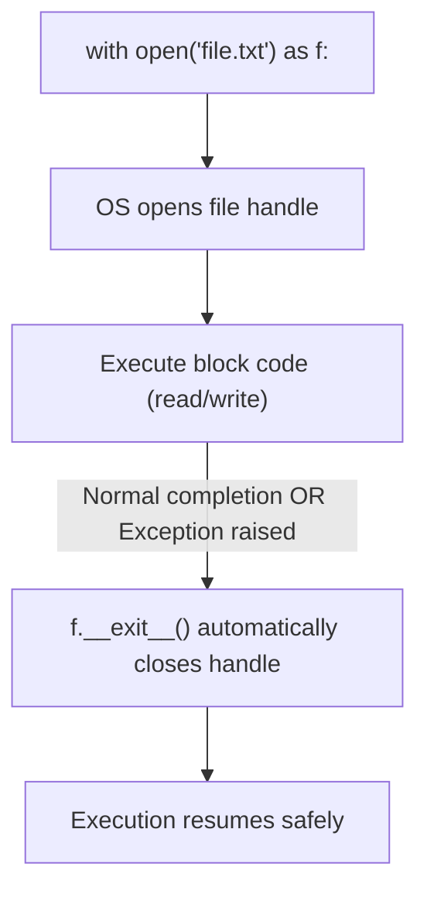

import { Callout } from "fumadocs-ui/components/callout";
import { Tabs, Tab } from "fumadocs-ui/components/tabs";
import { Accordion, Accordions } from "fumadocs-ui/components/accordion";

Whether processing server access logs, exporting user analytics reports, or persisting local configurations, reading and writing files from disk is a daily engineering requirement.

In Python, file I/O is designed to be safe and expressive through the **context manager (`with`)** protocol.

---

## 1. The Cardinal Rule: Always Use `with open(...)`

In older codebases, files were opened and manually closed like this:

```python
# ❌ DANGEROUS LEGACY PATTERN:
f = open("data.txt", "r")
content = f.read()
# If an error happens here, f.close() is NEVER REACHED!
# The OS file handle leaks and remains locked in memory.
f.close()
```

The Pythonic standard is the **`with` statement**. It guarantees that the file handle is automatically flushed and closed the moment execution leaves the indented block — even if an unhandled crash or exception occurs inside:

```python
# ✅ MODERN PRODUCTION PATTERN:
with open("data.txt", "r", encoding="utf-8") as f:
    content = f.read()

# At this exact point, f is 100% closed by the Python runtime!
```



---

## 2. File Modes Matrix

The second argument to `open()` specifies the **file access mode**:

| Mode                | Name               | Behavior if File Exists                                          | Behavior if File Does NOT Exist |
| :------------------ | :----------------- | :--------------------------------------------------------------- | :------------------------------ |
| **`"r"`**           | **Read** (Default) | Reads from start; file pointer at beginning.                     | Raises `FileNotFoundError`.     |
| **`"w"`**           | **Write**          | **Truncates (erases!)** all existing content immediately.        | Creates a new file.             |
| **`"a"`**           | **Append**         | Preserves existing content; writes to end of file.               | Creates a new file.             |
| **`"rb"` / `"wb"`** | **Binary**         | Reads or writes raw bytes (`bytes`), used for images/PDFs/audio. | Same as text equivalents.       |

<Callout type="warn" title="Encoding Trap: Always Specify UTF-8">
  Always pass <code>encoding="utf-8"</code> explicitly:{" "}
  <code>open("data.txt", "r", encoding="utf-8")</code>. If omitted, Windows
  defaults to legacy <code>cp1252</code> or <code>mbcs</code>, which causes
  crashes or character corruption (mojibake) when encountering emojis or
  international characters.
</Callout>

---

## 3. Reading Files: Three Distinct Approaches

### Approach 1: Reading Entire File at Once (`.read()`)

Good for small configuration files, templates, or short text files:

```python
with open("config.json", "r", encoding="utf-8") as f:
    full_text = f.read()
```

### Approach 2: Reading into a List of Lines (`.readlines()`)

Reads all lines into a Python list of strings (each ending with `\n`):

```python
with open("users.txt", "r", encoding="utf-8") as f:
    lines = [line.strip() for line in f.readlines()]
```

### Approach 3: Lazy Line-by-Line Streaming ($O(1)$ Memory)

If you need to process a **10 GB server log file**, calling `.read()` or `.readlines()` will immediately exhaust your computer's RAM and cause an Out-Of-Memory (OOM) crash.

Instead, **iterate directly over the file object `f`**. Python reads one line at a time from disk on demand:

```python
# Processes a file of ANY size using only ~8 KB of RAM!
with open("massive_production.log", "r", encoding="utf-8") as f:
    for line in f:
        if "ERROR" in line:
            print("Alert:", line.strip())
```

---

## 4. Writing & Appending to Files

### Writing (`"w"`)

Overwrites or creates the target file:

```python
users = ["Alice", "Bob", "Charlie"]

with open("output.txt", "w", encoding="utf-8") as f:
    for user in users:
        f.write(f"{user}\n")
```

### Appending (`"a"`)

Appends new lines to the end without touching existing data:

```python
def append_audit_log(event: str):
    with open("audit.log", "a", encoding="utf-8") as f:
        f.write(f"[AUDIT] {event}\n")

append_audit_log("User 42 logged in")
append_audit_log("User 42 changed password")
```

---

## Practice Questions & Challenges

Test your understanding of file descriptors, buffer streaming, character encodings, and context manager safety.

### Question 1: Output Prediction (The File Pointer Cursor)

Examine this code operating on an existing text file `greetings.txt` containing `"Hello World"` (11 characters):

```python
with open("greetings.txt", "r", encoding="utf-8") as f:
    part1 = f.read(5)
    part2 = f.read()
    part3 = f.read()

print("part1:", repr(part1))
print("part2:", repr(part2))
print("part3:", repr(part3))
```

1. What will `part1`, `part2`, and `part3` evaluate to?
2. Why is `part3` an empty string `""` instead of raising an error?
3. How can you reset the file pointer back to the beginning without re-opening the file?

<Accordions>
<Accordion title="Reveal Solution & Explanation">

**1. Output:**

```text
part1: 'Hello'
part2: ' World'
part3: ''
```

**2. Explanation:**

- Python maintains an internal byte offset (cursor/pointer) for open files.
- `f.read(5)` reads the first 5 characters (`'Hello'`), leaving the cursor at byte index 5.
- `f.read()` reads from cursor index 5 to the end of the file (`' World'`).
- The third `f.read()` begins at EOF (End Of File); because no characters remain, it returns an empty string `""` by design to signal EOF.

**3. Resetting the Pointer:**
Call `f.seek(0)` to rewind the cursor position back to the beginning of the file.

</Accordion>
</Accordions>

---

### Question 2: Spot and Fix the Bug (The Windows `cp1252` Encoding Crash)

An engineer writes this script to export internationalized customer reviews on macOS, where it works flawlessly:

```python
reviews = [
    "Great product! Highly recommended 🚀",
    "Excelente calidad, muy contento ⭐⭐⭐⭐⭐",
    "Bravo pour ce service clientèle café ☕"
]

with open("reviews.txt", "w") as f:
    for review in reviews:
        f.write(review + "\n")
```

When deployed to a Windows production VM, it crashes with:

```text
UnicodeEncodeError: 'charmap' codec can't encode character '\U0001f680' in position 33: character maps to <undefined>
```

1. Why did this work on macOS but fail on Windows?
2. What is Python's default encoding on Windows when omitted?
3. How do you fix this permanently across all operating systems?

<Accordions>
<Accordion title="Reveal Solution & Explanation">

**1. Root Cause:**
When `encoding` is omitted in `open()`, Python falls back to the host operating system's default locale. On macOS/Linux, the default is almost always modern `UTF-8` (which supports emojis and international accents). On Windows, the legacy default has historically been `cp1252` (Windows Western), which cannot represent emojis like `🚀` or characters outside Latin-1.

_(Note: Python 3.15 introduces PEP 686 making UTF-8 default everywhere, but in production today you must be explicit!)_

**2. The Fix:**
Always specify `encoding="utf-8"` explicitly in every `open()` call:

```python
with open("reviews.txt", "w", encoding="utf-8") as f:
    for review in reviews:
        f.write(review + "\n")
```

</Accordion>
</Accordions>

---

### Question 3: Architecture Question (Why Context Managers Prevent Descriptor Leaks)

Consider this legacy pattern:

```python
# Function running in a high-throughput loop
def process_log_file(filename: str):
    f = open(filename, "r")
    data = f.read()
    process_data(data)  # <-- Suppose this raises an unexpected ValueError!
    f.close()
```

1. What happens to the open file handle if `process_data()` raises an exception?
2. What operating system error occurs when thousands of files are left unclosed (`EMFILE`)?
3. How does the `with` statement guarantee closure even in the face of crashes?

<Accordions>
<Accordion title="Reveal Solution & Explanation">

**1. What Happens to the Handle:**
Because the exception halts execution immediately, `f.close()` is never executed. The file handle remains open in the OS process table until Python's garbage collector collects the object.

**2. The OS Level Crash (`EMFILE`):**
Operating systems place a hard limit on the number of simultaneous file descriptors a single process may hold (often 1024 on Linux). When exhausted, any attempt to open another file or network socket crashes with `OSError: [Errno 24] Too many open files`.

**3. The Context Manager Guarantee:**
The `with` statement utilizes the Context Manager protocol. When exiting the block—whether cleanly or due to an uncaught exception—Python is guaranteed to call the file object's `__exit__()` method, which immediately flushes buffers and closes the OS file descriptor.

</Accordion>
</Accordions>

---

### Question 4: Hands-On Challenge (Comment Stripper & Config Cleaner)

Write a script that reads an input file called `data.txt`, filters out all blank lines and comment lines (lines starting with `#`), and writes the cleaned lines into `cleaned.txt` using dual context managers.

<Accordions>
<Accordion title="Reveal Solution & Explanation">

```python
from pathlib import Path

input_path = Path("data.txt")
output_path = Path("cleaned.txt")

# Write sample raw data first:
input_path.write_text("""# Server Configuration
host=127.0.0.1

# Default port
port=8080

# End of file
""", encoding="utf-8")

# Process and clean lines:
with open(input_path, "r", encoding="utf-8") as infile, \
     open(output_path, "w", encoding="utf-8") as outfile:

    for line in infile:
        clean = line.strip()
        # Skip empty lines and lines starting with '#'
        if clean and not clean.startswith("#"):
            outfile.write(clean + "\n")

print("Cleaned contents:")
print(output_path.read_text(encoding="utf-8"))
```

Output:

```text
Cleaned contents:
host=127.0.0.1
port=8080
```

</Accordion>
</Accordions>

---

### Question 5: Code Challenge (Memory-Safe Streaming File Hasher)

In machine learning and cloud pipelines, dataset files are often 10GB–50GB. Calling `f.read()` on a 20GB file will crash Python with `MemoryError`.

Write a Python function `compute_sha256(file_path: Path | str, chunk_size: int = 65536) -> str` that computes the SHA-256 hexadecimal checksum of any file (regardless of size) by reading it in binary chunks of `64 KB` ($65,536$ bytes) in constant $O(1)$ memory.

<Accordions>
<Accordion title="Reveal Solution & Code">

```python
import hashlib
from pathlib import Path

def compute_sha256(file_path: Path | str, chunk_size: int = 65536) -> str:
    """
    Compute SHA-256 hash of a file using chunked binary streaming.
    Memory consumption remains strictly bound to `chunk_size` bytes.
    """
    path = Path(file_path)
    if not path.is_file():
        raise FileNotFoundError(f"Target file does not exist: {path}")

    hasher = hashlib.sha256()

    # Read in binary mode "rb"
    with open(path, "rb") as f:
        while True:
            chunk = f.read(chunk_size)
            if not chunk:  # Empty bytes b"" signals EOF
                break
            hasher.update(chunk)

    return hasher.hexdigest()

# Verification test:
if __name__ == "__main__":
    test_file = Path("test_stream.bin")
    test_file.write_bytes(b"Cloud-Scale Streaming Pipeline" * 1000)

    checksum = compute_sha256(test_file)
    print("SHA-256 Checksum:", checksum)
    assert len(checksum) == 64
    print("✅ Verified: Streaming hash computed successfully.")
    test_file.unlink()  # Cleanup
```

</Accordion>
</Accordions>

---

## Summary Reference

- **`with open(...) as f:`**: Always use context managers to guarantee immediate file closure.
- **`encoding="utf-8"`**: Mandatory parameter for cross-platform international text.
- **Modes**: `"r"` (read), `"w"` (overwrite), `"a"` (append), `"rb"`/`"wb"` (binary).
- **`for line in f:`**: Memory-efficient streaming for arbitrarily large files.

Next, learn how to split programs across files cleanly in **[16. Organizing Code: Modules, Packages & Entrypoints](/docs/learn-python/01-fundamentals/16-organizing-code)**!
