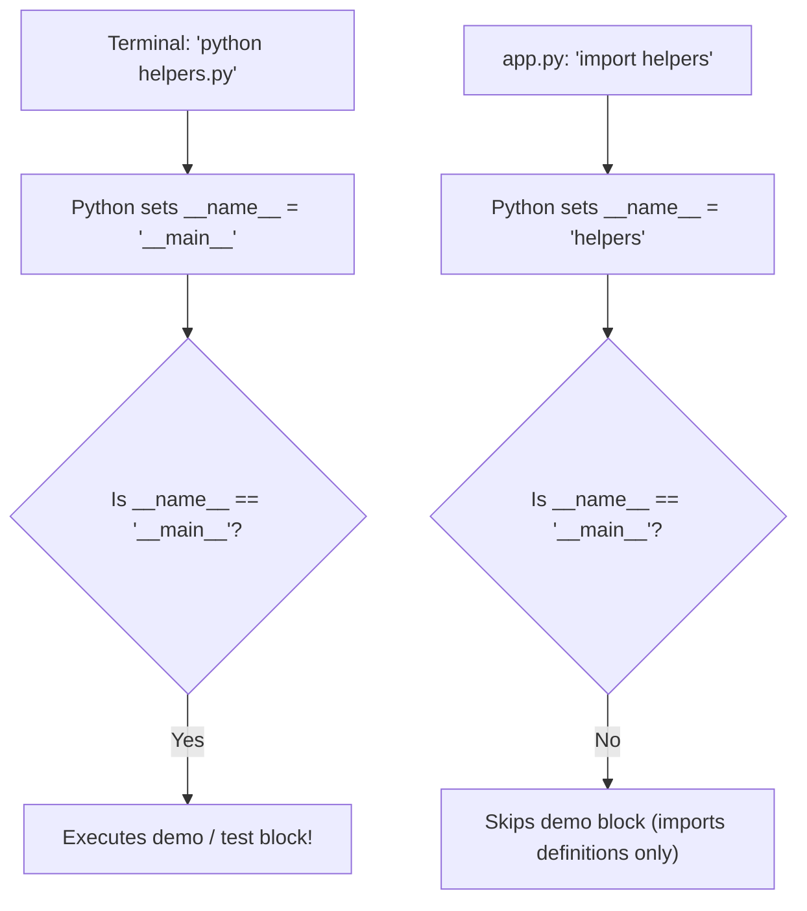
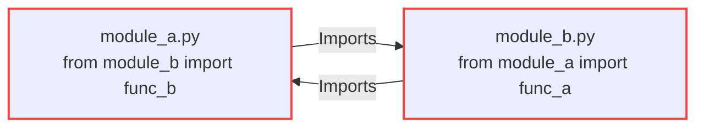

import { Callout } from "fumadocs-ui/components/callout";
import { Tabs, Tab } from "fumadocs-ui/components/tabs";
import { Accordion, Accordions } from "fumadocs-ui/components/accordion";

When all application code lives in a single file, functions step on each other's namespaces, testing becomes difficult, and scrolling through 2,000 lines of code slows development to a crawl.

Python provides a natural modularization system:

- **Module**: Any individual `.py` file.
- **Package**: Any directory containing an `__init__.py` file and one or more modules.

---

## 1. Creating & Importing Your First Module

Let's organize a project into two files:

```text
banking_app/
├── helpers.py    # The helper module
└── app.py        # The application script
```

### File 1: `helpers.py`

```python
# helpers.py

def format_currency(amount: float) -> str:
    """Format a float as standard USD currency."""
    return f"${amount:,.2f}"

def calculate_tax(subtotal: float, rate: float = 0.08) -> float:
    """Calculate sales tax."""
    return subtotal * rate
```

### File 2: `app.py`

You can import functions from `helpers.py` using two different syntaxes:

```python
# Syntax A: Import the whole module
import helpers

subtotal = 1500.0
tax = helpers.calculate_tax(subtotal)
print("Tax:", helpers.format_currency(tax))

# Syntax B: Import specific functions directly (Most common)
from helpers import format_currency, calculate_tax

total = subtotal + tax
print("Total Due:", format_currency(total))
```

Output:

```text
Tax: $120.00
Total Due: $1,620.00
```

---

## 2. Demystifying `if __name__ == "__main__":`

You will encounter this pattern in almost every professional Python codebase:

```python
def main():
    print("Executing main CLI task...")

if __name__ == "__main__":
    main()
```

### Why Is This Necessary?

Whenever Python executes a file, it automatically sets a built-in variable called `__name__`:

1. If the file is run **directly from the terminal** (e.g. `python helpers.py`), Python assigns `__name__ = "__main__"`.
2. If the file is **imported by another file** (e.g. `import helpers`), Python assigns `__name__ = "helpers"`.



### Practical Demonstration

Add self-tests or CLI execution to your helper modules without polluting other scripts that import them:

```python
# helpers.py

def format_currency(amount: float) -> str:
    return f"${amount:,.2f}"

# Only run if someone executes `python helpers.py` directly for testing:
if __name__ == "__main__":
    print("Running local self-tests for helpers.py...")
    assert format_currency(12.5) == "$12.50"
    assert format_currency(1000) == "$1,000.00"
    print("All local tests passed!")
```

Now:

- Running `python helpers.py` executes the test assertions.
- Running `python app.py` (which imports `helpers`) runs `app.py` cleanly without executing the test print statements!

---

## 3. Creating Packages with `__init__.py`

When you have multiple related modules, bundle them into a folder. To turn a directory into an importable package, place an `__init__.py` inside it:

```text
src/
└── analytics/
    ├── __init__.py        # Package initialization file
    ├── metrics.py
    └── visualizer.py
```

### What Goes Inside `__init__.py`?

`__init__.py` can be completely empty, or it can expose a clean public API for the package:

```python
# src/analytics/__init__.py
from analytics.metrics import calculate_mrr, calculate_churn
from analytics.visualizer import plot_trends

__all__ = ["calculate_mrr", "calculate_churn", "plot_trends"]
```

Now users of your package can write clean, top-level imports:

```python
from analytics import calculate_mrr, plot_trends
```

---

## 4. Avoiding Circular Imports

A **circular import** occurs when `module_a.py` imports `module_b.py`, and `module_b.py` simultaneously imports `module_a.py`.



When this happens, Python throws:

```text
ImportError: cannot import name 'func_a' from partially initialized module 'module_a' (most likely due to a circular import)
```

### The Solutions:

1. **Extract shared dependencies**: Move the shared types or functions into a third helper module (`common.py` or `types.py`) that both modules import.
2. **Import inside function**: In rare cases, move the import inside the specific function body that needs it to defer execution.

---

## Practice Questions & Challenges

Test your understanding of module scopes, package boundaries, import caching, and circular dependency resolution.

### Question 1: Output Prediction (`__name__` Mechanics)

Suppose you have two files in the same directory:

```python
# module_x.py
print(f"[module_x] Running with __name__ = {__name__}")

def greet():
    print("[module_x] Hello from greet()")
```

```python
# main.py
print("[main] Pre-import")
import module_x
print("[main] Post-import")
module_x.greet()
```

What is the exact terminal output when you run:

1. `python module_x.py`
2. `python main.py`

<Accordions>
<Accordion title="Reveal Solution & Explanation">

**1. When running `python module_x.py` directly:**

```text
[module_x] Running with __name__ = __main__
```

**2. When running `python main.py`:**

```text
[main] Pre-import
[module_x] Running with __name__ = module_x
[main] Post-import
[module_x] Hello from greet()
```

**Why this happens:**
When a file is invoked as the program's starting point via the CLI, Python assigns `"__main__"` to its special `__name__` variable. When a file is loaded via an `import` statement, Python sets `__name__` to its actual module name (`"module_x"`).

</Accordion>
</Accordions>

---

### Question 2: Spot and Fix the Bug (Top-Level Code Execution on Import)

A junior engineer writes a database management module in `db_admin.py`:

```python
# db_admin.py
import sqlite3

connection = sqlite3.connect("app.db")

def query_user(user_id: int):
    cursor = connection.cursor()
    return cursor.execute("SELECT * FROM users WHERE id = ?", (user_id,)).fetchone()

# Quick test run while developing:
print("Initializing test run...")
connection.execute("DROP TABLE IF EXISTS users")
connection.execute("CREATE TABLE users (id INTEGER PRIMARY KEY, name TEXT)")
connection.execute("INSERT INTO users VALUES (1, 'Alice')")
print("Test user created:", query_user(1))
```

In `api_server.py`, another developer simply writes:

```python
from db_admin import query_user
```

1. What catastrophic event happens when `api_server.py` is started?
2. Why did it happen even though `api_server.py` never called `connection.execute(...)`?
3. What is the industry-standard fix?

<Accordions>
<Accordion title="Reveal Solution & Explanation">

**1. The Catastrophe:**
When `api_server.py` imports `db_admin`, all top-level statements in `db_admin.py` are executed immediately. The existing `users` table is dropped (`DROP TABLE IF EXISTS users`), destroying all live production user data!

**2. Why It Happened:**
Python imports are **not** passive declarations; the interpreter executes every top-level statement in a module from top to bottom the first time it is imported.

**3. The Fix:**
Wrap all scratchpad testing, initialization, and script execution inside an `if __name__ == "__main__":` guard:

```python
# db_admin.py
import sqlite3

connection = sqlite3.connect("app.db")

def query_user(user_id: int):
    cursor = connection.cursor()
    return cursor.execute("SELECT * FROM users WHERE id = ?", (user_id,)).fetchone()

if __name__ == "__main__":
    print("Initializing test run...")
    connection.execute("DROP TABLE IF EXISTS users")
    connection.execute("CREATE TABLE users (id INTEGER PRIMARY KEY, name TEXT)")
    connection.execute("INSERT INTO users VALUES (1, 'Alice')")
    print("Test user created:", query_user(1))
```

</Accordion>
</Accordions>

---

### Question 3: Architecture Question (How `sys.modules` Resolves Imports)

1. When you write `import utils` three separate times in different files across your application, does Python read and execute `utils.py` three times?
2. What role does `sys.modules` play in import caching?
3. How can you inspect whether a module has already been imported into memory?

<Accordions>
<Accordion title="Reveal Solution & Explanation">

**1. Single Execution:**
No. Python executes `utils.py` **exactly once** during the lifetime of the process.

**2. The Role of `sys.modules`:**
`sys.modules` is a standard Python dictionary mapping module names to loaded module objects:

1. When an `import name` statement executes, Python first checks `if "name" in sys.modules`.
2. If found, Python returns the existing cached module reference immediately with zero disk I/O.
3. If not found, Python locates `name.py`, creates a new empty module object, inserts it into `sys.modules`, and executes its code.

**3. Inspecting the Cache:**

```python
import sys
import math

print("math" in sys.modules)  # True
print(type(sys.modules["math"]))  # <class 'module'>
```

</Accordion>
</Accordions>

---

### Question 4: Hands-On Challenge (Package API Facade with `__all__`)

You have a package with private implementation modules:

```text
crypto_toolkit/
├── __init__.py
├── _hashing.py      (contains def sha256_digest(text), def _internal_pad(b))
├── _encoding.py     (contains def base64_encode(data), def _hex_stream())
└── _ciphers.py      (contains def aes_encrypt(key, data))
```

Write the contents of `crypto_toolkit/__init__.py` such that:

1. Only `sha256_digest`, `base64_encode`, and `aes_encrypt` are exported to consumers.
2. `from crypto_toolkit import *` strictly imports only those three functions.
3. The internal private helpers (`_internal_pad`, `_hex_stream`) remain encapsulated and hidden.

<Accordions>
<Accordion title="Reveal Solution & Code">

```python
# crypto_toolkit/__init__.py
"""
Crypto Toolkit: Enterprise encryption and hashing facade.
"""

from ._hashing import sha256_digest
from ._encoding import base64_encode
from ._ciphers import aes_encrypt

# Explicit public API contract:
__all__ = [
    "sha256_digest",
    "base64_encode",
    "aes_encrypt",
]
```

**Testing the facade:**

```python
import crypto_toolkit

# Users enjoy clean, autocomplete-friendly top-level imports:
print(crypto_toolkit.__all__)
# Output: ['sha256_digest', 'base64_encode', 'aes_encrypt']
```

</Accordion>
</Accordions>

---

### Question 5: Code Challenge (Dynamic Plugin Loader with `importlib`)

In modern microservices and content management systems, applications frequently load plugin modules dynamically at runtime based on configuration strings (without hardcoded `import` statements).

Write a Python function `load_and_run_plugin(module_path: str, function_name: str, *args, **kwargs)` using standard library `importlib`.

Requirements:

1. Dynamically import the module using `importlib.import_module(module_path)`. If the module doesn't exist, raise an `ImportError` with: `Plugin module '<module_path>' not found`.
2. Extract the target function using `getattr(module, function_name)`. If the function does not exist or is not callable, raise an `AttributeError` with: `Function '<function_name>' not found or not callable in plugin`.
3. Call the function with `*args` and `**kwargs`, returning its result.

<Accordions>
<Accordion title="Reveal Solution & Code">

```python
import importlib
from typing import Any

def load_and_run_plugin(
    module_path: str,
    function_name: str,
    *args: Any,
    **kwargs: Any
) -> Any:
    """
    Dynamically load a Python module and execute a target function by name.
    """
    # 1. Dynamically import the module
    try:
        mod = importlib.import_module(module_path)
    except ModuleNotFoundError as err:
        raise ImportError(f"Plugin module '{module_path}' not found") from err

    # 2. Extract and validate the target function
    if not hasattr(mod, function_name):
        raise AttributeError(f"Function '{function_name}' not found or not callable in plugin '{module_path}'")

    func = getattr(mod, function_name)
    if not callable(func):
        raise AttributeError(f"Attribute '{function_name}' in module '{module_path}' is not callable")

    # 3. Execute and return
    return func(*args, **kwargs)

# Verification Test:
if __name__ == "__main__":
    # Test with standard library 'math' module and 'sqrt'
    result = load_and_run_plugin("math", "sqrt", 144)
    print("Dynamic math.sqrt(144) result:", result)  # 12.0
    assert result == 12.0
    print("✅ Verified: Dynamic plugin dispatcher works successfully.")
```

</Accordion>
</Accordions>

---

## Summary Reference

- **Module**: A single `.py` file containing functions, classes, or variables.
- **Package**: A folder containing an `__init__.py` and modules.
- **`if __name__ == "__main__":`**: Guarantees code only executes when run directly as a script, not when imported.
- **`from module import func`**: Specific object import.
- **Circular imports**: Avoid tight inter-module coupling by isolating shared definitions into dedicated utility modules.

Next, expand your toolkit to external packages and standard libraries in **[17. Importing Modules, Standard Library & PyPI](/docs/learn-python/01-fundamentals/17-importing-modules-and-packages)**!
