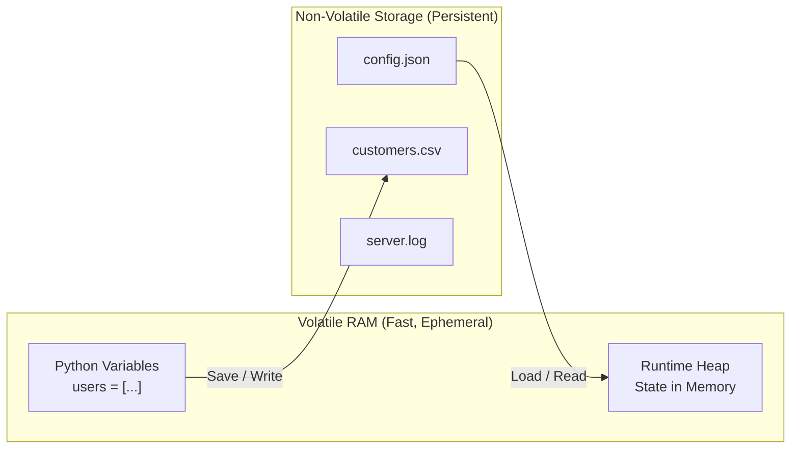
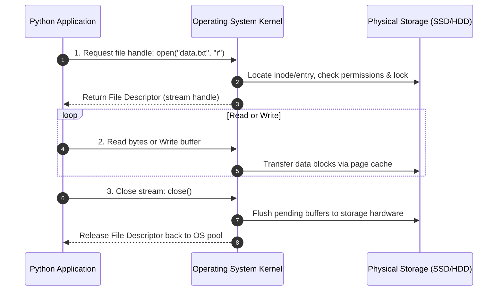
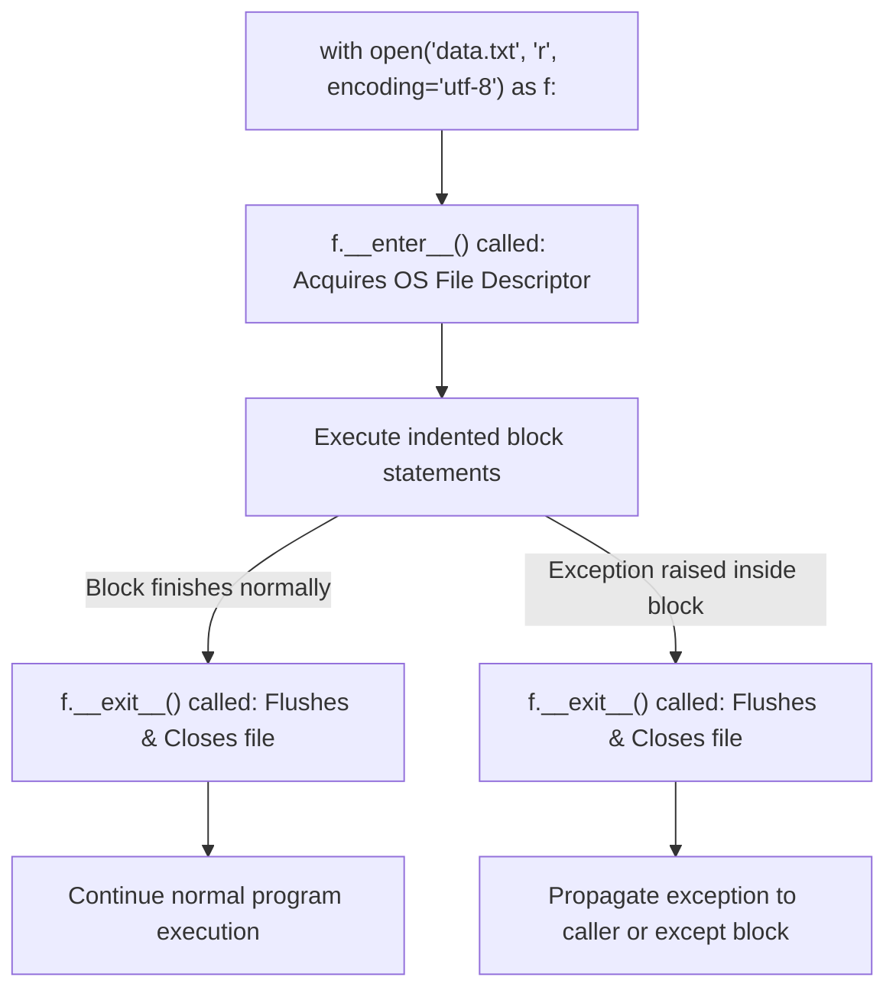
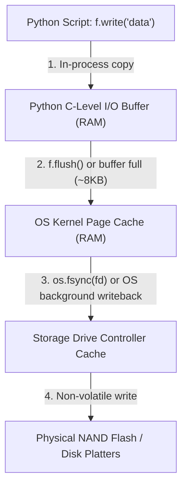
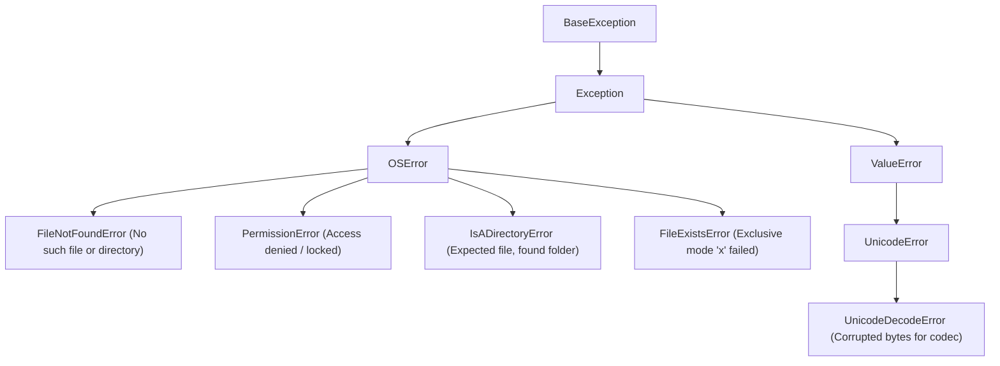

import { Callout } from "fumadocs-ui/components/callout";
import { Tabs, Tab } from "fumadocs-ui/components/tabs";
import { Accordion, Accordions } from "fumadocs-ui/components/accordion";

Whether you are saving user settings, parsing multi-gigabyte server logs, generating CSV business reports, deserializing API payloads, or reading raw binary images, working with files on disk is one of the most critical skills in modern software engineering.

In this comprehensive, beginner-friendly guide, you will master the full spectrum of Python file handling—from foundational 3-line quickstarts to memory-safe streaming, common structured formats (CSV, JSON, TOML), binary manipulation, buffering internals, crash-proof atomic writes, and defensive error handling.

---

## The Learning Roadmap

```mermaid
flowchart TD
    subgraph Part1["Foundations"]
        A["01. What is File Handling?<br/>(Storage, Inodes & Streams)"] --> B["02. First File Operations<br/>(Write, Read, Append)"]
        B --> C["03. Context Managers: with open()<br/>(Descriptors & Resource Safety)"]
    end

    subgraph Part2["Deep Dive"]
        C --> D["04. The File Modes Matrix<br/>(r, w, a, x, +, b, t)"]
        D --> E["05. UTF-8 & Newline Hygiene<br/>(BOM, codecs, universal newlines)"]
        E --> F["06. Reading Techniques<br/>(read, readline, readlines, streaming)"]
        F --> G["07. Writing Techniques<br/>(write, writelines, print to file)"]
        G --> H["08. The File Pointer<br/>(tell, seek & cursor positions)"]
    end

    subgraph Part3["Data Formats & Systems"]
        H --> I["09. CSV Processing<br/>(DictReader & DictWriter)"]
        I --> J["10. JSON Serialization<br/>(dump, dumps, load, loads)"]
        J --> K["11. TOML Configuration<br/>(tomllib in Python 3.11+)"]
        K --> L["12. Binary Files & Magic Bytes<br/>(bytes, chunk copying, signatures)"]
    end

    subgraph Part4["Production Engineering"]
        L --> M["13. Buffering & Atomic Writes<br/>(flush, os.fsync, Path.replace)"]
        M --> N["14. In-Memory Streams<br/>(io.StringIO & io.BytesIO)"]
        N --> O["15. Defensive Error Handling<br/>(FileNotFoundError, OSError)"]
        O --> P["16. Common Pitfalls & Traps<br/>(OOM, cursor rewinds, type casts)"]
        P --> Q["17. Practice Challenges<br/>(6 Hands-on Exercises)"]
    end
```



---

## Chapter 1: What is File Handling?

### 1.1 Understanding Files and Persistent Storage

Every computer program operates across two fundamentally distinct memory tiers:

1. **Volatile Memory (RAM):**
   - Lightning-fast (nanosecond access times).
   - Temporary: As soon as your Python script finishes running, or the computer loses power, **all variables, lists, and objects stored in RAM vanish completely**.
2. **Non-Volatile Secondary Storage (SSD, NVMe, HDD):**
   - Slower than RAM, but **persistent**.
   - Data stored on disk remains safe after your script terminates, after operating system reboots, and during power outages.



A **file** is simply a contiguous sequence of bytes given a name, managed by the Operating System's file system (such as NTFS on Windows, APFS on macOS, or ext4 on Linux).

Whenever software needs to remember user preferences, save database records, record error logs, or export an invoice, it writes data into persistent files.

### 1.2 The Basic File-Handling Workflow

Interacting with a file always follows a strict 3-step lifecycle:



1. **Open:** Your program requests access to the file from the Operating System. The OS verifies permissions, locates the file on the drive, and returns a stream handle called a **file descriptor**.
2. **Read or Write:** Your program transfers data between memory buffers and the open stream.
3. **Close:** Your program informs the OS that it has finished with the file. The OS flushes all remaining cached data to the physical disk and recycles the file descriptor.

---

## Chapter 2: Your First File Operations

Python provides a built-in function named `open()` to initiate file operations. Let's look at the three foundational operations: writing, reading, and appending.

### 2.1 Writing Text to a File (`"w"` Mode)

Mode `"w"` stands for **Write**. When you open a file in `"w"` mode:

- If the file **does not exist**, Python creates it automatically.
- If the file **already exists**, Python immediately **erases (truncates) all existing content** so you start with an empty file!

```python
# Open 'notes.txt' for writing with UTF-8 encoding:
file = open("notes.txt", "w", encoding="utf-8")

file.write("First entry: Learned Python file handling.\n")
file.write("Second entry: Python is elegant.\n")

# Always close manually when not using context managers:
file.close()

print("File written successfully.")
```

<Callout type="warning" title="Always Include Explicit Newlines (\n)">
  Notice the <code>\n</code> at the end of each string. Unlike the{" "}
  <code>print()</code> function, <code>file.write()</code>{" "}
  <strong>never</strong> appends a newline automatically. If you omit{" "}
  <code>\n</code>, all strings concatenate into one giant unbroken line!
</Callout>

### 2.2 Reading Text from a File (`"r"` Mode)

Mode `"r"` stands for **Read** and is Python's default mode. When you open a file in `"r"` mode:

- If the file **exists**, you can read its contents into Python strings.
- If the file **does not exist**, Python raises `FileNotFoundError`.

```python
# Open 'notes.txt' for reading:
file = open("notes.txt", "r", encoding="utf-8")

# Read the entire file into a single string:
content = file.read()

file.close()

print("File Content:\n" + content)
```

Output:

```text
File Content:
First entry: Learned Python file handling.
Second entry: Python is elegant.
```

### 2.3 Appending Text to a File (`"a"` Mode)

Mode `"a"` stands for **Append**. Unlike `"w"` mode, which erases the file, `"a"` mode preserves all previous data and places the write cursor at the very end of the file:

```python
# Open 'notes.txt' in append mode:
file = open("notes.txt", "a", encoding="utf-8")

file.write("Third entry: Appended without deleting existing lines!\n")

file.close()

# Verify by reading back:
file = open("notes.txt", "r", encoding="utf-8")
print(file.read())
file.close()
```

Output:

```text
First entry: Learned Python file handling.
Second entry: Python is elegant.
Third entry: Appended without deleting existing lines!
```

---

## Chapter 3: The Most Important Concept — `with open()`

In Chapter 2, we called `file.close()` manually after every operation. In professional Python software, **manual `open()` and `close()` is considered an anti-pattern**.

### 3.1 Why Files Must Always Be Closed

Operating systems track open files using an internal table of integer handles called **file descriptors** (FDs).

Every operating system enforces a strict limit on how many file descriptors a single process may hold concurrently (often `1024` on Linux and macOS, or `512` on Windows).

```python
# ❌ DANGEROUS CODE: What happens if an error occurs?
f = open("transactions.log", "r", encoding="utf-8")
data = f.read()
result = 100 / int(data.strip())  # Suppose data is "0" -> ZeroDivisionError!
f.close()  # THIS LINE NEVER RUNS!
```

If an unhandled exception or early return occurs before `f.close()`, the file descriptor remains locked in the operating system table. If this occurs inside a web server or high-frequency loop:

1. The OS runs out of available descriptors.
2. The entire process crashes with:
   ```text
   OSError: [Errno 24] Too many open files (EMFILE)
   ```
3. On Windows, open file handles prevent other programs from renaming, moving, or deleting the file.

### 3.2 The Manual Approach vs The `with` Statement

Before Python introduced context managers, developers had to write clunky `try ... finally` boilerplate to guarantee cleanup:

<Tabs items={["Modern with Statement (Recommended)", "Legacy try/finally Boilerplate"]}>
<Tab value="Modern with Statement (Recommended)">

```python
# ✅ MODERN, IDIOMATIC PYTHON:
# Guarantees closure under 100% of conditions (normal exit, exception, break, return)
with open("transactions.log", "r", encoding="utf-8") as f:
    data = f.read()
    print("Inside block: is file closed?", f.closed)  # False

print("Outside block: is file closed?", f.closed)     # True
```

</Tab>
<Tab value="Legacy try/finally Boilerplate">

```python
# ⚠️ VERBOSE LEGACY PYTHON (Pre-Python 2.5):
f = open("transactions.log", "r", encoding="utf-8")
try:
    data = f.read()
finally:
    f.close()  # Verbose, hard to read, prone to developer omission
```

</Tab>
</Tabs>

### 3.3 The Context Manager Protocol (`__enter__` and `__exit__`)

The `with` keyword leverages Python's **Context Manager Protocol**:

- When entering the `with` block, Python calls `f.__enter__()`, which returns the active file object.
- When exiting the `with` block for **any** reason (reaching the end, an exception, a `return` statement, or a `break` in a loop), Python is guaranteed by the CPython runtime to invoke `f.__exit__()`.
- Inside `f.__exit__()`, Python flushes unwritten buffers and closes the underlying OS file descriptor.



### 3.4 Working with Multiple Files Simultaneously

In real-world data pipelines, you frequently need to read from an input file and write directly to an output file.

#### Python 3.10+ Parenthesized Syntax

Python 3.10 introduced parenthesized context managers, allowing clean multi-line formatting without ugly backslash line-continuations:

```python
from pathlib import Path

source = Path("raw_data.txt")
destination = Path("cleaned_data.txt")

with (
    open(source, "r", encoding="utf-8") as src,
    open(destination, "w", encoding="utf-8") as dst
):
    for line in src:
        # Strip trailing whitespace and uppercase each record:
        clean_record = line.strip().upper()
        if clean_record:
            dst.write(clean_record + "\n")
```

#### Dynamic Number of Files with `contextlib.ExitStack`

When the number of files to open is not known in advance (e.g., merging 10 log files selected by a user at runtime), you cannot hardcode multiple `with open()` clauses. Use standard library **`contextlib.ExitStack`**:

```python
from contextlib import ExitStack
from pathlib import Path

log_filenames = ["app_server_1.log", "app_server_2.log", "app_server_3.log"]

with ExitStack() as stack:
    # Dynamically register each file context manager into the stack:
    open_files = [
        stack.enter_context(open(name, "r", encoding="utf-8"))
        for name in log_filenames
        if Path(name).exists()
    ]

    print(f"Successfully opened {len(open_files)} logs concurrently.")
    for f in open_files:
        first_line = f.readline().strip()
        print(f"[{f.name}] First entry: {first_line}")

# Upon leaving the with block, ExitStack closes all opened files in LIFO order!
```

---

## Chapter 4: Understanding File Modes

The second argument to `open(filename, mode)` dictates how the operating system configures the file stream.

### 4.1 The Full Mode Matrix

| Mode       | Name                 | File Pointer Initial Position | Behavior If File Exists                                      | Behavior If File Missing   | Primary Use Case                     |
| :--------- | :------------------- | :---------------------------- | :----------------------------------------------------------- | :------------------------- | :----------------------------------- |
| **`"r"`**  | **Read** (Default)   | Beginning (byte `0`)          | Opens for reading                                            | Raises `FileNotFoundError` | Inspecting existing files            |
| **`"w"`**  | **Write**            | Beginning (byte `0`)          | **Truncates (erases!)** all existing content                 | Creates a new file         | Generating new files from scratch    |
| **`"a"`**  | **Append**           | End of file                   | Preserves data; all writes append to end                     | Creates a new file         | Writing audit logs or event streams  |
| **`"x"`**  | **Exclusive Create** | Beginning (byte `0`)          | **Raises `FileExistsError`**                                 | Creates a new file         | Race-condition safety, lock files    |
| **`"r+"`** | **Read + Write**     | Beginning (byte `0`)          | Opens without erasing; allows reading & in-place overwriting | Raises `FileNotFoundError` | In-place header or record updates    |
| **`"w+"`** | **Write + Read**     | Beginning (byte `0`)          | **Truncates (erases!)** all content, then allows read/write  | Creates a new file         | Scratchpad scratch files             |
| **`"a+"`** | **Append + Read**    | End of file                   | Preserves data; writes always append to end                  | Creates a new file         | Reading history and logging new rows |
| **`"b"`**  | **Binary Mode**      | Mode-dependent                | Operates on raw `bytes`, not Unicode `str`                   | Mode-dependent             | Images, audio, PDFs, executables     |
| **`"t"`**  | **Text Mode**        | Mode-dependent                | Operates on decoded Unicode `str` (Default)                  | Mode-dependent             | Text documents, CSV, JSON, code      |

### 4.2 Understanding `"r+"`: In-Place Overwriting and the Pointer

Mode `"r+"` is frequently misunderstood by beginners. It does **not** insert text between existing characters. It overwrites bytes in place starting from the current cursor position:

```python
# Create initial file:
with open("counter.txt", "w", encoding="utf-8") as f:
    f.write("Total Visitors: 000000\n")

# Re-open in 'r+' mode to update the counter in-place:
with open("counter.txt", "r+", encoding="utf-8") as f:
    # Read the label:
    label = f.read(16)  # Reads 'Total Visitors: ' (length 16)
    print("Read label:", label)

    # Overwrite the '000000' digits with '000142':
    f.write("000142")

# Check result:
with open("counter.txt", "r", encoding="utf-8") as f:
    print(f.read())  # 'Total Visitors: 000142\n'
```

<Callout type="caution" title="Avoid 'w+' Unless You Truly Want an Empty File">
  Beginners often assume <code>"w+"</code> means "read and write safely".{" "}
  <strong>It does not!</strong> Like <code>"w"</code>, <code>"w+"</code>{" "}
  immediately wipes the target file down to 0 bytes the instant you call{" "}
  <code>open()</code>.
</Callout>

### 4.3 Understanding `"x"`: Exclusive Creation and Concurrency Guards

In high-concurrency systems (like background workers or multi-threaded task processors), two processes might attempt to write to `lock.pid` or `report_2026.csv` at the same time.

Mode `"x"` delegates atomicity to the OS kernel:

- If the file exists, it **immediately fails** by raising `FileExistsError`.
- It prevents race conditions and accidental overwriting of valuable backup files.

```python
from pathlib import Path

def create_unique_export(filename: str, payload: str) -> None:
    try:
        with open(filename, "x", encoding="utf-8") as f:
            f.write(payload)
        print(f"Created export: {filename}")
    except FileExistsError:
        print(f"Aborted: '{filename}' already exists! Not overwriting.")

create_unique_export("backup.bak", "Important Backup Data")
create_unique_export("backup.bak", "Overwriting attempt")
```

Output:

```text
Created export: backup.bak
Aborted: 'backup.bak' already exists! Not overwriting.
```

### 4.4 The Critical Distinction: `"b"` (Bytes) vs `"t"` (Text)

- In **Text mode** (`"rt"`, `"wt"`, or just `"r"`, `"w"`), Python translates between raw disk bytes and Python `str` using an encoding. It also converts line endings.
- In **Binary mode** (`"rb"`, `"wb"`), Python bypasses all encoding and newline translation. Data is read and written strictly as Python `bytes` objects.

```python
# Text mode returns str:
with open("notes.txt", "r", encoding="utf-8") as f:
    text_data = f.read()
    print("Text type:", type(text_data))  # <class 'str'>

# Binary mode returns bytes:
with open("notes.txt", "rb") as f:
    binary_data = f.read()
    print("Binary type:", type(binary_data))  # <class 'bytes'>
```

---

## Chapter 5: Text Encoding and Newlines

One of the most notorious sources of production crashes in Python is failing to configure character encodings and line endings properly.

### 5.1 What is Text Encoding? Why `encoding="utf-8"` is Mandatory

Computers only understand numbers ($0$s and $1$s). To store human text:

1. Every character is assigned a unique numerical index called a **Unicode Code Point** (e.g., `A` is `65`, `é` is `233`, `🚀` is `128640`).
2. An **encoding** is a mathematical algorithm that converts those code points into binary bytes.
3. **UTF-8** is the global standard of the internet: it represents ASCII characters in 1 byte, European accents in 2 bytes, and Asian characters or emojis in 3–4 bytes.


#### The Windows `cp1252` Trap

If you omit `encoding="utf-8"` in Python, Python uses `locale.getpreferredencoding()`:

- On Linux and macOS, the system default is almost universally `UTF-8`.
- On Windows, the legacy default has historically been `cp1252` (Windows Western European).

`cp1252` cannot represent emojis, Greek symbols, Japanese kanji, or mathematical notation. A script that runs cleanly on a developer's MacBook will crash immediately when deployed to a Windows VM:

```python
# ❌ DANGEROUS: Omitting encoding parameter:
with open("status.txt", "w") as f:
    f.write("System online: All systems operational 🚀")
    # On Windows, this raises:
    # UnicodeEncodeError: 'charmap' codec can't encode character '\U0001f680'

# ✅ PRODUCTION SAFE: Always pass encoding="utf-8":
with open("status.txt", "w", encoding="utf-8") as f:
    f.write("System online: All systems operational 🚀")
```

<Callout type="important" title="PEP 686 and Future Python Defaults">
  Python 3.15 is slated to make UTF-8 the default encoding everywhere (PEP 686).
  However, in current production versions (Python 3.9 through 3.14),{" "}
  <strong>
    you must explicitly specify <code>encoding="utf-8"</code> on every text file
    operation
  </strong>
  .
</Callout>

### 5.2 Handling UTF-8 Byte Order Mark (BOM): `encoding="utf-8-sig"`

When Microsoft Excel or Windows Notepad saves a UTF-8 file, it frequently injects an invisible 3-byte prefix at the very start of the file called the **BOM (Byte Order Mark)**: `\xef\xbb\xbf` (`\ufeff` in Unicode).

If you read an Excel CSV using standard `encoding="utf-8"`, the first column name gets corrupted:

```python
# Suppose excel_export.csv was saved by Microsoft Excel with a BOM:
# With standard "utf-8", the first dictionary key is '\ufeffid' instead of 'id':
with open("excel_export.csv", "r", encoding="utf-8") as f:
    print(repr(f.readline()))  # Output: '\ufeffid,name,role\n'

# ✅ SOLUTION: Use "utf-8-sig" to automatically detect and discard the BOM:
with open("excel_export.csv", "r", encoding="utf-8-sig") as f:
    print(repr(f.readline()))  # Output: 'id,name,role\n'
```

### 5.3 Handling Corrupted Characters: `errors="replace"` and `errors="ignore"`

When parsing legacy log files from third-party systems, you might encounter malformed byte sequences that violate UTF-8 specifications. By default, Python raises `UnicodeDecodeError`. You can alter this behavior via the `errors` parameter:

```python
# Sample byte stream containing valid ASCII mixed with a corrupted byte (\xff):
corrupted_bytes = b"Server 01: [Status OK] \xff [Temp 42C]\n"

with open("corrupted.log", "wb") as f:
    f.write(corrupted_bytes)

# 1. Default "strict" mode raises UnicodeDecodeError:
try:
    with open("corrupted.log", "r", encoding="utf-8") as f:
        print(f.read())
except UnicodeDecodeError as err:
    print(f"Strict mode failed as expected: {err}")

# 2. "replace" replaces invalid bytes with the official Unicode replacement character '' (U+FFFD):
with open("corrupted.log", "r", encoding="utf-8", errors="replace") as f:
    print("Replace mode:", f.read().strip())
    # Output: 'Server 01: [Status OK]  [Temp 42C]'

# 3. "ignore" silently drops the invalid bytes:
with open("corrupted.log", "r", encoding="utf-8", errors="ignore") as f:
    print("Ignore mode: ", f.read().strip())
    # Output: 'Server 01: [Status OK]  [Temp 42C]'
```

### 5.4 Understanding Newlines: Windows `\r\n` vs Unix `\n`

Different operating systems mark the end of lines with different byte sequences:

- **Unix, Linux, and macOS:** Line Feed (`\n`, byte `0x0A`).
- **Windows / DOS:** Carriage Return + Line Feed (`\r\n`, bytes `0x0D 0x0A`).
- **Old Mac (Classic macOS 9):** Carriage Return (`\r`, byte `0x0D`).

Python solves this transparently using **Universal Newlines**:

- When reading in text mode, Python automatically converts `\r\n`, `\r`, or `\n` into a standard `\n`.
- When writing in text mode, Python translates `\n` into the operating system's native line ending (i.e., `\r\n` on Windows, `\n` on Linux).

#### The `newline=""` Requirement for CSV Files

The standard library `csv` module does its own line-ending termination according to RFC 4180 (`\r\n`).

If you omit `newline=""` on Windows:

1. The `csv` module writes `\r\n`.
2. Python's default Windows text translation catches the `\n` and translates it to `\r\n` again.
3. The resulting file contains `\r\r\n`, producing **an empty blank line between every row**!

<Callout type="important" title="Golden Rule of CSV Handling">
  Always pass <code>newline=""</code> whenever opening a CSV file with Python's{" "}
  <code>csv</code> module:
  <br />
  <code>with open("data.csv", "w", encoding="utf-8", newline="") as f:</code>
</Callout>

---

## Chapter 6: Reading Files in Different Ways

Python provides five distinct ways to read files. Choosing the right method depends on file size and memory constraints.

### 6.1 Method 1: `.read()` (Entire File as One String)

Reads the entire file from current cursor position to End-Of-File (EOF) and returns a single Python `str`.

```python
with open("config.txt", "r", encoding="utf-8") as f:
    full_document = f.read()
    print(f"Total characters: {len(full_document)}")
```

- **Best for:** Small files (configuration files, markdown documents, small JSON files under 50 MB).
- **Hazard:** Never use on massive files (e.g., 20 GB database dumps). It will attempt to allocate 20+ GB of RAM, triggering an OS Out-Of-Memory (OOM) process kill.

### 6.2 Method 2: `.read(size)` (Fixed Chunks)

Reads at most `size` characters (in text mode) or bytes (in binary mode).

```python
with open("large_stream.txt", "r", encoding="utf-8") as f:
    while True:
        chunk = f.read(1024)  # Read in 1 KB character blocks
        if not chunk:          # Empty string signals EOF
            break
        print(f"Processing chunk of length {len(chunk)}")
```

- **Best for:** Controlled memory consumption when processing non-delimited streams or binary files.

### 6.3 Method 3: `.readline()` (Line-by-Line)

Reads a single line up to and including the trailing `\n`. When it reaches the end of the file, it returns an empty string `""`.

```python
with open("users.txt", "r", encoding="utf-8") as f:
    # Read the first line (header):
    header = f.readline().strip()
    # Read the second line:
    first_record = f.readline().strip()

    print(f"Header: {header}")
    print(f"Record: {first_record}")
```

- **Best for:** Parsing file headers or processing files line-by-line using a `while` loop.

### 6.4 Method 4: `.readlines()` (All Lines into a List)

Reads every line in the file and returns a `list[str]`.

```python
with open("items.txt", "r", encoding="utf-8") as f:
    lines = f.readlines()
    print(f"Total lines: {len(lines)}")
    if lines:
        print(f"Last line: {lines[-1].strip()}")
```

- **Best for:** When you need to index lines randomly (e.g., `lines[42]`) or sort lines in memory.
- **Hazard:** Like `.read()`, `.readlines()` loads the entire file into RAM at once.

### 6.5 Method 5: `for line in file:` (Memory-Safe Streaming - $O(1)$ RAM)

This is the **gold standard of Python file reading**. A file object in Python is an **iterator**.

```python
# Processes a 50 GB log file using only ~8 KB of RAM!
error_count = 0

with open("production_access.log", "r", encoding="utf-8") as f:
    for line_number, line in enumerate(f, start=1):
        if "ERROR" in line:
            error_count += 1
            print(f"Line {line_number}: {line.strip()}")

print(f"Scan complete. Total errors found: {error_count}")
```


<Callout type="tip" title="Why Streaming Uses O(1) Memory">
  Python's runtime maintains a small internal read buffer (typically 8 KB). As
  your <code>for</code> loop finishes processing a line, Python discards it and
  fetches the next line from the buffer. RAM consumption remains completely
  constant, whether the file is 10 Kilobytes or 100 Gigabytes!
</Callout>

---

## Chapter 7: Writing Files in Different Ways

### 7.1 Method 1: `.write()`

Writes a single string to the file. It returns the number of characters written.

```python
with open("output.txt", "w", encoding="utf-8") as f:
    chars_written = f.write("Hello World!\n")
    print(f"Wrote {chars_written} characters.")
```

Key points:

- Does **not** append `\n`.
- Only accepts `str` objects (or `bytes` in binary mode). Passing an integer or dictionary raises `TypeError`.

### 7.2 Method 2: `.writelines()`

Takes an iterable of strings (such as a list, tuple, or generator) and writes each string sequentially:

```python
servers = ["us-east-1", "eu-central-1", "ap-southeast-1"]

# Notice: writelines does NOT add newlines between elements!
# Use a generator expression to attach \n cleanly:
with open("clusters.txt", "w", encoding="utf-8") as f:
    f.writelines(f"{server}\n" for server in servers)
```

### 7.3 Method 3: `print(..., file=file)`

Python's built-in `print()` function accepts an optional `file` argument:

```python
with open("audit_report.txt", "w", encoding="utf-8") as f:
    print("=== AUDIT REPORT ===", file=f)
    print("Generated on:", "2026-10-21", file=f)
    print("Status:", "PASS", sep=" -> ", file=f)
    print("Error count:", 0, file=f)  # Automatically converts int 0 to str!
```

- **Best for:** Formatting text reports, tabular summaries, and debugging output.
- **Benefits:** Automatically converts non-string types, applies `sep=" "` and appends `end="\n"` without manual formatting.

---

## Chapter 8: The File Pointer — `tell()` and `seek()`

Every open file maintains an internal cursor (or byte offset) known as the **file pointer**. When you read or write, the pointer advances by the number of bytes processed.

### 8.1 Understanding `tell()`

`f.tell()` returns the current byte position of the file pointer:

```python
with open("stream_test.txt", "w+", encoding="utf-8") as f:
    print("Position at start:", f.tell())  # 0

    f.write("ABCDE")
    print("Position after writing 5 chars:", f.tell())  # 5
```

### 8.2 Understanding `seek()`

`f.seek(offset, whence)` moves the file pointer to an arbitrary position:

```python
with open("stream_test.txt", "w+", encoding="utf-8") as f:
    f.write("0123456789")

    # After writing, cursor is at EOF (byte 10).
    # Calling f.read() now returns empty string '':
    print("Reading at EOF:", repr(f.read()))  # ''

    # Rewind pointer back to beginning:
    f.seek(0)
    print("Reading after rewind:", repr(f.read()))  # '0123456789'

    # Jump to byte index 4:
    f.seek(4)
    print("Reading from byte 4:", repr(f.read()))   # '456789'
```

### 8.3 The `whence` Parameter and Text Mode Caveats

The `whence` argument specifies the reference anchor:

- `0` (or `os.SEEK_SET`, default): Relative to the **beginning** of the file.
- `1` (or `os.SEEK_CUR`): Relative to the **current** pointer position.
- `2` (or `os.SEEK_END`): Relative to the **end** of the file.

```python
# Binary mode allows arbitrary whence seeking:
with open("binary_demo.bin", "wb+") as f:
    f.write(b"0123456789")

    # Move to 3 bytes before the end:
    f.seek(-3, 2)
    print("Last 3 bytes:", f.read())  # b'789'
```

<Callout type="warning" title="Seeking in Text Mode is Restricted!">
  In Python text mode (<code>"r"</code>, <code>"w"</code>), seeking with{" "}
  <code>whence=1</code> or <code>whence=2</code> with non-zero offsets is
  undefined or disallowed because multi-byte UTF-8 characters and universal
  newline translations make character offsets non-linear!
  <br />
  <br />
  In text mode, you can only call <code>f.seek(0)</code> (rewind to start),{" "}
  <code>f.seek(0, 2)</code> (seek to EOF), or seek to an exact integer
  previously returned by <code>f.tell()</code>. For arbitrary byte-relative
  seeking, always use binary mode (<code>"rb"</code>).
</Callout>

---

## Chapter 9: Working with CSV Files

Comma-Separated Values (CSV) is the most ubiquitous format for tabular data. Python includes the built-in **`csv`** module.

### 9.1 Writing CSV with `csv.DictWriter`

`DictWriter` maps Python dictionaries directly to CSV rows. It prevents column order mismatch bugs:

```python
import csv
from pathlib import Path

users = [
    {"user_id": 101, "username": "alice_dev", "role": "Admin", "score": 98.5},
    {"user_id": 102, "username": "bob_ops", "role": "DevOps", "score": 91.2},
    {"user_id": 103, "username": "charlie_qa", "role": "QA", "score": 87.0},
]

output_path = Path("users.csv")

with open(output_path, "w", encoding="utf-8", newline="") as f:
    fieldnames = ["user_id", "username", "role", "score"]
    writer = csv.DictWriter(f, fieldnames=fieldnames)

    # 1. Write the column headers:
    writer.writeheader()

    # 2. Write all data rows:
    writer.writerows(users)

print("users.csv generated successfully.")
```

### 9.2 Reading CSV with `csv.DictReader`

`DictReader` treats the first row as headers and yields each subsequent row as an `OrderedDict` / standard `dict`:

```python
import csv

with open("users.csv", "r", encoding="utf-8", newline="") as f:
    reader = csv.DictReader(f)

    print(f"Detected Headers: {reader.fieldnames}")
    for row in reader:
        # Crucial: All CSV values are strings! Cast numeric values explicitly:
        user_id = int(row["user_id"])
        score = float(row["score"])
        print(f"User #{user_id}: {row['username']} ({row['role']}) -> Score: {score:.1f}")
```

Output:

```text
Detected Headers: ['user_id', 'username', 'role', 'score']
User #101: alice_dev (Admin) -> Score: 98.5
User #102: bob_ops (DevOps) -> Score: 91.2
User #103: charlie_qa (QA) -> Score: 87.0
```

### Comparing `DictReader`/`DictWriter` with Classic `csv.reader`/`writer`

<Tabs items={["DictReader & DictWriter (Modern / Safe)", "Classic csv.reader & writer (Row Lists)"]}>
<Tab value="DictReader & DictWriter (Modern / Safe)">

```python
import csv

# Reading with DictReader (access by column name):
with open("users.csv", "r", encoding="utf-8", newline="") as f:
    reader = csv.DictReader(f)
    for row in reader:
        # Immune to column reordering in the CSV file!
        print(row["username"], row["score"])
```

</Tab>
<Tab value="Classic csv.reader & writer (Row Lists)">

```python
import csv

# Reading with classic reader (access by integer index):
with open("users.csv", "r", encoding="utf-8", newline="") as f:
    reader = csv.reader(f)
    header = next(reader)  # Skip header manually
    for row in reader:
        # Fragile: If someone inserts a column at position 0, row[1] breaks!
        username = row[1]
        score = float(row[3])
        print(username, score)
```

</Tab>
</Tabs>

---

## Chapter 10: Working with JSON Files

JavaScript Object Notation (JSON) is the industry standard for REST APIs, web payloads, and configuration files. Python provides the built-in **`json`** module.

### 10.1 Writing JSON with `json.dump()`

`json.dump(obj, fp)` serializes a Python object directly to an open file handle:

```python
import json
from pathlib import Path

app_configuration = {
    "app_name": "CloudWatchdog",
    "version": "2.4.0",
    "port": 8080,
    "metrics_enabled": True,
    "allowed_hosts": ["api.cloud.com", "localhost"],
    "rate_limits": {
        "requests_per_minute": 1200,
        "burst": 50
    },
    "tls_certificate": None
}

target_file = Path("config.json")

with open(target_file, "w", encoding="utf-8") as f:
    # indent=2 formats human-readable JSON with indentation:
    json.dump(app_configuration, f, indent=2, ensure_ascii=False)

print("config.json written successfully.")
```

### 10.2 Reading JSON with `json.load()`

`json.load(fp)` reads JSON text directly from an open file handle and reconstructs native Python objects:

```python
import json

with open("config.json", "r", encoding="utf-8") as f:
    config = json.load(f)

# Inspect deserialized Python types:
print("App Name:        ", config["app_name"])                # str
print("Port:            ", config["port"])                    # int
print("Metrics Enabled: ", config["metrics_enabled"])         # bool
print("Burst Limit:     ", config["rate_limits"]["burst"])    # int
print("TLS Cert:        ", config["tls_certificate"])         # None
```

#### Python to JSON Type Mapping

| Python Data Type | JSON Data Type                |
| :--------------- | :---------------------------- |
| `dict`           | Object (`{ "key": "value" }`) |
| `list`, `tuple`  | Array (`[ 1, 2, 3 ]`)         |
| `str`            | String (`"hello"`)            |
| `int`, `float`   | Number (`42`, `3.14`)         |
| `True` / `False` | Boolean (`true` / `false`)    |
| `None`           | Null (`null`)                 |

### 10.3 `dump()` vs `dumps()` and `load()` vs `loads()`

The letter **`s`** at the end of the function name indicates **String**:

| Function                | Primary Input/Output        | Target Destination                | When to Use                                 |
| :---------------------- | :-------------------------- | :-------------------------------- | :------------------------------------------ |
| **`json.dump(obj, f)`** | Python object + File handle | Writes directly to **disk file**  | Saving state, writing config to disk        |
| **`json.dumps(obj)`**   | Python object               | Returns a Python **`str`**        | Sending HTTP payloads, logging JSON strings |
| **`json.load(f)`**      | File handle                 | Reads directly from **disk file** | Loading config or data from disk            |
| **`json.loads(s)`**     | Python `str` (or `bytes`)   | Parses string in **RAM**          | Parsing HTTP API response bodies            |

```python
import json

data = {"status": "healthy"}

# json.dumps -> returns in-memory string:
json_string = json.dumps(data)
print(type(json_string), json_string)  # <class 'str'> {"status": "healthy"}

# json.loads -> parses in-memory string:
parsed_dict = json.loads(json_string)
print(type(parsed_dict), parsed_dict["status"])  # <class 'dict'> healthy
```

---

## Chapter 11: Reading TOML Configuration Files

TOML (Tom's Obvious Minimal Language) has become the gold standard for Python project configuration (`pyproject.toml`, Cargo, Poetry).

Python 3.11+ includes the **`tomllib`** module directly in the standard library.

### Why Binary Mode (`"rb"`) is Required for TOML

The TOML specification mandates UTF-8 encoding. To guarantee strict adherence and eliminate subtle operating system newline translations, `tomllib.load()` **strictly requires a binary file handle opened in `"rb"` mode**.

```python
import tomllib  # Built-in in Python 3.11+
from pathlib import Path

# Create a sample TOML config file:
sample_toml = """
[project]
name = "api-service"
version = "1.0.0"

[database]
server = "192.168.1.50"
port = 5432
max_connections = 20
enabled = true

[database.credentials]
user = "postgres_admin"
"""

Path("settings.toml").write_text(sample_toml, encoding="utf-8")

# Read using tomllib in binary mode ("rb"):
with open("settings.toml", "rb") as f:
    config = tomllib.load(f)

print("Project Name:   ", config["project"]["name"])
print("Database Server:", config["database"]["server"])
print("Max Connections:", config["database"]["max_connections"])
print("Is Enabled:     ", config["database"]["enabled"])
```

Output:

```text
Project Name:    api-service
Database Server: 192.168.1.50
Max Connections: 20
Is Enabled:      True
```

---

## Chapter 12: Working with Binary Files

Non-text files (such as `.png`, `.jpg`, `.pdf`, `.zip`, `.mp3`, and `.parquet`) consist of arbitrary raw bytes rather than Unicode characters. They must always be opened with the **`"b"`** flag.

### 12.1 Understanding `bytes` vs `str`

- A `str` is an abstracted sequence of human Unicode code points.
- A `bytes` object is an immutable sequence of raw 8-bit integers ranging from `0` to `255`.

```python
text = "Python 🚀"
raw_bytes = text.encode("utf-8")

print("Text:       ", text)
print("Bytes:      ", raw_bytes)
print("First byte: ", raw_bytes[0])  # Integer 80 (ASCII code for 'P')
```

Output:

```text
Text:        Python 🚀
Bytes:       b'Python \xf0\x9f\x9a\x80'
First byte:  80
```

### 12.2 Reading a Binary File

```python
from pathlib import Path

pdf_path = Path("document.pdf")

# Read first 16 bytes:
if pdf_path.exists():
    with open(pdf_path, "rb") as f:
        header = f.read(16)
        print("Raw header bytes:", header)
```

### 12.3 Copying Binary Files in Memory-Safe Chunks

Never copy large binary files (e.g., ISOs or videos) by calling `dst.write(src.read())`. If the video is 4 GB, it will consume 4 GB of RAM.

Use chunked streaming with a 64 KB ($65,536$ byte) buffer:

```python
from pathlib import Path

def copy_large_binary(src_path: Path, dst_path: Path, chunk_size: int = 65536) -> int:
    """
    Copies a binary file of ANY size using constant 64KB RAM.
    Returns total bytes transferred.
    """
    total_bytes = 0
    with (
        open(src_path, "rb") as src,
        open(dst_path, "wb") as dst
    ):
        # Read in fixed 64 KB chunks using the walrus operator:
        while chunk := src.read(chunk_size):
            dst.write(chunk)
            total_bytes += len(chunk)

    return total_bytes
```

### 12.4 Validating File Signatures (Magic Bytes)

Never rely on file extensions alone! An attacker can easily upload a malicious executable named `avatar.png` or `invoice.pdf`.

Professional software validates a file's **Magic Bytes** (the leading sequence of bytes reserved by file format specifications):

```python
from pathlib import Path

# Recognized file signatures (magic bytes):
SIGNATURES = {
    "png":  b"\x89PNG\r\n\x1a\n",   # Standard 8-byte PNG header
    "pdf":  b"%PDF",                 # 4-byte PDF header
    "jpeg": b"\xff\xd8\xff",         # 3-byte JPEG header
    "zip":  b"PK\x03\x04",           # 4-byte ZIP header (used by docx, xlsx, jar)
    "gif":  b"GIF89a"                # GIF header
}

def identify_file_type(file_path: Path) -> str:
    with open(file_path, "rb") as f:
        header = f.read(8)

    for file_type, signature in SIGNATURES.items():
        if header.startswith(signature):
            return file_type

    return "unknown"

# Demo test:
test_png = Path("valid_image.png")
test_png.write_bytes(b"\x89PNG\r\n\x1a\n\x00\x00\x00\rIHDR...")

print("Detected Type:", identify_file_type(test_png))  # 'png'
test_png.unlink()  # Clean up
```

---

## Chapter 13: Buffering, Flushing, and Saving Data Reliably

Why does calling `f.write()` not immediately save your text to the physical SSD?

### 13.1 What is Buffering?

Writing to physical storage hardware (NVMe flash or spinning disks) is thousands of times slower than writing to RAM.

To achieve high performance, Python and the Operating System employ a multi-layered **caching and buffering architecture**:



1. **Python Buffer:** Python aggregates small `write()` calls inside an in-memory buffer (typically 8 KB).
2. **OS Kernel Page Cache:** When Python's buffer fills up (or the file is closed), data is transmitted across system calls to the operating system's page cache.
3. **Physical Storage:** The OS schedules a write to the physical SSD controller.

### 13.2 What Does `flush()` Do?

`f.flush()` forces Python to push all data from its internal application buffer into the **Operating System kernel page cache**.

- Other processes on the same computer can now read the newly written data immediately.
- **However, if the computer loses power right now, data in the OS page cache can still be lost!**

### 13.3 What Does `os.fsync()` Do?

`os.fsync(file_descriptor)` instructs the Operating System kernel to force the hardware storage controller to physically write all dirty cache pages onto the persistent disk media.

```python
import os

with open("critical_transaction.log", "a", encoding="utf-8") as f:
    f.write("TX #48201: Transfer $50,000 to Account B\n")

    # 1. Push from Python buffer to OS kernel:
    f.flush()

    # 2. Force OS kernel to physically commit to non-volatile storage:
    os.fsync(f.fileno())

print("Transaction 100% committed to physical disk hardware.")
```

### 13.4 Crash-Proof Pattern: Atomic File Replacement

Consider what happens if your server loses power midway through writing a 10 MB `settings.json` file. The original file was truncated, and the new file was only 40% written. **Your configuration is now corrupted and destroyed.**

The industry-standard solution is the **Atomic Write Pattern**:

1. Write the new content to a temporary file (`settings.json.tmp`) in the **same directory**.
2. Call `flush()` and `os.fsync()` to ensure the temporary file is physically written to disk.
3. Use `Path.replace()` (or `os.replace()`) to atomically swap the temporary file over the destination file.

```python
import os
import json
from pathlib import Path

def atomic_save_json(target_path: Path, data: dict) -> None:
    """
    Atomically saves data to target_path.
    Guarantees target_path is NEVER left in a partially written or corrupted state.
    """
    # Create temporary file in the same directory (crucial for same-filesystem rename):
    temp_path = target_path.with_suffix(f"{target_path.suffix}.tmp.{os.getpid()}")

    try:
        with open(temp_path, "w", encoding="utf-8") as f:
            json.dump(data, f, indent=2)
            f.flush()
            # Ensure physical disk persistence:
            os.fsync(f.fileno())

        # Atomic rename: The OS kernel swaps the directory pointer instantly!
        temp_path.replace(target_path)
    except Exception:
        # Clean up temporary file if write failed:
        if temp_path.exists():
            temp_path.unlink()
        raise

# Test:
config_file = Path("app_settings.json")
atomic_save_json(config_file, {"maintenance_mode": False, "version": "1.2"})
print("Atomically saved:", config_file.read_text(encoding="utf-8"))
```

---

## Chapter 14: In-Memory File Streams (`io.StringIO` & `io.BytesIO`)

Sometimes you need to interact with a library or API that expects a "file object" (with `.read()`, `.write()`, and `.seek()`), but you don't want the performance overhead of creating physical files on disk.

The standard library **`io`** module provides file-like objects that exist purely in RAM.

### 14.1 Using `io.StringIO` for In-Memory Text

```python
import io

# Create an in-memory text stream:
virtual_file = io.StringIO()

virtual_file.write("First line in memory.\n")
virtual_file.write("Second line in memory.\n")

# Rewind pointer to start:
virtual_file.seek(0)

# Read like a real file:
print(virtual_file.read())

# Or extract the full buffer directly without rewinding:
print("Direct buffer access:", repr(virtual_file.getvalue()))
```

### 14.2 Generating CSV in Memory for Web Responses

In backend web frameworks (FastAPI, Django, Flask), users frequently click "Download CSV Report". Creating physical files on disk fills up the server's SSD and creates file cleanup headaches.

Generate the CSV in-memory with `io.StringIO` and stream it directly:

```python
import io
import csv

def generate_csv_report(records: list[dict]) -> str:
    """Generates CSV string in RAM without touching the physical disk."""
    output = io.StringIO()
    writer = csv.DictWriter(output, fieldnames=["id", "name", "revenue"])

    writer.writeheader()
    writer.writerows(records)

    return output.getvalue()

sales = [
    {"id": 1, "name": "Enterprise Deal", "revenue": 50000},
    {"id": 2, "name": "Starter Plan", "revenue": 1200},
]

csv_payload = generate_csv_report(sales)
print(csv_payload)
```

### 14.3 Using `io.BytesIO` for In-Memory Binary Data

When processing images, zipped archives, or encrypted buffers in RAM, use `io.BytesIO`:

```python
import io
import zipfile

# Create in-memory zip archive:
zip_buffer = io.BytesIO()

with zipfile.ZipFile(zip_buffer, "w", zipfile.ZIP_DEFLATED) as archive:
    archive.writestr("readme.txt", "This file was zipped directly in RAM!")
    archive.writestr("data.json", '{"in_memory": true}')

# zip_buffer now contains raw compressed zip bytes:
raw_zip_data = zip_buffer.getvalue()
print(f"Generated zip file in RAM ({len(raw_zip_data)} bytes).")
```

---

## Chapter 15: Defensive Error Handling

Filesystem operations interact directly with the external environment. Hard drives get disconnected, permissions change, paths are misspelled, and network disks time out.

### 15.1 The `try` / `except` Pattern

Always protect file operations using targeted exception blocks:

```python
from pathlib import Path

def read_system_config(filepath: Path) -> str | None:
    try:
        with open(filepath, "r", encoding="utf-8") as f:
            return f.read()
    except FileNotFoundError:
        print(f"Configuration file '{filepath}' is missing. Using defaults.")
    except PermissionError:
        print(f"Access denied: Cannot read '{filepath}'. Check OS user permissions.")
    except IsADirectoryError:
        print(f"Path error: '{filepath}' is a directory, not a file.")
    except UnicodeDecodeError as err:
        print(f"Encoding mismatch in '{filepath}': {err}")
    except OSError as err:
        print(f"Operating system I/O error while reading '{filepath}': {err}")

    return None
```

### 15.2 Key Filesystem Exceptions



- **`FileNotFoundError`**: Attempted to open a non-existent file in `"r"` or `"r+"` mode.
- **`PermissionError`**: Current user lacks read/write permissions, or the file is exclusively locked by another process (common on Windows).
- **`IsADirectoryError`**: Passed a folder path to `open()` instead of a file.
- **`FileExistsError`**: Attempted to open an existing file in exclusive creation mode `"x"`.
- **`UnicodeDecodeError`**: File content contains bytes that do not conform to the specified `encoding`.
- **`OSError`**: Root class for all OS-level errors (disk full, corrupted sectors, file descriptor exhaustion).

### 15.3 Why You Should Never Blindly Use `except Exception:`

```python
# ❌ BAD PRACTICE:
try:
    with open("data.txt", "r", encoding="utf-8") as f:
        data = f.read()
except Exception:
    print("Failed to open file")
```

Catching `Exception` blindly masks programming bugs:

1. Typos in your code (e.g., calling `f.raed()` instead of `f.read()`) raise `AttributeError`, but your code will falsely report "Failed to open file".
2. It swallows `KeyboardInterrupt` and unexpected memory errors.
3. Always catch the specific exception you anticipate (`FileNotFoundError`), and let unexpected bugs fail visibly.

---

## Chapter 16: Common Beginner Mistakes

### Mistake 1: Using `"w"` Instead of `"a"`

- **The Bug:** A developer wants to add a new event to a log file, so they open with `"w"`.
- **The Consequence:** The file is immediately wiped clean. All past logs are destroyed.
- **The Fix:** Use `"a"` to append to an existing file.

### Mistake 2: Forgetting That `.write()` Does Not Add Newlines

- **The Bug:** Writing multiple lines with `f.write("Line 1")` and `f.write("Line 2")`.
- **The Consequence:** Produces `Line 1Line 2`.
- **The Fix:** Explicitly append `\n`, or use `print("Line 1", file=f)`.

### Mistake 3: Calling `.read()` or `.readlines()` on Huge Files

- **The Bug:** Calling `f.readlines()` on a 15 GB database log.
- **The Consequence:** Consumes 15+ GB of RAM; script terminates with `MemoryError` or OS Out-Of-Memory (OOM) killer.
- **The Fix:** Stream line-by-line with `for line in f:`.

### Mistake 4: Forgetting `seek(0)` Before Reading Back

- **The Bug:** Writing data to a file in `"w+"` or `"r+"` mode, and immediately calling `f.read()`.
- **The Consequence:** Returns an empty string `""` because the cursor is resting at EOF.
- **The Fix:** Call `f.seek(0)` to rewind the cursor before reading.

### Mistake 5: Treating CSV/JSON Values as Native Types Without Casting

- **The Bug:** Reading an age or price from `csv.DictReader` and attempting arithmetic: `row["price"] * 2`.
- **The Consequence:** `"100" * 2` evaluates to `"100100"` instead of `200`!
- **The Fix:** Explicitly cast numeric values: `float(row["price"]) * 2`.

### Mistake 6: Assuming `flush()` Alone Guarantees Physical Disk Persistence

- **The Bug:** Calling `f.flush()` and assuming the data is safely committed to the SSD before power failure.
- **The Consequence:** `flush()` only pushes data to the OS page cache. A power interruption can still corrupt the file.
- **The Fix:** Call `os.fsync(f.fileno())` for critical operations.

---

## Chapter 17: Practice Exercises & Challenges

### Exercise 1: First File Write & Read (UTF-8 Hygiene)

**Task:**

1. Create a file named `hello.txt`.
2. Write the string `"Hello, Python! 🚀"` to the file with `encoding="utf-8"`.
3. Re-open the file in read mode and print the contents to the console.

<Accordions>
<Accordion title="Reveal Solution & Explanation">

```python
from pathlib import Path

file_path = Path("hello.txt")

# 1. Write to file:
with open(file_path, "w", encoding="utf-8") as f:
    f.write("Hello, Python! 🚀\n")

# 2. Read back:
with open(file_path, "r", encoding="utf-8") as f:
    content = f.read()

print("File contents:")
print(content)

# Cleanup:
file_path.unlink()
```

**Explanation:**

- `with open()` guarantees closure.
- `encoding="utf-8"` ensures the emoji `🚀` does not trigger a encoding error on Windows.

</Accordion>
</Accordions>

---

### Exercise 2: Append Tasks to an Event List

**Task:**

1. Given a list of tasks `["Buy groceries", "Review PR #42", "Deploy v1.8"]`.
2. Write a function `append_tasks(filename: str, tasks: list[str])` that appends each task to `tasks.txt` on a new line without overwriting existing entries.

<Accordions>
<Accordion title="Reveal Solution & Explanation">

```python
from pathlib import Path

def append_tasks(filename: str, tasks: list[str]) -> None:
    with open(filename, "a", encoding="utf-8") as f:
        for task in tasks:
            f.write(f"- {task}\n")

# Test appending:
path = Path("tasks.txt")
append_tasks("tasks.txt", ["Buy groceries", "Review PR #42"])
append_tasks("tasks.txt", ["Deploy v1.8"])

print("Resulting file:")
print(path.read_text(encoding="utf-8"))

path.unlink()  # Cleanup
```

**Explanation:**

- Mode `"a"` automatically positions the cursor at EOF, keeping previous lines intact.

</Accordion>
</Accordions>

---

### Exercise 3: Memory-Safe Streaming Error Counter ($O(1)$ RAM)

**Task:**
Write a function `count_log_errors(log_path: str) -> dict[str, int]` that streams a log file line-by-line and counts occurrences of `"WARNING"`, `"ERROR"`, and `"CRITICAL"`. Ensure memory usage is $O(1)$ regardless of file size.

<Accordions>
<Accordion title="Reveal Solution & Explanation">

```python
from pathlib import Path

def count_log_errors(log_path: str) -> dict[str, int]:
    counts = {"WARNING": 0, "ERROR": 0, "CRITICAL": 0}

    with open(log_path, "r", encoding="utf-8") as f:
        # Memory-safe streaming: only 1 line in memory at any microsecond:
        for line in f:
            for level in counts:
                if level in line:
                    counts[level] += 1

    return counts

# Test setup:
test_log = Path("server.log")
test_log.write_text("""
[INFO] Server started
[WARNING] Disk utilization above 80%
[ERROR] Database timeout on query #102
[ERROR] Retrying connection
[CRITICAL] Out of disk space!
""", encoding="utf-8")

results = count_log_errors("server.log")
print("Log Error Breakdown:", results)

test_log.unlink()  # Cleanup
```

**Explanation:**

- Using `for line in f:` iterates directly over Python's internal generator, maintaining $O(1)$ constant memory overhead.

</Accordion>
</Accordions>

---

### Exercise 4: Structured Data Serialization with JSON

**Task:**

1. Create a list of dictionaries representing products (including ID, title, price, and in-stock boolean).
2. Save it to `inventory.json` with 2-space indentation.
3. Read the JSON back into Python, compute the total inventory value, and print it.

<Accordions>
<Accordion title="Reveal Solution & Explanation">

```python
import json
from pathlib import Path

inventory = [
    {"id": "A10", "name": "Mechanical Keyboard", "price": 129.99, "in_stock": True},
    {"id": "B20", "name": "Ultra-Wide Monitor", "price": 449.50, "in_stock": True},
    {"id": "C30", "name": "Wireless Mouse", "price": 49.99, "in_stock": False},
]

file_path = Path("inventory.json")

# 1. Write JSON:
with open(file_path, "w", encoding="utf-8") as f:
    json.dump(inventory, f, indent=2)

# 2. Read back JSON:
with open(file_path, "r", encoding="utf-8") as f:
    loaded_inventory = json.load(f)

# 3. Calculate total valuation of in-stock items:
total_val = sum(item["price"] for item in loaded_inventory if item["in_stock"])
print(f"Total in-stock inventory valuation: ${total_val:.2f}")

file_path.unlink()  # Cleanup
```

**Explanation:**

- `json.dump()` handles data conversion cleanly, and `json.load()` converts the data back to native Python types (`bool`, `float`, `str`).

</Accordion>
</Accordions>

---

### Exercise 5: In-Memory CSV Generation with `io.StringIO`

**Task:**
Write a function `build_csv_string(headers: list[str], rows: list[list]) -> str` that constructs a valid CSV string entirely in RAM using `io.StringIO` and `csv.writer`, returning the string without writing anything to disk.

<Accordions>
<Accordion title="Reveal Solution & Explanation">

```python
import io
import csv

def build_csv_string(headers: list[str], rows: list[list]) -> str:
    # Create in-memory buffer:
    stream = io.StringIO()

    # Pass stream directly to csv writer:
    writer = csv.writer(stream)
    writer.writerow(headers)
    writer.writerows(rows)

    # Return string value:
    return stream.getvalue()

headers = ["Name", "Department", "Base Salary"]
data = [
    ["Alice Smith", "Security", 115000],
    ["Bob Jones", "Infrastructure", 108000],
]

csv_text = build_csv_string(headers, data)
print("Generated In-Memory CSV:")
print(csv_text)
```

**Explanation:**

- `io.StringIO` acts as a drop-in replacement for a real file handle, allowing zero-disk-I/O CSV generation.

</Accordion>
</Accordions>

---

### Exercise 6: (Bonus Challenge) Memory-Safe Binary File Hasher (SHA-256)

**Task:**
Compute the SHA-256 cryptographic hash of a file of arbitrary size (even 50 GB) using chunked binary streaming in constant $O(1)$ memory.

<Accordions>
<Accordion title="Reveal Solution & Explanation">

```python
import hashlib
from pathlib import Path

def compute_sha256(file_path: Path | str, chunk_size: int = 65536) -> str:
    """
    Computes SHA-256 checksum in 64 KB binary chunks.
    Constant O(1) RAM consumption.
    """
    path = Path(file_path)
    if not path.is_file():
        raise FileNotFoundError(f"File not found: {path}")

    hasher = hashlib.sha256()

    with open(path, "rb") as f:
        # Stream binary chunks using walrus operator:
        while chunk := f.read(chunk_size):
            hasher.update(chunk)

    return hasher.hexdigest()

# Test:
test_bin = Path("sample_archive.bin")
test_bin.write_bytes(b"Secure Cloud Infrastructure Payload\n" * 1000)

checksum = compute_sha256(test_bin)
print(f"File SHA-256: {checksum}")
assert len(checksum) == 64
print("✅ Verified: Streaming hash computed successfully.")

test_bin.unlink()  # Cleanup
```

**Explanation:**

- `open(..., "rb")` reads raw bytes.
- `hasher.update(chunk)` incrementally updates the cryptographic state without needing the whole file in memory.

</Accordion>
</Accordions>

---

## Summary Reference Checklist

Keep these essential rules in mind when writing production Python file code:

- ✅ **Always use `with open(...) as f:`** to guarantee immediate file descriptor cleanup upon block exit.
- ✅ **Always pass `encoding="utf-8"`** explicitly on text files to prevent Windows `cp1252` encoding crashes.
- ✅ **Always pass `newline=""`** when opening files for the `csv` module to prevent duplicate blank lines on Windows.
- ✅ **Use `for line in f:`** for processing large files in $O(1)$ constant memory instead of `.read()` or `.readlines()`.
- ✅ **Use `f.seek(0)`** if you need to rewind the cursor position back to the start of the file.
- ✅ **Use `io.StringIO` / `io.BytesIO`** for in-memory testing or streaming web payloads without disk I/O.
- ✅ **Implement Atomic Writes (`.tmp` + `replace()`)** for critical configuration files to prevent corruption during sudden power losses.
- ✅ **Validate Magic Bytes** on uploaded binary files instead of trusting file extensions.

---

## Next Steps

Now that you have mastered reading, writing, and streaming files on disk, learn how to split programs across files cleanly with modules, packages, and entry points in **[17. Organizing Code: Modules, Packages & Entrypoints](/docs/learn-python/01-fundamentals/17-organizing-code)**!
