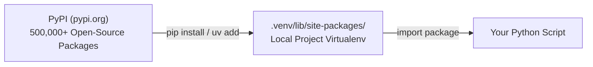

import { Callout } from "fumadocs-ui/components/callout";
import { Tabs, Tab } from "fumadocs-ui/components/tabs";
import { Accordion, Accordions } from "fumadocs-ui/components/accordion";

You never have to build everything from scratch.

Whether you need to generate secure random tokens, calculate trigonometric angles, or parse dates across world timezones, Python likely has a battle-tested module already written for you.

---

## 1. The Standard Library: Batteries Included

The **Python Standard Library** is a collection of hundreds of modules bundled directly with every Python installation. You do not need to download or install anything to use them.

Here are four essential built-in modules:

### `math`: Advanced Mathematical Operations

```python
import math

print("Square root of 64:", math.sqrt(64))  # 8.0
print("Pi constant:       ", math.pi)        # 3.141592653589793
print("Ceiling of 4.2:    ", math.ceil(4.2))  # 5
print("Floor of 4.9:      ", math.floor(4.9)) # 4
```

### `random`: Pseudorandom Number Generation & Choices

```python
import random

# Generate random integer between 1 and 100:
lucky_number = random.randint(1, 100)

# Pick a random item from a list:
fruits = ["apple", "banana", "cherry", "mango"]
snack = random.choice(fruits)

# Shuffle a sequence in-place:
cards = [1, 2, 3, 4, 5]
random.shuffle(cards)

print("Lucky Number:", lucky_number)
print("Snack Choice:", snack)
print("Shuffled:", cards)
```

### `datetime`: Dates, Times & Timezones

```python
from datetime import datetime, timezone, timedelta

# Current UTC time (best practice in servers):
now_utc = datetime.now(timezone.utc)
print("Current UTC:", now_utc.isoformat())

# Adding time intervals with timedelta:
seven_days_later = now_utc + timedelta(days=7)
print("One Week Later:", seven_days_later.strftime("%Y-%m-%d %H:%M:%S"))
```

---

## 2. The Three Import Patterns

Python supports three idiomatic ways to import functionality:

```python
# Pattern 1: Import the entire module namespace
import math
result = math.sqrt(25)

# Pattern 2: Import specific functions/classes directly into current scope
from datetime import datetime, timezone
now = datetime.now(timezone.utc)

# Pattern 3: Import with an alias (standard convention for popular libraries)
import collections as col
counter = col.Counter(["a", "b", "a"])
```

<Callout type="warn" title="Anti-Pattern: Wildcard Imports">
  Never write <code>from math import *</code>. Wildcard imports flood your local
  scope with hundreds of mystery names, leading to accidental variable
  overwrites and making code difficult to read and debug.
</Callout>

---

## 3. PyPI & Installing Third-Party Packages

When you need tools beyond the standard library (such as `requests` or `httpx` for APIs, `rich` for terminal styling, or `pydantic` for data validation), you install them from the **Python Package Index (PyPI)**.



### Installing Packages

<Tabs items={["Modern uv (Recommended)", "Standard pip"]}>
<Tab value="Modern uv (Recommended)">

`uv` is an ultra-fast Python package installer written in Rust (10-100x faster than pip):

```bash
# Add a third-party package to your project:
uv add httpx rich

# Remove a package:
uv remove rich
```

</Tab>
<Tab value="Standard pip">

```bash
# Ensure your virtual environment is active first!
pip install httpx rich

# Save all current project dependencies to requirements.txt:
pip freeze > requirements.txt

# Install all dependencies on another computer:
pip install -r requirements.txt
```

</Tab>
</Tabs>

### Testing Your Installed Package

Create a test script:

```python
# demo.py
from rich.console import Console
from rich.panel import Panel

console = Console()
console.print(Panel("[bold green]Installation Successful![/bold green] Welcome to PyPI tools."))
```

Run it:

```bash
python demo.py
```

---

## Practice Questions & Challenges

Test your understanding of standard library modules, PyPI packages, namespace safety, and deterministic pseudo-randomness.

### Question 1: Output Prediction (Deterministic Randomness with Seeds)

Without running Python, determine the exact behavior of this script:

```python
import random

# Run A:
random.seed(1337)
nums_a = [random.randint(1, 100) for _ in range(3)]

# Run B:
random.seed(1337)
nums_b = [random.randint(1, 100) for _ in range(3)]

# Run C:
random.seed(9999)
nums_c = [random.randint(1, 100) for _ in range(3)]

print("1. nums_a == nums_b :", nums_a == nums_b)
print("2. nums_a == nums_c :", nums_a == nums_c)
```

<Accordions>
<Accordion title="Reveal Solution & Explanation">

```text
1. nums_a == nums_b : True
2. nums_a == nums_c : False
```

**Why this happens:**
Python's `random` module uses the **Mersenne Twister** pseudo-random number generator (PRNG). PRNGs are strictly deterministic mathematical formulas; given the exact same starting integer "seed" (`1337`), the algorithm produces the exact same sequence of pseudo-random numbers every single time. Seeding is critical in machine learning and data science to make simulations and train/test splits 100% reproducible.

</Accordion>
</Accordions>

---

### Question 2: Spot and Fix the Bug (Wildcard Import Namespace Pollution)

A developer writes this image processing script:

```python
from math import *
from os import *

path = "images/sunset.jpg"
name = "sunset"

# We want to check if name is in the math namespace:
print("Log of 100:", log(100))
# Attempting to read a variable or function:
open = "temporary_tag"

# Later in the script:
with open("data.txt", "w") as f:
    f.write("Done")
```

1. Why does `with open(...)` crash on line 12?
2. Why is `from module import *` considered a severe anti-pattern in production code?
3. Rewrite the code using strict namespace isolation.

<Accordions>
<Accordion title="Reveal Solution & Explanation">

**1. The Crash:**
`open = "temporary_tag"` rebinds the built-in function `open` to a string (`str`). When Python reaches `with open("data.txt", "w")`, it attempts to call a string as a function, crashing with `TypeError: 'str' object is not callable`. Furthermore, `from os import *` dumped hundreds of OS functions directly into the local namespace, silently shadowing variables without warning.

**2. Why Wildcard Imports (`from x import *`) are Prohibited in PEP 8:**

- **Namespace Shadowing**: You cannot predict which built-in names or variable names are being silently overwritten.
- **Breaks Static Analysis & Linters**: Linters (like Ruff, Flake8) and IDE autocomplete cannot determine where functions originated.
- **Readability**: Another engineer reading `calculate()` cannot tell if it came from `math`, `os`, or another imported file.

**3. Corrected Code:**

```python
import math
import os

path = "images/sunset.jpg"
tag_name = "temporary_tag"

print("Log of 100:", math.log(100))

with open("data.txt", "w", encoding="utf-8") as f:
    f.write("Done")
```

</Accordion>
</Accordions>

---

### Question 3: Architecture Question (Standard Library vs PyPI Wheels)

1. What does the term _"Python comes with batteries included"_ mean?
2. When you run `pip install cryptography` or `uv add numpy`, what is a pre-compiled **Wheel (`.whl`)**, and why is it vastly faster than a source distribution (`.tar.gz`)?

<Accordions>
<Accordion title="Reveal Solution & Explanation">

**1. "Batteries Included":**
Python ships with an extensive, highly optimized Standard Library right out of the box (e.g., `sqlite3`, `json`, `math`, `hashlib`, `asyncio`, `pathlib`). You can build full web servers, encryption engines, and database systems without installing a single third-party package.

**2. Wheel (`.whl`) vs Source Distribution (`sdist`):**

- **Source Distribution (`.tar.gz`)**: Contains raw C/C++ or Rust source code. Installing it requires your machine to have a local C compiler (`gcc`, `MSVC`), development headers, and build tools, which can take minutes and fail if compilers are missing.
- **Wheel (`.whl`)**: A zip-format binary package pre-compiled for your specific OS and CPU architecture (e.g. `numpy-2.1.0-cp312-win_amd64.whl`). Installing a wheel takes milliseconds because `pip`/`uv` simply unpacks the pre-compiled binary directly into your `site-packages/` folder without compiling anything locally.

</Accordion>
</Accordions>

---

### Question 4: Hands-On Challenge (Cryptographically Secure Token Generator)

Python's `random` module is pseudo-random and **must never be used for security or passwords** because an attacker can predict future outputs after observing a few numbers.

Using standard library **`secrets`** (introduced in Python 3.6 for cryptography) and `string`, write a function `generate_api_key(prefix: str = "sk_live", num_bytes: int = 24) -> str` that produces secure API keys.

<Accordions>
<Accordion title="Reveal Solution & Code">

```python
import secrets

def generate_api_key(prefix: str = "sk_live", num_bytes: int = 24) -> str:
    """
    Generate a cryptographically secure, URL-safe random token.
    Uses the OS kernel's cryptographic entropy source (/dev/urandom).
    """
    random_token = secrets.token_urlsafe(num_bytes)
    return f"{prefix}_{random_token}"

# Verification:
if __name__ == "__main__":
    key1 = generate_api_key()
    key2 = generate_api_key(prefix="tok_test", num_bytes=16)
    print("API Key 1:", key1)
    print("API Key 2:", key2)
```

Sample Output:

```text
API Key 1: sk_live_4jK2_x9L-mQ1wZ8vA3bN7cR6
API Key 2: tok_test_8mP2-vK9wQ1_zL4x
```

</Accordion>
</Accordions>

---

### Question 5: Code Challenge (Dependency Verifier with `importlib.metadata`)

Write a Python function `verify_dependencies(requirements: dict[str, str]) -> dict[str, str]` that inspects the current Python environment using standard library `importlib.metadata`.

The function accepts a dictionary mapping package names to minimum required versions:

```python
requirements = {
    "httpx": "0.27.0",
    "rich": "13.0.0",
}
```

The function must:

1. Check if each package is installed. If missing, report its status as `"MISSING"`.
2. If installed, retrieve its active version via `importlib.metadata.version(pkg_name)`.
3. Return a dictionary reporting the status or version of each package.

<Accordions>
<Accordion title="Reveal Solution & Code">

```python
import importlib.metadata

def verify_dependencies(requirements: dict[str, str]) -> dict[str, str]:
    """
    Inspect installed packages in the active virtual environment.
    """
    status_report: dict[str, str] = {}

    for package, min_ver in requirements.items():
        try:
            installed_ver = importlib.metadata.version(package)
            status_report[package] = f"INSTALLED (v{installed_ver}, required >={min_ver})"
        except importlib.metadata.PackageNotFoundError:
            status_report[package] = f"MISSING (required >={min_ver})"

    return status_report

# Verification:
if __name__ == "__main__":
    deps = {
        "pip": "20.0.0",
        "non_existent_fake_package": "1.0.0"
    }
    report = verify_dependencies(deps)
    for pkg, status in report.items():
        print(f"[{pkg}]: {status}")
```

Sample Output:

```text
[pip]: INSTALLED (v24.2, required >=20.0.0)
[non_existent_fake_package]: MISSING (required >=1.0.0)
```

</Accordion>
</Accordions>

---

## Summary Reference

- **Standard Library**: Built-in modules available out of the box (`math`, `random`, `datetime`, `json`, `sys`).
- **`import module` vs `from module import name`**: Balance namespace clarity with brevity.
- **PyPI (`pypi.org`)**: The central repository for open-source Python packages.
- **`uv add` / `pip install`**: Tools to download and install packages into your virtual environment.

Next, learn how to parse structured web formats in **[18. Working with Data: JSON & CSV](/docs/learn-python/01-fundamentals/18-working-with-data)**!
