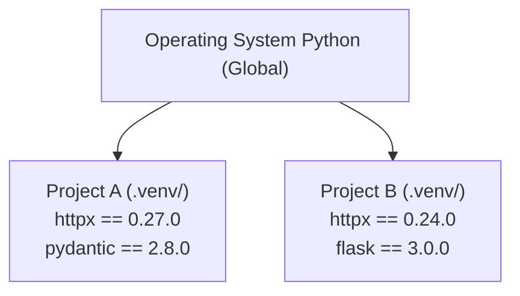
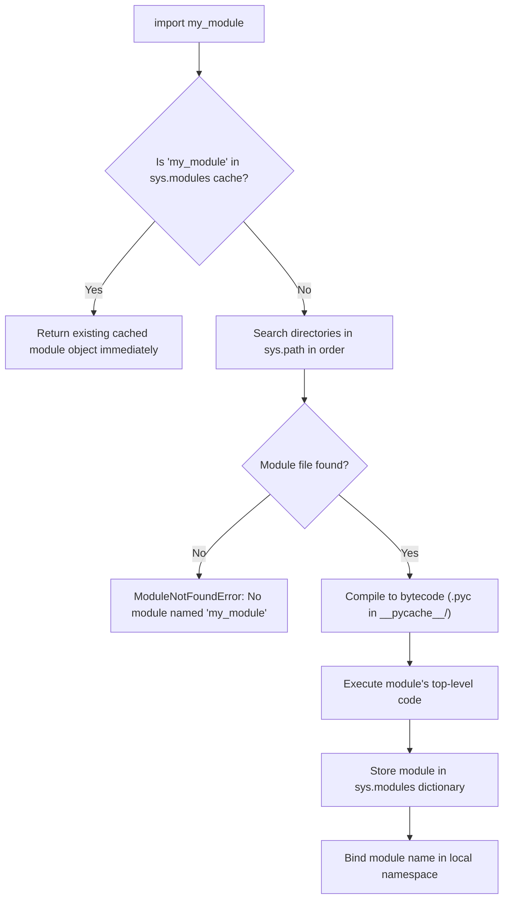

import { Callout } from "fumadocs-ui/components/callout";
import { Tabs, Tab } from "fumadocs-ui/components/tabs";
import { Accordion, Accordions } from "fumadocs-ui/components/accordion";

One of Python's greatest superpowers is summed up by its community motto: **"Batteries Included"**.

Right out of the box, Python comes bundled with hundreds of built-in modules for encryption, mathematical calculations, world timezones, file formats, and system automation. Beyond the standard library, the **Python Package Index (PyPI)** gives you access to over 500,000 open-source libraries—from AI and machine learning tools (PyTorch, NumPy) to modern web engines (FastAPI, Pydantic).

In this complete guide, you will learn:

1. **The 30-Second Quickstart**: Simple code examples using built-in and third-party tools.
2. **Virtual Environments (`.venv`)**: Why they are mandatory, how to create, activate, and manage them.
3. **Import Syntax Patterns & Conventions**: `import`, `from ... import`, aliases (`as`), and why wildcard imports (`*`) are prohibited.
4. **The Import Pipeline Under the Hood**: `sys.modules` caching, `sys.path` lookup, and fixing circular imports.
5. **The Name Shadowing Trap**: Why naming your file `random.py` or `math.py` breaks everything.
6. **Essential Standard Library Tour**: `math`, `secrets` vs. `random`, `datetime` + `zoneinfo`, `collections`, and `functools`.
7. **Installing Packages from PyPI**: `pip` vs. ultra-fast `uv`, Wheels (`.whl`) vs. source distributions (`sdist`), and modern `pyproject.toml`.
8. **Programmatic Package Introspection**: Checking installed versions at runtime with `importlib.metadata`.

---

## 1. The 30-Second Quickstart

### Example 1: Using Built-in Standard Library Modules

No installation required; simply `import` and use:

```python
import math
import random

# Calculate square root:
print("Square root of 81:", math.sqrt(81))  # 9.0

# Pick a random item from a list:
fruits = ["apple", "banana", "orange", "grape"]
print("Random snack:     ", random.choice(fruits))
```

### Example 2: Installing and Using a Third-Party Package from PyPI

To use third-party libraries, install them into your virtual environment:

```bash
# In your terminal:
pip install rich
# or with uv (recommended):
uv add rich
```

Then import it in Python:

```python
from rich.console import Console
from rich.panel import Panel

console = Console()
console.print(Panel("[bold green]Hello from PyPI![/bold green] Rich formatting enabled."))
```

### Example 3: Importing Your Own Python File

Suppose you have two files in the same directory:

```python
# math_helpers.py
def add(a: int, b: int) -> int:
    return a + b
```

```python
# main.py
from math_helpers import add

result = add(10, 25)
print("Result is:", result)  # 35
```

---

## 2. Virtual Environments (`.venv`): Why They Are Mandatory

A **Virtual Environment** is an isolated folder on your computer that contains its own Python executable and its own independent collection of third-party packages.



### Why You Must Never Run Global `pip install`

1. **Dependency Hell**: Project A might require `httpx 0.27`, while Project B requires older `httpx 0.24`. Installing globally overwrites one with the other, breaking your projects!
2. **Protects Your OS**: On Linux and macOS, system tools rely on Python. Overwriting system packages can break system utilities.
3. **Reproducibility**: Virtual environments allow you to deploy your exact working dependencies to servers or Docker containers.

### How to Create & Activate a Virtual Environment

<Tabs items={["Modern uv (Fastest)", "Standard Python venv"]}>
<Tab value="Modern uv (Fastest)">

```bash
# 1. Create a virtual environment (.venv) instantly:
uv venv

# 2. Activate the virtual environment:
# On Windows (PowerShell):
.venv\Scripts\Activate.ps1
# On macOS / Linux:
source .venv/bin/activate

# 3. Add packages:
uv add httpx rich

# 4. Deactivate when finished:
deactivate
```

</Tab>
<Tab value="Standard Python venv">

```bash
# 1. Create a virtual environment named .venv:
python -m venv .venv

# 2. Activate the virtual environment:
# On Windows (PowerShell):
.venv\Scripts\Activate.ps1
# On Windows (Command Prompt):
.venv\Scripts\activate.bat
# On macOS / Linux:
source .venv/bin/activate

# Notice your terminal prompt now shows (.venv) !

# 3. Install packages safely:
pip install httpx rich

# 4. Deactivate when finished:
deactivate
```

</Tab>
</Tabs>

<Callout type="tip" title="How to Verify Your Virtual Environment is Active">
  In your terminal, run `which python` (macOS/Linux) or `Get-Command python`
  (Windows PowerShell).
  <br />
  If active, the path will point to your project's `.venv/bin/python` or
  `.venv\Scripts\python.exe`, NOT the global system installation!
</Callout>

---

## 3. Import Syntax Patterns & PEP 8 Conventions

Python provides three main ways to import code:

### 1. Import Entire Module Namespace (`import module`)

Keeps code explicit and namespaces clear:

```python
import math

# Clear where sqrt came from:
result = math.sqrt(100)
```

### 2. Import Specific Members (`from module import name`)

Useful for frequently used functions or classes:

```python
from datetime import datetime, timezone

now = datetime.now(timezone.utc)
```

### 3. Import with an Alias (`import module as alias`)

Standard for popular third-party libraries with established community conventions:

```python
import numpy as np               # Community standard for NumPy
import pandas as pd              # Community standard for Pandas
import matplotlib.pyplot as plt  # Community standard for Matplotlib
```

### 4. Grouping Multi-Line Imports with Parentheses

```python
from typing import (
    Any,
    Callable,
    Mapping,
    Sequence,
    Union,
)
```

### The Forbidden Anti-Pattern: Wildcard Imports (`from module import *`)

```python
# ❌ NEVER WRITE THIS:
from os import *
from math import *
```

<Callout type="error" title="Why Wildcard Imports are Harmful">
  1. <strong>Namespace Pollution & Silent Shadowing</strong>:{" "}
  <code>from os import *</code> dumps hundreds of functions into your file. If
  both <code>os</code> and your file define a variable like <code>open</code>,
  your file's built-in <code>open()</code> function is silently overwritten,
  breaking file operations!
  <br />
  2. <strong>Breaks Linters & Autocomplete</strong>: Tools like Ruff and VS Code
  cannot determine where functions came from.
  <br />
  3. <strong>Readability</strong>: Another developer reading{" "}
  <code>calculate()</code> has no idea what file defined it.
</Callout>

### PEP 8 Import Organization Rules

Place imports at the very **top of your file**, organized into three groups separated by a single blank line:

```python
# Group 1: Standard library imports
import os
import sys
from datetime import datetime, timezone
from pathlib import Path

# Group 2: Third-party packages (installed via pip/uv)
import httpx
from rich.console import Console

# Group 3: Local project modules
from my_app.services.auth import verify_token
from my_app.models.user import User
```

---

## 4. The Import Pipeline Under the Hood

When you execute `import my_module`, Python performs a 5-step pipeline:



### 1. `sys.modules`: The Singleton Cache

Python only executes the top-level code of a module **once**. Subsequent imports in other files return the cached module from `sys.modules`:

```python
import sys

# Check if 'math' is already cached:
print("Is math loaded?", "math" in sys.modules)  # False
import math
print("Is math loaded now?", "math" in sys.modules)  # True
```

### 2. `sys.path`: The Search Path

Python looks for modules in the directories listed in `sys.path`:

1. The folder containing the running script.
2. The `PYTHONPATH` environment variable (if set).
3. The standard library directory.
4. The virtual environment's `site-packages/` folder.

### 3. Diagnosing Circular Imports

A circular import occurs when Module A imports Module B, while Module B imports Module A:

```python
# a.py
import b
def get_a(): return "A"

# b.py
import a
def get_b(): return a.get_a()  # ⚠️ AttributeError: partially initialized module!
```

#### How to Fix Circular Imports:

- **Extract Shared Logic (Best Practice)**: Move the shared functions, classes, or types into a third module (e.g. `common.py` or `models.py`) that both files import.
- **Local Import (Inside Functions)**: Import `a` inside the body of `get_b()` so it only imports when called, after both files have loaded.

---

## 5. The Name Shadowing Trap: Never Name Files After Built-ins!

This is one of the most common beginner traps in all of Python:

<Callout type="error" title="The Name Shadowing Disaster">
  Imagine you create a file named <code>random.py</code> or <code>math.py</code> to test some code:
  ```python
  # random.py (Your script)
  import random

print(random.randint(1, 10))

````
When you run this script, Python looks in the current folder first, finds <strong>your own file</strong> <code>random.py</code>, and attempts to import itself!
<br />
Result: <code>AttributeError: partially initialized module 'random' has no attribute 'randint' (most likely due to a circular import)</code>!
</Callout>

**The Golden Rule**: Never name your Python script files after standard library modules or third-party packages (`random.py`, `math.py`, `test.py`, `json.py`, `csv.py`, `requests.py`).

---

## 6. Curated Tour of Essential Standard Library Modules

### 1. Cryptography & Security: `secrets` vs. `random`

| Module | Purpose | Algorithm | Use Cases |
| :--- | :--- | :--- | :--- |
| **`random`** | Simulations, games, statistical sampling | Mersenne Twister (PRNG) | Rolling dice, shuffling cards, Monte Carlo sims |
| **`secrets`** | Cryptographically secure (CSPRNG) | OS Kernel Entropy (`/dev/urandom`) | Passwords, API tokens, password resets, auth codes |

```python
import random
import secrets

# Games & simulations (Fast, reproducible with random.seed()):
dice = random.randint(1, 6)

# SECURITY & AUTH (Unpredictable, cannot be cracked by observing past outputs):
api_key = secrets.token_urlsafe(32)
hex_token = secrets.token_hex(16)

print("Secure API Key:", api_key)
````

### 2. Modern Datetimes: `datetime` & `zoneinfo`

Python 3.9+ includes **`zoneinfo`** (PEP 615) for robust IANA timezone handling without external libraries:

```python
from datetime import datetime, timezone
from zoneinfo import ZoneInfo

# Always record and store timestamps in UTC on servers:
utc_now = datetime.now(timezone.utc)
print("Server UTC Time:", utc_now.isoformat())

# Convert to user's local timezone for display:
tokyo_time = utc_now.astimezone(ZoneInfo("Asia/Tokyo"))
print("Tokyo Display:  ", tokyo_time.strftime("%Y-%m-%d %H:%M:%S %Z"))
```

### 3. Specialized Data Structures: `collections`

```python
from collections import Counter, defaultdict, deque

# 1. Counter: count frequencies in one line
fruits = ["apple", "banana", "apple", "cherry", "apple", "banana"]
counts = Counter(fruits)
print("Most common:", counts.most_common(1))  # [('apple', 3)]

# 2. defaultdict: automatic missing key initialization
user_roles = defaultdict(list)
user_roles["admins"].append("Alice")  # No KeyError! Creates empty list automatically

# 3. deque: double-ended queue with O(1) appends and pops on BOTH ends
task_queue = deque(["task1", "task2"])
task_queue.appendleft("urgent_task")
print(task_queue)  # deque(['urgent_task', 'task1', 'task2'])
```

### 4. Performance & Memoization: `functools`

```python
from functools import lru_cache

# Caches previous return values in RAM:
@lru_cache(maxsize=128)
def fib(n: int) -> int:
    if n < 2:
        return n
    return fib(n - 1) + fib(n - 2)

print("Fibonacci(35):", fib(35))  # Instantaneous calculation!
print("Cache stats:  ", fib.cache_info())
```

### 5. Numerical Mathematics: `math`

The built-in `math` module provides standard mathematical constants and high-performance floating-point functions:

```python
import math

# Basic mathematical operations:
print("Square root of 144:   ", math.sqrt(144))       # 12.0
print("Round up (ceil):       ", math.ceil(4.2))        # 5
print("Round down (floor):    ", math.floor(4.9))       # 4
print("Pi constant:           ", round(math.pi, 4))     # 3.1416

# Safe floating-point comparison (avoids 0.1 + 0.2 != 0.3 IEEE 754 precision trap):
print("0.1 + 0.2 == 0.3?      ", 0.1 + 0.2 == 0.3)      # False!
print("math.isclose comparison:", math.isclose(0.1 + 0.2, 0.3))  # True!
```

```text
Square root of 144:    12.0
Round up (ceil):        5
Round down (floor):     4
Pi constant:            3.1416
0.1 + 0.2 == 0.3?       False
math.isclose comparison: True
```

### 6. Statistical Analysis: `statistics`

The built-in `statistics` module provides clean, ready-to-use statistical calculations without requiring third-party libraries like NumPy for basic tasks:

```python
import statistics

# A list of student quiz scores:
quiz_scores = [85, 90, 78, 92, 85, 95, 60, 85, 88]

# 1. Mean (Arithmetic average):
average = statistics.mean(quiz_scores)
print(f"Mean (Average):         {average:.2f}")

# 2. Median (Middle value when sorted — robust against extreme outliers):
midpoint = statistics.median(quiz_scores)
print(f"Median:                 {midpoint}")

# 3. Mode (Most frequently occurring value):
most_frequent = statistics.mode(quiz_scores)
print(f"Mode (Most Common):     {most_frequent}")

# 4. Standard Deviation (Measures data spread / variance):
spread = statistics.stdev(quiz_scores)
print(f"Standard Deviation:     {spread:.2f}")

# 5. Quantiles (Dividing dataset into quartiles: 25th, 50th, 75th percentiles):
q1, q2, q3 = statistics.quantiles(quiz_scores, n=4)
print(f"Quartiles (Q1, Q2, Q3): {q1:.1f}, {q2:.1f}, {q3:.1f}")
```

```text
Mean (Average):         84.22
Median:                 85
Mode (Most Common):     85
Standard Deviation:     10.53
Quartiles (Q1, Q2, Q3): 78.0, 85.0, 92.0
```

---

## 7. Installing Packages from PyPI: Wheels vs. `sdist` & Modern `uv`

When you install a package from PyPI (`pypi.org`):

- **Wheel (`.whl`)**: A pre-compiled binary package. It installs in milliseconds because `pip` or `uv` simply unzips it directly into `.venv/lib/site-packages/`.
- **Source Distribution (`sdist`, `.tar.gz`)**: Contains raw C/C++ or Rust source code. Requires your computer to have local compilers (`gcc`, `MSVC`) and build headers.

### Dependency Specification: `pyproject.toml`

Modern Python projects (PEP 517, PEP 621) define dependencies in **`pyproject.toml`** rather than legacy `requirements.txt`:

```toml
[project]
name = "my-web-api"
version = "0.1.0"
requires-python = ">=3.11"
dependencies = [
    "httpx>=0.27.0",
    "pydantic>=2.8.0",
    "rich>=13.7.0",
]

[project.optional-dependencies]
dev = [
    "pytest>=8.0.0",
    "ruff>=0.5.0",
    "mypy>=1.10.0",
]
```

---

## 8. Programmatic Introspection with `importlib.metadata`

You can inspect installed packages and their versions dynamically inside your code:

```python
import importlib.metadata

# Check version of any installed package:
try:
    pip_version = importlib.metadata.version("pip")
    print(f"Active pip version: {pip_version}")
except importlib.metadata.PackageNotFoundError:
    print("Package not installed.")

# Inspect packages that pip requires:
deps = importlib.metadata.requires("pip")
print("Requirements count:", len(deps) if deps else 0)
```

---

## Practice Questions & Challenges

Test your understanding of standard library modules, PyPI packages, namespace safety, and deterministic pseudo-randomness.

### Question 1: Output Prediction (Deterministic Randomness with Seeds)

Without running Python, determine the exact behavior of this script:

```python
import random

# Run A:
random.seed(1337)
nums_a = [random.randint(1, 100) for _ in range(3)]

# Run B:
random.seed(1337)
nums_b = [random.randint(1, 100) for _ in range(3)]

# Run C:
random.seed(9999)
nums_c = [random.randint(1, 100) for _ in range(3)]

print("1. nums_a == nums_b :", nums_a == nums_b)
print("2. nums_a == nums_c :", nums_a == nums_c)
```

<Accordions>
<Accordion title="Reveal Solution & Explanation">

```text
1. nums_a == nums_b : True
2. nums_a == nums_c : False
```

**Why this happens:**
Python's `random` module uses the **Mersenne Twister** pseudo-random number generator (PRNG). PRNGs are strictly deterministic mathematical formulas; given the exact same starting integer "seed" (`1337`), the algorithm produces the exact same sequence of pseudo-random numbers every single time. Seeding is critical in machine learning and data science to make simulations and train/test splits 100% reproducible.

</Accordion>
</Accordions>

---

### Question 2: Spot and Fix the Bug (Wildcard Import Namespace Pollution)

A developer writes this image processing script:

```python
from math import *
from os import *

path = "images/sunset.jpg"
name = "sunset"

# We want to check if name is in the math namespace:
print("Log of 100:", log(100))
# Attempting to read a variable or function:
open = "temporary_tag"

# Later in the script:
with open("data.txt", "w") as f:
    f.write("Done")
```

1. Why does `with open(...)` crash on line 12?
2. Why is `from module import *` considered a severe anti-pattern in production code?
3. Rewrite the code using strict namespace isolation.

<Accordions>
<Accordion title="Reveal Solution & Explanation">

**1. The Crash:**
`open = "temporary_tag"` rebinds the built-in function `open` to a string (`str`). When Python reaches `with open("data.txt", "w")`, it attempts to call a string as a function, crashing with `TypeError: 'str' object is not callable`. Furthermore, `from os import *` dumped hundreds of OS functions directly into the local namespace, silently shadowing variables without warning.

**2. Why Wildcard Imports (`from x import *`) are Prohibited in PEP 8:**

- **Namespace Shadowing**: You cannot predict which built-in names or variable names are being silently overwritten.
- **Breaks Static Analysis & Linters**: Linters (like Ruff, Flake8) and IDE autocomplete cannot determine where functions originated.
- **Readability**: Another engineer reading `calculate()` cannot tell if it came from `math`, `os`, or another imported file.

**3. Corrected Code:**

```python
import math
import os

path = "images/sunset.jpg"
tag_name = "temporary_tag"

print("Log of 100:", math.log(100))

with open("data.txt", "w", encoding="utf-8") as f:
    f.write("Done")
```

</Accordion>
</Accordions>

---

### Question 3: Architecture Question (Standard Library vs PyPI Wheels)

1. What does the term _"Python comes with batteries included"_ mean?
2. When you run `pip install cryptography` or `uv add numpy`, what is a pre-compiled **Wheel (`.whl`)**, and why is it vastly faster than a source distribution (`.tar.gz`)?

<Accordions>
<Accordion title="Reveal Solution & Explanation">

**1. "Batteries Included":**
Python ships with an extensive, highly optimized Standard Library right out of the box (e.g., `sqlite3`, `json`, `math`, `hashlib`, `asyncio`, `pathlib`). You can build full web servers, encryption engines, and database systems without installing a single third-party package.

**2. Wheel (`.whl`) vs Source Distribution (`sdist`):**

- **Source Distribution (`.tar.gz`)**: Contains raw C/C++ or Rust source code. Installing it requires your machine to have a local C compiler (`gcc`, `MSVC`), development headers, and build tools, which can take minutes and fail if compilers are missing.
- **Wheel (`.whl`)**: A zip-format binary package pre-compiled for your specific OS and CPU architecture (e.g. `numpy-2.1.0-cp312-win_amd64.whl`). Installing a wheel takes milliseconds because `pip`/`uv` simply unpacks the pre-compiled binary directly into your `site-packages/` folder without compiling anything locally.

</Accordion>
</Accordions>

---

### Question 4: Hands-On Challenge (Cryptographically Secure Token Generator)

Python's `random` module is pseudo-random and **must never be used for security or passwords** because an attacker can predict future outputs after observing a few numbers.

Using standard library **`secrets`** (introduced in Python 3.6 for cryptography) and `string`, write a function `generate_api_key(prefix: str = "sk_live", num_bytes: int = 24) -> str` that produces secure API keys.

<Accordions>
<Accordion title="Reveal Solution & Code">

```python
import secrets

def generate_api_key(prefix: str = "sk_live", num_bytes: int = 24) -> str:
    """
    Generate a cryptographically secure, URL-safe random token.
    Uses the OS kernel's cryptographic entropy source (/dev/urandom).
    """
    random_token = secrets.token_urlsafe(num_bytes)
    return f"{prefix}_{random_token}"

# Verification:
if __name__ == "__main__":
    key1 = generate_api_key()
    key2 = generate_api_key(prefix="tok_test", num_bytes=16)
    print("API Key 1:", key1)
    print("API Key 2:", key2)
```

Sample Output:

```text
API Key 1: sk_live_4jK2_x9L-mQ1wZ8vA3bN7cR6
API Key 2: tok_test_8mP2-vK9wQ1_zL4x
```

</Accordion>
</Accordions>

---

### Question 5: Code Challenge (Dependency Verifier with `importlib.metadata`)

Write a Python function `verify_dependencies(requirements: dict[str, str]) -> dict[str, str]` that inspects the current Python environment using standard library `importlib.metadata`.

The function accepts a dictionary mapping package names to minimum required versions:

```python
requirements = {
    "httpx": "0.27.0",
    "rich": "13.0.0",
}
```

The function must:

1. Check if each package is installed. If missing, report its status as `"MISSING"`.
2. If installed, retrieve its active version via `importlib.metadata.version(pkg_name)`.
3. Return a dictionary reporting the status or version of each package.

<Accordions>
<Accordion title="Reveal Solution & Code">

```python
import importlib.metadata

def verify_dependencies(requirements: dict[str, str]) -> dict[str, str]:
    """
    Inspect installed packages in the active virtual environment.
    """
    status_report: dict[str, str] = {}

    for package, min_ver in requirements.items():
        try:
            installed_ver = importlib.metadata.version(package)
            status_report[package] = f"INSTALLED (v{installed_ver}, required >={min_ver})"
        except importlib.metadata.PackageNotFoundError:
            status_report[package] = f"MISSING (required >={min_ver})"

    return status_report

# Verification:
if __name__ == "__main__":
    deps = {
        "pip": "20.0.0",
        "non_existent_fake_package": "1.0.0"
    }
    report = verify_dependencies(deps)
    for pkg, status in report.items():
        print(f"[{pkg}]: {status}")
```

Sample Output:

```text
[pip]: INSTALLED (v24.2, required >=20.0.0)
[non_existent_fake_package]: MISSING (required >=1.0.0)
```

</Accordion>
</Accordions>

---

## Summary Reference

- **Quickstart**: Standard library modules require zero installation; PyPI packages require `pip install` or `uv add`.
- **Virtual Environments**: Always activate `.venv` to isolate project packages and protect system Python.
- **Import Syntax**: Use `import module`, `from module import item`, or `import module as alias`. Never use `from module import *`.
- **Import Pipeline**: `sys.modules` (cache) $\rightarrow$ `sys.path` (search) $\rightarrow$ compile `.pyc` $\rightarrow$ execute.
- **Name Shadowing**: Never name files after modules (`random.py`, `math.py`, `json.py`).
- **Security**: Use `secrets` for passwords and authentication tokens; use `random` only for simulations and games.
- **Packaging**: Wheels (`.whl`) are pre-compiled fast binaries; configure dependencies using modern `pyproject.toml`.

Next, learn how to parse structured web formats in **[19. Working with Data: JSON & CSV](/docs/learn-python/01-fundamentals/19-working-with-data)**!
