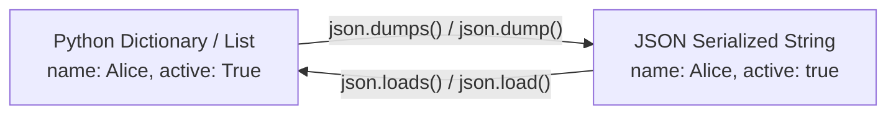

import { Callout } from "fumadocs-ui/components/callout";
import { Tabs, Tab } from "fumadocs-ui/components/tabs";
import { Accordion, Accordions } from "fumadocs-ui/components/accordion";

Almost all data you will encounter in production arrives in one of two formats:

1. **JSON (JavaScript Object Notation)**: The universal language of web APIs, configuration files, and database documents.
2. **CSV (Comma-Separated Values)**: The universal export format of spreadsheets, accounting systems, and tabular databases.

Python includes native, high-performance tools for both in its standard library.

---

## 1. Working with JSON (`json` module)

Python objects and JSON documents have a nearly 1:1 translation mapping:

| Python Type      | JSON Equivalent            |
| :--------------- | :------------------------- |
| `dict`           | Object (`{...}`)           |
| `list`, `tuple`  | Array (`[...]`)            |
| `str`            | String (`"..."`)           |
| `int`, `float`   | Number (`10`, `3.14`)      |
| `True` / `False` | Boolean (`true` / `false`) |
| `None`           | Null (`null`)              |



### The Suffix Rule: `s` Means "String"

- **`json.loads()`** (Load String): Parses a JSON **string** into a Python dict/list.
- **`json.dumps()`** (Dump String): Converts a Python dict/list into a formatted JSON **string**.
- **`json.load()`** (No `s`): Reads JSON directly from an open **file**.
- **`json.dump()`** (No `s`): Writes JSON directly into an open **file**.

### Parsing JSON Strings (`json.loads`)

```python
import json

raw_json = '{"user_id": 101, "name": "Elena", "roles": ["admin", "developer"], "is_active": true}'

data = json.loads(raw_json)

# Now it is a regular Python dictionary:
print(data["name"])          # Elena
print(data["roles"][0])      # admin
print(type(data["is_active"]))  # <class 'bool'>
```

### Serializing to JSON Strings (`json.dumps`)

```python
import json

payload = {
    "transaction_id": "tx_987",
    "amount": 49.99,
    "completed": True,
    "notes": None
}

# Pretty-print with 2-space indentation:
json_string = json.dumps(payload, indent=2)
print(json_string)
```

Output:

```json
{
  "transaction_id": "tx_987",
  "amount": 49.99,
  "completed": true,
  "notes": null
}
```

### Saving & Loading JSON Files

```python
from pathlib import Path
import json

config_file = Path("settings.json")

user_settings = {
    "theme": "dark",
    "font_size": 14,
    "auto_save": True
}

# 1. Write dictionary directly to JSON file:
with open(config_file, "w", encoding="utf-8") as f:
    json.dump(user_settings, f, indent=2)

# 2. Read dictionary directly from JSON file:
with open(config_file, "r", encoding="utf-8") as f:
    loaded_settings = json.load(f)

print("Loaded theme:", loaded_settings["theme"])
```

---

## 2. Working with CSV (`csv` module)

While you could parse a CSV file by calling `.split(",")` on lines of text, this will break the moment a field contains commas enclosed in quotes (e.g. `"123 Main St, Apt 4B"`).

Always use Python's built-in **`csv` module**.

### Reading CSV with `csv.DictReader`

`csv.DictReader` maps each row directly to a Python dictionary using the CSV header line as the keys:

```python
from pathlib import Path
import csv

# Create sample CSV file:
csv_file = Path("customers.csv")
csv_file.write_text("""id,name,plan,monthly_spend
1,Alice,Pro,49.00
2,Bob,Starter,19.00
3,Charlie,Enterprise,299.00
""", encoding="utf-8")

# Read rows as dictionaries:
with open(csv_file, "r", encoding="utf-8") as f:
    reader = csv.DictReader(f)
    for row in reader:
        print(f"Customer {row['name']} pays ${row['monthly_spend']}/mo ({row['plan']} plan)")
```

Output:

```text
Customer Alice pays $49.00/mo (Pro plan)
Customer Bob pays $19.00/mo (Starter plan)
Customer Charlie pays $299.00/mo (Enterprise plan)
```

### Writing CSV with `csv.DictWriter`

```python
import csv
from pathlib import Path

products = [
    {"sku": "SKU-1", "name": "Wireless Mouse", "price": 24.99, "stock": 150},
    {"sku": "SKU-2", "name": "USB-C Cable", "price": 12.50, "stock": 400},
    {"sku": "SKU-3", "name": "Monitor Stand", "price": 39.99, "stock": 85},
]

fieldnames = ["sku", "name", "price", "stock"]

with open("inventory.csv", "w", newline="", encoding="utf-8") as f:
    writer = csv.DictWriter(f, fieldnames=fieldnames)
    writer.writeheader()  # Write column names
    writer.writerows(products)  # Write all rows

print("inventory.csv successfully written!")
```

<Callout type="tip" title="Why newline='' in csv?">
  Notice <code>open("inventory.csv", "w", newline="")</code>: On Windows,
  omitting <code>newline=""</code> can produce double blank lines between CSV
  rows.
</Callout>

---

## Practice Questions & Challenges

Test your understanding of serialization protocols, JSON-to-Python type mappings, streaming file cursors, and tabular CSV processing.

### Question 1: Output Prediction (JSON Type Transmutation)

Without executing the code, determine what `json.dumps()` produces for this Python dictionary:

```python
import json

data = {
    "is_admin": True,
    "metadata": None,
    "tags": ("python", "data", "ml"),
    "count": 42
}

payload = json.dumps(data)
print(payload)
```

1. How do `True`, `None`, and the tuple `("python", "data", "ml")` translate into JSON format?
2. If you pass `payload` back into `json.loads(payload)`, what data type will `tags` be in the resulting Python dictionary?

<Accordions>
<Accordion title="Reveal Solution & Explanation">

**1. Output:**

```json
{
  "is_admin": true,
  "metadata": null,
  "tags": ["python", "data", "ml"],
  "count": 42
}
```

**Type Translations:**

- `True` $\rightarrow$ `true` (lowercase)
- `None` $\rightarrow$ `null`
- `tuple` $\rightarrow$ `array` (`[...]` with square brackets)

**2. Round-Trip Type Mutability:**
When `json.loads()` parses the string back into Python, `"tags"` becomes a **`list`** (`['python', 'data', 'ml']`), **not a tuple**. JSON has only one sequence type (array), so Python tuples always deserialize into mutable lists.

</Accordion>
</Accordions>

---

### Question 2: Spot and Fix the Bug (`TypeError: Object of type datetime is not JSON serializable`)

A backend engineer attempts to cache user login sessions to disk:

```python
import json
from datetime import datetime

session = {
    "user_id": 9941,
    "token": "auth_abc123",
    "login_time": datetime.now(),
}

with open("session.json", "w", encoding="utf-8") as f:
    json.dump(session, f)
```

Running this code produces:

```text
TypeError: Object of type datetime is not JSON serializable
```

1. Why does standard `json.dump()` refuse to serialize `datetime` objects?
2. What other common Python types cannot be serialized by `json` out-of-the-box (e.g. `set`, `bytes`)?
3. How do you resolve this using the `default` parameter in `json.dump()`?

<Accordions>
<Accordion title="Reveal Solution & Explanation">

**1. Root Cause:**
The JSON specification (RFC 8259) only defines numbers, strings, booleans, null, arrays, and objects. It has no native specification for dates, timestamps, sets, or binary buffers.

**2. Other Non-Serializable Types:**
`set` (must be converted to list), `bytes` (must be base64-encoded or decoded to str), `complex`, custom classes.

**3. The Fix with `default=str`:**
Pass `default=str` or `default=lambda o: o.isoformat()` to instruct Python how to convert unrecognized types:

```python
import json
from datetime import datetime

session = {
    "user_id": 9941,
    "token": "auth_abc123",
    "login_time": datetime.now(),
}

with open("session.json", "w", encoding="utf-8") as f:
    json.dump(session, f, indent=2, default=str)
```

</Accordion>
</Accordions>

---

### Question 3: Architecture Question (`load`/`dump` vs `loads`/`dumps`)

1. What does the `'s'` suffix stand for in `json.loads()` and `json.dumps()`?
2. Why is using `json.load(f)` on a 500MB JSON file vastly superior in RAM efficiency compared to `json.loads(f.read())`?

<Accordions>
<Accordion title="Reveal Solution & Explanation">

**1. String vs File Stream:**

- `json.dumps()` and `json.loads()` operate on in-memory **Strings** (`dump-string` and `load-string`).
- `json.dump()` and `json.load()` operate directly on readable/writable **File Streams** (`f`).

**2. Memory Footprint:**
Calling `json.loads(f.read())` first reads the entire 500MB file into a monolithic Python `str` object in RAM, then parses it to create Python dictionaries and lists—consuming **over 1.5 GB of RAM** in memory allocations! In contrast, `json.load(f)` streams the file buffer incrementally, avoiding the duplicate intermediate string allocation.

</Accordion>
</Accordions>

---

### Question 4: Hands-On Challenge (CSV to JSON Converter)

Write a script that reads `customers.csv` and converts it into a JSON file `customers.json`, casting `id` to an integer and `monthly_spend` to a float.

<Accordions>
<Accordion title="Reveal Solution & Explanation">

```python
import csv
import json
from pathlib import Path

input_csv = Path("customers.csv")
output_json = Path("customers.json")

# Create sample CSV
input_csv.write_text("id,name,plan,monthly_spend\n1,Alice,Pro,49.0\n2,Bob,Starter,19.0\n", encoding="utf-8")

transformed_records = []

with open(input_csv, "r", encoding="utf-8") as f:
    reader = csv.DictReader(f)
    for row in reader:
        transformed_records.append({
            "id": int(row["id"]),
            "name": row["name"],
            "plan": row["plan"],
            "monthly_spend": float(row["monthly_spend"])
        })

with open(output_json, "w", encoding="utf-8") as f:
    json.dump(transformed_records, f, indent=2)

print("Transformed JSON Output:")
print(output_json.read_text(encoding="utf-8"))
```

</Accordion>
</Accordions>

---

### Question 5: Code Challenge (Nested JSON to Tabular CSV Flattener)

In cloud analytics, raw JSON data from microservices often contains nested objects that must be flattened into tabular CSVs for database ingestion.

Write a function `flatten_users_to_csv(json_source: Path | str, csv_destination: Path | str) -> int` that flattens a nested structure:

Sample Input JSON (`users.json`):

```json
[
  {
    "id": 101,
    "name": "Sarah Connor",
    "location": { "city": "Los Angeles", "state": "CA" },
    "status": "active"
  },
  {
    "id": 102,
    "name": "Kyle Reese",
    "location": { "city": "New York", "state": "NY" },
    "status": "pending"
  }
]
```

Expected Output CSV (`users.csv`):

```csv
id,name,city,state,status
101,Sarah Connor,Los Angeles,CA,active
102,Kyle Reese,New York,NY,pending
```

Ensure the function handles missing nested keys gracefully without crashing and returns the total count of rows written.

<Accordions>
<Accordion title="Reveal Solution & Code">

```python
import csv
import json
from pathlib import Path

def flatten_users_to_csv(json_source: Path | str, csv_destination: Path | str) -> int:
    source = Path(json_source)
    dest = Path(csv_destination)

    with open(source, "r", encoding="utf-8") as f:
        users = json.load(f)

    fieldnames = ["id", "name", "city", "state", "status"]
    rows_written = 0

    with open(dest, "w", encoding="utf-8", newline="") as f:
        writer = csv.DictWriter(f, fieldnames=fieldnames)
        writer.writeheader()

        for user in users:
            location = user.get("location") or {}
            row = {
                "id": user.get("id"),
                "name": user.get("name"),
                "city": location.get("city", ""),
                "state": location.get("state", ""),
                "status": user.get("status", "unknown")
            }
            writer.writerow(row)
            rows_written += 1

    return rows_written

# Verification:
if __name__ == "__main__":
    test_json = Path("test_users.json")
    test_csv = Path("test_users.csv")

    sample_data = [
        {"id": 101, "name": "Sarah", "location": {"city": "LA", "state": "CA"}, "status": "active"},
        {"id": 102, "name": "Kyle", "location": {"city": "NYC", "state": "NY"}, "status": "pending"}
    ]
    test_json.write_text(json.dumps(sample_data), encoding="utf-8")

    count = flatten_users_to_csv(test_json, test_csv)
    print(f"Flattened {count} records into CSV:")
    print(test_csv.read_text(encoding="utf-8"))

    test_json.unlink()
    test_csv.unlink()
```

</Accordion>
</Accordions>

---

## Summary Reference

- **`json.loads(s)` / `json.dumps(obj)`**: In-memory JSON string parsing and serialization.
- **`json.load(f)` / `json.dump(obj, f)`**: Direct file-based JSON reading and writing.
- **`csv.DictReader(f)`**: Parses CSV rows into dictionaries keyed by header names.
- **`csv.DictWriter(f, fieldnames)`**: Writes dictionaries directly to structured CSV rows.

Next, learn how to fetch live web data using network requests in **[19. Working with APIs: HTTP & REST](/docs/learn-python/01-fundamentals/19-working-with-apis)**!
