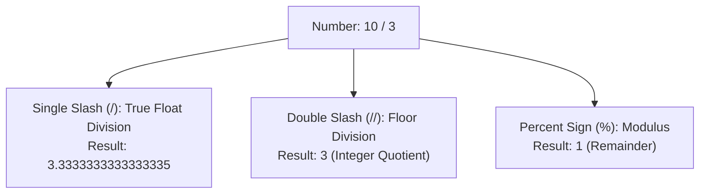
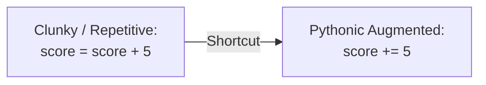
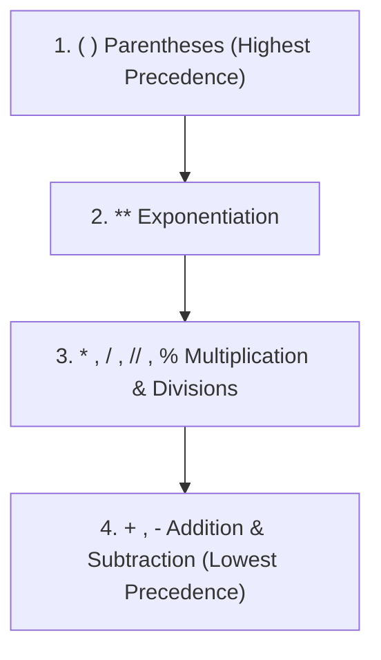

import { Callout } from "fumadocs-ui/components/callout";
import { Accordion, Accordions } from "fumadocs-ui/components/accordion";
import { Tabs, Tab } from "fumadocs-ui/components/tabs";

Now that you know how to store numbers in variables and cast user input using `int()` and `float()`, it is time to perform **computations**.

Computers exist primarily to calculate. Python provides seven fundamental arithmetic operators, augmented assignment shortcuts, and a clear hierarchy of operator precedence.

---

## 1. The Seven Arithmetic Operators

Python supports seven primary arithmetic operators:

| Operator | Name               |  Syntax  | Description                                          | Example   | Output |
| :------: | :----------------- | :------: | :--------------------------------------------------- | :-------- | :----- |
|   `+`    | **Addition**       | `a + b`  | Adds two numbers                                     | `10 + 3`  | `13`   |
|   `-`    | **Subtraction**    | `a - b`  | Subtracts right operand from left                    | `10 - 3`  | `7`    |
|   `*`    | **Multiplication** | `a * b`  | Multiplies two numbers                               | `10 * 3`  | `30`   |
|   `/`    | **Division**       | `a / b`  | Divides left by right (**always returns a `float`**) | `10 / 2`  | `5.0`  |
|   `//`   | **Floor Division** | `a // b` | Divides and rounds down to the nearest integer       | `10 // 3` | `3`    |
|   `%`    | **Modulus**        | `a % b`  | Returns the division remainder                       | `10 % 3`  | `1`    |
|   `**`   | **Exponentiation** | `a ** b` | Raises $a$ to the power of $b$ ($a^b$)               | `10 ** 3` | `1000` |

Let's test these in `app.py`:

```python
x = 10
y = 3

print("Addition (+):        ", x + y)
print("Subtraction (-):     ", x - y)
print("Multiplication (*):  ", x * y)
print("Float Division (/):  ", x / y)
print("Floor Division (//): ", x // y)
print("Modulus (%):         ", x % y)
print("Exponentiation (**): ", x ** y)
```

Terminal execution:

```text
Addition (+):         13
Subtraction (-):      7
Multiplication (*):   30
Float Division (/):   3.3333333333333335
Floor Division (//):  3
Modulus (%):          1
Exponentiation (**):  1000
```

---

## 2. Division Deep-Dive: `/` vs `//` vs `%`

Beginners from other languages (like C, C++, or Java) frequently get tripped up by Python's division mechanics. Let's inspect the three division-related operators:



### 1. True Division (`/`) Always Yields a Float

In Python 3, the single slash `/` **always produces a `float`**, even if the operands divide evenly without a remainder:

```python
print("10 / 2 =", 10 / 2)
print("type(10 / 2) =", type(10 / 2))
```

```text
10 / 2 = 5.0
type(10 / 2) = <class 'float'>
```

If you need an integer result from an exact division, you must either use floor division `10 // 2` or cast explicitly: `int(10 / 2)`.

### 2. Floor Division (`//`) Rounds Down (Towards Negative Infinity)

Floor division divides two numbers and applies the mathematical `floor` function: it rounds **down to the nearest whole integer**.

For positive numbers, it truncates the decimal part:

```python
print("7 // 2  =", 7 // 2)   # 3.5 rounded down -> 3
print("10 // 3 =", 10 // 3) # 3.333 rounded down -> 3
```

<Callout type="warn" title="Negative Floor Division Trap">
Watch out when dividing negative numbers! Python rounds **down towards negative infinity**, not towards zero:

```python
print("-7 // 2 =", -7 // 2)  # -3.5 rounded DOWN is -4, NOT -3!
```

If you need truncation towards zero (like in C/Java), use `int(-7 / 2)`, which produces `-3`.

</Callout>

### 3. Modulus (`%`) Returns the Remainder

The modulus operator `%` returns what is left over after dividing:

$$a = (a // b) \times b + (a \% b)$$

```python
print("10 % 3 =", 10 % 3)  # 3 fits into 10 three times (9), remainder is 1
print("15 % 5 =", 15 % 5)  # 5 divides 15 evenly, remainder is 0
```

#### Common Engineering Use Cases for `%`:

1. **Checking Even vs Odd Numbers**:
   ```python
   num = 42
   if num % 2 == 0:
       print("Even number")
   else:
       print("Odd number")
   ```
2. **Clock / Cyclical Math**:
   ```python
   # What time is it 28 hours after 9:00 AM on a 12-hour clock?
   future_hour = (9 + 28) % 12
   print("Future hour:", future_hour)  # 1:00
   ```

---

## 3. Exponentiation (`**`) & Root Extraction

The double asterisk `**` calculates powers. It replaces the old-fashioned need to import external libraries for basic exponent math:

```python
# 2 to the 4th power: 2 * 2 * 2 * 2 = 16
print("2 ** 4 =", 2 ** 4)

# Fractional exponents compute roots!
# The square root of 64 is 64 ** 0.5:
print("64 ** 0.5 =", 64 ** 0.5)

# The cube root of 27 is 27 ** (1 / 3):
print("27 ** (1 / 3) =", 27 ** (1 / 3))
```

```text
2 ** 4 = 16
64 ** 0.5 = 8.0
27 ** (1 / 3) = 3.0
```

---

## 4. Division by Zero (`ZeroDivisionError`)

In mathematics and computer architecture, division by zero is undefined. If you attempt to divide, floor-divide, or compute modulus with `0` as the right operand, Python halts immediately:

```python
count = 100
total = 0
average = count / total
```

```text
Traceback (most recent call last):
  File "app.py", line 3, in <module>
    average = count / total
ZeroDivisionError: division by zero
```

<Callout type="tip" title="Defensive Check Before Division">
  Always validate or guard dynamic divisors before performing division:
  ```python if total != 0: average = count / total else: average = 0.0 ```
</Callout>

---

## 5. Augmented Assignment Operators

In production code, you will frequently update the value of an existing variable based on its current value (e.g., incrementing counters, accumulating totals, applying discounts).

Python provides **augmented assignment operators** as concise shortcuts:



| Verbose Syntax | Augmented Operator | Meaning                                  |
| :------------- | :----------------: | :--------------------------------------- |
| `x = x + 3`    |      `x += 3`      | Increment `x` by 3                       |
| `x = x - 2`    |      `x -= 2`      | Decrement `x` by 2                       |
| `x = x * 4`    |      `x *= 4`      | Multiply `x` by 4                        |
| `x = x / 2`    |      `x /= 2`      | Divide `x` by 2 (result becomes `float`) |
| `x = x // 2`   |     `x //= 2`      | Floor divide `x` by 2                    |
| `x = x % 3`    |      `x %= 3`      | Modulo `x` by 3                          |
| `x = x ** 2`   |     `x **= 2`      | Raise `x` to power of 2                  |

```python
wallet = 100

wallet += 50   # Deposits: 150
wallet -= 20   # Purchase: 130
wallet *= 2    # Doubled bonus: 260
wallet /= 4    # Split into 4 accounts: 65.0

print("Final wallet balance:", wallet)
```

```text
Final wallet balance: 65.0
```

<Callout type="info" title="No ++ or -- in Python">
  Unlike C, C++, Java, or JavaScript, Python **does not support** the unary
  increment (`x++`) or decrement (`x--`) operators. Writing `x++` in Python
  causes a `SyntaxError` (or is interpreted as double positive signs `+(+x)`).
  Always use `x += 1` instead.
</Callout>

---

## 6. Operator Precedence: The PEMDAS Rule

When you combine multiple operators in a single mathematical expression, in what order does Python evaluate them?

Consider this expression:

```python
x = 10 + 3 * 2
```

Does `x` equal `26` (`(10 + 3) * 2`), or does it equal `16` (`10 + (3 * 2)`)?

Python adheres strictly to the universal mathematical order of operations, commonly remembered by the acronym **PEMDAS** (or **BODMAS**):

1. **P** - Parentheses: `()`
2. **E** - Exponentiation: `**`
3. **M / D** - Multiplication, Division, Floor Division, Modulus: `*`, `/`, `//`, `%` (evaluated left-to-right)
4. **A / S** - Addition and Subtraction: `+`, `-` (evaluated left-to-right)



Let's test this in Python:

```python
# 1. Multiplication happens before addition:
print("10 + 3 * 2 =        ", 10 + 3 * 2)          # 10 + 6 = 16

# 2. Parentheses override natural precedence:
print("(10 + 3) * 2 =      ", (10 + 3) * 2)        # 13 * 2 = 26

# 3. Exponentiation happens before multiplication:
print("2 * 3 ** 2 =        ", 2 * 3 ** 2)          # 2 * 9 = 18
print("(2 * 3) ** 2 =      ", (2 * 3) ** 2)        # 6 ** 2 = 36

# 4. Same precedence evaluates Left to Right:
print("10 / 2 * 3 =        ", 10 / 2 * 3)          # (10 / 2) * 3 = 5.0 * 3 = 15.0
```

```text
10 + 3 * 2 =         16
(10 + 3) * 2 =       26
2 * 3 ** 2 =         18
(2 * 3) ** 2 =       36
10 / 2 * 3 =         15.0
```

### The Exponentiation Associativity Exception

Most binary operators in Python evaluate **left-to-right**:

$$\text{10 - 5 - 2} = (10 - 5) - 2 = 3$$

However, **exponentiation (`**`) is right-associative\*\* (evaluates from right to left, matching mathematical notation $a^{b^c} = a^{(b^c)}$):

```python
# 2 ** 3 ** 2 evaluates as 2 ** (3 ** 2) = 2 ** 9 = 512
# It does NOT evaluate as (2 ** 3) ** 2 = 8 ** 2 = 64
print("2 ** 3 ** 2 =", 2 ** 3 ** 2)
```

```text
2 ** 3 ** 2 = 512
```

<Callout type="tip" title="Best Practice: Use Parentheses for Clarity">
Even when operator precedence is well-defined, humans reading your code may not remember every subtle precedence rule. **When in doubt, use parentheses `()`**. They make your computational intent explicit and unambiguous to your teammates:
```python
# Hard to read at a glance:
result = 100 - base_price * discount_rate + tax_rate ** 2 / factor

# Instantly clear:

result = 100 - (base_price \* discount_rate) + ((tax_rate \*\* 2) / factor)

````
</Callout>

---

## 7. The Math Remote: Built-in Functions vs `import math`

<Callout type="warn" title="Crucial Distinction: There is NO math() function!">
Beginners often ask: *"How do I use `math()`?"*
**Python does NOT have a function named `math()`.**

Instead, Python divides mathematical tools into two distinct categories:
1. **Built-in Functions**: Loaded automatically into global memory. You can call them directly anywhere without `import`.
2. **The `math` Module**: A specialized standard library module. You must write `import math` to unlock its functions and constants.
</Callout>

```mermaid
flowchart LR
    subgraph Builtins ["Global Built-ins (No Import Needed)"]
        B1["round(x, n)"]
        B2["abs(x)"]
        B3["pow(x, y)"]
        B4["sum(iterable)"]
        B5["min() / max()"]
        B6["divmod(a, b)"]
    end
    subgraph MathModule ["Standard Library: 'import math'"]
        M1["math.ceil(x)"]
        M2["math.floor(x)"]
        M3["math.sqrt(x)"]
        M4["math.pi"]
        M5["math.prod(seq)"]
        M6["math.isclose(a, b)"]
    end
````

### 1. Essential Built-in Math Functions (No Import Needed)

```python
# 1. round(): rounds to nearest integer or n decimal places
print("round(2.9): ", round(2.9))     # 3
print("round(3.14159, 2): ", round(3.14159, 2)) # 3.14

# 2. abs(): returns the positive absolute magnitude
print("abs(-42):   ", abs(-42))       # 42

# 3. pow(): exponentiation with optional fast modulo
print("pow(2, 5):  ", pow(2, 5))      # 32

# 4. sum(): sums any iterable collection
print("sum([10, 20, 30]):", sum([10, 20, 30])) # 60

# 5. min() & max(): find smallest and largest numbers
print("min(5, 2, 9):", min(5, 2, 9)) # 2
print("max(5, 2, 9):", max(5, 2, 9)) # 9
```

### 2. The `math` Module (Requires `import math`)

When you need advanced trigonometry, logarithms, or rounding guarantees, import the `math` module:

```python
import math

# Rounding guarantees:
print("math.ceil(2.1):  ", math.ceil(2.1))   # Always rounds UP -> 3
print("math.floor(2.9): ", math.floor(2.9))  # Always rounds DOWN -> 2

# Square roots:
print("math.sqrt(81):   ", math.sqrt(81))    # 9.0

# Mathematical constants:
print("math.pi:         ", round(math.pi, 4)) # 3.1416

# Multiplying all items (the multiplication sibling of sum()):
print("math.prod([2, 3, 4]):", math.prod([2, 3, 4])) # 2 * 3 * 4 = 24
```

```text
math.ceil(2.1):   3
math.floor(2.9):  2
math.sqrt(81):    9.0
math.pi:          3.1416
math.prod([2, 3, 4]): 24
```

_(You will explore the complete `math` module in depth in **[18. Importing Modules & Packages](/docs/learn-python/01-fundamentals/18-importing-modules-and-packages)** and the built-ins in **[Python Built-in Functions](/docs/learn-python/01-fundamentals/built-in-functions)**)._

---

## Hands-On Exercises & Prediction Drills

### Drill 1: Operator Precedence Prediction

Without running the code, predict the output of each expression:

```python
a = 10 + 2 * 3 ** 2
b = (10 + 2) * 3 ** 2
c = 100 // 3 % 5
d = 20 / 5 * 2
```

<Accordions>
<Accordion title="Reveal Solution & Explanation">

```text
a = 28
b = 108
c = 3
d = 8.0
```

**Step-by-step evaluation:**

1. **`a`**: `3 ** 2` evaluates first to `9`. Then `2 * 9` evaluates to `18`. Finally `10 + 18` yields `28`.
2. **`b`**: Parentheses evaluate first: `10 + 2 = 12`. Then `3 ** 2 = 9`. Finally `12 * 9` yields `108`.
3. **`c`**: `//` and `%` share the same precedence and evaluate left-to-right. `100 // 3` yields `33`. Then `33 % 5` has remainder `3`.
4. **`d`**: `/` and `*` share the same precedence and evaluate left-to-right. `20 / 5` yields `4.0` (float). Then `4.0 * 2` yields `8.0`.

</Accordion>
</Accordions>

---

### Drill 2: Hands-On Program (Tip & Split Calculator)

Write a small script `tip_calculator.py` that:

1. Asks the user for the total restaurant bill amount.
2. Asks for the tip percentage they wish to give (e.g. `15` for 15%).
3. Asks how many people will split the bill.
4. Calculates the final total (bill + tip) and the exact cost per person, rounded to 2 decimal places.

<Accordions>
<Accordion title="Reveal Solution & Code">

```python
# tip_calculator.py
print("--- Restaurant Tip & Split Calculator ---")

total_bill = float(input("Enter the total bill amount: $"))
tip_percentage = float(input("Enter tip percentage (e.g. 15, 18, 20): "))
people_count = int(input("How many people are splitting the bill? "))

# 1. Calculate tip and grand total
tip_amount = total_bill * (tip_percentage / 100)
grand_total = total_bill + tip_amount

# 2. Divide among people
amount_per_person = grand_total / people_count

# 3. Display formatted output
print(f"\nGrand Total (with {tip_percentage:.0f}% tip): ${grand_total:.2f}")
print(f"Each person owes: ${amount_per_person:.2f}")
```

Sample Terminal Execution:

```text
--- Restaurant Tip & Split Calculator ---
Enter the total bill amount: $125.50
Enter tip percentage (e.g. 15, 18, 20): 20
How many people are splitting the bill? 4

Grand Total (with 20% tip): $150.60
Each person owes: $37.65
```

</Accordion>
</Accordions>

---

## Summary Reference

- **7 Arithmetic Operators**: `+` (add), `-` (subtract), `*` (multiply), `/` (float division), `//` (floor division), `%` (modulus), `**` (exponentiation).
- **Division rule**: `/` always returns a `float`. `//` truncates down towards negative infinity.
- **Augmented Assignment**: `+=`, `-=`, `*=`, `/=`, `//=`, `%=`, `**=` update variables in-place.
- **PEMDAS Hierarchy**: Parentheses $\rightarrow$ Exponents $\rightarrow$ Multiplication/Division $\rightarrow$ Addition/Subtraction.
- **`math()` is not a function**: Use built-ins (`round`, `abs`, `sum`) directly; import the `math` module (`import math`) for scientific tools (`math.sqrt`, `math.ceil`, `math.floor`).

Next, explore text manipulation, quotation rules, and slicing in **[05. Strings: Quotes, Indexing & Slicing](/docs/learn-python/01-fundamentals/05-strings-quotes-indexes-slices)**!
