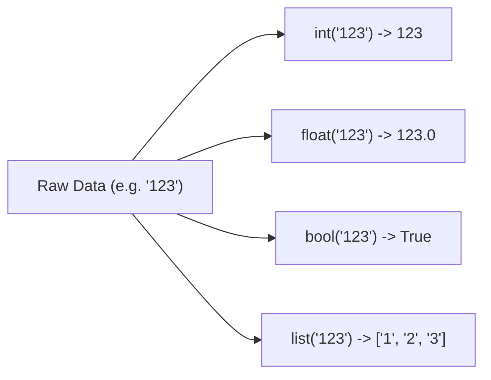
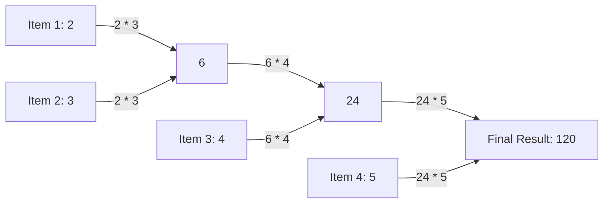

import { Callout } from "fumadocs-ui/components/callout";
import { Tabs, Tab } from "fumadocs-ui/components/tabs";
import { Accordion, Accordions } from "fumadocs-ui/components/accordion";

Python provides over 70 built-in functions directly in the global namespace via the `builtins` module. Because they are always loaded into memory, you never need an `import` statement to use them.

Reaching for built-in functions is a cornerstone of writing **idiomatic ("Pythonic") code**:

- **Speed**: Built-ins are implemented in optimized C (CPython), executing far faster than hand-rolled pure-Python loops.
- **Readability**: Code using standard built-ins communicates intent instantly to other developers.
- **Memory Efficiency**: Many modern built-ins (such as `range`, `zip`, `reversed`, `map`, and `filter`) produce lazy iterators that process data item-by-item without allocating memory for entire collections.

In this deep dive, we explore the most frequently used built-in functions organized by engineering role, complete with code examples, terminal outputs, edge cases, and performance tips.

---

## 1. Core I/O, Inspection & Identity

These functions form the bread and butter of day-to-day scripting, debugging, and input handling.

### `print(*objects, sep=' ', end='\n', file=None, flush=False)`

Outputs one or more values to the standard output stream (`sys.stdout`), joined by `sep` and terminated by `end`.

```python
# Basic printing and custom separators
print("Server", "Status", "Port", sep=" | ")

# Preventing automatic newlines with end
print("Loading database", end="")
print("...", end="")
print(" [READY]")

# Real-time console flushing (useful for progress bars and live logs)
import time
print("Connecting", end="", flush=True)
time.sleep(0.1)
print(" -> OK")
```

```text
Server | Status | Port
Loading database... [READY]
Connecting -> OK
```

<Callout type="tip" title="When to use flush=True">
  By default, Python buffers standard output line-by-line. When printing without
  a newline (`end=""`), output may remain buffered and invisible until the
  script finishes or a newline arrives. Passing `flush=True` forces Python to
  immediately push bytes to the terminal screen.
</Callout>

---

### `input(prompt="")`

Prompts the user, pauses execution, and reads a line from standard input (`sys.stdin`) as a string.

```python
user_input = "42"  # Simulating input
# In terminal: raw_age = input("Enter your age: ")
raw_age = user_input
age = int(raw_age)

print(f"Next year, you will be {age + 1} years old.")
print(f"Type of raw input: {type(raw_age)}")
```

```text
Next year, you will be 43 years old.
Type of raw input: <class 'str'>
```

<Callout type="warn" title="Always Cast input()">
  `input()` **always** returns a string (`str`), even if the user types numbers.
  Attempting arithmetic directly on `input()` raises a `TypeError`.
</Callout>

---

### `type(object)` vs `isinstance(object, classinfo)`

- `type(x)` returns the exact class that created the object.
- `isinstance(x, classinfo)` checks whether `x` is an instance of `classinfo` or any of its subclasses. It also accepts a tuple of types.

```python
class Animal:
    pass

class Dog(Animal):
    pass

rover = Dog()

# Comparing exact type vs inheritance-aware checking:
print("type(rover) == Dog:      ", type(rover) is Dog)
print("type(rover) == Animal:   ", type(rover) is Animal)
print("isinstance(rover, Dog):   ", isinstance(rover, Dog))
print("isinstance(rover, Animal):", isinstance(rover, Animal))

# Checking multiple allowed types using a tuple:
value: object = 3.14
if isinstance(value, (int, float)):
    print(f"Numeric value verified: {value * 2}")
```

```text
type(rover) == Dog:       True
type(rover) == Animal:    False
isinstance(rover, Dog):    True
isinstance(rover, Animal): True
Numeric value verified: 6.28
```

<Callout type="info" title="Best Practice: Favor isinstance()">
  Always use `isinstance()` for type checks instead of `type(x) == Y`.
  `isinstance()` respects class inheritance and object-oriented polymorphism,
  whereas `type()` checks break if a subclass is introduced.
</Callout>

---

### `id(object)` and `hash(object)`

- `id(x)` returns the object's unique integer memory identity (its virtual memory address in CPython).
- `hash(x)` returns an integer hash code used by dictionaries and sets for $O(1)$ lookups. Only **immutable** objects are hashable.

```python
a = [1, 2, 3]
b = [1, 2, 3]
c = a

print(f"id(a) == id(b): {id(a) == id(b)} (Different objects with same values)")
print(f"a is b:         {a is b}")
print(f"a == b:         {a == b}")
print(f"id(a) == id(c): {id(a) == id(c)} (Same object in memory)")

# Hashing immutable vs mutable objects
print(f"Hash of 'python': {hash('python')}")
print(f"Hash of (1, 2):   {hash((1, 2))}")

try:
    hash([1, 2, 3])  # Lists are mutable!
except TypeError as err:
    print(f"Error hashing list: {err}")
```

```text
id(a) == id(b): False (Different objects with same values)
a is b:         False
a == b:         True
id(a) == id(c): True (Same object in memory)
Hash of 'python': -4987241289567923485
Hash of (1, 2):   -3550055125485641917
Error hashing list: unhashable type: 'list'
```

---

### `callable(object)`

Checks if an object can be invoked like a function (e.g. functions, methods, classes, or objects implementing `__call__`).

```python
def worker():
    return "done"

number = 42

class Multiplier:
    def __call__(self, x: int) -> int:
        return x * 10

multiply = Multiplier()

print("callable(worker):    ", callable(worker))
print("callable(number):    ", callable(number))
print("callable(Multiplier):", callable(Multiplier))  # Calling a class creates an instance
print("callable(multiply):  ", callable(multiply))    # Instance with __call__
```

```text
callable(worker):     True
callable(number):     False
callable(Multiplier): True
callable(multiply):   True
```

---

### `dir(object)` & `help(object)`

- `dir(x)` lists all valid attribute names and methods available on object `x`.
- `help(x)` opens the interactive manual or displays the docstring of an object, function, or module.

```python
data = [10, 20]

# Inspecting available non-dunder public methods:
methods = [m for m in dir(data) if not m.startswith("__")]
print("Public list methods:", methods[:6])
```

```text
Public list methods: ['append', 'clear', 'copy', 'count', 'extend', 'index']
```

---

## 2. Type Casting & Collection Constructors

Python is dynamically but **strongly** typed. Objects do not implicitly coerce types across boundaries; you must cast them explicitly using built-in constructors.



### Primitive Constructors: `int()`, `float()`, `str()`, `bool()`

```python
# Integer conversions & base parsing
print("int('255'):         ", int("255"))
print("int('11111111', 2):  ", int("11111111", 2))  # Base 2 binary
print("int('FF', 16):       ", int("FF", 16))        # Base 16 hex
print("int(9.99):           ", int(9.99))            # Truncates toward zero, no rounding!

# Float conversions
print("float('3.1415'):     ", float("3.1415"))
print("float('1e-3'):       ", float("1e-3"))

# String conversions
print("str(450):            ", type(str(450)), str(450))

# Boolean truthiness evaluation
# False values: 0, 0.0, "", None, [], (), {}, set()
print("bool('hello'):       ", bool("hello"))
print("bool(''):            ", bool(""))
print("bool([]):            ", bool([]))
print("bool([0]):           ", bool([0]))  # Non-empty list is True!
```

```text
int('255'):          255
int('11111111', 2):   255
int('FF', 16):        255
int(9.99):            9
float('3.1415'):      3.1415
float('1e-3'):        0.001
str(450):             <class 'str'> 450
bool('hello'):        True
bool(''):             False
bool([]):             False
bool([0]):            True
```

---

### Collection Constructors: `list()`, `dict()`, `set()`, `tuple()`

```python
# Converting strings to collections
text = "banana"
print("list(text): ", list(text))
print("set(text):  ", set(text))  # Deduplicated unique characters
print("tuple(text):", tuple(text))

# Deduplicating a list while preserving or ignoring order:
numbers = [1, 2, 2, 3, 4, 4, 1]
unique_numbers = list(set(numbers))
print("Deduplicated set -> list:", unique_numbers)

# Constructing dictionaries from paired key-value iterables
pairs = [("id", 101), ("name", "Alice"), ("role", "Admin")]
user_dict = dict(pairs)
print("dict(pairs):", user_dict)
```

```text
list(text):  ['b', 'a', 'n', 'a', 'n', 'a']
set(text):   {'a', 'b', 'n'}
tuple(text): ('b', 'a', 'n', 'a', 'n', 'a')
Deduplicated set -> list: [1, 2, 3, 4]
dict(pairs): {'id': 101, 'name': 'Alice', 'role': 'Admin'}
```

---

### `len(s)`

Returns the number of items in a container (string, list, tuple, dict, set, range).

```python
users = ["Alice", "Bob", "Charlie"]
config = {"timeout": 30, "debug": True}

print(f"Total users:  {len(users)}")
print(f"Config keys:  {len(config)}")
```

```text
Total users:  3
Config keys:  2
```

<Callout type="tip" title="Why is len() so fast?">
  `len()` executes in **$O(1)$ constant time**. For built-in types (`str`,
  `list`, `dict`), CPython does not count elements by looping; it simply reads
  the integer stored in the object’s internal C header struct (`ob_size`).
</Callout>

---

## 3. Iteration, Indexing & Sequence Pairing

Writing manual indexing loops like `for i in range(len(items)):` is an antipattern in Python. The built-ins below allow clean, expressive, and bug-free iterations.

### `range(start, stop[, step])`

Generates an immutable arithmetic sequence of integers on-demand (lazy evaluation, consuming $O(1)$ memory regardless of size).

```python
# One argument: stop (exclusive)
print("range(5):            ", list(range(5)))

# Two arguments: start (inclusive), stop (exclusive)
print("range(2, 6):         ", list(range(2, 6)))

# Three arguments: start, stop, step
print("range(0, 10, 2):     ", list(range(0, 10, 2)))

# Stepping backwards
print("range(5, 0, -1):     ", list(range(5, 0, -1)))
```

```text
range(5):             [0, 1, 2, 3, 4]
range(2, 6):          [2, 3, 4, 5]
range(0, 10, 2):      [0, 2, 4, 6, 8]
range(5, 0, -1):      [5, 4, 3, 2, 1]
```

---

### `enumerate(iterable, start=0)`

Returns an iterator of `(index, item)` tuples. Eliminates the need to maintain manual counter variables.

<Tabs items={["The Pythonic Way (enumerate)", "The Clunky Antipattern"]}>
  <Tab value="The Pythonic Way (enumerate)">
```python
fruits = ["Apple", "Blueberry", "Cherry"]

for rank, fruit in enumerate(fruits, start=1):
print(f"#{rank}: {fruit}")

````
  </Tab>
  <Tab value="The Clunky Antipattern">
```python
fruits = ["Apple", "Blueberry", "Cherry"]

# Avoid: prone to off-by-one errors and indexing bugs
index = 1
for fruit in fruits:
    print(f"#{index}: {fruit}")
    index += 1
````

  </Tab>
</Tabs>

```text
#1: Apple
#2: Blueberry
#3: Cherry
```

---

### `zip(*iterables, strict=False)`

Aggregates elements from each of the iterables in parallel, yielding tuples of grouped items.

```python
names = ["Alice", "Bob", "Charlie"]
scores = [88, 95, 72]
departments = ["Engineering", "Product", "Sales"]

for name, score, dept in zip(names, scores, departments):
    print(f"{name:8} | Score: {score} | Team: {dept}")

# Fast dictionary construction from parallel lists:
scores_dict = dict(zip(names, scores))
print("\nGenerated dictionary:", scores_dict)
```

```text
Alice    | Score: 88 | Team: Engineering
Bob      | Score: 95 | Team: Product
Charlie  | Score: 72 | Team: Sales

Generated dictionary: {'Alice': 88, 'Bob': 95, 'Charlie': 72}
```

<Callout type="warn" title="Python 3.10+ strict=True Mode">
By default, `zip()` silently stops when the **shortest** iterable is exhausted, potentially hiding truncated data bugs:
```python
names = ["Alice", "Bob"]
scores = [100, 90, 80]  # Missing score!

# Zip silently discards the 3rd score:

print(list(zip(names, scores))) # [('Alice', 100), ('Bob', 90)]

# Passing strict=True raises a ValueError if lengths differ:

try:
list(zip(names, scores, strict=True))
except ValueError as err:
print("Caught mismatch:", err)

````
Output:
```text
[('Alice', 100), ('Bob', 90)]
Caught mismatch: zip() argument 2 is longer than argument 1
````

</Callout>

---

### `reversed(sequence)`

Returns a reverse iterator over any sequence without modifying the original container.

```python
letters = ["a", "b", "c", "d"]

# Non-mutating reverse iteration:
for char in reversed(letters):
    print(char, end=" ")
print()

# Original list remains intact:
print("Original untouched:", letters)
```

```text
d c b a
Original untouched: ['a', 'b', 'c', 'd']
```

---

### `iter()` & `next(iterator[, default])`

Underpins Python’s entire iterator protocol:

- `iter(obj)` converts an iterable into an iterator object.
- `next(iterator, default)` advances the iterator by one item. If the iterator is exhausted, it returns `default` (or raises `StopIteration` if no default is provided).

```python
stream = iter(["packet_01", "packet_02", "packet_03"])

# Manually pulling items from the stream:
first = next(stream)
second = next(stream)
print(f"Pulled: {first}, {second}")

# Using the fallback default to avoid StopIteration:
third = next(stream, "EOF")
fourth = next(stream, "EOF")
print(f"Pulled: {third}, {fourth}")
```

```text
Pulled: packet_01, packet_02
Pulled: packet_03, EOF
```

---

## 4. Math, Extremes & Aggregation

Built-in math functions operate on iterables and scalars directly in C without requiring the `math` module.

### `sum(iterable, /, start=0)`

Calculates the sum of all numerical items in an iterable.

```python
prices = [19.99, 5.50, 42.00]
print("Sum of prices: ", sum(prices))

# Starting with an initial base value (e.g. shipping fee):
shipping = 10.00
total = sum(prices, start=shipping)
print("Total + Shipping:", total)
```

```text
Sum of prices:  67.49
Total + Shipping: 77.49
```

<Callout type="warn" title="Do NOT use sum() on Strings">
  Never use `sum()` to concatenate strings (e.g. `sum(["a", "b"])`); Python
  explicitly blocks this with a `TypeError`. Use `"".join(["a", "b"])`, which
  operates in $O(N)$ time instead of quadratic $O(N^2)$ memory reallocation.
</Callout>

---

### `min()` & `max()`

Finds the lowest or highest value in an iterable (or across positional arguments), supporting custom sorting keys and fallback defaults.

```python
# 1. Simple positional arguments
print("max(10, 45, 23):", max(10, 45, 23))

# 2. Key function with dictionaries
employees = [
    {"name": "Alice", "salary": 85000},
    {"name": "Bob", "salary": 115000},
    {"name": "Charlie", "salary": 92000},
]

highest_earner = max(employees, key=lambda emp: emp["salary"])
print(f"Top earner: {highest_earner['name']} (${highest_earner['salary']:,})")

# 3. Safe fallback with empty iterables
empty_logs: list[int] = []
safe_peak = max(empty_logs, default=0)
print(f"Safe peak value: {safe_peak}")
```

```text
max(10, 45, 23): 45
Top earner: Bob ($115,000)
Safe peak value: 0
```

<Callout type="tip" title="Always specify default for variable data">
  Calling `max([])` or `min([])` on an empty sequence raises `ValueError: max()
  arg is an empty sequence`. Passing `default=0` (or `None`) ensures robust
  error-free code when processing dynamic user data or database queries.
</Callout>

---

### `abs(x)` & `round(number[, ndigits])`

- `abs(x)` returns the non-negative magnitude of a number.
- `round(x, n)` rounds a floating-point number to `n` decimal places.

```python
# Absolute value
temperature_delta = -14.8
print("Magnitude of change:", abs(temperature_delta))

# Rounding
pi = 3.14159265
print("round(pi, 2):", round(pi, 2))
print("round(pi, 4):", round(pi, 4))
```

```text
Magnitude of change: 14.8
round(pi, 2): 3.14
round(pi, 4): 3.1416
```

<Callout type="info" title="Banker's Rounding (Round-Half-To-Even)">
Python implements the IEEE 754 standard for rounding: when a number is exactly halfway between two integers, it rounds to the **nearest even number**:
```python
print(round(2.5))  # -> 2 (even)
print(round(3.5))  # -> 4 (even)
print(round(4.5))  # -> 4 (even)
```
This prevents systematic upward drift in financial and statistical aggregations.
</Callout>

---

### `divmod(a, b)`

Returns the pair `(a // b, a % b)` in a single operation, computing quotient and remainder simultaneously at the C level.

```python
total_seconds = 7384

# Convert seconds to hours, minutes, and seconds:
hours, remaining_seconds = divmod(total_seconds, 3600)
minutes, seconds = divmod(remaining_seconds, 60)

print(f"{total_seconds} seconds = {hours:02d}h:{minutes:02d}m:{seconds:02d}s")
```

```text
7384 seconds = 02h:03m:04s
```

---

### `pow(base, exp[, mod])`

Calculates `base ** exp`. When supplied with the third parameter `mod`, it computes `(base ** exp) % mod` using high-speed binary exponentiation.

```python
# Standard power
print("pow(2, 8):          ", pow(2, 8))

# Modular exponentiation (standard in cryptography and hashing):
# Calculates (3 ** 200) % 13 in milliseconds without allocating a massive 200-digit number
print("pow(3, 200, 13):    ", pow(3, 200, 13))
```

```text
pow(2, 8):           256
pow(3, 200, 13):     9
```

---

## 5. Sorting, Filtering & Boolean Quantifiers

### `sorted(iterable, *, key=None, reverse=False)`

Builds and returns a brand-new sorted `list` from any iterable. Unlike `list.sort()`, which mutates in-place, `sorted()` works on strings, tuples, sets, and dictionaries.

```python
# Sorting strings & dictionaries
word = "algorithm"
print("sorted(word):", sorted(word))

students = [
    {"name": "Alice", "grade": 92, "age": 20},
    {"name": "Bob", "grade": 85, "age": 22},
    {"name": "Charlie", "grade": 92, "age": 19},
]

# Multi-level sort: Grade descending (-grade), then Age ascending (age)
ranked = sorted(students, key=lambda s: (-s["grade"], s["age"]))

for s in ranked:
    print(f"Grade: {s['grade']} | Age: {s['age']} | Name: {s['name']}")
```

```text
sorted(word): ['a', 'g', 'h', 'i', 'l', 'm', 'o', 'r', 't']
Grade: 92 | Age: 19 | Name: Charlie
Grade: 92 | Age: 20 | Name: Alice
Grade: 85 | Age: 22 | Name: Bob
```

---

### `all(iterable)` and `any(iterable)`

These functions provide high-speed boolean evaluation with **short-circuiting**:

- `all()` returns `True` only if **every** item is truthy. Stops immediately on the first `False`.
- `any()` returns `True` if **at least one** item is truthy. Stops immediately on the first `True`.

```python
form_fields = {
    "username": "coder42",
    "email": "coder@example.com",
    "password": "secret_token",
    "referral_code": ""  # Optional empty string
}

required_fields = ["username", "email", "password"]

# Check that every required field is populated:
is_valid = all(bool(form_fields[field]) for field in required_fields)
print(f"Form submission valid: {is_valid}")

# Check if any account has administrative privileges:
user_roles = ["guest", "editor", "moderator"]
has_admin_access = any(role == "admin" for role in user_roles)
print(f"Admin privilege active: {has_admin_access}")
```

```text
Form submission valid: True
Admin privilege active: False
```

<Callout type="tip" title="Vacuous Truth & Empty Iterables">
  Note how `all()` and `any()` handle empty iterables: - `all([])` evaluates to
  **`True`** (there is no element that is false). - `any([])` evaluates to
  **`False`** (there is no element that is true).
</Callout>

---

### `map(function, iterable, ...)` & `filter(function, iterable)`

Functional primitives that return lazy generators:

- `map(f, seq)` applies function `f` to every element.
- `filter(p, seq)` retains only elements where predicate `p(item)` is truthy.

```python
raw_numbers = ["10", "25", "50", "100"]

# Parse strings to integers using map:
integers = list(map(int, raw_numbers))
print("Mapped integers:", integers)

# Filter numbers greater than 30:
big_numbers = list(filter(lambda n: n > 30, integers))
print("Filtered numbers:", big_numbers)
```

```text
Mapped integers: [10, 25, 50, 100]
Filtered numbers: [50, 100]
```

<Callout type="info" title="Comprehensions vs map / filter">
In modern Python, list and generator comprehensions are generally preferred over `map` and `filter` because they are easier to read and do not require wrapping in `lambda`:
- Comprehension equivalent to `map`: `[int(x) for x in raw_numbers]`
- Comprehension equivalent to `filter`: `[n for n in integers if n > 30]`
</Callout>

### `functools.reduce(function, iterable[, initializer])`

While `map()` transforms each element and `filter()` discards elements, **`reduce()` collapses (folds) an entire sequence into a single cumulative value**.

> [!NOTE] Built-in vs. `functools`
> `reduce()` lives in the standard `functools` module (`from functools import reduce`). Python moved it here because common cumulative operations like calculating a total are more readably handled by `sum()`. However, `reduce()` remains the standard tool when you need custom sequential reduction.

#### Mental Model: The Rolling Snowball

`reduce()` takes the first two items, combines them, takes that intermediate result (the accumulator), combines it with the third item, and repeats until only **one final value** remains:



#### Simple Example 1: Multiplying All Numbers (Product)

```python
from functools import reduce

numbers = [2, 3, 4, 5]

# Multiply sequentially: ((2 * 3) * 4) * 5 = 120
product = reduce(lambda acc, x: acc * x, numbers)
print("Cumulative product:", product)
```

```text
Cumulative product: 120
```

#### Simple Example 2: Finding the Maximum Value

```python
scores = [45, 89, 72, 95, 61]

# Compare two items at a time and keep the larger one:
highest = reduce(lambda a, b: a if a > b else b, scores)
print("Highest score:", highest)
```

```text
Highest score: 95
```

#### Simple Example 3: Using an Initial Value (`initializer`)

Passing an optional third argument provides a safe starting value. This also protects against crashes if the input list happens to be empty:

```python
cart_items = [19.99, 35.50, 4.99]

# Start with a fixed $5.00 shipping base fee:
total = reduce(lambda acc, price: acc + price, cart_items, 5.00)
print(f"Total with shipping: ${total:.2f}")
```

```text
Total with shipping: $65.48
```

#### The Functional Trinity Summary

| Function       | What it Does                  | Input $\rightarrow$ Output                 | Example                                                    |
| :------------- | :---------------------------- | :----------------------------------------- | :--------------------------------------------------------- |
| **`map()`**    | Transforms each element       | $N$ items $\rightarrow$ $N$ items          | `map(int, ["1", "2"])` $\rightarrow$ `[1, 2]`              |
| **`filter()`** | Retains matching elements     | $N$ items $\rightarrow$ $\le N$ items      | `filter(lambda x: x > 0, [-1, 2])` $\rightarrow$ `[2]`     |
| **`reduce()`** | Folds sequence into one value | $N$ items $\rightarrow$ **1 single value** | `reduce(lambda a, b: a * b, [2, 3, 4])` $\rightarrow$ `24` |

---

## 6. Dynamic Reflection & Attribute Access

In production systems (e.g. deserializing JSON configs, ORMs, and plugin loaders), you often need to access or inspect attributes dynamically at runtime.

### `getattr()`, `setattr()`, `hasattr()`, `delattr()`

```python
class ServerConfig:
    host: str = "127.0.0.1"
    port: int = 8080
    debug: bool = True

config = ServerConfig()

# 1. Checking attribute existence dynamically
print("hasattr(config, 'port'):    ", hasattr(config, "port"))
print("hasattr(config, 'timeout'): ", hasattr(config, "timeout"))

# 2. Reading attributes with fallback defaults (no AttributeError!)
port = getattr(config, "port", 3000)
timeout = getattr(config, "timeout", 60)  # Attribute does not exist, uses fallback
print(f"Active config: Port={port}, Timeout={timeout}s")

# 3. Dynamic assignment
setattr(config, "environment", "production")
print("Dynamic env value:", config.environment)
```

```text
hasattr(config, 'port'):     True
hasattr(config, 'timeout'):  False
Active config: Port=8080, Timeout=60s
Dynamic env value: production
```

---

### `repr(object)` vs `str(object)`

- `str(x)` produces a user-friendly, human-readable string.
- `repr(x)` produces an unambiguous, developer-focused representation (ideally valid Python syntax to recreate the object).

```python
import datetime

now = datetime.date(2026, 10, 19)

print("str(now): ", str(now))   # For human display
print("repr(now):", repr(now))  # For debugging & logging

text = "Hello\nWorld"
print(f"When printed:    {text}")
print(f"With repr(text): {repr(text)}")
```

```text
str(now):  2026-10-19
repr(now): datetime.date(2026, 10, 19)
When printed:    Hello
World
With repr(text): 'Hello\\nWorld'
```

---

## 7. File I/O Primitives

### `open(file, mode='r', encoding=None)`

Opens a file and returns a corresponding file stream object. Always pair with the `with` statement (context manager) to ensure file descriptors close automatically.

```python
sample_payload = "timestamp,event\n1700000000,LOGIN\n1700000005,LOGOUT\n"

# Writing to a file safely with explicit UTF-8 encoding
with open("audit_log.csv", mode="w", encoding="utf-8") as file:
    file.write(sample_payload)

# Reading from the file line by line
with open("audit_log.csv", mode="r", encoding="utf-8") as file:
    header = next(file).strip()  # Pull first line using next()
    print(f"CSV Header: {header}")
    for line in file:
        print("Log entry:", line.strip())
```

```text
CSV Header: timestamp,event
Log entry: 1700000000,LOGIN
Log entry: 1700000005,LOGOUT
```

---

## 8. Hands-On Engineering Challenges

<Accordions>
<Accordion title="Challenge 1: The Transaction Log Sanitizer">

**Problem**:
You are given a list of raw transaction strings: `["$150.25", "$42.00", "invalid", "$99.90", "N/A", "$300.50"]`.
Write a clean function `calculate_audit_stats(raw_data: list[str])` that:

1. Filters out unparseable items.
2. Strips the `$` prefix and converts valid transactions to floats.
3. Returns a dictionary containing:
   - `count`: total valid transactions (`len`)
   - `total`: sum of transactions rounded to 2 decimals (`sum`, `round`)
   - `min_tx`: smallest transaction (`min`)
   - `max_tx`: largest transaction (`max`)
   - `average`: average transaction value rounded to 2 decimals

```python
def calculate_audit_stats(raw_data: list[str]) -> dict:
    valid_txs: list[float] = []
    for item in raw_data:
        cleaned = item.strip().replace("$", "")
        try:
            valid_txs.append(float(cleaned))
        except ValueError:
            continue

    if not valid_txs:
        return {"count": 0, "total": 0.0, "min_tx": 0.0, "max_tx": 0.0, "average": 0.0}

    total_amount = round(sum(valid_txs), 2)
    return {
        "count": len(valid_txs),
        "total": total_amount,
        "min_tx": min(valid_txs),
        "max_tx": max(valid_txs),
        "average": round(total_amount / len(valid_txs), 2),
    }

# Verification
raw = ["$150.25", "$42.00", "invalid", "$99.90", "N/A", "$300.50"]
stats = calculate_audit_stats(raw)
for k, v in stats.items():
    print(f"{k:8}: {v}")
```

```text
count   : 4
total   : 592.65
min_tx  : 42.0
max_tx  : 300.5
average : 148.16
```

</Accordion>

<Accordion title="Challenge 2: Multi-Criteria Leaderboard Ranker">

**Problem**:
You receive two parallel lists: player names and their corresponding score lists (e.g. `[10, 20, 30]`).
Using `zip`, `enumerate`, and `sorted`, create a function that ranks players by:

1. **Total points** (descending).
2. If total points are tied, rank by **highest single game score** (descending).
3. Prints a clean leaderboard with 1-based ranks.

```python
def print_leaderboard(players: list[str], game_scores: list[list[int]]) -> None:
    # Build enriched records using zip, sum, and max
    roster = []
    for name, scores in zip(players, game_scores, strict=True):
        total = sum(scores)
        top_score = max(scores, default=0)
        roster.append({"name": name, "total": total, "top_score": top_score})

    # Sort by total points (descending), then top single game (descending)
    ranked = sorted(roster, key=lambda p: (-p["total"], -p["top_score"]))

    print(f"{'Rank':4} | {'Player':8} | {'Total':5} | {'Best Score':10}")
    print("-" * 36)
    for rank, p in enumerate(ranked, start=1):
        print(f"#{rank:<3} | {p['name']:8} | {p['total']:<5} | {p['top_score']:<10}")

# Verification
names = ["Diana", "Alice", "Bob", "Charlie"]
scores = [
    [80, 95, 75],   # Total: 250, Max: 95
    [100, 70, 80],  # Total: 250, Max: 100
    [90, 85, 95],   # Total: 270, Max: 95
    [60, 60, 70]    # Total: 190, Max: 70
]

print_leaderboard(names, scores)
```

```text
Rank | Player   | Total | Best Score
------------------------------------
#1   | Bob      | 270   | 95
#2   | Alice    | 250   | 100
#3   | Diana    | 250   | 95
#4   | Charlie  | 190   | 70
```

</Accordion>
</Accordions>

---

## 9. Comprehensive Reference Matrix

| Function                 | Primary Purpose                  |   Time Complexity    | Typical Example                                    |
| :----------------------- | :------------------------------- | :------------------: | :------------------------------------------------- |
| `print()`                | Terminal output stream           |  $O(N)$ string size  | `print("ID:", 101, sep=" ")`                       |
| `input()`                | Read string from console         |  $O(N)$ chars typed  | `name = input("Username: ")`                       |
| `len()`                  | Length of container              |      **$O(1)$**      | `len(user_list)`                                   |
| `type()`                 | Exact object class               |        $O(1)$        | `type(val) is int`                                 |
| `isinstance()`           | Inheritance-aware type check     |        $O(1)$        | `isinstance(val, (int, float))`                    |
| `id()`                   | Object virtual memory address    |        $O(1)$        | `id(obj)`                                          |
| `hash()`                 | Hash integer for dict keys       |        $O(1)$        | `hash("secure_key")`                               |
| `int()`, `float()`       | Cast to numeric primitive        |    $O(N)$ digits     | `int("1010", 2)`                                   |
| `str()`, `bool()`        | Cast to string or truthiness     |   $O(1)$ / $O(N)$    | `bool([]) -> False`                                |
| `list()`, `dict()`       | Iterable conversion constructors |   $O(N)$ elements    | `dict([("a", 1)])`                                 |
| `range()`                | Arithmetic sequence generator    |  **$O(1)$ memory**   | `range(0, 100, 5)`                                 |
| `enumerate()`            | Indexed pair generator           |   $O(1)$ per step    | `enumerate(items, start=1)`                        |
| `zip()`                  | Parallel iterator pairing        |   $O(1)$ per step    | `zip(names, ages, strict=True)`                    |
| `reversed()`             | Reverse sequence iterator        |  **$O(1)$ memory**   | `reversed(ordered_list)`                           |
| `iter()`, `next()`       | Iterator protocol stepping       |        $O(1)$        | `next(it, default="EOF")`                          |
| `sum()`                  | Arithmetic addition              |        $O(N)$        | `sum(scores, start=10)`                            |
| `min()`, `max()`         | Extremes with custom keys        |        $O(N)$        | `max(users, key=lambda u: u['age'], default=None)` |
| `abs()`                  | Absolute numeric magnitude       |        $O(1)$        | `abs(-42)`                                         |
| `round()`                | Banker's round-half-to-even      |        $O(1)$        | `round(2.5) -> 2`                                  |
| `divmod()`               | Combined quotient and modulo     |        $O(1)$        | `hours, secs = divmod(t, 3600)`                    |
| `pow()`                  | Modular power exponentiation     | $O(\log \text{exp})$ | `pow(3, 100, 7)`                                   |
| `sorted()`               | Stable Timsort (new list)        |  **$O(N \log N)$**   | `sorted(data, key=..., reverse=True)`              |
| `any()`, `all()`         | Short-circuit boolean checks     |   $O(1)$ to $O(N)$   | `any(x > 0 for x in nums)`                         |
| `map()`, `filter()`      | Lazy functional iteration        |     $O(1)$ setup     | `map(int, str_list)`                               |
| `getattr()`, `hasattr()` | Dynamic attribute reflection     |        $O(1)$        | `getattr(obj, "port", 8080)`                       |
| `open()`                 | File context manager             |    $O(1)$ handle     | `with open(p, "r", encoding="utf-8") as f:`        |

---

Next, learn how to document code cleanly in **[11. Comments: Documenting Your Code for Humans](/docs/learn-python/01-fundamentals/11-comments-and-code-documentation)**!
