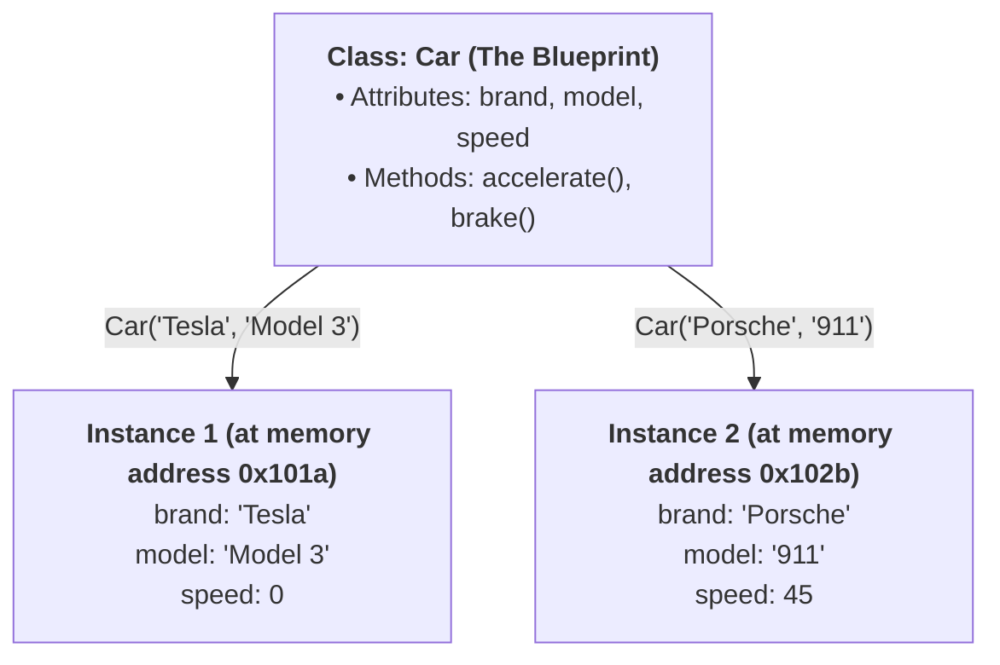
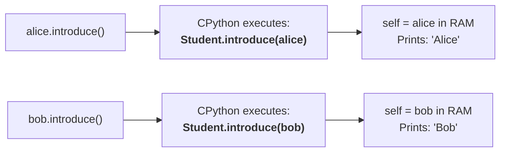
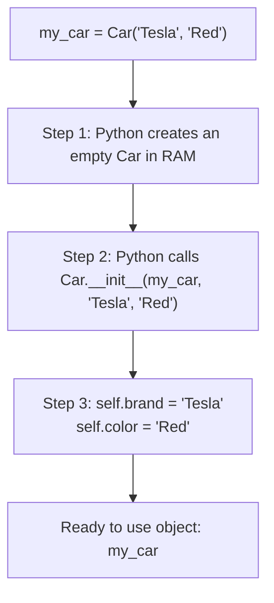
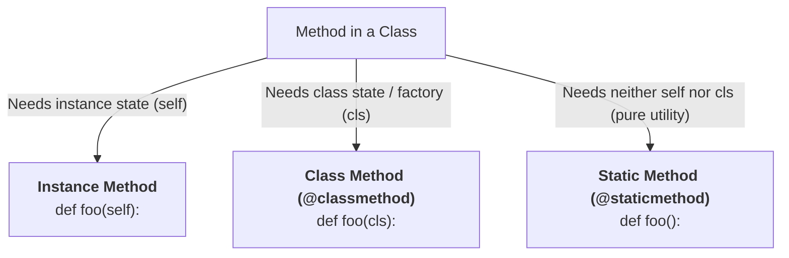

import { Callout } from "fumadocs-ui/components/callout";
import { Tabs, Tab } from "fumadocs-ui/components/tabs";
import { Accordion, Accordions } from "fumadocs-ui/components/accordion";

Up to this point, our programs have organized logic into standalone functions and data into primitive structures like dictionaries, lists, and tuples. This paradigm is known as **Procedural Programming**.

Procedural code works well for simple scripts. But as applications grow, keeping data separate from the functions that manipulate that data leads to code that is fragile, difficult to debug, and repetitive.

**Object-Oriented Programming (OOP)** solves this by grouping related **data (state)** and **functions (behavior)** into self-contained units called **objects**.

---

## 1. The Core Mental Model: Blueprint vs. Instance

To understand OOP, think of an architect designing houses:

- **The Class (The Blueprint)**: A blueprint specifies that every house has a street address, 3 bedrooms, 2 bathrooms, a front door, and an alarm system. The blueprint itself is not a physical house; you cannot sleep inside a sheet of paper.
- **The Instance / Object (The Physical House)**: When a builder uses the blueprint to build actual houses on real streets, each physical house is an **instance**.
  - House A is built at `124 Elm Street` with red paint and an unlocked front door.
  - House B is built at `500 Oak Avenue` with blue paint and a locked front door.
  - Both houses share the same structure defined by the blueprint, but each has its **own independent state**.



### Interactive Blueprint & Instance Lab

Build independent Car objects from the blueprint below, trigger `accelerate()` and `brake()`, and watch the corresponding lines of code execute in real time:

<PythonOopSimulator initialTab="classes" />

### Essential Vocabulary

| Term                  | Plain English Definition                                                                  | Python Example                    |
| :-------------------- | :---------------------------------------------------------------------------------------- | :-------------------------------- |
| **Class**             | The blueprint or template defining structure and actions.                                 | `class BankAccount:`              |
| **Object / Instance** | The concrete entity created in computer memory from a class.                              | `my_account = BankAccount()`      |
| **Attribute**         | A variable belonging to a class or instance (represents **state**).                       | `self.balance = 100.0`            |
| **Method**            | A function defined inside a class that operates on an instance (represents **behavior**). | `def deposit(self, amount):`      |
| **Instantiation**     | The act of creating an instance from a class.                                             | `acc = BankAccount("Alice", 250)` |

---

## 2. Anatomy of a Python Class: `__init__` and `self`

Here is a complete, runnable Python class:

```python
class BankAccount:
    """A simple bank account managing customer balance."""

    def __init__(self, owner: str, balance: float = 0.0):
        # Instance attributes (unique to each account)
        self.owner = owner
        self.balance = balance

    def deposit(self, amount: float) -> float:
        """Add money to the account."""
        if amount <= 0:
            raise ValueError("Deposit amount must be positive.")
        self.balance += amount
        return self.balance

    def withdraw(self, amount: float) -> float:
        """Withdraw money from the account with overdraft protection."""
        if amount > self.balance:
            raise ValueError(f"Insufficient funds! Balance is ${self.balance:.2f}")
        self.balance -= amount
        return self.balance


# Instantiating two independent objects:
alice_acc = BankAccount("Alice", 100.0)
bob_acc = BankAccount("Bob", 50.0)

alice_acc.deposit(40.0)
bob_acc.withdraw(20.0)

print(f"{alice_acc.owner}'s balance: ${alice_acc.balance:.2f}")
print(f"{bob_acc.owner}'s balance: ${bob_acc.balance:.2f}")
```

Output:

```text
Alice's balance: $140.00
Bob's balance: $30.00
```

Notice how mutating `alice_acc` has zero effect on `bob_acc`. They reside at different addresses in computer memory.

### Demystifying `self`: The "Classroom ID Badge" Analogy

The single biggest source of confusion for Python learners is the `self` parameter.

To understand `self`, imagine a teacher standing in front of a classroom with 30 students.

If the teacher announces:

> _"Open **your** notebook and write **your** name on it."_

Every student intuitively knows to open **their own** notebook and write **their own** name. Nobody writes on their neighbor's desk. The word **"your"** or **"my"** points to that **specific individual student**.

In Python, **`self` is simply Python's explicit keyword for "MY" or "THIS SPECIFIC INSTANCE"**.

When you write a class, you are writing a blueprint. The blueprint doesn't know yet _who_ will be created in the future:

```python
class Student:
    def introduce(self):
        print(f"Hi, my name is {self.name}")

alice = Student()
alice.name = "Alice"

bob = Student()
bob.name = "Bob"
```

When you write:

```python
alice.introduce()
```

**Here is Python's behind-the-scenes secret:** CPython automatically grabs the object in front of the dot (`alice`) and inserts it as the first argument into `introduce()`:

```python
# What you write:
alice.introduce()

# What Python ACTUALLY executes under the hood:
Student.introduce(alice)
```

Look at `Student.introduce(alice)`:

- `alice` is passed into the `self` parameter!
- Inside the method, `self.name` resolves to `alice.name` (`"Alice"`).
- When you call `bob.introduce()`, Python executes `Student.introduce(bob)`. Here, `self` points to `bob`!



<Callout type="warn" title="What Happens If You Forget 'self'?">
If you define a method without `self`:
```python
class Dog:
    def bark():  # ❌ Forgot 'self'!
        print("Woof!")

my_dog = Dog()
my_dog.bark()

````
Python crashes with this famous error:
```text
TypeError: Dog.bark() takes 0 positional arguments but 1 was given
````

**Why did Python say "1 was given" when you passed nothing?**
Because Python automatically tried to pass `my_dog` as the first argument: `Dog.bark(my_dog)`! But `bark()` had no parameter waiting to receive it.

</Callout>

### Demystifying `__init__`: The Setup Form / Birth Certificate

When a baby is born in a hospital, the staff immediately fills out a birth certificate:

- What is their name?
- What is their birth date?
- What is their weight?

In Python, **`__init__` is the "Birth Certificate / Setup Form" for an object**. It runs **automatically** the exact instant a new object is created:

```python
class Car:
    def __init__(self, brand: str, color: str):
        # self is the brand-new car just created in memory
        self.brand = brand  # Give THIS car its brand
        self.color = color  # Give THIS car its color
```

When you write:

```python
my_car = Car("Tesla", "Red")
```

Python performs two steps behind the scenes:

1. **Creation (`__new__`)**: Python allocates a brand-new, empty chunk of RAM for the object.
2. **Initialization (`__init__`)**: Python immediately invokes `__init__`, passing the new empty object as `self`:
   ```python
   Car.__init__(my_car, "Tesla", "Red")
   ```



---

## 3. Demystifying Underscores: `_`, `__`, and `__dunder__`

Python uses underscores to communicate special rules, visibility conventions, and internal interpreter hooks.

Here is the master roadmap of underscores in Python:

| Syntax            | Name                          | Meaning in Plain English                                           | Real-World Analogy                                                                |
| :---------------- | :---------------------------- | :----------------------------------------------------------------- | :-------------------------------------------------------------------------------- |
| **`self._name`**  | **Single Leading Underscore** | _"Please don't touch this directly."_ (Polite internal convention) | A _"Staff Only"_ sign on a door. You can walk in, but you shouldn't.              |
| **`self.__name`** | **Double Leading Underscore** | _"Private! Scramble this name."_ (CPython Name Mangling)           | A safety lock preventing accidental naming collisions in subclasses.              |
| **`__init__`**    | **Double Leading + Trailing** | _"Python Magic / Dunder Method"_ (Built-in interpreter protocol)   | Special built-in buttons that hook directly into Python operators (`+`, `len()`). |

### 1. Single Leading Underscore: `_variable` (The Polite Warning)

Python's core philosophy is:

> _"We are all consenting adults here."_

Python chooses not to restrict access with hard compiler locks like Java's `private`. Instead, prefixing an attribute with a single underscore `_` tells other programmers:

> _"This variable is an internal implementation detail. You can access it if you really need to, but do not rely on it because it might change without warning."_

```python
class SmartLight:
    def __init__(self):
        self.is_on = False            # Public: freely modify this
        self._voltage_reading = 12.0  # Protected by convention: internal detail
```

### 2. Double Leading Underscore: `__variable` (Name Mangling)

When you put two underscores before an attribute name, Python **scrambles (mangles)** the name behind your back:

```python
class BankAccount:
    def __init__(self, pin: int):
        self.__pin = pin  # Double underscore!

acc = BankAccount(4321)

try:
    print(acc.__pin)
except AttributeError as err:
    print("Caught:", err)
```

Output:

```text
Caught: 'BankAccount' object has no attribute '__pin'
```

**Why does Python say it has no attribute?**
Because Python secretly renamed `__pin` to `_BankAccount__pin`!

```python
# Look inside the object's raw storage:
print(acc.__dict__)
# Output: {'_BankAccount__pin': 4321}

# You can still access it if you use the scrambled name:
print("Scrambled access:", acc._BankAccount__pin)  # 4321
```

Python does this **not for cryptography or security**, but to prevent subclasses from accidentally overwriting parent attributes!

### 3. Double Leading + Double Trailing: `__dunder__` (Magic Methods)

Double underscore on **both sides** is reserved exclusively for Python itself. These are called **"Dunder"** methods (**D**ouble **Under**score).

You never call these directly; Python triggers them automatically when you use standard symbols or built-in functions:

```python
class CustomList:
    def __init__(self, items):
        self.items = items

    # 1. Triggered by len(obj)
    def __len__(self):
        return len(self.items)

    # 2. Triggered by print(obj) or str(obj)
    def __str__(self):
        return f"CustomList with {len(self.items)} items: {self.items}"

    # 3. Triggered by obj1 + obj2
    def __add__(self, other):
        return CustomList(self.items + other.items)

cl1 = CustomList([1, 2])
cl2 = CustomList([3, 4])

print(len(cl1))     # Calls cl1.__len__() -> Output: 2
print(cl1)          # Calls cl1.__str__() -> Output: CustomList with 2 items: [1, 2]
cl3 = cl1 + cl2     # Calls cl1.__add__(cl2)
print(cl3.items)    # Output: [1, 2, 3, 4]
```

---

## 4. Instance Attributes vs. Class Attributes

In Python, attributes can live in two different places: on the **instance** or on the **class**.

```python
class Employee:
    # 1. Class Attribute: Shared by EVERY employee in the company
    company_name = "TechCorp Global"
    total_employees = 0

    def __init__(self, name: str, salary: float):
        # 2. Instance Attributes: Unique to THIS specific employee
        self.name = name
        self.salary = salary
        Employee.total_employees += 1


e1 = Employee("Alice", 90_000)
e2 = Employee("Bob", 85_000)

print(f"{e1.name} works at {e1.company_name}")
print(f"{e2.name} works at {e2.company_name}")
print(f"Total employees: {Employee.total_employees}")
```

Output:

```text
Alice works at TechCorp Global
Bob works at TechCorp Global
Total employees: 2
```

### The Namespaces: `__dict__`

Every Python object and class has an internal dictionary called `__dict__` storing its attributes:

```python
print("e1 instance dict:", e1.__dict__)
print("e2 instance dict:", e2.__dict__)
print("Employee class dict keys:", [k for k in Employee.__dict__.keys() if not k.startswith("__")])
```

Output:

```text
e1 instance dict: {'name': 'Alice', 'salary': 90000}
e2 instance dict: {'name': 'Bob', 'salary': 85000}
Employee class dict keys: ['company_name', 'total_employees']
```

When you write `e1.company_name`:

1. Python first checks `e1.__dict__`. Since `'company_name'` is not in `e1.__dict__`,
2. Python falls back to check `Employee.__dict__`, where it finds `"TechCorp Global"`.

### The Dangerous "Mutable Class Attribute Trap"

This is one of the most infamous bugs in Python programming:

```python
# BUGGY CODE:
class Student:
    enrolled_courses = []  # Dangerous! Mutable class attribute!

    def __init__(self, name: str):
        self.name = name

    def enroll(self, course: str):
        self.enrolled_courses.append(course)

s1 = Student("Sarah")
s2 = Student("Liam")

s1.enroll("Algorithms")
print("Liam's courses:", s2.enrolled_courses)  # Liam has Sarah's course!
```

Output:

```text
Liam's courses: ['Algorithms']
```

**Why did Liam get Sarah's course?**
Because `enrolled_courses = []` was defined at the class level. There is only **one single list** in RAM shared by every student instance! When `s1` appended to `self.enrolled_courses`, Python looked up `enrolled_courses`, found the shared class list, and modified it in place.

**The Fix:** Always initialize mutable data (lists, dicts, sets) inside `__init__`:

```python
class Student:
    def __init__(self, name: str):
        self.name = name
        self.enrolled_courses = []  # Brand-new list created for EACH instance!
```

---

## 5. The Three Types of Methods (Instance, Class, Static)

Python supports three distinct types of methods inside a class. Understanding when to use each is crucial for clean software architecture:



Let's inspect an example demonstrating all three:

```python
from datetime import date

class User:
    minimum_age = 18

    def __init__(self, name: str, birth_year: int):
        self.name = name
        self.birth_year = birth_year

    # 1. Instance Method: Operates on 'self' (the specific user)
    def calculate_age(self) -> int:
        current_year = date.today().year
        return current_year - self.birth_year

    # 2. Class Method: Operates on 'cls' (the User class itself)
    # Often used as an "Alternative Constructor" or "Factory"
    @classmethod
    def from_string(cls, user_str: str) -> "User":
        """Factory method to create a User from a 'Name-BirthYear' string."""
        name, birth_year = user_str.split("-")
        return cls(name=name, birth_year=int(birth_year))

    # 3. Static Method: Operates on neither 'self' nor 'cls'
    # It behaves like a plain function, but is organized inside User's namespace
    @staticmethod
    def is_adult(age: int) -> bool:
        """Utility function to check adulthood without needing an instance."""
        return age >= User.minimum_age


# Using the standard constructor:
user1 = User("Maya", 2000)
print(f"{user1.name}'s age: {user1.calculate_age()}")

# Using the classmethod alternative constructor:
user2 = User.from_string("Lucas-1995")
print(f"Created from string: {user2.name}, born in {user2.birth_year}")

# Using the static method directly on the class:
print("Is 21 adult?", User.is_adult(21))
print("Is 15 adult?", User.is_adult(15))
```

### Method Comparison Matrix

| Method Type         | Decorator       | First Parameter | Accesses Instance State? | Accesses Class State?  | Primary Purpose                                                       |
| :------------------ | :-------------- | :-------------- | :----------------------- | :--------------------- | :-------------------------------------------------------------------- |
| **Instance Method** | None            | `self`          | Yes (`self.name`)        | Yes (`self.__class__`) | Standard business logic modifying object state.                       |
| **Class Method**    | `@classmethod`  | `cls`           | No                       | Yes (`cls.attr`)       | Factory methods, alternative constructors, class-wide state mutation. |
| **Static Method**   | `@staticmethod` | None            | No                       | No                     | Pure utility helpers that logically belong to the class namespace.    |

---

## 6. Developer Truth vs. User Beauty: `__str__` and `__repr__`

If you print a basic Python object without custom string methods:

```python
class Book:
    def __init__(self, title: str, author: str):
        self.title = title
        self.author = author

b = Book("Clean Code", "Robert C. Martin")
print(b)
```

Python prints:

```text
<__main__.Book object at 0x0000021A5D865F10>
```

That default representation is useless for debugging. Python gives us two magic methods to control how objects are displayed:

```python
class Book:
    def __init__(self, title: str, author: str, pages: int):
        self.title = title
        self.author = author
        self.pages = pages

    def __str__(self) -> str:
        """User-friendly representation for print() and user logs."""
        return f"'{self.title}' by {self.author} ({self.pages} pages)"

    def __repr__(self) -> str:
        """Unambiguous developer representation: shows exact code to recreate."""
        return f"Book(title={self.title!r}, author={self.author!r}, pages={self.pages})"

book = Book("Fluent Python", "Luciano Ramalho", 1014)

# __str__ is invoked by str() and print():
print("str(book) :", str(book))

# __repr__ is invoked by repr(), debuggers, and interactive REPLs:
print("repr(book):", repr(book))

# Inside a list or container, Python always uses __repr__:
library = [book]
print("library   :", library)
```

Output:

```text
str(book) : 'Fluent Python' by Luciano Ramalho (1014 pages)
repr(book): Book(title='Fluent Python', author='Luciano Ramalho', pages=1014)
library   : [Book(title='Fluent Python', author='Luciano Ramalho', pages=1014)]
```

<Callout type="tip" title="Rule of Thumb">
  Always implement at least `__repr__` for your classes. If `__str__` is
  omitted, Python automatically falls back to `__repr__`.
</Callout>

---

## 7. Real-World Architecture: Building an Inventory Item Class

Let's synthesize all foundational concepts into a production-grade class:

```python
from datetime import datetime

class InventoryItem:
    """Manages an item in an enterprise warehouse."""

    # Class attribute
    default_warehouse: str = "Central-East-1"
    item_count: int = 0

    def __init__(self, sku: str, name: str, unit_price: float, stock_quantity: int = 0):
        # Instance attributes
        self.sku = sku.upper()
        self.name = name
        self.unit_price = unit_price
        self.stock_quantity = stock_quantity
        self.created_at = datetime.utcnow()

        InventoryItem.item_count += 1

    # Instance methods
    def restock(self, quantity: int) -> int:
        if quantity <= 0:
            raise ValueError("Restock quantity must be positive.")
        self.stock_quantity += quantity
        return self.stock_quantity

    def sell(self, quantity: int) -> float:
        if quantity > self.stock_quantity:
            raise ValueError(f"Insufficient stock for {self.name}! Available: {self.stock_quantity}")
        self.stock_quantity -= quantity
        return quantity * self.unit_price

    def get_total_value(self) -> float:
        return self.unit_price * self.stock_quantity

    # Alternative Constructor (Factory)
    @classmethod
    def from_csv_row(cls, row: str) -> "InventoryItem":
        """Instantiate an InventoryItem from a CSV string: 'SKU,Name,Price,Stock'."""
        sku, name, price, stock = row.split(",")
        return cls(sku=sku.strip(), name=name.strip(), unit_price=float(price), stock_quantity=int(stock))

    # Static Utility Method
    @staticmethod
    def is_valid_sku(sku: str) -> bool:
        """Validate SKU format: must be at least 4 alphanumeric characters."""
        return len(sku) >= 4 and sku.isalnum()

    # Dunder representation methods
    def __repr__(self) -> str:
        return (
            f"InventoryItem(sku={self.sku!r}, name={self.name!r}, "
            f"unit_price={self.unit_price}, stock_quantity={self.stock_quantity})"
        )

    def __str__(self) -> str:
        return f"[{self.sku}] {self.name}: {self.stock_quantity} units @ ${self.unit_price:.2f}"
```

Testing the inventory item:

```python
# Create from factory
item = InventoryItem.from_csv_row("WH-001, Wireless Keyboard, 49.99, 15")

print("Created item :", item)
revenue = item.sell(5)
print(f"Sold 5 units for ${revenue:.2f}")
print("Updated stock:", item)
print(f"Inventory total value: ${item.get_total_value():.2f}")
print(f"Is 'WH-001' valid SKU? {InventoryItem.is_valid_sku('WH001')}")
```

Output:

```text
Created item : [WH-001] Wireless Keyboard: 15 units @ $49.99
Sold 5 units for $249.95
Updated stock: [WH-001] Wireless Keyboard: 10 units @ $49.99
Inventory total value: $499.90
Is 'WH-001' valid SKU? True
```

---

## Practice Questions & Challenges

### Question 1: Output Prediction (Class vs. Instance Namespace)

Examine the code below:

```python
class Counter:
    count = 0

    def increment(self):
        self.count += 1

c1 = Counter()
c2 = Counter()

c1.increment()
c1.increment()
c2.increment()

print("c1.count:", c1.count)
print("c2.count:", c2.count)
print("Counter.count:", Counter.count)
```

1. What will be printed?
2. Did `c1.increment()` modify `Counter.count`? Why or why not?

<Accordions>
<Accordion title="Reveal Solution & Explanation">

**Output:**

```text
c1.count: 2
c2.count: 1
Counter.count: 0
```

**Why Counter.count is still 0:**
When `c1.increment()` executes:

```python
self.count += 1
```

This is equivalent to:

```python
self.count = self.count + 1
```

1. On the right side, `self.count` reads the class attribute `Counter.count` (which is `0`).
2. On the left side, the assignment `self.count = 1` creates a **new instance attribute** inside `c1.__dict__`!
3. `Counter.count` is never modified. `c1` now has its own `count` of `2`, and `c2` has its own `count` of `1`.
   </Accordion>
</Accordions>

---

### Question 2: Spot and Fix the Bug (`TypeError: missing 1 required positional argument`)

A developer wrote the following logger class:

```python
class Logger:
    prefix = "[LOG]"

    def log(message: str):
        print(f"{Logger.prefix} {message}")

logger = Logger()
logger.log("Application started successfully.")
```

When run, the code crashes with:

```text
TypeError: Logger.log() takes 1 positional argument but 2 were given
```

1. Why does Python complain that 2 arguments were given when the caller passed only 1?
2. What are the two ways to fix this class depending on intended design?

<Accordions>
<Accordion title="Reveal Solution & Explanation">

**1. The Root Cause:**
Because `logger.log(...)` is an instance call, Python automatically prepends the instance (`logger`) as the first parameter. Python executed `Logger.log(logger, "Application started successfully.")`. Since `log(message)` only accepted one parameter, Python threw a `TypeError`.

**2. Two Fixes:**

_Fix Option A (If it should be an instance method):_ Add `self`:

```python
class Logger:
    prefix = "[LOG]"

    def log(self, message: str):
        print(f"{self.prefix} {message}")
```

_Fix Option B (If it does not need instance state):_ Make it a `@staticmethod`:

```python
class Logger:
    prefix = "[LOG]"

    @staticmethod
    def log(message: str):
        print(f"{Logger.prefix} {message}")
```

</Accordion>
</Accordions>

---

### Next Step

Now that you have mastered classes, instances, `self`, namespaces, and method types, explore the core pillars that protect and structure object-oriented systems in **[02. The Four Pillars: Encapsulation & Abstraction](/docs/learn-python/02-intermediate/02-oop-encapsulation-and-abstraction)**!
