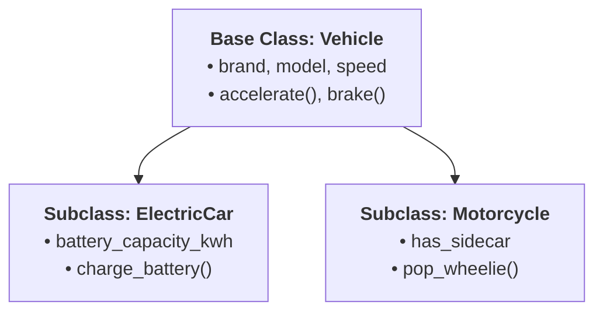
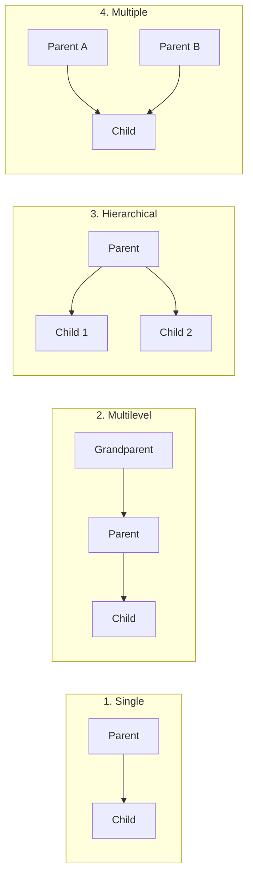
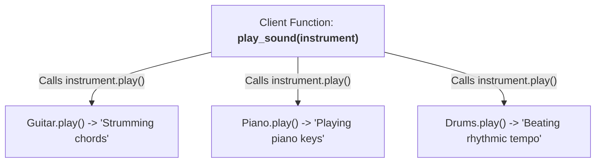

import { Callout } from "fumadocs-ui/components/callout";
import { Tabs, Tab } from "fumadocs-ui/components/tabs";
import { Accordion, Accordions } from "fumadocs-ui/components/accordion";

Having explored **Encapsulation** and **Abstraction**, we now turn to the remaining two pillars of Object-Oriented Programming: **Inheritance** and **Polymorphism**.

These two pillars empower you to write DRY (Don't Repeat Yourself) code, establish hierarchical domain models, and design flexible systems that adapt to new requirements without rewriting existing code.

---

## Pillar 3: Inheritance

### What is Inheritance?

**Inheritance** is a mechanism where a new class (the **child class** or **subclass**) derives properties and behaviors from an existing class (the **parent class**, **base class**, or **superclass**).

Inheritance models an **"IS-A" relationship**:

- A `SavingsAccount` **is a** `BankAccount`.
- A `Developer` **is an** `Employee`.
- A `Dog` **is a** `Mammal`.



### Interactive Inheritance & Polymorphism Lab

Inspect class hierarchies, inherited vs overridden methods, and polymorphic method execution in this hands-on simulator:

<PythonOopSimulator initialTab="inheritance" />

---

## The Four Types of Inheritance in Python

Python supports four primary structural inheritance topologies:



### 1. Single Inheritance

A child inherits from a single parent:

```python
class Animal:
    def __init__(self, name: str):
        self.name = name

    def eat(self):
        print(f"{self.name} is eating food.")

class Dog(Animal):
    def bark(self):
        print(f"{self.name} says: Woof! Woof!")

dog = Dog("Buddy")
dog.eat()   # Inherited from Animal
dog.bark()  # Defined on Dog
```

Output:

```text
Buddy is eating food.
Buddy says: Woof! Woof!
```

### 2. Multilevel Inheritance

A class inherits from a child class, forming an ancestry chain:

```python
class Vehicle:
    def start_engine(self):
        print("Engine hums to life.")

class Car(Vehicle):
    def drive(self):
        print("Driving on 4 wheels.")

class SportsCar(Car):
    def activate_turbo(self):
        print("Turbo boost engaged! Accelerating rapidly!")

ferrari = SportsCar()
ferrari.start_engine()    # From Vehicle
ferrari.drive()           # From Car
ferrari.activate_turbo()  # From SportsCar
```

### 3. Hierarchical Inheritance

Multiple child classes inherit from the same parent base class:

```python
class Employee:
    def __init__(self, name: str, base_salary: float):
        self.name = name
        self.base_salary = base_salary

class Developer(Employee):
    def write_code(self):
        print(f"{self.name} is writing Python.")

class Manager(Employee):
    def conduct_meeting(self):
        print(f"{self.name} is leading the team sync.")
```

---

## Demystifying `super()` & Constructor Chaining

When creating a subclass, you almost always need to initialize the parent class's state as well as adding new child-specific attributes.

This is achieved using **`super()`**:

```python
class BankAccount:
    def __init__(self, owner: str, balance: float = 0.0):
        self.owner = owner
        self.balance = balance

    def deposit(self, amount: float) -> float:
        self.balance += amount
        return self.balance

    def get_summary(self) -> str:
        return f"Account[{self.owner}]: ${self.balance:.2f}"


class HighYieldSavingsAccount(BankAccount):
    def __init__(self, owner: str, balance: float = 0.0, apy: float = 0.045):
        # 1. Delegate base initialization to parent via super()
        super().__init__(owner=owner, balance=balance)

        # 2. Initialize child-specific attribute
        self.apy = apy

    # 3. Method Overriding: Extend parent method with extra functionality
    def apply_monthly_interest(self) -> float:
        monthly_rate = self.apy / 12
        earned = self.balance * monthly_rate
        self.deposit(earned)  # Reusing parent deposit()!
        return earned


hysa = HighYieldSavingsAccount("Sophia", 10_000.0, apy=0.05)
print(hysa.get_summary())

earned = hysa.apply_monthly_interest()
print(f"Earned monthly interest: ${earned:.2f}")
print("New status:", hysa.get_summary())
```

Output:

```text
Account[Sophia]: $10000.00
Earned monthly interest: $41.67
New status: Account[Sophia]: $10041.67
```

<Callout type="warn" title="What Happens If You Forget super().__init__()?">
If a child class defines its own `__init__` and does **not** call `super().__init__()`, the parent's `__init__` **never runs**!
```python
class BrokenSavings(BankAccount):
    def __init__(self, apy: float):
        self.apy = apy

s = BrokenSavings(0.05)
print(s.balance) # AttributeError: 'BrokenSavings' object has no attribute 'balance'

````
Always call `super().__init__(...)` when your subclass declares its own constructor.
</Callout>

---

## Method Overriding: Replacing vs. Extending

A subclass can **override** any method inherited from its parent:

1. **Complete Replacement**: The child completely ignores the parent's logic and provides its own.
2. **Extension**: The child calls `super().method()` to execute the parent's logic first, then adds extra steps.

```python
class EmailService:
    def send(self, recipient: str, body: str):
        print(f"Sending standard email to {recipient}: {body}")

class EncryptedEmailService(EmailService):
    def send(self, recipient: str, body: str):
        # 1. Add extra behavior (Encryption)
        encrypted_body = f"***ENCRYPTED[{body}]***"
        print("[Security] Encrypting email payload with AES-256...")

        # 2. Call parent method to perform actual delivery
        super().send(recipient, encrypted_body)

email = EncryptedEmailService()
email.send("security@company.com", "Server credentials: admin/12345")
````

Output:

```text
[Security] Encrypting email payload with AES-256...
Sending standard email to security@company.com: ***ENCRYPTED[Server credentials: admin/12345]***
```

---

## Type Inspection: `isinstance()` vs. `type()`

In Python, always use `isinstance()` rather than `type()` when inspecting objects:

```python
acc = HighYieldSavingsAccount("Alice", 500.0)

# isinstance respects inheritance hierarchies:
print("isinstance(acc, HighYieldSavingsAccount):", isinstance(acc, HighYieldSavingsAccount))
print("isinstance(acc, BankAccount)            :", isinstance(acc, BankAccount))
print("isinstance(acc, object)                 :", isinstance(acc, object))

# type() checks ONLY the exact concrete class (ignoring inheritance):
print("type(acc) is BankAccount                :", type(acc) is BankAccount)
```

Output:

```text
isinstance(acc, HighYieldSavingsAccount): True
isinstance(acc, BankAccount)            : True
isinstance(acc, object)                 : True
type(acc) is BankAccount                : False
```

---

## Pillar 4: Polymorphism

### What is Polymorphism?

The word **Polymorphism** comes from the Greek _poly_ (many) and _morph_ (form).

In programming, **polymorphism means that different classes can be treated through the same interface**, with each class executing its own version of the behavior.



Let's see this in code:

```python
class Guitar:
    def play(self):
        return "Strumming acoustic strings: ~Twang~"

class Piano:
    def play(self):
        return "Pressing ivory keys: ~Melodic chords~"

class DrumKit:
    def play(self):
        return "Striking snare: ~Boom-crash~"

# Polymorphic client function:
def jam_session(instruments: list):
    """Works with ANY instrument regardless of class type!"""
    for instrument in instruments:
        print(instrument.play())

orchestra = [Guitar(), Piano(), DrumKit()]
jam_session(orchestra)
```

Output:

```text
Strumming acoustic strings: ~Twang~
Pressing ivory keys: ~Melodic chords~
Striking snare: ~Boom-crash~
```

---

## Duck Typing: Python's Crown Jewel

In statically typed languages like Java or C++, polymorphism requires all classes to inherit from a common parent class or implement a formal interface.

Python does not require this. Python practices **Duck Typing**, famously summarized by writer James Whitcomb Riley:

> _"When I see a bird that walks like a duck and swims like a duck and quacks like a duck, I call that bird a duck."_

In Python, an object's suitability is determined by the **presence of specific methods and attributes**, rather than by its inheritance lineage:

```python
class RealDuck:
    def quack(self):
        print("Quack! Quack!")

class RoboticDuck:
    def quack(self):
        print("BEEP BOOP: Synthesized Quack 1.0 activated.")

class PersonImitatingDuck:
    def quack(self):
        print("Hey, look at me, I'm quacking like a duck!")

def make_it_quack(creature):
    # Doesn't care about creature's class or inheritance tree!
    # As long as it has a .quack() method, it works!
    creature.quack()

make_it_quack(RealDuck())
make_it_quack(RoboticDuck())
make_it_quack(PersonImitatingDuck())
```

Output:

```text
Quack! Quack!
BEEP BOOP: Synthesized Quack 1.0 activated.
Hey, look at me, I'm quacking like a duck!
```

Duck typing allows incredible flexibility in Python: you can swap in mocks, stubs, and third-party classes seamlessly as long as they implement the expected methods.

---

## Method Overloading in Python (And Why Python Doesn't Have It)

In languages like Java or C++, you can write multiple methods with the exact same name as long as their parameter types or argument counts differ:

```java
// Java: Method Overloading
public int add(int a, int b) { return a + b; }
public double add(double a, double b) { return a + b; }
public int add(int a, int b, int c) { return a + b + c; }
```

### Why Doesn't Python Support This?

In Python, functions are first-class dictionary entries. If you define a method twice in the same class, **the second definition simply overwrites the first**:

```python
class Calculator:
    def add(self, a: int, b: int):
        return a + b

    def add(self, a: int, b: int, c: int):  # Overwrites the previous add()!
        return a + b + c

calc = Calculator()
try:
    calc.add(5, 10)
except TypeError as err:
    print("Caught:", err)
```

Output:

```text
Caught: Calculator.add() missing 1 required positional argument: 'c'
```

### How Pythonic Code Handles Overloading

Python provides three clean, idiomatic ways to achieve flexible method signatures:

#### 1. Default Arguments

```python
class Calculator:
    def add(self, a: float, b: float, c: float = 0.0) -> float:
        return a + b + c

calc = Calculator()
print(calc.add(2, 3))     # 5.0
print(calc.add(2, 3, 4))  # 9.0
```

#### 2. Variable Arguments (`*args`)

```python
class MathEngine:
    def sum_all(self, *numbers: float) -> float:
        return sum(numbers)

m = MathEngine()
print(m.sum_all(1, 2))              # 3
print(m.sum_all(10, 20, 30, 40))    # 100
```

#### 3. `functools.singledispatchmethod` (Type-Based Dispatch)

For rigorous type-based overloading, Python's standard library provides `singledispatchmethod`:

```python
from functools import singledispatchmethod

class Formatter:
    @singledispatchmethod
    def format(self, arg):
        raise NotImplementedError(f"Cannot format type: {type(arg)}")

    @format.register
    def _(self, arg: int):
        return f"Integer: {arg:,}"

    @format.register
    def _(self, arg: float):
        return f"Currency: ${arg:.2f}"

    @format.register
    def _(self, arg: list):
        return f"List of {len(arg)} items: {', '.join(str(x) for x in arg)}"

fmt = Formatter()
print(fmt.format(1_000_000))
print(fmt.format(49.95))
print(fmt.format(["apple", "banana", "cherry"]))
```

Output:

```text
Integer: 1,000,000
Currency: $49.95
List of 3 items: apple, banana, cherry
```

---

## Operator Overloading: Giving Magic to Custom Objects

Operator overloading lets your custom classes respond naturally to Python's built-in operators (`+`, `-`, `*`, `==`, `<`, `len()`).

Python maps operators to **magic dunder methods**:

| Operator | Dunder Method          | Example Call |
| :------- | :--------------------- | :----------- |
| `+`      | `__add__(self, other)` | `a + b`      |
| `-`      | `__sub__(self, other)` | `a - b`      |
| `*`      | `__mul__(self, other)` | `a * b`      |
| `==`     | `__eq__(self, other)`  | `a == b`     |
| `<`      | `__lt__(self, other)`  | `a < b`      |
| `len()`  | `__len__(self)`        | `len(a)`     |
| `str()`  | `__str__(self)`        | `str(a)`     |

### Real-World Example: A Robust `Money` Value Object

Let's build a production-grade `Money` class with operator overloading and currency mismatch safety:

```python
class Money:
    """A financial value object supporting arithmetic and comparisons."""

    def __init__(self, amount: float, currency: str = "USD"):
        self.amount = round(float(amount), 2)
        self.currency = currency.upper()

    def __repr__(self) -> str:
        return f"Money({self.amount:.2f}, {self.currency!r})"

    def __str__(self) -> str:
        symbol = "$" if self.currency == "USD" else f"{self.currency} "
        return f"{symbol}{self.amount:.2f}"

    def _ensure_same_currency(self, other: "Money"):
        if self.currency != other.currency:
            raise ValueError(
                f"Currency mismatch: cannot operate on {self.currency} and {other.currency}."
            )

    # 1. Addition: m1 + m2
    def __add__(self, other: "Money") -> "Money":
        if not isinstance(other, Money):
            return NotImplemented
        self._ensure_same_currency(other)
        return Money(self.amount + other.amount, self.currency)

    # 2. Subtraction: m1 - m2
    def __sub__(self, other: "Money") -> "Money":
        if not isinstance(other, Money):
            return NotImplemented
        self._ensure_same_currency(other)
        return Money(self.amount - other.amount, self.currency)

    # 3. Scalar Multiplication: m1 * 3
    def __mul__(self, scalar: float) -> "Money":
        if not isinstance(scalar, (int, float)):
            return NotImplemented
        return Money(self.amount * scalar, self.currency)

    # 4. Equality: m1 == m2
    def __eq__(self, other: object) -> bool:
        if not isinstance(other, Money):
            return False
        return self.amount == other.amount and self.currency == other.currency

    # 5. Less Than: m1 < m2 (Enables sorted() and comparisons)
    def __lt__(self, other: "Money") -> bool:
        if not isinstance(other, Money):
            return NotImplemented
        self._ensure_same_currency(other)
        return self.amount < other.amount
```

Let's test our `Money` class:

```python
wallet = Money(50.0, "USD")
coffee = Money(4.75, "USD")
lunch = Money(15.25, "USD")

# Operator Overloading in action:
remaining = wallet - (coffee + lunch)
print("Remaining balance:", remaining)

# Multiplication:
tripled = coffee * 3
print("3 Coffees cost   :", tripled)

# Comparison & Sorting:
prices = [Money(99.0), Money(12.50), Money(45.00)]
print("Sorted prices    :", sorted(prices))

# Currency mismatch check:
euro_item = Money(20.0, "EUR")
try:
    wallet + euro_item
except ValueError as err:
    print("Safety Check     :", err)
```

Output:

```text
Remaining balance: $30.00
3 Coffees cost   : $14.25
Sorted prices    : [Money(12.50, 'USD'), Money(45.00, 'USD'), Money(99.00, 'USD')]
Safety Check     : Currency mismatch: cannot operate on USD and EUR.
```

---

## Practice Questions & Challenges

### Question 1: Output Prediction (Method Resolution Under Overriding)

Examine the code below:

```python
class Base:
    def identify(self):
        print("Base identify")

    def execute(self):
        print("Base execute start")
        self.identify()
        print("Base execute end")

class Derived(Base):
    def identify(self):
        print("Derived identify")

d = Derived()
d.execute()
```

1. What will be printed by `d.execute()`?
2. Why was `Derived.identify()` called even though `execute()` was defined inside `Base`?

<Accordions>
<Accordion title="Reveal Solution & Explanation">

**Output:**

```text
Base execute start
Derived identify
Base execute end
```

**Explanation:**

1. When `d.execute()` is called, Python finds `execute` in `Base`.
2. Inside `Base.execute()`, `self` is still an instance of `Derived` (`d`).
3. When `self.identify()` is invoked, Python looks up `identify` on the object's class (`Derived`) first.
4. Because `Derived` overrides `identify`, Python executes `Derived.identify()`! This dynamic dispatch is polymorphism in action.
   </Accordion>
</Accordions>

---

### Question 2: Spot and Fix the Bug (`AttributeError` from Missing Super Call)

A junior developer creates a customized `LoggedDictionary`:

```python
class LoggedDict(dict):
    def __init__(self, owner: str):
        self.owner = owner

    def __setitem__(self, key, value):
        print(f"[{self.owner}] Setting {key} = {value}")
        super().__setitem__(key, value)

ld = LoggedDict("Admin")
ld["auth_token"] = "xyz-999"
print("Stored dict:", ld)
```

While this appears to run, what happens if the caller attempts to initialize the dictionary with existing data, like `LoggedDict("Admin", {"a": 1})`?

How should `LoggedDict.__init__` be refactored to support all normal `dict` initialization arguments?

<Accordions>
<Accordion title="Reveal Solution & Explanation">

**The Problem:**
The developer defined `__init__(self, owner: str)` without calling `super().__init__(*args, **kwargs)`. Therefore, any initial dictionary data passed to `LoggedDict` causes a `TypeError` or is completely ignored.

**The Fix:**
Accept variable arguments and forward them to `super().__init__()`:

```python
class LoggedDict(dict):
    def __init__(self, owner: str, *args, **kwargs):
        self.owner = owner
        super().__init__(*args, **kwargs)  # Properly initialize dict storage!

    def __setitem__(self, key, value):
        print(f"[{self.owner}] Setting {key} = {value}")
        super().__setitem__(key, value)

# Now it supports all standard dictionary initializations:
ld = LoggedDict("Admin", {"user": "Alice", "role": "root"})
ld["status"] = "active"
print("Stored dict:", ld)
```

Output:

```text
[Admin] Setting status = active
Stored dict: {'user': 'Alice', 'role': 'root', 'status': 'active'}
```

</Accordion>
</Accordions>

---

### Next Step

Now that you understand inheritance hierarchies and polymorphic behavior, master complex multi-parent architectures, C3 MRO resolution, and clean object relationships in **[04. Advanced OOP: Multiple Inheritance, MRO, Mixins & Composition](/docs/learn-python/02-intermediate/04-multiple-inheritance-mro-and-composition)**!
