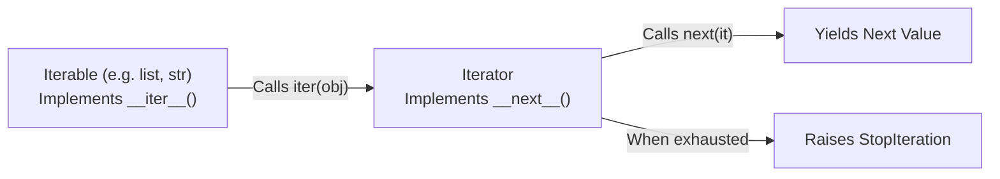

import { Callout } from "fumadocs-ui/components/callout";
import { Tabs, Tab } from "fumadocs-ui/components/tabs";
import { Accordion, Accordions } from "fumadocs-ui/components/accordion";

When processing 10,000,000 database rows or streaming gigabytes of network logs, creating an in-memory list will instantly deplete your machine's RAM.

Python solves this with **Iterators** and **Generators** — allowing you to produce and process data **one item at a time, lazily on demand**.

---

## 1. Iterable vs. Iterator: The Protocol

In Python, these two terms have distinct, precise meanings:



```python
numbers = [10, 20, 30]

# 1. Obtain an iterator from the iterable
it = iter(numbers)

# 2. Advance the iterator manually
print(next(it))  # 10
print(next(it))  # 20
print(next(it))  # 30

# 3. Reaching the end raises StopIteration
try:
    next(it)
except StopIteration:
    print("Reached the end of the iterator!")
```

Output:

```text
10
20
30
Reached the end of the iterator!
```

---

## 2. Generator Functions: The `yield` Keyword

Writing a custom class with `__iter__` and `__next__` requires substantial boilerplate. A **generator function** provides an elegant shortcut: any function containing the `yield` keyword automatically becomes a generator factory!

```python
def count_down(start: int):
    print(f"Starting countdown from {start}")
    current = start
    while current > 0:
        yield current  # Pauses execution and returns current value
        current -= 1
    print("Blastoff!")

gen = count_down(3)
print("Generator object created:", gen)

for num in gen:
    print("Count:", num)
```

Output:

```text
Generator object created: <generator object count_down at 0x...>
Starting countdown from 3
Count: 3
Count: 2
Count: 1
Blastoff!
```

### What Happens When `yield` Executes?

Unlike a standard function whose stack frame is destroyed upon hitting `return`, a generator **freezes its execution frame in memory**:

- All local variable states (`current`) are preserved.
- When `next()` is called again, execution resumes directly from the instruction immediately following the `yield`.

---

## 3. Generator Expressions: Memory Benchmark

Compare the memory footprint of a list comprehension vs a generator expression:

```python
import sys

# 1. List comprehension (allocates all 1,000,000 integers in RAM immediately)
list_comp = [x * 2 for x in range(1_000_000)]
print(f"List size in RAM: {sys.getsizeof(list_comp) / (1024 * 1024):.2f} MB")

# 2. Generator expression (produces values on demand)
gen_exp = (x * 2 for x in range(1_000_000))
print(f"Generator size in RAM: {sys.getsizeof(gen_exp)} bytes")
```

Output:

```text
List size in RAM: 8.05 MB
Generator size in RAM: 200 bytes
```

The generator expression takes **200 bytes** of memory regardless of whether it processes 1,000 items or 1,000,000,000 items!

---

## 4. Subgenerator Delegation: `yield from`

When nesting generators, `yield from` delegates all iteration directly to a subgenerator:

<Tabs items={['Modern yield from', 'Manual Nested Loop']}>
<Tab value="Modern yield from">
```python
def sub_sequence():
    yield "A"
    yield "B"

def main_sequence():
yield 1
yield from sub_sequence() # Directly forwards iteration
yield 2

print(list(main_sequence()))

````
</Tab>
<Tab value="Manual Nested Loop">
```python
def sub_sequence():
    yield "A"
    yield "B"

def main_sequence():
    yield 1
    for item in sub_sequence():
        yield item
    yield 2

print(list(main_sequence()))
````

</Tab>
</Tabs>

Output:

```text
[1, 'A', 'B', 2]
```

---

## 5. Composing Lazy Data Processing Pipelines

In production data engineering, you can chain multiple small generator stages together like Unix pipes (`cat | grep | awk`):

```python
# Stage 1: Source generator
def generate_integers(limit: int):
    for i in range(1, limit + 1):
        yield i

# Stage 2: Filter generator
def filter_evens(stream):
    for item in stream:
        if item % 2 == 0:
            yield item

# Stage 3: Transformer generator
def square_numbers(stream):
    for item in stream:
        yield item ** 2

# Connect the pipeline:
pipeline = square_numbers(filter_evens(generate_integers(10)))

# Pull results through the pipeline on demand:
print(list(pipeline))
```

Output:

```text
[4, 16, 36, 64, 100]
```

No intermediate lists were created at any point in memory!

---

## Practice Questions & Challenges

Test your understanding of the iterator protocol, generator frame freezing, lazy evaluation, and stream pipelines.

### Question 1: Output Prediction (The One-Time Consumption Trap)

Examine this script:

```python
def count_down(n: int):
    while n > 0:
        yield n
        n -= 1

counter = count_down(3)

print("Pass 1:", list(counter))
print("Pass 2:", list(counter))
print("Pass 3 sum:", sum(counter))
```

1. Predict the exact output of Pass 1, Pass 2, and Pass 3.
2. Why is Pass 2 empty `[]` instead of `[3, 2, 1]`?
3. What is the fundamental difference between an **Iterable** (like a `list`) and an **Iterator** (like a generator)?

<Accordions>
<Accordion title="Reveal Solution & Explanation">

**1. Output:**

```text
Pass 1: [3, 2, 1]
Pass 2: []
Pass 3 sum: 0
```

**2. Why Pass 2 is Empty:**
Iterators are stateful, single-pass forward cursors. Once an iterator yields its final value and raises `StopIteration`, it is completely exhausted. Subsequent calls to `next()` or `list()` immediately receive `StopIteration` and return an empty collection.

**3. Iterable vs Iterator:**

- An **Iterable** (e.g., `list`, `str`, `tuple`, custom class with `__iter__`) can produce a fresh, independent iterator each time `iter(obj)` is called. You can loop over a list multiple times.
- An **Iterator** (e.g., generators, `enumerate`, `zip`, `map`) is the active cursor object itself. It advances on each `next()` call and can only be traversed once.

</Accordion>
</Accordions>

---

### Question 2: Spot and Fix the Bug (The Infinite Stream Memory Lockup)

A developer wants to inspect the first 5 even numbers from an infinite generator:

```python
def infinite_integers():
    n = 0
    while True:
        yield n
        n += 1

# Attempting to fetch first 5 even numbers:
evens = [x for x in infinite_integers() if x % 2 == 0][:5]
print("First 5 evens:", evens)
```

When they run this script, the program hangs permanently, memory usage climbs continuously, and the script never prints anything.

1. Why did the list comprehension hang forever even though `[:5]` is applied at the end?
2. How do square brackets `[...]` differ from parentheses `(...)` in terms of evaluation timing?
3. How do you extract the first 5 items cleanly using `itertools.islice()`?

<Accordions>
<Accordion title="Reveal Solution & Explanation">

**1. Root Cause:**
List comprehensions are **greedy (eager)**. Python must compute the _entire_ list comprehension in memory before it can apply the slice `[:5]`. Because `infinite_integers()` never terminates, Python loops indefinitely, consuming all available RAM until killed with `MemoryError` or terminated by the user.

**2. Eager vs Lazy Syntax:**

- `[...]` creates a **list comprehension** (eagerly computes and stores all items in RAM).
- `(...)` creates a **generator expression** (lazily produces items on demand in $O(1)$ RAM).

**3. The Solution with `itertools.islice`:**

```python
from itertools import islice

def infinite_integers():
    n = 0
    while True:
        yield n
        n += 1

# Lazy filter generator:
evens_gen = (x for x in infinite_integers() if x % 2 == 0)

# Slice exactly 5 items from the generator without consuming infinity:
first_five = list(islice(evens_gen, 5))
print("First 5 evens:", first_five)  # [0, 2, 4, 6, 8]
```

</Accordion>
</Accordions>

---

### Question 3: Architecture Question (How `yield` Freezes Frame Execution)

1. When a normal function returns with `return 42`, what happens to its local variables and execution frame on the call stack?
2. When a generator encounters `yield 42`, what does CPython do to the function's execution frame (`PyFrameObject`)?
3. Where does execution resume when `next()` is called on the generator?

<Accordions>
<Accordion title="Reveal Solution & Explanation">

**1. Normal Function Return:**
When `return` executes, the function's call stack frame is popped from the call stack and deallocated. All local variables are freed immediately (subject to reference counts).

**2. Generator `yield` Suspension:**
When `yield` executes:

- CPython freezes the execution frame's instruction pointer (`f_lasti`).
- The frame object is **not destroyed**; it remains preserved on the heap.
- All local variable bindings and internal loop states are preserved in memory.
- The yielded value is passed to the caller of `next()`.

**3. Resumption on `next()`:**
When `next()` is called again, CPython reinstates the preserved frame and resumes execution on the very next bytecode instruction immediately following the `yield` statement.

</Accordion>
</Accordions>

---

### Question 4: Hands-On Challenge (Batch Flattening with `yield from`)

Suppose a database query fetches records in batches:

```python
batches = [
    [{"id": 1, "name": "Alice"}, {"id": 2, "name": "Bob"}],
    [{"id": 3, "name": "Charlie"}],
    [{"id": 4, "name": "Dave"}, {"id": 5, "name": "Eve"}]
]
```

Write a generator function `flatten_batches(batch_stream)` that uses **`yield from`** to yield individual record items sequentially.

<Accordions>
<Accordion title="Reveal Solution & Code">

```python
def flatten_batches(batch_stream):
    """
    Lazily unpacks and streams individual records from a stream of batches.
    """
    for batch in batch_stream:
        # yield from delegates sub-iteration cleanly:
        yield from batch

# Verification:
batches = [
    [{"id": 1, "name": "Alice"}, {"id": 2, "name": "Bob"}],
    [{"id": 3, "name": "Charlie"}],
    [{"id": 4, "name": "Dave"}, {"id": 5, "name": "Eve"}]
]

record_stream = flatten_batches(batches)

for record in record_stream:
    print("Record:", record["id"], record["name"])
```

Sample Output:

```text
Record: 1 Alice
Record: 2 Bob
Record: 3 Charlie
Record: 4 Dave
Record: 5 Eve
```

</Accordion>
</Accordions>

---

### Question 5: Code Challenge (Sliding Window N-Gram Stream Generator)

In Natural Language Processing (NLP) and time-series analytics, algorithms process sliding windows of consecutive items.

Write a generator function `sliding_window(iterable, window_size: int = 3)` that yields sliding window tuples of size `window_size` in $O(window\_size)$ memory without materializing the whole input into a list.

Example:

```python
stream = sliding_window([1, 2, 3, 4, 5], window_size=3)
list(stream)
# Output: [(1, 2, 3), (2, 3, 4), (3, 4, 5)]
```

If the input has fewer than `window_size` elements, the generator should yield nothing and exit cleanly.

<Accordions>
<Accordion title="Reveal Solution & Code">

```python
from collections import deque
from collections.abc import Iterable
from typing import TypeVar, Generator

T = TypeVar("T")

def sliding_window(
    iterable: Iterable[T],
    window_size: int = 3
) -> Generator[tuple[T, ...], None, None]:
    """
    Yields overlapping sliding windows of length `window_size`.
    Maintains strictly O(window_size) memory using a deque.
    """
    if window_size <= 0:
        raise ValueError("window_size must be a positive integer.")

    it = iter(iterable)
    window: deque[T] = deque(maxlen=window_size)

    # Pre-fill window up to window_size - 1
    for _ in range(window_size - 1):
        try:
            window.append(next(it))
        except StopIteration:
            return  # Input was shorter than window_size

    # Process remaining elements
    for item in it:
        window.append(item)
        yield tuple(window)

# Verification Test:
if __name__ == "__main__":
    data = [10, 20, 30, 40, 50, 60]
    windows = list(sliding_window(data, window_size=3))
    print("Windows:", windows)
    assert windows == [
        (10, 20, 30),
        (20, 30, 40),
        (30, 40, 50),
        (40, 50, 60)
    ]

    # Test on infinite stream safely with islice:
    from itertools import count, islice
    infinite_stream = sliding_window(count(), window_size=2)
    first_three = list(islice(infinite_stream, 3))
    print("Infinite stream windows:", first_three)
    assert first_three == [(0, 1), (1, 2), (2, 3)]
    print("✅ Verified: Sliding window generator works cleanly.")
```

</Accordion>
</Accordions>

---

## Summary Reference

- **Iterable**: Any object with `__iter__()`.
- **Iterator**: An object with `__next__()` that raises `StopIteration` when exhausted.
- **`yield`**: Yields a value and freezes local function state.
- **Generator expression**: `(x for x in seq)` uses $O(1)$ memory.
- **`yield from subgen`**: Delegates iteration directly to an inner generator.
