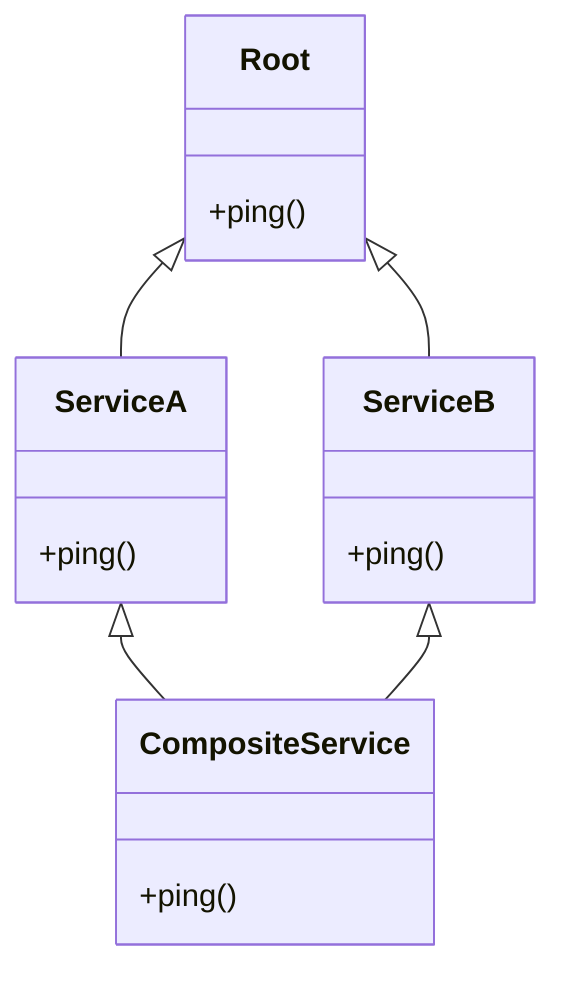
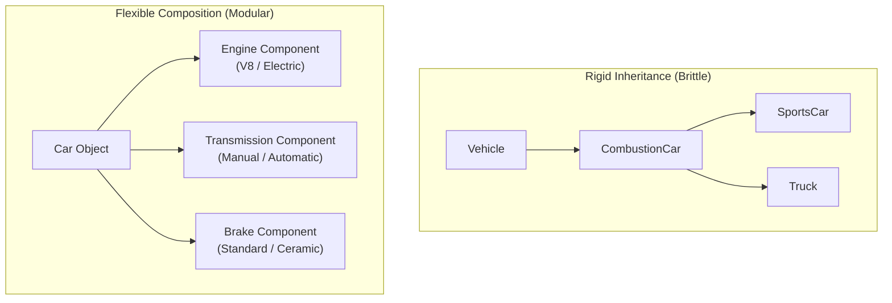

import { Callout } from "fumadocs-ui/components/callout";
import { Tabs, Tab } from "fumadocs-ui/components/tabs";
import { Accordion, Accordions } from "fumadocs-ui/components/accordion";

Python is one of the few mainstream programming languages that supports full **Multiple Inheritance** — the ability of a class to inherit from multiple parent classes simultaneously.

While multiple inheritance is powerful, it introduces architectural challenges, such as the famous **Diamond Problem**. Python solves these challenges deterministically using **C3 Linearization**.

In this chapter, we master multiple inheritance, demystify Method Resolution Order (MRO), learn how to write modular **Mixins**, explore the vital principle of **Composition over Inheritance**, and discover how **`__slots__`** drastically cuts memory usage.

---

## 1. Multiple Inheritance & The Diamond Problem

What happens when two classes inherit from the same base class, and a child class inherits from both of them?



In languages like C++, this "Diamond Pattern" can cause ambiguity: if both `ServiceA` and `ServiceB` override `ping()`, which version should `CompositeService` call?

Python resolves this ambiguity deterministically using an algorithm called **C3 Linearization** to construct a strict, linear search sequence known as the **Method Resolution Order (MRO)**.

---

## 2. Demystifying C3 Linearization & MRO

The **Method Resolution Order (MRO)** is the exact list of classes Python searches sequentially when looking for a method or attribute on an instance.

You can inspect any class's MRO using the `.mro()` method or the `.__mro__` attribute:

```python
class Root:
    pass

class A(Root):
    pass

class B(Root):
    pass

class C(A, B):
    pass

print([cls.__name__ for cls in C.mro()])
```

Output:

```text
['C', 'A', 'B', 'Root', 'object']
```

### The Three Guarantees of C3 Linearization

When Python computes the MRO for a class, the C3 algorithm enforces three mathematical invariants:

1. **Children Before Parents**: A subclass is always inspected before its base classes (`C` comes before `A` and `B`).
2. **Order of Declaration Preserved**: In `class C(A, B):`, `A` is searched before `B` because `A` was listed first in the inheritance tuple.
3. **Monotonicity**: If class `X` precedes class `Y` in the MRO of one class, `X` must precede `Y` in the MRO of every subclass throughout the entire hierarchy.

### What Happens If You Violate Monotonicity?

If you attempt to construct an impossible inheritance hierarchy where parent orders contradict each other, Python refuses to compile the class:

```python
class X: pass
class Y(X): pass

# Impossible: Y inherits from X (so Y must precede X),
# but (X, Y) demands X precede Y!
try:
    class Contradiction(X, Y):
        pass
except TypeError as err:
    print("Python prevented invalid hierarchy:")
    print(err)
```

Output:

```text
Python prevented invalid hierarchy:
Cannot create a consistent method resolution order (MRO) for bases X, Y
```

### The C3 Linearization Merge Algorithm (Step-by-Step Manual Calculation)

How does Python calculate the exact MRO sequence under the hood? It uses the **C3 Linearization** algorithm, first described in computer science literature for the Dylan language and adopted by Python in version 2.3 (PEP 2308).

#### The Recurrence Formula

The linearization of class $C$ inheriting from bases $B_1, B_2, \dots, B_n$ is defined as:

$$L(C) = [C] + \text{merge}(L(B_1), L(B_2), \dots, L(B_n), [B_1, B_2, \dots, B_n])$$

And the base case:

$$L(\text{object}) = [\text{object}]$$

#### The Head & Tail Merge Rules

To evaluate $\text{merge}(\dots)$:

1. Look at the **head** (the first element) of the first candidate list.
2. Check if this head appears in the **tail** (any position other than the first) of **any other list** in the merge.
   - **If it is NOT in any other tail**: It is a "good head"! Append it to the class MRO, delete all occurrences of it from every candidate list in the merge, and repeat from Step 1.
   - **If it IS in any tail**: It is blocked! Skip it and examine the head of the _next_ candidate list.
3. If all candidate heads appear in someone else's tail, an impossible cyclic dependency has occurred, and Python raises:
   `TypeError: Cannot create a consistent method resolution order (MRO)`.

#### Manual Worked Example: The Classic Diamond

Consider this diamond hierarchy:

```python
class O: pass  # Base root (inherits from object)
class A(O): pass
class B(O): pass
class C(A, B): pass
```

Let's calculate $L(C)$ step-by-step:

1. **Calculate base linearizations:**
   - $L(O) = [O, \text{object}]$
   - $L(A) = [A] + \text{merge}(L(O), [O]) = [A, O, \text{object}]$
   - $L(B) = [B] + \text{merge}(L(O), [O]) = [B, O, \text{object}]$

2. **Apply the recurrence for $C(A, B)$:**
   $$L(C) = [C] + \text{merge}([A, O, \text{object}], [B, O, \text{object}], [A, B])$$

3. **Execute the merge steps:**
   - **Step 1**: Look at the head of the 1st list: `A`.
     - Is `A` in the tail of $[B, O, \text{object}]$? No (tail is $[O, \text{object}]$).
     - Is `A` in the tail of $[A, B]$? No (tail is $[B]$).
     - `A` is a **good head**! Add `A` to MRO, remove `A` from all lists.
     - _MRO so far_: $[C, A]$
     - _Remaining merge_: $\text{merge}([O, \text{object}], [B, O, \text{object}], [B])$
   - **Step 2**: Look at the head of the 1st list: `O`.
     - Is `O` in the tail of $[B, O, \text{object}]$? **Yes!** (Tail of $[B, O, \text{object}]$ is $[O, \text{object}]$).
     - `O` is blocked! Skip it and look at the head of the 2nd list: `B`.
     - Is `B` in the tail of $[O, \text{object}]$? No.
     - Is `B` in the tail of $[B]$? No (it is the head, tail is empty).
     - `B` is a **good head**! Add `B` to MRO, remove `B` from all lists.
     - _MRO so far_: $[C, A, B]$
     - _Remaining merge_: $\text{merge}([O, \text{object}], [O, \text{object}])$
   - **Step 3**: Look at the head of the 1st list: `O`.
     - Is `O` in any other list's tail? No.
     - Add `O` to MRO, remove `O`.
     - _MRO so far_: $[C, A, B, O]$
     - _Remaining merge_: $\text{merge}([\text{object}], [\text{object}])$
   - **Step 4**: Take `object`.
   - **Final Computed MRO:**
     $$[C, A, B, O, \text{object}]$$

You can verify Python computes the exact same order in 1 line:

```python
print([cls.__name__ for cls in C.mro()])
# Output: ['C', 'A', 'B', 'O', 'object']
```

---

## 3. Cooperative Multiple Inheritance with `super()`

The single most common misconception among Python developers is:

> _"super() calls the parent class."_

**This is false.** In Python:

> **`super()` calls the NEXT class in the instance's MRO chain.**

Because `super()` follows the MRO chain rather than hardcoded parent links, classes in a diamond hierarchy can cooperatively delegate tasks to each other without duplicate execution!

```python
class RootService:
    def execute(self):
        print("RootService: Core action completed.")

class LoggingService(RootService):
    def execute(self):
        print("[LoggingService] Starting execution trace...")
        super().execute()  # Calls NEXT class in MRO
        print("[LoggingService] Finished execution trace.")

class MetricsService(RootService):
    def execute(self):
        print("[MetricsService] Recording execution start timestamp...")
        super().execute()  # Calls NEXT class in MRO
        print("[MetricsService] Recording duration metric.")

# Multiple Inheritance:
class EnterpriseApplication(LoggingService, MetricsService):
    def execute(self):
        print("=== EnterpriseApp: Task Triggered ===")
        super().execute()
        print("=== EnterpriseApp: Task Finished ===")

app = EnterpriseApplication()
app.execute()
```

Output:

```text
=== EnterpriseApp: Task Triggered ===
[LoggingService] Starting execution trace...
[MetricsService] Recording execution start timestamp...
RootService: Core action completed.
[MetricsService] Recording duration metric.
[LoggingService] Finished execution trace.
=== EnterpriseApp: Task Finished ===
```

Let's inspect the MRO of `EnterpriseApplication`:

```python
print([cls.__name__ for cls in EnterpriseApplication.mro()])
```

Output:

```text
['EnterpriseApplication', 'LoggingService', 'MetricsService', 'RootService', 'object']
```

Notice what happened:

1. `EnterpriseApplication.execute()` ran, then its `super().execute()` called `LoggingService.execute()`.
2. Inside `LoggingService`, `super().execute()` **did NOT call `RootService`**! Instead, it stepped sideways to `MetricsService`, because `MetricsService` was next in `EnterpriseApplication`'s MRO!
3. Inside `MetricsService`, `super().execute()` called `RootService.execute()`.
4. Then each method finished its post-call steps in reverse order (like peeling layers of an onion).

Every single class executed exactly once, with zero code duplication! This is known as **Cooperative Multiple Inheritance**.

### Cooperative `__init__` Chaining & The `**kwargs` Consumption Pattern

A common dilemma in multiple inheritance is:

> _"What happens when different base classes require different initialization arguments in their `__init__` methods?"_

If you use positional arguments like `super().__init__(arg1, arg2)`, your program will fail with a `TypeError` as soon as `super()` calls a sibling in the MRO that expects different parameters!

#### The Solution: Keyword-Only Parameter Popping

In professional cooperative hierarchies, every class accepts `**kwargs`, consumes only the arguments intended for itself, and forwards the remaining `**kwargs` down the MRO chain.

To ensure safety, a root base class terminates the chain before reaching `object.__init__()` (since `object.__init__` raises an error if passed any arguments):

```python
class CooperativeRoot:
    """Terminates parameter forwarding before object.__init__ is reached."""
    def __init__(self, **kwargs):
        super().__init__()
        if kwargs:
            # If any unconsumed kwargs reach the root, warn or raise
            raise TypeError(f"Unconsumed kwargs reached hierarchy root: {list(kwargs.keys())}")


class Configurable(CooperativeRoot):
    def __init__(self, env: str = "production", **kwargs):
        super().__init__(**kwargs)
        self.env = env
        print(f"[Configurable] Initialized for environment: {self.env}")


class Identifiable(CooperativeRoot):
    def __init__(self, entity_id: str, **kwargs):
        super().__init__(**kwargs)
        self.entity_id = entity_id
        print(f"[Identifiable] Registered unique ID: {self.entity_id}")


class DatabaseService(Identifiable, Configurable):
    def __init__(self, connection_url: str, **kwargs):
        super().__init__(**kwargs)
        self.connection_url = connection_url
        print(f"[DatabaseService] Connected to: {self.connection_url}")


# Instantiation works seamlessly regardless of MRO resolution order:
service = DatabaseService(
    entity_id="srv-prod-042",
    connection_url="postgresql://db.internal:5432/app",
    env="staging"
)
```

Output:

```text
[Configurable] Initialized for environment: staging
[Identifiable] Registered unique ID: srv-prod-042
[DatabaseService] Connected to: postgresql://db.internal:5432/app
```

Each class peeled off its own configuration keyword, and the cooperative chain initialized every layer cleanly without parameter collisions!

---

## 4. The Mixin Architectural Pattern

A **Mixin** is a specialized, lightweight class designed to provide a specific slice of reusable functionality to other classes via multiple inheritance.

### Golden Rules of Writing Mixins

1. A mixin should **never be instantiated directly**.
2. A mixin should **not store independent state** (it should not define a standalone `__init__` that overrides attributes).
3. A mixin should be focused on a single responsibility (e.g. JSON serialization, audit logging, rate limiting).
4. By convention, mixin class names end with `Mixin` (e.g., `JSONSerializableMixin`).

### Building Real-World Mixins

```python
import json

class JSONSerializableMixin:
    """Provides automatic JSON serialization to any class with a __dict__."""

    def to_json(self, indent: int = 2) -> str:
        # Serializes only public attributes
        data = {
            k: v for k, v in self.__dict__.items()
            if not k.startswith("_")
        }
        return json.dumps(data, indent=indent, default=str)


class AuditLogMixin:
    """Logs state inspections for auditing purposes."""

    def audit_summary(self) -> str:
        cls_name = self.__class__.__name__
        attrs = ", ".join(f"{k}={v!r}" for k, v in self.__dict__.items() if not k.startswith("_"))
        return f"[AUDIT:{cls_name}] {attrs}"
```

Now, any business entity can effortlessly gain JSON export and audit capabilities simply by listing the mixins:

```python
class Product(JSONSerializableMixin, AuditLogMixin):
    def __init__(self, sku: str, name: str, price: float):
        self.sku = sku
        self.name = name
        self.price = price

class Customer(JSONSerializableMixin, AuditLogMixin):
    def __init__(self, username: str, email: str):
        self.username = username
        self.email = email

prod = Product("TECH-99", "Noise-Cancelling Headphones", 249.99)
user = Customer("johndoe", "john@example.com")

print(prod.audit_summary())
print(prod.to_json())

print(user.audit_summary())
print(user.to_json())
```

Output:

```text
[AUDIT:Product] sku='TECH-99', name='Noise-Cancelling Headphones', price=249.99
{
  "sku": "TECH-99",
  "name": "Noise-Cancelling Headphones",
  "price": 249.99
}
[AUDIT:Customer] username='johndoe', email='john@example.com'
{
  "username": "johndoe",
  "email": "john@example.com"
}
```

Mixins provide modular "plug-and-play" capabilities across completely unrelated domain models.

### Advanced Pattern: Cooperative Caching Mixins

Mixins can also intercept and optimize method calls by combining multiple inheritance with `super()`:

```python
import time
from typing import Any

class CacheMixin:
    """Thread-safe memoization mixin utilizing cooperative super()."""
    def __init__(self, **kwargs):
        super().__init__(**kwargs)
        self._cache: dict[str, Any] = {}

    def fetch(self, key: str) -> Any:
        if key in self._cache:
            return f"[CACHE HIT] {self._cache[key]}"
        # Cooperatively delegates to the next class in the MRO!
        result = super().fetch(key)
        self._cache[key] = result
        return f"[FRESH FETCH] {result}"


class RemoteDataService:
    def fetch(self, key: str) -> str:
        time.sleep(0.01)  # Simulate network request
        return f"payload_for_{key}"


# Assemble the cached microservice:
class CachedDataClient(CacheMixin, RemoteDataService):
    pass

client = CachedDataClient()
print(client.fetch("user:101"))
print(client.fetch("user:101"))
```

Output:

```text
[FRESH FETCH] payload_for_user:101
[CACHE HIT] payload_for_user:101
```

Notice that `RemoteDataService` knows nothing about caching, and `CacheMixin` knows nothing about how data is fetched remotely. By stacking them, we get a clean, testable, and reusable caching client!

---

## 5. Composition vs. Inheritance: The Golden Principle

One of the most famous maxims in software engineering from the Gang of Four (_Design Patterns_) is:

> _"Favor object composition over class inheritance."_

### Why Inheritance Can Become a Nightmare

Beginners often create deep, rigid inheritance hierarchies. As the codebase evolves, this leads to two classic architectural disasters:

1. **The Fragile Base Class Problem**: If you modify a method in a base class 5 levels deep, you may unintentionally break 20 subclasses across your application.
2. **The Gorilla/Banana Problem** (as described by Erlang creator Joe Armstrong):
   > _"You wanted a banana, but what you got was a gorilla holding the banana and the entire jungle."_

### "IS-A" vs. "HAS-A"

- **Inheritance ("IS-A")**: Use only when the child is a genuine, permanent specialization of the parent (e.g., `SavingsAccount` _is a_ `BankAccount`).
- **Composition ("HAS-A")**: Assemble classes by containing references to other helper objects (e.g., A `Car` _has an_ `Engine`, a `Computer` _has a_ `CPU`).



### Refactoring Inheritance into Clean Composition

Consider this modular, composed architecture:

```python
class GasEngine:
    def start(self):
        return "Vroom! Internal combustion engine purrs."

class ElectricMotor:
    def start(self):
        return "Silent power. Electric motor ready."

class Car:
    def __init__(self, model: str, engine):
        self.model = model
        # COMPOSITION: Car HAS an engine (injected as a dependency)
        self.engine = engine

    def drive(self):
        engine_sound = self.engine.start()
        print(f"{self.model} is in gear. {engine_sound}")

# We can swap engines dynamically without altering the Car class:
tesla = Car("Model S", ElectricMotor())
mustang = Car("Mustang GT", GasEngine())

tesla.drive()
mustang.drive()
```

Output:

```text
Model S is in gear. Silent power. Electric motor ready.
Mustang GT is in gear. Vroom! Internal combustion engine purrs.
```

With composition, your code is modular, loosely coupled, and trivially easy to unit test using mock objects!

### Composition in Action: The `Engine` and `Car` Model

To contrast composition directly against inheritance, consider building a car from scratch:

```python
class Engine:
    def start(self):
        print("Engine started.")

class Car:
    def __init__(self):
        # Composition: Car HAS an Engine
        self.engine = Engine()

    def start(self):
        self.engine.start()
        print("Car is ready to drive.")

car = Car()
car.start()
```

Output:

```text
Engine started.
Car is ready to drive.
```

Here:

- An engine is **not** a type of car, so `class Car(Engine):` would be an architectural mistake.
- Instead, `Car` holds an `Engine` instance inside its `self.engine` attribute.
- This "HAS-A" relationship allows you to replace, test, or upgrade the `Engine` without altering the `Car`'s external interface.

### Architectural Decision Matrix: Inheritance vs. Composition

When designing a class hierarchy, use this decision framework:

| Architectural Requirement  | Use Inheritance ("IS-A")                                          | Use Composition ("HAS-A")                                          |
| :------------------------- | :---------------------------------------------------------------- | :----------------------------------------------------------------- |
| **Domain Relationship**    | Genuine ontological specialization (e.g., `Dog` is an `Animal`).  | Assembly of parts or services (e.g., `Car` has an `Engine`).       |
| **Coupling Level**         | Tight coupling (subclasses depend on parent internals).           | Loose coupling (components interact only via clean interfaces).    |
| **Runtime Mutability**     | Fixed at definition time (cannot re-parent instances at runtime). | Fully dynamic (swap `car.engine = ElectricMotor()` on the fly).    |
| **Unit Testing & Mocking** | Fragile (must initialize the full parent chain).                  | Effortless (inject lightweight mock objects into the constructor). |
| **Code Reuse Strategy**    | Subclassing shared base methods.                                  | Delegating work to specialized component instances.                |

---

## 6. High-Performance OOP: Memory Optimization with `__slots__`

By default, every Python instance stores its attributes in an internal dictionary called `__dict__`.

Because Python dictionaries are dynamic hash tables designed to grow arbitrarily, they consume a substantial amount of memory (often 100 to 200+ bytes per object just for the dictionary overhead).

If you instantiate **millions** of objects (such as nodes in a graph, financial ticks, or 3D particles), this overhead causes severe memory bloat.

### The Solution: `__slots__`

By defining `__slots__`, you tell CPython:

> _"This class will only ever have these specific attributes. Do NOT allocate a `__dict__` for instances; allocate a compact, fixed-size C array instead."_

```python
class RegularPoint:
    def __init__(self, x: float, y: float):
        self.x = x
        self.y = y

class SlottedPoint:
    __slots__ = ("x", "y")  # Eliminates __dict__!

    def __init__(self, x: float, y: float):
        self.x = x
        self.y = y
```

### Inspecting Memory & Behavior Differences

```python
r = RegularPoint(1.0, 2.0)
s = SlottedPoint(1.0, 2.0)

# RegularPoint has an internal __dict__:
print("Regular has __dict__?", hasattr(r, "__dict__"))

# SlottedPoint does NOT have a __dict__:
print("Slotted has __dict__?", hasattr(s, "__dict__"))

# Trying to add arbitrary attributes:
r.z = 3.0  # Works fine on regular objects
print("r.z:", r.z)

try:
    s.z = 3.0  # Fails on slotted objects!
except AttributeError as err:
    print("Caught slotted error:", err)
```

Output:

```text
Regular has __dict__? True
Slotted has __dict__? False
r.z: 3.0
Caught slotted error: 'SlottedPoint' object has no attribute 'z'
```

### Benefits of `__slots__`

1. **40% to 60% Memory Reduction**: Creating 1,000,000 slotted objects uses less than half the RAM of regular objects.
2. **Faster Attribute Access**: Reading and writing slotted attributes is roughly 15-20% faster because CPython bypasses dictionary lookups.
3. **Typo Prevention**: Prevents accidental attribute assignments (e.g., typing `user.emial = ...` instead of `user.email`).

### The 4 Invariants and Traps of `__slots__` Inheritance

While `__slots__` is a great optimization for high-throughput systems, it introduces four strict inheritance rules:

#### 1. The Child `__dict__` Reversion Trap

If a parent class defines `__slots__`, but its subclass does **not** declare `__slots__`, Python quietly creates a `__dict__` on every child instance!

```python
class Parent:
    __slots__ = ("x",)

class Child(Parent):
    pass  # Forgot __slots__!

c = Child()
c.new_attr = "oops"  # Succeeds because Child created an instance __dict__!
print("Child has __dict__?", hasattr(c, "__dict__"))  # True!
```

To preserve memory savings in derived classes, the subclass must explicitly define `__slots__ = ()` (if adding no new fields) or list only its new fields: `__slots__ = ("y",)`.

#### 2. The Multiple Inheritance "Layout Conflict" Error

In multiple inheritance, Python **forbids inheriting from more than one base class that has non-empty `__slots__`**:

```python
class BaseA:
    __slots__ = ("a",)

class BaseB:
    __slots__ = ("b",)

# ❌ Crashes at class definition time:
try:
    class Combined(BaseA, BaseB):
        pass
except TypeError as err:
    print("Caught layout conflict:")
    print(err)
# Output: TypeError: multiple bases have instance lay-out conflict
```

**Why CPython rejects this:** Slots are implemented in C as fixed memory offsets from the start of the C-struct. Two distinct base classes each expect their slots at identical struct offsets, making a combined layout impossible in C.

#### 3. The Golden Rule for Slotted Mixins

Because of the layout conflict rule, **mixins intended for multiple inheritance should always declare empty slots**:

```python
class SafeMixin:
    __slots__ = ()  # Empty tuple allows multiple inheritance without layout conflict!

class SlottedModel(BaseA, SafeMixin):
    __slots__ = ("extra",)  # Works perfectly!
```

#### 4. The Weak Reference Trap

Regular Python objects can be referenced using `weakref.ref(obj)`. Slotted classes do not support weak references by default unless you explicitly include `"__weakref__"` in `__slots__`:

```python
class WeaklyReferencedNode:
    __slots__ = ("data", "__weakref__")  # Allocates pointer for weak reference tracking
```

---

## 7. Master Quick Revision: Concepts You Should Never Confuse

To wrap up the four Object-Oriented Programming foundation chapters, use this reference table whenever you need to clarify which concept solves which architectural problem:

| Concept               | The Essential Architectural Question It Answers                                  | Primary Python Mechanism                         |
| :-------------------- | :------------------------------------------------------------------------------- | :----------------------------------------------- |
| **Class**             | _What data structure and behavior should these objects possess?_                 | `class ClassName:`                               |
| **Object / Instance** | _Which specific living entity in RAM are we operating on right now?_             | `obj = ClassName()`                              |
| **`self`**            | _Which concrete instance is this method executing for?_                          | First parameter of instance methods              |
| **`__init__()`**      | _What initial state must be written to the instance at creation time?_           | The constructor initialization protocol          |
| **Encapsulation**     | _How do we group state and actions while preventing unauthorized mutation?_      | `_protected`, `__private` mangling, `@property`  |
| **Inheritance**       | _How can one class specialize or extend another class's behavior?_               | `class Subclass(BaseClass):`                     |
| **`super()`**         | _How can I cooperatively call the next class in the MRO chain?_                  | `super().method(*args)`                          |
| **Method Overriding** | _How can a child class replace or extend an inherited action?_                   | Defining a same-named method in the subclass     |
| **Polymorphism**      | _How can different classes respond to the same method call in their own way?_    | Duck typing, common method names, Protocols      |
| **Abstraction**       | _What contract and essential interface should external callers depend upon?_     | `abc.ABC`, `@abstractmethod`                     |
| **Composition**       | _How can we build complex, maintainable objects from modular components?_        | Storing helper instances as attributes ("HAS-A") |
| **Dunder Methods**    | _How do custom objects natively hook into Python's built-in language operators?_ | `__len__`, `__str__`, `__repr__`, `__add__`      |

### The Ultimate OOP Mental Model

Do not attempt to memorize syntax in isolation. Always anchor your thinking in the relational model:

> **A class defines how objects behave. `self` points to the specific instance. `__init__()` sets up its initial state. Encapsulation organizes and guards that state. Inheritance reuses and specializes behavior, while polymorphism lets different objects support a uniform interface. Abstraction specifies the required contract, and composition assembles robust applications from simple, swappable components.**

Once you see these relationships clearly, designing production-grade Python architectures becomes intuitive.

---

## Practice Questions & Challenges

### Question 1: Output Prediction (The Diamond MRO Trace)

Examine this diamond hierarchy:

```python
class A:
    def ping(self):
        print("A ping")

class B(A):
    def ping(self):
        print("B ping start")
        super().ping()
        print("B ping end")

class C(A):
    def ping(self):
        print("C ping start")
        super().ping()
        print("C ping end")

class D(B, C):
    def ping(self):
        print("D ping start")
        super().ping()
        print("D ping end")

d = D()
d.ping()
```

1. Predict the exact line-by-line output of `d.ping()`.
2. In `B.ping()`, why does `super().ping()` call `C.ping()` instead of `A.ping()`, even though `B` does not inherit from `C`?

<Accordions>
<Accordion title="Reveal Solution & Explanation">

**1. Output:**

```text
D ping start
B ping start
C ping start
A ping
C ping end
B ping end
D ping end
```

**2. Explanation:**
Remember the golden rule of `super()`:

> `super()` finds the current class in the **instance's MRO chain** and calls the class that immediately follows it.

For an instance of `D`, the MRO is:

```text
D -> B -> C -> A -> object
```

When `d.ping()` runs:

- `D.ping()` calls `super().ping()`, which looks at the class after `D` in the MRO: **`B`**.
- `B.ping()` calls `super().ping()`, which looks at the class after `B` in the MRO: **`C`**!
- `C.ping()` calls `super().ping()`, which looks at the class after `C` in the MRO: **`A`**.
- `A.ping()` prints `"A ping"`, and then the execution stacks unwind in reverse!

</Accordion>
</Accordions>

---

### Question 2: Spot and Fix the Bug (Inconsistent MRO Error)

A backend developer structures their microservice classes like this:

```python
class Component: pass
class Database(Component): pass
class Cache(Component): pass

# Later in the code:
class Service(Database, Component, Cache):
    pass
```

When Python tries to import this module, it crashes with:

```text
TypeError: Cannot create a consistent method resolution order (MRO) for bases Component, Cache
```

1. Why does Python reject this class hierarchy?
2. How should the class definition of `Service` be fixed?

<Accordions>
<Accordion title="Reveal Solution & Explanation">

**1. Why it crashed:**
In `Service(Database, Component, Cache)`:

- `Component` is listed _before_ `Cache`.
- However, `Cache` itself inherits from `Component` (`class Cache(Component):`), which means `Cache` must precede `Component` in the MRO (children before parents rule)!
- This creates a contradiction: the definition order requires `Component -> Cache`, but the inheritance tree requires `Cache -> Component`. Python detects this violation of C3 Linearization and rejects it immediately.

**2. The Fix:**
Remove redundant intermediate base classes or place base classes in the correct hierarchical order:

```python
# Fixed: Let Database and Cache resolve their shared Component ancestor naturally:
class Service(Database, Cache):
    pass

print([cls.__name__ for cls in Service.mro()])
# Output: ['Service', 'Database', 'Cache', 'Component', 'object']
```

</Accordion>
</Accordions>

---

### Next Step

Now that you have mastered the four pillars of OOP, cooperative multiple inheritance, and architectural composition, explore how Python intercepts syntax with special double-underscore methods in **[05. The Python Data Model & Dunder Protocols](/docs/learn-python/02-intermediate/05-dunder-protocols-data-model)**!
