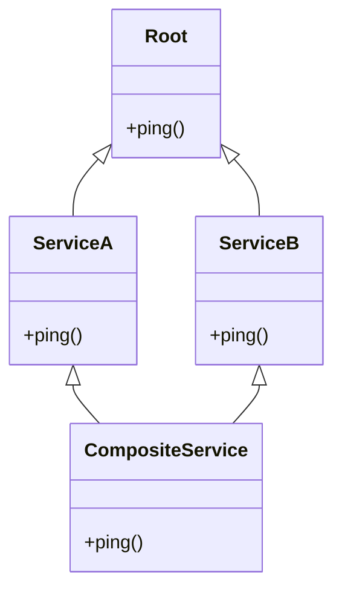
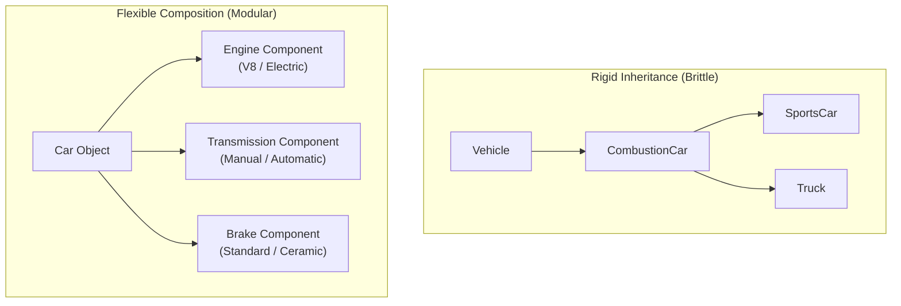

import { Callout } from "fumadocs-ui/components/callout";
import { Tabs, Tab } from "fumadocs-ui/components/tabs";
import { Accordion, Accordions } from "fumadocs-ui/components/accordion";

Python is one of the few mainstream programming languages that supports full **Multiple Inheritance** — the ability of a class to inherit from multiple parent classes simultaneously.

While multiple inheritance is powerful, it introduces architectural challenges, such as the famous **Diamond Problem**. Python solves these challenges deterministically using **C3 Linearization**.

In this chapter, we master multiple inheritance, demystify Method Resolution Order (MRO), learn how to write modular **Mixins**, explore the vital principle of **Composition over Inheritance**, and discover how **`__slots__`** drastically cuts memory usage.

---

## 1. Multiple Inheritance & The Diamond Problem

What happens when two classes inherit from the same base class, and a child class inherits from both of them?



In languages like C++, this "Diamond Pattern" can cause ambiguity: if both `ServiceA` and `ServiceB` override `ping()`, which version should `CompositeService` call?

Python resolves this ambiguity deterministically using an algorithm called **C3 Linearization** to construct a strict, linear search sequence known as the **Method Resolution Order (MRO)**.

---

## 2. Demystifying C3 Linearization & MRO

The **Method Resolution Order (MRO)** is the exact list of classes Python searches sequentially when looking for a method or attribute on an instance.

You can inspect any class's MRO using the `.mro()` method or the `.__mro__` attribute:

```python
class Root:
    pass

class A(Root):
    pass

class B(Root):
    pass

class C(A, B):
    pass

print([cls.__name__ for cls in C.mro()])
```

Output:

```text
['C', 'A', 'B', 'Root', 'object']
```

### The Three Guarantees of C3 Linearization

When Python computes the MRO for a class, the C3 algorithm enforces three mathematical invariants:

1. **Children Before Parents**: A subclass is always inspected before its base classes (`C` comes before `A` and `B`).
2. **Order of Declaration Preserved**: In `class C(A, B):`, `A` is searched before `B` because `A` was listed first in the inheritance tuple.
3. **Monotonicity**: If class `X` precedes class `Y` in the MRO of one class, `X` must precede `Y` in the MRO of every subclass throughout the entire hierarchy.

### What Happens If You Violate Monotonicity?

If you attempt to construct an impossible inheritance hierarchy where parent orders contradict each other, Python refuses to compile the class:

```python
class X: pass
class Y(X): pass

# Impossible: Y inherits from X (so Y must precede X),
# but (X, Y) demands X precede Y!
try:
    class Contradiction(X, Y):
        pass
except TypeError as err:
    print("Python prevented invalid hierarchy:")
    print(err)
```

Output:

```text
Python prevented invalid hierarchy:
Cannot create a consistent method resolution order (MRO) for bases X, Y
```

---

## 3. Cooperative Multiple Inheritance with `super()`

The single most common misconception among Python developers is:

> _"super() calls the parent class."_

**This is false.** In Python:

> **`super()` calls the NEXT class in the instance's MRO chain.**

Because `super()` follows the MRO chain rather than hardcoded parent links, classes in a diamond hierarchy can cooperatively delegate tasks to each other without duplicate execution!

```python
class RootService:
    def execute(self):
        print("RootService: Core action completed.")

class LoggingService(RootService):
    def execute(self):
        print("[LoggingService] Starting execution trace...")
        super().execute()  # Calls NEXT class in MRO
        print("[LoggingService] Finished execution trace.")

class MetricsService(RootService):
    def execute(self):
        print("[MetricsService] Recording execution start timestamp...")
        super().execute()  # Calls NEXT class in MRO
        print("[MetricsService] Recording duration metric.")

# Multiple Inheritance:
class EnterpriseApplication(LoggingService, MetricsService):
    def execute(self):
        print("=== EnterpriseApp: Task Triggered ===")
        super().execute()
        print("=== EnterpriseApp: Task Finished ===")

app = EnterpriseApplication()
app.execute()
```

Output:

```text
=== EnterpriseApp: Task Triggered ===
[LoggingService] Starting execution trace...
[MetricsService] Recording execution start timestamp...
RootService: Core action completed.
[MetricsService] Recording duration metric.
[LoggingService] Finished execution trace.
=== EnterpriseApp: Task Finished ===
```

Let's inspect the MRO of `EnterpriseApplication`:

```python
print([cls.__name__ for cls in EnterpriseApplication.mro()])
```

Output:

```text
['EnterpriseApplication', 'LoggingService', 'MetricsService', 'RootService', 'object']
```

Notice what happened:

1. `EnterpriseApplication.execute()` ran, then its `super().execute()` called `LoggingService.execute()`.
2. Inside `LoggingService`, `super().execute()` **did NOT call `RootService`**! Instead, it stepped sideways to `MetricsService`, because `MetricsService` was next in `EnterpriseApplication`'s MRO!
3. Inside `MetricsService`, `super().execute()` called `RootService.execute()`.
4. Then each method finished its post-call steps in reverse order (like peeling layers of an onion).

Every single class executed exactly once, with zero code duplication! This is known as **Cooperative Multiple Inheritance**.

---

## 4. The Mixin Architectural Pattern

A **Mixin** is a specialized, lightweight class designed to provide a specific slice of reusable functionality to other classes via multiple inheritance.

### Golden Rules of Writing Mixins

1. A mixin should **never be instantiated directly**.
2. A mixin should **not store independent state** (it should not define a standalone `__init__` that overrides attributes).
3. A mixin should be focused on a single responsibility (e.g. JSON serialization, audit logging, rate limiting).
4. By convention, mixin class names end with `Mixin` (e.g., `JSONSerializableMixin`).

### Building Real-World Mixins

```python
import json

class JSONSerializableMixin:
    """Provides automatic JSON serialization to any class with a __dict__."""

    def to_json(self, indent: int = 2) -> str:
        # Serializes only public attributes
        data = {
            k: v for k, v in self.__dict__.items()
            if not k.startswith("_")
        }
        return json.dumps(data, indent=indent, default=str)


class AuditLogMixin:
    """Logs state inspections for auditing purposes."""

    def audit_summary(self) -> str:
        cls_name = self.__class__.__name__
        attrs = ", ".join(f"{k}={v!r}" for k, v in self.__dict__.items() if not k.startswith("_"))
        return f"[AUDIT:{cls_name}] {attrs}"
```

Now, any business entity can effortlessly gain JSON export and audit capabilities simply by listing the mixins:

```python
class Product(JSONSerializableMixin, AuditLogMixin):
    def __init__(self, sku: str, name: str, price: float):
        self.sku = sku
        self.name = name
        self.price = price

class Customer(JSONSerializableMixin, AuditLogMixin):
    def __init__(self, username: str, email: str):
        self.username = username
        self.email = email

prod = Product("TECH-99", "Noise-Cancelling Headphones", 249.99)
user = Customer("johndoe", "john@example.com")

print(prod.audit_summary())
print(prod.to_json())

print(user.audit_summary())
print(user.to_json())
```

Output:

```text
[AUDIT:Product] sku='TECH-99', name='Noise-Cancelling Headphones', price=249.99
{
  "sku": "TECH-99",
  "name": "Noise-Cancelling Headphones",
  "price": 249.99
}
[AUDIT:Customer] username='johndoe', email='john@example.com'
{
  "username": "johndoe",
  "email": "john@example.com"
}
```

Mixins provide modular "plug-and-play" capabilities across completely unrelated domain models.

---

## 5. Composition vs. Inheritance: The Golden Principle

One of the most famous maxims in software engineering from the Gang of Four (_Design Patterns_) is:

> _"Favor object composition over class inheritance."_

### Why Inheritance Can Become a Nightmare

Beginners often create deep, rigid inheritance hierarchies. As the codebase evolves, this leads to two classic architectural disasters:

1. **The Fragile Base Class Problem**: If you modify a method in a base class 5 levels deep, you may unintentionally break 20 subclasses across your application.
2. **The Gorilla/Banana Problem** (as described by Erlang creator Joe Armstrong):
   > _"You wanted a banana, but what you got was a gorilla holding the banana and the entire jungle."_

### "IS-A" vs. "HAS-A"

- **Inheritance ("IS-A")**: Use only when the child is a genuine, permanent specialization of the parent (e.g., `SavingsAccount` _is a_ `BankAccount`).
- **Composition ("HAS-A")**: Assemble classes by containing references to other helper objects (e.g., A `Car` _has an_ `Engine`, a `Computer` _has a_ `CPU`).



### Refactoring Inheritance into Clean Composition

Consider this modular, composed architecture:

```python
class GasEngine:
    def start(self):
        return "Vroom! Internal combustion engine purrs."

class ElectricMotor:
    def start(self):
        return "Silent power. Electric motor ready."

class Car:
    def __init__(self, model: str, engine):
        self.model = model
        # COMPOSITION: Car HAS an engine (injected as a dependency)
        self.engine = engine

    def drive(self):
        engine_sound = self.engine.start()
        print(f"{self.model} is in gear. {engine_sound}")

# We can swap engines dynamically without altering the Car class:
tesla = Car("Model S", ElectricMotor())
mustang = Car("Mustang GT", GasEngine())

tesla.drive()
mustang.drive()
```

Output:

```text
Model S is in gear. Silent power. Electric motor ready.
Mustang GT is in gear. Vroom! Internal combustion engine purrs.
```

With composition, your code is modular, loosely coupled, and trivially easy to unit test using mock objects!

---

## 6. High-Performance OOP: Memory Optimization with `__slots__`

By default, every Python instance stores its attributes in an internal dictionary called `__dict__`.

Because Python dictionaries are dynamic hash tables designed to grow arbitrarily, they consume a substantial amount of memory (often 100 to 200+ bytes per object just for the dictionary overhead).

If you instantiate **millions** of objects (such as nodes in a graph, financial ticks, or 3D particles), this overhead causes severe memory bloat.

### The Solution: `__slots__`

By defining `__slots__`, you tell CPython:

> _"This class will only ever have these specific attributes. Do NOT allocate a `__dict__` for instances; allocate a compact, fixed-size C array instead."_

```python
class RegularPoint:
    def __init__(self, x: float, y: float):
        self.x = x
        self.y = y

class SlottedPoint:
    __slots__ = ("x", "y")  # Eliminates __dict__!

    def __init__(self, x: float, y: float):
        self.x = x
        self.y = y
```

### Inspecting Memory & Behavior Differences

```python
r = RegularPoint(1.0, 2.0)
s = SlottedPoint(1.0, 2.0)

# RegularPoint has an internal __dict__:
print("Regular has __dict__?", hasattr(r, "__dict__"))

# SlottedPoint does NOT have a __dict__:
print("Slotted has __dict__?", hasattr(s, "__dict__"))

# Trying to add arbitrary attributes:
r.z = 3.0  # Works fine on regular objects
print("r.z:", r.z)

try:
    s.z = 3.0  # Fails on slotted objects!
except AttributeError as err:
    print("Caught slotted error:", err)
```

Output:

```text
Regular has __dict__? True
Slotted has __dict__? False
r.z: 3.0
Caught slotted error: 'SlottedPoint' object has no attribute 'z'
```

### Benefits of `__slots__`

1. **40% to 60% Memory Reduction**: Creating 1,000,000 slotted objects uses less than half the RAM of regular objects.
2. **Faster Attribute Access**: Reading and writing slotted attributes is roughly 15-20% faster because CPython bypasses dictionary lookups.
3. **Typo Prevention**: Prevents accidental attribute assignments (e.g., typing `user.emial = ...` instead of `user.email`).

---

## Practice Questions & Challenges

### Question 1: Output Prediction (The Diamond MRO Trace)

Examine this diamond hierarchy:

```python
class A:
    def ping(self):
        print("A ping")

class B(A):
    def ping(self):
        print("B ping start")
        super().ping()
        print("B ping end")

class C(A):
    def ping(self):
        print("C ping start")
        super().ping()
        print("C ping end")

class D(B, C):
    def ping(self):
        print("D ping start")
        super().ping()
        print("D ping end")

d = D()
d.ping()
```

1. Predict the exact line-by-line output of `d.ping()`.
2. In `B.ping()`, why does `super().ping()` call `C.ping()` instead of `A.ping()`, even though `B` does not inherit from `C`?

<Accordions>
<Accordion title="Reveal Solution & Explanation">

**1. Output:**

```text
D ping start
B ping start
C ping start
A ping
C ping end
B ping end
D ping end
```

**2. Explanation:**
Remember the golden rule of `super()`:

> `super()` finds the current class in the **instance's MRO chain** and calls the class that immediately follows it.

For an instance of `D`, the MRO is:

```text
D -> B -> C -> A -> object
```

When `d.ping()` runs:

- `D.ping()` calls `super().ping()`, which looks at the class after `D` in the MRO: **`B`**.
- `B.ping()` calls `super().ping()`, which looks at the class after `B` in the MRO: **`C`**!
- `C.ping()` calls `super().ping()`, which looks at the class after `C` in the MRO: **`A`**.
- `A.ping()` prints `"A ping"`, and then the execution stacks unwind in reverse!
  </Accordion>
</Accordions>

---

### Question 2: Spot and Fix the Bug (Inconsistent MRO Error)

A backend developer structures their microservice classes like this:

```python
class Component: pass
class Database(Component): pass
class Cache(Component): pass

# Later in the code:
class Service(Database, Component, Cache):
    pass
```

When Python tries to import this module, it crashes with:

```text
TypeError: Cannot create a consistent method resolution order (MRO) for bases Component, Cache
```

1. Why does Python reject this class hierarchy?
2. How should the class definition of `Service` be fixed?

<Accordions>
<Accordion title="Reveal Solution & Explanation">

**1. Why it crashed:**
In `Service(Database, Component, Cache)`:

- `Component` is listed _before_ `Cache`.
- However, `Cache` itself inherits from `Component` (`class Cache(Component):`), which means `Cache` must precede `Component` in the MRO (children before parents rule)!
- This creates a contradiction: the definition order requires `Component -> Cache`, but the inheritance tree requires `Cache -> Component`. Python detects this violation of C3 Linearization and rejects it immediately.

**2. The Fix:**
Remove redundant intermediate base classes or place base classes in the correct hierarchical order:

```python
# Fixed: Let Database and Cache resolve their shared Component ancestor naturally:
class Service(Database, Cache):
    pass

print([cls.__name__ for cls in Service.mro()])
# Output: ['Service', 'Database', 'Cache', 'Component', 'object']
```

</Accordion>
</Accordions>

---

### Next Step

Now that you have mastered the four pillars of OOP, cooperative multiple inheritance, and architectural composition, explore how Python intercepts syntax with special double-underscore methods in **[05. The Python Data Model & Dunder Protocols](/docs/learn-python/02-intermediate/05-dunder-protocols-data-model)**!
