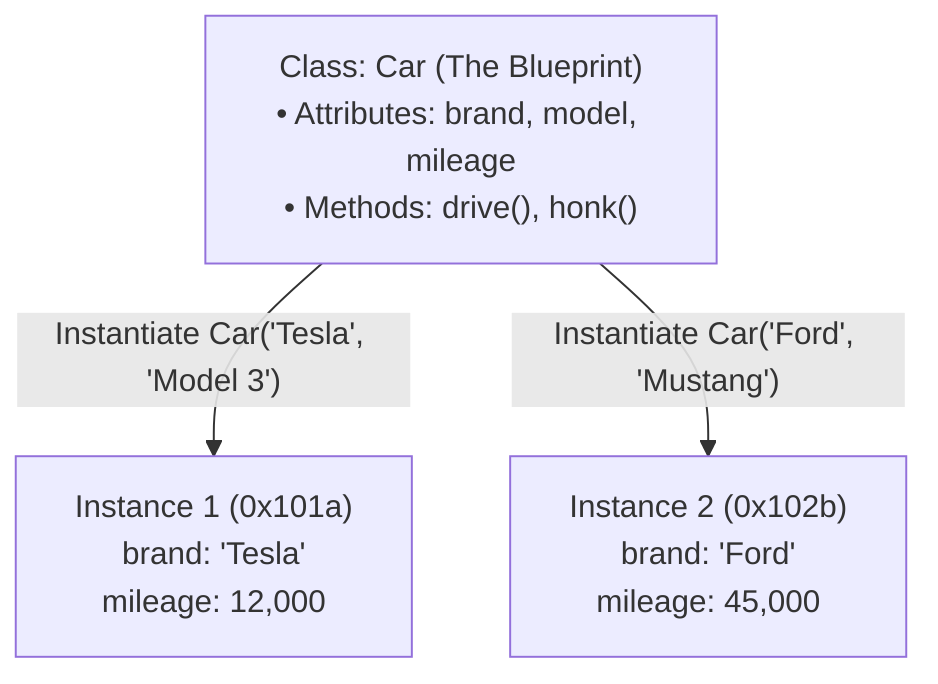
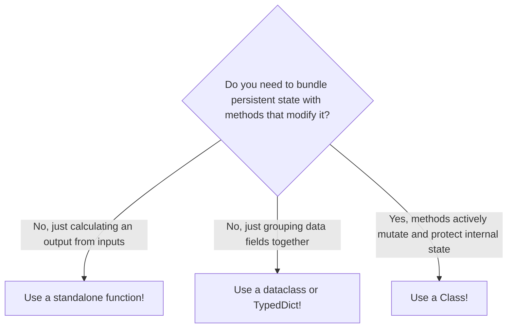

import { Callout } from "fumadocs-ui/components/callout";
import { Tabs, Tab } from "fumadocs-ui/components/tabs";
import { Accordion, Accordions } from "fumadocs-ui/components/accordion";

Up to this point, our programs have organized logic into standalone functions and data into dictionaries or tuples. This style is known as **procedural programming**.

As software expands, programs develop entities that bundle **data (state)** together with the **actions (behavior)** that operate on that data. This is the foundation of **Object-Oriented Programming (OOP)**.

In Python, classes are simple, elegant, and first-class citizens.

---

## 1. The Mental Model: Blueprint vs. Instance

Think of an architect's blueprint for a house:

- The **blueprint** defines what a house looks like: it has 3 bedrooms, 2 bathrooms, a front door, and a lock switch. The blueprint itself is not a physical house; you cannot live inside a piece of paper.
- An **instance (object)** is a concrete house built in the physical world using that blueprint. You can build 50 houses from one blueprint at different street addresses. Each house has its own physical rooms, its own keys, and its own front door state (locked or unlocked).



In Python:

- **Class**: The blueprint (`class Car:`)
- **Instance / Object**: The concrete entity created in memory (`my_car = Car(...)`)
- **Attributes**: Variables bound to the object (the data/state)
- **Methods**: Functions bound to the object (the behavior)

---

## 2. Your First Class: `__init__` and `self`

Here is a minimal Python class:

```python
class BankAccount:
    def __init__(self, owner: str, balance: float = 0.0):
        # Instance attributes: data specific to this account
        self.owner = owner
        self.balance = balance

# Creating two distinct instances (objects):
account_a = BankAccount("Alice", 250.0)
account_b = BankAccount("Bob", 50.0)

print(f"{account_a.owner}'s balance: ${account_a.balance:.2f}")
print(f"{account_b.owner}'s balance: ${account_b.balance:.2f}")
```

Output:

```text
Alice's balance: $250.00
Bob's balance: $50.00
```

### Demystifying `__init__`

`__init__` is Python's **constructor method**. Whenever you call `BankAccount(...)`, Python performs two steps behind the scenes:

1. It allocates a brand-new, empty object in RAM.
2. It immediately calls `__init__`, passing the new object as the first parameter.

### Demystifying `self`

The single biggest question beginners ask: **What is `self`?**

`self` is a reference to the **specific instance** currently being created or operated on.

- When creating Alice's account, `self` points to Alice's object in memory. `self.owner = "Alice"` assigns `"Alice"` to that specific instance.
- When creating Bob's account, `self` points to Bob's object.

<Callout type="note" title="Why is self Explicit in Python?">
  In languages like Java or C++, `this` is hidden and implicitly available.
  Python follows the Zen of Python rule:{" "}
  <em>"Explicit is better than implicit."</em> Every instance method must
  declare <code>self</code> as its first parameter so you always know which
  instance is being manipulated.
</Callout>

---

## 3. Methods & Attributes: Adding Behavior

A method is simply a function that lives inside a class and operates on `self`:

```python
class BankAccount:
    def __init__(self, owner: str, balance: float = 0.0):
        self.owner = owner
        self.balance = balance

    def deposit(self, amount: float) -> float:
        """Add funds to the account."""
        if amount <= 0:
            raise ValueError("Deposit amount must be positive.")
        self.balance += amount
        return self.balance

    def withdraw(self, amount: float) -> float:
        """Deduct funds if balance allows."""
        if amount > self.balance:
            raise ValueError(f"Insufficient funds! Balance is ${self.balance:.2f}")
        self.balance -= amount
        return self.balance

    def get_summary(self) -> str:
        """Return a formatted status message."""
        return f"Account[{self.owner}]: ${self.balance:.2f}"
```

Using the methods:

```python
account = BankAccount("Charlie", 100.0)

account.deposit(50.0)
print(account.get_summary())

account.withdraw(30.0)
print(account.get_summary())
```

Output:

```text
Account[Charlie]: $150.00
Account[Charlie]: $120.00
```

Notice that when calling `account.deposit(50.0)`, you do **not** pass `self`. Python automatically translates `account.deposit(50.0)` into `BankAccount.deposit(account, 50.0)`.

---

## 4. Inheritance: Reusing Code Across Classes

Inheritance allows a new class (**child class** or **subclass**) to inherit all attributes and methods from an existing class (**parent class** or **base class**).

Let's create a specialized `SavingsAccount` that inherits from `BankAccount` and adds an annual interest rate:

```python
class SavingsAccount(BankAccount):
    def __init__(self, owner: str, balance: float = 0.0, interest_rate: float = 0.04):
        # 1. Call parent constructor using super() to initialize owner and balance
        super().__init__(owner=owner, balance=balance)
        # 2. Add child-specific attribute
        self.interest_rate = interest_rate

    def apply_interest(self) -> float:
        """Calculate and deposit interest."""
        earned = self.balance * self.interest_rate
        self.deposit(earned)  # Reuses parent's deposit method!
        return earned
```

Testing inheritance:

```python
savings = SavingsAccount("Dana", 1000.0, interest_rate=0.05)

# Inherited methods from BankAccount:
print(savings.get_summary())

# Child-specific method:
interest = savings.apply_interest()
print(f"Earned interest: ${interest:.2f}")
print(savings.get_summary())
```

Output:

```text
Account[Dana]: $1000.00
Earned interest: $50.00
Account[Dana]: $1050.00
```

### Why Use `super()`?

`super()` delegates to the parent class. It ensures that the parent's `__init__` code runs properly, eliminating code duplication while keeping child classes clean and extensible.

---

## 5. When to Use Classes (And When NOT To)

Beginners who discover classes often attempt to wrap everything into a class. In Python, writing classes when they aren't needed is a common anti-pattern.

Use this decision matrix:

| Use Case                                                                                   | Recommended Tool          | Why?                                                                          |
| :----------------------------------------------------------------------------------------- | :------------------------ | :---------------------------------------------------------------------------- |
| **Pure computation** (e.g. `calculate_tax(subtotal, rate)`)                                | **Standalone function**   | Functions are simpler, stateless, and easier to test.                         |
| **Simple key-value records** (e.g. HTTP JSON payload)                                      | **`dict` or `TypedDict`** | No behavioral methods needed; directly JSON-serializable.                     |
| **Structured data container with type hints**                                              | **`dataclass`**           | Auto-generates `__init__`, `__repr__`, and `__eq__` without boilerplate.      |
| **State + Behavior + Lifecycle** (e.g. Database connection, Game character, Shopping cart) | **Full `class`**          | Holds mutable state and provides methods that safeguard or modify that state. |



---

## Practice Questions & Challenges

Test your understanding of instance instantiation, class versus instance namespaces, constructor dispatch, and object encapsulation.

### Question 1: Output Prediction (Class Attribute Mutation Trap)

Examine this class definition:

```python
class Student:
    courses = []  # Class attribute (shared list)

    def __init__(self, name: str):
        self.name = name

    def enroll(self, course: str):
        self.courses.append(course)

alice = Student("Alice")
bob = Student("Bob")

alice.enroll("Computer Science")
bob.enroll("Linear Algebra")

print("Alice courses:", alice.courses)
print("Bob courses  :", bob.courses)
print("Are lists identical?", alice.courses is bob.courses)
```

1. Predict the exact output.
2. Why does Bob have Alice's course in his list?
3. How must `__init__` be refactored to make courses isolated per student?

<Accordions>
<Accordion title="Reveal Solution & Explanation">

**1. Output:**

```text
Alice courses: ['Computer Science', 'Linear Algebra']
Bob courses  : ['Computer Science', 'Linear Algebra']
Are lists identical? True
```

**2. The Shared Mutation Trap:**
`courses = []` is declared at the class level. In Python, class attributes are shared across **all instances** of that class. When `alice.enroll()` executes `self.courses.append()`, Python looks up `courses` on the instance, doesn't find it in `alice.__dict__`, falls back to `Student.courses`, and mutates the single shared class-level list in place.

**3. The Fix:**
Always initialize mutable collections inside `__init__` bound to `self`:

```python
class Student:
    def __init__(self, name: str):
        self.name = name
        self.courses = []  # Unique new list created per instance!
```

</Accordion>
</Accordions>

---

### Question 2: Spot and Fix the Bug (`TypeError: take_damage() takes 1 positional argument`)

A game developer writes this player combat class:

```python
class Warrior:
    def __init__(self, name: str, health: int = 100):
        self.name = name
        self.health = health

    def take_damage(amount: int):
        self.health -= amount
        print(f"{self.name} took {amount} damage! Remaining HP: {self.health}")

thor = Warrior("Thor")
thor.take_damage(25)
```

When running `thor.take_damage(25)`, Python crashes with:

```text
TypeError: Warrior.take_damage() takes 1 positional argument but 2 were given
```

1. Why does Python report that **2 arguments were given** when the code clearly wrote `thor.take_damage(25)`?
2. What missing parameter in the method signature causes this?
3. Rewrite the method correctly.

<Accordions>
<Accordion title="Reveal Solution & Explanation">

**1. The Implicit `self` Parameter:**
In Python, calling a method on an instance like `thor.take_damage(25)` is syntactic sugar for:

```python
Warrior.take_damage(thor, 25)
```

Python automatically passes the instance `thor` as the first argument. Because `take_damage(amount: int)` was declared with only one parameter (`amount`), receiving both `thor` and `25` results in 2 arguments being passed to a function that only accepts 1!

**2. The Missing Parameter:**
All instance methods in Python must explicitly declare `self` as their first parameter.

**3. Corrected Method:**

```python
    def take_damage(self, amount: int) -> None:
        self.health -= amount
        print(f"{self.name} took {amount} damage! Remaining HP: {self.health}")
```

</Accordion>
</Accordions>

---

### Question 3: Architecture Question (`@classmethod` vs `@staticmethod` vs Instance Method)

In modern object-oriented Python:

1. What does the first parameter of an instance method represent?
2. What does the first parameter of a `@classmethod` represent, and what is its primary use case?
3. When should you use a `@staticmethod` instead of a regular top-level function?

<Accordions>
<Accordion title="Reveal Solution & Explanation">

**1. Instance Methods (`def method(self, ...)`):**

- First argument is `self` (the instance).
- Use when the method needs to read or modify instance attributes (`self.field`).

**2. Class Methods (`@classmethod def method(cls, ...)`):**

- First argument is `cls` (the class object itself, e.g. `Warrior` or `User`).
- Primary use case: **Alternative Constructors** (Factory Methods). For example:
  ```python
  @classmethod
  def from_json(cls, json_str: str) -> "User":
      data = json.loads(json_str)
      return cls(name=data["name"], email=data["email"])
  ```

**3. Static Methods (`@staticmethod def method(...)`):**

- Receives neither `self` nor `cls`.
- Behaves like a plain function, but is namespaced inside the class because it is logically coupled to the class domain (e.g. validating an email format or tax calculation).

</Accordion>
</Accordions>

---

### Question 4: Hands-On Challenge (Inventory Item Domain Model)

Create an `InventoryItem` class that:

1. Accepts `name: str`, `price: float`, and `quantity: int = 0`.
2. Has a `restock(amount: int)` method that increases quantity (raising `ValueError` if `amount <= 0`).
3. Has a `sell(amount: int)` method that decreases quantity (raising `ValueError` if insufficient stock).
4. Has a `total_value()` method that returns `price * quantity`.

<Accordions>
<Accordion title="Reveal Solution & Code">

```python
class InventoryItem:
    def __init__(self, name: str, price: float, quantity: int = 0):
        self.name = name
        self.price = price
        self.quantity = quantity

    def restock(self, amount: int) -> None:
        if amount <= 0:
            raise ValueError("Restock amount must be greater than zero.")
        self.quantity += amount

    def sell(self, amount: int) -> None:
        if amount <= 0:
            raise ValueError("Sale amount must be greater than zero.")
        if amount > self.quantity:
            raise ValueError(f"Cannot sell {amount} units; only {self.quantity} in stock.")
        self.quantity -= amount

    def total_value(self) -> float:
        return self.price * self.quantity

# Test Verification:
if __name__ == "__main__":
    item = InventoryItem("Mechanical Keyboard", 89.99, 10)
    item.restock(5)
    item.sell(3)
    print(f"Remaining stock: {item.quantity}")  # 12
    print(f"Total inventory value: ${item.total_value():.2f}")  # $1079.88
```

</Accordion>
</Accordions>

---

### Question 5: Code Challenge (Encapsulated Bank Account with Audit Ledger)

Write a Python class `BankAccount` that demonstrates professional encapsulation, inheritance, and transaction logging.

Requirements:

1. `__init__(self, account_holder: str, initial_balance: float = 0.0)` initializes an account holder, balance, and an empty list of strings `self.ledger`.
2. `deposit(self, amount: float) -> float`: Adds amount to balance, appends `"[DEPOSIT] +$amount"` to ledger, and returns new balance.
3. `withdraw(self, amount: float) -> float`: Deducts amount from balance if funds are sufficient; otherwise raises a `ValueError("Insufficient funds")`. Appends `"[WITHDRAWAL] -$amount"` to ledger.
4. Create a subclass `SavingsAccount(BankAccount)` that adds an `apply_interest(self, rate: float = 0.05)` method, multiplying balance by `(1 + rate)` and logging `"[INTEREST] +$gain"` into the ledger.

<Accordions>
<Accordion title="Reveal Solution & Code">

```python
class BankAccount:
    def __init__(self, account_holder: str, initial_balance: float = 0.0):
        if initial_balance < 0:
            raise ValueError("Initial balance cannot be negative.")
        self.account_holder = account_holder
        self.balance = float(initial_balance)
        self.ledger: list[str] = [f"[OPEN] Account initialized with ${self.balance:.2f}"]

    def deposit(self, amount: float) -> float:
        if amount <= 0:
            raise ValueError("Deposit amount must be positive.")
        self.balance += amount
        self.ledger.append(f"[DEPOSIT] +${amount:.2f} (Balance: ${self.balance:.2f})")
        return self.balance

    def withdraw(self, amount: float) -> float:
        if amount <= 0:
            raise ValueError("Withdrawal amount must be positive.")
        if amount > self.balance:
            raise ValueError(f"Insufficient funds: cannot withdraw ${amount:.2f} from balance ${self.balance:.2f}")
        self.balance -= amount
        self.ledger.append(f"[WITHDRAWAL] -${amount:.2f} (Balance: ${self.balance:.2f})")
        return self.balance


class SavingsAccount(BankAccount):
    def apply_interest(self, rate: float = 0.05) -> float:
        if rate <= 0:
            raise ValueError("Interest rate must be positive.")
        interest_gained = self.balance * rate
        self.balance += interest_gained
        self.ledger.append(f"[INTEREST] +${interest_gained:.2f} at {rate*100:.1f}% (Balance: ${self.balance:.2f})")
        return self.balance


# Verification Test:
if __name__ == "__main__":
    acc = SavingsAccount("Alice", 1000.0)
    acc.deposit(500.0)
    acc.withdraw(200.0)
    acc.apply_interest(0.04)  # 4% annual interest

    print(f"Final Balance for {acc.account_holder}: ${acc.balance:.2f}")
    print("\nAccount Ledger:")
    for entry in acc.ledger:
        print(" ", entry)
```

Sample Output:

```text
Final Balance for Alice: $1352.00

Account Ledger:
  [OPEN] Account initialized with $1000.00
  [DEPOSIT] +$500.00 (Balance: $1500.00)
  [WITHDRAWAL] -$200.00 (Balance: $1300.00)
  [INTEREST] +$52.00 at 4.0% (Balance: $1352.00)
```

</Accordion>
</Accordions>

---

## Summary Reference

- **`class Name:`**: Defines a class blueprint (use `PascalCase` naming convention).
- **`__init__(self, ...)`**: The constructor called on instantiation.
- **`self`**: Reference to the current instance in memory.
- **Instance attributes**: Variables bound to `self` (e.g., `self.balance = 100`).
- **Inheritance**: `class SubClass(BaseClass):` inherits parent capabilities.
- **`super()`**: Calls parent methods and constructors.

Now that you have mastered foundational OOP, dive deeper into multiple inheritance and C3 linearization in **[05. Classes, Multiple Inheritance & C3 Linearization](/docs/learn-python/02-intermediate/05-classes-inheritance-mro)**!
