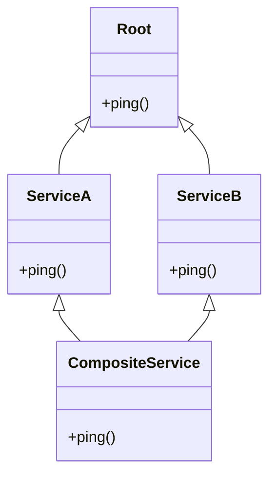

import { Callout } from "fumadocs-ui/components/callout";
import { Tabs, Tab } from "fumadocs-ui/components/tabs";
import { Accordion, Accordions } from "fumadocs-ui/components/accordion";

Object-Oriented Programming (OOP) in Python is clean, explicit, and dynamic. While many languages support only single inheritance, Python provides full **multiple inheritance** — managed by a mathematically sound algorithm called **C3 Linearization**.

---

## 1. Class State vs. Instance State

A common point of confusion is the distinction between **instance attributes** and **class attributes**:

```python
class Employee:
    # Class attribute: Shared across ALL instances
    company_name: str = "Acme Corp"
    employee_count: int = 0

    def __init__(self, name: str, salary: float):
        # Instance attributes: Unique to THIS specific instance
        self.name = name
        self.salary = salary
        Employee.employee_count += 1

    @classmethod
    def from_string(cls, data_str: str) -> "Employee":
        """Alternative constructor / factory method."""
        name, salary_str = data_str.split("-")
        return cls(name=name, salary=float(salary_str))

    @staticmethod
    def is_valid_salary(salary: float) -> bool:
        """Utility method that requires no access to class or instance state."""
        return salary >= 30_000

e1 = Employee("Alice", 85_000)
e2 = Employee.from_string("Bob-92000")

print(f"Total Employees: {Employee.employee_count}")
print(f"{e1.name} works at {e1.company_name}")
print(f"Valid salary check: {Employee.is_valid_salary(50_000)}")
```

Output:

```text
Total Employees: 2
Alice works at Acme Corp
Valid salary check: True
```

---

## 2. Multiple Inheritance & The Diamond Problem

What happens when two parent classes inherit from the same base class, and a child class inherits from both?



In languages like C++, this "Diamond Pattern" can cause ambiguity: which version of `ping()` should `CompositeService` execute?

Python solves this deterministically using **C3 Linearization** to compute a strict, monotonic **Method Resolution Order (MRO)**.

---

## 3. Cooperative Multiple Inheritance with `super()`

Many developers mistakenly believe that `super()` calls the immediate parent class. In Python, **`super()` calls the next class in the MRO chain**, allowing cooperative multiple inheritance:

```python
class Base:
    def __init__(self):
        print("Base __init__")

class LoggingMixin(Base):
    def __init__(self):
        print("LoggingMixin: Initializing logger")
        super().__init__()  # Calls the NEXT class in the MRO

class MetricMixin(Base):
    def __init__(self):
        print("MetricMixin: Initializing metrics")
        super().__init__()  # Calls the NEXT class in the MRO

class PaymentGateway(LoggingMixin, MetricMixin):
    def __init__(self):
        print("PaymentGateway: Starting initialization")
        super().__init__()

gateway = PaymentGateway()
```

Output:

```text
PaymentGateway: Starting initialization
LoggingMixin: Initializing logger
MetricMixin: Initializing metrics
Base __init__
```

### Inspecting the MRO

You can inspect the exact linearization sequence at runtime using `.mro()`:

```python
print([cls.__name__ for cls in PaymentGateway.mro()])
```

Output:

```text
['PaymentGateway', 'LoggingMixin', 'MetricMixin', 'Base', 'object']
```

Notice how `super()` in `LoggingMixin` stepped over to `MetricMixin`! This cooperative chaining is what makes reusable mixins work seamlessly in Python.

---

## 4. Enforcing Contracts: Abstract Base Classes (`abc`)

When designing frameworks, you often want to define interfaces that subclasses _must_ implement:

```python
from abc import ABC, abstractmethod

class Repository(ABC):
    @abstractmethod
    def get(self, entity_id: int) -> dict:
        """Fetch record by ID."""
        pass

    @abstractmethod
    def save(self, entity: dict) -> None:
        """Persist record."""
        pass

class SQLRepository(Repository):
    def get(self, entity_id: int) -> dict:
        return {"id": entity_id, "source": "postgres"}

    # Forgot to implement save()!

# Attempting to instantiate an incomplete subclass:
try:
    repo = SQLRepository()
except TypeError as err:
    print("Caught instantiation error:", err)
```

Output:

```text
Caught instantiation error: Can't instantiate abstract class SQLRepository without an implementation for abstract method 'save'
```

---

## Practice Questions & Challenges

Test your understanding of Method Resolution Order (MRO), cooperative `super()`, the diamond inheritance problem, and Abstract Base Classes (`abc`).

### Question 1: Output Prediction (The Diamond MRO Trace)

Examine this classic diamond inheritance hierarchy:

```python
class Root:
    def ping(self):
        print("Root ping")

class Left(Root):
    def ping(self):
        print("Left ping start")
        super().ping()
        print("Left ping end")

class Right(Root):
    def ping(self):
        print("Right ping start")
        super().ping()
        print("Right ping end")

class Diamond(Left, Right):
    def ping(self):
        print("Diamond ping start")
        super().ping()
        print("Diamond ping end")

d = Diamond()
d.ping()
```

1. Predict the exact line-by-line terminal output.
2. In `Left.ping()`, why does `super().ping()` call `Right.ping()` instead of `Root.ping()`, even though `Left` does not inherit from `Right`?
3. Print the MRO list of `Diamond`.

<Accordions>
<Accordion title="Reveal Solution & Explanation">

**1. Output:**

```text
Diamond ping start
Left ping start
Right ping start
Root ping
Right ping end
Left ping end
Diamond ping end
```

**2. Why `Left` calls `Right`:**
In Python, `super()` does **not** simply mean "call my parent class". It means **"find the current class in the instance's MRO chain, and call the next class that follows it"**.
For an instance of `Diamond`, the MRO is:

```text
Diamond -> Left -> Right -> Root -> object
```

Because `Right` immediately follows `Left` in `Diamond`'s MRO, `super().ping()` inside `Left` calls `Right.ping()`! This cooperative dispatch ensures every class in the diamond runs exactly once.

**3. MRO Inspection:**

```python
print([cls.__name__ for cls in Diamond.mro()])
# Output: ['Diamond', 'Left', 'Right', 'Root', 'object']
```

</Accordion>
</Accordions>

---

### Question 2: Spot and Fix the Bug (`TypeError: Cannot create a consistent MRO`)

A developer writes this multi-inheritance hierarchy:

```python
class Base:
    pass

class Alpha(Base):
    pass

class Beta(Base):
    pass

class ServiceA(Alpha, Beta):
    pass

# Notice the reversed order in ServiceB:
class ServiceB(Beta, Alpha):
    pass

class UnifiedService(ServiceA, ServiceB):
    pass
```

When Python parses line 17 (`class UnifiedService`), it crashes immediately with:

```text
TypeError: Cannot create a consistent method resolution order (MRO) for bases Alpha, Beta
```

1. Why does Python reject this class definition?
2. What mathematical rule in C3 Linearization is being violated?
3. What is the clean architectural fix?

<Accordions>
<Accordion title="Reveal Solution & Explanation">

**1. Root Cause:**
`ServiceA` declares that `Alpha` must precede `Beta`. But `ServiceB` declares that `Beta` must precede `Alpha`. When `UnifiedService` attempts to inherit from both, Python cannot satisfy both conflicting precedence constraints simultaneously.

**2. The C3 Linearization Invariant:**
C3 Linearization guarantees **monotonicity**: if class $X$ precedes class $Y$ in the MRO of any parent class, $X$ must precede $Y$ in all subclasses. A cyclic or contradictory inheritance order violates monotonicity, and CPython rejects it at compile time.

**3. The Fix:**
Ensure consistent precedence ordering across all sibling base classes:

```python
# Align ServiceB to match Alpha, Beta ordering:
class ServiceB(Alpha, Beta):
    pass

class UnifiedService(ServiceA, ServiceB):
    pass
```

</Accordion>
</Accordions>

---

### Question 3: Architecture Question (Cooperative `super()` vs Direct Class Calls)

Why is calling `super().__init__(*args, **kwargs)` strictly preferred over hardcoded direct parent calls like `ParentClass.__init__(self, *args, **kwargs)` in multiple inheritance?

<Accordions>
<Accordion title="Reveal Solution & Explanation">

**Why Direct Calls Break Cooperative Hierarchies:**

1. **Double Initialization in Diamonds**: In diamond inheritance, if both `Left` and `Right` directly call `Root.__init__(self)`, `Root` will be initialized **twice**! If `Root` opens database connections, assigns unique IDs, or allocates resources, running twice causes bugs.
2. **Breaks Mixins**: If a mixin calls `super()`, it can cooperatively pass execution to a sibling mixin it didn't even know existed at write time. Hardcoding `Parent.__init__(self)` bypasses the dynamic MRO search, breaking composability.

</Accordion>
</Accordions>

---

### Question 4: Hands-On Challenge (Composable Mixin Architecture)

Create two reusable mixin classes:

1. `TimestampMixin`: Automatically sets `self.created_at = time.time()` when initialized via `super().__init__()`.
2. `JSONSerializableMixin`: Provides a `.to_json()` method that returns `json.dumps(self.__dict__)`.
3. Create a domain class `UserProfile(TimestampMixin, JSONSerializableMixin)` that inherits from both mixins, initialize an instance with `name="Alice"`, and print its `.to_json()` representation.

<Accordions>
<Accordion title="Reveal Solution & Code">

```python
import time
import json

class TimestampMixin:
    def __init__(self, *args, **kwargs):
        super().__init__(*args, **kwargs)
        self.created_at = time.time()

class JSONSerializableMixin:
    def to_json(self) -> str:
        return json.dumps(self.__dict__, default=str, indent=2)

class UserProfile(TimestampMixin, JSONSerializableMixin):
    def __init__(self, username: str, email: str):
        super().__init__()  # Cooperatively invokes TimestampMixin.__init__
        self.username = username
        self.email = email

# Verification:
if __name__ == "__main__":
    user = UserProfile("alice99", "alice@domain.org")
    print(user.to_json())
```

Sample Output:

```json
{
  "created_at": 1729270000.123,
  "username": "alice99",
  "email": "alice@domain.org"
}
```

</Accordion>
</Accordions>

---

### Question 5: Code Challenge (Production Plugin Interface with `abc.ABC`)

Define a production plug-in contract for cloud storage backends using Python's `abc` module.

Requirements:

1. Define an abstract class `CloudStorageProvider(ABC)`.
2. Declare three abstract methods:
   - `@abstractmethod def upload_file(self, remote_path: str, data: bytes) -> bool`
   - `@abstractmethod def download_file(self, remote_path: str) -> bytes`
   - `@abstractmethod def delete_file(self, remote_path: str) -> bool`
3. Implement a concrete class `LocalStorageProvider(CloudStorageProvider)` that implements all three methods using standard file I/O or an in-memory dictionary.
4. Verify that trying to instantiate `CloudStorageProvider` directly raises a `TypeError`, and that a partially implemented subclass also fails instantiation.

<Accordions>
<Accordion title="Reveal Solution & Code">

```python
from abc import ABC, abstractmethod

class CloudStorageProvider(ABC):
    @abstractmethod
    def upload_file(self, remote_path: str, data: bytes) -> bool:
        """Upload raw bytes to remote storage."""
        pass

    @abstractmethod
    def download_file(self, remote_path: str) -> bytes:
        """Retrieve raw bytes from remote storage."""
        pass

    @abstractmethod
    def delete_file(self, remote_path: str) -> bool:
        """Delete object at remote path."""
        pass


class LocalStorageProvider(CloudStorageProvider):
    def __init__(self):
        self._storage: dict[str, bytes] = {}

    def upload_file(self, remote_path: str, data: bytes) -> bool:
        self._storage[remote_path] = data
        return True

    def download_file(self, remote_path: str) -> bytes:
        if remote_path not in self._storage:
            raise FileNotFoundError(f"Key '{remote_path}' not found in storage.")
        return self._storage[remote_path]

    def delete_file(self, remote_path: str) -> bool:
        return self._storage.pop(remote_path, None) is not None


# Verification Test:
if __name__ == "__main__":
    # 1. Abstract base cannot be instantiated directly:
    try:
        CloudStorageProvider()
    except TypeError as err:
        print("✅ Expected abstract base instantiation error:", err)

    # 2. Concrete provider works:
    storage = LocalStorageProvider()
    storage.upload_file("config/app.bin", b"ENCRYPTED_PAYLOAD")
    downloaded = storage.download_file("config/app.bin")
    print("Downloaded bytes:", downloaded)
    assert downloaded == b"ENCRYPTED_PAYLOAD"

    deleted = storage.delete_file("config/app.bin")
    print("Deleted successfully:", deleted)
    assert deleted is True
```

</Accordion>
</Accordions>

---

## Summary Reference

- **Class attributes**: Declared at the class level; shared across all instances.
- **`@classmethod`**: Receives `cls` as the first argument; ideal for alternative factory constructors.
- **`@staticmethod`**: Bound to the class namespace, but receives neither `self` nor `cls`.
- **C3 MRO**: Deterministic method resolution order algorithm; viewable with `cls.mro()`.
- **`super()`**: Invokes the next method in the MRO chain, enabling cooperative multiple inheritance.
- **`abc.ABC`**: Abstract base classes that enforce required methods at instantiation time.
