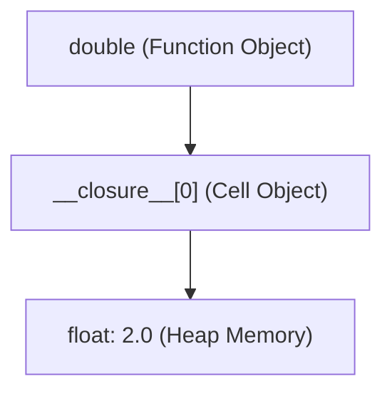

import { Callout } from "fumadocs-ui/components/callout";
import { Tabs, Tab } from "fumadocs-ui/components/tabs";
import { Accordion, Accordions } from "fumadocs-ui/components/accordion";

In Python, functions are not merely blocks of syntax — **functions are first-class objects**.

This means a function has the exact same status as any integer, string, or list:

1. It can be assigned to a variable.
2. It can be passed as an argument to another function.
3. It can be returned from another function.
4. It can be stored inside lists or dictionaries.

---

## 1. Functions as First-Class Citizens

```python
def shout(text: str) -> str:
    return text.upper() + "!"

# 1. Assign to a variable
say_loudly = shout
print(say_loudly("hello"))

# 2. Pass as an argument (Higher-Order Function)
def apply_transformer(words: list[str], transform) -> list[str]:
    return [transform(w) for w in words]

results = apply_transformer(["apple", "banana"], shout)
print(results)
```

Output:

```text
HELLO!
['APPLE!', 'BANANA!']
```

### The Functional Triad: `map()`, `filter()`, and `reduce()`

Python standard library provides higher-order functions that take a function as their primary argument:

```python
from functools import reduce

nums = [1, 2, 3, 4, 5]

# 1. map(): Transform each element
squared = list(map(lambda x: x ** 2, nums))  # [1, 4, 9, 16, 25]

# 2. filter(): Retain elements matching a predicate
evens = list(filter(lambda x: x % 2 == 0, nums))  # [2, 4]

# 3. reduce(): Accumulate sequence into a single cumulative value
total_product = reduce(lambda acc, x: acc * x, nums)  # 1 * 2 * 3 * 4 * 5 = 120

print(f"{squared=}")
print(f"{evens=}")
print(f"{total_product=}")
```

```text
squared=[1, 4, 9, 16, 25]
evens=[2, 4]
total_product=120
```

---

## 2. Inner Functions & The Architecture of a Closure

A **closure** is a function that remembers and accesses variables from its enclosing lexical scope, **even after that outer scope has completely finished executing**.

```python
def make_multiplier(factor: float):
    # 'factor' lives in the outer enclosing scope
    def multiplier(number: float) -> float:
        return number * factor
    return multiplier

double = make_multiplier(2.0)
triple = make_multiplier(3.0)

print(double(10))
print(triple(10))
```

Output:

```text
20.0
30.0
```

### What Happened in Memory?

When `make_multiplier(2.0)` finished and returned, its stack frame was popped. How could `double(10)` still access `factor = 2.0`?



Python created a **cell object** on the heap to store `factor`. You can inspect this closure cell directly:

```python
print(double.__closure__)
print(double.__closure__[0].cell_contents)
```

Output:

```text
(<cell at 0x...: float object at 0x...>,)
2.0
```

---

## 3. Stateful Closures with `nonlocal`

Normally, reassigning a variable inside an inner function treats it as a local variable. The `nonlocal` keyword allows an inner function to mutate a variable in its enclosing parent scope:

```python
def make_counter(start: int = 0):
    count = start

    def increment() -> int:
        nonlocal count  # Declares that 'count' belongs to the parent scope
        count += 1
        return count

    return increment

counter = make_counter(10)
print(counter())
print(counter())
print(counter())
```

Output:

```text
11
12
13
```

---

## 4. The Infamous Late-Binding Closure Trap

This is one of the most common pitfalls in Python exams and job interviews:

```python
# ❌ DANGEROUS BUG: Late-binding loop
multipliers = []
for i in range(4):
    multipliers.append(lambda x: x * i)

# What will these print?
print([m(2) for m in multipliers])
```

Run this code:

```text
[6, 6, 6, 6]
```

Every single function multiplied by `3` ($2 \times 3 = 6$), instead of `0, 1, 2, 3`!

<Callout type="error" title="Why Did This Happen?">
  Python closures bind to <strong>variable names, not values</strong>. The
  lambdas did not store the value of <code>i</code> when the loop ran; they
  stored a reference to the single variable <code>i</code>. When the loop
  finished, <code>i</code> was <code>3</code>. When the functions were later
  executed, they all looked up <code>i</code> and found <code>3</code>!
</Callout>

### The Idiomatic Fix: Default Parameter Binding

```python
# ✅ IDIOMATIC FIX: Bind current value as default argument
multipliers = []
for i in range(4):
    multipliers.append(lambda x, i=i: x * i)

print([m(2) for m in multipliers])
```

Output:

```text
[0, 2, 4, 6]
```

Because default argument values are evaluated when the function is defined, each function locks in its own current copy of `i`.

---

## Practice Questions & Challenges

Test your understanding of lexical scoping, closure cell objects, `nonlocal` rebinding, and late-binding evaluation mechanics.

### Question 1: Output Prediction (The Late-Binding Closure Trap)

Examine this list comprehension of lambdas:

```python
multipliers = [lambda x: x * i for i in range(4)]

results = [func(10) for func in multipliers]
print("Results:", results)
```

1. Predict the exact output of `results`.
2. Why is the output **not** `[0, 10, 20, 30]`?
3. How do you rewrite the lambda using default argument binding to achieve `[0, 10, 20, 30]`?

<Accordions>
<Accordion title="Reveal Solution & Explanation">

**1. Output:**

```text
Results: [30, 30, 30, 30]
```

**2. Why Late Binding Occurs:**
In Python, variables inside closures are looked up when the inner function is **invoked (called)**, not when it is created. When the loop finishes, the variable `i` in the enclosing scope has the value `3`. Later, when all four functions execute `func(10)`, every one of them reads `i == 3`, resulting in `10 * 3 = 30` for all four calls.

**3. The Default Argument Fix:**
Default arguments are evaluated at function **definition time**:

```python
multipliers = [lambda x, i=i: x * i for i in range(4)]
# Results: [0, 10, 20, 30]
```

</Accordion>
</Accordions>

---

### Question 2: Spot and Fix the Bug (`UnboundLocalError` on State Rebinding)

A developer writes this ID generator closure:

```python
def make_id_generator(start_id: int = 1000):
    current = start_id

    def get_next_id():
        current += 1
        return f"USER_{current}"

    return get_next_id

generate_id = make_id_generator()
print(generate_id())
```

When running `generate_id()`, Python crashes with:

```text
UnboundLocalError: cannot access local variable 'current' where it is not associated with a value
```

1. Why does Python treat `current` as an uninitialized local variable when `current = start_id` was clearly defined on line 2?
2. What keyword resolves this error?
3. How does this keyword differ from `global`?

<Accordions>
<Accordion title="Reveal Solution & Explanation">

**1. Root Cause:**
In Python, any assignment to a variable (`current += 1` expands to `current = current + 1`) within a function marks that variable as strictly **local** to that function's scope at compile time. Because `current` is marked local, Python attempts to read `current` before the local assignment completes, triggering `UnboundLocalError`.

**2. The Solution:**
Use the `nonlocal` keyword inside `get_next_id()` to inform Python that `current` belongs to the nearest enclosing non-global scope:

```python
def make_id_generator(start_id: int = 1000):
    current = start_id

    def get_next_id():
        nonlocal current
        current += 1
        return f"USER_{current}"

    return get_next_id
```

**3. `nonlocal` vs `global`:**

- `global` binds a name to the top-level module namespace.
- `nonlocal` binds to an enclosing function scope without touching the module global namespace.

</Accordion>
</Accordions>

---

### Question 3: Architecture Question (How CPython Implements Closures in Memory)

When the outer function finishes executing, its stack frame is popped and destroyed.

1. How can the inner function continue to access variables from the destroyed outer function?
2. What is a CPython `cell` object?
3. Run or analyze this snippet:

   ```python
   def outer():
       secret = 42
       def inner(): return secret
       return inner

   fn = outer()
   print(fn.__closure__[0].cell_contents)
   ```

   What does `fn.__closure__[0].cell_contents` output?

<Accordions>
<Accordion title="Reveal Solution & Explanation">

**1. Cell Objects on the Heap:**
When CPython's compiler analyzes a function and notices an inner function referencing an outer variable (`secret`), it does not allocate `secret` on the temporary call stack. Instead, it allocates a special **`PyCellObject`** on the permanent heap memory.

**2. The `__closure__` Tuple:**
The returned inner function object retains a tuple called `__closure__` containing references to these heap cell objects. Even when the outer function's stack frame is destroyed, the heap cells remain alive as long as the inner function is referenced.

**3. Output:**

```text
42
```

`fn.__closure__[0].cell_contents` directly accesses the heap value preserved inside the cell.

</Accordion>
</Accordions>

---

### Question 4: Hands-On Challenge (Running Moving Average Closure)

Create a `make_moving_average()` closure that remembers all past values fed to it and returns the updated moving average on each call in constant $O(1)$ memory without storing a growing list of numbers in RAM.

<Accordions>
<Accordion title="Reveal Solution & Explanation">

```python
def make_moving_average():
    total = 0.0
    count = 0

    def compute_average(new_val: float) -> float:
        nonlocal total, count
        total += new_val
        count += 1
        return total / count

    return compute_average

# Verification:
avg = make_moving_average()

print("Average 1:", avg(10))  # 10.0
print("Average 2:", avg(20))  # 15.0
print("Average 3:", avg(30))  # 20.0
```

_Efficiency:_ By tracking only `total` and `count`, memory remains strictly $O(1)$ regardless of whether 3 or 3,000,000 values are processed.

</Accordion>
</Accordions>

---

### Question 5: Code Challenge (Sliding Window Rate Limiter Closure)

In production APIs, rate limiters protect backend servers from denial-of-service traffic.

Write a factory function `create_rate_limiter(max_requests: int, window_seconds: float)` that returns an enclosed function `allow_request() -> bool`.

Requirements:

1. `allow_request()` returns `True` if fewer than `max_requests` have been made in the preceding `window_seconds`.
2. If the request limit has been reached within the sliding window, it returns `False`.
3. Use `time.time()` to track request timestamps.
4. Clean up expired timestamps older than the sliding window so memory doesn't leak.

<Accordions>
<Accordion title="Reveal Solution & Code">

```python
import time
from collections import deque

def create_rate_limiter(max_requests: int, window_seconds: float):
    """
    Returns a rate-limiter closure that enforces sliding-window request quotas.
    """
    timestamps = deque()

    def allow_request() -> bool:
        now = time.time()

        # Evict all timestamps outside the current sliding window:
        while timestamps and (now - timestamps[0]) > window_seconds:
            timestamps.popleft()

        # Check quota
        if len(timestamps) < max_requests:
            timestamps.append(now)
            return True

        return False

    return allow_request

# Verification Test:
if __name__ == "__main__":
    # Allow at most 3 requests per 0.5 seconds:
    limiter = create_rate_limiter(max_requests=3, window_seconds=0.5)

    print("Request 1:", limiter())  # True
    print("Request 2:", limiter())  # True
    print("Request 3:", limiter())  # True
    print("Request 4:", limiter())  # False (Limit exceeded!)

    time.sleep(0.6)  # Wait for window to slide
    print("Request 5 (after cooldown):", limiter())  # True (Permitted!)
```

</Accordion>
</Accordions>

---

## Summary Reference

- **First-class functions**: Functions can be passed, returned, and stored like any value.
- **Closure**: A function bundling its code with references to surrounding state (lexical scope).
- **`__closure__`**: CPython tuple of cell objects containing closed-over variables.
- **`nonlocal`**: Allows rebinding of names in outer enclosing scopes without global variables.
- **Late binding trap**: Variables in closures resolve at call time, not definition time; use default arguments (`lambda x, i=i: ...`) to freeze loop states.

---

### Next Step

Now that you understand lexical closures and state encapsulation in functions, master metaprogramming and function wrapping in **[07. Production Decorators Deep Dive](/docs/learn-python/02-intermediate/07-decorators-deep-dive)**!
