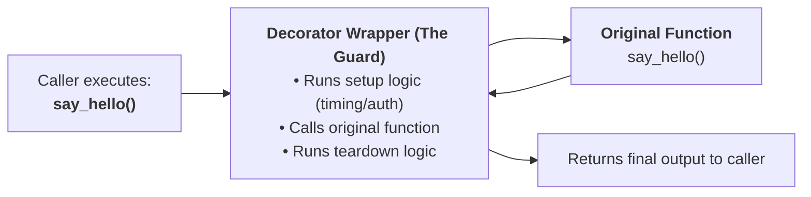
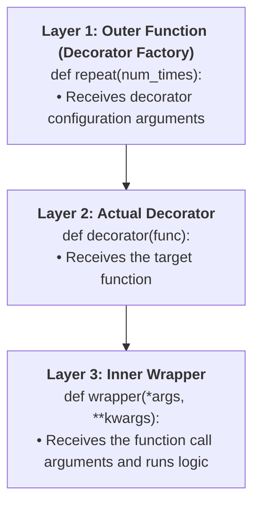

import { Callout } from "fumadocs-ui/components/callout";
import { Tabs, Tab } from "fumadocs-ui/components/tabs";
import { Accordion, Accordions } from "fumadocs-ui/components/accordion";

Decorators are one of the most powerful and elegant features in Python, yet they often intimidate beginners.

In this lesson, we demystify decorators from first principles using intuitive real-world analogies, step-by-step manual assembly, and production-grade design patterns.

---

## 1. The Mental Model: The "Gift Box" & The "Security Guard"

To understand decorators, imagine two everyday scenarios:

### Analogy A: The Gift Box

You have a gift (a function that calculates an invoice). You want to wrap it in colorful paper with a ribbon (add logging and timing).

- The gift inside **does not change**.
- But anyone receiving the gift experiences the wrapping first, then opens the gift, and then sees the thank-you note on the outside.

### Analogy B: The Security Guard at a VIP Room

Imagine a function called `vip_lounge()`. You want to verify every person's ID before they enter, and log their exit time when they leave:

- Instead of modifying the VIP room's interior code, you place a **Security Guard (Decorator)** at the door.
- When someone tries to enter `vip_lounge()`, the guard intercepts them, checks their credentials, lets them into the lounge, and records their exit.



---

## 2. Prerequisite: Functions are First-Class Citizens

Before you can understand decorators, you must understand three foundational Python truths:

### 1. Functions can be assigned to variables:

```python
def shout(text: str) -> str:
    return text.upper() + "!"

# Assign function to a new variable:
yell = shout
print(yell("hello"))  # HELLO!
```

### 2. Functions can be passed as arguments into other functions:

```python
def execute_twice(func, value):
    return func(func(value))

def double(x: int) -> int:
    return x * 2

print(execute_twice(double, 5))  # 5 * 2 = 10 -> 10 * 2 = 20
```

### 3. Functions can be defined inside functions and returned:

```python
def make_greeter(greeting: str):
    def greeter(name: str) -> str:
        return f"{greeting}, {name}!"
    return greeter  # Return the inner function!

friendly = make_greeter("Welcome")
print(friendly("Alice"))  # Welcome, Alice!
```

---

## 3. Building a Decorator from Scratch (Without `@`)

A decorator is simply:

> **A function that takes a function as input, wraps it with extra behavior, and returns the wrapped function.**

Let's build one manually without any special syntax:

```python
def my_guard(original_func):
    """The Decorator: takes original_func and wraps it."""

    def wrapper():
        print("[Guard] Checking credentials before entry...")
        original_func()  # Execute the original function
        print("[Guard] Logged exit time.")

    return wrapper  # Return the enhanced wrapper function


def enter_vip_lounge():
    print(">>> Inside the VIP Lounge sipping champagne! <<<")


# Step 1: Manually wrap the function:
enter_vip_lounge = my_guard(enter_vip_lounge)

# Step 2: Call it:
enter_vip_lounge()
```

Output:

```text
[Guard] Checking credentials before entry...
>>> Inside the VIP Lounge sipping champagne! <<<
[Guard] Logged exit time.
```

Look at that assignment line carefully:

```python
enter_vip_lounge = my_guard(enter_vip_lounge)
```

We passed the original function into `my_guard`, which handed us back `wrapper`. Now, calling `enter_vip_lounge()` actually executes `wrapper()`!

---

## 4. The `@` Syntactic Sugar

Python introduced the `@` symbol simply as a convenient shortcut so you don't have to write `func = decorator(func)` manually:

```python
@my_guard
def enter_vip_lounge():
    print(">>> Inside the VIP Lounge sipping champagne! <<<")
```

Whenever Python sees:

```python
@my_decorator
def my_func():
    pass
```

It translates it automatically to:

```python
my_func = my_decorator(my_func)
```

The `@` symbol is nothing more than syntax sugar for that exact reassignment.

---

## 5. Handling Arguments and Return Values (`*args`, `**kwargs`)

What if the function you want to decorate takes arguments or returns a value?

If your inner `wrapper()` takes no arguments, decorating a function with parameters will crash!

### The Universal Wrapper Pattern

To decorate **any function with any arguments**, the inner wrapper must:

1. Accept `*args` and `**kwargs`.
2. Forward them to `original_func(*args, **kwargs)`.
3. Capture and **return** the result of `original_func`.

```python
def audit_logger(func):
    def wrapper(*args, **kwargs):
        print(f"[AUDIT] Calling '{func.__name__}' with args={args}, kwargs={kwargs}")

        # 1. Capture the return value of the wrapped function
        result = func(*args, **kwargs)

        print(f"[AUDIT] '{func.__name__}' returned: {result}")

        # 2. Return the result back to the caller!
        return result

    return wrapper

@audit_logger
def multiply(a: int, b: int) -> int:
    return a * b

@audit_logger
def make_user(username: str, role: str = "guest") -> dict:
    return {"user": username, "role": role}

total = multiply(6, 7)
print("Result of multiply:", total)

user = make_user("sarah_dev", role="admin")
print("Result of make_user:", user)
```

Output:

```text
[AUDIT] Calling 'multiply' with args=(6, 7), kwargs={}
[AUDIT] 'multiply' returned: 42
Result of multiply: 42
[AUDIT] Calling 'make_user' with args=('sarah_dev',), kwargs={'role': 'admin'}
[AUDIT] 'make_user' returned: {'user': 'sarah_dev', 'role': 'admin'}
Result of make_user: {'user': 'sarah_dev', 'role': 'admin'}
```

---

## 6. Preserving Function Identity: `@functools.wraps`

There is a subtle bug hidden in naive decorators called **Identity Theft**:

```python
def naive_decorator(func):
    def wrapper(*args, **kwargs):
        """This is the wrapper docstring."""
        return func(*args, **kwargs)
    return wrapper

@naive_decorator
def calculate_tax(amount: float) -> float:
    """Calculates state and federal sales tax."""
    return amount * 0.08

print("Function name    :", calculate_tax.__name__)
print("Function docstring:", calculate_tax.__doc__)
```

Output:

```text
Function name    : wrapper
Function docstring: This is the wrapper docstring.
```

The original function's name and documentation were completely wiped out and replaced by `"wrapper"`! This ruins debugging, stack traces, IDE tooltips, and documentation generators.

### The Fix: `@wraps` from `functools`

Always decorate your inner wrapper with `@wraps(func)`:

```python
from functools import wraps

def proper_decorator(func):
    @wraps(func)  # Copies __name__, __doc__, and __annotations__ from func
    def wrapper(*args, **kwargs):
        """This is the wrapper docstring."""
        return func(*args, **kwargs)
    return wrapper

@proper_decorator
def calculate_tax(amount: float) -> float:
    """Calculates state and federal sales tax."""
    return amount * 0.08

print("Function name    :", calculate_tax.__name__)
print("Function docstring:", calculate_tax.__doc__)
```

Output:

```text
Function name    : calculate_tax
Function docstring: Calculates state and federal sales tax.
```

<Callout type="tip" title="Golden Rule of Decorators">
  Always decorate your inner `wrapper` with `@wraps(func)`. It is non-negotiable
  in production Python code.
</Callout>

---

## 7. Decorators with Arguments: The "Three-Layer Onion"

What if you want a decorator that accepts its own configuration arguments, like `@repeat(num_times=3)` or `@retry(max_attempts=5)`?

Notice that `@repeat(num_times=3)` is a function call that **must return the actual decorator**.

This requires **three nested functions** (the 3-layer onion):



Let's see this in code:

```python
from functools import wraps

# Layer 1: Accepts decorator configuration
def repeat(num_times: int):
    def decorator(func):
        # Layer 2: Accepts the function to be decorated
        @wraps(func)
        def wrapper(*args, **kwargs):
            # Layer 3: Accepts call arguments and executes repeat loop
            result = None
            for i in range(1, num_times + 1):
                print(f"[Run {i}/{num_times}] Calling {func.__name__}...")
                result = func(*args, **kwargs)
            return result
        return wrapper
    return decorator


@repeat(num_times=3)
def ping_server(host: str):
    print(f"--> Pinging {host} (200 OK)")

ping_server("api.github.com")
```

Output:

```text
[Run 1/3] Calling ping_server...
--> Pinging api.github.com (200 OK)
[Run 2/3] Calling ping_server...
--> Pinging api.github.com (200 OK)
[Run 3/3] Calling ping_server...
--> Pinging api.github.com (200 OK)
```

---

## 8. Stacking Multiple Decorators: The Onion Peeling Order

When you stack multiple decorators on a single function:

```python
@decorator_a
@decorator_b
def my_func():
    pass
```

Python compiles them from **bottom to top**:

```python
my_func = decorator_a(decorator_b(my_func))
```

But when called, they execute from **top to bottom** (outermost wrapper first):

```python
from functools import wraps

def bold(func):
    @wraps(func)
    def wrapper(*args, **kwargs):
        return f"<b>{func(*args, **kwargs)}</b>"
    return wrapper

def italic(func):
    @wraps(func)
    def wrapper(*args, **kwargs):
        return f"<i>{func(*args, **kwargs)}</i>"
    return wrapper

@bold
@italic
def format_message(text: str) -> str:
    return text

print(format_message("Hello World"))
```

Output:

```text
<b><i>Hello World</i></b>
```

`italic` wrapped the text first (`<i>Hello World</i>`), and then `bold` wrapped the result (`<b><i>Hello World</i></b>`).

---

## 9. Real-World Production Decorators

### 1. The `@timer` Execution Benchmark Decorator

```python
import time
from functools import wraps

def timer(func):
    """Measures and logs function execution duration."""
    @wraps(func)
    def wrapper(*args, **kwargs):
        start_time = time.perf_counter()
        result = func(*args, **kwargs)
        end_time = time.perf_counter()
        duration_ms = (end_time - start_time) * 1000
        print(f"⏱️ [{func.__name__}] finished in {duration_ms:.2f}ms")
        return result
    return wrapper

@timer
def heavy_computation():
    return sum(x * x for x in range(1_000_000))

total = heavy_computation()
```

Output:

```text
⏱️ [heavy_computation] finished in 58.42ms
```

---

### 2. The `@retry` Fault-Tolerant Network Decorator

```python
import time
from functools import wraps

def retry(max_attempts: int = 3, delay_seconds: float = 0.5):
    """Retries an unstable operation up to max_attempts with exponential delay."""
    def decorator(func):
        @wraps(func)
        def wrapper(*args, **kwargs):
            last_exception = None
            for attempt in range(1, max_attempts + 1):
                try:
                    return func(*args, **kwargs)
                except Exception as err:
                    last_exception = err
                    print(f"⚠️ Attempt {attempt}/{max_attempts} failed: {err}")
                    if attempt < max_attempts:
                        time.sleep(delay_seconds)
            raise RuntimeError(f"All {max_attempts} attempts failed.") from last_exception
        return wrapper
    return decorator


@retry(max_attempts=3, delay_seconds=0.1)
def fetch_user_data(attempt_fails: int):
    fetch_user_data.counter = getattr(fetch_user_data, "counter", 0) + 1
    if fetch_user_data.counter <= attempt_fails:
        raise ConnectionError("Database timeout")
    return {"user_id": 101, "status": "active"}

print(fetch_user_data(2))
```

Output:

```text
⚠️ Attempt 1/3 failed: Database timeout
⚠️ Attempt 2/3 failed: Database timeout
{'user_id': 101, 'status': 'active'}
```

---

## 10. Modern Type-Safe Decorators: `ParamSpec` (PEP 612)

Historically, wrapping a function in Python destroyed its type hints. In Python 3.10+, `typing.ParamSpec` allows decorators to preserve the exact parameter signature and return type so your IDE's autocomplete and static type checkers (`pyright`, `mypy`) work perfectly:

```python
from collections.abc import Callable
from functools import wraps
import time
from typing import ParamSpec, TypeVar

# P captures the parameters of the wrapped function
P = ParamSpec("P")
# R captures the return type of the wrapped function
R = TypeVar("R")

def measure_latency(func: Callable[P, R]) -> Callable[P, R]:
    @wraps(func)
    def wrapper(*args: P.args, **kwargs: P.kwargs) -> R:
        start = time.perf_counter()
        result = func(*args, **kwargs)
        duration_ms = (time.perf_counter() - start) * 1000
        print(f"[{func.__name__}] Latency: {duration_ms:.2f}ms")
        return result
    return wrapper

@measure_latency
def greet(name: str, shout: bool = False) -> str:
    message = f"Hello, {name}"
    return message.upper() if shout else message

# Fully type-checked: IDE knows greet takes (name: str, shout: bool) and returns str!
result = greet("Alice", shout=True)
print(result)
```

---

## Practice Questions & Challenges

### Question 1: Output Prediction (Decorator Stacking Order)

Examine the decorators below:

```python
def add_stars(func):
    def wrapper(*args, **kwargs):
        print("*** Starting Stars ***")
        val = func(*args, **kwargs)
        print("*** Ending Stars ***")
        return f"*{val}*"
    return wrapper

def add_brackets(func):
    def wrapper(*args, **kwargs):
        print("[[[ Starting Brackets ]]]")
        val = func(*args, **kwargs)
        print("[[[ Ending Brackets ]]]")
        return f"[{val}]"
    return wrapper

@add_stars
@add_brackets
def get_title(title: str):
    print("Core function running:", title)
    return title

print("Final Result:", get_title("Python Guide"))
```

1. Predict the exact line-by-line output printed to the terminal.
2. What will `Final Result:` contain?

<Accordions>
<Accordion title="Reveal Solution & Explanation">

**Output:**

```text
*** Starting Stars ***
[[[ Starting Brackets ]]]
Core function running: Python Guide
[[[ Ending Brackets ]]]
*** Ending Stars ***
Final Result: *[Python Guide]*
```

**Explanation:**

1. Stacking order wraps from bottom to top: `get_title = add_stars(add_brackets(get_title))`.
2. When called, the outermost wrapper (`add_stars`) runs first:
   - Prints `"*** Starting Stars ***"`
   - Calls `add_brackets()` wrapper
3. The `add_brackets` wrapper runs:
   - Prints `"[[[ Starting Brackets ]]]"`
   - Calls the core `get_title()`
4. Core function runs, prints `"Core function running: Python Guide"`, returns `"Python Guide"`.
5. `add_brackets` wraps it into `"[Python Guide]"`, prints `"[[[ Ending Brackets ]]]"`, and returns it.
6. `add_stars` wraps that into `"*[" + "Python Guide" + "]*"`, prints `"*** Ending Stars ***"`, and returns `"*[Python Guide]*"`.

</Accordion>
</Accordions>

---

### Question 2: Spot and Fix the Bug (Missing Return Value in Decorator)

A developer writes an authentication decorator:

```python
from functools import wraps

def require_auth(func):
    @wraps(func)
    def wrapper(user: str, *args, **kwargs):
        if user != "admin":
            raise PermissionError("Access denied!")
        print(f"User '{user}' authorized successfully.")
        func(user, *args, **kwargs)  # Bug is on this line!
    return wrapper

@require_auth
def get_secret_vault_code(user: str) -> str:
    return "SECRET-CODE-8899"

code = get_secret_vault_code("admin")
print("Secret code:", code)
```

When the code runs with `"admin"`, it prints:

```text
User 'admin' authorized successfully.
Secret code: None
```

1. Why was `Secret code: None` printed instead of `"SECRET-CODE-8899"`?
2. How should the wrapper be fixed?

<Accordions>
<Accordion title="Reveal Solution & Explanation">

**1. The Root Cause:**
The wrapper called `func(user, *args, **kwargs)`, but **failed to return its result**! In Python, any function without an explicit `return` statement returns `None` by default. Therefore, the secret code was thrown away, and `None` was returned to the caller.

**2. The Fix:**
Add `return` before calling `func`:

```python
def require_auth(func):
    @wraps(func)
    def wrapper(user: str, *args, **kwargs):
        if user != "admin":
            raise PermissionError("Access denied!")
        print(f"User '{user}' authorized successfully.")
        return func(user, *args, **kwargs)  # ✅ Return the result!
    return wrapper
```

</Accordion>
</Accordions>

---

### Next Step

Now that you have mastered wrapping and extending functions with decorators, explore lazy evaluation, streaming pipelines, and memory optimization in **[08. Generators, Iterators & Stream Pipelines](/docs/learn-python/02-intermediate/08-generators-and-iterators)**!
