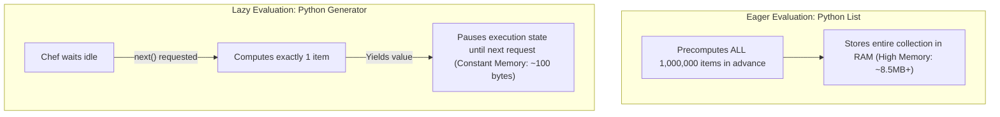
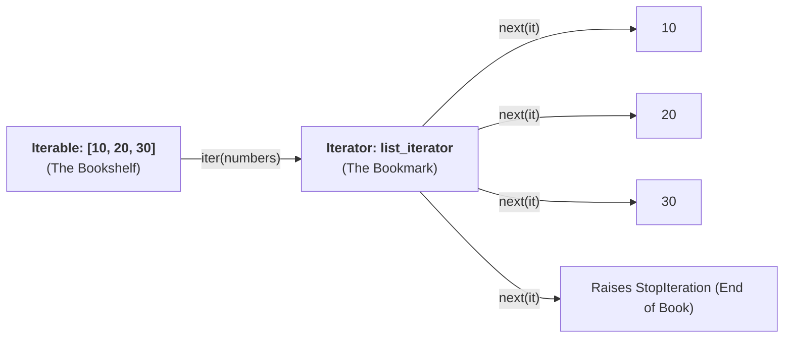

import { Callout } from "fumadocs-ui/components/callout";
import { Tabs, Tab } from "fumadocs-ui/components/tabs";
import { Accordion, Accordions } from "fumadocs-ui/components/accordion";

When processing 10,000,000 database rows, scanning a 50GB server log, or streaming real-time sensor data, loading everything into a Python `list` will instantly crash your machine with an `OutOfMemoryError`.

Python solves this with **Iterators** and **Generators** — a paradigm known as **Lazy Evaluation** (producing items one at a time, strictly on demand).

---

## 1. The Core Mental Model: The Buffet vs. The Chef on Demand

To understand the difference between standard collections (`list`, `dict`) and generators, think of food service:

### The List (The Giant Buffet)

Imagine a catering company cooking **1,000,000 meals** at 6:00 AM and laying them all out on gigantic tables:

- It requires massive banquet halls and thousands of tables (**enormous RAM usage**).
- If your guests only eat 2 plates and leave, 999,998 plates were prepared and stored completely in vain!

### The Generator (The Personal Chef on Demand)

Imagine a personal chef standing by with ingredients:

- The chef prepares **nothing** until you ring the bell and say _"Next plate, please"_ (`next()`).
- The chef cooks **one single meal**, hands it to you, and then **pauses and waits**.
- The kitchen only ever needs space for a single plate (**almost zero RAM usage**)!



---

## 2. Iterable vs. Iterator: The Hidden Dance

In Python, the words **Iterable** and **Iterator** are not synonyms. They represent two halves of a cooperative protocol:

- **An Iterable** is any object you can loop over (e.g. `list`, `str`, `tuple`, `dict`).
  - _Analogy_: An **Iterable is a Bookshelf** full of books. It holds the collection, but it doesn't remember which book you are currently reading.
  - _Technical Definition_: Any object that implements `__iter__()`.
- **An Iterator** is the stream engine that produces values one at a time.
  - _Analogy_: An **Iterator is a Bookmark**. It points to your exact current page, and moves forward one page every time you turn it.
  - _Technical Definition_: Any object that implements `__next__()` and raises `StopIteration` when exhausted.



### Inspecting the Protocol in Code

```python
numbers = [10, 20, 30]

# 1. Ask the Iterable to give us an Iterator (The Bookmark):
it = iter(numbers)
print("Iterator object:", it)

# 2. Advance the bookmark step-by-step:
print(next(it))  # 10
print(next(it))  # 20
print(next(it))  # 30

# 3. What happens when the bookmark reaches the end?
try:
    print(next(it))
except StopIteration:
    print("Caught StopIteration! The sequence is exhausted.")
```

Output:

```text
Iterator object: <list_iterator object at 0x...>
10
20
30
Caught StopIteration! The sequence is exhausted.
```

---

## 3. How Python's `for` Loop Works Under the Hood

When you write a normal `for` loop in Python:

```python
for item in [10, 20, 30]:
    print(item)
```

CPython secretly translates that loop into a `while True` loop using `iter()`, `next()`, and catching `StopIteration`:

```python
# What Python ACTUALLY executes behind the scenes:
hidden_iterator = iter([10, 20, 30])

while True:
    try:
        item = next(hidden_iterator)
        print(item)
    except StopIteration:
        # Reached the end: cleanly exit the loop
        break
```

Once you understand `iter()` and `next()`, the magic of Python's `for` loops disappears completely.

---

## 4. Generator Functions & The `yield` Keyword

Writing a custom class with `__iter__` and `__next__` methods requires boilerplate. Python gives us a shortcut: **Generator Functions**.

Any regular Python function that contains the **`yield`** keyword is automatically transformed by Python into a **Generator Function**.

### What is `yield`? (The Pause & Resume Button)

To understand `yield`, contrast it with `return`:

| Feature             | `return`                                     | `yield`                                                  |
| :------------------ | :------------------------------------------- | :------------------------------------------------------- |
| **Action**          | Terminates the function immediately.         | **Pauses** the function and hands a value to the caller. |
| **Local Variables** | Destroyed from memory immediately.           | **Frozen in place** in RAM.                              |
| **Next Call**       | Must start over from line 1 of the function. | **Resumes execution** right from where it paused!        |

Let's see this in action:

```python
def countdown_chef():
    print("[Chef] Starting shift: Preparing Order 3...")
    yield "Plate #3"  # PAUSES HERE!

    print("[Chef] Resuming shift: Preparing Order 2...")
    yield "Plate #2"  # PAUSES HERE!

    print("[Chef] Resuming shift: Preparing Order 1...")
    yield "Plate #1"  # PAUSES HERE!

    print("[Chef] Kitchen closed! Shift complete.")


# 1. Calling the function does NOT run the code; it creates the generator engine:
chef = countdown_chef()
print("Chef created:", chef)

# 2. Each next() call runs code until the next yield, then freezes:
print("Customer received:", next(chef))
print("Customer received:", next(chef))
print("Customer received:", next(chef))

# 3. Next call raises StopIteration:
try:
    next(chef)
except StopIteration:
    print("Customer notified: No more plates.")
```

Output:

```text
Chef created: <generator object countdown_chef at 0x...>
[Chef] Starting shift: Preparing Order 3...
Customer received: Plate #3
[Chef] Resuming shift: Preparing Order 2...
Customer received: Plate #2
[Chef] Resuming shift: Preparing Order 1...
Customer received: Plate #1
[Chef] Kitchen closed! Shift complete.
Customer notified: No more plates.
```

Because generators implement the iterator protocol, you can loop through them using a standard `for` loop:

```python
for plate in countdown_chef():
    print("Ate:", plate)
```

---

## 5. Infinite Streams with $O(1)$ Constant Memory

Because generators compute values only when asked, **generators can generate infinite data streams without running out of RAM**!

Try doing this with a `list`, and your computer will freeze and crash. With a generator, it takes less than 100 bytes:

```python
def infinite_fibonacci():
    """Generates an infinite stream of Fibonacci numbers on demand."""
    a, b = 0, 1
    while True:
        yield a
        a, b = b, a + b

# Generate Fibonacci numbers on the fly:
fib = infinite_fibonacci()

# Take the first 10 Fibonacci numbers:
for _ in range(10):
    print(next(fib), end=" ")
print()
```

Output:

```text
0 1 1 2 3 5 8 13 21 34
```

The generator could run for 10 years producing trillions of numbers, and it will never consume more than a few bytes of memory.

---

## 6. Generator Expressions: The Memory Showdown

You already know **List Comprehensions** using square brackets `[...]`.

If you change those square brackets to round parentheses `(...)`, Python creates a **Generator Expression**:

```python
import sys

# 1. List Comprehension: Creates all 1,000,000 numbers in memory RIGHT NOW
list_data = [x * 2 for x in range(1_000_000)]

# 2. Generator Expression: Creates a recipe to produce numbers ON DEMAND
gen_data = (x * 2 for x in range(1_000_000))

print(f"List size in RAM     : {sys.getsizeof(list_data):,} bytes (~8.4 MB)")
print(f"Generator size in RAM: {sys.getsizeof(gen_data):,} bytes (Only 104 bytes!)")
```

Output:

```text
List size in RAM     : 8,448,728 bytes (~8.4 MB)
Generator size in RAM: 104 bytes (Only 104 bytes!)
```

The generator is over **80,000 times smaller** in memory!

---

## 7. Delegating Iteration with `yield from`

What if you have nested generators or sub-collections?

Without `yield from`, you have to write nested loops:

```python
# The Clunky Old Way:
def chain_iterables(*iterables):
    for it in iterables:
        for item in it:
            yield item
```

Python provides `yield from` to delegate iteration directly to an inner generator:

```python
# The Elegant Pythonic Way:
def chain_iterables(*iterables):
    for it in iterables:
        yield from it  # Automatically unpacks and yields from sub-iterator!

fruits = ["apple", "banana"]
vegetables = ["carrot", "spinach"]

for food in chain_iterables(fruits, vegetables):
    print("Food:", food)
```

Output:

```text
Food: apple
Food: banana
Food: carrot
Food: spinach
```

`yield from` is also bidirectional: it transparently forwards values sent via `.send()` and exceptions thrown via `.throw()`.

### Capturing Subgenerator Return Values with `yield from`

Did you know that a generator function can have a **`return` statement** with a value?

When a generator executes `return value`, Python packages that value inside a `StopIteration` exception:

```python
def sub_worker():
    yield 10
    yield 20
    return "TASK_COMPLETE"  # Packed into StopIteration.value!

gen = sub_worker()
print(next(gen))  # 10
print(next(gen))  # 20
try:
    next(gen)
except StopIteration as err:
    print("Return value caught from StopIteration:", err.value)
```

Output:

```text
10
20
Return value caught from StopIteration: TASK_COMPLETE
```

When you use `yield from`, Python **automatically unpacks that return value** for you:

```python
def sub_task():
    yield "Step 1"
    yield "Step 2"
    return 42

def master_coordinator():
    print("[Coordinator] Delegating to sub_task...")
    result = yield from sub_task()
    print(f"[Coordinator] Sub_task finished with result: {result}")
    yield f"Result was {result}"

for msg in master_coordinator():
    print("Message:", msg)
```

Output:

```text
[Coordinator] Delegating to sub_task...
Message: Step 1
Message: Step 2
[Coordinator] Sub_task finished with result: 42
Message: Result was 42
```

---

## 8. Generator Lifecycle States & Bidirectional Communication

Generators are not just one-way data producers; they can also receive data back from the caller, acting as cooperative lightweight routines (coroutines).

### The Four Lifecycle States (`inspect.getgeneratorstate`)

Python exposes the internal state machine of a generator through `inspect.getgeneratorstate()`:

| State           | Description                                                                                        |
| :-------------- | :------------------------------------------------------------------------------------------------- |
| `GEN_CREATED`   | The generator object has been created, but execution has not yet started (no `next()` called yet). |
| `GEN_RUNNING`   | Currently being executed by the Python interpreter.                                                |
| `GEN_SUSPENDED` | Currently frozen at a `yield` expression, awaiting the next `next()` or `.send()`.                 |
| `GEN_CLOSED`    | Execution has finished or the generator was terminated via `.close()`.                             |

```python
import inspect

def my_gen():
    yield 1
    yield 2

g = my_gen()
print("1. After creation:", inspect.getgeneratorstate(g))  # GEN_CREATED

next(g)
print("2. After 1st next:", inspect.getgeneratorstate(g))  # GEN_SUSPENDED

next(g)
try:
    next(g)
except StopIteration:
    pass
print("3. After exhaust :", inspect.getgeneratorstate(g))  # GEN_CLOSED
```

### Bidirectional Coroutines: `.send()`, `.throw()`, and `.close()`

By capturing the result of the `yield` expression (`received = yield output`), you can send data into the running generator:

```python
def running_average():
    """Maintains a rolling average of values pushed via .send()."""
    total = 0.0
    count = 0
    avg = None
    while True:
        # yield produces 'avg' and pauses. .send(val) resumes and sets 'val'
        val = yield avg
        if val is None:
            break
        total += val
        count += 1
        avg = total / count

# 1. Create the coroutine:
coro = running_average()

# 2. PRIME the coroutine to the first yield (must advance to GEN_SUSPENDED):
next(coro)

# 3. Send values and receive updated running averages:
print("Average after 10:", coro.send(10))  # 10.0
print("Average after 20:", coro.send(20))  # 15.0
print("Average after 30:", coro.send(30))  # 20.0

# 4. Gracefully terminate the coroutine:
coro.close()
```

Output:

```text
Average after 10: 10.0
Average after 20: 15.0
Average after 30: 20.0
```

---

## 9. Real-World Architecture: Composing Stream Pipelines

In modern backend and data engineering, you often need to process large streams of data (e.g. gigabytes of HTTP logs).

By chaining generators together like Unix pipes (`cat log | grep ERROR | awk ...`), data flows through your pipeline item-by-item with zero intermediate memory accumulation:


Let's build this pipeline in clean Python:

```python
# Simulated raw log file stream
def read_raw_logs():
    raw_logs = [
        "2026-10-19 12:00:01 INFO [auth] User logged in",
        "2026-10-19 12:00:04 ERROR [db] Connection timeout to PostgreSQL",
        "2026-10-19 12:00:07 INFO [api] GET /index.html 200",
        "2026-10-19 12:00:12 ERROR [payment] Stripe webhook signature failed",
        "2026-10-19 12:00:15 WARNING [disk] Storage threshold reached 85%",
    ]
    for line in raw_logs:
        yield line  # In real life, reads line-by-line from a 50GB file


# Stage 1 Generator: Filter only ERROR lines
def filter_errors(log_stream):
    for line in log_stream:
        if "ERROR" in line:
            yield line


# Stage 2 Generator: Parse error lines into structured dictionaries
def parse_error_events(error_stream):
    for line in error_stream:
        parts = line.split(" ", 3)
        timestamp = f"{parts[0]} {parts[1]}"
        component = parts[3].split("]")[0].strip("[")
        message = parts[3].split("]")[1].strip()
        yield {
            "timestamp": timestamp,
            "component": component,
            "message": message,
        }


# Chaining the pipeline together (Zero memory overhead!):
raw_stream = read_raw_logs()
error_stream = filter_errors(raw_stream)
parsed_events = parse_error_events(error_stream)

# Process output one item at a time:
print("=== Security Alert System ===")
for event in parsed_events:
    print(f"🚨 ALERT on [{event['component']}]: {event['message']} (at {event['timestamp']})")
```

Output:

```text
=== Security Alert System ===
🚨 ALERT on [db]: Connection timeout to PostgreSQL (at 2026-10-19 12:00:04)
🚨 ALERT on [payment]: Stripe webhook signature failed (at 2026-10-19 12:00:12)
```

Notice that at no point in this entire process was a giant list created. Even if the file contained 500,000,000 lines, RAM usage remains constant at a few kilobytes!

---

## 10. Zero-Copy Stream Processing with `itertools`

Python's standard library `itertools` module provides high-speed C-implemented functions for assembling complex streaming pipelines without memory allocations.

### 1. `itertools.islice` (Lazy Slicing)

Standard sequence slicing `lst[10:20]` creates a brand-new list copy in RAM. `itertools.islice` slices **any iterator lazily** without allocating memory or advancing past the requested boundary:

```python
import itertools

def infinite_integers():
    n = 0
    while True:
        yield n
        n += 1

# Take elements from index 10 to 15 from an infinite stream:
window = itertools.islice(infinite_integers(), 10, 15)
print("Sliced window:", list(window))  # [10, 11, 12, 13, 14]
```

### 2. `itertools.chain.from_iterable` (Lazy Stream Flattening)

When dealing with batches or paginated API results, `chain.from_iterable` flattens nested streams without creating intermediate lists:

```python
def fetch_api_pages():
    yield ["user_1", "user_2"]
    yield ["user_3", "user_4"]
    yield ["user_5"]

all_users = itertools.chain.from_iterable(fetch_api_pages())
for user in all_users:
    print("Streaming user:", user)
```

### 3. `itertools.groupby` (Streaming Grouping)

Groups consecutive items from a sorted stream:

```python
records = [
    {"dept": "Engineering", "name": "Alice"},
    {"dept": "Engineering", "name": "Bob"},
    {"dept": "Sales", "name": "Charlie"},
]

for dept, group in itertools.groupby(records, key=lambda r: r["dept"]):
    employees = [emp["name"] for emp in group]
    print(f"Department: {dept} -> {employees}")
```

Output:

```text
Department: Engineering -> ['Alice', 'Bob']
Department: Sales -> ['Charlie']
```

---

## Practice Questions & Challenges

### Question 1: Output Prediction (Generator Exhaustion Trap)

Examine the code below:

```python
def number_stream():
    yield 1
    yield 2
    yield 3

stream = number_stream()

first_sum = sum(stream)
second_sum = sum(stream)

print("First sum :", first_sum)
print("Second sum:", second_sum)
```

1. What will be printed by `first_sum` and `second_sum`?
2. Why is `second_sum` not equal to `6`?

<Accordions>
<Accordion title="Reveal Solution & Explanation">

**Output:**

```text
First sum : 6
Second sum: 0
```

**Explanation:**
Generators are **single-use streams**.

1. When `sum(stream)` runs the first time, it iterates through the generator until it raises `StopIteration`. The generator is now **completely exhausted**.
2. When `sum(stream)` is called a second time on the same generator object, `stream` is already exhausted. `next(stream)` raises `StopIteration` immediately.
3. Therefore, `sum()` sees an empty sequence and returns `0`.
4. To iterate again, you must create a fresh generator instance: `stream = number_stream()`.

</Accordion>
</Accordions>

---

### Question 2: Spot and Fix the Bug (Accidental Eager Evaluation)

A developer wanted to stream lines from a massive 20GB dataset without running out of RAM:

```python
def process_large_data():
    # Attempting to be memory efficient:
    data = [line.strip().upper() for line in open("massive_file.txt")]  # Bug is here!
    for record in data:
        yield record
```

Why does this function completely defeat the purpose of using a generator? How should it be refactored?

<Accordions>
<Accordion title="Reveal Solution & Explanation">

**The Bug:**
The developer used square brackets `[...]` (a List Comprehension) on line 3! This immediately reads and loads all 20GB of data into memory at once before the generator ever yields a single record, crashing the system with an `OutOfMemoryError`.

**The Fix:**
Use a generator expression `(...)` or a `for line in file:` loop to stream the lines lazily:

```python
def process_large_data(filename: str):
    with open(filename, "r", encoding="utf-8") as f:
        for line in f:
            yield line.strip().upper()  # Streams 1 line at a time into RAM!
```

</Accordion>
</Accordions>

---

### Next Step

Now that you have mastered generators, iterators, and stream pipelines, explore concise data models and structural subtyping in **[09. Modern Dataclasses & Strict Type Protocols](/docs/learn-python/02-intermediate/09-dataclasses-and-type-hints)**!
