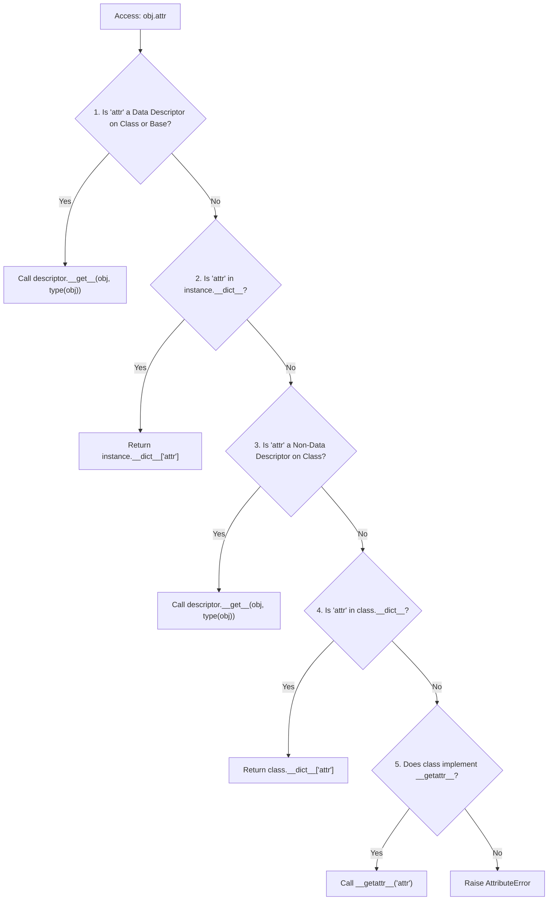

import { Callout } from "fumadocs-ui/components/callout";
import { Tabs, Tab } from "fumadocs-ui/components/tabs";
import { Accordion, Accordions } from "fumadocs-ui/components/accordion";

Have you ever wondered how `@property`, `@classmethod`, `@staticmethod`, or ORM fields in Django and SQLAlchemy actually work?

They are not special compiler hacks. They are all powered by a single, unified protocol: **The Descriptor Protocol**.

---

## 1. What is a Descriptor?

A **descriptor** is any Python object that defines at least one of the following special methods:

- `__get__(self, instance, owner)`: Invoked when the attribute is accessed (`val = obj.attr`).
- `__set__(self, instance, value)`: Invoked when the attribute is assigned (`obj.attr = val`).
- `__delete__(self, instance)`: Invoked when the attribute is deleted (`del obj.attr`).
- `__set_name__(self, owner, name)`: Invoked at class creation to learn its own attribute name!

---

## 2. Building a Reusable Validating Descriptor

Instead of writing identical `@property` getter/setter logic for 10 different numeric fields, you can define a single, reusable descriptor:

```python
class PositiveNumber:
    def __set_name__(self, owner, name):
        """Automatically called when the class is defined."""
        self.public_name = name
        self.private_name = f"_{name}"

    def __get__(self, instance, owner):
        if instance is None:
            return self  # Accessed on the class itself (e.g. OrderItem.price)
        return getattr(instance, self.private_name, 0.0)

    def __set__(self, instance, value: float):
        if not isinstance(value, (int, float)) or value <= 0:
            raise ValueError(f"'{self.public_name}' must be positive, got {value}")
        setattr(instance, self.private_name, float(value))

class OrderItem:
    # Descriptors MUST be defined as CLASS attributes!
    price = PositiveNumber()
    quantity = PositiveNumber()

    def __init__(self, name: str, price: float, quantity: int):
        self.name = name
        self.price = price        # Automatically triggers price.__set__()
        self.quantity = quantity  # Automatically triggers quantity.__set__()

item = OrderItem("Mechanical Keyboard", 120.0, 2)
print(f"Item: {item.name}, Price: ${item.price}, Qty: {item.quantity}")

# Test invalid input:
try:
    item.price = -50.0
except ValueError as err:
    print("Caught validation error:", err)
```

Output:

```text
Item: Mechanical Keyboard, Price: $120.0, Qty: 2.0
Caught validation error: 'price' must be positive, got -50.0
```

Notice how `__set_name__` automatically captured the name `"price"` and `"quantity"` without us having to pass them as string arguments!

---

## 3. Data Descriptors vs. Non-Data Descriptors

Python classifies descriptors into two critical categories:

| Category                | Defined Methods                       | Lookup Precedence                | Example                                    |
| :---------------------- | :------------------------------------ | :------------------------------- | :----------------------------------------- |
| **Data Descriptor**     | Defines `__set__` and/or `__delete__` | **Beats** instance `__dict__`    | `@property` (with setter), ORM fields      |
| **Non-Data Descriptor** | Defines only `__get__`                | **Loses** to instance `__dict__` | Ordinary functions/methods, `@classmethod` |

---

## 4. The Grand Hierarchy: Attribute Lookup Precedence

When you write `obj.attribute`, CPython resolves the attribute in this exact order:



Because a **Data Descriptor** sits at Step 1, assigning to `self.__dict__["price"]` cannot bypass it if `price` is a data descriptor.

---

## Practice Questions & Challenges

Test your understanding of the descriptor protocol (`__get__`, `__set__`, `__set_name__`), data vs non-data descriptors, and attribute lookup precedence.

### Question 1: Output Prediction (Data vs Non-Data Descriptor Shadowing)

Examine these two descriptor classes:

```python
class NonDataDesc:
    def __get__(self, instance, owner):
        return "Descriptor Value"

class DataDesc:
    def __get__(self, instance, owner):
        return "Descriptor Value"

    def __set__(self, instance, value):
        pass  # Does not store value in __dict__

class Host:
    non_data = NonDataDesc()
    data = DataDesc()

h = Host()

# Step 1: Normal access
print("1. Initial non_data :", h.non_data)
print("2. Initial data     :", h.data)

# Step 2: Directly insert into instance __dict__
h.__dict__["non_data"] = "Instance Shadow"
h.__dict__["data"] = "Instance Shadow"

# Step 3: Access again
print("3. Shadowed non_data:", h.non_data)
print("4. Shadowed data    :", h.data)
```

1. Predict lines 3 and 4.
2. Why did `h.non_data` return `"Instance Shadow"` while `h.data` still returned `"Descriptor Value"`?
3. Where does each descriptor type sit in Python's attribute lookup precedence hierarchy?

<Accordions>
<Accordion title="Reveal Solution & Explanation">

**1. Output:**

```text
1. Initial non_data : Descriptor Value
2. Initial data     : Descriptor Value
3. Shadowed non_data: Instance Shadow
4. Shadowed data    : Descriptor Value
```

**2. Why Shadowing Succeeded for Non-Data but Failed for Data:**

- **Non-Data Descriptors** define only `__get__`. In Python's attribute lookup rules, an entry in `instance.__dict__` **takes precedence over** non-data descriptors. Inserting `"non_data"` into `h.__dict__` shadows the descriptor.
- **Data Descriptors** define `__set__` (or `__delete__`). Data descriptors **take precedence over `instance.__dict__`**. Even though `"data"` was manually inserted into `h.__dict__`, Python checks for data descriptors on the class _before_ checking the instance dictionary, so `DataDesc.__get__()` wins.

</Accordion>
</Accordions>

---

### Question 2: Spot and Fix the Bug (The Infinite Recursion Trap)

A junior framework developer writes this validation descriptor:

```python
class NonNegativeNumber:
    def __set_name__(self, owner, name):
        self.name = name

    def __get__(self, instance, owner):
        if instance is None:
            return self
        return getattr(instance, self.name)

    def __set__(self, instance, value):
        if value < 0:
            raise ValueError("Value must be non-negative.")
        # Attempt to store value on instance:
        setattr(instance, self.name, value)

class Product:
    price = NonNegativeNumber()

p = Product()
p.price = 100
```

When running `p.price = 100`, Python crashes with:

```text
RecursionError: maximum recursion depth exceeded while calling a Python object
```

1. Why did `setattr(instance, self.name, value)` cause infinite recursion?
2. What attribute name conflict caused this loop?
3. What is the standard idiom for storing descriptor values safely?

<Accordions>
<Accordion title="Reveal Solution & Explanation">

**1. The Infinite Recursion Loop:**
Calling `setattr(instance, "price", 100)` is identical to `instance.price = 100`. Because `price` is a descriptor, assigning to it immediately invokes `NonNegativeNumber.__set__()` again, which calls `setattr()`, which calls `__set__()`, recursing infinitely until the stack explodes.

**2. The Conflict:**
The descriptor tried to use its own public name (`"price"`) as the storage key on the instance.

**3. The Solution (Private Mangled Name):**
Store the value in `instance.__dict__` using a private prefixed key (e.g. `f"_{self.name}"`):

```python
class NonNegativeNumber:
    def __set_name__(self, owner, name):
        self.name = name
        self.storage_name = f"_{name}"

    def __get__(self, instance, owner):
        if instance is None:
            return self
        return instance.__dict__.get(self.storage_name, 0)

    def __set__(self, instance, value):
        if value < 0:
            raise ValueError(f"'{self.name}' must be non-negative.")
        instance.__dict__[self.storage_name] = value
```

</Accordion>
</Accordions>

---

### Question 3: Architecture Question (Why Descriptors Must Live on the Class)

Why does this attempt to attach a descriptor inside `__init__` fail completely?

```python
class BrokenModel:
    def __init__(self):
        # Trying to attach descriptor per instance:
        self.price = NonNegativeNumber()

m = BrokenModel()
m.price = 50
print(type(m.price))  # Prints: <class 'int'>, descriptor is destroyed!
```

Why must all descriptors be instantiated as **class attributes** rather than **instance attributes**?

<Accordions>
<Accordion title="Reveal Solution & Explanation">

**The Descriptor Dispatch Mechanism:**
Python's descriptor protocol is invoked by `type(instance).__getattribute__()`.
When evaluating `obj.attr`, Python searches for descriptors in **`type(obj).__dict__`** (and its parent classes' dictionaries in MRO).

If a descriptor is assigned to `self.price` inside `__init__`, it lives in `instance.__dict__`, not on the class. Python will never inspect instance attributes for `__get__` or `__set__` methods—it treats it as a plain variable holding an object, and reassigning `m.price = 50` simply overwrites the descriptor with the integer `50`.

</Accordion>
</Accordions>

---

### Question 4: Hands-On Challenge (Type-Enforced Field Descriptor)

Create a generic validation descriptor `TypedField` that:

1. Accepts an `expected_type: type` on instantiation (e.g. `int` or `str`).
2. Uses `__set_name__` to learn its attribute name.
3. In `__set__`, verifies that `isinstance(value, self.expected_type)`. If not, raises a `TypeError` specifying the invalid type.
4. Stores valid values in `instance.__dict__`.

<Accordions>
<Accordion title="Reveal Solution & Code">

```python
class TypedField:
    def __init__(self, expected_type: type):
        self.expected_type = expected_type

    def __set_name__(self, owner, name):
        self.name = name
        self.storage_name = f"_{name}"

    def __get__(self, instance, owner):
        if instance is None:
            return self
        return instance.__dict__.get(self.storage_name)

    def __set__(self, instance, value):
        if not isinstance(value, self.expected_type):
            raise TypeError(
                f"Attribute '{self.name}' must be of type {self.expected_type.__name__}, "
                f"got {type(value).__name__}"
            )
        instance.__dict__[self.storage_name] = value

class UserRecord:
    name = TypedField(str)
    age = TypedField(int)

    def __init__(self, name: str, age: int):
        self.name = name
        self.age = age

# Verification:
if __name__ == "__main__":
    u = UserRecord("Neo", 30)
    print(f"User: {u.name}, Age: {u.age}")

    try:
        u.age = "thirty"  # Invalid type!
    except TypeError as err:
        print("Caught expected validation error:", err)
```

</Accordion>
</Accordions>

---

### Question 5: Code Challenge (Production `@lazy_property` Cached Descriptor)

Python standard library provides `functools.cached_property`. How is it built under the hood?

Implement your own `@lazy_property` decorator as a **Non-Data Descriptor**:

Requirements:

1. The class `lazy_property` takes a function on instantiation (`def __init__(self, func)`).
2. Uses `__set_name__` to capture the property name.
3. In `__get__(self, instance, owner)`:
   - If `instance is None`, return `self`.
   - Calculate the value by calling `self.func(instance)`.
   - Store the computed value directly into `instance.__dict__[self.name]`.
   - Return the computed value.
4. Verify that the expensive calculation runs **exactly once**, and all subsequent attribute reads are served directly from `instance.__dict__` in $O(1)$ time.

<Accordions>
<Accordion title="Reveal Solution & Code">

```python
import time

class lazy_property:
    """
    Non-data descriptor that caches the result of an expensive calculation
    directly in the instance's __dict__ after the first call.
    """
    def __init__(self, func):
        self.func = func
        self.name = func.__name__

    def __set_name__(self, owner, name):
        self.name = name

    def __get__(self, instance, owner):
        if instance is None:
            return self

        print(f"[Calculating expensive property '{self.name}'...]")
        val = self.func(instance)

        # Because this is a Non-Data descriptor (no __set__ defined),
        # placing this key in instance.__dict__ shadows the descriptor for all future lookups!
        instance.__dict__[self.name] = val
        return val


class AnalyticsReport:
    def __init__(self, dataset_size: int):
        self.dataset_size = dataset_size

    @lazy_property
    def aggregate_statistics(self) -> dict:
        time.sleep(0.1)  # Simulate expensive database processing
        return {"records": self.dataset_size, "hash": "sha256_mock"}


# Verification Test:
if __name__ == "__main__":
    report = AnalyticsReport(500_000)

    # 1. First read computes and caches:
    data1 = report.aggregate_statistics
    print("Run 1 Result:", data1)

    # 2. Second read fetches directly from instance __dict__ without recomputing:
    data2 = report.aggregate_statistics
    print("Run 2 Result:", data2)

    assert data1 is data2
    print("✅ Verified: Property was cached directly into instance.__dict__")
```

</Accordion>
</Accordions>

---

## Summary Reference

- **Descriptor**: An object placed on a class that controls attribute access via `__get__`, `__set__`, and `__delete__`.
- **`__set_name__(owner, name)`**: Captures the attribute variable name at class definition time (PEP 487).
- **Data Descriptors**: Define `__set__` and take priority over the instance dictionary `__dict__`.
- **Non-Data Descriptors**: Define only `__get__`; shadowed by instance variables of the same name.

---

### Next Step

Now that you understand attribute interceptors and descriptors, master deterministic resource management and exception cleanup in **[11. Context Managers & Resource Management](/docs/learn-python/02-intermediate/11-context-managers-protocol)**!
