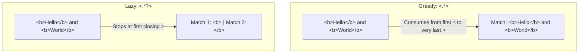
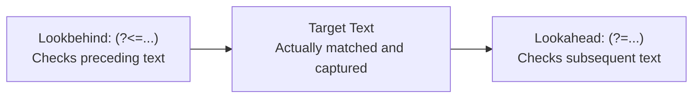
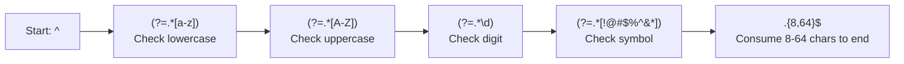
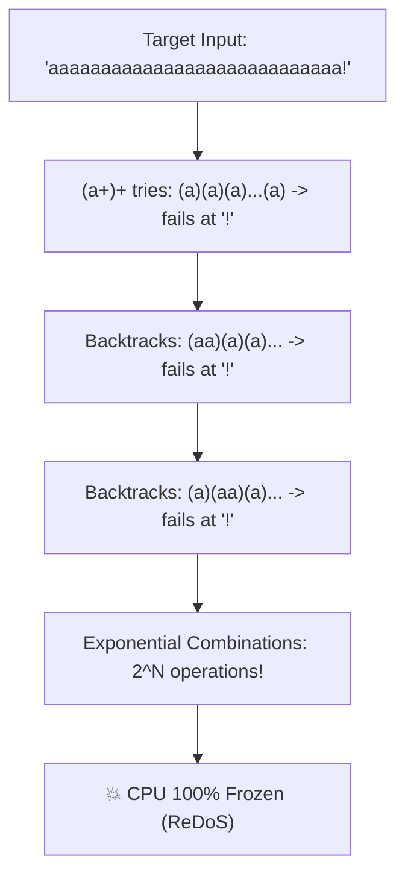

import { Callout } from "fumadocs-ui/components/callout";
import { Tabs, Tab } from "fumadocs-ui/components/tabs";
import { Accordion, Accordions } from "fumadocs-ui/components/accordion";

When processing real-world text—such as scraping websites, validating user registration forms, parsing server logs, or cleaning messy datasets—simple string methods like `.find()` or `.split()` quickly break down.

Consider searching for a phone number in a block of text:

```text
My phone number is 9876543210.
My email is abhishek@example.com.
My backup phone number is 9123456780.
```

Phone numbers don't have a single fixed string value; they follow a **pattern**: ten consecutive decimal digits, or formatted chunks with country codes and delimiters (e.g., `415-555-1234` or `(415) 555-1234`).

Writing manual `if`/`elif` checks for every slice and character index requires dozens of lines of brittle, unmaintainable code. **Regular expressions** (commonly shortened to **regex**) provide a concise, standardized language for describing, matching, validating, extracting, and transforming text patterns across programming languages.

---

## 1. Finding Patterns: Naive Code vs. Regex

Let's see why regular expressions exist by comparing a manual Python validator against a regex solution for US-formatted phone numbers (`###-###-####`):

<Tabs items={["Manual Slicing (25 Lines)", "With Regular Expressions (4 Lines)"]}>
<Tab value="Manual Slicing (25 Lines)">

```python
def is_phone_number(text: str) -> bool:
    """Manually validates whether text matches ###-###-#### format."""
    if len(text) != 12:
        return False
    for i in range(0, 3):
        if not text[i].isdecimal():
            return False
    if text[3] != "-":
        return False
    for i in range(4, 7):
        if not text[i].isdecimal():
            return False
    if text[7] != "-":
        return False
    for i in range(8, 12):
        if not text[i].isdecimal():
            return False
    return True

print(is_phone_number("415-555-4242"))      # True
print(is_phone_number("Call me tomorrow"))  # False
```

</Tab>
<Tab value="With Regular Expressions (4 Lines)">

```python
import re

phone_pattern = re.compile(r"\d{3}-\d{3}-\d{4}")

def is_phone_number(text: str) -> bool:
    return bool(phone_pattern.fullmatch(text))

print(is_phone_number("415-555-4242"))      # True
print(is_phone_number("Call me tomorrow"))  # False
```

</Tab>
</Tabs>

The regex `r"\d{3}-\d{3}-\d{4}"` expresses the exact same rules in 16 characters:

- `\d`: matches any single decimal digit (`0` through `9`).
- `{3}`: repeats the preceding element exactly 3 times.
- `-`: matches the literal hyphen character.

### What Can You Do with Regex?

Regex is a fundamental tool for software engineers across five core categories:

1. **Search**: Find every occurrence of a pattern within unstructured text (e.g., locating all URLs in a webpage).
2. **Validation**: Check whether user input strictly follows required formats (e.g., verifying an email address or postal code).
3. **Extraction**: Pull specific components from text (e.g., extracting year, month, and day from an ISO date).
4. **Replacement**: Transform or sanitize text (e.g., masking credit card digits or redacting personally identifiable information).
5. **Parsing**: Dissect structured data formats such as server access logs, CSV rows, or configuration files.

<Callout type="info" title="Regex Engines Don't Understand Meaning">
  A regex does not understand what a "phone number" or an "email" represents
  semantically. It only validates whether characters match a structural
  blueprint you defined.
</Callout>

---

## 2. Your First Regex Patterns: Literal Matching

The simplest regular expressions match exact sequences of characters:

| Regex   | Meaning                      | Example Match         | Non-Matching Example              |
| :------ | :--------------------------- | :-------------------- | :-------------------------------- |
| `cat`   | Exact sequence `c`, `a`, `t` | `"cat"`, `"category"` | `"dog"`, `"Cat"` (case-sensitive) |
| `hello` | Exact sequence `hello`       | `"hello world"`       | `"helo"`                          |
| `123`   | Exact sequence `1`, `2`, `3` | `"Order 123"`         | `"124"`                           |
| `dog`   | Exact sequence `dog`         | `"hotdog"`, `"dogs"`  | `"cat"`                           |

### Substring Search vs. Input Validation

By default, regular expressions search for **substrings** anywhere within the target text:

```python
import re

pattern = re.compile(r"cat")

# Matches because 'cat' is a substring of each word:
print(bool(pattern.search("The cat slept.")))        # True
print(bool(pattern.search("Catalog of items.")))     # True
print(bool(pattern.search("Concatenate strings.")))  # True
```

This distinction is critical: **finding a valid-looking substring is not the same as validating that an entire string conforms to a rule.** To enforce full-string matching, we use anchors (`^` and `$`) or `re.fullmatch()`.

---

## 3. Character Classes: Matching Character Categories

When you don't know the exact character in advance, you use **character classes** to match specific categories of characters.

### 3.1 Standard Character Shortcuts

| Pattern  | Meaning                                                          | Example Matches            | Non-Matches                        |
| :------- | :--------------------------------------------------------------- | :------------------------- | :--------------------------------- |
| **`\d`** | Any decimal digit                                                | `'0'`, `'5'`, `'9'`        | `'a'`, `'#'`, `' '`                |
| **`\D`** | Any non-digit                                                    | `'a'`, `'!'`, `' '`        | `'1'`, `'9'`                       |
| **`\w`** | "Word" character (alphanumeric + underscore)                     | `'a'`, `'Z'`, `'7'`, `'_'` | `'@'`, `'!'`, `' '`, `'-'`         |
| **`\W`** | Non-word character                                               | `'@'`, `' '`, `'.'`        | `'a'`, `'9'`, `'_'`                |
| **`\s`** | Whitespace (space, tab `\t`, newline `\n`, carriage return `\r`) | `' '`, `'\t'`, `'\n'`      | `'a'`, `'1'`, `'!'`                |
| **`\S`** | Non-whitespace                                                   | `'a'`, `'7'`, `'@'`        | `' '`, `'\t'`                      |
| **`.`**  | Any single character except newline `\n`                         | `'a'`, `'5'`, `'%'`, `' '` | `'\n'` (unless `re.DOTALL` is set) |

<Callout type="warn" title="Unicode Nuances: Python vs. JavaScript">
  In Python 3, `\w` matches Unicode alphanumeric characters by default (e.g.,
  accented characters like `é`, `ñ`, `ü`, and characters from non-Latin
  scripts). In standard JavaScript regex, `\w` strictly matches ASCII
  `[a-zA-Z0-9_]` unless Unicode property escapes like `\p{L}` are used with the
  `u` or `v` flag.
</Callout>

### 3.2 Stepping Through `\d`, `\d\d`, and `\d+`

Consider the text: `"My age is 21 and my score is 95."`

```python
import re

text = "My age is 21 and my score is 95."

# 1. \d matches single individual digits:
print(re.findall(r"\d", text))
# ['2', '1', '9', '5']

# 2. \d\d matches pairs of consecutive digits:
print(re.findall(r"\d\d", text))
# ['21', '95']

# 3. \d+ matches one or more consecutive digits (quantified):
print(re.findall(r"\d+", text))
# ['21', '95']
```

### 3.3 Custom Character Classes (`[...]`)

Square brackets define a custom set of permitted characters at that position:

| Pattern        | Meaning                                       | Matches             |
| :------------- | :-------------------------------------------- | :------------------ |
| `[abc]`        | Exactly one character: `'a'`, `'b'`, or `'c'` | `'a'`, `'b'`, `'c'` |
| `[0-9]`        | Any single digit (equivalent to `\d`)         | `'0'` through `'9'` |
| `[a-z]`        | Any single lowercase ASCII letter             | `'a'` through `'z'` |
| `[A-Z]`        | Any single uppercase ASCII letter             | `'A'` through `'Z'` |
| `[a-zA-Z0-9]`  | Any alphanumeric character                    | `'k'`, `'K'`, `'8'` |
| `[aeiouAEIOU]` | Any English vowel (both cases)                | `'a'`, `'E'`, `'o'` |

```python
import re

vowel_pattern = re.compile(r"[aeiou]")
print(vowel_pattern.findall("hello world"))
# ['e', 'o', 'o']
```

Notice the difference:

- `[abc]` matches **one** character from the set (`'a'` OR `'b'` OR `'c'`).
- `abc` matches the **three-character sequence** `'a'`, followed by `'b'`, followed by `'c'`.

Inside square brackets, a hyphen `-` defines a character range (`a-z`). If you want to match a literal hyphen inside brackets, place it at the very beginning or end: `[-abc]` or `[abc-]`. Most other metacharacters (like `.` and `*`) lose their special meaning inside `[...]` and match literally.

### 3.4 Negated Character Classes (`[^...]`)

A caret `^` placed as the **first character** inside brackets inverts the set:

```python
import re

# Match any single character that is NOT a digit:
non_digits = re.findall(r"[^0-9]", "Code 42!")
print(non_digits)
# ['C', 'o', 'd', 'e', ' ', '!']

# Match sequences of non-digits:
chunks = re.findall(r"[^0-9]+", "Order #404: 12 items")
print(chunks)
# ['Order #', ': ', ' items']
```

<Callout type="info" title="Dual Role of Caret (^)">
  - `[^0-9]`: Caret **inside brackets** means "negation" (NOT these characters).
  - `^abc`: Caret **outside brackets** is an anchor meaning "beginning of the
  string/line".
</Callout>

---

## 4. Quantifiers: Controlling Repetition

Quantifiers specify how many times a character, character class, or group must appear:

| Quantifier      | Meaning                       | Example   | Matches                   | Non-Matches                    |
| :-------------- | :---------------------------- | :-------- | :------------------------ | :----------------------------- |
| **`*`**         | Zero or more times            | `ab*`     | `"a"`, `"ab"`, `"abbb"`   | `"b"` (since `a` is mandatory) |
| **`+`**         | One or more times             | `ab+`     | `"ab"`, `"abb"`           | `"a"` (needs at least one `b`) |
| **`?`**         | Zero or one time (optional)   | `colou?r` | `"color"`, `"colour"`     | `"colouur"`                    |
| **`{n}`**       | Exactly $n$ times             | `\d{4}`   | `"2026"`                  | `"123"`, `"12345"`             |
| **`{min,max}`** | Between $min$ and $max$ times | `\d{2,4}` | `"99"`, `"123"`, `"2026"` | `"9"`, `"12345"`               |
| **`{min,}`**    | At least $min$ times          | `\d{3,}`  | `"123"`, `"123456"`       | `"12"`                         |

### Detailed Walkthrough of Quantifiers

```python
import re

# 1. Zero or more (*):
star_pattern = re.compile(r"ab*")
print(star_pattern.findall("a ab abb abbb b"))
# ['a', 'ab', 'abb', 'abbb']

# 2. One or more (+):
plus_pattern = re.compile(r"ab+")
print(plus_pattern.findall("a ab abb abbb b"))
# ['ab', 'abb', 'abbb']

# 3. Optional quantifier (?):
color_pattern = re.compile(r"colou?r")
print(bool(color_pattern.fullmatch("color")))   # True
print(bool(color_pattern.fullmatch("colour")))  # True
print(bool(color_pattern.fullmatch("colouur"))) # False

# 4. Exact repetition ({5}):
zip_pattern = re.compile(r"\d{5}")
print(zip_pattern.findall("Zip codes: 90210, 10001, and invalid 123"))
# ['90210', '10001']
```

Notice: An unanchored `\d{5}` will match inside `123456` (extracting `12345`). To require that the string contains _only_ five digits, we combine quantifiers with anchors.

---

## 5. Anchors and Boundaries: Where Should It Match?

Anchors do not consume any text characters. Instead, they assert a **position** within the string.

| Anchor   | Meaning                                                                                      |
| :------- | :------------------------------------------------------------------------------------------- |
| **`^`**  | Asserts position at the **beginning of the string** (or beginning of line in multiline mode) |
| **`$`**  | Asserts position at the **end of the string** (or end of line in multiline mode)             |
| **`\b`** | Asserts a **word boundary** (boundary between a word char `\w` and a non-word char `\W`)     |
| **`\B`** | Asserts a **non-word boundary** (any position that is not a word boundary)                   |

### 5.1 Beginning (`^`) and End (`$`) for Strict Validation

```python
import re

text = "abc12345xyz"

# Substring search succeeds:
print(bool(re.search(r"\d{5}", text)))        # True (found '12345')

# Anchored regex requires entire string to start and end with 5 digits:
print(bool(re.search(r"^\d{5}$", text)))      # False
print(bool(re.search(r"^\d{5}$", "12345")))    # True

# In Python, re.fullmatch() is the cleanest way to enforce full-string matching:
print(bool(re.fullmatch(r"\d{5}", "12345")))  # True
print(bool(re.fullmatch(r"\d{5}", text)))     # False
```

### 5.2 Word Boundaries (`\b`)

A word boundary `\b` is a zero-width transition between:

1. A word character `\w` and a non-word character `\W`.
2. A word character `\w` and the start or end of a string.

```python
import re

sentence = "The cat is in the category with a bobcat."

# Without boundaries: matches 'cat' in all three words:
print(re.findall(r"cat", sentence))
# ['cat', 'cat', 'cat']

# With boundaries: matches ONLY the standalone word:
print(re.findall(r"\bcat\b", sentence))
# ['cat']
```

`\b` does not match a space character. It matches the _invisible seam_ between the word `'cat'` and the surrounding spaces.

---

## 6. Alternation: Match One Option or Another

The pipe character `|` functions as an **OR** operator in regex.

```python
import re

# Match 'cat' OR 'dog':
pet_pattern = re.compile(r"cat|dog")
print(pet_pattern.findall("I have a cat, a dog, and a parrot."))
# ['cat', 'dog']
```

### Grouping Alternatives

When alternation applies to part of a word, wrap the options in parentheses:

```python
import re

# Match 'gray' OR 'grey':
color_pattern = re.compile(r"gr(a|e)y")
print(color_pattern.findall("The gray wolf and grey seal."))
# ['a', 'e'] (Notice: capturing parentheses extract group 1!)

# Using a non-capturing group (?:...) or character class [ae] avoids unintended capture:
print(re.findall(r"gr(?:a|e)y", "The gray wolf and grey seal."))
# ['gray', 'grey']

print(re.findall(r"gr[ae]y", "The gray wolf and grey seal."))
# ['gray', 'grey']
```

<Callout type="warn" title="Left-to-Right Ordering Trap">
  Regex engines evaluate alternatives from left to right. In patterns with overlapping prefixes, place the longer, more specific alternative first:
  ```python
  # ⚠️ Pitfall: 'cat' matches first, never trying 'caterpillar':
  re.findall(r"cat|caterpillar", "The caterpillar crawled.")  # ['cat']

# ✅ Correct: Test longer alternative first:

re.findall(r"caterpillar|cat", "The caterpillar crawled.") # ['caterpillar']

````
</Callout>

---

## 7. Groups: Captures, Non-Capturing & Named Groups

Parentheses `(...)` group sub-patterns into a single unit, allowing you to apply quantifiers, isolate alternatives, and extract specific slices of the matched text.

```python
import re

# Without parentheses: + applies only to 'b':
print(re.findall(r"ab+", "ababab"))  # ['ab', 'ab', 'ab']

# With parentheses: + applies to the whole sequence 'ab':
print(re.findall(r"(?:ab)+", "ababab"))  # ['ababab']
````

### 7.1 Capturing Groups (`(...)`)

When extracting data from structured text, capturing groups allow you to pull out individual components:

```python
import re

# Format: (Year)-(Month)-(Day)
date_pattern = re.compile(r"(\d{4})-(\d{2})-(\d{2})")
match = date_pattern.search("Release date: 2026-10-21 on production.")

if match:
    print("Full match (.group(0)):", match.group(0))  # 2026-10-21
    print("Year       (.group(1)):", match.group(1))  # 2026
    print("Month      (.group(2)):", match.group(2))  # 10
    print("Day        (.group(3)):", match.group(3))  # 21
    print("All groups as tuple:   ", match.groups())   # ('2026', '10', '21')
```

### 7.2 Non-Capturing Groups (`(?:...)`)

If you need parentheses to group characters or apply a quantifier, but do not need to store the matched text in capture indices, use `(?:...)`. Non-capturing groups improve engine performance and keep `.groups()` clean:

```python
import re

# We want to match 'cat' or 'dog' optionally followed by 's':
pet_regex = re.compile(r"(?:cat|dog)s?")

print(pet_regex.findall("cats, dog, and dogs are pets."))
# ['cats', 'dog', 'dogs']
```

### 7.3 Named Capture Groups (`(?P<name>...)`)

In production code, numbered indices like `.group(3)` are fragile and difficult to read. Python supports **named capture groups** using `(?P<name>...)`:

```python
import re

log_pattern = re.compile(
    r"\[(?P<level>\w+)\] (?P<timestamp>\d{4}-\d{2}-\d{2}) - (?P<message>.*)"
)

line = "[ERROR] 2026-10-21 - Database connection pool exhausted"
match = log_pattern.search(line)

if match:
    # Access by name:
    print("Level:    ", match.group("level"))
    print("Timestamp:", match.group("timestamp"))

    # Extract directly into a clean Python dictionary:
    data = match.groupdict()
    print("Group dict:", data)
```

Output:

```text
Level:     ERROR
Timestamp: 2026-10-21
Group dict: {'level': 'ERROR', 'timestamp': '2026-10-21', 'message': 'Database connection pool exhausted'}
```

<Callout type="info" title="Cross-Language Named Group Syntax">
  - **Python**: `(?P<group_name>...)`
  - **JavaScript (ES2018+)**: `(?<group_name>...)`
</Callout>

---

## 8. Escaping Metacharacters & Python Raw Strings

The following characters have special syntactical meaning in regex:

```text
.  *  +  ?  ^  $  (  )  [  ]  {  }  |  \
```

To match any of these symbols as literal text, prefix it with a backslash `\`.

| Pattern | Meaning                      | Example Matches     |
| :------ | :--------------------------- | :------------------ |
| `.`     | Any character except newline | `'a'`, `'9'`, `'%'` |
| `\.`    | Literal period               | `'example.com'`     |
| `\$`    | Literal dollar sign          | `'$100'`            |
| `\+`    | Literal plus sign            | `'C++'`             |
| `\*`    | Literal asterisk             | `'*bold*'`          |
| `\\`    | Literal backslash            | `'C:\Windows'`      |

```python
import re

# ⚠️ INCORRECT: '.' matches any character, matching 'exampleXcom':
bad_domain = re.compile(r"example.com")
print(bool(bad_domain.fullmatch("exampleXcom")))  # True!

# ✅ CORRECT: Escaped '\.' matches only a real dot:
good_domain = re.compile(r"example\.com")
print(bool(good_domain.fullmatch("exampleXcom"))) # False
print(bool(good_domain.fullmatch("example.com")))  # True
```

### The Mandatory Raw String Rule (`r"..."`)

In normal Python strings, `\n` means newline and `\t` means tab. Without a raw string `r"..."`, Python's string parser intercepts backslashes before the regex engine ever sees them:

```python
# ❌ Without raw string: Must double-escape every backslash
pattern = "\\d{3}-\\d{4}"

# ✅ With raw string: Python passes backslashes directly to regex engine
pattern = r"\d{3}-\d{4}"
```

In JavaScript, regex literals (`/\d+/`) don't require raw string prefixes, but passing a string to `new RegExp("\\d+")` requires double backslashes.

---

## 9. Greedy vs. Lazy Matching

By default, all regex quantifiers (`*`, `+`, `{}`) are **greedy**: they consume as much text as possible while still allowing the pattern to succeed.

Appending a question mark `?` after a quantifier (`*?`, `+?`, `??`, `{n,m}?`) makes it **lazy (non-greedy)**: it matches the minimum characters necessary.



### Demonstrating the Greedy Trap

```python
import re

html_snippet = "<b>Hello</b> and <b>World</b>"

# 1. Greedy: Consumes from the first '<b>' to the final '</b>' across the entire string:
greedy_match = re.search(r"<b>.*</b>", html_snippet)
print("Greedy:", greedy_match.group())
# Output: <b>Hello</b> and <b>World</b>

# 2. Lazy: Stops at the very first closing '</b>':
lazy_matches = re.findall(r"<b>.*?</b>", html_snippet)
print("Lazy:  ", lazy_matches)
# Output: ['<b>Hello</b>', '<b>World</b>']
```

| Greedy Quantifier | Lazy Equivalent | Behavior                            |
| :---------------- | :-------------- | :---------------------------------- |
| `.*`              | `.*?`           | Zero or more (shortest possible)    |
| `.+`              | `.+?`           | One or more (shortest possible)     |
| `\d+`             | `\d+?`          | Digits (shortest possible)          |
| `.{2,5}`          | `.{2,5}?`       | Between 2 and 5 (shortest possible) |

<Callout type="warn" title="Regex is NOT an HTML/XML Parser">
  While `.*?` prevents consuming multiple tags on a simple line, regex cannot
  properly handle nested tags, unescaped attributes, or complex markup. For
  production HTML parsing, always use dedicated parsers like `BeautifulSoup`
  (Python) or `cheerio` / `htmlparser2` (JavaScript).
</Callout>

---

## 10. Regex Flags: Modifying Engine Behavior

Flags change how the regular expression engine interprets characters without rewriting the pattern itself:

| Flag                    | Python Short | Python Long     | JavaScript | Description                                                                  |
| :---------------------- | :----------- | :-------------- | :--------- | :--------------------------------------------------------------------------- |
| **Case-Insensitive**    | `re.I`       | `re.IGNORECASE` | `i`        | Match characters regardless of uppercase or lowercase                        |
| **Multiline**           | `re.M`       | `re.MULTILINE`  | `m`        | Makes `^` and `$` match start/end of _each line_, not just the entire string |
| **Dotall / Singleline** | `re.S`       | `re.DOTALL`     | `s`        | Allows `.` to match newline `\n` characters                                  |
| **Verbose / Extended**  | `re.X`       | `re.VERBOSE`    | _N/A_      | Ignores whitespace and allows `#` comments inside regex                      |
| **Global**              | _N/A_        | `re.findall()`  | `g`        | Finds all matches rather than stopping at the first                          |
| **Unicode**             | Default      | `re.UNICODE`    | `u` / `v`  | Enables full Unicode character properties                                    |

### Combining Flags with Bitwise OR (`|`)

In Python, multiple flags are combined using the bitwise OR operator `|`:

```python
import re

text = """
Item: apple
ITEM: banana
item: cherry
"""

# Match 'item: <name>' regardless of case, matching each line:
pattern = re.compile(r"^item:\s+(\w+)$", flags=re.IGNORECASE | re.MULTILINE)
print(pattern.findall(text))
# Output: ['apple', 'banana', 'cherry']
```

### Self-Documenting Regex with `re.VERBOSE`

Complex regular expressions quickly look like unreadable line noise. The `re.VERBOSE` flag allows you to format patterns across multiple indented lines and add inline documentation:

```python
import re

# Production phone number regex with comments:
phone_regex = re.compile(r"""
    ^                           # Start of string
    (?:\+(?P<country>\d{1,3})[-.\s]?)? # Optional country code (+1, +44)
    (?:\((?P<area>\d{3})\)|(?P<area_plain>\d{3})) # Area code: (415) or 415
    [-.\s]?                     # Separator
    (?P<prefix>\d{3})           # 3-digit central office prefix
    [-.\s]?                     # Separator
    (?P<line>\d{4})             # 4-digit subscriber line number
    $                           # End of string
""", flags=re.VERBOSE)

match = phone_regex.search("+1 (415) 555-1234")
print(bool(match))  # True
```

---

## 11. Python's Comprehensive `re` Toolkit

Python's built-in `re` module provides eight essential methods:

| Method                       | Description                                    | Return Value                 |
| :--------------------------- | :--------------------------------------------- | :--------------------------- |
| **`re.search(pat, str)`**    | Scans the whole string for the **first match** | `re.Match` or `None`         |
| **`re.match(pat, str)`**     | Matches **only at index 0** (start of string)  | `re.Match` or `None`         |
| **`re.fullmatch(pat, str)`** | Matches if the **entire string** conforms      | `re.Match` or `None`         |
| **`re.findall(pat, str)`**   | Finds **all non-overlapping matches**          | `list[str]` or `list[tuple]` |
| **`re.finditer(pat, str)`**  | Yields matches lazily as match objects         | Iterator of `re.Match`       |
| **`re.sub(pat, repl, str)`** | Replaces matched text with replacement         | `str`                        |
| **`re.split(pat, str)`**     | Splits string by regex matches                 | `list[str]`                  |
| **`re.compile(pat, flags)`** | Pre-compiles pattern into reusable object      | `re.Pattern`                 |

### 11.1 Search vs. Match vs. Fullmatch

```python
import re

text = "Status: 200 OK"

# 1. match() fails because text starts with 'Status', not digits:
print(re.match(r"\d+", text))       # None

# 2. search() scans until it discovers '200':
match = re.search(r"\d+", text)
print(match.group())                # '200'

# 3. fullmatch() requires entire input to be digits:
print(bool(re.fullmatch(r"\d+", "200")))     # True
print(bool(re.fullmatch(r"\d+", text)))      # False
```

### 11.2 `re.findall()` vs. `re.finditer()`

```python
import re

text = "Alpha 100, Beta 200, Gamma 300"

# findall: returns list of matched strings
print(re.findall(r"\d+", text))
# ['100', '200', '300']

# finditer: yields re.Match objects providing exact start/end character offsets:
for m in re.finditer(r"\d+", text):
    print(f"Found {m.group()} at slice indexes {m.span()}")
# Found 100 at slice indexes (6, 9)
# Found 200 at slice indexes (16, 19)
# Found 300 at slice indexes (27, 30)
```

### 11.3 Search & Replace with `re.sub()`

`re.sub()` accepts static strings, backreference groups, or callable replacement functions:

```python
import re

# 1. Basic replacement:
redacted = re.sub(r"\b\d{4}-\d{4}-\d{4}-\d{4}\b", "[CARD REDACTED]", "Card: 1234-5678-9012-3456")
print(redacted)  # Card: [CARD REDACTED]

# 2. Backreferences in replacement string (\1, \2, \3):
# Reformat ISO date (YYYY-MM-DD) to European format (DD/MM/YYYY):
euro_date = re.sub(r"(\d{4})-(\d{2})-(\d{2})", r"\3/\2/\1", "Date: 2026-10-21")
print(euro_date)  # Date: 21/10/2026

# 3. Dynamic replacement with a Python callback function:
prices = "Item 1: $50, Item 2: $120, Item 3: $80"

def apply_discount(m: re.Match) -> str:
    original = float(m.group(1))
    discounted = original * 0.90  # 10% discount
    return f"${discounted:.2f}"

print(re.sub(r"\$(\d+)", apply_discount, prices))
# Output: Item 1: $45.00, Item 2: $108.00, Item 3: $72.00
```

### 11.4 Splitting on Complex Delimiters with `re.split()`

Standard `str.split()` only splits by a single fixed substring. `re.split()` splits across multiple separators and irregular whitespace:

```python
import re

raw_csv = "apple, banana; orange   grape|mango"
tokens = re.split(r"[,;\s|]+", raw_csv)
print(tokens)
# ['apple', 'banana', 'orange', 'grape', 'mango']
```

---

## 12. Advanced Zero-Width Assertions: Lookaheads & Lookbehinds

Lookarounds inspect the surrounding characters **without consuming them or including them in the match result**. They are zero-width assertions.



| Lookaround Type         | Syntax     | Meaning                           | Example Pattern     | Input Text             | Match Result |
| :---------------------- | :--------- | :-------------------------------- | :------------------ | :--------------------- | :----------- |
| **Positive Lookahead**  | `(?=...)`  | Next text **must** match          | `\d+(?=\s*USD)`     | `"100 USD and 50 EUR"` | `'100'`      |
| **Negative Lookahead**  | `(?!...)`  | Next text **must NOT** match      | `\b\d+\b(?!\s*USD)` | `"100 USD and 50 EUR"` | `'50'`       |
| **Positive Lookbehind** | `(?<=...)` | Preceding text **must** match     | `(?<=\$)\d+`        | `"Cost is $250 today"` | `'250'`      |
| **Negative Lookbehind** | `(?<!...)` | Preceding text **must NOT** match | `(?<!\$)\b\d+\b`    | `"Paid $250 and 80"`   | `'80'`       |

### Code Demonstration

```python
import re

text = "100 USD, 200 EUR, 300 USD, 400 JPY"

# 1. Positive lookahead: digits followed by ' USD' (excluding ' USD' from match):
usd_amounts = re.findall(r"\d+(?=\s*USD)", text)
print("USD amounts:", usd_amounts)  # ['100', '300']

# 2. Positive lookbehind: digits preceded by '$':
prices = "Items cost $45, €90, and $120."
dollar_values = re.findall(r"(?<=\$)\d+", prices)
print("Dollar values:", dollar_values)  # ['45', '120']
```

<Callout type="warn" title="Python Lookbehind Constraint: Fixed Width Only">
  In Python's standard `re` module, lookbehinds **must have a fixed width**. You cannot use variable-length quantifiers (`*`, `+`, `?`) inside a lookbehind:
  ```python
  # ❌ Invalid in standard re: Variable width in lookbehind
  re.search(r"(?<=https?://)\w+", text)  # Raises: lookbehind requires fixed-width pattern

# ✅ Valid: Use non-capturing group with capturing target instead:

match = re.search(r"https?://(\w+)", text)

````
*(The third-party `regex` PyPI package removes this restriction if variable-width lookbehinds are required).*
</Callout>

---

## 13. Backreferences: Matching Repeated Words & Patterns

A backreference allows you to match the **exact same text** previously matched by a capturing group earlier in the pattern. Backreferences are written as `\1`, `\2`, etc.

### Detecting Duplicate Adjacent Words

A classic proofreading problem is detecting accidentally doubled words (e.g., `"the the"`, `"is is"`):

```python
import re

sample = "Paris in the the spring is is wonderful."

# Pattern breakdown:
# \b       : Word boundary
# (\w+)    : Capture group 1 (matches and stores any word)
# \s+      : One or more spaces
# \1       : Exact match of the content in group 1
# \b       : Word boundary
duplicate_word_pattern = re.compile(r"\b(\w+)\s+\1\b", flags=re.IGNORECASE)

for match in duplicate_word_pattern.finditer(sample):
  print(f"Duplicate word found: '{match.group(1)}' at slice {match.span()}")
````

Output:

```text
Duplicate word found: 'the' at slice (9, 16)
Duplicate word found: 'is' at slice (24, 29)
```

### Matching Paired Quotes

```python
import re

# Match content enclosed in matching single OR double quotes:
quote_pattern = re.compile(r"""(['"])(.*?)\1""")

text = """He said 'hello' and she replied "world", but not 'mismatched"."""
for match in quote_pattern.finditer(text):
    delimiter, content = match.group(1), match.group(2)
    print(f"Quote [{delimiter}]: {content}")
```

Output:

```text
Quote [']: hello
Quote ["]: world
```

---

## 14. Architecture: Multi-Rule Password Validation

Let's combine multiple zero-width lookaheads to enforce a strict password security policy:

1. At least 8 characters in length.
2. At least one lowercase English letter (`[a-z]`).
3. At least one uppercase English letter (`[A-Z]`).
4. At least one numeric digit (`\d`).
5. At least one special symbol (`[!@#$%^&*]`).

### The Compound Lookahead Pattern

```python
import re

password_pattern = re.compile(r"""
    ^                       # Start of string anchor
    (?=.*[a-z])             # Positive lookahead: contains at least 1 lowercase letter
    (?=.*[A-Z])             # Positive lookahead: contains at least 1 uppercase letter
    (?=.*\d)                # Positive lookahead: contains at least 1 digit
    (?=.*[!@#$%^&*])        # Positive lookahead: contains at least 1 special character
    .{8,64}                 # Length constraint: 8 to 64 characters total
    $                       # End of string anchor
""", flags=re.VERBOSE)

def validate_password(password: str) -> bool:
    return bool(password_pattern.fullmatch(password))

print(validate_password("Secure123!"))       # True
print(validate_password("weakpassword"))      # False (missing upper, digit, symbol)
print(validate_password("Short1!"))          # False (less than 8 chars)
```



Because each lookahead is zero-width, the regex engine returns its cursor to the start of the string (`^`) after checking each condition, allowing all 5 rules to be evaluated independently!

<Callout type="warn" title="Password Security Guidelines">
  Regex validation ensures format complexity, but it does **not** replace
  password security best practices: - Always enforce a maximum length (e.g., 64
  or 128 characters) to prevent Denial of Service attacks. - Never store plain
  text passwords; hash with modern algorithms like **Argon2id** or **bcrypt**. -
  Always validate passwords server-side, never trusting client-only validations.
</Callout>

---

## 15. Common Practical Patterns & Semantic vs. Format Validation

### Production Starter Patterns

| Use Case                 | Pattern                           | Example Match           | Notes                                   |
| :----------------------- | :-------------------------------- | :---------------------- | :-------------------------------------- |
| **Integers**             | `r"^-?\d+$"`                      | `"-42"`, `"2026"`       | Optional leading minus                  |
| **Floats / Decimals**    | `r"^-?\d+(?:\.\d+)?$"`            | `"3.14"`, `"-0.05"`     | Optional decimal segment                |
| **ISO Date**             | `r"^\d{4}-\d{2}-\d{2}$"`          | `"2026-10-21"`          | Checks format, not calendar validity    |
| **Standard Username**    | `r"^[a-zA-Z][a-zA-Z0-9_]{2,19}$"` | `"abhishek_21"`         | Starts with letter, 3-20 chars          |
| **Indian Mobile Number** | `r"^[6-9]\d{9}$"`                 | `"9876543210"`          | Simplified 10-digit format starting 6-9 |
| **Safe HTTP(S) URL**     | `r"^https?://[^\s/$.?#].[^\s]*$"` | `"https://example.com"` | Basic structural check                  |

### Format Validation vs. Semantic Validation

A regex only validates **syntax**, not **semantics**:

```python
import re
from datetime import datetime

date_input = "2026-99-88"

# 1. Regex validates the format:
if re.fullmatch(r"\d{4}-\d{2}-\d{2}", date_input):
    print("Syntax format: VALID")  # Passes!

# 2. Semantic validator checks if the date actually exists in reality:
try:
    valid_date = datetime.strptime(date_input, "%Y-%m-%d")
    print("Semantic check: VALID")
except ValueError as err:
    print(f"Semantic check: INVALID -> {err}")
# Output: Semantic check: INVALID -> month must be in 1..12
```

Similarly, an email regex can confirm that text _looks_ like an email (`name@domain.com`), but cannot verify whether the domain has active MX mail records or whether the user's inbox exists. Use regex for quick structural checks, followed by domain verification or confirmation links.

---

## 16. Cross-Language Bridge: Regex in JavaScript & Next.js

As a fullstack developer building Next.js and Python applications, you will frequently write regular expressions in TypeScript alongside Python backend services.

### JavaScript Regex Syntax

```typescript
// 1. Regex literal notation:
const phonePattern = /^\d{10}$/;
console.log(phonePattern.test("9876543210")); // true
console.log(phonePattern.test("12345")); // false

// 2. Extraction using .match():
const text = "Orders: 101, 102, 103";
const extracted = text.match(/\d+/g);
console.log(extracted); // ["101", "102", "103"]
```

### ⚠️ The Dangerous JavaScript `g` / `lastIndex` Bug

In JavaScript, regular expressions with the global flag (`/g`) or sticky flag (`/y`) maintain **mutable state** across calls via their `.lastIndex` property:

```typescript
// ⚠️ DANGEROUS BUG IN JAVASCRIPT:
const globalPattern = /^\d{3}$/g;

console.log(globalPattern.test("123")); // true  (lastIndex moves to 3)
console.log(globalPattern.test("123")); // false! (starts scanning at index 3!)
console.log(globalPattern.test("123")); // true  (resets to 0, succeeds again)
```

<Callout type="warn" title="Never Use /g with .test() in JavaScript">
  If you use a regex with the `/g` flag in form validation or inside an exported
  module in Next.js, alternating users will randomly fail validation on valid
  inputs! **Never use the `/g` flag for boolean validation.**
</Callout>

### Fullstack Next.js Validation with Zod

In a modern Next.js application, validation should occur on both the client (for instant UI feedback) and the server (inside Route Handlers or Server Actions). Use **Zod** for unified type-safe schemas:

```typescript
// app/schemas/user.ts
import { z } from "zod";

export const UserRegistrationSchema = z.object({
  username: z
    .string()
    .min(3, "Username must be at least 3 characters")
    .max(20, "Username must be 20 characters or fewer")
    .regex(
      /^[a-zA-Z][a-zA-Z0-9_]*$/,
      "Username must start with a letter and contain only letters, numbers, and underscores"
    ),
  phone: z
    .string()
    .regex(/^[6-9]\d{9}$/, "Please enter a valid 10-digit mobile number"),
});

export type UserRegistrationInput = z.infer<typeof UserRegistrationSchema>;
```

---

## 17. Advanced Performance & Catastrophic Backtracking (ReDoS)

Most regex engines—including Python's `re` and V8 in Node.js/browsers—use **Nondeterministic Finite Automata (NFA)** with backtracking. When an engine encounters ambiguous choices, it tries one branch; if it fails, it rewinds (backtracks) and tests other combinations.

### The Catastrophic Backtracking Trap

Consider the pattern `^(a+)+$`:



When evaluated against 30 `a` characters followed by an exclamation mark `!`, the engine tests over **$2^{30}$ (one billion)** permutations before reporting failure, freezing the CPU thread for minutes!

This vulnerability is called **ReDoS (Regular Expression Denial of Service)**.

### How to Defend Against ReDoS

1. **Eliminate Nested Quantifiers**: Never write `(a+)+`, `(a*)*`, or `(a+)*`. Rewrite `^(a+)+$` as `^a+$`.
2. **Mutually Exclusive Sub-Patterns**: Ensure alternative branches do not overlap. Instead of `.*,.*`, use `[^,]+,[^,]+`.
3. **Enforce Input Length Caps**: Restrict user input length to reasonable bounds (e.g. `len(text) <= 256`) before running regex.
4. **Atomic Groups and Possessive Quantifiers (Python 3.11+)**:
   - **Atomic groups** `(?>...)`: Tells the engine never to backtrack into this group once matched.
   - **Possessive quantifiers** `a++`, `a*+`: Consumes all matching characters without yielding back during failure.

```python
import re

# Python 3.11+ atomic group prevents backtracking into the inner repetition:
safe_pattern = re.compile(r"^(?>a+)+$")
```

---

## 18. Common Regex Mistakes & Anti-Patterns

| Anti-Pattern                                         | Why It Breaks                                           | The Idiomatic Fix                                                 |
| :--------------------------------------------------- | :------------------------------------------------------ | :---------------------------------------------------------------- | ------------------------------------------ | ----- |
| `re.search(r"example.com", text)`                    | Unescaped dot `.` matches any character (`exampleXcom`) | Escape the dot: `r"example\.com"`                                 |
| `re.search(r"\d{5}", input)` for zip code validation | Matches inside `"abc123456xyz"`                         | Use full matching: `re.fullmatch(r"\d{5}", input)`                |
| `re.compile(r"cat                                    | caterpillar")`                                          | Eager alternation matches `'cat'` first, ignoring `'caterpillar'` | Order longer options first: `r"caterpillar | cat"` |
| Assuming `*` requires at least one item              | `*` matches zero items, matching empty strings          | Use `+` if at least one character is required                     |
| Believing `\b` matches spaces                        | `\b` is a zero-width assertion between `\w` and `\W`    | Use `\s` if matching literal spaces or whitespace                 |
| Using greedy `.*` for HTML or quotes                 | Consumes entire document between first `<` and last `>` | Use lazy `.*?` or negated classes `[^>]*`                         |
| Validating emails with 500-char regex                | Impenetrable regexes reject valid emails or cause ReDoS | Use simple regex + send validation email                          |
| Reusing `/g` regex instances with `.test()` in JS    | Mutable `lastIndex` causes alternating `true`/`false`   | Remove `/g` flag for boolean tests                                |

---

## 19. Comprehensive Regex Cheat Sheet

### Characters & Classes

| Syntax      | Description                     | Example Matches                     |
| :---------- | :------------------------------ | :---------------------------------- |
| `\d` / `\D` | Digit / Non-digit               | `[0-9]` / `[^0-9]`                  |
| `\w` / `\W` | Word char / Non-word char       | `[a-zA-Z0-9_]` / non-word           |
| `\s` / `\S` | Whitespace / Non-whitespace     | Space, tab, newline / non-space     |
| `.`         | Any character except `\n`       | Any non-newline                     |
| `[abc]`     | Any single character in set     | `'a'`, `'b'`, `'c'`                 |
| `[^abc]`    | Any single character NOT in set | Anything except `'a'`, `'b'`, `'c'` |
| `[a-z]`     | Range from a to z               | Lowercase letters                   |

### Quantifiers & Repetition

| Syntax       | Description                         | Greedy vs. Lazy |
| :----------- | :---------------------------------- | :-------------- |
| `*` / `*?`   | 0 or more occurrences               | Greedy / Lazy   |
| `+` / `+?`   | 1 or more occurrences               | Greedy / Lazy   |
| `?` / `??`   | 0 or 1 occurrence (optional)        | Greedy / Lazy   |
| `{n}`        | Exactly $n$ occurrences             | Fixed count     |
| `{min,max}`  | Between $min$ and $max$ occurrences | Greedy          |
| `{min,max}?` | Between $min$ and $max$ occurrences | Lazy            |

### Anchors & Structure

| Syntax          | Description                           |
| :-------------- | :------------------------------------ | -------------------------------- |
| `^`             | Start of string (or line with `re.M`) |
| `$`             | End of string (or line with `re.M`)   |
| `\b` / `\B`     | Word boundary / Non-word boundary     |
| `a              | b`                                    | Alternation (matches `a` OR `b`) |
| `(...)`         | Capturing group                       |
| `(?:...)`       | Non-capturing group                   |
| `(?P<name>...)` | Python named capturing group          |
| `\1`, `\2`      | Backreference to group 1, group 2     |

### Lookarounds (Zero-Width)

| Syntax     | Name                | Condition               |
| :--------- | :------------------ | :---------------------- |
| `(?=...)`  | Positive Lookahead  | Followed by pattern     |
| `(?!...)`  | Negative Lookahead  | NOT followed by pattern |
| `(?<=...)` | Positive Lookbehind | Preceded by pattern     |
| `(?<!...)` | Negative Lookbehind | NOT preceded by pattern |

---

## 20. Real-World Capstone Project: Production Contact & Log Harvester

Here is an end-to-end Python script that parses an unorganized document containing mixed contacts and server logs, normalizes their formats, and produces clean reports:

```python
"""contact_log_harvester.py: Automated Document Parser & Scraper."""

import re

document = """
== Support Incident Log 2026-10-21 ==
[INFO] 2026-10-21 - Server cluster initialized on host node-01.
Customer support line reached: +1-415-555-0199 for billing issues.
Fallback contacts: support@company.com and billing-dept+us@enterprise.org.
[ERROR] 2026-10-21 - Memory threshold exceeded on worker pool 4.
Executive escalations: (800) 555-4321 or ceo.office@domain.co.uk.
Direct mobile hotline for overseas: +44 20 7946 0991.
Spam addresses like admin@@bad..com or invalid-numbers 123-abc should be skipped.
"""

# 1. Self-documenting Phone Number Regex:
phone_pattern = re.compile(r"""
    (?:\+(?P<country>\d{1,3})[-.\s]?)? # Optional country code
    (?:\((?P<area>\d{3})\)|(?P<area_plain>\d{3})) # Area code with/without parens
    [-.\s]?                             # Delimiter
    (?P<prefix>\d{3,4})                 # Prefix
    [-.\s]?                             # Delimiter
    (?P<line>\d{4})                     # Line number
""", flags=re.VERBOSE)

# 2. Self-documenting Email Regex:
email_pattern = re.compile(r"""
    [a-zA-Z0-9_.+-]+                    # Local part
    @                                   # At symbol
    [a-zA-Z0-9-]+                       # Domain root
    (?:\.[a-zA-Z0-9-]+)+                # Domain extensions (.co.uk, .org)
""", flags=re.VERBOSE)

# 3. Log Event Pattern:
log_pattern = re.compile(r"""
    ^\[(?P<level>[A-Z]+)\]\s+           # Log level [INFO], [ERROR]
    (?P<date>\d{4}-\d{2}-\d{2})\s+-\s+  # Date
    (?P<message>.*)$                    # Message text
""", flags=re.VERBOSE | re.MULTILINE)

# Process Phone Numbers:
print("=== 📞 HARVESTED PHONE NUMBERS ===")
for match in phone_pattern.finditer(document):
    country = match.group("country")
    area = match.group("area") or match.group("area_plain")
    prefix = match.group("prefix")
    line = match.group("line")
    country_prefix = f"+{country} " if country else ""
    print(f"  Standardized: {country_prefix}({area}) {prefix}-{line}")

# Process Emails:
print("\n=== ✉️ HARVESTED EMAIL ADDRESSES ===")
for email in set(email_pattern.findall(document)):
    print(f"  Verified Email: {email}")

# Process Log Events:
print("\n=== 📋 HARVESTED LOG EVENTS ===")
for match in log_pattern.finditer(document):
    d = match.groupdict()
    print(f"  [{d['level']}] {d['date']} -> {d['message']}")
```

Output:

```text
=== 📞 HARVESTED PHONE NUMBERS ===
  Standardized: +1 (415) 555-0199
  Standardized: (800) 555-4321
  Standardized: +44 (20) 7946-0991

=== ✉️ HARVESTED EMAIL ADDRESSES ===
  Verified Email: billing-dept+us@enterprise.org
  Verified Email: ceo.office@domain.co.uk
  Verified Email: support@company.com

=== 📋 HARVESTED LOG EVENTS ===
  [INFO] 2026-10-21 -> Server cluster initialized on host node-01.
  [ERROR] 2026-10-21 -> Memory threshold exceeded on worker pool 4.
```

---

## 21. Practice Exercises & Solutions

<Accordions>
<Accordion title="Exercise 1: Date Format Transformer (US to ISO-8601)">

**Objective:** Write a function `convert_dates(text: str) -> str` that finds all US-formatted dates (`MM/DD/YYYY` or `M/D/YYYY`) and transforms them into standard ISO-8601 format (`YYYY-MM-DD`).

```python
import re

def convert_dates(text: str) -> str:
    pattern = re.compile(r"\b(\d{1,2})/(\d{1,2})/(\d{4})\b")

    def replacer(match: re.Match) -> str:
        month = int(match.group(1))
        day = int(match.group(2))
        year = match.group(3)
        return f"{year}-{month:02d}-{day:02d}"

    return pattern.sub(replacer, text)

# Test Verification:
sample = "Project kick-off was 4/5/2025 and release is scheduled for 12/31/2026."
print(convert_dates(sample))
# Output: Project kick-off was 2025-04-05 and release is scheduled for 2026-12-31.
```

</Accordion>

<Accordion title="Exercise 2: Sensitive Data Masker">

**Objective:** Write a function `mask_credit_cards(text: str) -> str` that finds 16-digit credit card numbers (grouped by hyphens `####-####-####-####` or spaces) and masks the first 12 digits with `****-****-****-` while keeping the last 4 digits visible.

```python
import re

def mask_credit_cards(text: str) -> str:
    # Match 3 blocks of 4 digits separated by dash or space, followed by captured last 4 digits:
    card_pattern = re.compile(r"\b\d{4}[-\s]\d{4}[-\s]\d{4}[-\s](\d{4})\b")
    return card_pattern.sub(r"****-****-****-\1", text)

# Test Verification:
transaction = "Primary: 4111-2222-3333-4444 and Backup: 5500 0000 1234 9876."
print(mask_credit_cards(transaction))
# Output: Primary: ****-****-****-4444 and Backup: ****-****-****-9876.
```

</Accordion>

<Accordion title="Exercise 3: Duplicate Word Detector">

**Objective:** Write a function `find_repeated_words(text: str) -> list[str]` that detects and extracts all adjacent duplicate words in a sentence using backreferences.

```python
import re

def find_repeated_words(text: str) -> list[str]:
    # \b(\w+) captures word 1; \s+ matches whitespace; \1 asserts identical word follows:
    pattern = re.compile(r"\b(\w+)\s+\1\b", flags=re.IGNORECASE)
    # Using finditer ensures we get each unique duplicated token:
    return [match.group(1).lower() for match in pattern.finditer(text)]

# Test Verification:
sentence = "We must go to the the store and and buy food."
print(find_repeated_words(sentence))
# Output: ['the', 'and']
```

</Accordion>

<Accordion title="Exercise 4: Multi-Rule Password Strength Checker">

**Objective:** Write a function `check_password_strength(password: str) -> dict[str, bool]` that validates:

- Length: $\ge 8$ chars
- Contains lowercase letter
- Contains uppercase letter
- Contains digit
- Contains special character from `[!@#$%^&*]`

```python
import re

def check_password_strength(password: str) -> dict[str, bool]:
    return {
        "length_ok": len(password) >= 8,
        "has_lowercase": bool(re.search(r"[a-z]", password)),
        "has_uppercase": bool(re.search(r"[A-Z]", password)),
        "has_digit": bool(re.search(r"\d", password)),
        "has_special": bool(re.search(r"[!@#$%^&*]", password)),
        "is_valid": bool(
            re.fullmatch(
                r"^(?=.*[a-z])(?=.*[A-Z])(?=.*\d)(?=.*[!@#$%^&*]).{8,}$",
                password
            )
        )
    }

# Test Verification:
print(check_password_strength("Pass123!"))
# Output: {'length_ok': True, 'has_lowercase': True, 'has_uppercase': True, 'has_digit': True, 'has_special': True, 'is_valid': True}
```

</Accordion>

<Accordion title="Exercise 5: Hex Color & Hashtag Extractor">

**Objective:** Write a function `extract_hex_colors(text: str) -> list[str]` that extracts valid 3-character and 6-character hex color codes (`#FFF`, `#1a2b3c`) while ignoring invalid hashtag sequences like `#12` or `#blue`.

```python
import re

def extract_hex_colors(text: str) -> list[str]:
    # Match '#' followed by either 6 hex characters or 3 hex characters, bounded by word end:
    pattern = re.compile(r"#(?:[0-9a-fA-F]{6}|[0-9a-fA-F]{3})\b")
    return pattern.findall(text)

# Test Verification:
css = "Colors are #fff, #1A2B3C, and #09f. Invalid: #12, #blue, #1234567."
print(extract_hex_colors(css))
# Output: ['#fff', '#1A2B3C', '#09f']
```

</Accordion>

<Accordion title="Exercise 6: Cross-Language Validation Parity (Python & Zod)">

**Objective:** Ensure identical validation behavior between Python backend and Next.js frontend for an alphanumeric user tag format: must begin with `@`, followed by 3–15 lowercase letters, numbers, or dots, but cannot end with a dot.

```python
# python_validator.py
import re

tag_regex = re.compile(r"^@[a-z0-9][a-z0-9.]{1,13}[a-z0-9]$")

def is_valid_tag(tag: str) -> bool:
    return bool(tag_regex.fullmatch(tag))

# Verification:
print(is_valid_tag("@abhishek.dev"))  # True
print(is_valid_tag("@bad."))          # False (ends with dot)
print(is_valid_tag("no_at"))          # False (missing @)
```

```typescript
// zod-validator.ts (Next.js / TypeScript)
import { z } from "zod";

export const TagSchema = z
  .string()
  .regex(
    /^@[a-z0-9][a-z0-9.]{1,13}[a-z0-9]$/,
    "Tag must start with @, be 3-15 chars, and cannot end in a dot"
  );

// Verification:
console.log(TagSchema.safeParse("@abhishek.dev").success); // true
console.log(TagSchema.safeParse("@bad.").success); // false
```

</Accordion>
</Accordions>

---

## Summary Reference

- Always prefix Python regex patterns with raw string notation: `r"..."`.
- Compile reusable patterns with `re.compile(pattern, flags=...)` for clarity, performance, and maintainability.
- Use `re.search()` for finding substrings, `re.fullmatch()` for whole-input validation, and `re.finditer()` for memory-safe iteration with character offsets.
- Quantifiers are greedy by default; append `?` (`*?`, `+?`) for lazy, minimal matching, or use negated character classes (`[^>]*`) to prevent runaway backtracking.
- Parentheses `(...)` create capture groups; use `(?:...)` for non-capturing grouping, and `(?P<name>...)` for structured dictionary extraction via `.groupdict()`.
- Use zero-width lookarounds (`(?=...)`, `(?!...)`, `(?<=...)`, `(?<!...)`) to inspect surrounding context without consuming characters.
- Use `\1` backreferences to identify repeated adjacent words or matching delimiters.
- Defend against ReDoS attacks by avoiding nested quantifiers (`(a+)+`), bounding input lengths, and using atomic groups `(?>...)` where available.
- In JavaScript / Next.js, never use the global flag `/g` with `.test()` due to stateful `lastIndex` bugs; use Zod schemas for end-to-end fullstack type safety.
- Next, connect Python to live web services and consume REST endpoints in **[13. Working with APIs: HTTP & REST](/docs/learn-python/02-intermediate/13-working-with-apis)**!
