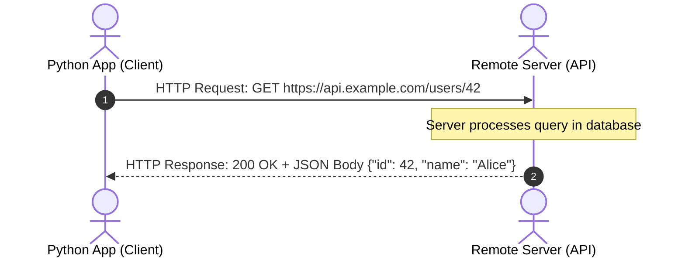

import { Callout } from "fumadocs-ui/components/callout";
import { Tabs, Tab } from "fumadocs-ui/components/tabs";
import { Accordion, Accordions } from "fumadocs-ui/components/accordion";

Modern applications rarely live in isolation.

Whether querying real-time weather forecasts, processing credit card charges via Stripe, interacting with GitHub repositories, or sending prompts to LLM endpoints, your Python programs will communicate over the internet using **REST APIs** (Representational State Transfer).

---

## 1. How Web APIs Work

An **API** is a standardized contract that allows two computer programs to talk to each other over the web using the **HTTP protocol**:



Every HTTP Request consists of four essential parts:

1. **URL (Endpoint)**: Where the request goes (e.g. `https://api.github.com/users/octocat`).
2. **HTTP Verb (Method)**: What action to take:
   - `GET`: Retrieve existing data.
   - `POST`: Create new data or trigger an action.
   - `PUT` / `PATCH`: Update existing records.
   - `DELETE`: Remove records.
3. **Headers**: Metadata (e.g. `Authorization: Bearer <token>`, `Content-Type: application/json`).
4. **Body / Query Parameters**: The data being sent.

---

## 2. HTTP Status Codes Quick Reference

Every HTTP response returns a numeric **Status Code** indicating what happened:

| Status Code                     | Meaning      | What It Means                                                 |
| :------------------------------ | :----------- | :------------------------------------------------------------ |
| **`200 OK`**                    | Success      | Request succeeded; response data is ready.                    |
| **`201 Created`**               | Success      | A new resource was created successfully (usually after POST). |
| **`400 Bad Request`**           | Client Error | Your request was malformed or missing parameters.             |
| **`401 Unauthorized`**          | Client Error | Missing or invalid API key / bearer token.                    |
| **`404 Not Found`**             | Client Error | The requested URL or ID does not exist on the server.         |
| **`429 Too Many Requests`**     | Client Error | Rate limit exceeded! You are sending requests too quickly.    |
| **`500 Internal Server Error`** | Server Error | The remote server crashed; not a bug in your client request.  |

---

## 3. Fetching Data with `httpx`

While Python includes a basic `urllib` module, the industry standard for modern Python is **`httpx`** (a next-generation HTTP library supporting both synchronous and asynchronous calls, HTTP/2, and type safety).

Install `httpx` first:

```bash
uv add httpx
# or: pip install httpx
```

### Making a Simple GET Request

Let's fetch public repository data from the GitHub API:

```python
import httpx

url = "https://api.github.com/repos/python/cpython"

# Set a custom User-Agent header (required by GitHub API):
headers = {"User-Agent": "LearnPythonTutorial/1.0"}

response = httpx.get(url, headers=headers)

# 1. Check HTTP status code:
print("Status Code:", response.status_code)

if response.status_code == 200:
    # 2. Parse the JSON body directly into a Python dictionary:
    repo_data = response.json()
    print("Repository Name:", repo_data["full_name"])
    print("Description:    ", repo_data["description"])
    print("Stars:          ", repo_data["stargazers_count"])
```

Output:

```text
Status Code: 200
Repository Name: python/cpython
Description:     The Python programming language
Stars:           63850
```

---

## 4. Query Parameters: Filtering API Results

When querying APIs, you often filter results by passing **query parameters** appended to the URL (e.g. `?limit=10&sort=desc`).

Instead of building strings manually, pass a dictionary to `params=`:

```python
import httpx

api_url = "https://jsonplaceholder.typicode.com/posts"

query_filters = {
    "userId": 1,
    "_limit": 3
}

response = httpx.get(api_url, params=query_filters)

# httpx automatically constructs:
# https://jsonplaceholder.typicode.com/posts?userId=1&_limit=3
print("Constructed URL:", response.url)

for post in response.json():
    print(f"[{post['id']}] {post['title']}")
```

---

## 5. Sending Data with POST Requests

To submit data to an API, use `httpx.post()` with the `json=` argument:

```python
import httpx

endpoint = "https://jsonplaceholder.typicode.com/posts"

new_article = {
    "title": "Mastering Python APIs",
    "body": "A comprehensive guide to HTTP requests.",
    "userId": 42
}

response = httpx.post(endpoint, json=new_article)

print("Status Code:", response.status_code)  # 201 Created
print("Server Response:", response.json())
```

---

## 6. Defensive Error Handling: `.raise_for_status()`

Never assume an API call succeeded. If a server returns `404` or `500`, accessing `.json()` might fail or return an error object.

Use `.raise_for_status()` combined with `try...except`:

```python
import httpx

invalid_url = "https://api.github.com/repos/python/this-repo-does-not-exist-xyz"

try:
    response = httpx.get(invalid_url, headers={"User-Agent": "LearnPython"})
    # Automatically raises an exception if status is 4xx or 5xx:
    response.raise_for_status()
    data = response.json()

except httpx.HTTPStatusError as exc:
    print(f"HTTP Failure [{exc.response.status_code}]: {exc.request.url} not found.")

except httpx.RequestError as exc:
    print(f"Network / DNS connection failure: {exc}")
```

Output:

```text
HTTP Failure [404]: https://api.github.com/repos/python/this-repo-does-not-exist-xyz not found.
```

---

## Practice Questions & Challenges

Test your understanding of REST API patterns, HTTP status codes, connection pooling, and resilient network error handling.

### Question 1: Output Prediction (Status Codes & `is_success`)

Without executing a network request, predict what this snippet prints for each simulated response:

```python
# Simulated responses from an API gateway:
responses = [
    {"code": 200, "reason": "OK"},
    {"code": 201, "reason": "Created"},
    {"code": 304, "reason": "Not Modified"},
    {"code": 401, "reason": "Unauthorized"},
    {"code": 429, "reason": "Too Many Requests"},
    {"code": 503, "reason": "Service Unavailable"},
]

for item in responses:
    code = item["code"]
    is_success = 200 <= code < 300
    is_client_error = 400 <= code < 500
    is_server_error = 500 <= code < 600
    print(f"[{code}] Success: {is_success} | ClientErr: {is_client_error} | ServerErr: {is_server_error}")
```

<Accordions>
<Accordion title="Reveal Solution & Explanation">

```text
[200] Success: True  | ClientErr: False | ServerErr: False
[201] Success: True  | ClientErr: False | ServerErr: False
[304] Success: False | ClientErr: False | ServerErr: False
[401] Success: False | ClientErr: True  | ServerErr: False
[429] Success: False | ClientErr: True  | ServerErr: False
[503] Success: False | ClientErr: False | ServerErr: True
```

**Key Takeaways:**

- **2xx (Success)**: 200 (OK), 201 (Created), 204 (No Content). In `httpx`, `response.is_success` checks if the status is in this range.
- **3xx (Redirection)**: 301 (Moved Permanently), 304 (Not Modified / Cached).
- **4xx (Client Errors)**: 400 (Bad Request), 401 (Unauthorized), 403 (Forbidden), 404 (Not Found), 429 (Rate Limited). The client must adjust its request before retrying.
- **5xx (Server Errors)**: 500 (Internal Server Error), 502 (Bad Gateway), 503 (Service Unavailable). The server failed; safe to retry with exponential backoff.

</Accordion>
</Accordions>

---

### Question 2: Spot and Fix the Bug (The Unbounded Network Hang)

A developer writes this microservice crawler:

```python
# worker.py
import httpx

def sync_vendor_catalogs(vendor_endpoints: list[str]):
    results = []
    for endpoint in vendor_endpoints:
        # Fetching vendor endpoint
        response = httpx.get(endpoint)
        results.append(response.json())
    return results
```

In production, one vendor's firewall drops packets silently without sending a TCP reset. The entire worker process freezes, stops processing jobs, and locks up worker threads indefinitely.

1. Why did `httpx.get()` hang forever?
2. Why is calling top-level `httpx.get()` in a loop inefficient for multiple requests to the same host?
3. Rewrite the function with robust production timeouts and connection reuse.

<Accordions>
<Accordion title="Reveal Solution & Explanation">

**1. Root Cause:**
While `httpx` has a default 5-second timeout, top-level functions or unconfigured pools without specific granular read/connect timeouts can stall indefinitely on socket reads if connections are dropped by stateful firewalls.

**2. The Performance Penalty:**
Calling top-level `httpx.get()` closes and recreates a new TCP socket connection for every single URL. For HTTPS, this performs a new DNS lookup, TCP 3-way handshake, and TLS negotiation (taking 150ms–300ms of latency per call!). Using `httpx.Client()` reuses existing open TCP connections via HTTP Keep-Alive.

**3. Corrected Code:**

```python
import httpx

def sync_vendor_catalogs(vendor_endpoints: list[str]) -> list[dict]:
    results = []
    # Configure explicit connect and read timeouts (5s max):
    timeout_config = httpx.Timeout(5.0, connect=2.0)

    with httpx.Client(timeout=timeout_config) as client:
        for endpoint in vendor_endpoints:
            try:
                res = client.get(endpoint)
                res.raise_for_status()
                results.append(res.json())
            except (httpx.TimeoutException, httpx.HTTPStatusError) as err:
                print(f"⚠️ Failed to fetch {endpoint}: {err}")
                continue

    return results
```

</Accordion>
</Accordions>

---

### Question 3: Architecture Question (Query Parameters vs Request Body)

When designing or consuming REST APIs:

1. What is the fundamental difference between passing `params={"limit": 50}` vs `json={"title": "New Post"}` in an HTTP request?
2. Which HTTP method typically uses `params`, and which typically uses `json`?
3. What happens if you put sensitive user passwords inside query parameters?

<Accordions>
<Accordion title="Reveal Solution & Explanation">

**1. URL vs Body Transmission:**

- `params`: Encoded directly into the URL query string (e.g. `https://api.com/items?limit=50`). Handled in HTTP GET requests.
- `json`: Serialized into the HTTP payload body with `Content-Type: application/json`. The payload travels inside the encrypted TLS stream after the HTTP headers.

**2. HTTP Method Association:**

- `GET` & `DELETE` use query parameters (`params`). Under HTTP specifications, GET requests should not carry body payloads.
- `POST`, `PUT`, & `PATCH` send data payloads inside the request body (`json` or `content`).

**3. The Query Parameter Security Risk:**
URLs are routinely logged in plaintext by reverse proxies (Nginx, Cloudflare), browser histories, and server access logs (`access.log`). Placing passwords or authentication tokens in query strings leaks credentials into system log files. Sensitive data must always travel in headers (`Authorization: Bearer <token>`) or the encrypted request body.

</Accordion>
</Accordions>

---

### Question 4: Hands-On Challenge (Website Health & Latency Monitor)

Write a function `check_website_health(urls: list[str])` that checks each URL in a list and prints whether it is healthy, its HTTP status code, and its latency in milliseconds using `response.elapsed.total_seconds()`.

<Accordions>
<Accordion title="Reveal Solution & Code">

```python
import httpx

def check_website_health(urls: list[str]) -> None:
    # Use Client with a 5-second timeout to prevent hanging forever:
    with httpx.Client(timeout=5.0) as client:
        for url in urls:
            try:
                res = client.get(url)
                latency_ms = res.elapsed.total_seconds() * 1000
                if res.is_success:
                    print(f"✅ [{res.status_code} OK] {url} ({latency_ms:.1f}ms)")
                else:
                    print(f"⚠️ [{res.status_code}] {url} ({latency_ms:.1f}ms)")
            except httpx.RequestError as err:
                print(f"❌ [DOWN] {url} - Error: {err}")

# Test:
if __name__ == "__main__":
    sites = [
        "https://httpbin.org/status/200",
        "https://httpbin.org/status/404",
        "https://httpbin.org/delay/1",
    ]
    check_website_health(sites)
```

Sample Output:

```text
✅ [200 OK] https://httpbin.org/status/200 (142.3ms)
⚠️ [404] https://httpbin.org/status/404 (130.8ms)
✅ [200 OK] https://httpbin.org/delay/1 (1124.6ms)
```

</Accordion>
</Accordions>

---

### Question 5: Code Challenge (Paginated REST API Harvester)

Modern REST APIs limit results to $30$ or $100$ items per request. To fetch an entire collection, your code must paginate until no items remain.

Write a Python function `harvest_paginated_api(base_url: str, max_pages: int = 5) -> list[dict]` that paginates through an API endpoint.

Requirements:

1. Start at `page=1` with query parameter `page=1`.
2. Inspect the returned JSON list.
3. If the page returns an empty list `[]`, stop paginating immediately.
4. If the server responds with status code `429` (Rate Limited), read the `Retry-After` header (or default to 1 second), print a warning, wait using `time.sleep()`, and retry the same page.
5. Aggregate all items across all pages into a single flat list and return it.

<Accordions>
<Accordion title="Reveal Solution & Code">

```python
import httpx
import time

def harvest_paginated_api(base_url: str, max_pages: int = 5) -> list[dict]:
    """
    Harvest items across multiple paginated API pages with rate-limit backoff.
    """
    all_items: list[dict] = []

    with httpx.Client(timeout=10.0) as client:
        current_page = 1

        while current_page <= max_pages:
            try:
                response = client.get(base_url, params={"page": current_page})

                # Handle rate limiting (429)
                if response.status_code == 429:
                    retry_after = int(response.headers.get("Retry-After", 1))
                    print(f"⏳ Rate limited. Backing off for {retry_after}s...")
                    time.sleep(retry_after)
                    continue  # Retry same page

                response.raise_for_status()
                data = response.json()

                # Check for end of collection
                if not data:
                    print(f"End of collection reached at page {current_page}.")
                    break

                all_items.extend(data)
                print(f"Fetched page {current_page}: retrieved {len(data)} items.")
                current_page += 1

            except httpx.HTTPError as err:
                print(f"Network error on page {current_page}: {err}")
                break

    return all_items

# Verification demonstration:
if __name__ == "__main__":
    # Test with GitHub public releases API:
    url = "https://api.github.com/repos/psf/requests/releases"
    releases = harvest_paginated_api(url, max_pages=2)
    print(f"Total releases harvested: {len(releases)}")
```

</Accordion>
</Accordions>

---

## Summary Reference

- **HTTP Verbs**: `GET` (read), `POST` (create), `PUT`/`PATCH` (update), `DELETE` (delete).
- **`httpx.get(url, params=...)`**: Fetch data with automatic query parameter encoding.
- **`httpx.post(url, json=...)`**: Submit JSON payloads with appropriate content-type headers.
- **`response.raise_for_status()`**: Instantly throws `HTTPStatusError` on 4xx or 5xx codes.
- **`response.json()`**: Deserializes response body directly into Python dictionaries.

Congratulations! You have completed all core OOP, data model protocol, and applied ecosystem lessons in Stage 2. Next, synthesize descriptors, context managers, and class reflection into a working milestone project: **[Capstone: active-lite Mini-ORM](/docs/learn-python/02-intermediate/capstone-mini-orm)**!
