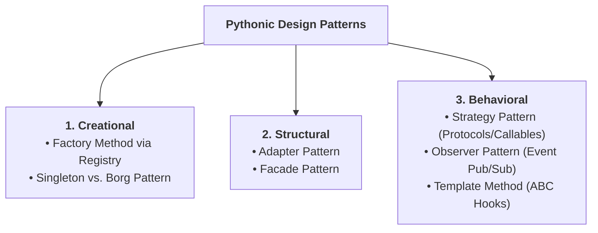
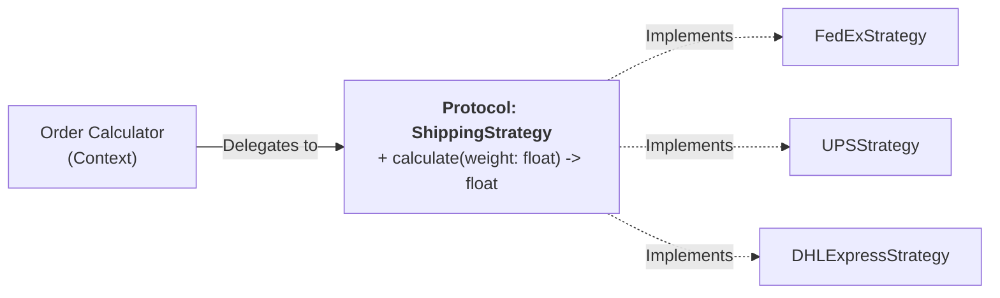
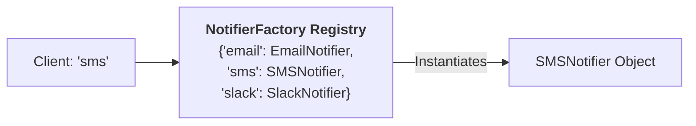
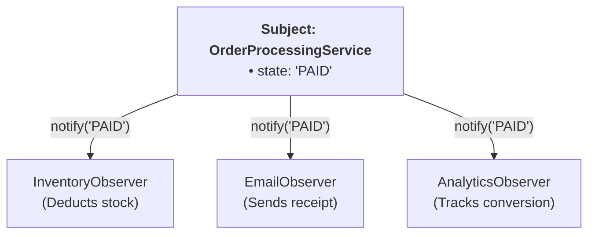
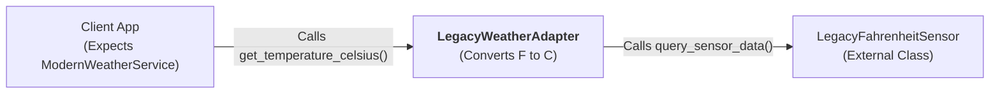

import { Callout } from "fumadocs-ui/components/callout";
import { Tabs, Tab } from "fumadocs-ui/components/tabs";
import { Accordion, Accordions } from "fumadocs-ui/components/accordion";

In 1994, the legendary "Gang of Four" (Erich Gamma, Richard Helm, Ralph Johnson, and John Vlissides) published _Design Patterns: Elements of Reusable Object-Oriented Software_. It cataloged 23 recurring patterns to solve common software design challenges.

However, the original patterns were demonstrated primarily in C++ and Smalltalk. In languages like Java or C++, implementing these patterns requires heavy boilerplate: dozens of interfaces, abstract factory creators, and rigid class hierarchies.

**Python is dynamically typed and supports multi-paradigm programming.** In Python, functions are first-class citizens, duck typing is universal, and `typing.Protocol` enables structural subtyping. Consequently, design patterns in Python are drastically lighter, more elegant, and more expressive.



In this chapter, we master how to write production-grade design patterns the **idiomatic Pythonic way**.

---

## 1. The Strategy Pattern: Eliminating Fragile `if-elif` Chains

### The Problem: Branching Nightmare

Imagine you are building an e-commerce shipping rate calculator:

```python
# FRAGILE, NON-EXTENSIBLE DESIGN:
class ShippingCostCalculator:
    def calculate(self, order_weight: float, method: str) -> float:
        if method == "fedex":
            return order_weight * 2.50 + 5.00
        elif method == "ups":
            return order_weight * 3.00 + 3.50
        elif method == "dhl_express":
            return order_weight * 5.00 + 15.00
        elif method == "postal_standard":
            return order_weight * 1.20 + 2.00
        else:
            raise ValueError(f"Unknown shipping method: {method}")
```

Every time your business adds a new courier (e.g. `dhl_express` or `bike_courier`), you must reopen and modify `ShippingCostCalculator`. This violates the **Open/Closed Principle** (software entities should be open for extension, but closed for modification).

### The Solution: The Strategy Pattern

The **Strategy Pattern** defines a family of interchangeable algorithms, encapsulates each one inside a separate class or callable, and makes them swappable at runtime.

In modern Python (Python 3.8+), we define the strategy contract using `typing.Protocol`:



```python
from typing import Protocol

# 1. Define the Strategy Interface using Protocol (Structural Subtyping)
class ShippingStrategy(Protocol):
    def calculate_cost(self, weight_kg: float) -> float:
        """Calculate the shipping cost for a given package weight."""
        ...

# 2. Concrete Strategies (No inheritance required thanks to Duck Typing!)
class FedExStrategy:
    def calculate_cost(self, weight_kg: float) -> float:
        return weight_kg * 2.50 + 5.00

class UPSStrategy:
    def calculate_cost(self, weight_kg: float) -> float:
        return weight_kg * 3.00 + 3.50

class DHLExpressStrategy:
    def calculate_cost(self, weight_kg: float) -> float:
        return weight_kg * 5.00 + 15.00

# 3. Context Class: Receives Strategy via Dependency Injection
class Order:
    def __init__(self, weight_kg: float, shipping_strategy: ShippingStrategy):
        self.weight_kg = weight_kg
        self.shipping_strategy = shipping_strategy

    def calculate_shipping(self) -> float:
        # Delegates calculation entirely to the strategy!
        return self.shipping_strategy.calculate_cost(self.weight_kg)

# Testing swappable strategies:
package = Order(weight_kg=10.0, shipping_strategy=FedExStrategy())
print(f"FedEx Shipping: ${package.calculate_shipping():.2f}")

# Switch strategy at runtime on the fly!
package.shipping_strategy = DHLExpressStrategy()
print(f"DHL Express   : ${package.calculate_shipping():.2f}")
```

Output:

```text
FedEx Shipping: $30.00
DHL Express   : $65.00
```

<Callout type="tip" title="The Pythonic Shortcut: Functions as Strategies">
Because functions are first-class objects in Python, a strategy does not even need to be a class! A simple function or lambda conforming to `Callable[[float], float]` works identically:

```python
from typing import Callable

def economy_shipping(weight_kg: float) -> float:
    return weight_kg * 0.90 + 1.50

class FunctionalOrder:
    def __init__(self, weight_kg: float, strategy: Callable[[float], float]):
        self.weight_kg = weight_kg
        self.strategy = strategy

    def get_cost(self) -> float:
        return self.strategy(self.weight_kg)

order = FunctionalOrder(10.0, economy_shipping)
print(f"Economy Shipping: ${order.get_cost():.2f}")  # $10.50
```

</Callout>

---

## 2. The Factory Pattern: The Dynamic Class Registry

### The Problem: Hardcoded Class Instantiations

In classical OOP, creating objects with different configurations requires extensive subclassing (`AbstractPaymentFactory`, `StripePaymentFactory`).

In Python, the most robust and idiomatic way to implement the **Factory Pattern** is through a **Dynamic Class Registry**:



```python
from abc import ABC, abstractmethod
from typing import Type

class BaseNotifier(ABC):
    @abstractmethod
    def send(self, recipient: str, message: str) -> bool:
        pass

class NotifierFactory:
    """Dynamic Registry Factory: Automatically manages available notification handlers."""

    _registry: dict[str, Type[BaseNotifier]] = {}

    @classmethod
    def register(cls, channel: str):
        """Decorator to register a notifier class into the factory registry."""
        def decorator(subclass: Type[BaseNotifier]):
            cls._registry[channel.lower()] = subclass
            return subclass
        return decorator

    @classmethod
    def create(cls, channel: str, **kwargs) -> BaseNotifier:
        """Instantiate a notifier for the requested channel."""
        channel_key = channel.lower()
        if channel_key not in cls._registry:
            valid_channels = ", ".join(cls._registry.keys())
            raise ValueError(f"Unknown channel '{channel}'. Supported: {valid_channels}")

        target_class = cls._registry[channel_key]
        return target_class(**kwargs)
```

Now, any developer on your team can plug in a new notification service simply by adding a class with the `@NotifierFactory.register` decorator:

```python
@NotifierFactory.register("email")
class EmailNotifier(BaseNotifier):
    def __init__(self, smtp_server: str = "smtp.company.com"):
        self.smtp_server = smtp_server

    def send(self, recipient: str, message: str) -> bool:
        print(f"[EMAIL via {self.smtp_server}] To: {recipient} | Body: {message}")
        return True

@NotifierFactory.register("sms")
class SMSNotifier(BaseNotifier):
    def __init__(self, twilio_sid: str = "AC-998877"):
        self.twilio_sid = twilio_sid

    def send(self, recipient: str, message: str) -> bool:
        print(f"[SMS via {self.twilio_sid}] To: {recipient} | Text: {message}")
        return True

@NotifierFactory.register("slack")
class SlackNotifier(BaseNotifier):
    def __init__(self, webhook_url: str = "https://hooks.slack.com/services/xyz"):
        self.webhook_url = webhook_url

    def send(self, recipient: str, message: str) -> bool:
        print(f"[SLACK to #{recipient}] Message: {message}")
        return True
```

Testing the registry factory:

```python
# The client specifies the channel dynamically from user config:
user_preferred_channel = "sms"
notifier = NotifierFactory.create(user_preferred_channel)
notifier.send("+1-555-0199", "Your security verification code is 482910.")

slack_notifier = NotifierFactory.create("slack")
slack_notifier.send("devops-alerts", "CPU threshold exceeded 90%!")
```

Output:

```text
[SMS via AC-998877] To: +1-555-0199 | Text: Your security verification code is 482910.
[SLACK to #devops-alerts] Message: CPU threshold exceeded 90%!
```

Notice how `NotifierFactory` does not contain a single `if/elif` branch. It scales effortlessly to hundreds of plugins!

---

## 3. The Observer Pattern: Event-Driven Architecture

### What is the Observer Pattern?

The **Observer Pattern** (commonly known as **Publish-Subscribe** or **Event Listener**) establishes a one-to-many dependency: when a core object (the **Subject** / **Publisher**) changes state, all subscribed objects (**Observers** / **Listeners**) are notified automatically.



```python
from typing import Protocol, List

# 1. Define the Observer Protocol
class OrderObserver(Protocol):
    def on_order_status_change(self, order_id: str, new_status: str) -> None:
        ...

# 2. Concrete Observers
class InventoryService:
    def on_order_status_change(self, order_id: str, new_status: str) -> None:
        if new_status == "PAID":
            print(f"[Inventory] Reserving warehouse stock for order {order_id}.")

class NotificationService:
    def on_order_status_change(self, order_id: str, new_status: str) -> None:
        print(f"[Notification] Sending customer status update: Order {order_id} is now {new_status}.")

class AnalyticsService:
    def on_order_status_change(self, order_id: str, new_status: str) -> None:
        print(f"[Analytics] Ingesting event: order_id={order_id}, status={new_status}")

# 3. Subject (Publisher)
class OrderManager:
    def __init__(self, order_id: str):
        self.order_id = order_id
        self._status = "CREATED"
        self._observers: List[OrderObserver] = []

    def attach(self, observer: OrderObserver):
        """Subscribe a new listener."""
        if observer not in self._observers:
            self._observers.append(observer)

    def detach(self, observer: OrderObserver):
        """Unsubscribe an existing listener."""
        self._observers.remove(observer)

    def set_status(self, new_status: str):
        """Mutate state and notify all active observers."""
        print(f"\n--- Order {self.order_id} Transition: {self._status} -> {new_status} ---")
        self._status = new_status
        self._notify()

    def _notify(self):
        for observer in self._observers:
            observer.on_order_status_change(self.order_id, self._status)

# Wire up the system:
order_mgr = OrderManager("ORD-9821")

# Subscribe listeners:
order_mgr.attach(InventoryService())
order_mgr.attach(NotificationService())
order_mgr.attach(AnalyticsService())

# Trigger state changes:
order_mgr.set_status("PAID")
order_mgr.set_status("SHIPPED")
```

Output:

```text
--- Order ORD-9821 Transition: CREATED -> PAID ---
[Inventory] Reserving warehouse stock for order ORD-9821.
[Notification] Sending customer status update: Order ORD-9821 is now PAID.
[Analytics] Ingesting event: order_id=ORD-9821, status=PAID

--- Order ORD-9821 Transition: PAID -> SHIPPED ---
[Notification] Sending customer status update: Order ORD-9821 is now SHIPPED.
[Analytics] Ingesting event: order_id=ORD-9821, status=SHIPPED
```

---

## 4. The Adapter Pattern: Reconciling Incompatible Interfaces

### The Problem: Third-Party Incompatibility

Suppose your application consumes weather data via a standardized `WeatherProvider` protocol:

```python
class ModernWeatherService(Protocol):
    def get_temperature_celsius(self, city: str) -> float: ...
```

You are forced to integrate a legacy third-party library that returns temperatures in **Fahrenheit via an XML-style dictionary**:

```python
# Unmodifiable legacy class from an external package:
class LegacyFahrenheitSensor:
    def query_sensor_data(self, location_code: str) -> dict:
        # Returns Fahrenheit and location metadata
        return {"loc": location_code, "temp_f": 77.0, "status": "OK"}
```

The interfaces do not match! The client expects Celsius and method `get_temperature_celsius(city)`, but the legacy sensor provides `query_sensor_data(location_code)` in Fahrenheit.

### The Solution: The Adapter Wrapper

An **Adapter** acts as a translator between two incompatible interfaces without modifying either source class:



```python
class LegacyWeatherAdapter:
    """Adapts LegacyFahrenheitSensor into the ModernWeatherService protocol."""

    def __init__(self, legacy_sensor: LegacyFahrenheitSensor):
        self._sensor = legacy_sensor

    def get_temperature_celsius(self, city: str) -> float:
        # 1. Adapt parameter
        location_code = city.upper()

        # 2. Call incompatible legacy method
        raw_data = self._sensor.query_sensor_data(location_code)

        # 3. Adapt returned data format (Fahrenheit -> Celsius)
        fahrenheit = raw_data["temp_f"]
        celsius = (fahrenheit - 32.0) * 5.0 / 9.0
        return round(celsius, 2)


# Client function that strictly requires the modern protocol:
def display_weather_report(service: ModernWeatherService, city: str):
    temp = service.get_temperature_celsius(city)
    print(f"Weather Report for {city}: {temp}°C")

# Use the adapter to bridge legacy code seamlessly:
legacy_device = LegacyFahrenheitSensor()
adapted_service = LegacyWeatherAdapter(legacy_device)

display_weather_report(adapted_service, "Tokyo")
```

Output:

```text
Weather Report for Tokyo: 25.0°C
```

---

## 5. The Singleton Dilemma in Python: Modules vs. `__new__` vs. Borg

The **Singleton Pattern** ensures that a class has only one instance and provides a global access point to it.

In Java or C++, Singletons are rampant. In Python, singletons are often considered an anti-pattern because **Python modules are already singletons by definition!**

### Approach 1: The Pythonic Way (Modules as Singletons)

When Python imports a module, it caches the module in `sys.modules`. Subsequent imports across your entire codebase return the exact same object in memory:

```python
# config.py
class _AppConfig:
    def __init__(self):
        self.api_key: str = "secret_production_key"
        self.debug: bool = False

# Instantiate once at the module level:
config = _AppConfig()
```

In any other file:

```python
from config import config

config.debug = True  # Modifies the single, shared global instance!
```

### Approach 2: The `__new__` Singleton Pattern

If your architecture strictly requires a class that prevents multiple instantiations:

```python
class DatabaseConnection:
    _instance = None

    def __new__(cls, *args, **kwargs):
        if cls._instance is None:
            # First instantiation: allocate object in RAM
            cls._instance = super().__new__(cls)
            cls._instance._initialized = False
        return cls._instance

    def __init__(self, dsn: str = "sqlite:///:memory:"):
        if not self._initialized:
            self.dsn = dsn
            self._initialized = True

db1 = DatabaseConnection("postgresql://prod-db:5432")
db2 = DatabaseConnection("sqlite:///:memory:")

print("Same instance in RAM?", db1 is db2)
print("db2 DSN:", db2.dsn)
```

Output:

```text
Same instance in RAM? True
db2 DSN: postgresql://prod-db:5432
```

### Approach 3: The "Borg" Pattern (Alex Martelli's Monostate)

Python legend Alex Martelli proposed the **Borg Pattern**: Instead of forcing a single instance reference, create multiple instances that **all share the exact same `__dict__` state**:

```python
class BorgConfig:
    _shared_state = {}

    def __init__(self):
        # All instances point their dictionary to the class's shared dictionary!
        self.__dict__ = self._shared_state

b1 = BorgConfig()
b2 = BorgConfig()

b1.theme = "Dark Mode"
print("b2 theme:", b2.theme)
print("Different instances?", b1 is not b2)
print("Identical state dict?", b1.__dict__ is b2.__dict__)
```

Output:

```text
b2 theme: Dark Mode
Different instances? True
Identical state dict? True
```

---

## Pattern Comparison Matrix

| Pattern       | Category   | When to Use                                                          | Idiomatic Python Implementation                              |
| :------------ | :--------- | :------------------------------------------------------------------- | :----------------------------------------------------------- |
| **Strategy**  | Behavioral | When you have swappable algorithms or calculations.                  | `typing.Protocol` or first-class `Callable` functions.       |
| **Factory**   | Creational | When instantiation depends on dynamic runtime inputs.                | Dynamic decorator registry (`_registry: dict[str, type]`).   |
| **Observer**  | Behavioral | When state changes must notify an open-ended list of listeners.      | List of `Protocol` subscribers triggered in setter/action.   |
| **Adapter**   | Structural | When integrating third-party or legacy classes with mismatched APIs. | Composition wrapper translating method signatures and units. |
| **Singleton** | Creational | When you need a single shared state across the application.          | A Python module with top-level instance; `__new__` or Borg.  |

---

## Practice Questions & Challenges

### Question 1: Output Prediction (The Shared Borg Dict)

Examine the class implementation below:

```python
class ConfigBorg:
    _shared_dict = {}

    def __init__(self):
        self.__dict__ = self._shared_dict

c1 = ConfigBorg()
c1.app_name = "AuthService"
c1.timeout = 30

c2 = ConfigBorg()
c2.timeout = 60

print(c1.app_name)
print(c1.timeout)
```

1. What will be printed by `print(c1.timeout)`?
2. Why did modifying `c2.timeout` mutate `c1`?

<Accordions>
<Accordion title="Reveal Solution & Explanation">

**Output:**

```text
AuthService
60
```

**Explanation:**
In `ConfigBorg.__init__`, `self.__dict__` is assigned to reference `_shared_dict`. Therefore, `c1.__dict__` and `c2.__dict__` are **the exact same dictionary in memory** (`c1.__dict__ is c2.__dict__ == True`). Mutating `c2.timeout = 60` writes into this shared dictionary, instantly reflecting across all Borg instances!

</Accordion>
</Accordions>

---

### Question 2: Spot and Fix the Bug (Missing Strategy Validation)

A developer implemented a Strategy pattern for tax calculation:

```python
from typing import Protocol

class TaxStrategy(Protocol):
    def calculate_tax(self, amount: float) -> float: ...

class VATStrategy:
    def calculate_tax(self, amount: float) -> float:
        return amount * 0.20

class Invoice:
    def __init__(self, amount: float, tax_strategy: TaxStrategy):
        self.amount = amount
        self.tax_strategy = tax_strategy

    def get_total(self) -> float:
        return self.amount + self.tax_strategy.calculate_tax(self.amount)

# Later in code:
inv = Invoice(100.0, None)
print(inv.get_total())
```

When run, the code crashes with `AttributeError: 'NoneType' object has no attribute 'calculate_tax'`.

How should `Invoice` be refactored to enforce a valid strategy at initialization and provide a sensible default?

<Accordions>
<Accordion title="Reveal Solution & Explanation">

**The Fix:**
Provide a default no-op strategy and validate that the passed strategy is not `None`:

```python
class ZeroTaxStrategy:
    """Sensible default null-object strategy."""
    def calculate_tax(self, amount: float) -> float:
        return 0.0

class Invoice:
    def __init__(self, amount: float, tax_strategy: TaxStrategy = None):
        if amount < 0:
            raise ValueError("Invoice amount cannot be negative.")
        self.amount = amount
        # Fall back to Null-Object strategy if none provided:
        self.tax_strategy = tax_strategy if tax_strategy is not None else ZeroTaxStrategy()

    def get_total(self) -> float:
        return self.amount + self.tax_strategy.calculate_tax(self.amount)

inv_tax_free = Invoice(100.0)
inv_with_vat = Invoice(100.0, VATStrategy())

print("Tax-free Total:", inv_tax_free.get_total())  # $100.0
print("VAT Total     :", inv_with_vat.get_total())  # $120.0
```

</Accordion>
</Accordions>

---

### Next Step

Now that you have mastered enterprise design patterns in Python, explore how to build resilient, production-grade error handling architectures in **[15. Custom Exceptions & Production Error Hierarchies](/docs/learn-python/02-intermediate/15-custom-exceptions-and-error-hierarchies)**!
