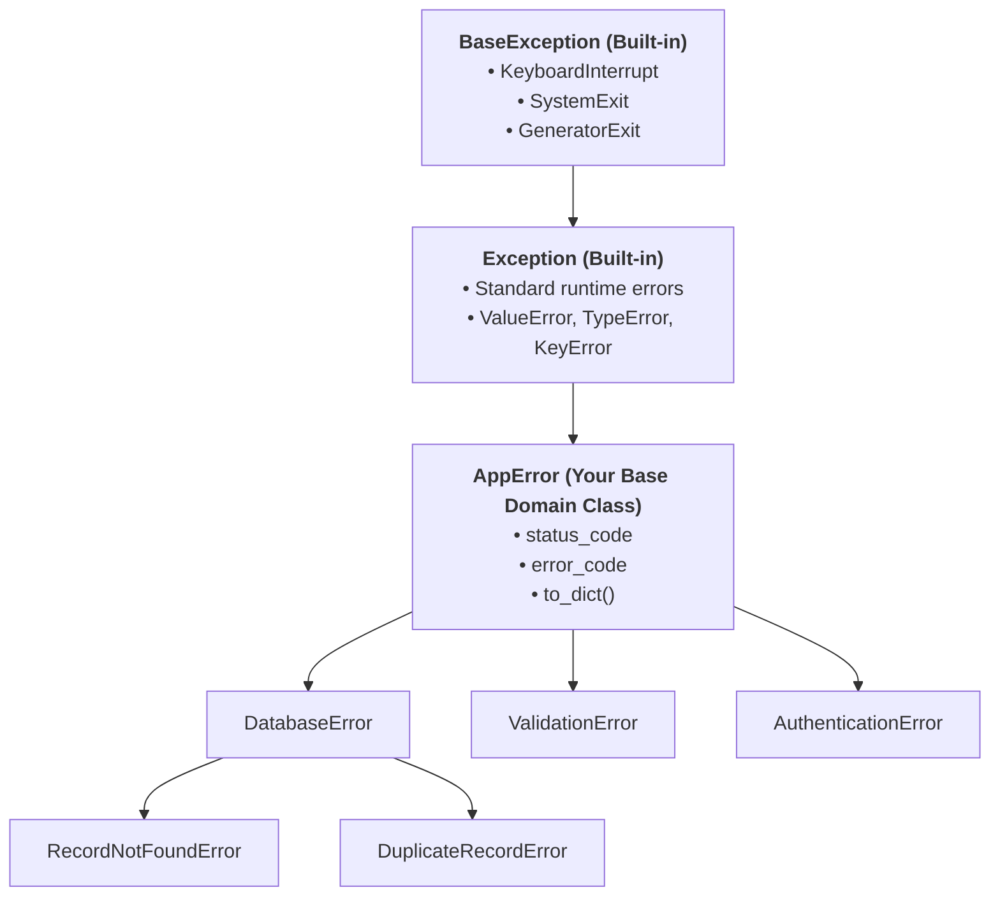
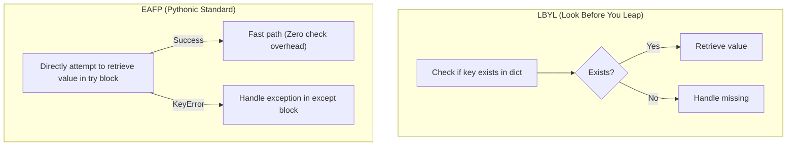

import { Callout } from "fumadocs-ui/components/callout";
import { Tabs, Tab } from "fumadocs-ui/components/tabs";
import { Accordion, Accordions } from "fumadocs-ui/components/accordion";

In introductory Python, error handling is typically introduced through basic `try/except` blocks handling `ZeroDivisionError` or `ValueError`.

However, in large-scale backend systems, microservices, and enterprise APIs, treating errors as generic strings or catching generic `Exception` objects leads to catastrophic production failures: silent data corruption, unhelpful logs, and broken retry loops.

**In Python, exceptions are first-class objects organized in an inheritance hierarchy.** By harnessing Object-Oriented Programming (OOP) to design custom domain exception hierarchies, you transform error handling from reactive troubleshooting into a predictable, structured communication system.



---

## 1. The OOP Architecture of Python Exceptions

Before building custom errors, you must understand Python's internal exception inheritance tree.

### The Critical Invariant: `BaseException` vs. `Exception`

Python divides all throwable objects into two primary tiers:

1. **`BaseException`**: The absolute root of all exceptions in Python. It includes system-level events that should **almost never be caught by normal business logic**:
   - `KeyboardInterrupt` (triggered when the user presses `Ctrl+C`).
   - `SystemExit` (triggered when `sys.exit()` is called).
   - `GeneratorExit` (triggered when a generator is closed).
2. **`Exception`**: The root class for all non-fatal, application-level runtime errors (`ValueError`, `KeyError`, `RuntimeError`, etc.).

<Callout type="warn" title="The Golden Rule of Exception Inheritance">
**ALWAYS inherit custom exceptions from `Exception`, NEVER from `BaseException`!**

If you inherit from `BaseException`, catching `except Exception:` in your web framework or API middleware will **fail to catch your error**, causing unhandled server crashes. Conversely, catching `except BaseException:` prevents users from stopping your program with `Ctrl+C`!

</Callout>

---

## 2. Designing a Domain Exception Hierarchy

### The Anti-Pattern: String Matching in Logs

Beginners often check error causes by inspecting strings:

```python
# FRAGILE ANTI-PATTERN:
try:
    user = fetch_user(user_id=42)
except Exception as err:
    if "not found" in str(err).lower():
        # What if the database driver changes the message to "Record missing"?
        # Your error handling silently breaks!
        return {"status": 404}
```

### The Solution: The Root Package Exception Pattern

In professional software development, every library, SDK, or microservice defines a **single root exception class**. All specific domain exceptions inherit from this root:

```python
from datetime import datetime
from typing import Optional, Any, Dict

class AppError(Exception):
    """Base domain exception for the entire application.

    Attributes:
        message: Human-readable error description.
        error_code: Machine-readable uppercase identifier for API clients.
        status_code: Suggested HTTP status code.
        details: Optional structured payload containing contextual data.
    """

    def __init__(
        self,
        message: str,
        error_code: str = "INTERNAL_ERROR",
        status_code: int = 500,
        details: Optional[Dict[str, Any]] = None,
    ):
        super().__init__(message)
        self.message = message
        self.error_code = error_code
        self.status_code = status_code
        self.details = details or {}
        self.timestamp = datetime.utcnow()

    def to_dict(self) -> Dict[str, Any]:
        """Serialize exception state for clean JSON API error responses."""
        return {
            "error": {
                "code": self.error_code,
                "message": self.message,
                "status": self.status_code,
                "details": self.details,
                "timestamp": self.timestamp.isoformat() + "Z",
            }
        }
```

### Subclassing Domain Categories

Now we derive specialized errors that provide domain-specific semantics and HTTP status codes:

```python
# 1. Database Domain
class DatabaseError(AppError):
    def __init__(self, message: str, **kwargs):
        super().__init__(message, error_code="DATABASE_ERROR", status_code=500, **kwargs)

class RecordNotFoundError(DatabaseError):
    def __init__(self, entity_name: str, entity_id: Any):
        super().__init__(
            message=f"{entity_name} with ID '{entity_id}' does not exist.",
            error_code="RECORD_NOT_FOUND",
            status_code=404,
            details={"entity": entity_name, "id": str(entity_id)},
        )

class DuplicateRecordError(DatabaseError):
    def __init__(self, entity_name: str, key_field: str, value: Any):
        super().__init__(
            message=f"{entity_name} with {key_field}='{value}' already exists.",
            error_code="DUPLICATE_RECORD",
            status_code=409,
            details={"entity": entity_name, "field": key_field, "conflict_value": str(value)},
        )

# 2. Validation Domain
class ValidationError(AppError):
    def __init__(self, field_name: str, constraint: str):
        super().__init__(
            message=f"Validation failed on field '{field_name}': {constraint}",
            error_code="VALIDATION_FAILED",
            status_code=422,
            details={"field": field_name, "constraint": constraint},
        )
```

### The Power of Granular vs. Categorical Catching

Because of polymorphism and class inheritance, downstream callers can choose the exact level of error handling they care about:

```python
def find_user(user_id: int):
    # Simulated database lookup:
    if user_id <= 0:
        raise ValidationError("user_id", "Must be a positive integer.")
    if user_id > 1000:
        raise RecordNotFoundError("User", user_id)
    return {"id": user_id, "username": "alice"}

# Scenario A: Catching specifically
try:
    find_user(-5)
except RecordNotFoundError as err:
    print(f"Handled 404: {err.message}")
except ValidationError as err:
    print(f"Handled 422: {err.to_dict()}")

# Scenario B: High-level API Middleware catching ALL application errors categorically!
try:
    find_user(9999)
except AppError as err:
    # Works for RecordNotFoundError, ValidationError, DatabaseError, etc.!
    print(f"\n[HTTP Response {err.status_code}]:")
    print(err.to_dict())
```

Output:

```text
Handled 422: {'error': {'code': 'VALIDATION_FAILED', 'message': "Validation failed on field 'user_id': Must be a positive integer.", 'status': 422, 'details': {'field': 'user_id', 'constraint': 'Must be a positive integer.'}, 'timestamp': '2026-10-22T14:15:00.000000Z'}}

[HTTP Response 404]:
{'error': {'code': 'RECORD_NOT_FOUND', 'message': "User with ID '9999' does not exist.", 'status': 404, 'details': {'entity': 'User', 'id': '9999'}, 'timestamp': '2026-10-22T14:15:00.000000Z'}}
```

---

## 3. Exception Chaining: Preserving Root Cause Tracebacks

When writing robust services, you often catch a low-level error (e.g. `sqlite3.OperationalError` or `ConnectionRefusedError`) and translate it into a high-level domain error.

Python provides explicit **Exception Chaining** using the `from` keyword.

### Preserving Root Causes: `raise ... from original_error`

```python
import sqlite3

def load_user_profile(user_id: int):
    try:
        # Intentionally malformed query triggering sqlite3 syntax error:
        conn = sqlite3.connect(":memory:")
        conn.execute("SELECT * FROM non_existent_table WHERE id = ?", (user_id,))
    except sqlite3.OperationalError as db_err:
        # Wrap low-level driver error into clean domain error while preserving traceback:
        raise DatabaseError(f"Failed to query database for user {user_id}") from db_err
```

When this code fails, Python preserves the entire history in the traceback:

```text
sqlite3.OperationalError: no such table: non_existent_table

The above exception was the direct cause of the following exception:

DatabaseError: Failed to query database for user 42
```

Under the hood, Python sets `domain_error.__cause__ = db_err`. Developers can inspect `err.__cause__` programmatically to see the root cause.

### Suppressing Context: `raise ... from None`

Sometimes you want to translate an internal implementation error without confusing users with low-level internal stack traces (such as leaking sensitive system paths):

```python
def get_user_setting(user_dict: dict, key: str):
    try:
        return user_dict[key]
    except KeyError:
        # Suppress internal KeyError from the traceback output!
        raise RecordNotFoundError("UserSetting", key) from None
```

With `from None`, Python sets `__suppress_context__ = True`. The caller sees only the clean `RecordNotFoundError`, without the distracting `During handling of the above exception...` banner.

---

## 4. Modern Feature: Exception Notes (`add_note()` - PEP 678)

Introduced in **Python 3.11**, `add_note()` allows you to attach diagnostic context to an in-flight exception as it bubbles up through layers of code, **without altering the original exception message**:

```python
def process_payment_step(order_id: str, amount: float):
    try:
        # Simulate a payment gateway network timeout:
        raise TimeoutError("Socket connection timed out after 5000ms.")
    except TimeoutError as err:
        # Attach contextual debugging data:
        err.add_note(f"Payment Context: order_id='{order_id}', amount=${amount:.2f}")
        err.add_note("Server Region: us-east-2 | Retry Count: 3")
        raise err  # Re-raise enriched exception

try:
    process_payment_step("ORD-7711", 149.99)
except TimeoutError as err:
    print("Caught Timeout with attached notes:")
    for note in err.__notes__:
        print(" -", note)
```

Output:

```text
Caught Timeout with attached notes:
 - Payment Context: order_id='ORD-7711', amount=$149.99
 - Server Region: us-east-2 | Retry Count: 3
```

In Python's printed traceback, notes are automatically displayed directly beneath the exception line, revolutionizing debugging in production log systems like Datadog, Sentry, or CloudWatch!

---

## 5. Modern Feature: Batch & Concurrent Failures with `ExceptionGroup` (PEP 654)

In batch processing, form validation, and asynchronous pipelines, multiple independent operations can fail simultaneously. Previously, Python could only raise one exception at a time, discarding the rest.

Python 3.11 introduced `ExceptionGroup` and the `except*` syntax.

### Creating and Raising an `ExceptionGroup`

```python
def validate_user_payload(payload: dict):
    errors = []

    if "username" not in payload:
        errors.append(ValidationError("username", "Field is required."))
    elif len(payload["username"]) < 3:
        errors.append(ValidationError("username", "Must be at least 3 characters."))

    if "email" not in payload:
        errors.append(ValidationError("email", "Field is required."))
    elif "@" not in payload["email"]:
        errors.append(ValidationError("email", "Invalid email format."))

    if "age" in payload and payload["age"] < 18:
        errors.append(ValidationError("age", "Must be at least 18 years old."))

    if errors:
        # Bundle all validation failures into a single grouped exception:
        raise ExceptionGroup("User registration payload validation failed", errors)
```

### Catching with `except*` (Star Syntax)

The `except*` syntax lets you selectively catch specific types of exceptions from within the group, while allowing unhandled exceptions in the group to propagate:

```python
sample_payload = {"username": "a", "email": "invalid-email", "age": 16}

try:
    validate_user_payload(sample_payload)
except* ValidationError as eg:
    print(f"Caught {len(eg.exceptions)} validation errors simultaneously:")
    for err in eg.exceptions:
        print(f" • [{err.details['field']}] {err.message}")
```

Output:

```text
Caught 3 validation errors simultaneously:
 • [username] Validation failed on field 'username': Must be at least 3 characters.
 • [email] Validation failed on field 'email': Invalid email format.
 • [age] Validation failed on field 'age': Must be at least 18 years old.
```

---

## 6. The EAFP Principle: "Easier to Ask for Forgiveness than Permission"

In Python, the official architectural philosophy for error handling is **EAFP** (_Easier to Ask for Forgiveness than Permission_), contrasting with the traditional C/Java style **LBYL** (_Look Before You Leap_).



### Why Python Prefers EAFP

1. **Race Condition Immunity (TOCTOU)**: In file systems or concurrent programs, checking `if os.path.exists(file):` before reading introduces a **Time-Of-Check to Time-Of-Use (TOCTOU)** vulnerability. Another process could delete the file in the microsecond between the check and the read! In EAFP, `try: open(file) except FileNotFoundError:` is atomic.
2. **Performance in the Happy Path**: In Python, entering a `try` block has **virtually zero CPU overhead** (often referred to as "zero-cost exceptions" in CPython). If exceptions are rare, EAFP runs significantly faster than executing repetitive condition checks on every call.

---

## Production Error Handling Checklist

| Practice                      | Status           | Reason                                                                        |
| :---------------------------- | :--------------- | :---------------------------------------------------------------------------- |
| `except:` (Bare except)       | **FORBIDDEN**    | Catches `KeyboardInterrupt` and `SystemExit`, preventing program termination. |
| `except Exception: pass`      | **FORBIDDEN**    | Silently swallows unexpected bugs and crashes, making debugging impossible.   |
| `raise Exception("msg")`      | **ANTI-PATTERN** | Generic exceptions force callers to use brittle string matching.              |
| `class MyError(Exception):`   | **RECOMMENDED**  | Provides clean, typed domain semantics.                                       |
| `raise MyError from original` | **RECOMMENDED**  | Preserves root cause tracebacks via `__cause__`.                              |
| `exc.add_note(...)`           | **RECOMMENDED**  | Attaches runtime debugging telemetry without polluting error messages.        |

---

## Practice Questions & Challenges

### Question 1: Output Prediction (Chained Exception Cause)

Examine the code snippet:

```python
class ServiceError(Exception): pass

def run_task():
    try:
        int("invalid_number")
    except ValueError as err:
        raise ServiceError("Failed to convert number.") from err

try:
    run_task()
except ServiceError as e:
    print("Caught:", type(e).__name__)
    print("Underlying cause:", type(e.__cause__).__name__)
```

1. What will be printed for `Underlying cause`?
2. What attribute on `e` holds the original `ValueError`?

<Accordions>
<Accordion title="Reveal Solution & Explanation">

**Output:**

```text
Caught: ServiceError
Underlying cause: ValueError
```

**Explanation:**
The syntax `raise ServiceError(...) from err` explicitly sets the `__cause__` attribute of the newly raised `ServiceError` to reference the caught `ValueError`. This enables inspection of the entire causal chain throughout telemetry pipelines.

</Accordion>
</Accordions>

---

### Question 2: Spot and Fix the Bug (Destructive Exception Masking)

A developer wrote this file loader helper:

```python
def load_configuration(filepath: str) -> dict:
    try:
        with open(filepath, "r") as f:
            import json
            return json.load(f)
    except BaseException:
        print("File could not be loaded. Returning default settings.")
        return {}
```

Identify two critical flaws with this implementation and refactor it into clean, idiomatic Python.

<Accordions>
<Accordion title="Reveal Solution & Explanation">

**The Flaws:**

1. **Catching `BaseException`**: If the user presses `Ctrl+C` (`KeyboardInterrupt`) while this function is running, Python intercepts the interrupt and returns an empty dictionary instead of shutting down!
2. **Overly Broad Catch**: If the JSON file contains a syntax error (`json.JSONDecodeError`), it silently swallows the syntax bug, masking a corrupted config file as a simple missing file.

**The Fix:**
Catch only specific, expected exceptions, distinguish between missing files and corrupted syntax, and never catch `BaseException`:

```python
import json
import logging

class ConfigurationError(Exception):
    """Raised when configuration cannot be loaded or parsed."""
    pass

def load_configuration(filepath: str) -> dict:
    try:
        with open(filepath, "r", encoding="utf-8") as f:
            return json.load(f)
    except FileNotFoundError as err:
        logging.warning("Config file '%s' not found. Using defaults.", filepath)
        return {}
    except json.JSONDecodeError as err:
        # Corrupted config file: explicitly chain into domain error!
        raise ConfigurationError(f"Corrupted JSON formatting inside '{filepath}'") from err
```

</Accordion>
</Accordions>

---

### Next Step

Congratulations on completing the core architectural lessons of Stage 2! Put all your Object-Oriented Programming, custom protocols, descriptors, and exception handling skills into practice by building a real-world active database mapper in the **[Capstone Project: active-lite Mini-ORM](/docs/learn-python/02-intermediate/capstone-mini-orm)**!
