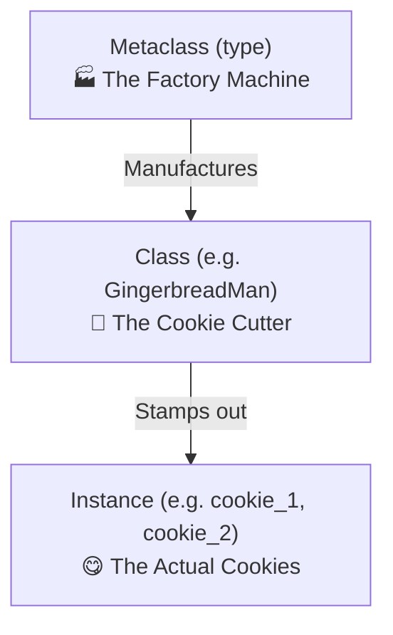
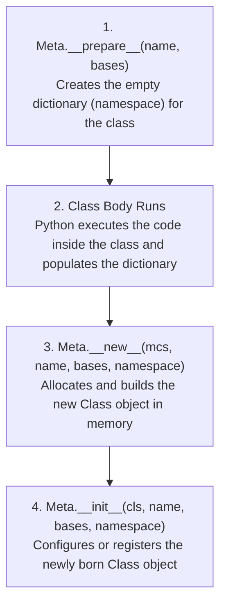

import { Callout } from "fumadocs-ui/components/callout";
import { Tabs, Tab } from "fumadocs-ui/components/tabs";
import { Accordion, Accordions } from "fumadocs-ui/components/accordion";

In Python, you often hear the phrase: **"Everything is an object."**
Numbers are objects. Strings are objects. Functions are objects.

And classes? **Classes are objects too!**

If an object is created by an instance of a class, what creates the class itself?
The answer is: **`type` (the default metaclass)**.

---

## The Mental Model: The Cookie Cutter Hierarchy

To make metaclasses intuitive, think of a bakery:



- An **Instance** is a cookie stamped out by the cutter.
- A **Class** is the cookie cutter that defines the shape.
- A **Metaclass** is the machine that _builds the cookie cutter_.

---

## 1. `type` as a Class Factory

Most developers only use `type(x)` to check what an object is:

```python
type(42)      # <class 'int'>
type("hello") # <class 'str'>
```

However, when passed **3 arguments**, `type` transforms into a **class factory**:

$$\text{type}(name, bases, dict)$$

| Argument    | What it represents                        | Example                                 |
| :---------- | :---------------------------------------- | :-------------------------------------- |
| **`name`**  | The string name of the class              | `"Robot"`                               |
| **`bases`** | A tuple of parent classes to inherit from | `(object,)`                             |
| **`dict`**  | A dictionary of attributes and methods    | `{"category": "Machine", "speak": ...}` |

Let's compare the normal `class` statement with dynamic `type()` construction:

<Tabs items={['Standard Class Statement', 'Dynamic type() Construction']}>
<Tab value="Standard Class Statement">
```python
class Robot:
    category = "Machine"

    def speak(self):
        return "Beep boop!"

r = Robot()
print(r.category) # "Machine"
print(r.speak()) # "Beep boop!"
print(type(Robot)) # <class 'type'>

````
</Tab>
<Tab value="Dynamic type() Construction">
```python
# Create the exact same class dynamically at runtime!
Robot = type(
    "Robot",
    (object,),
    {
        "category": "Machine",
        "speak": lambda self: "Beep boop!"
    }
)

r = Robot()
print(r.category)  # "Machine"
print(r.speak())     # "Beep boop!"
print(type(Robot))   # <class 'type'>
````

</Tab>
</Tabs>

Both snippets produce the exact same class object in memory. This is what Python does behind the scenes every time you write a `class` block!

---

## 2. The Metaclass Lifecycle: How Classes are Born

A **metaclass** is simply a class that inherits from `type`. It lets you intercept and customize class creation at **import time** (before any instances are ever created).

When Python encounters `class MyClass(metaclass=Meta):`, it runs 4 distinct steps:



### Step-by-Step Breakdown

1. **`__prepare__(name, bases)`**: Returns a dictionary (or ordered mapping) where the class's methods and attributes will be collected.
2. **Body Execution**: Python runs the code inside the class line-by-line, adding each attribute or method into the namespace dictionary.
3. **`__new__(mcs, name, bases, namespace)`**: Actually creates the class object in memory. You can modify, rename, or validate attributes here.
4. **`__init__(cls, name, bases, namespace)`**: Initializes the newly created class object.

### Practical Example: Enforcing Coding Standards at Import Time

Imagine you want to ensure that every configuration class in your codebase uses lowercase attribute names:

```python
class EnforceLowercaseMeta(type):
    def __new__(mcs, name, bases, namespace):
        # Inspect every attribute defined in the class body:
        for attr_name in namespace:
            # Skip special internal attributes like __module__ or __doc__
            if not attr_name.startswith("__") and not attr_name.islower():
                raise TypeError(
                    f"Class '{name}' violates convention: attribute '{attr_name}' must be lowercase!"
                )
        return super().__new__(mcs, name, bases, namespace)

# Valid class (passes check):
class GoodConfig(metaclass=EnforceLowercaseMeta):
    timeout = 30
    retries = 3

# Invalid class (fails at import time before running!):
try:
    class BadConfig(metaclass=EnforceLowercaseMeta):
        MAX_RETRIES = 5  # Uppercase attribute!
except TypeError as err:
    print("Caught compile-time error:", err)
```

Output:

```text
Caught compile-time error: Class 'BadConfig' violates convention: attribute 'MAX_RETRIES' must be lowercase!
```

---

## 3. The Modern Alternative: `__init_subclass__`

<Callout type="tip" title="Tim Peters' Golden Rule of Metaclasses">
  *"Metaclasses are deeper magic than 99% of users should ever worry about. If
  you wonder whether you need them, you don't."*
</Callout>

In modern Python (Python 3.6+), **95% of traditional metaclass use cases can be solved much more cleanly with `__init_subclass__`**.

Instead of writing a custom `type` subclass, you simply implement a normal method on your base class:

<Tabs items={['Modern (__init_subclass__)', 'Old (Custom Metaclass)']}>
<Tab value="Modern (__init_subclass__)">
```python
# Base class registers its own subclasses cleanly:
class PluginBase:
    registry = {}

    def __init_subclass__(cls, plugin_name: str | None = None, **kwargs):
        super().__init_subclass__(**kwargs)
        name = plugin_name or cls.__name__.lower()
        cls.registry[name] = cls

# Clean subclassing with keyword arguments:

class AudioPlugin(PluginBase, plugin_name="audio_player"):
pass

class VideoPlugin(PluginBase, plugin_name="video_stream"):
pass

print(PluginBase.registry)

# {'audio_player': <class '**main**.AudioPlugin'>, 'video_stream': <class '**main**.VideoPlugin'>}

````
</Tab>
<Tab value="Old (Custom Metaclass)">
```python
# Requires understanding type, mcs, and inheritance plumbing:
class PluginMeta(type):
    def __init__(cls, name, bases, namespace):
        super().__init__(name, bases, namespace)
        if not hasattr(cls, "registry"):
            cls.registry = {}
        else:
            cls.registry[name.lower()] = cls

class PluginBase(metaclass=PluginMeta):
    pass
````

</Tab>
</Tabs>

### When Do You Actually Need a Metaclass?

| Feature                                             | `__init_subclass__`    | Metaclass (`type`)          |
| :-------------------------------------------------- | :--------------------- | :-------------------------- |
| **Class Validation** (check methods/types)          | Yes                    | Yes                         |
| **Subclass Auto-Registration**                      | Yes                    | Yes                         |
| **Ease of Reading**                                 | Easy & standard Python | Complex                     |
| **Avoid Metaclass Conflicts**                       | Yes (cooperative)      | No (frequent conflicts)     |
| **Custom Namespace** (e.g. track declaration order) | No                     | **Yes** (via `__prepare__`) |
| **Intercepting Instantiation** (`MyClass()`)        | No                     | **Yes** (via `__call__`)    |

---

## Practice Questions & Challenges

### Question 1: Output Prediction (Class Construction Order)

What is the exact sequence printed when Python parses and runs the following script?

```python
class Meta(type):
    def __prepare__(name, bases):
        print("1. Meta.__prepare__")
        return super().__prepare__(name, bases)

    def __new__(mcs, name, bases, namespace):
        print("3. Meta.__new__")
        return super().__new__(mcs, name, bases, namespace)

    def __init__(cls, name, bases, namespace):
        print("4. Meta.__init__")
        super().__init__(name, bases, namespace)

print("Starting class definition...")
class Service(metaclass=Meta):
    print("2. Class body evaluating...")
    port = 8080

print("Instantiating Service...")
s = Service()
```

<Accordions>
<Accordion title="Solution & Breakdown">
**Output:**
```text
Starting class definition...
1. Meta.__prepare__
2. Class body evaluating...
3. Meta.__new__
4. Meta.__init__
Instantiating Service...
```

**Step-by-Step Trace:**

1. When Python encounters `class Service(metaclass=Meta):`, it calls `Meta.__prepare__` first to get the namespace dictionary.
2. Python executes the lines inside the class body (`print("2. ...")` and `port = 8080`).
3. After the body finishes executing, Python passes the namespace to `Meta.__new__` to allocate the class object in memory.
4. Python immediately calls `Meta.__init__` to configure the created class object.
5. Finally, `s = Service()` creates an _instance_ of the class. Notice that `Meta.__new__` and `Meta.__init__` do **not** run again! Class construction happens once when the class is defined (usually at import time).

</Accordion>
</Accordions>

---

### Question 2: Spot and Fix the Bug (Metaclass Conflict)

A developer tries to combine two mixins that each use their own metaclass, but Python crashes on import:

```python
class ValidationMeta(type):
    pass

class AuditMeta(type):
    pass

class ValidatedModel(metaclass=ValidationMeta):
    pass

class AuditedModel(metaclass=AuditMeta):
    pass

# CRASHES with:
# TypeError: metaclass conflict: the metaclass of a derived class
# must be a (non-strict) subclass of the metaclasses of all its bases
class SecureRecord(ValidatedModel, AuditedModel):
    pass
```

Explain why this happens and write the clean fix.

<Accordions>
<Accordion title="Solution & Breakdown">
**Why the crash happens:**
Python requires that the metaclass of a derived class must be a subclass of the metaclasses of all parent classes. Here, `ValidationMeta` does not inherit from `AuditMeta` (and vice-versa), so Python does not know which metaclass to use.

**The Fix:**
Create a unified metaclass that inherits from both:

```python
class ValidationMeta(type):
    pass

class AuditMeta(type):
    pass

class ValidatedModel(metaclass=ValidationMeta):
    pass

class AuditedModel(metaclass=AuditMeta):
    pass

# Create a composite metaclass:
class CombinedMeta(ValidationMeta, AuditMeta):
    pass

class SecureRecord(ValidatedModel, AuditedModel, metaclass=CombinedMeta):
    pass

print("SecureRecord created successfully with:", type(SecureRecord))
# Output: SecureRecord created successfully with: <class '__main__.CombinedMeta'>
```

</Accordion>
</Accordions>

---

### Question 3: Architecture Deep-Dive (Intercepting Instantiation with `__call__`)

How does Python use `__call__` on a metaclass to intercept when someone calls `MyClass()`, and how does this enable a clean **Singleton** pattern?

<Accordions>
<Accordion title="Solution & Breakdown">
In Python, calling an object `x()` triggers the `__call__` method on `x`'s type:
- If `s = Service()`, calling `s()` invokes `Service.__call__`.
- Because `Service` is an instance of `Meta`, calling `Service()` invokes `Meta.__call__`!

By overriding `__call__` in your metaclass, you can intercept when someone asks to create an instance:

```python
class SingletonMeta(type):
    _instances = {}

    def __call__(cls, *args, **kwargs):
        # Only create the instance if it doesn't already exist:
        if cls not in cls._instances:
            cls._instances[cls] = super().__call__(*args, **kwargs)
        return cls._instances[cls]

class DatabasePool(metaclass=SingletonMeta):
    def __init__(self, uri: str = "sqlite:///:memory:"):
        self.uri = uri

# Both variables reference the exact same singleton instance:
p1 = DatabasePool("postgres://primary-db")
p2 = DatabasePool("mysql://secondary-db")

print(p1 is p2)      # True
print(p2.uri)        # "postgres://primary-db" (retained from first creation)
```

**Why this is better than overriding `__new__` on the class:**
When you override `__new__` on a regular class to implement a singleton, Python still calls `__init__` on every call to `DatabasePool()`, overwriting your attributes! Overriding `__call__` on the metaclass guarantees `__init__` is only called once.

</Accordion>
</Accordions>

---

### Question 4: Hands-On Refactoring (Metaclass to `__init_subclass__`)

A legacy project uses a complex metaclass to register model classes into a table registry:

```python
REGISTRY = {}

class ModelMeta(type):
    def __new__(mcs, name, bases, namespace):
        cls = super().__new__(mcs, name, bases, namespace)
        if name != "BaseModel":
            table = namespace.get("table_name")
            if not table or not isinstance(table, str):
                raise AttributeError(f"{name} must define a string 'table_name'")
            REGISTRY[table] = cls
        return cls

class BaseModel(metaclass=ModelMeta):
    pass
```

Refactor this to eliminate the metaclass completely using modern `__init_subclass__`.

<Accordions>
<Accordion title="Solution & Breakdown">
**Refactored with `__init_subclass__`:**

```python
REGISTRY = {}

class BaseModel:
    table_name: str

    def __init_subclass__(cls, table_name: str | None = None, **kwargs):
        super().__init_subclass__(**kwargs)

        resolved_table = table_name or getattr(cls, "table_name", None)
        if not resolved_table or not isinstance(resolved_table, str):
            raise AttributeError(f"Subclass '{cls.__name__}' must specify a string 'table_name'!")

        cls.table_name = resolved_table
        REGISTRY[resolved_table] = cls

# Subclasses can specify the table directly in the class definition header!
class User(BaseModel, table_name="users"):
    pass

class Product(BaseModel):
    table_name = "products"

print("Registered Tables:", list(REGISTRY.keys()))
# Output: Registered Tables: ['users', 'products']
```

**Why this is much cleaner:**

1. Zero metaclass conflicts when mixing with third-party libraries.
2. Subclasses can pass configuration arguments directly in the class header: `class User(BaseModel, table_name="users"):`.
3. Much simpler stack traces when errors occur.

</Accordion>
</Accordions>

---

### Question 5: Code Challenge (Interface Enforcer Metaclass)

Build a custom metaclass `InterfaceEnforcerMeta` that:

1. Inspects any class using it at definition time.
2. Checks that every **public method** (methods not starting with `_`) has full type annotations for all parameters and return types.
3. If an annotation is missing, raises a clear `TypeError`.

```python
# Should define successfully:
class PaymentProcessor(metaclass=InterfaceEnforcerMeta):
    def charge(self, amount: float, currency: str) -> bool:
        return True

# Should raise TypeError at import time:
# TypeError: Method 'refund' on class 'BadProcessor' is missing return type annotation!
class BadProcessor(metaclass=InterfaceEnforcerMeta):
    def refund(self, transaction_id: str):
        pass
```

<Accordions>
<Accordion title="Solution & Breakdown">
```python
import inspect

class InterfaceEnforcerMeta(type):
def **new**(mcs, name, bases, namespace):
for attr*name, attr_value in namespace.items(): # Check public functions only (skip **init**, \_helpers, etc.)
if not attr_name.startswith("*") and inspect.isfunction(attr_value):
sig = inspect.signature(attr_value)

                # 1. Verify return annotation
                if sig.return_annotation is inspect.Signature.empty:
                    raise TypeError(
                        f"Method '{attr_name}' on class '{name}' is missing a return type annotation!"
                    )

                # 2. Verify all parameter annotations (ignoring 'self' and 'cls')
                for param_name, param in sig.parameters.items():
                    if param_name in ("self", "cls"):
                        continue
                    if param.annotation is inspect.Signature.empty:
                        raise TypeError(
                            f"Method '{attr_name}' on class '{name}' has unannotated parameter '{param_name}'!"
                        )

        return super().__new__(mcs, name, bases, namespace)

# Verification

class GoodProcessor(metaclass=InterfaceEnforcerMeta):
def charge(self, amount: float, currency: str) -> bool:
return True

print("GoodProcessor passed compile-time validation!")

try:
class BadProcessor(metaclass=InterfaceEnforcerMeta):
def refund(self, transaction_id): # Missing param and return annotations!
return False
except TypeError as err:
print("Caught expected validation error:\n", err)

```
</Accordion>
</Accordions>

---

## Summary Reference

- **`type`**: The built-in metaclass that manufactures all classes in Python.
- **Dynamic Creation**: `type(name, bases, dict)` creates a class programmatically.
- **The Lifecycle**: `__prepare__` (gets namespace) $\rightarrow$ body runs $\rightarrow$ `__new__` (allocates class) $\rightarrow$ `__init__` (configures class).
- **Rule of Thumb**: Always prefer `__init_subclass__` unless you need custom namespace dicts or instantiation hooks (`__call__`).

Next, explore how threads and processes compete for CPU time in **[02. Concurrency: Threading vs. Multiprocessing](/docs/learn-python/03-advanced/02-threading-vs-multiprocessing)**!
```
