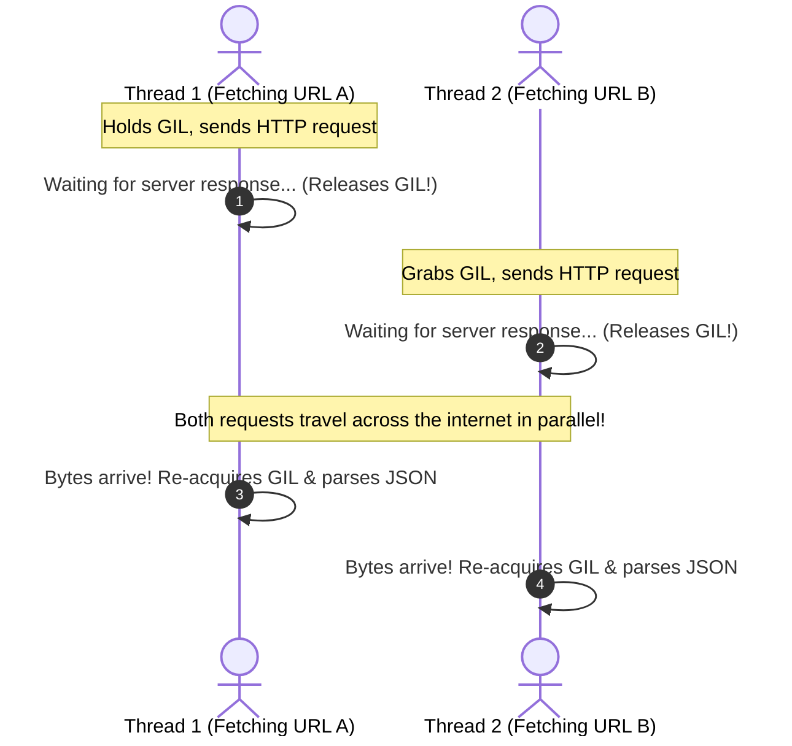

import { Callout } from "fumadocs-ui/components/callout";
import { Tabs, Tab } from "fumadocs-ui/components/tabs";
import { Accordion, Accordions } from "fumadocs-ui/components/accordion";

Concurrency in Python confuses many developers because adding threads to a Python program can sometimes make it **slower** than running on a single thread!

To understand why, you need to understand two key ideas:

1. **The nature of your task** (Is it waiting on the outside world, or doing heavy math?).
2. **The Global Interpreter Lock (GIL)** (CPython's internal traffic officer).

---

## The Mental Model: The Kitchen Chef Analogy

Imagine your program is a kitchen preparing meals:


---

## 1. I/O-Bound vs. CPU-Bound: Which is Your Task?

Before choosing a concurrency tool, ask yourself this simple question:
**"Is my program waiting, or is it calculating?"**

| Workload Type                | What is happening?                                                                                          | Real-World Examples                                                          | Best Tool                         |
| :--------------------------- | :---------------------------------------------------------------------------------------------------------- | :--------------------------------------------------------------------------- | :-------------------------------- |
| **I/O-Bound** (Input/Output) | The CPU is idle 95% of the time, **waiting** for bytes over the network, disk reads, or database responses. | Downloading 50 URLs, querying PostgreSQL, reading log files.                 | `ThreadPoolExecutor` or `asyncio` |
| **CPU-Bound**                | The CPU cores are pinned at 100%, crunching mathematical calculations as fast as possible.                  | Image resizing, video encoding, password hashing, machine learning training. | `ProcessPoolExecutor`             |

---

## 2. The Global Interpreter Lock (GIL) Explained Simply

In standard Python (CPython), threads are genuine operating system threads. However, CPython has a guard named the **Global Interpreter Lock (GIL)**.

### Why Does the GIL Exist?

CPython manages memory using **reference counting**. Every object tracks how many variables point to it. If two threads incremented or decremented an object's reference counter at the exact same nanosecond without protection, memory would corrupt and crash Python.

To keep memory management fast and thread-safe without slow lock overhead on every operation, Python uses the GIL:

> **Only one thread can execute Python bytecode at any given instant.**

### The Miracle of I/O: Why Threading Still Works

If only one thread runs at a time, why use threads at all?
Because **when a thread waits for I/O (network, disk, sleep), Python automatically releases the GIL!**



Let's test this in code using `concurrent.futures.ThreadPoolExecutor`:

```python
from concurrent.futures import ThreadPoolExecutor
import time

def fetch_url(url_id: int) -> str:
    # Simulate a 1-second network download
    time.sleep(1.0)
    return f"Response #{url_id}"

start = time.perf_counter()

# Run 10 network requests across 10 threads
with ThreadPoolExecutor(max_workers=10) as executor:
    results = list(executor.map(fetch_url, range(10)))

elapsed = time.perf_counter() - start
print(f"Fetched 10 URLs in {elapsed:.2f} seconds!")
print("Sequential would have taken: 10.00 seconds.")
```

Output:

```text
Fetched 10 URLs in 1.02 seconds!
Sequential would have taken: 10.00 seconds.
```

---

## 3. Multiprocessing: True Multi-Core Parallelism

For CPU-heavy number crunching, threads cannot help because they fight over the single GIL.

To use all your CPU cores, use **`ProcessPoolExecutor`**. Each process gets its own independent Python interpreter, its own memory space, and its own GIL!

```python
from concurrent.futures import ProcessPoolExecutor
import time

def cpu_heavy_hash(n: int) -> int:
    """Intensive CPU computation."""
    return sum(i * i for i in range(n))

if __name__ == "__main__":
    workloads = [10_000_000] * 4

    start = time.perf_counter()
    with ProcessPoolExecutor() as executor:
        results = list(executor.map(cpu_heavy_hash, workloads))

    elapsed = time.perf_counter() - start
    print(f"Processed 4 heavy CPU tasks across cores in {elapsed:.2f}s")
```

Output:

```text
Processed 4 heavy CPU tasks across cores in 0.85s
```

### The Hidden Cost: IPC and `pickle`

Because processes do not share memory:

1. Python must convert your input data into bytes (**serialization / pickling**).
2. It sends those bytes across operating system pipes to the worker process.
3. The worker deserializes (**unpickles**) the data, calculates the result, and pickles the answer back.

<Callout type="warning" title="Watch Out for Large Data Transfer!">
  If you pass a 2 GB pandas DataFrame or image array into a worker process via
  `ProcessPoolExecutor`, the time spent serializing and copying memory can
  easily wipe out the speedup of multi-core processing! For shared read-only
  data, consider shared memory (`multiprocessing.shared_memory`).
</Callout>

---

## Concurrency Comparison Matrix

| Model                              | Mechanism                                 | Best For                                     | Pros                                             | Cons                                                                       |
| :--------------------------------- | :---------------------------------------- | :------------------------------------------- | :----------------------------------------------- | :------------------------------------------------------------------------- |
| **`threading`**                    | OS Threads (GIL-constrained)              | Network calls, disk I/O, synchronous APIs    | Shares memory easily; low setup cost             | Cannot parallelize Python bytecode on multi-core CPU; race condition risks |
| **`multiprocessing`**              | Separate OS Processes                     | Heavy CPU math, compression, image rendering | True multi-core parallelism; bypasses GIL        | High memory overhead; data must be picklable; slower startup               |
| **`asyncio`**                      | Single thread with cooperative event loop | 100,000+ simultaneous network sockets        | Ultra-lightweight (near zero RAM); no lock races | Any blocking CPU call stalls the entire program                            |
| **Free-Threading (`python3.13t`)** | Multi-threaded with `--disable-gil`       | Multi-threaded CPU parallel code             | True parallel threads in one process             | Experimental; some C extensions not yet ready                              |

---

## Practice Questions & Challenges

### Question 1: Output Prediction (The Race Condition Under the GIL)

What happens when 4 threads increment a shared counter without a lock?

```python
import threading

counter = 0

def worker():
    global counter
    for _ in range(100_000):
        counter += 1

threads = [threading.Thread(target=worker) for _ in range(4)]
for t in threads:
    t.start()
for t in threads:
    t.join()

print(f"Final Counter: {counter}")
```

Why is `counter` virtually guaranteed **not** to be `400,000`, even though Python has a GIL?

<Accordions>
<Accordion title="Solution & Breakdown">
**Answer:**
`counter` will print a number significantly lower than 400,000 (e.g. `241,830`).

**Why the GIL does not protect you here:**
The GIL guarantees that **one low-level bytecode instruction** executes atomically. But `counter += 1` is not one instruction! It compiles down to three separate bytecode steps:

1. `LOAD_GLOBAL (counter)`: Read current value from memory.
2. `BINARY_OP (ADD 1)`: Add 1 to the local register.
3. `STORE_GLOBAL (counter)`: Write the updated value back to memory.

Here is how a race condition happens between Thread A and Thread B:

| Timeline | Thread A                                                | Thread B                     | `counter` in Memory                      |
| :------- | :------------------------------------------------------ | :--------------------------- | :--------------------------------------- |
| T1       | Reads `counter` (value = 50)                            | _Waiting_                    | 50                                       |
| T2       | _Context switch!_                                       | Reads `counter` (value = 50) | 50                                       |
| T3       | _Waiting_                                               | Increments and writes `51`   | **51**                                   |
| T4       | Resumes with old register (50 + 1 = 51) and writes `51` | _Waiting_                    | **51 (Thread B's work is overwritten!)** |

**The Fix: Protect with a `threading.Lock`:**

```python
lock = threading.Lock()

def worker():
    global counter
    for _ in range(100_000):
        with lock:
            counter += 1
```

</Accordion>
</Accordions>

---

### Question 2: Spot and Fix the Bug (Pickling Unpicklable Objects)

A developer tries to clean strings across cores using `ProcessPoolExecutor`, but it crashes with `PicklingError: Can't pickle local object`:

```python
from concurrent.futures import ProcessPoolExecutor

def process_data(raw_items):
    prefix = "[CLEANED]: "

    # Local helper function:
    def clean(item):
        return f"{prefix}{item.strip()}"

    with ProcessPoolExecutor() as executor:
        return list(executor.map(clean, raw_items))

if __name__ == "__main__":
    data = ["  alpha ", " beta\n", "gamma "]
    results = process_data(data)
    print(results)
```

Explain why this occurs and provide the clean fix.

<Accordions>
<Accordion title="Solution & Breakdown">
**The Root Cause:**
`ProcessPoolExecutor` transmits worker functions to sub-processes using `pickle`.
`pickle` can only serialize functions that are defined at the **module top-level** so the child process can import them by name. Local closures, nested functions, and lambdas cannot be pickled by default.

**Fix 1: Move the function to module top-level (using `functools.partial` if parameters are needed):**

```python
from concurrent.futures import ProcessPoolExecutor
from functools import partial

def _clean_item(prefix: str, item: str) -> str:
    return f"{prefix}{item.strip()}"

def process_data(raw_items):
    worker_fn = partial(_clean_item, "[CLEANED]: ")
    with ProcessPoolExecutor() as executor:
        return list(executor.map(worker_fn, raw_items))

if __name__ == "__main__":
    data = ["  alpha ", " beta\n", "gamma "]
    print(process_data(data))
    # Output: ['[CLEANED]: alpha', '[CLEANED]: beta', '[CLEANED]: gamma']
```

**Fix 2: If the task is lightweight or string manipulation, use `ThreadPoolExecutor` instead:**
Threads share the exact same memory space, completely bypassing `pickle` serialization.

</Accordion>
</Accordions>

---

### Question 3: Architecture Deep-Dive (Why Threads Slow Down CPU Tasks)

Why does running 4 threads on an 8-core CPU to calculate 50 million hashes take **longer** than running the exact same code on 1 thread in standard CPython?

<Accordions>
<Accordion title="Solution & Breakdown">
**The Convoy Effect & Lock Contention:**
When 4 threads perform non-stop CPU calculations:
1. Thread 1 acquires the GIL and computes.
2. The OS scheduler allocates Threads 2, 3, and 4 to other physical CPU cores.
3. Because the GIL is already held by Thread 1, Threads 2, 3, and 4 immediately sleep on a mutex condition variable.
4. Every 5 milliseconds (the default GIL switch interval), Python forces Thread 1 to release the GIL.
5. Now, all 4 CPU cores furiously fight to acquire the lock at the same time. This triggers frequent **OS context switches**, CPU cache misses, and kernel lock arbitration.
6. The total work performed is still restricted to 1 core's worth of bytecode, but you pay a heavy tax for thread synchronization overhead!

**Rule of thumb:**

- CPU work + Threads = Slower than single thread.
- CPU work + Multiprocessing = True parallel speedup.

</Accordion>
</Accordions>

---

### Question 4: Hands-On Challenge (Deadlock-Free Resource Acquisition)

Two background threads need to acquire two shared locks (`lock_a` and `lock_b`) to transfer funds. Currently, an intermittent deadlock freezes the application:

```python
import threading
import time

lock_a = threading.Lock()
lock_b = threading.Lock()

def transfer_x_to_y():
    with lock_a:
        time.sleep(0.01)  # Context switch window
        with lock_b:
            print("Transfer X -> Y complete")

def transfer_y_to_x():
    with lock_b:
        time.sleep(0.01)
        with lock_a:
            print("Transfer Y -> X complete")
```

Refactor this to guarantee that a deadlock can **never** happen, no matter what order threads call it.

<Accordions>
<Accordion title="Solution & Breakdown">
**Why deadlocks happen:**
A deadlock occurs when Thread 1 holds Lock A and waits for Lock B, while Thread 2 holds Lock B and waits for Lock A (circular wait).

**The Solution: Strict Global Lock Ordering:**
If all threads always acquire locks in the exact same consistent order (for example, ordered by each lock's memory address `id(lock)`), circular wait is mathematically impossible!

```python
import threading
from contextlib import contextmanager

@contextmanager
def acquire_locks_in_order(*locks):
    # Sort locks deterministically by unique object id:
    sorted_locks = sorted(locks, key=id)
    acquired = []
    try:
        for lk in sorted_locks:
            lk.acquire()
            acquired.append(lk)
        yield
    finally:
        # Release in reverse order of acquisition:
        for lk in reversed(acquired):
            lk.release()

lock_a = threading.Lock()
lock_b = threading.Lock()

def transfer_x_to_y():
    with acquire_locks_in_order(lock_a, lock_b):
        print("Transfer X -> Y safely executed")

def transfer_y_to_x():
    with acquire_locks_in_order(lock_b, lock_a):
        print("Transfer Y -> X safely executed")

t1 = threading.Thread(target=transfer_x_to_y)
t2 = threading.Thread(target=transfer_y_to_x)
t1.start()
t2.start()
t1.join()
t2.join()
```

</Accordion>
</Accordions>

---

### Question 5: Code Challenge (Thread-Safe Priority Worker Pool with Graceful Shutdown)

Build a production-grade worker pool using standard library `threading` and `queue.PriorityQueue` with the following requirements:

1. `Job` dataclass with `priority: int` (lower number = higher priority), `task_id: str`, and `payload: str`.
2. Worker threads process jobs in priority order.
3. Clean shutdown: A `shutdown(wait=True)` method that terminates all worker threads cleanly without dropping pending tasks.

```python
pool = ThreadedJobQueue(workers=2)
pool.submit(Job(priority=10, task_id="A", payload="Low priority background job"))
pool.submit(Job(priority=1, task_id="B", payload="Urgent payment validation"))
pool.submit(Job(priority=5, task_id="C", payload="Medium report export"))
pool.shutdown(wait=True)
# Expected order: B (pri 1) -> C (pri 5) -> A (pri 10)
```

<Accordions>
<Accordion title="Solution & Breakdown">
```python
from dataclasses import dataclass, field
import queue
import threading
import time

@dataclass(order=True)
class Job:
priority: int
task_id: str = field(compare=False)
payload: str = field(compare=False)

# Sentinel with infinite priority to shut down workers safely

SHUTDOWN_SENTINEL = Job(priority=float("inf"), task_id="**SHUTDOWN**", payload="")

class ThreadedJobQueue:
def **init**(self, workers: int = 2):
self.num_workers = workers
self.q = queue.PriorityQueue()
self.threads = []

        for i in range(workers):
            t = threading.Thread(target=self._worker_loop, name=f"Worker-{i}", daemon=True)
            t.start()
            self.threads.append(t)

    def submit(self, job: Job):
        self.q.put(job)

    def _worker_loop(self):
        while True:
            job = self.q.get()
            if job.task_id == "__SHUTDOWN__":
                self.q.task_done()
                break

            try:
                print(f"[{threading.current_thread().name}] Processing {job.task_id} (Priority {job.priority}): {job.payload}")
                time.sleep(0.05)  # Simulate task work
            finally:
                self.q.task_done()

    def shutdown(self, wait: bool = True):
        # Enqueue one sentinel per worker thread
        for _ in range(self.num_workers):
            self.q.put(SHUTDOWN_SENTINEL)

        if wait:
            self.q.join()
            for t in self.threads:
                t.join()
            print("All workers shut down cleanly.")

# Verification

if **name** == "**main**":
pool = ThreadedJobQueue(workers=2)
pool.submit(Job(priority=10, task_id="Job-A", payload="Nightly archive"))
pool.submit(Job(priority=1, task_id="Job-B", payload="Urgent auth check"))
pool.submit(Job(priority=2, task_id="Job-C", payload="Order checkout"))
pool.submit(Job(priority=8, task_id="Job-D", payload="Email receipt"))

    pool.shutdown(wait=True)

```
</Accordion>
</Accordions>

---

## Summary Reference

- **I/O-Bound**: Waiting on network/disk $\rightarrow$ use `ThreadPoolExecutor` or `asyncio`.
- **CPU-Bound**: Heavy number crunching $\rightarrow$ use `ProcessPoolExecutor`.
- **The GIL**: Prevents multi-threaded Python bytecode execution; automatically released during I/O.
- **Race Conditions**: `counter += 1` is not atomic; always protect shared mutable state with `threading.Lock`.
- **Multiprocessing IPC**: Data passed across processes must be serializable with `pickle`.
```
