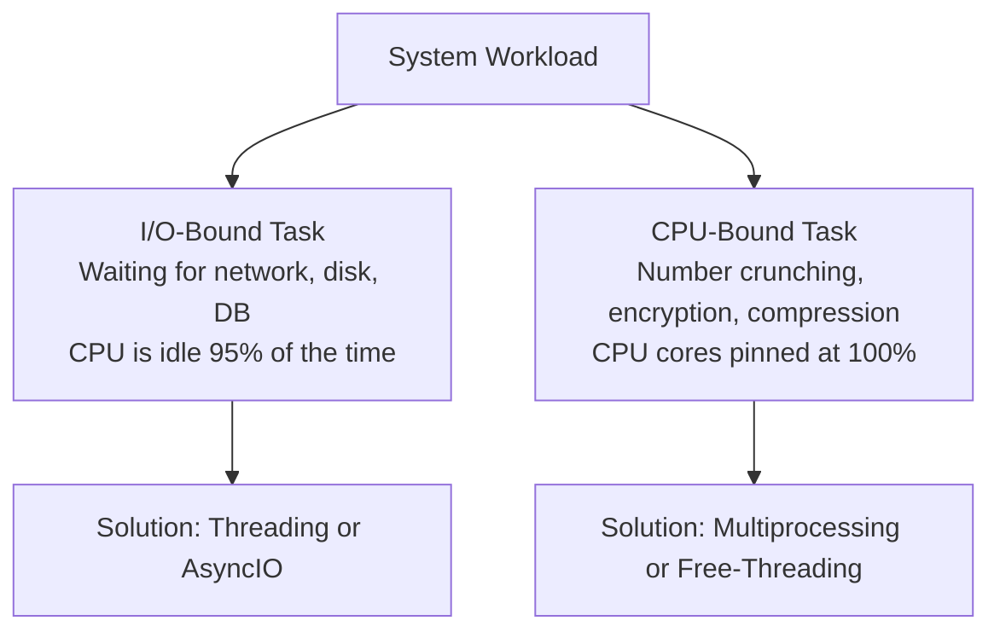

import { Callout } from "fumadocs-ui/components/callout";
import { Tabs, Tab } from "fumadocs-ui/components/tabs";
import { Accordion, Accordions } from "fumadocs-ui/components/accordion";

When building high-throughput systems, concurrency is essential. But choosing the wrong concurrency model in Python can actually make your program **slower** than running on a single thread.

To choose correctly, you must distinguish between **I/O-Bound** and **CPU-Bound** tasks.

---

## 1. The Fundamental Distinction: I/O-Bound vs. CPU-Bound



---

## 2. The Traditional Threading Model & The GIL

Python threads are true native OS threads. However, CPython has historically been governed by the **Global Interpreter Lock (GIL)** — a mutual exclusion lock that prevents multiple native threads from executing Python bytecode simultaneously.

### Why Does the GIL Exist?

CPython's internal memory management relies heavily on **reference counting**. Without the GIL, every single pointer assignment across threads would require expensive atomic instructions to prevent race conditions. The GIL was implemented to ensure thread-safety with zero overhead on single-threaded code.

### When Threading Works: I/O Operations

When a Python thread initiates an I/O operation (e.g., waiting for an HTTP response or reading from disk), **CPython explicitly releases the GIL**:

```python
from concurrent.futures import ThreadPoolExecutor
import time

def fetch_url(url_id: int):
    # Simulates an I/O network wait
    time.sleep(1.0)
    return f"Response from URL {url_id}"

# 10 network requests run concurrently on 10 threads!
start = time.perf_counter()
with ThreadPoolExecutor(max_workers=10) as executor:
    results = list(executor.map(fetch_url, range(10)))

elapsed = time.perf_counter() - start
print(f"Fetched 10 URLs in {elapsed:.2f} seconds (Sequential would take 10.0s)")
```

Output:

```text
Fetched 10 URLs in 1.02 seconds (Sequential would take 10.0s)
```

---

## 3. Multiprocessing: Bypassing the GIL for CPU Work

For CPU-bound tasks (e.g. calculating cryptographic hashes or processing images), multiple threads will compete for the GIL on a single core. To use all CPU cores, use **`multiprocessing`**:

```python
from concurrent.futures import ProcessPoolExecutor
import time

def cpu_heavy_hash(n: int) -> int:
    """CPU-bound mathematical calculation."""
    return sum(i * i for i in range(n))

if __name__ == "__main__":
    workloads = [10_000_000] * 4

    start = time.perf_counter()
    with ProcessPoolExecutor() as executor:
        results = list(executor.map(cpu_heavy_hash, workloads))

    elapsed = time.perf_counter() - start
    print(f"Processed 4 CPU tasks across cores in {elapsed:.2f}s")
```

Output:

```text
Processed 4 CPU tasks across cores in 0.85s
```

### The Hidden Cost of Multiprocessing: IPC & `pickle`

Processes do not share memory. Every object passed to a worker process must be serialized (**pickled**), transmitted across OS pipes, and deserialized in the worker process. For massive datasets, serialization overhead can easily outweigh the CPU speedup!

---

## Concurrency Comparison Matrix

| Model                      | Mechanism                              | Best For                               | Main Bottleneck                                      |
| :------------------------- | :------------------------------------- | :------------------------------------- | :--------------------------------------------------- |
| **`threading`**            | Native OS threads with GIL             | Network I/O, synchronous APIs          | Cannot parallelize Python bytecode on multi-core CPU |
| **`multiprocessing`**      | Separate OS processes                  | Heavy CPU batch computing              | Memory overhead, slow IPC serialization (`pickle`)   |
| **`asyncio`**              | Single-threaded cooperative event loop | 100k+ concurrent network connections   | Any blocking CPU call stalls the entire event loop   |
| **Free-Threading (3.13+)** | Native OS threads with `--disable-gil` | Parallel multi-threaded CPU algorithms | Experimental build, C-extension compatibility        |

---

## Practice Questions & Challenges

Test your concurrency instincts, thread synchronization mastery, and multiprocessing debugging skills:

### Question 1: Output Prediction (Thread Race Condition)

Consider the following multithreaded incrementer without mutual exclusion:

```python
import threading
import time

counter = 0

def worker():
    global counter
    for _ in range(100_000):
        counter += 1

threads = [threading.Thread(target=worker) for _ in range(4)]
for t in threads:
    t.start()
for t in threads:
    t.join()

print(f"Final Counter: {counter}")
```

Why is `counter` virtually guaranteed **not** to be `400,000`, even though Python has a Global Interpreter Lock (GIL)?

<Accordions>
<Accordion title="Solution & Breakdown">
**Answer:**
`counter` is almost certainly less than 400,000 (e.g., 214,832).

**Explanation:**
The GIL only ensures that CPython bytecode instructions run atomically one by one. It does **not** make multi-bytecode operations atomic!
The expression `counter += 1` translates into three separate bytecode instructions:

1. `LOAD_GLOBAL (counter)`
2. `BINARY_OP (ADD 1)`
3. `STORE_GLOBAL (counter)`

CPython periodically releases and re-acquires the GIL (by default every 5 milliseconds or after a fixed number of bytecode instructions).
If Thread A reads `counter = 50`, and Python switches context to Thread B, Thread B can increment `counter` from 50 to 51 and store it. When Thread A resumes, its register still holds 50, increments it to 51, and overwrites Thread B's work!

To fix this, protect the critical section with a `threading.Lock`:

```python
lock = threading.Lock()

def worker():
    global counter
    for _ in range(100_000):
        with lock:
            counter += 1
```

</Accordion>
</Accordions>

---

### Question 2: Spot and Fix the Bug (Pickling Unpicklable Objects in ProcessPoolExecutor)

A developer attempts to parallelize dataset processing across cores using `ProcessPoolExecutor`, but the program crashes with `_pickle.PicklingError: Can't pickle local object 'process_data.<locals>.clean'`:

```python
from concurrent.futures import ProcessPoolExecutor

def process_data(raw_items):
    prefix = "[CLEANED]: "

    # Nested helper closure:
    def clean(item):
        return f"{prefix}{item.strip()}"

    with ProcessPoolExecutor() as executor:
        return list(executor.map(clean, raw_items))

if __name__ == "__main__":
    data = ["  alpha ", " beta\n", "gamma "]
    results = process_data(data)
    print(results)
```

Explain why this occurs and provide two distinct fixes to make the code execute properly.

<Accordions>
<Accordion title="Solution & Breakdown">
**The Root Cause:**
`multiprocessing` communicates by serializing callables and arguments using `pickle`.
`pickle` requires functions to be defined at the **top-level of a module** so worker processes can import them by qualified name. Closures, nested functions, and lambdas cannot be pickled by Python's default serializer.

**Fix 1: Move the function to module top-level (or use `functools.partial`):**

```python
from concurrent.futures import ProcessPoolExecutor
from functools import partial

def _clean_item(prefix: str, item: str) -> str:
    return f"{prefix}{item.strip()}"

def process_data(raw_items):
    worker_fn = partial(_clean_item, "[CLEANED]: ")
    with ProcessPoolExecutor() as executor:
        return list(executor.map(worker_fn, raw_items))

if __name__ == "__main__":
    data = ["  alpha ", " beta\n", "gamma "]
    print(process_data(data))
```

**Fix 2: For I/O or string munging, use `ThreadPoolExecutor` instead:**
Threads share memory space, completely bypassing `pickle` serialization.

```python
from concurrent.futures import ThreadPoolExecutor

def process_data(raw_items):
    prefix = "[CLEANED]: "
    def clean(item):
        return f"{prefix}{item.strip()}"

    with ThreadPoolExecutor() as executor:
        return list(executor.map(clean, raw_items))
```

</Accordion>
</Accordions>

---

### Question 3: Architecture Deep-Dive (Why Threads Slow Down CPU-Bound Tasks under the GIL)

Why does executing a heavy numeric task (e.g., calculating 50 million hashes) across 4 threads on an 8-core CPU take **longer** than running the exact same task sequentially on a single thread in standard CPython?

<Accordions>
<Accordion title="Solution & Breakdown">
**The Convoy & GIL Contention Effect:**
In CPython, only one thread can hold the GIL and execute bytecode at any instant.
When 4 threads are actively trying to compute CPU instructions:
1. Thread 1 acquires the GIL and begins calculating.
2. Threads 2, 3, and 4 are scheduled by the OS kernel on separate CPU cores.
3. Because the GIL is held, Threads 2, 3, and 4 immediately block on a condition variable / mutex.
4. When Thread 1 reaches the GIL release interval (default 5ms), it signals the condition variable and releases the GIL.
5. All 4 threads now aggressively compete to acquire the lock. This causes frequent **OS context switches**, CPU cache invalidations, and high kernel scheduling overhead.
6. Worse, the thread that was just forced to release the lock often immediately re-acquires it before the sleeping threads can wake up.

**Conclusion:**
You get zero CPU parallelism (work is still serialized to 1 core's worth of bytecode), but you pay the extra tax of thread creation, OS scheduling, and lock contention. For CPU tasks, use `ProcessPoolExecutor` or free-threaded Python 3.13 (`python3.13t`).

</Accordion>
</Accordions>

---

### Question 4: Hands-On Challenge (Deadlock-Free Resource Acquisition)

Two background threads need to acquire two shared locks (`lock_a` and `lock_b`) to perform an atomic transaction. In the current design, an intermittent deadlock freezes the application:

```python
import threading
import time

lock_a = threading.Lock()
lock_b = threading.Lock()

def transfer_x_to_y():
    with lock_a:
        time.sleep(0.01)  # Simulate latency
        with lock_b:
            print("Transfer X -> Y complete")

def transfer_y_to_x():
    with lock_b:
        time.sleep(0.01)
        with lock_a:
            print("Transfer Y -> X complete")
```

Refactor this mechanism to guarantee that a deadlock can **never** occur, regardless of how many threads or accounts are involved.

<Accordions>
<Accordion title="Solution & Breakdown">
**Deadlock Condition:**
Deadlocks occur when threads acquire identical locks in conflicting orders (Thread 1: A then B; Thread 2: B then A).

**Resolution (Global Lock Hierarchy / Strict Ordering):**
Ensure that whenever multiple locks must be acquired, they are **always acquired in a consistent, globally deterministic order** (e.g., by unique ID or memory address):

```python
import threading
from contextlib import contextmanager

@contextmanager
def acquire_locks_in_order(*locks):
    # Sort locks deterministically by unique object id:
    sorted_locks = sorted(locks, key=id)
    acquired = []
    try:
        for lk in sorted_locks:
            lk.acquire()
            acquired.append(lk)
        yield
    finally:
        # Release in reverse order of acquisition:
        for lk in reversed(acquired):
            lk.release()

lock_a = threading.Lock()
lock_b = threading.Lock()

def transfer_x_to_y():
    with acquire_locks_in_order(lock_a, lock_b):
        print("Transfer X -> Y safely executed")

def transfer_y_to_x():
    with acquire_locks_in_order(lock_b, lock_a):
        print("Transfer Y -> X safely executed")

t1 = threading.Thread(target=transfer_x_to_y)
t2 = threading.Thread(target=transfer_y_to_x)
t1.start(); t2.start()
t1.join(); t2.join()
```

</Accordion>
</Accordions>

---

### Question 5: Code Challenge (Thread-Safe Priority Worker Pool with Graceful Shutdown)

Build a production-grade worker pool using standard library `threading` and `queue.PriorityQueue` with the following requirements:

1. `Job` dataclass with `priority: int` (lower number = higher priority), `task_id: str`, and `payload: str`.
2. Worker threads process jobs in priority order.
3. Graceful shutdown: Provide a `shutdown(wait=True)` method that sends sentinel values (`None`) to shut down all worker threads cleanly without dropping pending tasks.

**Test cases:**

```python
pool = ThreadedJobQueue(workers=2)
pool.submit(Job(priority=10, task_id="A", payload="Low priority background job"))
pool.submit(Job(priority=1, task_id="B", payload="Urgent payment validation"))
pool.submit(Job(priority=5, task_id="C", payload="Medium report export"))
pool.shutdown(wait=True)
# Expected execution order: B (pri 1) -> C (pri 5) -> A (pri 10)
```

<Accordions>
<Accordion title="Solution & Breakdown">
```python
from dataclasses import dataclass, field
import queue
import threading
import time

@dataclass(order=True)
class Job:
priority: int
task_id: str = field(compare=False)
payload: str = field(compare=False)

class ThreadedJobQueue:
def **init**(self, workers: int = 2):
self.num_workers = workers
self.q = queue.PriorityQueue()
self.threads = []
for i in range(workers):
t = threading.Thread(target=self.\_worker_loop, name=f"Worker-{i}", daemon=True)
t.start()
self.threads.append(t)

    def submit(self, job: Job):
        self.q.put(job)

    def _worker_loop(self):
        while True:
            job = self.q.get()
            if job is None:
                # Sentinel received: terminate thread
                self.q.task_done()
                break
            try:
                # Simulate work
                print(f"[{threading.current_thread().name}] Processing {job.task_id} (Priority {job.priority}): {job.payload}")
                time.sleep(0.05)
            finally:
                self.q.task_done()

    def shutdown(self, wait: bool = True):
        # 1. Enqueue one None sentinel per worker thread
        for _ in range(self.num_workers):
            # Sentinel needs lowest possible priority to be processed after all real jobs:
            self.q.put(None)

        if wait:
            # Wait for all queued items to be processed
            self.q.join()
            for t in self.threads:
                t.join()
            print("All workers shut down cleanly.")

# Verification

if **name** == "**main**":
pool = ThreadedJobQueue(workers=2)
pool.submit(Job(priority=10, task_id="Job-A", payload="Nightly archive"))
pool.submit(Job(priority=1, task_id="Job-B", payload="Urgent auth check"))
pool.submit(Job(priority=2, task_id="Job-C", payload="Order checkout"))
pool.submit(Job(priority=8, task_id="Job-D", payload="Email receipt"))

    pool.shutdown(wait=True)

```
</Accordion>
</Accordions>
```
