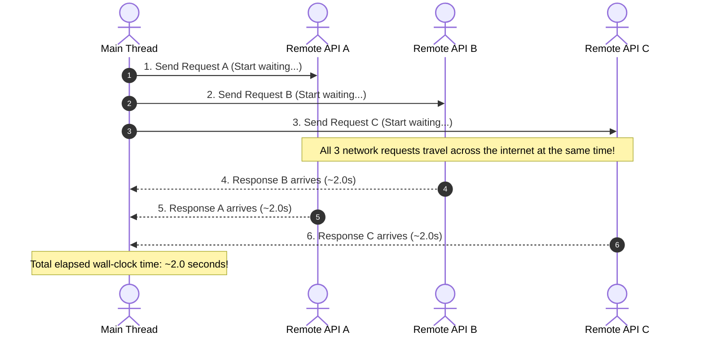
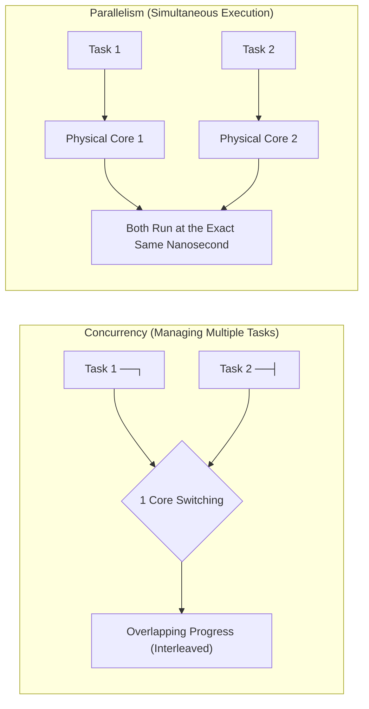
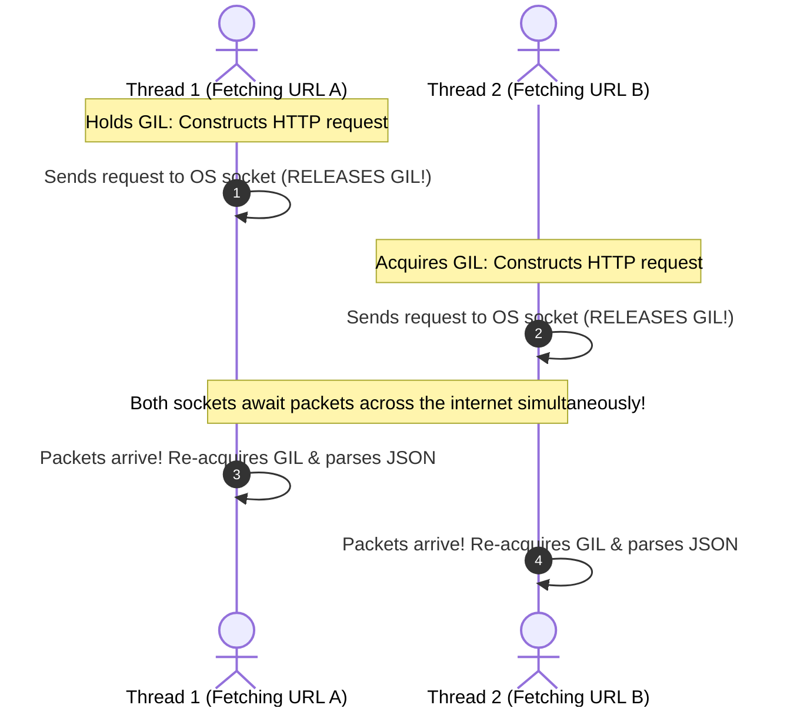
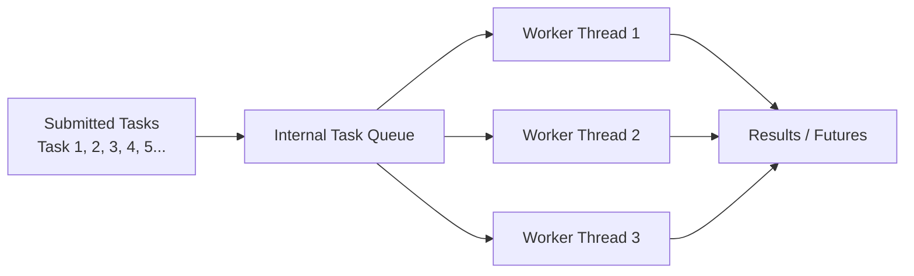
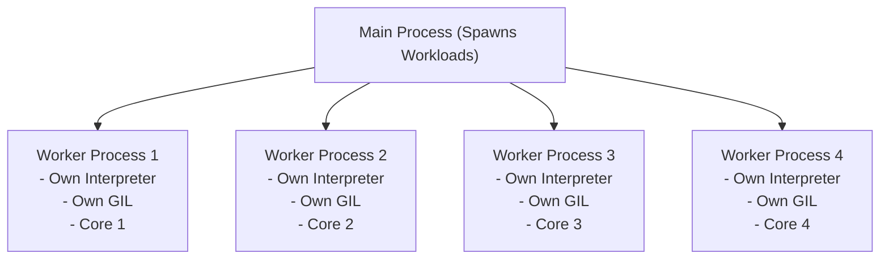
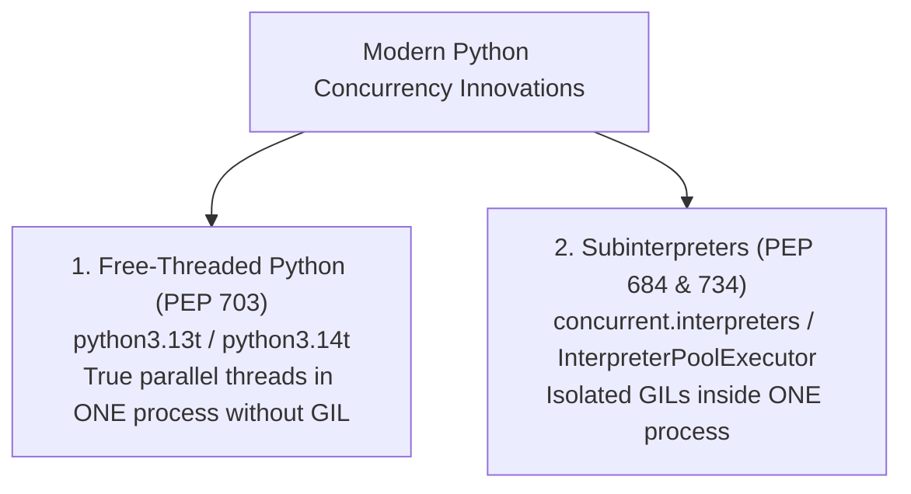
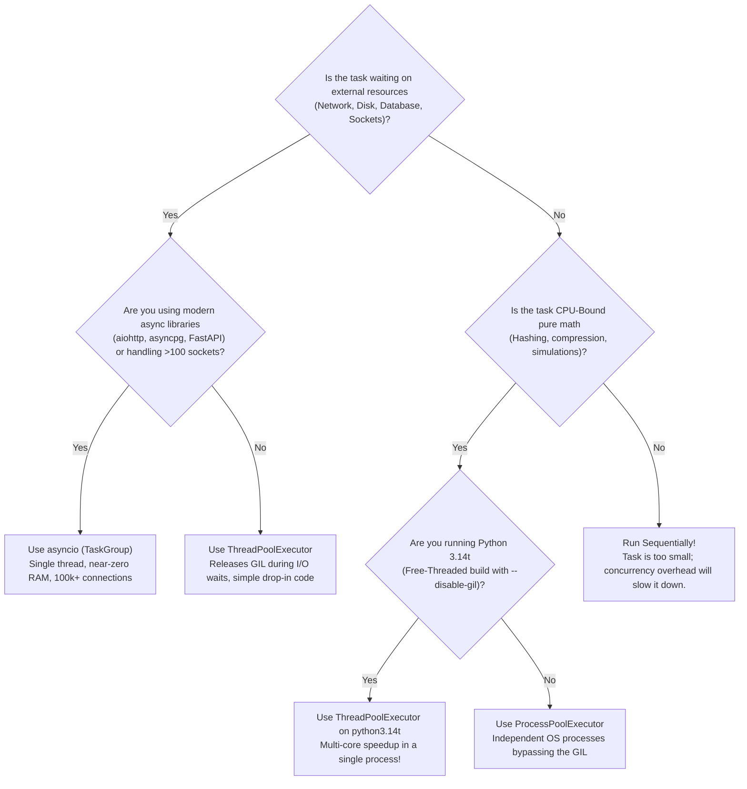

import { Callout } from "fumadocs-ui/components/callout";
import { Tabs, Tab } from "fumadocs-ui/components/tabs";
import { Accordion, Accordions } from "fumadocs-ui/components/accordion";

Concurrency in Python is one of the most misunderstood topics in the language. Many developers assume that adding threads to any program will make it faster—only to discover that adding threads to a Python calculation can actually make it **slower** than running on a single thread!

To master Python concurrency, you need to understand:

1. **The fundamental problem concurrency solves** (sequential vs. overlapping execution).
2. **The nature of your workload** (Is your program waiting on external resources, or crunching numbers on the CPU?).
3. **The Global Interpreter Lock (GIL)** (CPython's internal synchronization guard and why it behaves differently for I/O vs. CPU).
4. **The execution models** (`threading`, `multiprocessing`, `asyncio`, and modern free-threaded Python).

---

## The Mental Model: The Kitchen Chef Analogy

Imagine your program is a commercial kitchen preparing orders:


---

## 1. The Fundamental Problem Concurrency Solves

Imagine you are building a Python program that performs three tasks: fetching user data from three remote services.

### Approach A: Sequential Execution

In sequential execution, every instruction executes one after another. If a task must wait for an external service, the CPU remains idle until that response arrives:

```python
import time

def task(name: str) -> None:
    print(f"Starting {name}...")
    time.sleep(2.0)  # Simulates waiting for network response
    print(f"Finished {name}!")

start = time.perf_counter()

task("Task A")
task("Task B")
task("Task C")

elapsed = time.perf_counter() - start
print(f"Total time: {elapsed:.2f} seconds")
```

Output:

```text
Starting Task A...
Finished Task A!
Starting Task B...
Finished Task B!
Starting Task C...
Finished Task C!
Total time: 6.01 seconds
```

Why did this take 6 seconds?
Because each task waited for the previous task to finish completely before starting:

$$
T_{\text{total}} = 2.0 + 2.0 + 2.0 = 6.0\text{ seconds}
$$

During those 6 seconds, the CPU spent virtually 100% of its time doing **nothing** except waiting for an external timer to expire.

### Approach B: Concurrent Execution

Instead of waiting for Task A to finish before starting Task B, we allow tasks to make progress during **overlapping periods**:



By overlapping the waiting periods, the total time drops from 6 seconds down to approximately **2 seconds**. This is the core benefit of concurrency.

---

## 2. Concurrency vs. Parallelism

These two terms are frequently confused, but they describe fundamentally different concepts:



### Key Differences

- **Concurrency**: Multiple tasks make progress over overlapping time periods. The tasks do **not** necessarily run at the exact same physical instant. (Example: A single chef juggling three frying pans, flipping pancakes in pan A while oil heats in pan B).
- **Parallelism**: Multiple tasks execute at the exact same physical instant on separate hardware CPU cores. (Example: Four separate chefs cooking at four independent stoves).

<Callout type="info" title="The Golden Rule">
  **A program can be concurrent without being parallel.** A single CPU core can
  achieve concurrency by switching rapidly between waiting tasks. To achieve
  true parallelism, you need multiple physical CPU cores.
</Callout>

---

## 3. CPU-Bound vs. I/O-Bound Workloads

Before choosing any concurrency tool in Python, you must answer one question:
**"What is my program spending its time doing?"**

### 3.1 I/O-Bound Tasks (Input / Output)

An I/O-bound task spends the majority of its time **waiting** for an external system to respond:

- Downloading data over HTTP / REST APIs.
- Querying a PostgreSQL or Redis database.
- Reading or writing files to an SSD or network volume.
- Waiting on user input or external webhooks.

```python
import time

def download_file(file_id: int):
    print(f"Requesting file {file_id}...")
    time.sleep(2.0)  # Simulates network socket latency
    print(f"Received file {file_id}!")
```

During `time.sleep(2.0)`, the CPU is idle. Adding concurrent workers allows other tasks to utilize that idle waiting time.

### 3.2 CPU-Bound Tasks (Pure Computation)

A CPU-bound task spends its time performing non-stop mathematical calculations directly on the processor:

- Numerical simulations and matrix algebra.
- Video encoding, image filtering, and compression.
- Cryptographic hashing (Argon2, SHA-256) and decryption.
- Large pure-Python loops.

```python
def calculate_squares(n: int) -> int:
    total = 0
    for i in range(n):
        total += i * i
    return total

# Pins 1 CPU core at 100% utilization:
result = calculate_squares(20_000_000)
```

The CPU core is pinned at 100% capacity. There is zero waiting.

### Workload Comparison Matrix

| Property                     | I/O-Bound Workload                                      | CPU-Bound Workload                                           |
| :--------------------------- | :------------------------------------------------------ | :----------------------------------------------------------- |
| **Main Bottleneck**          | Network latency, disk throughput, database query time   | Processor clock speed, CPU core count, memory bandwidth      |
| **CPU State**                | Idle 90%–99% of the time, waiting for bytes             | Pinned at 100% utilization                                   |
| **Typical Tasks**            | Web scraping, API calls, database reads, file transfers | Image manipulation, machine learning training, cryptography  |
| **Best Python Tool**         | `ThreadPoolExecutor` or `asyncio`                       | `ProcessPoolExecutor` or free-threaded Python                |
| **Effect of Adding Workers** | Drastically reduces total wall-clock time               | Speeds up only if workers map to distinct physical CPU cores |

---

## 4. The Global Interpreter Lock (GIL) Demystified

The **Global Interpreter Lock (GIL)** is a mutual-exclusion mutex used by CPython to ensure that only one OS thread executes Python bytecode at any given instant.

### Why Does CPython Have a GIL?

CPython manages object lifecycles using **reference counting**. Every Python object contains a header field (`ob_refcnt`) tracking how many references point to it:

```python
a = [1, 2, 3]  # Reference count = 1
b = a          # Reference count = 2
del a          # Reference count = 1
```

If two threads concurrently mutated `ob_refcnt` without synchronization, memory corruption or double-free crashes would occur. The GIL was implemented as a single, global lock to:

1. Prevent race conditions on interpreter internal memory structures.
2. Provide exceptional single-threaded performance (acquiring one global lock once is far faster than acquiring thousands of fine-grained locks on every object allocation).
3. Easily integrate with legacy C extensions that were not originally designed to be thread-safe.

### Why Threads Fail on CPU-Bound Tasks (The Convoy Effect)

When multiple threads run CPU-heavy Python code on a multi-core machine:

```python
import threading

def cpu_heavy():
    return sum(i * i for i in range(10_000_000))

# Running on two threads:
t1 = threading.Thread(target=cpu_heavy)
t2 = threading.Thread(target=cpu_heavy)
t1.start()
t2.start()
t1.join()
t2.join()
```

1. Thread 1 acquires the GIL and begins executing bytecode on Core 1.
2. The operating system allocates Thread 2 to Core 2.
3. Thread 2 attempts to run, but discovers the GIL is already locked! Thread 2 is immediately forced to sleep on an OS mutex.
4. Every 5 milliseconds (the default `sys.getswitchinterval()`), Python forces Thread 1 to release the GIL.
5. Both CPU cores furiously contend to acquire the lock. This triggers constant **OS context switching**, CPU cache-line invalidation, and kernel lock arbitration.

The result? Running two CPU-heavy threads on standard CPython takes **longer** than running the exact same calculations sequentially on a single thread!

### Why Threading Excels on I/O-Bound Tasks

If the GIL prevents parallel bytecode execution, why do threads work so well for network requests?

> **When a Python thread executes a blocking system call (such as waiting for network packets, reading from disk, or sleeping), CPython voluntarily releases the GIL!**



While Thread 1 is waiting on network packets, Thread 2 acquires the GIL and initiates its own request. Neither thread blocks the other.

<Callout type="tip" title="Native C/Rust Extensions">
  Libraries like **NumPy**, **OpenCV**, and **PyO3/Rust** can explicitly release
  the GIL during heavy numerical operations (`Py_BEGIN_ALLOW_THREADS`). In those
  cases, Python threads can achieve genuine multi-core parallelism!
</Callout>

---

## 5. Low-Level Threading in Python (`threading.Thread`)

Python's standard library provides the `threading` module for creating and managing OS threads directly.

### 5.1 Creating Your First Thread

```python
import threading
import time

def worker():
    print("[Worker] Thread started")
    time.sleep(2.0)
    print("[Worker] Thread finished")

# 1. Instantiate the thread object:
thread = threading.Thread(target=worker)

# 2. Start the thread:
thread.start()
print("[Main] Main thread continues executing...")

# 3. Wait for the thread to complete:
thread.join()
print("[Main] Main program complete!")
```

Output:

```text
[Worker] Thread started
[Main] Main thread continues executing...
[Worker] Thread finished
[Main] Main program complete!
```

Key points:

- `target=worker`: Pass the function object itself. Do **not** write `target=worker()`, which would execute the function immediately on the main thread before the thread even starts!
- `thread.start()`: Spawns the operating system thread and begins execution.
- `thread.join()`: Blocks the calling thread until the target thread finishes execution.

### 5.2 Why `join()` is Critical

Consider what happens if you omit `thread.join()`:

```python
thread = threading.Thread(target=worker)
thread.start()
# Omitting thread.join():
print("[Main] Script reached the end!")
```

Output:

```text
[Worker] Thread started
[Main] Script reached the end!
[Worker] Thread finished
```

Without `join()`, the main thread finishes immediately and moves on to subsequent code while background threads continue running asynchronously. If your main script exits, background daemon threads may be terminated abruptly without finishing their cleanup.

### 5.3 Running Multiple Threads

To run multiple tasks concurrently, spawn a list of threads and `join()` them in a loop:

```python
import threading
import time

def download(task_id: int):
    print(f"Task {task_id} started")
    time.sleep(1.0)
    print(f"Task {task_id} finished")

threads = []
for i in range(5):
    t = threading.Thread(target=download, args=(i,))
    t.start()
    threads.append(t)

# Wait for all 5 threads to finish:
for t in threads:
    t.join()

print("All downloads finished!")
```

All 5 downloads run concurrently, taking ~1.0 second total instead of 5.0 seconds.

<Callout type="warning" title="The OS Thread Overhead Trap">
  Do not create thousands of raw `threading.Thread` instances! Each operating
  system thread allocates its own dedicated memory stack (typically **2 MB to 8
  MB** on Linux/Windows). Creating 10,000 threads will exhaust gigabytes of RAM
  and trigger severe OS context-switching thrashing. To manage concurrency
  safely, use a **thread pool**.
</Callout>

---

## 6. `ThreadPoolExecutor`: The Practical Modern Standard

The `concurrent.futures` module provides high-level abstractions for asynchronously executing callables.

`ThreadPoolExecutor` manages a **reusable pool of worker threads**. Rather than paying the overhead of spawning and destroying threads for every task, tasks are submitted to an internal queue and picked up by warm worker threads:



### 6.1 Basic Usage with Context Manager

```python
from concurrent.futures import ThreadPoolExecutor
import time

def fetch_data(task_id: int) -> str:
    time.sleep(1.0)
    return f"Payload {task_id}"

start = time.perf_counter()

# Reusable pool with at most 5 worker threads:
with ThreadPoolExecutor(max_workers=5) as executor:
    # executor.map preserves input order:
    results = list(executor.map(fetch_data, range(10)))

elapsed = time.perf_counter() - start
print(f"Fetched 10 items in {elapsed:.2f}s!")
print("Results:", results)
```

Output:

```text
Fetched 10 items in 2.02s!
Results: ['Payload 0', 'Payload 1', ..., 'Payload 9']
```

The 10 tasks were processed by 5 workers in two batches, completing in ~2 seconds rather than 10 seconds.
When the `with` block exits, the executor automatically calls `shutdown(wait=True)`, ensuring all submitted tasks complete before execution proceeds.

### 6.2 Tuning `max_workers`

How many worker threads should you configure?

- **Default Formula (Python 3.8+)**: `min(32, (os.cpu_count() or 1) + 4)`.
- **I/O-Bound Tasks**: You can often increase `max_workers` to 20, 50, or 100, depending on latency.
- **Rules to avoid outages**:
  1. **Memory Limits**: Each thread consumes stack space.
  2. **Socket / File Descriptor Limits**: OS operating systems restrict the number of open sockets per process (e.g., `ulimit -n`).
  3. **Target Server Limits**: Bombarding an external API with 500 simultaneous threads will trigger HTTP `429 Too Many Requests` or IP bans.

---

## 7. Mastering `Future` Objects

When you submit a task to an executor, it immediately returns a **`Future`** object.

Think of a `Future` as a **claim check or receipt** for an order. It represents an operation that has been scheduled and will produce a result (or an exception) at some point in the future.

### 7.1 `submit()` vs. `map()`

```python
from concurrent.futures import ThreadPoolExecutor
import time

def add_ten(x: int) -> int:
    time.sleep(0.5)
    return x + 10

with ThreadPoolExecutor(max_workers=2) as executor:
    # submit() takes a callable and returns a Future immediately:
    future_a = executor.submit(add_ten, 5)
    future_b = executor.submit(add_ten, 20)

    print("Tasks submitted! Main thread is free to do other work.")

    # future.result() blocks until that specific task finishes:
    res_a = future_a.result()
    res_b = future_b.result()
    print(f"Results: {res_a}, {res_b}")
```

<Callout type="warning" title="Critical Syntax Trap">
  Always pass the function name, not the function call: -
  `executor.submit(add_ten, 5)` $\rightarrow$ **Correct!** Submits the function
  to the thread pool. - `executor.submit(add_ten(5))` $\rightarrow$ **Wrong!**
  Executes `add_ten(5)` immediately on the main thread and submits the returned
  integer `15`!
</Callout>

### 7.2 Key `Future` Methods

| Method                        | Behavior                                                                                                                                    |
| :---------------------------- | :------------------------------------------------------------------------------------------------------------------------------------------ |
| `future.result(timeout=None)` | Blocks until work completes and returns the value. If an exception occurred during execution, calling `.result()` re-raises that exception! |
| `future.done()`               | Non-blocking check returning `True` if the task completed or was cancelled.                                                                 |
| `future.running()`            | Returns `True` if the task is currently executing.                                                                                          |
| `future.cancel()`             | Attempts to cancel the task if it is still sitting in the queue. (Cannot cancel a task that is already running).                            |
| `future.exception()`          | Returns the exception raised by the task without raising it, or `None` if successful.                                                       |

### 7.3 Processing Results as They Finish (`as_completed`)

When submitting tasks with variable execution times, you rarely want to wait for the slowest task before handling the fast ones.
`as_completed()` yields `Future` objects **in the order they finish**:

```python
from concurrent.futures import ThreadPoolExecutor, as_completed
import time

def fetch_metric(name: str, delay: float) -> str:
    time.sleep(delay)
    return f"{name} (after {delay}s)"

workloads = [("Database", 3.0), ("Cache", 0.5), ("AuthService", 1.5)]

with ThreadPoolExecutor(max_workers=3) as executor:
    # Submit all tasks and track futures in a dictionary:
    future_to_name = {
        executor.submit(fetch_metric, name, delay): name
        for name, delay in workloads
    }

    # Yields futures as soon as they complete:
    for future in as_completed(future_to_name):
        name = future_to_name[future]
        try:
            data = future.result()
            print(f"Received: {data}")
        except Exception as exc:
            print(f"{name} generated an exception: {exc}")
```

Output:

```text
Received: Cache (after 0.5s)
Received: AuthService (after 1.5s)
Received: Database (after 3.0s)
```

### 7.4 Graceful Shutdowns & `cancel_futures` (Python 3.9+)

When an unrecoverable error occurs, you often want to shut down the executor immediately without waiting for hundreds of pending tasks to start.
Pass `cancel_futures=True`:

```python
executor = ThreadPoolExecutor(max_workers=4)
# ... submit 1,000 tasks ...

# Cancel all pending tasks in the queue; wait only for the 4 active workers to finish:
executor.shutdown(wait=True, cancel_futures=True)
```

---

## 8. Race Conditions & Synchronization with `threading.Lock`

Because threads in the same process share identical memory space, exchanging data between threads is trivial. However, shared mutable memory introduces the most notorious concurrency bug: **the race condition**.

A **race condition** occurs when the final outcome of a program depends on the non-deterministic scheduling and timing of concurrent operations.

### 8.1 The Bank Balance Dilemma

Imagine a shared bank account holding ₹1,000. Two threads attempt to withdraw ₹100 simultaneously:

1. Thread 1 reads the balance: `₹1,000`.
2. OS context switches to Thread 2!
3. Thread 2 reads the balance: `₹1,000`.
4. Thread 2 subtracts ₹100 and writes `₹900`.
5. OS context switches back to Thread 1.
6. Thread 1 subtracts ₹100 from its stale local register (`1000 - 100 = 900`) and writes `₹900`.

The final balance is **₹900**, even though ₹200 was withdrawn!

### 8.2 Reproducing a Race Condition in Python

Why does `counter += 1` fail across multiple threads, even with the GIL?

```python
import threading
import time

counter = 0

def increment():
    global counter
    for _ in range(100_000):
        # Even with the GIL, counter += 1 is NOT atomic!
        counter += 1

threads = [threading.Thread(target=increment) for _ in range(4)]
for t in threads:
    t.start()
for t in threads:
    t.join()

print("Expected:", 400_000)
print("Actual:  ", counter)
```

Output:

```text
Expected: 400000
Actual:   261842
```

### Why the GIL Doesn't Save You

The GIL ensures that only **one bytecode instruction** executes atomically. But `counter += 1` is not a single instruction! In Python bytecode, it compiles down to three distinct operations:

```text
1. LOAD_GLOBAL     (counter)  <- Reads value from memory into thread register
2. BINARY_OP_ADD   (1)        <- Adds 1 to local register
3. STORE_GLOBAL    (counter)  <- Writes updated value back to memory
```

If an OS context switch happens between `LOAD_GLOBAL` and `STORE_GLOBAL`, another thread can overwrite the updated value, silently discarding increments!

### 8.3 The Fix: `threading.Lock`

A **`Lock`** (or mutex) guarantees mutual exclusion: only one thread can hold the lock at any given moment. All other threads attempting to acquire the lock will wait until it is released:

```python
import threading

counter = 0
lock = threading.Lock()

def increment():
    global counter
    for _ in range(100_000):
        # Acquire lock before entering the critical section:
        with lock:
            counter += 1

threads = [threading.Thread(target=increment) for _ in range(4)]
for t in threads:
    t.start()
for t in threads:
    t.join()

print("Expected:", 400_000)
print("Actual:  ", counter)
```

Output:

```text
Expected: 400000
Actual:   400000
```

Always use `with lock:` instead of manual `lock.acquire()` and `lock.release()`. The context manager ensures the lock is released even if an unhandled exception occurs inside the block.

### 8.4 Critical Section Rule of Thumb

A **critical section** is the minimal block of code that accesses shared mutable state.

<Callout type="error" title="Never Hold Locks Across I/O!">
  Never perform slow network I/O, database queries, or `time.sleep()` while holding a lock!
  ```python
  # ❌ TERRIBLE: Freezes all other threads for 2 full seconds!
  with lock:
      data = download_huge_file()  # Network I/O under lock!
      shared_state[key] = data

# ✅ EXCELLENT: Perform I/O concurrently, lock only the memory update:

data = download_huge_file() # Multiple threads download concurrently!
with lock:
shared_state[key] = data # Lock held for only 0.1 microseconds

````
</Callout>

---

## 9. The Complete Synchronization Arsenal

Beyond basic mutex locks, Python's `threading` and `queue` modules provide specialized synchronization primitives:

| Tool | Purpose | Typical Use Case |
| :--- | :--- | :--- |
| **`threading.Lock`** | Mutual exclusion (mutex) | Protecting shared mutable counters, dicts, or balance updates. |
| **`threading.RLock`** | Reentrant lock | A thread can acquire the lock multiple times recursively without deadlocking itself. |
| **`threading.Semaphore`** | Counting semaphore | Limiting concurrent access to a resource (e.g. at most 3 simultaneous API calls). |
| **`threading.Event`** | Boolean flag signaling | Notifying worker threads to start, pause, or terminate. |
| **`threading.Condition`** | State-change notification | Waiting for a complex predicate to become true (`wait_for(predicate)`). |
| **`threading.Barrier`** | Rendezvous barrier | Synchronizing a fixed number of threads before advancing to the next stage. |
| **`queue.Queue`** | Thread-safe FIFO channel | Decoupling producers from consumers with built-in locking and backpressure. |

### 9.1 Resource Throttling with `Semaphore`

Suppose an external payment gateway strictly forbids more than 3 simultaneous connections from your IP:

```python
import threading
import time

# Permit at most 3 simultaneous active threads:
gatekeeper = threading.Semaphore(3)

def access_payment_gateway(client_id: int):
  with gatekeeper:
      print(f"[Client {client_id}] Entered payment gateway")
      time.sleep(1.0)  # Processing payment
      print(f"[Client {client_id}] Exited payment gateway")

threads = [threading.Thread(target=access_payment_gateway, args=(i,)) for i in range(9)]
for t in threads:
  t.start()
for t in threads:
  t.join()
````

Only 3 clients can enter the protected section at any moment. As soon as one exits, the next queued thread is admitted.

### 9.2 The Producer-Consumer Pattern with `queue.Queue`

Directly sharing lists between threads requires manual locking. Instead, production architectures use **`queue.Queue`**, which encapsulates all locking internally:

```python
import queue
import threading
import time

job_queue = queue.Queue(maxsize=10)

def worker(worker_id: int):
    while True:
        item = job_queue.get()
        if item is None:  # Sentinel value indicating shutdown
            job_queue.task_done()
            break

        try:
            print(f"[Worker {worker_id}] Processing job: {item}")
            time.sleep(0.2)
        finally:
            job_queue.task_done()

# Spawn 3 worker threads:
workers = [threading.Thread(target=worker, args=(i,)) for i in range(3)]
for w in workers:
    w.start()

# Producer enqueues work:
for job_id in range(10):
    job_queue.put(f"Invoice #{job_id}")

# Wait for all queued jobs to be marked complete with task_done():
job_queue.join()

# Shut down workers cleanly by sending sentinel values:
for _ in range(3):
    job_queue.put(None)
for w in workers:
    w.join()

print("All jobs completed and workers shut down cleanly!")
```

<Callout type="tip" title="Python 3.13 Gamechanger: Queue.shutdown()">
  Starting in **Python 3.13**, `queue.Queue` includes a native `.shutdown()`
  method! Calling `job_queue.shutdown()` causes subsequent `.get()` calls to
  raise `queue.ShutDown` once the queue is drained, eliminating the need for
  custom `None` sentinels.
</Callout>

### 9.3 Deadlocks: The Circular Wait Trap

A **deadlock** occurs when two or more threads are permanently blocked, each waiting for a lock held by the other:

- Thread 1 holds `Lock A` and waits for `Lock B`.
- Thread 2 holds `Lock B` and waits for `Lock A`.

```python
# ❌ DEADLOCK DANGER: Inconsistent Lock Acquisition Order!
def transfer_x_to_y():
    with lock_a:
        with lock_b:
            ...

def transfer_y_to_x():
    with lock_b:  # If Thread 2 grabs lock_b while Thread 1 has lock_a...
        with lock_a:  # Deadlock! Neither thread can ever make progress.
            ...
```

**The Solution: Strict Global Lock Ordering**
If all threads always acquire locks in the exact same deterministic order (e.g., sorted by each lock's unique memory ID `id(lock)`), circular wait is mathematically impossible.

---

## 10. Multiprocessing: True Multi-Core Scaling

When tasks are CPU-bound, threads cannot help on standard CPython. To utilize all physical CPU cores, you must use **`multiprocessing`**.

Instead of multiple threads inside one process, `multiprocessing` launches **separate operating system processes**. Each process runs its own independent CPython interpreter, has its own virtual memory space, and possesses its own independent GIL!



### 10.1 `ProcessPoolExecutor` in Action

```python
from concurrent.futures import ProcessPoolExecutor
import time

def cpu_heavy_hash(n: int) -> int:
    """CPU-bound mathematical loop."""
    return sum(i * i for i in range(n))

if __name__ == "__main__":
    workloads = [10_000_000] * 4

    start = time.perf_counter()
    with ProcessPoolExecutor() as executor:
        results = list(executor.map(cpu_heavy_hash, workloads))

    elapsed = time.perf_counter() - start
    print(f"Processed 4 heavy tasks across cores in {elapsed:.2f}s")
```

Output:

```text
Processed 4 heavy tasks across cores in 0.85s
```

On a 4-core machine, all 4 calculations run simultaneously, reducing total execution time by roughly $4\times$.

### 10.2 Why `if __name__ == "__main__":` is Mandatory

Notice line 9 above: `if __name__ == "__main__":`.
On Windows and macOS (and Linux in Python 3.14+), new processes are spawned by starting a fresh Python interpreter and **importing the main script**.

Without the `__main__` guard, the newly launched child process would execute the script from line 1 again, spawn another batch of worker processes, which would spawn more processes—resulting in a catastrophic **infinite fork bomb** that freezes your operating system!

### 10.3 Process Start Methods: Python 3.14 POSIX Change

Operating systems launch child processes via three methods:

1. **`spawn`**: Starts a completely clean Python interpreter process. The child only inherits necessary file descriptors. (Default on Windows and macOS).
2. **`forkserver`**: **New default on Linux / POSIX in Python 3.14!** Starts a clean single-threaded forkserver daemon that safely forks worker processes before user threads exist. Avoids all multithreaded `fork` deadlocks.
3. **`fork` (Legacy)**: Clones the parent process memory directly using OS `fork()`. Fast, but highly dangerous in multithreaded applications (can clone locks in permanently held states). Deprecated with threads in 3.12 and replaced as default in 3.14.

---

## 11. Pickling & IPC: The Hidden Cost of Multiprocessing

Multiprocessing provides true multi-core execution, but it introduces a significant engineering tradeoff: **Inter-Process Communication (IPC) and serialization costs**.

Because separate processes cannot access each other's memory directly:


1. **Serialization (`pickle`)**: The parent process must serialize function arguments into bytes.
2. **IPC Transfer**: The operating system copies those bytes across pipes/sockets to the child process.
3. **Deserialization**: The child process reconstructs the object in its own memory heap.
4. The result must be pickled and sent back the same way!

### 11.1 The Large Data Transfer Trap

<Callout
  type="warning"
  title="Passing Large Objects Kills Multiprocessing Speed"
>
  If you pass a 2 GB pandas DataFrame or NumPy array into `executor.submit()`,
  Python will spend 10 seconds serializing and copying memory across OS pipes,
  completely wiping out the speedup of multi-core parallelism!
</Callout>

### Solutions for Heavy Multiprocessing State:

1. **Pass references instead of data**: Pass file paths, database primary keys, or array slices rather than raw 2 GB objects.
2. **Use Shared Memory (`multiprocessing.shared_memory`)**: Allocates a zero-copy POSIX shared memory block that multiple processes can map directly into their address space.
3. **Use the `initializer` Pattern**: Initialize heavy or unpicklable resources (e.g. database connections, machine learning models) **once per worker process**:

```python
import multiprocessing
from concurrent.futures import ProcessPoolExecutor
import sqlite3

_DB: sqlite3.Connection | None = None

def init_worker(db_path: str):
    """Runs once when the worker process spawns."""
    global _DB
    _DB = sqlite3.connect(db_path)

def query_user(user_id: int):
    """Uses the process-local pre-warmed connection."""
    cursor = _DB.cursor()
    cursor.execute("SELECT email FROM users WHERE id = ?", (user_id,))
    return cursor.fetchone()

if __name__ == "__main__":
    with ProcessPoolExecutor(
        max_workers=4,
        initializer=init_worker,
        initargs=("users.db",)
    ) as executor:
        results = list(executor.map(query_user, [101, 102, 103]))
```

---

## 12. Free-Threaded Python & Subinterpreters (Python 3.13 & 3.14)

Python concurrency is undergoing its most revolutionary evolution in 30 years:



### 12.1 Free-Threaded CPython (`python3.13t` / `python3.14t`)

- **PEP 703**: Makes the Global Interpreter Lock optional in CPython.
- **Python 3.13**: Introduced as an opt-in experimental build.
- **Python 3.14 (PEP 779 Phase II)**: Transitions to **officially supported** production build! Single-threaded overhead has been optimized down to just **0%–10%**.
- **How it works internally**:
  - **Biased Reference Counting (BRC)**: The thread that allocates an object modifies its reference count without atomic locking. Cross-thread access uses atomic operations.
  - **Immortal Objects (PEP 683)**: Constants (`None`, `True`, small integers) have frozen refcounts, eliminating CPU cache-line invalidation across cores.
  - **`mimalloc`**: Microsoft's thread-local memory allocator replaces standard `malloc` to prevent heap lock contention.

You can inspect whether free-threading is active at runtime:

```python
import sys
import sysconfig

is_free_threaded_build = bool(sysconfig.get_config_var("Py_GIL_DISABLED"))
gil_active = sys._is_gil_enabled()

print(f"Free-threaded binary: {is_free_threaded_build}")
print(f"GIL currently active: {gil_active}")
```

<Callout type="error" title="CRITICAL: Free-Threading Does NOT Eliminate Race Conditions!">
  While free-threaded Python equips built-in containers (`dict`, `list`) with internal C-level mutexes to prevent memory corruption, **application logic race conditions still occur!**
  ```python
  # ❌ STILL NOT THREAD-SAFE under python3.14t without a Lock:
  counter += 1

# ❌ Check-then-act STILL races without a Lock:

if key not in shared_cache:
shared_cache[key] = compute_value()

````
You still need `threading.Lock` to coordinate multi-step logic!
</Callout>

### 12.2 Subinterpreters & `InterpreterPoolExecutor` (Python 3.14)

**PEP 684** (Python 3.12) introduced a **per-interpreter GIL**. In **Python 3.14 (PEP 734)**, subinterpreters arrive in the standard library via `concurrent.interpreters` and **`InterpreterPoolExecutor`**:

```python
from concurrent.futures import InterpreterPoolExecutor

def heavy_math(n: int) -> int:
  return sum(i * i for i in range(n))

if __name__ == "__main__":
  # True parallel execution across cores within a SINGLE OS process:
  with InterpreterPoolExecutor() as executor:
      results = list(executor.map(heavy_math, [10_000_000, 20_000_000]))
      print("Results:", results)
````

Subinterpreters provide true parallel CPU execution like `ProcessPoolExecutor`, but with faster startup times and lower memory overhead because everything lives in a single OS process.

---

## 13. The Concurrency Triple Crown: Side-by-Side Comparison

| Feature                        | `threading`                           | `multiprocessing`                             | `asyncio`                                | Free-Threaded (`python3.14t`)           |
| :----------------------------- | :------------------------------------ | :-------------------------------------------- | :--------------------------------------- | :-------------------------------------- |
| **Unit of Concurrency**        | OS Thread                             | OS Process                                    | Coroutine / Task                         | OS Thread (No GIL)                      |
| **Memory Isolation**           | Shared memory space                   | Isolated memory space                         | Shared memory space                      | Shared memory space                     |
| **GIL Status**                 | Shared single GIL                     | Independent GIL per process                   | Single GIL (Single thread)               | **GIL Disabled**                        |
| **Multi-Core CPU Parallelism** | ❌ No (Bytecode serialized)           | ✅ Yes (True multi-core)                      | ❌ No (Single threaded)                  | ✅ Yes (True multi-core)                |
| **Best For**                   | Blocking I/O, legacy synchronous APIs | Heavy CPU math, image rendering, hashing      | 100,000+ simultaneous WebSockets/sockets | Multi-threaded CPU code without IPC     |
| **Memory Overhead**            | Moderate (2–8 MB stack per thread)    | High (Separate process heap + Python runtime) | **Minimal** (A few KB per coroutine)     | Moderate (2–8 MB stack per thread)      |
| **Communication Mechanism**    | Direct memory pointers, `queue.Queue` | IPC pipes, `multiprocessing.Queue`, pickle    | In-memory `asyncio.Queue`                | Direct memory pointers, `queue.Queue`   |
| **Primary Danger**             | Race conditions, deadlocks            | Pickling overhead, memory ballooning          | Blocking the event loop freezes server   | Race conditions (locks still required!) |

---

## 14. How to Benchmark Concurrency Accurately

A concurrency lesson is incomplete if you cannot measure whether your optimizations actually worked.

### The Golden Rules of Concurrency Benchmarks:

1. **Use `time.perf_counter()`**: Never benchmark with `time.time()`. `time.perf_counter()` uses the highest-resolution hardware clock and cannot jump backwards due to system clock adjustments.
2. **Speedup Ratio**:

$$
\text{Speedup} = \frac{T_{\text{sequential}}}{T_{\text{concurrent}}}
$$

If sequential execution takes 8.0s and concurrent takes 2.0s, the speedup is $4.0\times$.

### The Complete Benchmark Suite

Save and run this script to compare your machine's throughput across models:

```python
from concurrent.futures import ThreadPoolExecutor, ProcessPoolExecutor
import time

def cpu_work(n: int = 5_000_000) -> int:
    return sum(i * i for i in range(n))

def io_work(delay: float = 0.5) -> str:
    time.sleep(delay)
    return "done"

def measure(label: str, fn, *args):
    start = time.perf_counter()
    result = fn(*args)
    elapsed = time.perf_counter() - start
    print(f"[{label:20}] Elapsed: {elapsed:.3f}s")
    return elapsed

if __name__ == "__main__":
    count = 4
    print(f"--- BENCHMARK 1: CPU-BOUND WORKLOAD ({count} tasks) ---")
    t_seq_cpu = measure("Sequential CPU", lambda: [cpu_work() for _ in range(count)])
    t_thr_cpu = measure("Threading CPU", lambda: list(ThreadPoolExecutor().map(lambda _: cpu_work(), range(count))))
    t_mp_cpu  = measure("Multiprocess CPU", lambda: list(ProcessPoolExecutor().map(lambda _: cpu_work(), range(count))))

    print(f"Threading Speedup:      {t_seq_cpu / t_thr_cpu:.2f}x (Expect <= 1.0x due to GIL)")
    print(f"Multiprocessing Speedup: {t_seq_cpu / t_mp_cpu:.2f}x (Expect ~3.0-4.0x on 4+ cores)")

    print(f"\n--- BENCHMARK 2: I/O-BOUND WORKLOAD ({count} tasks) ---")
    t_seq_io = measure("Sequential I/O", lambda: [io_work() for _ in range(count)])
    t_thr_io = measure("Threading I/O", lambda: list(ThreadPoolExecutor().map(lambda _: io_work(), range(count))))
    t_mp_io  = measure("Multiprocess I/O", lambda: list(ProcessPoolExecutor().map(lambda _: io_work(), range(count))))

    print(f"Threading Speedup:      {t_seq_io / t_thr_io:.2f}x (Expect ~4.0x)")
    print(f"Multiprocessing Speedup: {t_seq_io / t_mp_io:.2f}x (Expect ~4.0x but with higher startup overhead)")
```

### Profiling Tools

- **`py-spy`**: Zero-overhead sampling profiler written in Rust. Generates interactive SVG flamegraphs of threads and C extensions without modifying code (`py-spy record -o profile.svg --pid <PID>`).
- **`VizTracer`**: Deterministic tracing profiler that logs thread interactions, multiprocessing timelines, and async task switches into Chrome / Perfetto trace visualizers.
- **`Scalene`**: High-performance CPU, GPU, and memory profiler with native support for Python 3.13t/3.14t free-threaded builds.

---

## 15. Common Beginner Mistakes & Anti-Patterns

### Mistake 1: Spawning Threads for Pure CPU Math

Spawning threads to parallelize pure Python loops on standard CPython results in slower execution due to lock contention over the GIL. Use `ProcessPoolExecutor` or free-threaded builds.

### Mistake 2: Assuming the GIL Prevents Race Conditions

The GIL does not make compound statements atomic. `counter += 1`, dictionary check-then-set (`if k not in d: d[k] = v`), and list operations still race! Always synchronize shared mutable state with `threading.Lock`.

### Mistake 3: Holding Locks Across Slow I/O

Holding a mutex while waiting on network downloads, database queries, or `time.sleep()` blocks all other threads from accessing that lock. Perform I/O outside the lock and acquire the lock only for the instantaneous memory update.

### Mistake 4: Passing Giant Objects to Child Processes

Passing a 2 GB pandas DataFrame or NumPy array into `ProcessPoolExecutor` causes severe serialization and IPC copying overhead. Use `multiprocessing.shared_memory` or initialize the resource once per worker with `initializer`.

### Mistake 5: Swallowing Exceptions in Futures

If a task submitted to an executor raises an exception, the executor captures it silently. If you never call `future.result()`, the exception will never be printed or logged! Always retrieve results or inspect `future.exception()`.

### Mistake 6: Unbounded Worker Pools

Creating `ThreadPoolExecutor(max_workers=5000)` will exhaust operating system file descriptors, run out of memory, or trigger external API rate bans. Use bounded worker pools or migrate to `asyncio`.

---

## 16. The Concurrency Decision Guide

Follow this 5-step diagnostic process whenever architecting a Python application:



### Production Workload Cheat Sheet

| Real-World Task                              | Recommended Tool                                  | Architectural Reason                                                                                |
| :------------------------------------------- | :------------------------------------------------ | :-------------------------------------------------------------------------------------------------- |
| **Scrape 200 web pages with `requests`**     | `ThreadPoolExecutor(max_workers=20)`              | `requests` is synchronous/blocking; threads release the GIL during network waits.                   |
| **Serve 50,000 active WebSocket chat rooms** | `asyncio` (`TaskGroup`)                           | OS threads would exhaust RAM; an event loop coordinates 50k connections with negligible RAM.        |
| **Resize 1,000 high-res photos**             | `ProcessPoolExecutor()`                           | Image filtering is CPU-heavy; separate processes utilize all CPU cores.                             |
| **Query PostgreSQL with SQLAlchemy 2.0**     | `asyncio` (via `asyncpg`) or `ThreadPoolExecutor` | Choose based on whether your web framework is async (FastAPI) or sync (Django/Flask).               |
| **Large array math with NumPy**              | Standard `threading`                              | NumPy drops the GIL in C for BLAS/LAPACK operations; threads run in parallel!                       |
| **Summing 100 integers**                     | Plain Sequential Python                           | The task takes 1 microsecond; thread or process creation overhead would make it $100\times$ slower! |

---

## Practice Questions & Challenges

### Question 1: Output Prediction (The Race Condition Under the GIL)

What happens when 4 threads increment a shared counter without a lock?

```python
import threading

counter = 0

def worker():
    global counter
    for _ in range(100_000):
        counter += 1

threads = [threading.Thread(target=worker) for _ in range(4)]
for t in threads:
    t.start()
for t in threads:
    t.join()

print(f"Final Counter: {counter}")
```

Why is `counter` virtually guaranteed **not** to be `400,000`, even though Python has a GIL?

<Accordions>
<Accordion title="Solution & Breakdown">
**Answer:**
`counter` will print a number significantly lower than 400,000 (e.g. `241,830`).

**Why the GIL does not protect you here:**
The GIL guarantees that **one low-level bytecode instruction** executes atomically. But `counter += 1` is not one instruction! It compiles down to three separate bytecode steps:

1. `LOAD_GLOBAL (counter)`: Read current value from memory.
2. `BINARY_OP (ADD 1)`: Add 1 to the local register.
3. `STORE_GLOBAL (counter)`: Write the updated value back to memory.

Here is how a race condition happens between Thread A and Thread B:

| Timeline | Thread A                                                | Thread B                     | `counter` in Memory                      |
| :------- | :------------------------------------------------------ | :--------------------------- | :--------------------------------------- |
| **T1**   | Reads `counter` (value = 50)                            | _Waiting_                    | 50                                       |
| **T2**   | _Context switch!_                                       | Reads `counter` (value = 50) | 50                                       |
| **T3**   | _Waiting_                                               | Increments and writes `51`   | **51**                                   |
| **T4**   | Resumes with old register (50 + 1 = 51) and writes `51` | _Waiting_                    | **51 (Thread B's work is overwritten!)** |

**The Fix: Protect with a `threading.Lock`:**

```python
lock = threading.Lock()

def worker():
    global counter
    for _ in range(100_000):
        with lock:
            counter += 1
```

</Accordion>
</Accordions>

---

### Question 2: Spot and Fix the Bug (Pickling Unpicklable Objects)

A developer tries to clean strings across cores using `ProcessPoolExecutor`, but it crashes with `PicklingError: Can't pickle local object`:

```python
from concurrent.futures import ProcessPoolExecutor

def process_data(raw_items):
    prefix = "[CLEANED]: "

    # Local helper function:
    def clean(item):
        return f"{prefix}{item.strip()}"

    with ProcessPoolExecutor() as executor:
        return list(executor.map(clean, raw_items))

if __name__ == "__main__":
    data = ["  alpha ", " beta\n", "gamma "]
    results = process_data(data)
    print(results)
```

Explain why this occurs and provide the clean fix.

<Accordions>
<Accordion title="Solution & Breakdown">
**The Root Cause:**
`ProcessPoolExecutor` transmits worker functions to sub-processes using `pickle`.
`pickle` can only serialize functions that are defined at the **module top-level** so the child process can import them by name. Local closures, nested functions, and lambdas cannot be pickled by default.

**Fix 1: Move the function to module top-level (using `functools.partial` if parameters are needed):**

```python
from concurrent.futures import ProcessPoolExecutor
from functools import partial

def _clean_item(prefix: str, item: str) -> str:
    return f"{prefix}{item.strip()}"

def process_data(raw_items):
    worker_fn = partial(_clean_item, "[CLEANED]: ")
    with ProcessPoolExecutor() as executor:
        return list(executor.map(worker_fn, raw_items))

if __name__ == "__main__":
    data = ["  alpha ", " beta\n", "gamma "]
    print(process_data(data))
    # Output: ['[CLEANED]: alpha', '[CLEANED]: beta', '[CLEANED]: gamma']
```

**Fix 2: If the task is lightweight or string manipulation, use `ThreadPoolExecutor` instead:**
Threads share the exact same memory space, completely bypassing `pickle` serialization.

</Accordion>
</Accordions>

---

### Question 3: Architecture Deep-Dive (Why Threads Slow Down CPU Tasks)

Why does running 4 threads on an 8-core CPU to calculate 50 million hashes take **longer** than running the exact same code on 1 thread in standard CPython?

<Accordions>
<Accordion title="Solution & Breakdown">
**The Convoy Effect & Lock Contention:**
When 4 threads perform non-stop CPU calculations:
1. Thread 1 acquires the GIL and computes.
2. The OS scheduler allocates Threads 2, 3, and 4 to other physical CPU cores.
3. Because the GIL is already held by Thread 1, Threads 2, 3, and 4 immediately sleep on a mutex condition variable.
4. Every 5 milliseconds (the default GIL switch interval), Python forces Thread 1 to release the GIL.
5. Now, all 4 CPU cores furiously fight to acquire the lock at the same time. This triggers frequent **OS context switches**, CPU cache misses, and kernel lock arbitration.
6. The total work performed is still restricted to 1 core's worth of bytecode, but you pay a heavy tax for thread synchronization overhead!

**Rule of thumb:**

- CPU work + Threads = Slower than single thread on standard CPython.
- CPU work + Multiprocessing = True parallel speedup.
  </Accordion>
</Accordions>

---

### Question 4: Hands-On Challenge (Deadlock-Free Resource Acquisition)

Two background threads need to acquire two shared locks (`lock_a` and `lock_b`) to transfer funds. Currently, an intermittent deadlock freezes the application:

```python
import threading
import time

lock_a = threading.Lock()
lock_b = threading.Lock()

def transfer_x_to_y():
    with lock_a:
        time.sleep(0.01)  # Context switch window
        with lock_b:
            print("Transfer X -> Y complete")

def transfer_y_to_x():
    with lock_b:
        time.sleep(0.01)
        with lock_a:
            print("Transfer Y -> X complete")
```

Refactor this to guarantee that a deadlock can **never** happen, no matter what order threads call it.

<Accordions>
<Accordion title="Solution & Breakdown">
**Why deadlocks happen:**
A deadlock occurs when Thread 1 holds Lock A and waits for Lock B, while Thread 2 holds Lock B and waits for Lock A (circular wait).

**The Solution: Strict Global Lock Ordering:**
If all threads always acquire locks in the exact same consistent order (for example, ordered by each lock's memory address `id(lock)`), circular wait is mathematically impossible!

```python
import threading
from contextlib import contextmanager

@contextmanager
def acquire_locks_in_order(*locks):
    # Sort locks deterministically by unique object id:
    sorted_locks = sorted(locks, key=id)
    acquired = []
    try:
        for lk in sorted_locks:
            lk.acquire()
            acquired.append(lk)
        yield
    finally:
        # Release in reverse order of acquisition:
        for lk in reversed(acquired):
            lk.release()

lock_a = threading.Lock()
lock_b = threading.Lock()

def transfer_x_to_y():
    with acquire_locks_in_order(lock_a, lock_b):
        print("Transfer X -> Y safely executed")

def transfer_y_to_x():
    with acquire_locks_in_order(lock_b, lock_a):
        print("Transfer Y -> X safely executed")

t1 = threading.Thread(target=transfer_x_to_y)
t2 = threading.Thread(target=transfer_y_to_x)
t1.start()
t2.start()
t1.join()
t2.join()
```

</Accordion>
</Accordions>

---

### Question 5: Code Challenge (Thread-Safe Priority Worker Pool with Graceful Shutdown)

Build a production-grade worker pool using standard library `threading` and `queue.PriorityQueue` with the following requirements:

1. `Job` dataclass with `priority: int` (lower number = higher priority), `task_id: str`, and `payload: str`.
2. Worker threads process jobs in priority order.
3. Clean shutdown: A `shutdown(wait=True)` method that terminates all worker threads cleanly without dropping pending tasks.

```python
pool = ThreadedJobQueue(workers=2)
pool.submit(Job(priority=10, task_id="A", payload="Low priority background job"))
pool.submit(Job(priority=1, task_id="B", payload="Urgent payment validation"))
pool.submit(Job(priority=5, task_id="C", payload="Medium report export"))
pool.shutdown(wait=True)
# Expected order: B (pri 1) -> C (pri 5) -> A (pri 10)
```

<Accordions>
<Accordion title="Solution & Breakdown">
```python
from dataclasses import dataclass, field
import queue
import threading
import time

@dataclass(order=True)
class Job:
priority: int
task_id: str = field(compare=False)
payload: str = field(compare=False)

# Sentinel with infinite priority to shut down workers safely

SHUTDOWN_SENTINEL = Job(priority=float("inf"), task_id="**SHUTDOWN**", payload="")

class ThreadedJobQueue:
def **init**(self, workers: int = 2):
self.num_workers = workers
self.q = queue.PriorityQueue()
self.threads = []

        for i in range(workers):
            t = threading.Thread(target=self._worker_loop, name=f"Worker-{i}", daemon=True)
            t.start()
            self.threads.append(t)

    def submit(self, job: Job):
        self.q.put(job)

    def _worker_loop(self):
        while True:
            job = self.q.get()
            if job.task_id == "__SHUTDOWN__":
                self.q.task_done()
                break

            try:
                print(f"[{threading.current_thread().name}] Processing {job.task_id} (Priority {job.priority}): {job.payload}")
                time.sleep(0.05)  # Simulate task work
            finally:
                self.q.task_done()

    def shutdown(self, wait: bool = True):
        # Enqueue one sentinel per worker thread:
        for _ in range(self.num_workers):
            self.q.put(SHUTDOWN_SENTINEL)

        if wait:
            self.q.join()
            for t in self.threads:
                t.join()
            print("All workers shut down cleanly.")

# Verification

if **name** == "**main**":
pool = ThreadedJobQueue(workers=2)
pool.submit(Job(priority=10, task_id="Job-A", payload="Nightly archive"))
pool.submit(Job(priority=1, task_id="Job-B", payload="Urgent auth check"))
pool.submit(Job(priority=2, task_id="Job-C", payload="Order checkout"))
pool.submit(Job(priority=8, task_id="Job-D", payload="Email receipt"))

    pool.shutdown(wait=True)

```
</Accordion>
</Accordions>

---

## Summary Reference

- **Concurrency vs. Parallelism**: Concurrency manages multiple overlapping tasks; parallelism executes multiple tasks simultaneously across CPU cores.
- **I/O-Bound**: Bottlenecked by network/disk waiting $\rightarrow$ Use `ThreadPoolExecutor` or `asyncio`.
- **CPU-Bound**: Bottlenecked by pure computation $\rightarrow$ Use `ProcessPoolExecutor` or free-threaded Python (`python3.14t`).
- **The GIL**: Prevents multi-threaded Python bytecode execution; automatically released during blocking system calls (I/O, sleep).
- **Race Conditions**: `counter += 1` is not atomic; always protect shared mutable state with `threading.Lock`.
- **Multiprocessing IPC**: Data passed across processes must be serializable with `pickle`. Avoid passing large arrays; use shared memory or initialization hooks.
- **Free-Threaded Python (PEP 703)**: Officially supported in Python 3.14; removes the GIL but still requires application-level locks for data safety!

Next, discover how a single thread can coordinate 100,000+ simultaneous connections with zero lock contention in **[03. AsyncIO & Event Loop Mechanics](/docs/learn-python/03-advanced/03-asyncio-event-loop-internals)**!

### Official References for Further Study
- [Python `threading` Documentation](https://docs.python.org/3/library/threading.html)
- [Python `concurrent.futures` Documentation](https://docs.python.org/3/library/concurrent.futures.html)
- [Python `multiprocessing` Documentation](https://docs.python.org/3/library/multiprocessing.html)
- [Python Free-Threaded CPython HOWTO](https://docs.python.org/3/howto/free-threading-python.html)
- [PEP 703: Making the Global Interpreter Lock Optional in CPython](https://peps.python.org/pep-0703/)
- [PEP 734: Multiple Interpreters in the Standard Library](https://peps.python.org/pep-0734/)
```
