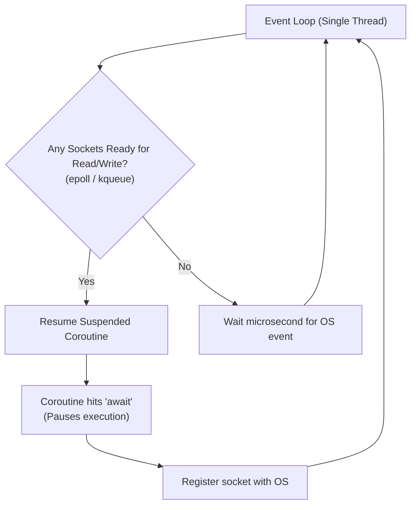

import { Callout } from "fumadocs-ui/components/callout";
import { Tabs, Tab } from "fumadocs-ui/components/tabs";
import { Accordion, Accordions } from "fumadocs-ui/components/accordion";

Why do modern web frameworks like **FastAPI** rely on `asyncio` instead of traditional multi-threading?

Because creating an operating system thread incurs a memory stack cost (often 2–8 MB per thread). If you try to maintain 50,000 simultaneous connections using threads, your server will exhaust its RAM before handling a single request.

With **`asyncio`**, a **single thread** can effortlessly coordinate 100,000+ connections using cooperative multitasking.

---

## 1. How the Event Loop Works

At the heart of `asyncio` sits the **Event Loop**. It uses OS-level I/O multiplexing primitives (`epoll` on Linux, `kqueue` on macOS, and `IOCP` on Windows):



1. A coroutine executes until it hits an `await` statement on an I/O operation.
2. The coroutine **voluntarily yields control** back to the event loop.
3. The event loop registers the underlying network socket with the operating system kernel.
4. Instead of sitting idle waiting for bytes, the single thread immediately picks up another ready task.
5. When the OS signals that data has arrived, the event loop wakes up the suspended coroutine and resumes it!

---

## 2. Coroutines: `async def` and `await`

When you define a function with `async def`, calling it **does not execute its body**; it returns a **coroutine object**:

```python
import asyncio

async def fetch_data(source_id: int) -> dict:
    print(f"[Task {source_id}] Starting network fetch...")
    # 'await' cooperatively yields control to the event loop:
    await asyncio.sleep(1.0)
    print(f"[Task {source_id}] Data received!")
    return {"id": source_id, "status": "active"}

async def main():
    print("Initiating requests...")
    # Run two coroutines concurrently:
    t1 = asyncio.create_task(fetch_data(1))
    t2 = asyncio.create_task(fetch_data(2))

    res1 = await t1
    res2 = await t2
    print("Results:", res1, res2)

# Start the event loop:
asyncio.run(main())
```

Output:

```text
Initiating requests...
[Task 1] Starting network fetch...
[Task 2] Starting network fetch...
[Task 1] Data received!
[Task 2] Data received!
Results: {'id': 1, 'status': 'active'} {'id': 2, 'status': 'active'}
```

Notice that both Task 1 and Task 2 started at the same instant! Total execution time was 1.0s, not 2.0s.

---

## 3. The Cardinal Rule of AsyncIO

<Callout type="error" title="Never Block the Event Loop!">
  Because AsyncIO runs on a <strong>single thread</strong>, if any function
  executes a long blocking CPU loop or calls synchronous I/O (such as{" "}
  <code>time.sleep()</code>, <code>requests.get()</code>, or standard file
  operations), <strong>the entire event loop freezes</strong>. No other
  coroutine can run until that blocking call returns!
</Callout>

### Offloading Blocking Code with `asyncio.to_thread`

If you must call a legacy synchronous blocking library, offload it to a background thread pool:

```python
import asyncio
import time

def legacy_blocking_io(name: str):
    time.sleep(1.5)  # Blocking OS call!
    return f"Processed {name}"

async def main():
    # Safely offloads the blocking function to a background worker thread:
    result = await asyncio.to_thread(legacy_blocking_io, "Image_01.png")
    print(result)

asyncio.run(main())
```

Output:

```text
Processed Image_01.png
```

---

## Practice Questions & Challenges

Deepen your understanding of asynchronous event loops, coroutine scheduling, and non-blocking architecture:

### Question 1: Output Prediction (Task Execution Order vs Await)

What is the exact printed sequence of messages when the following script runs?

```python
import asyncio

async def job(name: str):
    print(f"[{name}] step 1")
    await asyncio.sleep(0)  # Yields control to event loop
    print(f"[{name}] step 2")

async def main():
    print("Main start")
    t1 = asyncio.create_task(job("Alpha"))
    t2 = asyncio.create_task(job("Beta"))
    print("Tasks scheduled")
    print("Main waiting...")
    await t1
    await t2
    print("Main complete")

asyncio.run(main())
```

<Accordions>
<Accordion title="Solution & Breakdown">
**Output:**
```text
Main start
Tasks scheduled
Main waiting...
[Alpha] step 1
[Beta] step 1
[Alpha] step 2
[Beta] step 2
Main complete
```

**Explanation:**

1. `asyncio.create_task()` queues `Alpha` and `Beta` onto the event loop's ready queue, but does **not** interrupt the currently running coroutine `main()`.
2. `main()` continues synchronously through `"Tasks scheduled"` and `"Main waiting..."` until it hits `await t1`.
3. At `await t1`, `main()` cooperatively suspends, allowing the loop to execute the first ready task (`Alpha`).
4. `Alpha` prints `"[Alpha] step 1"`, then calls `await asyncio.sleep(0)`. Even with a delay of `0`, `sleep(0)` voluntarily yields the thread back to the loop!
5. The loop now switches to `Beta`, which prints `"[Beta] step 1"` and also yields on `sleep(0)`.
6. Both tasks re-enter the ready queue. `Alpha` finishes (`"[Alpha] step 2"`), then `Beta` finishes (`"[Beta] step 2"`).
7. `main()` resumes and concludes with `"Main complete"`.

</Accordion>
</Accordions>

---

### Question 2: Spot and Fix the Bug (Unintentional Sequential Execution)

A developer expects the following script to fetch 5 endpoints in parallel in ~1 second. Instead, it takes 5 seconds!

```python
import asyncio
import time

async def fetch_endpoint(url: str):
    await asyncio.sleep(1.0)
    return f"Response from {url}"

async def main():
    urls = [f"https://api.internal/item/{i}" for i in range(5)]
    start = time.perf_counter()

    # CRITICAL FLAW:
    results = [await fetch_endpoint(u) for u in urls]

    elapsed = time.perf_counter() - start
    print(f"Fetched {len(results)} items in {elapsed:.2f}s")

asyncio.run(main())
```

Identify why it ran sequentially and provide the correct concurrent pattern using `asyncio.gather()`.

<Accordions>
<Accordion title="Solution & Breakdown">
**The Root Cause:**
In the list comprehension `[await fetch_endpoint(u) for u in urls]`, each iteration directly `await`s the coroutine before moving to the next iteration. It waits 1.0s for item 0, then 1.0s for item 1, etc.

**The Fix:**
Use `asyncio.gather(*tasks)` to run all coroutines concurrently:

```python
import asyncio
import time

async def fetch_endpoint(url: str):
    await asyncio.sleep(1.0)
    return f"Response from {url}"

async def main():
    urls = [f"https://api.internal/item/{i}" for i in range(5)]
    start = time.perf_counter()

    # Schedule all coroutines concurrently onto the loop:
    coros = [fetch_endpoint(u) for u in urls]
    results = await asyncio.gather(*coros)

    elapsed = time.perf_counter() - start
    print(f"Fetched {len(results)} items concurrently in {elapsed:.2f}s")

asyncio.run(main())
# Output: Fetched 5 items concurrently in 1.00s
```

</Accordion>
</Accordions>

---

### Question 3: Architecture Deep-Dive (AsyncIO Event Loop vs Node.js Event Loop)

How does Python's `asyncio` event loop compare architecturally to Node.js's event loop (libuv)? Specifically, what is the role of explicit suspension (`await`) in Python vs callback scheduling in JavaScript?

<Accordions>
  <Accordion title="Solution & Breakdown">
    **Key Differences:** 1. **Explicit vs Implicit Scheduling:** - In Python,
    suspension points are **syntactically explicit**. A coroutine cannot be
    paused or preempted unless it explicitly executes an `await` (or `async for`
    / `async with`) expression. Without `await`, a Python function runs
    synchronously to completion on the thread. - In Node.js / JavaScript,
    asynchronous functions also use `async/await`, but the runtime has
    background event-driven callback phases (Timers, Pending Callbacks, Poll,
    Check/setImmediate, Close) integrated at the C++ V8 engine level. 2.
    **Reentrancy and Threading:** - Node.js runs one global event loop per
    thread by default. - In Python, `asyncio` allows multiple distinct event
    loops across separate threads (one per thread), though sharing objects
    between loops across threads requires explicit thread-safe primitives like
    `loop.call_soon_threadsafe()`. 3. **Pluggable Event Loops:** - Python allows
    dropping in high-performance alternative C-based event loops like `uvloop`
    (built on libuv), which achieves speeds matching or exceeding Node.js and
    Go.

</Accordion>
</Accordions>

---

### Question 4: Hands-On Refactoring (Fixing CPU Starvation on the Loop)

The following service processes incoming WebSocket requests, but calculating cryptographic hashes on the thread freezes the entire server, causing ping timeouts for all other connected users:

```python
import asyncio
import hashlib

def compute_heavy_hash(data: str) -> str:
    h = data
    for _ in range(5_000_000):
        h = hashlib.sha256(h.encode()).hexdigest()
    return h

async def handle_request(client_id: int, payload: str):
    print(f"[Client {client_id}] Request received")
    # BUG: Freezes all other coroutines on the loop!
    result = compute_heavy_hash(payload)
    print(f"[Client {client_id}] Calculation finished")
    return result
```

Refactor `handle_request` so that heavy CPU computations are offloaded without blocking the main event loop.

<Accordions>
<Accordion title="Solution & Breakdown">
**Refactored Code using `asyncio.to_thread`:**

```python
import asyncio
import hashlib

def compute_heavy_hash(data: str) -> str:
    h = data
    for _ in range(5_000_000):
        h = hashlib.sha256(h.encode()).hexdigest()
    return h

async def handle_request(client_id: int, payload: str):
    print(f"[Client {client_id}] Request received")

    # Safely offload CPU-heavy or blocking calls to a worker thread:
    # Under Python 3.9+, asyncio.to_thread runs the function in a ThreadPoolExecutor
    # while the main thread event loop remains completely responsive to other clients!
    result = await asyncio.to_thread(compute_heavy_hash, payload)

    print(f"[Client {client_id}] Calculation finished")
    return result
```

_Note: For extreme CPU loads in multi-core environments, configure a `ProcessPoolExecutor` with `loop.run_in_executor(process_pool, compute_heavy_hash, payload)` to bypass the GIL entirely._

</Accordion>
</Accordions>

---

### Question 5: Code Challenge (Async Token Bucket Rate Limiter)

Implement an asynchronous token bucket rate limiter class `AsyncRateLimiter` that:

1. Accepts `rate: float` (tokens added per second) and `capacity: int` (maximum burst capacity).
2. Provides an `async def acquire(tokens: int = 1)` method.
3. If sufficient tokens are available, consume them immediately.
4. If insufficient tokens are available, calculate the exact delay required and sleep (`await asyncio.sleep(...)`) until enough tokens have refilled.
5. Must be safe for concurrent coroutines (using `asyncio.Lock`).

**Test cases:**

```python
limiter = AsyncRateLimiter(rate=2.0, capacity=2)  # 2 tokens/sec, max 2 tokens
# 1st and 2nd calls acquire immediately
# 3rd call must wait ~0.5s for the next token to regenerate
```

<Accordions>
<Accordion title="Solution & Breakdown">
```python
import asyncio
import time

class AsyncRateLimiter:
def **init**(self, rate: float, capacity: int):
self.rate = rate # Tokens per second
self.capacity = capacity
self.tokens = float(capacity)
self.last_refill = time.monotonic()
self.lock = asyncio.Lock()

    async def acquire(self, tokens: int = 1):
        if tokens > self.capacity:
            raise ValueError(f"Requested {tokens} tokens exceeds max capacity {self.capacity}")

        async with self.lock:
            while True:
                now = time.monotonic()
                elapsed = now - self.last_refill
                self.last_refill = now

                # Refill tokens based on elapsed time:
                self.tokens = min(self.capacity, self.tokens + elapsed * self.rate)

                if self.tokens >= tokens:
                    self.tokens -= tokens
                    return

                # Calculate required sleep duration to get remaining tokens:
                needed = tokens - self.tokens
                wait_time = needed / self.rate
                await asyncio.sleep(wait_time)

# Verification

async def worker(id: int, limiter: AsyncRateLimiter):
for i in range(3):
t0 = time.monotonic()
await limiter.acquire(1)
print(f"[{time.monotonic() - t0:.2f}s] Worker {id} acquired token {i}")

async def main():
limiter = AsyncRateLimiter(rate=4.0, capacity=2) # 4 tokens/sec
await asyncio.gather(worker(1, limiter), worker(2, limiter))

asyncio.run(main())

```

</Accordion>
</Accordions>

---

## Summary Reference

- **Event Loop**: Single-threaded multiplexer checking OS socket events.
- **Coroutine**: A function defined with `async def` that pauses at `await` expressions.
- **`asyncio.run()`**: Standard entrypoint to initialize and manage the event loop.
- **`asyncio.create_task()`**: Schedules a coroutine to run concurrently on the loop.
- **`asyncio.to_thread()`**: Offloads blocking synchronous code safely to worker threads.
```
