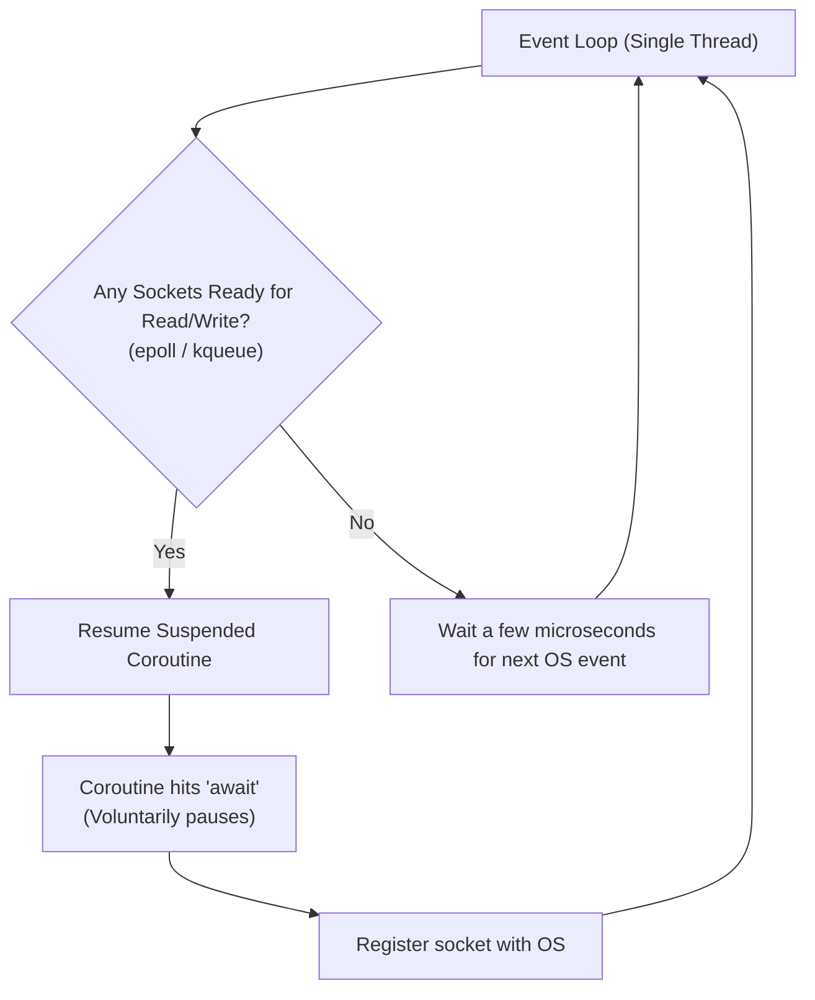
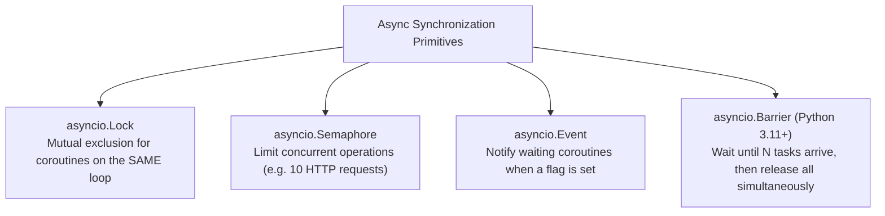

import { Callout } from "fumadocs-ui/components/callout";
import { Tabs, Tab } from "fumadocs-ui/components/tabs";
import { Accordion, Accordions } from "fumadocs-ui/components/accordion";

Why do modern web frameworks like **FastAPI** rely on `asyncio` instead of traditional multi-threading?

Because operating system threads are relatively heavy. Each OS thread requires its own dedicated memory stack (typically 2 to 8 MB). If you try to maintain 50,000 active connections using threads, your server will run out of RAM before handling a single request.

With **`asyncio`**, a **single thread** can coordinate 100,000+ simultaneous connections using cooperative multitasking and almost no memory overhead.

---

## The Mental Model: The Restaurant Waiter Analogy

To grasp `asyncio`, compare how different restaurants serve customers:


---

## 1. How the Event Loop Works Under the Hood

At the core of `asyncio` sits a continuous loop called the **Event Loop**.

Instead of your code repeatedly checking sockets ("Are you done yet? How about now?"), the event loop offloads socket monitoring directly to the operating system kernel using high-performance multiplexers:

- **`epoll`** on Linux
- **`kqueue`** on macOS / BSD
- **`IOCP`** on Windows



1. A coroutine runs until it encounters an `await` on an I/O operation (e.g. reading from a network socket).
2. The coroutine **voluntarily yields control** back to the event loop.
3. The event loop registers the socket file descriptor with the OS kernel and turns its attention to another ready task.
4. When the OS signals that network packets have arrived, the event loop wakes up the suspended coroutine right where it left off!

---

## 2. Coroutines: `async def` and `await`

When you define a function with `async def`, calling it **does not run its code**. It creates and returns a **coroutine object**:

```python
import asyncio

async def greet():
    return "Hello, world!"

coro = greet()
print(coro)
# Output: <coroutine object greet at 0x...>
```

The coroutine is a paused state machine. To execute it, you must pass it to the event loop using `await` or `asyncio.run()`:

```python
import asyncio

async def fetch_data(source_id: int) -> dict:
    print(f"[Task {source_id}] Starting network fetch...")
    # 'await' voluntarily yields control to the event loop for 1.0 second:
    await asyncio.sleep(1.0)
    print(f"[Task {source_id}] Data received!")
    return {"id": source_id, "status": "active"}

async def main():
    print("Initiating requests...")
    # Schedule two tasks to run concurrently on the single thread:
    t1 = asyncio.create_task(fetch_data(1))
    t2 = asyncio.create_task(fetch_data(2))

    # Wait for both to finish:
    res1 = await t1
    res2 = await t2
    print("Results:", res1, res2)

# Start the event loop:
asyncio.run(main())
```

Output:

```text
Initiating requests...
[Task 1] Starting network fetch...
[Task 2] Starting network fetch...
[Task 1] Data received!
[Task 2] Data received!
Results: {'id': 1, 'status': 'active'} {'id': 2, 'status': 'active'}
```

Both Task 1 and Task 2 ran concurrently! The total elapsed time was **1.0 second**, not 2.0 seconds.

---

## 3. The Cardinal Rule of AsyncIO

<Callout type="error" title="Never Block the Event Loop!">
  Because AsyncIO runs on a <strong>single thread</strong>, if any function
  executes a long blocking CPU computation or calls a synchronous I/O function
  (such as <code>time.sleep()</code>, <code>requests.get()</code>, or standard
  file operations), <strong>the entire event loop freezes</strong>. No other
  user, WebSocket, or task can run until that blocking call finishes!
</Callout>

### Offloading Blocking Calls with `asyncio.to_thread`

What should you do if you _must_ call a legacy synchronous library (like `requests` or an image resizing library)?

Use Python 3.9's **`asyncio.to_thread()`**! It runs the blocking function on a background worker thread while your main event loop stays 100% responsive:

```python
import asyncio
import time

def legacy_blocking_io(name: str) -> str:
    # A synchronous library that blocks the thread for 1.5s
    time.sleep(1.5)
    return f"Processed {name}"

async def main():
    print("Main loop running smoothly...")
    # Offload the blocking call to a background thread pool:
    result = await asyncio.to_thread(legacy_blocking_io, "large_photo.png")
    print(result)

asyncio.run(main())
```

---

## 4. Modern Performance: Eager Task Execution (Python 3.12+)

In traditional `asyncio`, creating a task via `asyncio.create_task()` always defers execution to the next iteration of the event loop.

Starting in **Python 3.12**, you can configure an **eager task factory**:

```python
import asyncio

async def compute_or_cache(key: str):
    # If the value is cached, returns synchronously without awaiting
    return f"cached_{key}"

async def main():
    # Enable eager task execution across the loop
    loop = asyncio.get_running_loop()
    loop.set_task_factory(asyncio.eager_task_factory)

    # Starts executing immediately inline; never hits loop queue if it doesn't block!
    task = asyncio.create_task(compute_or_cache("user:101"))
    print("Immediate result:", task.result() if task.done() else "Pending")

asyncio.run(main())
```

<Callout type="tip" title="Why Eager Tasks Matter">
  If a coroutine finishes synchronously (e.g. hitting an in-memory cache or
  validation check), eager execution avoids the overhead of scheduling and
  context switching through the event loop, yielding significant throughput
  gains in high-concurrency microservices.
</Callout>

---

## 5. Debugging Event Loop Freezes (`PYTHONASYNCIODEBUG` & Task Introspection)

Asynchronous Python applications do not get slow because of hardware constraints; they get slow because **the single thread of the event loop is blocked**.

If any coroutine or callback executes a blocking synchronous call (like `time.sleep()`, heavy CPU cryptography, or an un-offloaded file read), the event loop stalls, starving **all** concurrent WebSocket connections and API clients!

### 5.1 Enabling AsyncIO Debug Mode

By default, Python runs `asyncio` in production mode, stripping diagnostic checks for performance. To diagnose stalls:

1. **Via Environment Variable**:
   ```bash
   PYTHONASYNCIODEBUG=1 python app.py
   ```
2. **Programmatically in Code**:
   ```python
   asyncio.run(main(), debug=True)
   ```

### 5.2 Catching Slow Callbacks (`slow_callback_duration`)

When debug mode is active, `asyncio` monitors the execution duration of every task step. If any callback takes longer than **100 milliseconds**, Python automatically outputs a warning:

```text
WARNING:asyncio:Executing <Task pending name='Task-2' ...> took 0.182 seconds
```

You can customize the threshold to catch smaller latency spikes:

```python
import asyncio

async def main():
    loop = asyncio.get_running_loop()
    loop.set_debug(True)
    # Warn if any callback or task blocks the loop for more than 50ms:
    loop.slow_callback_duration = 0.05
```

### 5.3 Live Task Introspection

When an async application appears to hang, you can introspect all currently running tasks:

```python
import asyncio

async def inspect_running_tasks():
    # Retrieve all active tasks on the current event loop:
    tasks = asyncio.all_tasks()
    print(f"Total active tasks: {len(tasks)}")

    for t in tasks:
        # Inspect task name and execution stack trace:
        print(f"Task: {t.get_name()}, Done: {t.done()}")
        t.print_stack()
```

---

## 6. The Async Synchronization Arsenal: Locks, Semaphores & Barriers

Just like multi-threaded programs use synchronization tools to coordinate shared memory access, asynchronous programs use coroutine-safe synchronization primitives.



### Async Synchronization Matrix

| Primitive      | Class               | Async Method                         | Use Case                                                                               |
| :------------- | :------------------ | :----------------------------------- | :------------------------------------------------------------------------------------- |
| **Mutex Lock** | `asyncio.Lock`      | `async with lock:`                   | Mutual exclusion between coroutines accessing shared in-memory dictionaries or caches. |
| **Semaphore**  | `asyncio.Semaphore` | `async with sem:`                    | Concurrency limiter (e.g. limit external API calls to 10 simultaneous sockets).        |
| **Event**      | `asyncio.Event`     | `await event.wait()`                 | One-to-many signaling. Calling `event.set()` wakes all awaiting coroutines.            |
| **Condition**  | `asyncio.Condition` | `async with cond: await cond.wait()` | Predicate-based coordination between coroutines.                                       |
| **Barrier**    | `asyncio.Barrier`   | `await barrier.wait()`               | Python 3.11+ rendezvous point for a fixed number of coroutines (`parties`).            |

<Callout type="error" title="Two Lethal Cross-Paradigm Traps">
  1. **Never use `threading.Lock` inside an async coroutine!** Calling
  `thread_lock.acquire()` blocks the OS thread, freezing the entire event loop.
  Always use `async with asyncio.Lock():`! 2. **Never share `asyncio.Lock`
  across multiple OS threads!** `asyncio.Lock` is strictly single-threaded and
  does not use OS atomics. Sharing it across OS threads causes silent data
  corruption. 3. **Why is there no `asyncio.RLock`?** Python's standard library
  deliberately omits a reentrant lock for asyncio. Reentrancy across `await`
  suspension points introduces dangerous reentrancy hazards where intermediate
  state is modified by other coroutines!
</Callout>

---

## Practice Questions & Challenges

### Question 1: Output Prediction (Task Execution Order vs Await)

What is the exact printed sequence of messages when the following script runs?

```python
import asyncio

async def job(name: str):
    print(f"[{name}] step 1")
    await asyncio.sleep(0)  # Yields control to event loop
    print(f"[{name}] step 2")

async def main():
    print("Main start")
    t1 = asyncio.create_task(job("Alpha"))
    t2 = asyncio.create_task(job("Beta"))
    print("Tasks scheduled")
    print("Main waiting...")
    await t1
    await t2
    print("Main complete")

asyncio.run(main())
```

<Accordions>
<Accordion title="Solution & Breakdown">
**Output:**
```text
Main start
Tasks scheduled
Main waiting...
[Alpha] step 1
[Beta] step 1
[Alpha] step 2
[Beta] step 2
Main complete
```

**Step-by-Step Execution Trace:**

1. `asyncio.create_task()` adds `Alpha` and `Beta` to the event loop's ready queue, but does **not** interrupt `main()`.
2. `main()` continues synchronously through `"Tasks scheduled"` and `"Main waiting..."` until it hits `await t1`.
3. At `await t1`, `main()` suspends, allowing the loop to run the first queued task (`Alpha`).
4. `Alpha` prints `"[Alpha] step 1"`, then calls `await asyncio.sleep(0)`. Even with a delay of `0`, `sleep(0)` voluntarily yields the thread back to the loop!
5. The loop switches to `Beta`, which prints `"[Beta] step 1"` and also yields on `sleep(0)`.
6. Both tasks re-enter the ready queue. `Alpha` finishes (`"[Alpha] step 2"`), then `Beta` finishes (`"[Beta] step 2"`).
7. `main()` resumes and concludes with `"Main complete"`.

</Accordion>
</Accordions>

---

### Question 2: Spot and Fix the Bug (Unintentional Sequential Execution)

A developer expects the following script to fetch 5 endpoints in parallel in ~1 second. Instead, it takes 5 seconds!

```python
import asyncio
import time

async def fetch_endpoint(url: str):
    await asyncio.sleep(1.0)
    return f"Response from {url}"

async def main():
    urls = [f"https://api.internal/item/{i}" for i in range(5)]
    start = time.perf_counter()

    # CRITICAL BUG:
    results = [await fetch_endpoint(u) for u in urls]

    elapsed = time.perf_counter() - start
    print(f"Fetched {len(results)} items in {elapsed:.2f}s")

asyncio.run(main())
```

Explain why it ran sequentially and provide the clean concurrent fix.

<Accordions>
<Accordion title="Solution & Breakdown">
**The Root Cause:**
In the list comprehension `[await fetch_endpoint(u) for u in urls]`, the `await` keyword pauses the loop for item 0, waits the full 1.0s, then moves to item 1, waits 1.0s, and so on.

**The Fix:**
Schedule all tasks concurrently and wait for them using `asyncio.gather(*tasks)`:

```python
import asyncio
import time

async def fetch_endpoint(url: str):
    await asyncio.sleep(1.0)
    return f"Response from {url}"

async def main():
    urls = [f"https://api.internal/item/{i}" for i in range(5)]
    start = time.perf_counter()

    # Create coroutines first, then gather them concurrently:
    coros = [fetch_endpoint(u) for u in urls]
    results = await asyncio.gather(*coros)

    elapsed = time.perf_counter() - start
    print(f"Fetched {len(results)} items concurrently in {elapsed:.2f}s!")

asyncio.run(main())
# Output: Fetched 5 items concurrently in 1.00s!
```

</Accordion>
</Accordions>

---

### Question 3: Architecture Deep-Dive (Python AsyncIO vs Node.js Event Loop)

How does Python's `asyncio` event loop compare to Node.js's event loop (libuv)? Specifically, what is the role of explicit suspension (`await`) in Python vs callback scheduling in JavaScript?

<Accordions>
<Accordion title="Solution & Breakdown">
**Key Differences:**

1. **Explicit vs Implicit Suspension:**
   - In Python, suspension points are **strictly explicit**. A function cannot be paused or switched away from unless it contains an explicit `await`, `async for`, or `async with`. Without `await`, a Python function runs synchronously to completion on the thread.
   - In Node.js, the runtime is event-driven from the ground up at the C++ V8 engine level, with distinct event phases (Timers, Pending Callbacks, Poll, Check/setImmediate).

2. **Loop Management:**
   - Node.js automatically creates and manages one global event loop per thread.
   - In Python, you control the event loop lifecycle explicitly (typically via `asyncio.run()`), and you can run distinct event loops on different threads if needed.

3. **Pluggable Event Loops:**
   - Python allows dropping in high-performance alternative C-based event loops like **`uvloop`** (built directly on Node's `libuv`), which can double the throughput of standard asyncio.

</Accordion>
</Accordions>

---

### Question 4: Hands-On Refactoring (Fixing CPU Starvation on the Loop)

The following service calculates cryptographic hashes on the event loop, freezing all other connected WebSocket clients:

```python
import asyncio
import hashlib

def compute_heavy_hash(data: str) -> str:
    h = data
    for _ in range(5_000_000):
        h = hashlib.sha256(h.encode()).hexdigest()
    return h

async def handle_request(client_id: int, payload: str):
    print(f"[Client {client_id}] Request received")
    # BUG: Freezes the entire server!
    result = compute_heavy_hash(payload)
    print(f"[Client {client_id}] Calculation finished")
    return result
```

Refactor `handle_request` so heavy CPU computations do not block the main event loop.

<Accordions>
<Accordion title="Solution & Breakdown">
**Refactored with `asyncio.to_thread`:**

```python
import asyncio
import hashlib

def compute_heavy_hash(data: str) -> str:
    h = data
    for _ in range(5_000_000):
        h = hashlib.sha256(h.encode()).hexdigest()
    return h

async def handle_request(client_id: int, payload: str):
    print(f"[Client {client_id}] Request received")

    # Safely offload CPU-heavy computation to a background thread:
    result = await asyncio.to_thread(compute_heavy_hash, payload)

    print(f"[Client {client_id}] Calculation finished")
    return result
```

_Note: For extreme CPU workloads across multiple physical CPU cores, you can use `loop.run_in_executor(process_pool_executor, compute_heavy_hash, payload)` to bypass the GIL._

</Accordion>
</Accordions>

---

### Question 5: Code Challenge (Async Token Bucket Rate Limiter)

Build an asynchronous token bucket rate limiter class `AsyncRateLimiter` that:

1. Accepts `rate: float` (tokens added per second) and `capacity: int` (maximum burst capacity).
2. Has an `async def acquire(tokens: int = 1)` method.
3. If enough tokens are available, consumes them immediately.
4. If not enough tokens are available, sleeps (`await asyncio.sleep(...)`) until enough tokens have regenerated.
5. Is safe for concurrent coroutines using `asyncio.Lock`.

```python
limiter = AsyncRateLimiter(rate=2.0, capacity=2)  # 2 tokens/sec, max 2 tokens
# 1st and 2nd calls acquire immediately
# 3rd call waits ~0.5s for the next token to refill
```

<Accordions>
<Accordion title="Solution & Breakdown">
```python
import asyncio
import time

class AsyncRateLimiter:
def **init**(self, rate: float, capacity: int):
self.rate = rate # Tokens refilled per second
self.capacity = capacity
self.tokens = float(capacity)
self.last_refill = time.monotonic()
self.lock = asyncio.Lock()

    async def acquire(self, tokens: int = 1):
        if tokens > self.capacity:
            raise ValueError(f"Requested {tokens} tokens exceeds max capacity {self.capacity}")

        async with self.lock:
            while True:
                now = time.monotonic()
                elapsed = now - self.last_refill
                self.last_refill = now

                # Refill tokens proportional to elapsed time:
                self.tokens = min(self.capacity, self.tokens + elapsed * self.rate)

                if self.tokens >= tokens:
                    self.tokens -= tokens
                    return

                # Calculate required sleep duration to get remaining tokens:
                needed = tokens - self.tokens
                wait_time = needed / self.rate
                await asyncio.sleep(wait_time)

# Verification

async def worker(id: int, limiter: AsyncRateLimiter):
for i in range(3):
t0 = time.monotonic()
await limiter.acquire(1)
print(f"[{time.monotonic() - t0:.2f}s] Worker {id} acquired token #{i + 1}")

async def main():
limiter = AsyncRateLimiter(rate=4.0, capacity=2) # 4 tokens/sec, max 2 burst
await asyncio.gather(worker(1, limiter), worker(2, limiter))

asyncio.run(main())

```
</Accordion>
</Accordions>

---

## Summary Reference

- **Event Loop**: A single-threaded conductor that registers sockets with OS multiplexers (`epoll`, `kqueue`, `IOCP`).
- **`async def`**: Returns a paused coroutine object; does not execute until awaited or scheduled.
- **`asyncio.run()`**: The standard entrypoint to start and manage the event loop.
- **`asyncio.create_task()`**: Schedules a coroutine to run concurrently on the loop.
- **`asyncio.to_thread()`**: Offloads blocking synchronous functions to background threads safely.
- **`eager_task_factory`**: (Python 3.12+) Executes non-blocking coroutines immediately without event loop roundtrips.
- **`PYTHONASYNCIODEBUG=1`**: Diagnoses stalls and flags callbacks blocking longer than `slow_callback_duration`.
- **Async Primitives**: Use `asyncio.Lock`, `asyncio.Semaphore`, and `asyncio.Barrier` to synchronize coroutines without blocking the loop thread.

Next, learn how to manage concurrent task groups safely in **[04. Structured Concurrency, TaskGroup & Async Iteration](/docs/learn-python/03-advanced/04-async-iterators-and-context)**!
```
