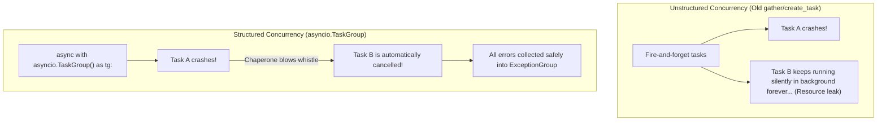

import { Callout } from "fumadocs-ui/components/callout";
import { Tabs, Tab } from "fumadocs-ui/components/tabs";
import { Accordion, Accordions } from "fumadocs-ui/components/accordion";

In early versions of Python asyncio, managing multiple concurrent tasks using `asyncio.gather()` or fire-and-forget `create_task()` had a major problem: **orphaned background tasks**.

If one task crashed, other tasks kept running in the background invisibly, leaking memory, holding open database connections, and swallowing exceptions.

Python 3.11 solved this by introducing **Structured Concurrency** (`asyncio.TaskGroup`) and **Exception Groups** (`except*`).

---

## The Mental Model: The Mall Chaperone Analogy

Think of structured concurrency like taking a group on a field trip:



The golden rule of structured concurrency:

> **Tasks spawned within a block must never outlive that block.**

---

## 1. Structured Concurrency with `asyncio.TaskGroup`

With `asyncio.TaskGroup`, you manage tasks within an `async with` block.
When Python reaches the end of the block, it **guarantees** that every task inside the group has finished or cancelled before moving to the next line:

```python
import asyncio

async def worker(task_id: int, delay: float) -> str:
    print(f"[Worker {task_id}] Running...")
    await asyncio.sleep(delay)
    print(f"[Worker {task_id}] Complete!")
    return f"Result {task_id}"

async def main():
    # Structured context: execution halts at the exit of this block until all tasks finish
    async with asyncio.TaskGroup() as tg:
        t1 = tg.create_task(worker(1, 0.5))
        t2 = tg.create_task(worker(2, 0.2))
        t3 = tg.create_task(worker(3, 0.4))

    # Safe to read results here:
    print("All tasks finished successfully:")
    print(t1.result(), t2.result(), t3.result())

asyncio.run(main())
```

Output:

```text
[Worker 1] Running...
[Worker 2] Running...
[Worker 3] Running...
[Worker 2] Complete!
[Worker 3] Complete!
[Worker 1] Complete!
All tasks finished successfully:
Result 1 Result 2 Result 3
```

---

## 2. Handling Multiple Concurrent Failures: `except*` (PEP 654)

What happens if **two concurrent tasks fail at the exact same moment**?

In traditional Python, a `try ... except` block can only raise **one** exception at a time, forcing Python to silently discard the other.

Python 3.11 introduced **Exception Groups** and the **`except*`** syntax (notice the asterisk):

```python
import asyncio

async def network_task():
    await asyncio.sleep(0.1)
    raise ConnectionResetError("Database connection dropped")

async def disk_task():
    await asyncio.sleep(0.1)
    raise FileNotFoundError("Config file missing")

async def main():
    try:
        async with asyncio.TaskGroup() as tg:
            tg.create_task(network_task())
            tg.create_task(disk_task())
    except* ConnectionResetError as eg:
        # Handles all ConnectionResetErrors in the group
        print("Caught network failure:", eg.exceptions)
    except* FileNotFoundError as eg:
        # Handles all FileNotFoundErrors in the group
        print("Caught file failure:", eg.exceptions)

asyncio.run(main())
```

Output:

```text
Caught network failure: (ConnectionResetError('Database connection dropped'),)
Caught file failure: (FileNotFoundError('Config file missing'),)
```

Notice that **both** `except*` blocks ran! Neither error was swallowed or lost.

---

## 3. Asynchronous Iterators & `async for`

Just like standard Python iterators use `__iter__` and `__next__`, asynchronous streaming data sources use **`__aiter__`** and **`__anext__`**:

| Protocol          | Synchronous (`for item in ...`) | Asynchronous (`async for item in ...`) |
| :---------------- | :------------------------------ | :------------------------------------- |
| **Get Iterator**  | `__iter__()`                    | `__aiter__()`                          |
| **Get Next Item** | `__next__()`                    | `async def __anext__()`                |
| **Stop Signal**   | `raise StopIteration`           | `raise StopAsyncIteration`             |

Here is an async streaming generator that simulates real-time stock ticker updates:

```python
import asyncio

class StockTickerStream:
    """Simulates real-time price ticks over a WebSocket."""
    def __init__(self, symbol: str, ticks: int):
        self.symbol = symbol
        self.ticks = ticks
        self.count = 0

    def __aiter__(self):
        return self

    async def __anext__(self):
        if self.count >= self.ticks:
            raise StopAsyncIteration

        await asyncio.sleep(0.2)  # Non-blocking network wait
        self.count += 1
        return f"{self.symbol}: ${150.0 + self.count * 1.25:.2f}"

async def main():
    # Consume data asynchronously as it arrives:
    async for tick in StockTickerStream("AAPL", 3):
        print("Received tick:", tick)

asyncio.run(main())
```

Output:

```text
Received tick: AAPL: $151.25
Received tick: AAPL: $152.50
Received tick: AAPL: $153.75
```

---

## 4. Producer-Consumer Pipelines: Python 3.13 `asyncio.Queue.shutdown()`

In asynchronous microservices, producer coroutines frequently ingest network packets while consumer coroutines process and persist them. To decouple producers from consumers with safe backpressure, use **`asyncio.Queue`**.

### The Old Sentinel Problem vs. Python 3.13 Native Shutdown

Before Python 3.13, shutting down an async queue required producers to enqueue a sentinel value (e.g. `None`) for each consumer worker. If you had 5 workers, you had to manually enqueue 5 `None` values and handle them in `if item is None: break`.

Starting in **Python 3.13**, `asyncio.Queue` (and `queue.Queue`) provides **`.shutdown()`** and the **`asyncio.QueueShutDown`** exception!

```python
import asyncio

async def producer(q: asyncio.Queue):
    for i in range(5):
        await q.put(f"Event #{i}")
        await asyncio.sleep(0.05)

    print("[Producer] Completed all tasks. Shutting down queue...")
    # Python 3.13+: Signals to all consumers that no further items will be added:
    q.shutdown()

async def consumer(name: str, q: asyncio.Queue):
    try:
        while True:
            # Gets items normally until queue is empty AND shut down:
            item = await q.get()
            try:
                print(f"[{name}] Processed: {item}")
                await asyncio.sleep(0.1)
            finally:
                q.task_done()
    except asyncio.QueueShutDown:
        # Raised automatically when q.get() is called on an empty, shut-down queue!
        print(f"[{name}] Queue shut down. Exiting worker cleanly.")

async def main():
    q = asyncio.Queue(maxsize=10)

    async with asyncio.TaskGroup() as tg:
        tg.create_task(producer(q))
        tg.create_task(consumer("Worker-A", q))
        tg.create_task(consumer("Worker-B", q))

    print("Pipeline drained and completed!")

asyncio.run(main())
```

<Callout type="tip" title="Immediate vs. Graceful Shutdown">
  - `q.shutdown()` (or `immediate=False`): Consumers continue to process all
  items currently in the queue until empty, after which `QueueShutDown` is
  raised. - `q.shutdown(immediate=True)`: Instantly discards all remaining items
  in the queue and immediately raises `QueueShutDown` to all awaiting tasks.
</Callout>

---

## 5. Async Coordination with `asyncio.Barrier` (Python 3.11+)

What happens if you have $N$ concurrent tasks that must wait for each other to finish an initialization phase before any of them proceed to phase 2?

Python 3.11 introduced **`asyncio.Barrier`**, mirroring `threading.Barrier` for the async event loop:

```python
import asyncio

async def microservice_worker(service_id: int, barrier: asyncio.Barrier):
    print(f"[Service {service_id}] Loading configuration & warmup...")
    await asyncio.sleep(service_id * 0.2)  # Different startup times
    print(f"[Service {service_id}] Warmup complete. Waiting at rendezvous barrier...")

    # Blocks until all 3 services call wait():
    await barrier.wait()

    # All 3 services start accepting traffic at the exact same moment:
    print(f"[Service {service_id}] System GO! Processing live customer requests.")

async def main():
    # Requires 3 participants to unlock:
    barrier = asyncio.Barrier(parties=3)

    async with asyncio.TaskGroup() as tg:
        for i in range(1, 4):
            tg.create_task(microservice_worker(i, barrier))

asyncio.run(main())
```

---

## 6. Profiling & Observability for Async Code

Because async code executes on a single OS thread, standard profilers (like `cProfile`) often report confusing metrics because they cannot distinguish between coroutine suspension at `await` and active CPU computation.

### Modern Async Profiling Tools:

1. **`VizTracer` (`--log_async`)**:
   Deterministic tracing profiler that tracks exact task switches, coroutine creation, and event loop delays.
   ```bash
   viztracer --log_async my_async_service.py
   vizviewer result.json
   ```
   Visualizes an interactive timeline in Chrome DevTools / Perfetto, showing exactly which coroutines ran and where the event loop was waiting.
2. **`PYTHONASYNCIODEBUG=1`**:
   Flags any coroutine that executes a blocking call longer than `slow_callback_duration` (default 100ms).
3. **`Scalene`**:
   High-performance line-by-line profiler for CPU, GPU, and memory that distinguishes Python time from native C/system time.

---

## Practice Questions & Challenges

### Question 1: Output Prediction (TaskGroup Cancellation Cascading)

What prints when one task crashes while another is sleeping inside a `TaskGroup`?

```python
import asyncio

async def failing_task():
    await asyncio.sleep(0.1)
    print("Task 1: Raising ValueError")
    raise ValueError("Something broke!")

async def slow_task():
    try:
        print("Task 2: Started sleeping...")
        await asyncio.sleep(1.0)
        print("Task 2: Finished sleeping")
    except asyncio.CancelledError:
        print("Task 2: Intercepted cancellation signal!")
        raise

async def main():
    try:
        async with asyncio.TaskGroup() as tg:
            tg.create_task(failing_task())
            tg.create_task(slow_task())
    except* ValueError as eg:
        print(f"Main caught ExceptionGroup: {eg.exceptions}")

asyncio.run(main())
```

Does `"Task 2: Finished sleeping"` ever print?

<Accordions>
<Accordion title="Solution & Breakdown">
**Output:**
```text
Task 2: Started sleeping...
Task 1: Raising ValueError
Task 2: Intercepted cancellation signal!
Main caught ExceptionGroup: (ValueError('Something broke!'),)
```

**Step-by-Step Trace:**

1. Both `failing_task` and `slow_task` start concurrently. `"Task 2: Started sleeping..."` prints immediately.
2. At 0.1s, `failing_task` raises `ValueError`.
3. The `TaskGroup` immediately calls `.cancel()` on all other active sibling tasks (namely, `slow_task`).
4. `slow_task` wakes up at its `await` point with an `asyncio.CancelledError`.
5. It prints `"Task 2: Intercepted cancellation signal!"` and cleanly terminates.
6. `"Task 2: Finished sleeping"` **never prints**!
7. Once all tasks finish unwinding, `TaskGroup` wraps the error into an `ExceptionGroup`, which is caught by `except* ValueError`.

</Accordion>
</Accordions>

---

### Question 2: Spot and Fix the Bug (Async Context Manager Exception Leaks)

The following database connection context manager is supposed to return connections back to the pool even if an error occurs inside the `async with` block. However, when an error occurs, the connection is permanently leaked:

```python
class AsyncDBConnection:
    def __init__(self, pool, conn_id):
        self.pool = pool
        self.conn_id = conn_id

    async def __aenter__(self):
        print(f"Acquiring connection {self.conn_id}")
        return self

    async def __aexit__(self, exc_type, exc_val, exc_tb):
        if exc_type is not None:
            print(f"Error occurred: {exc_val}")
            # BUG: Returns early without returning connection to pool!
            return False

        print(f"Releasing connection {self.conn_id} back to pool")
        self.pool.release(self.conn_id)
        return False
```

Explain the leak and write the robust fix.

<Accordions>
<Accordion title="Solution & Breakdown">
**The Root Cause:**
Because `self.pool.release(self.conn_id)` is placed after `if exc_type is not None: return False`, any exception inside the user's `async with` block exits early, skipping pool cleanup and leaking the socket.

**The Fix:**
Use a `finally` block so cleanup occurs unconditionally:

```python
class AsyncDBConnection:
    def __init__(self, pool, conn_id):
        self.pool = pool
        self.conn_id = conn_id

    async def __aenter__(self):
        print(f"Acquiring connection {self.conn_id}")
        return self

    async def __aexit__(self, exc_type, exc_val, exc_tb):
        try:
            if exc_type is not None:
                print(f"Logging error during session {self.conn_id}: {exc_val}")
        finally:
            # Guarantees the connection is returned under all circumstances:
            print(f"Releasing connection {self.conn_id} back to pool")
            self.pool.release(self.conn_id)

        # Return False so any caller exception continues propagating:
        return False
```

</Accordion>
</Accordions>

---

### Question 3: Architecture Deep-Dive (Why except\* Has an Asterisk)

Why was the new `except*` syntax added to Python 3.11 instead of just extending existing `try ... except`?

<Accordions>
<Accordion title="Solution & Breakdown">
**The Problem with Classic `except`:**
In traditional Python, a `try` block can only execute **one** matching `except` clause.
Once a match is found, Python skips all subsequent `except` blocks.

In concurrent programming (like `TaskGroup`), multiple independent tasks might fail at the exact same moment with completely different errors:

- Task 1 raises `DatabaseConnectionError`
- Task 2 raises `TimeoutError`

Both errors are packaged into an `ExceptionGroup`.
If Python used standard `except`, only the first matching handler would run, leaving the other exception unhandled!

**How `except*` solves this:**

1. `except*` allows **multiple handlers to execute** for the same `try` block.
2. Each `except*` matches and handles its specific slice of the exception group.
3. If any exceptions in the group are not matched by any `except*` clause, Python automatically re-raises the remaining group!

</Accordion>
</Accordions>

---

### Question 4: Hands-On Challenge (Async Log Stream with Clean Consumer Exit)

Implement an asynchronous generator `async_tail_log(filepath: str)` that yields lines from a log stream. If the consumer stops reading early (`break`), ensure cleanup logic runs cleanly.

<Accordions>
<Accordion title="Solution & Breakdown">
```python
import asyncio

async def async_tail_log(log_name: str):
print(f"[File] Opened file handle for {log_name}")
try:
line_num = 1
while True:
await asyncio.sleep(0.05) # Simulate waiting for new log lines
yield f"[{log_name}] Log entry #{line_num}"
line_num += 1
except asyncio.CancelledError:
print(f"[File] Generator received cancellation for {log_name}")
raise
finally: # Crucial: This runs even if the consumer calls 'break' or crashes!
print(f"[File] Closed and cleaned up file handle for {log_name}")

async def main():
print("Reading first 3 lines only...")
async for line in async_tail_log("server.log"):
print("Consumer received:", line)
if "3" in line:
print("Consumer breaking early!")
break

asyncio.run(main())

````

**Output:**

```text
Reading first 3 lines only...
[File] Opened file handle for server.log
Consumer received: [server.log] Log entry #1
Consumer received: [server.log] Log entry #2
Consumer received: [server.log] Log entry #3
Consumer breaking early!
[File] Closed and cleaned up file handle for server.log
````

</Accordion>
</Accordions>

---

### Question 5: Code Challenge (Async Batch Window Transformer)

Build an async stream processor `async_batcher(stream, batch_size: int, max_wait_seconds: float)` that:

1. Takes an arbitrary async iterator.
2. Yields batches (`list`) as soon as `batch_size` items accumulate OR when `max_wait_seconds` expires (whichever comes first).
3. Flushes any remaining items when the stream ends.

```python
# If stream yields 5 items with batch_size=2, max_wait=0.5s:
# Yields [1, 2], [3, 4], [5]
```

<Accordions>
<Accordion title="Solution & Breakdown">
```python
import asyncio
import time
from typing import AsyncIterator, List, TypeVar

T = TypeVar("T")

async def async_batcher(
stream: AsyncIterator[T],
batch_size: int,
max_wait_seconds: float
) -> AsyncIterator[List[T]]:
batch: List[T] = []
stream_iter = aiter(stream)
last_flush = time.monotonic()

    while True:
        try:
            # Calculate remaining time window
            elapsed = time.monotonic() - last_flush
            remaining_time = max(0.001, max_wait_seconds - elapsed)

            # Wait for next item with remaining timeout
            item = await asyncio.wait_for(anext(stream_iter), timeout=remaining_time)
            batch.append(item)

            if len(batch) >= batch_size:
                yield batch
                batch = []
                last_flush = time.monotonic()

        except asyncio.TimeoutError:
            # Time window expired: flush accumulated partial batch if any
            if batch:
                yield batch
                batch = []
                last_flush = time.monotonic()

        except StopAsyncIteration:
            # Stream finished: flush any trailing items
            if batch:
                yield batch
            break

# Verification

async def sample*event_stream():
for i in range(1, 8): # Items 1-3 arrive quickly, item 4 is delayed, items 5-7 arrive quickly
delay = 0.3 if i == 4 else 0.05
await asyncio.sleep(delay)
yield f"event*{i}"

async def main():
async for b in async_batcher(sample_event_stream(), batch_size=3, max_wait_seconds=0.15):
print(f"Flushed batch ({len(b)} items): {b}")

asyncio.run(main())

```
</Accordion>
</Accordions>

---

## Summary Reference

- **`asyncio.TaskGroup`**: Modern structured concurrency; replaces `asyncio.gather()`.
- **Automatic Cancellation**: If any task in a `TaskGroup` crashes, all sibling tasks cancel cleanly.
- **`except*`**: Modern syntax for selectively matching subsets of an `ExceptionGroup`.
- **`async for`**: Consumes async streams via `__aiter__` and `__anext__`.
- **`asyncio.Queue.shutdown()`**: (Python 3.13+) Native graceful and immediate shutdown without sentinel objects.
- **`asyncio.Barrier`**: (Python 3.11+) Synchronizes multiple tasks at a shared rendezvous barrier before proceeding.
- **Cleanup Guarantee**: Always place stream cleanup in `finally` blocks so early `break` closes resources properly.

Next, uncover how Python allocates and reclaims memory in **[05. Memory Management, Reference Counting & GC](/docs/learn-python/03-advanced/05-memory-management-and-gc)**!
```
