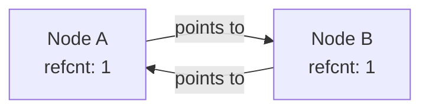

import { Callout } from "fumadocs-ui/components/callout";
import { Tabs, Tab } from "fumadocs-ui/components/tabs";
import { Accordion, Accordions } from "fumadocs-ui/components/accordion";

Unlike low-level languages like C or Rust where developers manually allocate and free heap buffers, Python automates memory management.

However, writing high-throughput backend services without understanding Python's **Garbage Collector (GC)** inevitably leads to memory bloat, latency spikes, and silent leaks.

---

## 1. Pillar 1: Reference Counting (Immediate Reclamation)

In CPython, every object contains a header field named `ob_refcnt`.

Whenever a new variable points to an object, its reference count increments. Whenever a variable goes out of scope or is reassigned, its reference count decrements.

```python
import sys

# 1. Create object (refcount = 1)
data = ["alpha", "beta"]
print("Initial refcount:", sys.getrefcount(data) - 1)  # -1 because getrefcount itself adds a temporary ref

# 2. Add an alias (refcount increments to 2)
alias = data
print("After alias:", sys.getrefcount(data) - 1)

# 3. Delete alias (refcount decrements to 1)
del alias
print("After deleting alias:", sys.getrefcount(data) - 1)
```

Output:

```text
Initial refcount: 1
After alias: 2
After deleting alias: 1
```

When an object's reference count drops to **zero**, CPython immediately reclaims its memory block back to the allocator. No waiting for background sweeps!

---

## 2. The Reference Cycle Problem

Reference counting has one fatal flaw: **circular references**.



```python
class Node:
    def __init__(self, name: str):
        self.name = name
        self.link = None

# Create circular reference:
a = Node("A")
b = Node("B")
a.link = b
b.link = a

# Delete the variable names:
del a
del b
```

Notice what happened: `Node A` points to `Node B`, and `Node B` points to `Node A`. Even though neither object is accessible by any variable in our program, **their reference counts never drop to zero**!

Pure reference counting would leave these objects in memory forever, leaking RAM.

---

## 3. Pillar 2: The Generational Cyclic Garbage Collector

To solve this, CPython includes a secondary **Cyclic Garbage Collector** (`gc` module).

The GC tracks container objects (lists, dicts, custom instances) using a doubly linked list. It operates on the **Weak Generational Hypothesis**: _most objects die shortly after creation_.

Objects are categorized into three generations:

- **Generation 0**: Newly created objects. Scanned frequently.
- **Generation 1**: Objects that survive a Gen 0 sweep.
- **Generation 2**: Long-lived objects (configurations, singletons). Scanned rarely.

```python
import gc

print("GC Thresholds (Gen0, Gen1, Gen2):", gc.get_threshold())

# Manually trigger a full cycle collection:
unreachable = gc.collect()
print(f"Collected {unreachable} cyclic objects from memory.")
```

Output:

```text
GC Thresholds (Gen0, Gen1, Gen2): (700, 10, 10)
Collected 4 cyclic objects from memory.
```

---

## 4. Hunting Memory Leaks with `tracemalloc`

Python ships with a powerful native memory profiler: **`tracemalloc`**. It tracks the exact file and line number responsible for every heap allocation:

```python
import tracemalloc

# Start tracking allocations
tracemalloc.start()

# Code to profile
leak = [str(x) * 100 for x in range(100_000)]

# Take snapshot
snapshot = tracemalloc.take_snapshot()
top_stats = snapshot.statistics("lineno")

print("Top 3 Memory Allocations:")
for stat in top_stats[:3]:
    print(stat)
```

Output:

```text
Top 3 Memory Allocations:
app.py:7: size=10.2 MiB, count=100000, average=107 B
```

`tracemalloc` pinpoints the exact line where memory consumption ballooned.

---

## Practice Questions & Challenges

Deepen your understanding of CPython memory allocators, cycle detectors, and heap diagnostics:

### Question 1: Output Prediction (Reference Counting with Local Scopes and sys.getrefcount)

What will this script print in standard CPython?

```python
import sys

def analyze():
    sample = [1, 2, 3]
    print("Inside function:", sys.getrefcount(sample) - 1)

analyze()
```

Does `sys.getrefcount` print `1`, `2`, or something else, and what is the refcount of `[1, 2, 3]` after `analyze()` returns?

<Accordions>
<Accordion title="Solution & Breakdown">
**Output:**
```text
Inside function: 1
```

**Explanation:**

1. The list `[1, 2, 3]` is referenced by local variable `sample` (refcount = 1).
2. Passing `sample` to `sys.getrefcount(sample)` temporarily increments the count to 2 because the parameter binding inside `getrefcount` adds a reference.
3. We subtract `1` to display the actual net references held by the caller, outputting `1`.
4. When `analyze()` finishes executing and returns, its local stack frame is destroyed. Variable `sample` goes out of scope, decrementing the refcount of `[1, 2, 3]` from 1 to 0.
5. CPython's allocator immediately deallocates the list memory back to the pymalloc arena. Its post-return refcount is `0` (memory freed immediately).
   </Accordion>
</Accordions>

---

### Question 2: Spot and Fix the Bug (Circular Reference Memory Leak in Cache)

The following LRU cache design creates circular references between doubly-linked list nodes. Even when items are evicted from the cache dictionary, memory usage steadily grows until the process runs out of RAM:

```python
class Node:
    def __init__(self, key, value):
        self.key = key
        self.value = value
        self.prev = None
        self.next = None

class MemoryLeakCache:
    def __init__(self):
        self.head = Node(None, None)
        self.tail = Node(None, None)
        self.head.next = self.tail
        self.tail.prev = self.head
        self.items = {}

    def put(self, key, value):
        new_node = Node(key, value)
        # Link: head <-> new_node <-> next
        new_node.next = self.head.next
        new_node.prev = self.head
        self.head.next.prev = new_node
        self.head.next = new_node
        self.items[key] = new_node

    def remove(self, key):
        if key in self.items:
            node = self.items.pop(key)
            # Unlink from list
            node.prev.next = node.next
            node.next.prev = node.prev
            # BUG: node.prev and node.next still reference active nodes!
```

Explain why the unlinked `node` isn't immediately freed and fix `remove()` to ensure immediate reclamation without waiting for GC sweeps.

<Accordions>
<Accordion title="Solution & Breakdown">
**The Root Cause:**
Even though `node` was deleted from `self.items` and unlinked from the chain, `node.prev` and `node.next` still point to active `Node` objects. More dangerously, if any two nodes point to each other in an unlinked cluster, their refcounts remain at `1`, preventing immediate refcount reclamation!

**The Fix:**
Explicitly clear internal pointers (`node.prev = None; node.next = None`) when disconnecting nodes, or use `weakref` for back-pointers:

```python
    def remove(self, key):
        if key in self.items:
            node = self.items.pop(key)
            # Unlink from list
            node.prev.next = node.next
            node.next.prev = node.prev

            # Break references immediately to drop refcount to 0:
            node.prev = None
            node.next = None
```

</Accordion>
</Accordions>

---

### Question 3: Architecture Deep-Dive (CPython Pymalloc, Arenas, Pools, and Blocks)

Explain CPython's 3-tier memory allocation hierarchy (`Arenas`, `Pools`, `Blocks`) handled by `pymalloc`. Why does CPython rarely return small object memory back to the Operating System?

<Accordions>
<Accordion title="Solution & Breakdown">
**The Pymalloc Hierarchy (for allocations &le; 512 bytes):**
1. **Arenas (256 KB):**
   - CPython allocates large 256 KB contiguous memory chunks from the OS via standard `malloc()` or `mmap()`.
2. **Pools (4 KB):**
   - Each Arena is carved into 4 KB Pools (matching virtual memory page sizes). Each pool is dedicated to a single fixed block size class (e.g., all 32-byte blocks, or all 64-byte blocks).
3. **Blocks (8 to 512 bytes):**
   - The actual memory slots handed to Python objects (e.g., integers, floats, small tuples).

**Why Python Doesn't Return Memory to the OS:**

- An Arena can **only** be released back to the operating system kernel if **every single 4 KB Pool inside that Arena is 100% empty**.
- If an Arena has 64 pools, and 63 are empty but a single pool retains just ONE active integer object (28 bytes), the entire 256 KB Arena must remain mapped in process virtual memory.
- This is why Python processes often appear to "never shrink in RAM" after processing large batch jobs. Python retains the arenas to instantly re-use them for subsequent allocations without OS syscall overhead.
  </Accordion>
</Accordions>

---

### Question 4: Hands-On Challenge (Weakref Callback Finalizer)

Implement a resource-tracking cache using `weakref.finalize` that logs an alert message whenever an expensive image buffer object is collected by the garbage collector, without preventing the object from being reclaimed.

<Accordions>
<Accordion title="Solution & Breakdown">
```python
import weakref

class HeavyImageBuffer:
def **init**(self, name: str, size_mb: int):
self.name = name
self.data = bytearray(size_mb _ 1024 _ 1024)

def \_on_buffer_collected(name: str):
print(f"[Memory Audit] Buffer '{name}' was collected and heap memory reclaimed!")

def create_tracked_image(name: str) -> HeavyImageBuffer:
img = HeavyImageBuffer(name, 10) # Register finalizer without capturing strong reference to img in the callback!
weakref.finalize(img, \_on_buffer_collected, name)
return img

# Test

print("Allocating buffer...")
buf = create_tracked_image("satellite_render_01.raw")
print("Buffer active.")

print("Releasing buffer reference...")
del buf # Immediately drops refcount to 0
print("Script finished.")

````

**Output:**
```text
Allocating buffer...
Buffer active.
Releasing buffer reference...
[Memory Audit] Buffer 'satellite_render_01.raw' was collected and heap memory reclaimed!
Script finished.
````

</Accordion>
</Accordions>

---

### Question 5: Code Challenge (Tracemalloc Leak Detector Context Manager)

Build a diagnostic context manager `assert_no_memory_leak(max_allowed_growth_kb: float)` that:

1. Starts `tracemalloc` tracking on enter.
2. Takes a baseline snapshot of heap allocations.
3. On exit, takes a second snapshot, calculates the total net bytes allocated during the block, and raises an `AssertionError` with top allocation lines if growth exceeds `max_allowed_growth_kb`.

**Test cases:**

```python
with assert_no_memory_leak(max_allowed_growth_kb=500):
    # Safe block: creates and deletes temp list
    temp = [i for i in range(1000)]
    del temp

# Should raise AssertionError:
with assert_no_memory_leak(max_allowed_growth_kb=100):
    leaky_cache = [str(x) * 1000 for x in range(5000)]  # > 500 KB
```

<Accordions>
<Accordion title="Solution & Breakdown">
```python
from contextlib import contextmanager
import tracemalloc

@contextmanager
def assert_no_memory_leak(max_allowed_growth_kb: float = 100.0):
was_tracing = tracemalloc.is_tracing()
if not was_tracing:
tracemalloc.start()

    snapshot_before = tracemalloc.take_snapshot()
    try:
        yield
    finally:
        snapshot_after = tracemalloc.take_snapshot()
        if not was_tracing:
            tracemalloc.stop()

        # Compare differences
        stats = snapshot_after.compare_to(snapshot_before, "lineno")
        total_growth_bytes = sum(stat.size_diff for stat in stats if stat.size_diff > 0)
        total_growth_kb = total_growth_bytes / 1024.0

        if total_growth_kb > max_allowed_growth_kb:
            top_culprits = "\n".join(str(s) for s in stats[:3])
            raise AssertionError(
                f"Memory leak detected! Net growth: {total_growth_kb:.2f} KB "
                f"(Max threshold: {max_allowed_growth_kb:.2f} KB)\n"
                f"Top Allocations:\n{top_culprits}"
            )

# Verification

# Safe:

with assert_no_memory_leak(max_allowed_growth_kb=200):
data = [x for x in range(1000)]
print("Safe block passed.")

# Leaky test:

try:
with assert*no_memory_leak(max_allowed_growth_kb=50):
leak = ["x" \* 10_000 for * in range(500)] # ~5 MB
except AssertionError as err:
print("Caught expected leak assertion:\n", err)

```
</Accordion>
</Accordions>

---

## Summary Reference

- **Reference Counting**: Main memory mechanism; frees objects immediately when refcount reaches zero.
- **Circular References**: Occur when objects reference each other; requires the cyclic GC.
- **Generational GC (`gc`)**: Sweeps generations 0, 1, and 2 based on allocation thresholds.
- **`tracemalloc`**: Standard library profiler for diagnosing heap growth down to the line number.
```
