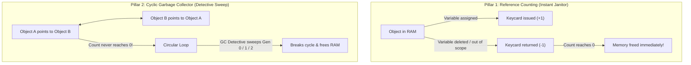
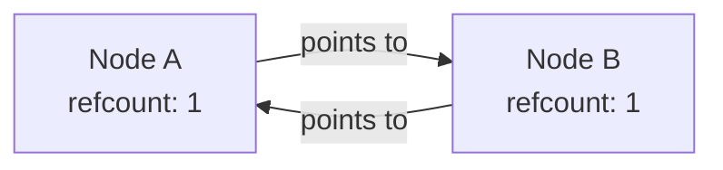
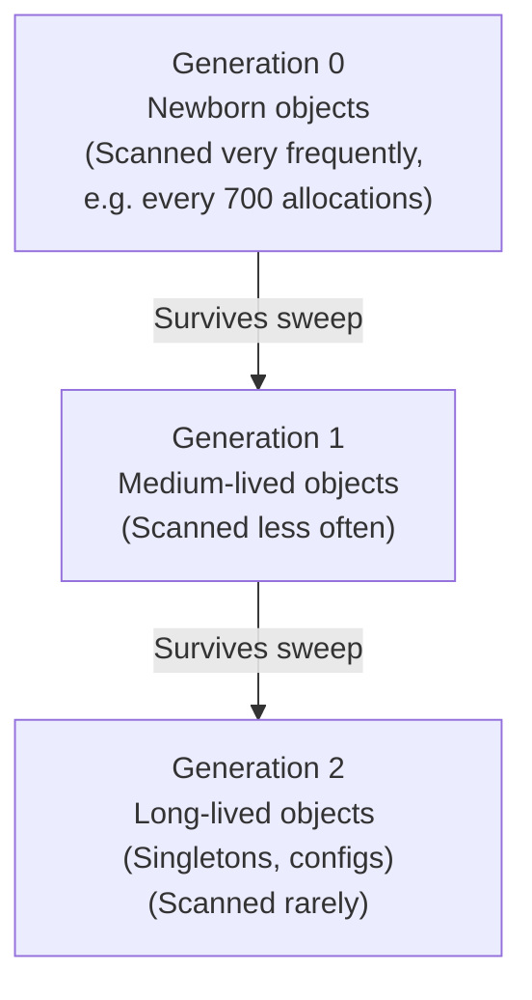

import { Callout } from "fumadocs-ui/components/callout";
import { Tabs, Tab } from "fumadocs-ui/components/tabs";
import { Accordion, Accordions } from "fumadocs-ui/components/accordion";

Unlike languages like C or Rust where developers must manually allocate and free memory pointers, Python manages memory automatically.

However, writing high-throughput services without understanding how Python reclaims memory inevitably leads to **memory leaks**, **RAM spikes**, and **unexpected latency freezes**.

Python's memory management rests on **Two Core Pillars**:

1. **Reference Counting** (Immediate cleanup for 90% of objects).
2. **The Generational Cyclic Garbage Collector** (Background detective for circular loops).

---

## The Mental Model: Keycards & The Hotel Room



---

## 1. Pillar 1: Reference Counting (Immediate Reclamation)

In CPython, every object has an internal counter named `ob_refcnt`.

Whenever a new variable points to an object, its reference count goes up by 1. Whenever a variable goes out of scope or is reassigned, its reference count drops by 1:

```python
import sys

# 1. Create an object (refcount = 1)
data = ["alpha", "beta"]
print("Initial refcount:", sys.getrefcount(data) - 1)
# Note: we subtract 1 because getrefcount() itself temporarily references data!

# 2. Add an alias (refcount increments to 2)
alias = data
print("After alias:", sys.getrefcount(data) - 1)

# 3. Delete the alias (refcount decrements to 1)
del alias
print("After deleting alias:", sys.getrefcount(data) - 1)
```

Output:

```text
Initial refcount: 1
After alias: 2
After deleting alias: 1
```

### The Immediate Cleanup Guarantee

When an object's reference count drops to **zero**, Python does not wait for a background sweep. It **immediately** reclaims that memory block back to the allocator. This is why Python does not suffer from the long "stop-the-world" GC pauses seen in Java or Go!

---

## 2. The Achilles' Heel: Circular Reference Cycles

Reference counting has one blind spot: **what if two objects point to each other?**



```python
class Node:
    def __init__(self, name: str):
        self.name = name
        self.link = None

# Create two nodes referencing each other:
a = Node("A")
b = Node("B")
a.link = b
b.link = a

# Delete the variable names:
del a
del b
```

Even though our code can no longer reach `Node A` or `Node B`, **their reference counts never hit zero** because they hold references to each other!

Without a secondary system, these two objects would sit in RAM forever, causing a silent memory leak.

---

## 3. Pillar 2: The Generational Garbage Collector (`gc`)

To catch and destroy circular reference cycles, CPython includes a secondary **Cyclic Garbage Collector** (the `gc` module).

The GC tracks container objects (lists, dicts, custom class instances) and operates on the **Weak Generational Hypothesis**:

> _"Most objects die very young."_

Objects are organized into **three generations**:



- **Generation 0**: Kitchen trash can (swept frequently).
- **Generation 1**: Building dumpster (swept periodically).
- **Generation 2**: Long-term basement archive (swept rarely).

You can inspect or manually trigger this in Python:

```python
import gc

# Inspect current GC trigger thresholds (Gen0, Gen1, Gen2)
print("GC Thresholds:", gc.get_threshold())

# Manually trigger a full cycle sweep:
unreachable = gc.collect()
print(f"Collected {unreachable} cyclic objects from memory.")
```

Output:

```text
GC Thresholds: (700, 10, 10)
Collected 4 cyclic objects from memory.
```

---

## 4. Hunting Memory Leaks with `tracemalloc`

When your Python server's memory is creeping up in production, how do you find the line of code responsible?

Python has a built-in memory profiler: **`tracemalloc`**. It tracks memory allocations down to the exact file and line number:

```python
import tracemalloc

# 1. Start tracking allocations
tracemalloc.start()

# 2. Simulate code that allocates memory
leak = [str(x) * 100 for x in range(100_000)]

# 3. Take snapshot and print the top allocation line
snapshot = tracemalloc.take_snapshot()
top_stats = snapshot.statistics("lineno")

print("Top Memory Allocations:")
for stat in top_stats[:3]:
    print(stat)
```

Output:

```text
Top Memory Allocations:
app.py:7: size=10.2 MiB, count=100000, average=107 B
```

`tracemalloc` shows the exact line number (`app.py:7`) and how many megabytes were allocated!

---

## Practice Questions & Challenges

### Question 1: Output Prediction (Reference Counting & Function Scopes)

What does this script print in standard CPython?

```python
import sys

def analyze():
    sample = [1, 2, 3]
    print("Inside function:", sys.getrefcount(sample) - 1)

analyze()
```

Does `sys.getrefcount` output `1` or `2`, and what happens to `[1, 2, 3]` after `analyze()` returns?

<Accordions>
<Accordion title="Solution & Breakdown">
**Output:**
```text
Inside function: 1
```

**Explanation:**

1. The list `[1, 2, 3]` is referenced by the local variable `sample` (refcount = 1).
2. Calling `sys.getrefcount(sample)` temporarily adds a parameter reference, so `sys.getrefcount` sees 2. Subtracting 1 reveals the true count (1).
3. When `analyze()` returns, its local stack frame is destroyed.
4. Variable `sample` disappears, dropping the list's refcount from 1 to **0**.
5. CPython immediately deallocates the list memory on the spot.
   </Accordion>
</Accordions>

---

### Question 2: Spot and Fix the Bug (Circular Reference Leak in Cache)

The following doubly-linked list cache creates circular references between nodes. When items are removed from the cache, memory keeps growing:

```python
class Node:
    def __init__(self, key, value):
        self.key = key
        self.value = value
        self.prev = None
        self.next = None

class MemoryLeakCache:
    def __init__(self):
        self.head = Node(None, None)
        self.tail = Node(None, None)
        self.head.next = self.tail
        self.tail.prev = self.head
        self.items = {}

    def put(self, key, value):
        new_node = Node(key, value)
        new_node.next = self.head.next
        new_node.prev = self.head
        self.head.next.prev = new_node
        self.head.next = new_node
        self.items[key] = new_node

    def remove(self, key):
        if key in self.items:
            node = self.items.pop(key)
            # Unlink from list
            node.prev.next = node.next
            node.next.prev = node.prev
            # BUG: node.prev and node.next still reference active nodes!
```

Explain why `node` is not immediately freed and provide the clean fix.

<Accordions>
<Accordion title="Solution & Breakdown">
**The Root Cause:**
Even though `node` was removed from `self.items` and unlinked from the chain, `node.prev` and `node.next` still point to active nodes in the list. This prevents its reference count from dropping to 0, forcing it to wait for a generational GC sweep.

**The Fix:**
Explicitly clear internal pointers to break references immediately:

```python
    def remove(self, key):
        if key in self.items:
            node = self.items.pop(key)
            # Unlink from neighboring nodes:
            node.prev.next = node.next
            node.next.prev = node.prev

            # Break internal pointers so refcount drops to 0 immediately:
            node.prev = None
            node.next = None
```

</Accordion>
</Accordions>

---

### Question 3: Architecture Deep-Dive (Arenas, Pools, and Blocks: Why Python Keeps RAM)

Why does a Python process often continue to show high RAM usage in the OS Task Manager even after you delete millions of objects and run `gc.collect()`?

<Accordions>
<Accordion title="Solution & Breakdown">
**CPython's 3-Tier `pymalloc` Allocator:**
For objects smaller than 512 bytes (small strings, ints, tuples), CPython uses an internal allocator called `pymalloc` divided into:
1. **Arenas** (256 KB memory chunks allocated from the OS).
2. **Pools** (4 KB pages inside each Arena).
3. **Blocks** (8 to 512 bytes inside each Pool).

**Why RAM Doesn't Shrink in the Task Manager:**

- Python can only return a 256 KB Arena back to the operating system if **every single 4 KB Pool inside that Arena is 100% empty**.
- If an Arena holds 64 pools, and 63 are empty but a single pool retains just ONE active 32-byte integer, the entire 256 KB Arena must remain allocated!
- This is normal and intentional: Python holds onto that memory so subsequent object allocations can reuse it instantly without costly OS kernel syscalls.
  </Accordion>
</Accordions>

---

### Question 4: Hands-On Challenge (Weakref Finalizer Notification)

Implement a resource cache using `weakref.finalize` that logs a message as soon as an expensive image buffer is garbage collected, without preventing the object from being freed.

<Accordions>
<Accordion title="Solution & Breakdown">
```python
import weakref

class HeavyImageBuffer:
def **init**(self, name: str, size_mb: int):
self.name = name
self.data = bytearray(size_mb _ 1024 _ 1024)

def \_on_buffer_collected(name: str):
print(f"[Memory Audit] Buffer '{name}' was collected and heap memory reclaimed!")

def create_tracked_image(name: str) -> HeavyImageBuffer:
img = HeavyImageBuffer(name, 5) # Register finalizer without capturing a strong reference to 'img' inside the callback!
weakref.finalize(img, \_on_buffer_collected, name)
return img

# Test

print("Allocating buffer...")
buf = create_tracked_image("satellite_render_01.raw")
print("Buffer is active in memory.")

print("Releasing buffer reference...")
del buf # Reference count drops to 0 immediately!
print("Script finished.")

````

**Output:**
```text
Allocating buffer...
Buffer is active in memory.
Releasing buffer reference...
[Memory Audit] Buffer 'satellite_render_01.raw' was collected and heap memory reclaimed!
Script finished.
````

</Accordion>
</Accordions>

---

### Question 5: Code Challenge (Tracemalloc Leak Detector Context Manager)

Build a diagnostic context manager `assert_no_memory_leak(max_allowed_growth_kb: float)` that:

1. Starts `tracemalloc` tracking on enter.
2. Takes a baseline snapshot of heap allocations.
3. On exit, takes a second snapshot, calculates net allocated bytes, and raises an `AssertionError` if growth exceeds `max_allowed_growth_kb`.

```python
with assert_no_memory_leak(max_allowed_growth_kb=500):
    # Safe block
    temp = [i for i in range(1000)]
    del temp

# Should raise AssertionError:
with assert_no_memory_leak(max_allowed_growth_kb=50):
    leaky_cache = [str(x) * 1000 for x in range(5000)]
```

<Accordions>
<Accordion title="Solution & Breakdown">
```python
from contextlib import contextmanager
import tracemalloc

@contextmanager
def assert_no_memory_leak(max_allowed_growth_kb: float = 100.0):
was_tracing = tracemalloc.is_tracing()
if not was_tracing:
tracemalloc.start()

    snapshot_before = tracemalloc.take_snapshot()
    try:
        yield
    finally:
        snapshot_after = tracemalloc.take_snapshot()
        if not was_tracing:
            tracemalloc.stop()

        # Compare differences by line number
        stats = snapshot_after.compare_to(snapshot_before, "lineno")
        total_growth_bytes = sum(stat.size_diff for stat in stats if stat.size_diff > 0)
        total_growth_kb = total_growth_bytes / 1024.0

        if total_growth_kb > max_allowed_growth_kb:
            top_culprits = "\n".join(str(s) for s in stats[:3])
            raise AssertionError(
                f"Memory leak detected! Net growth: {total_growth_kb:.2f} KB "
                f"(Max allowed: {max_allowed_growth_kb:.2f} KB)\n"
                f"Top Allocations:\n{top_culprits}"
            )

# Verification

# 1. Safe block:

with assert_no_memory_leak(max_allowed_growth_kb=200):
data = [x for x in range(1000)]
del data
print("Safe block passed!")

# 2. Leaky block:

try:
with assert*no_memory_leak(max_allowed_growth_kb=50):
leaky_data = ["x" \* 10_000 for * in range(500)] # ~5 MB
except AssertionError as err:
print("Caught expected leak assertion:\n", err)

```
</Accordion>
</Accordions>

---

## Summary Reference

- **Reference Counting**: Primary cleanup mechanism; frees memory instantly when refcount drops to 0.
- **Reference Cycles**: When objects point to each other; requires the cyclic garbage collector.
- **Generational GC (`gc`)**: Sweeps Generations 0, 1, and 2 based on object age.
- **`tracemalloc`**: Built-in profiler that pinpoints memory growth down to the exact file and line number.
- **`pymalloc` Arenas**: Python reuses memory arenas internally rather than constantly returning small blocks to the OS.
```
