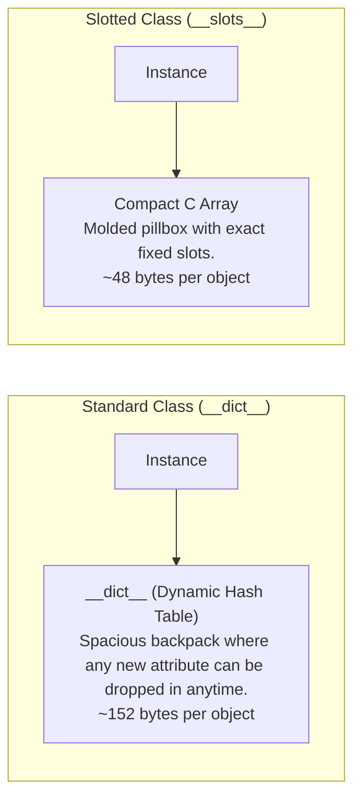

import { Callout } from "fumadocs-ui/components/callout";
import { Tabs, Tab } from "fumadocs-ui/components/tabs";
import { Accordion, Accordions } from "fumadocs-ui/components/accordion";

> _"Premature optimization is the root of all evil."_  
> — Donald Knuth

Before optimizing code, you must **measure**. Guessing where performance bottlenecks exist is almost always wrong.

In this lesson, you will learn how to profile CPU bottlenecks and apply one of Python's highest-impact memory optimizations: **`__slots__`**.

---

## The Mental Model: The Backpack vs. The Molded Pillbox

Why do standard Python objects consume so much memory?



- **Standard Class**: Holds an internal dictionary (`self.__dict__`). Highly flexible, but heavy.
- **Slotted Class (`__slots__`)**: Replaces the dictionary with a fixed C array of pointers. Saves **68% RAM**!

---

## 1. CPU Profiling with `cProfile`

Python includes a built-in deterministic profiler: **`cProfile`**. It records the number of calls, execution duration, and cumulative time spent inside every single function:

```python
import cProfile
import pstats
import time

def slow_step():
    time.sleep(0.3)

def fast_step():
    return sum(i for i in range(100_000))

def run_pipeline():
    for _ in range(3):
        slow_step()
        fast_step()

# Profile the execution:
profiler = cProfile.Profile()
profiler.enable()

run_pipeline()

profiler.disable()
stats = pstats.Stats(profiler).sort_stats("cumulative")
stats.print_stats(5)
```

Output:

```text
         100021 function calls in 0.912 seconds

   Ordered by: cumulative time
   List reduced from 15 to 5 due to restriction <5>

   ncalls  tottime  percall  cumtime  percall filename:lineno(function)
        1    0.000    0.000    0.912    0.912 app.py:12(run_pipeline)
        3    0.000    0.000    0.901    0.300 app.py:5(slow_step)
        3    0.901    0.300    0.901    0.300 {built-in method time.sleep}
        3    0.008    0.003    0.011    0.004 app.py:8(fast_step)
```

The report immediately pinpoints that `slow_step` accounts for **98.7%** of the entire execution time.

---

## 2. Memory Optimization: The Power of `__slots__`

If your service stores **1,000,000 objects in RAM** (such as GPS coordinates, financial orders, or user sessions), standard instances will consume gigabytes of unnecessary memory!

### Comparing Standard vs. Slotted Objects

```python
import sys

# 1. Standard class with dynamic __dict__
class StandardPoint:
    def __init__(self, x: float, y: float):
        self.x = x
        self.y = y

# 2. Optimized class with fixed __slots__
class SlottedPoint:
    __slots__ = ("x", "y")
    def __init__(self, x: float, y: float):
        self.x = x
        self.y = y

p_std = StandardPoint(1.0, 2.0)
p_slot = SlottedPoint(1.0, 2.0)

print("Standard Object Overhead:", sys.getsizeof(p_std) + sys.getsizeof(p_std.__dict__), "bytes")
print("Slotted Object Overhead:", sys.getsizeof(p_slot), "bytes")
```

Output:

```text
Standard Object Overhead: 152 bytes
Slotted Object Overhead: 48 bytes
```

### Scale Benchmark: 1,000,000 Objects in Memory

| Class Type                      | RAM Consumed (1,000,000 Instances) | Memory Saved           |
| :------------------------------ | :--------------------------------- | :--------------------- |
| **Standard Class (`__dict__`)** | **~152 MB**                        | 0% (Baseline)          |
| **`__slots__` Class**           | **~48 MB**                         | **68% RAM Reduction!** |

### Modern Idiomatic Python: `dataclass(slots=True)`

In modern Python (Python 3.10+), you don't even need to write `__slots__ = (...)` manually. Just use `@dataclass(slots=True)`:

```python
from dataclasses import dataclass

@dataclass(slots=True)
class Coordinate:
    latitude: float
    longitude: float

c = Coordinate(37.7749, -122.4194)
print(hasattr(c, "__dict__"))  # False! Automatically slotted.
```

---

## 3. Profiler Comparison: `cProfile` vs. `py-spy`

| Feature                    | `cProfile` (Built-in)                           | `py-spy` (Sampling Profiler)                              |
| :------------------------- | :---------------------------------------------- | :-------------------------------------------------------- |
| **How it works**           | Intercepts _every single_ Python function call. | Periodically inspects process memory from outside the OS. |
| **Overhead**               | High (30% to 300% slowdown).                    | Near zero (< 2%).                                         |
| **Production Safe?**       | **No** (can trigger cascading timeouts).        | **Yes** (attach to live web servers safely).              |
| **Requires Code Changes?** | Yes (`import cProfile`, wrap functions).        | No (`py-spy top --pid 12345`).                            |

---

## Practice Questions & Challenges

### Question 1: Output Prediction (Attribute Assignment on Slotted Class)

What happens when you assign a new attribute to a slotted object?

```python
class Packet:
    __slots__ = ("header", "payload")
    def __init__(self, header: str, payload: bytes):
        self.header = header
        self.payload = payload

pkt = Packet("TCP", b"DATA")
pkt.header = "UDP"
print("Header:", pkt.header)

try:
    pkt.timestamp = 1718000000
    print("Timestamp assigned:", pkt.timestamp)
except AttributeError as err:
    print("Caught error:", err)
```

<Accordions>
<Accordion title="Solution & Breakdown">
**Output:**
```text
Header: UDP
Caught error: 'Packet' object has no attribute 'timestamp' and no __dict__ for this attribute
```

**Explanation:**

1. Modifying existing slotted attributes (`pkt.header = "UDP"`) works normally through compact C-level pointer offsets.
2. When attempting to assign a new attribute `pkt.timestamp`, Python checks if `"timestamp"` is in `__slots__`.
3. Finding that it is not, Python looks for an instance `__dict__` to store dynamic attributes.
4. Because `__slots__` eliminated `__dict__`, Python raises an `AttributeError` on the spot!
   </Accordion>
</Accordions>

---

### Question 2: Spot and Fix the Bug (Broken Inheritance with `__slots__`)

A developer defines `__slots__` on a base class, but child instances still have a `__dict__` and consume 152 bytes in RAM:

```python
class BaseEntity:
    __slots__ = ("id", "created_at")
    def __init__(self, id: int, created_at: float):
        self.id = id
        self.created_at = created_at

class UserEntity(BaseEntity):
    # Notice: No __slots__ defined in child class!
    def __init__(self, id: int, created_at: float, email: str):
        super().__init__(id, created_at)
        self.email = email

u = UserEntity(1, 100.0, "user@test.com")
print("Has __dict__:", hasattr(u, "__dict__"))  # True! Memory savings lost.
```

Explain why this occurs and provide the clean fix.

<Accordions>
<Accordion title="Solution & Breakdown">
**The Root Cause:**
In Python, `__slots__` is **not automatically inherited**. If a subclass does not explicitly declare `__slots__`, CPython automatically gives each subclass instance a standard `__dict__`, wiping out the memory optimization!

**The Fix:**
Subclasses must declare `__slots__` containing _only their new attributes_:

```python
class BaseEntity:
    __slots__ = ("id", "created_at")
    def __init__(self, id: int, created_at: float):
        self.id = id
        self.created_at = created_at

class UserEntity(BaseEntity):
    # Only declare new child attributes:
    __slots__ = ("email",)

    def __init__(self, id: int, created_at: float, email: str):
        super().__init__(id, created_at)
        self.email = email

u = UserEntity(1, 100.0, "user@test.com")
print("Has __dict__:", hasattr(u, "__dict__"))  # False! Fully optimized.
```

</Accordion>
</Accordions>

---

### Question 3: Architecture Deep-Dive (Deterministic vs. Statistical Profiling)

Why should you **never** run `cProfile` in a latency-critical production environment, and how does `py-spy` solve this?

<Accordions>
<Accordion title="Solution & Breakdown">
**Deterministic Profiling (`cProfile`):**
- Hooks into CPython's execution engine via `PyEval_SetProfile`.
- Intercepts **every single** function call, return, and exception.
- Slows down execution by 30% to 300%. In production, this added latency can trigger client timeouts, cascading database retries, and system outages.

**Statistical Sampling (`py-spy`):**

- Runs completely outside the target Python process.
- Reads process memory using OS syscalls (`process_vm_readv` on Linux or `ReadProcessMemory` on Windows).
- Samples the call stack 100 times per second with near-zero overhead (< 2%).
- Can be attached to live production servers without stopping or restarting them!
  </Accordion>
</Accordions>

---

### Question 4: Hands-On Challenge (Restoring Weakref Support to a Slotted Class)

By default, slotted classes do not support weak references (`weakref.ref(instance)` raises `TypeError: cannot create weak reference to 'SlottedItem' object`).

Modify the class below so that it retains all memory benefits of `__slots__` while enabling `weakref` compatibility.

```python
class CacheItem:
    __slots__ = ("key", "val")
    def __init__(self, key: str, val: str):
        self.key = key
        self.val = val
```

<Accordions>
<Accordion title="Solution & Breakdown">
Add `"__weakref__"` directly to the `__slots__` tuple. This reserves a single pointer slot for weak reference management without creating a full `__dict__`:

```python
import weakref

class CacheItem:
    __slots__ = ("key", "val", "__weakref__")

    def __init__(self, key: str, val: str):
        self.key = key
        self.val = val

item = CacheItem("session_42", "token_xyz")

# Weak reference works smoothly:
r = weakref.ref(item)
print("Referenced key:", r().key)  # "session_42"

# Dynamic attributes are still safely blocked:
try:
    item.extra = "not allowed"
except AttributeError:
    print("Dynamic attributes still safely prevented!")
```

</Accordion>
</Accordions>

---

### Question 5: Code Challenge (Memory Footprint Benchmark Utility)

Write a diagnostic benchmarking utility `compare_memory_footprint(cls_a, cls_b, count: int = 100_000)` that:

1. Instantiates `count` instances of `cls_a` and measures peak heap RAM using `tracemalloc`.
2. Clears them and runs garbage collection.
3. Instantiates `count` instances of `cls_b` and measures peak RAM.
4. Prints a comparative report showing the MB consumed by each and the percentage reduction.

```python
class RegularPoint:
    def __init__(self, x: float, y: float):
        self.x = x
        self.y = y

class SlottedPoint:
    __slots__ = ("x", "y")
    def __init__(self, x: float, y: float):
        self.x = x
        self.y = y

compare_memory_footprint(RegularPoint, SlottedPoint, count=100_000)
```

<Accordions>
<Accordion title="Solution & Breakdown">
```python
import gc
import tracemalloc
from typing import Type

def measure_alloc(cls: Type, count: int) -> float:
gc.collect()
tracemalloc.start()

    # Allocate instances
    instances = [cls(float(i), float(i * 2)) for i in range(count)]

    current, peak = tracemalloc.get_traced_memory()
    tracemalloc.stop()

    # Explicit cleanup
    del instances
    gc.collect()

    return peak / (1024 * 1024)  # Return Peak in MB

def compare_memory_footprint(cls_a: Type, cls_b: Type, count: int = 100_000):
print(f"--- Benchmarking {count:,} instances ---")
mb_a = measure_alloc(cls_a, count)
print(f"[{cls_a.__name__}] Peak RAM: {mb_a:.2f} MB")

    mb_b = measure_alloc(cls_b, count)
    print(f"[{cls_b.__name__}] Peak RAM: {mb_b:.2f} MB")

    reduction = ((mb_a - mb_b) / mb_a) * 100
    print(f"Memory Reduction: {reduction:.1f}% savings with {cls_b.__name__}!\n")

# Verification

class StandardPoint:
def **init**(self, x: float, y: float):
self.x = x
self.y = y

class SlottedPoint:
**slots** = ("x", "y")
def **init**(self, x: float, y: float):
self.x = x
self.y = y

if **name** == "**main**":
compare_memory_footprint(StandardPoint, SlottedPoint, count=100_000)

```
</Accordion>
</Accordions>

---

## Summary Reference

- **`cProfile`**: Built-in deterministic profiler; best for local development benchmarks.
- **`py-spy`**: Zero-overhead statistical sampling profiler; safe for live production services.
- **`__slots__`**: Replaces the per-instance dictionary with a compact C array, saving ~68% RAM.
- **`@dataclass(slots=True)`**: The modern, idiomatic Python 3.10+ way to create slotted classes.
- **Subclassing `__slots__`**: Subclasses must explicitly declare `__slots__ = (...)` to avoid inheriting a `__dict__`.
```
