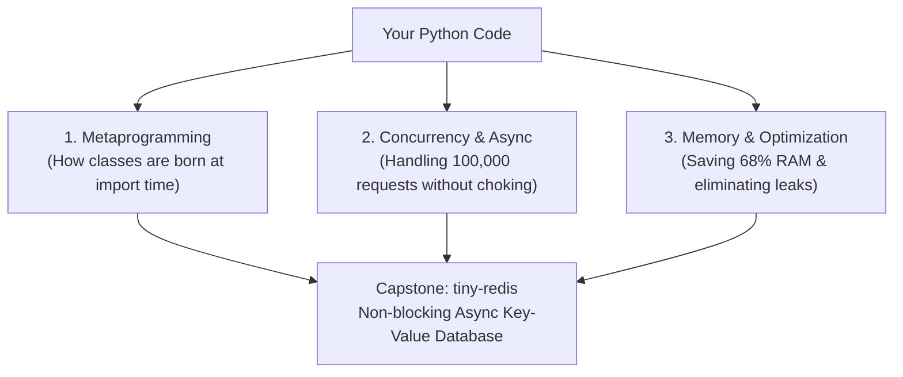

import { Callout } from "fumadocs-ui/components/callout";
import { Steps, Step } from "fumadocs-ui/components/steps";
import { Tabs, Tab } from "fumadocs-ui/components/tabs";

Welcome to **Stage 3: Advanced Python**!

Many developers find topics like **metaclasses**, **the GIL**, **asyncio event loops**, and **memory allocators** intimidating because they are often explained with heavy academic jargon.

In this stage, our goal is to **make these advanced concepts simple, intuitive, and practical**. We break down the magic using real-world analogies, step-by-step mental models, and production-tested recipes.

---

## The Big Picture: How the Pieces Fit Together

---

## The Concurrency Decision Matrix: Which Tool When?

Before diving in, here is the quick mental cheat sheet for Python concurrency:

| If your task is...                   | Typical Example                                    | Best Tool                                 | Why?                                                           |
| :----------------------------------- | :------------------------------------------------- | :---------------------------------------- | :------------------------------------------------------------- |
| **I/O-Bound (High Concurrency)**     | 10,000 WebSockets, HTTP scraping, microservices    | `asyncio` (`TaskGroup`)                   | Single thread, near-zero memory per connection, non-blocking.  |
| **I/O-Bound (Simple / Legacy)**      | Querying a slow SQL database with blocking drivers | `ThreadPoolExecutor`                      | Releases the GIL during I/O waits, simple drop-in code.        |
| **CPU-Bound (Standard CPython)**     | Image processing, machine learning math, hashing   | `multiprocessing` / `ProcessPoolExecutor` | Bypasses the GIL by running across separate OS processes.      |
| **CPU-Bound (Python 3.14t No-GIL)**  | Multi-core Python calculation without IPC copying  | `ThreadPoolExecutor` on `python3.14t`     | True multi-core execution on OS threads without IPC overhead.  |
| **Memory-Heavy (Millions of items)** | Coordinates, stock ticks, sensor telemetry         | `__slots__` or `@dataclass(slots=True)`   | Cuts RAM by 60%+ by replacing dynamic dicts with fixed arrays. |

---

## Stage 3 Roadmap

<Steps>
<Step>
### [01. Metaclasses & Class Construction](/docs/learn-python/03-advanced/01-metaclasses-and-class-creation)
The "Cookie Cutter Factory" of Python. Learn how Python builds classes dynamically with `type`, inspect the 4-step class lifecycle (`__prepare__`, `__new__`, `__init__`), and see why modern Python prefers `__init_subclass__` for 95% of use cases.
</Step>

<Step>
  ### [02. The Concurrency Matrix: Threads vs
  Processes](/docs/learn-python/03-advanced/02-threading-vs-multiprocessing) The
  Kitchen Chef analogy: Understand sequential vs. concurrent execution ($T = 6s
  \rightarrow 2s$), the Global Interpreter Lock (GIL), how OS threads switch
  during I/O, why threads fail at CPU math, synchronization primitives (`Lock`,
  `Semaphore`, `Queue`), `concurrent.futures`, free-threaded Python (PEP 703 in
  3.13/3.14), subinterpreters, and benchmarking.
</Step>

<Step>
  ### [03. AsyncIO & Event Loop
  Mechanics](/docs/learn-python/03-advanced/03-asyncio-event-loop-internals) The
  Waiter Analogy: How a single Python thread coordinates 100,000+ connections
  without freezing. Master coroutines, the cardinal rule of non-blocking code,
  bridging legacy blocking functions with `asyncio.to_thread`, debugging event
  loop freezes with `PYTHONASYNCIODEBUG`, eager task execution (Python 3.12+),
  and async synchronization primitives.
</Step>

<Step>
  ### [04. Structured Concurrency (TaskGroup &
  except*)](/docs/learn-python/03-advanced/04-async-iterators-and-context) No
  more orphaned background tasks! Python 3.11's `TaskGroup` acts as a
  chaperone—if one task fails, all sibling tasks cancel cleanly. Handle multiple
  concurrent crashes using Exception Groups and `except*`, stream data with
  async iterators, coordinate pipelines with Python 3.13
  `asyncio.Queue.shutdown()`, and synchronize tasks with `asyncio.Barrier`.
</Step>

<Step>
  ### [05. Memory Profiling, tracemalloc & Cyclic
  GC](/docs/learn-python/03-advanced/05-memory-management-and-gc) How Python
  allocates and frees memory: Reference counting (immediate cleanup) vs the
  Generational Cyclic Garbage Collector (catching circular loops). Pinpoint
  memory leaks down to the exact line with `tracemalloc`.
</Step>

<Step>
  ### [06. Performance Optimization &
  Slots](/docs/learn-python/03-advanced/06-performance-profiling-slots) "Measure
  before you optimize." Profile function bottlenecks with `cProfile` and
  zero-overhead `py-spy`. Cut object memory overhead by 68% using `__slots__`
  and `@dataclass(slots=True)`.
</Step>

<Step>
### [Capstone: tiny-redis RESP Server & Crawler](/docs/learn-python/03-advanced/capstone-tiny-redis)
Put it all into practice! Build a real, high-performance in-memory key-value server implementing the official Redis protocol (RESP) from scratch with non-blocking sockets, TTL expirations, and automated pytest testing.
</Step>
</Steps>
