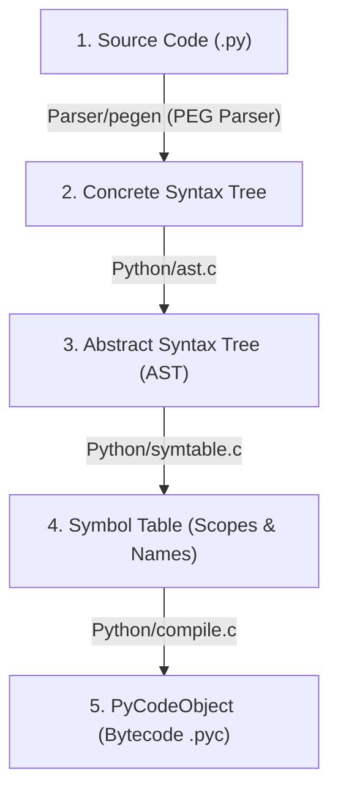

import { Callout } from "fumadocs-ui/components/callout";
import { Tabs, Tab } from "fumadocs-ui/components/tabs";
import { Accordion, Accordions } from "fumadocs-ui/components/accordion";

When you run `python app.py`, what happens between reading characters from disk and executing instructions on your CPU?

Many developers think Python is a purely interpreted language that runs lines directly as text. In reality, **CPython compiles your code into bytecode before executing a single instruction**.

---

## 1. The 5 Stages of CPython Compilation



1. **Tokenizing & PEG Parsing**: In Python 3.9+, CPython transitioned to a powerful **Parsing Expression Grammar (PEG)** parser (`pegen`). It reads source text and generates a parse tree without ambiguity.
2. **AST Construction (`ast.c`)**: Converts concrete grammatical tokens into a structural tree representing operations, expressions, and statements.
3. **Symbol Table Generation (`symtable.c`)**: Analyzes variable scopes. Determines whether each variable is local, global, enclosing (closure), or built-in _before_ bytecode is generated!
4. **Bytecode Compilation (`compile.c`)**: Traverses the AST, builds basic blocks and a Control Flow Graph (CFG), applies peephole optimizations, and emits a `PyCodeObject`.

---

## 2. Inspecting the Abstract Syntax Tree

Python gives you direct programmatic access to its AST via the standard library **`ast`** module:

```python
import ast

code = "total = price * 1.08"
tree = ast.parse(code)

print(ast.dump(tree, indent=2))
```

Output:

```text
Module(
  body=[
    Assign(
      targets=[
        Name(id='total', ctx=Store())],
      value=BinOp(
        left=Name(id='price', ctx=Load()),
        op=Mult(),
        right=Constant(value=1.08)))],
  type_ignores=[])
```

Notice the AST hierarchy:

- An assignment statement (`Assign`).
- Storing to target name `'total'` (`ctx=Store()`).
- Value is a binary operation (`BinOp`) multiplying `'price'` (`ctx=Load()`) by `1.08` (`Constant`).

---

## 3. Metaprogramming with `ast.NodeTransformer`

Because Python's AST is fully introspectable, you can rewrite, optimize, or sanitize code before it executes:

```python
import ast

class ConstantMultiplier(ast.NodeTransformer):
    """AST Transformer that replaces all integer constants with their double!"""
    def visit_Constant(self, node):
        if isinstance(node.value, int):
            return ast.copy_location(ast.Constant(value=node.value * 2), node)
        return node

source = "print(10 + 20)"
tree = ast.parse(source)

# Rewrite the AST:
transformer = ConstantMultiplier()
new_tree = transformer.visit(tree)
ast.fix_missing_locations(new_tree)

# Compile and execute the transformed AST!
compiled_code = compile(new_tree, filename="<ast>", mode="exec")
exec(compiled_code)
```

Output:

```text
60
```

`10` became `20`, `20` became `40`, and the sum evaluated to `60`! This is the exact mechanism linters and code formatters (like `ruff`) use to inspect and refactor Python code at compile time.

---

## Practice Questions & Challenges

Deepen your mastery of CPython parser mechanics, AST manipulation, and compile-time inspection:

### Question 1: Output Prediction (Compile-Time Constant Folding)

CPython's compiler applies optimization passes (peephole optimization / constant folding) during AST to bytecode generation. What is the value of `len(compiled.co_consts)` for the following two functions?

```python
code_a = compile("x = 24 * 60 * 60", "<test>", "exec")
code_b = compile("x = a * b * c", "<test>", "exec")

print("Constants in code_a:", code_a.co_consts)
print("Constants in code_b:", code_b.co_consts)
```

Does `code_a` contain `24`, `60`, and `60` at runtime, or something else?

<Accordions>
<Accordion title="Solution & Breakdown">
**Output:**
```text
Constants in code_a: (86400, None)
Constants in code_b: (None,)
```

**Explanation:**

1. During the compilation step in `compile.c`, CPython detects binary operations between literal constants whose results are deterministically computable at compile time.
2. The expression `24 * 60 * 60` is evaluated by the compiler and folded directly into a single constant: `86400`. The individual numbers `24` and `60` do not exist in the final `co_consts` tuple at all! (The trailing `None` represents the default return value of module scope).
3. In `code_b`, because `a`, `b`, and `c` are variable names (not constants), folding cannot happen. The names are stored in `co_names`, and `co_consts` contains only `(None,)`.

</Accordion>
</Accordions>

---

### Question 2: Spot and Fix the Bug (Broken Scope Classification via Symtable)

A developer tries to dynamically determine whether a function accesses any global variables by checking `func.__globals__`. However, this returns the entire module's dictionary (hundreds of imported libraries) rather than variables actually referenced by the function:

```python
import symtable

def analyze_function_globals():
    source = """
counter = 0
def increment(step):
    global counter
    local_val = 10
    counter += step + local_val
"""
    table = symtable.symtable(source, "<string>", "exec")
    # BUG: Fails to inspect the nested function namespace
    func_symbols = table.get_symbols()
    print("Function symbols:", [s.get_name() for s in func_symbols])
```

Refactor this using `symtable` methods to correctly traverse into the child scope of `increment` and isolate only the symbols declared as `global`.

<Accordions>
<Accordion title="Solution & Breakdown">
**The Root Cause:**
`symtable.symtable(...)` returns a symbol table for the top-level module scope. Functions, classes, and comprehensions create **nested child scopes** which must be retrieved via `table.get_children()`.

**The Fix:**

```python
import symtable

def find_function_global_symbols():
    source = """
counter = 0
def increment(step):
    global counter
    local_val = 10
    counter += step + local_val
"""
    table = symtable.symtable(source, "<string>", "exec")

    # 1. Find child scope corresponding to the function:
    func_table = None
    for child in table.get_children():
        if child.get_name() == "increment":
            func_table = child
            break

    if not func_table:
        return []

    # 2. Inspect symbols inside the function:
    global_vars = [
        s.get_name() for s in func_table.get_symbols()
        if s.is_global()
    ]
    return global_vars

# Verification
print("Isolated global symbols in function:", find_function_global_symbols())
# Output: ['counter']
```

</Accordion>
</Accordions>

---

### Question 3: Architecture Deep-Dive (Why CPython Replaced the LL(1) Parser with PEG)

Why did Python 3.9 replace the original 30-year-old **LL(1)** parser with a **Parsing Expression Grammar (PEG)** parser (`pegen`)? What language syntax was impossible to parse under LL(1)?

<Accordions>
<Accordion title="Solution & Breakdown">
**Limitations of the Old LL(1) Parser:**
- **Lookahead Constraint:** LL(1) looks ahead by only **1 token** to determine which grammatical production rule to branch into.
- **Ambiguity Restrictions:** Left-recursive rules and multi-line context could not be distinguished with a single token.
- **Hacks in the C code:** To support constructs like `with (open('a'), open('b')):` or complex decorators, core developers had to write bizarre, unmaintainable C parser hacks (e.g. artificial tokenizer rules).

**The Solution with PEG (PEP 617):**

- **Infinite Lookahead & Backtracking:** A PEG parser can look ahead arbitrarily many tokens without ambiguity. If a branch fails, it cleanly backtracks.
- **Enabling Modern Syntax:** PEG enabled:
  1. Parenthesized context managers across multiple lines without backslashes.
  2. Structural Pattern Matching (`match / case` in Python 3.10), which has deeply contextual keywords that would be utterly unparseable in LL(1).
  3. Clearer syntax error messages pointing to the exact token column.

</Accordion>
</Accordions>

---

### Question 4: Hands-On Challenge (AST Lint Rule Enforcing Type Hints)

Write an `ast.NodeVisitor` subclass `EnforceTypeHintsVisitor` that parses Python code and reports an error if any function definition (`def`) is missing parameter type annotations or a return type annotation.

<Accordions>
<Accordion title="Solution & Breakdown">
```python
import ast

class EnforceTypeHintsVisitor(ast.NodeVisitor):
def **init**(self):
self.violations = []

    def visit_FunctionDef(self, node: ast.FunctionDef):
        # 1. Check return annotation
        if node.returns is None:
            self.violations.append(
                f"Line {node.lineno}: Function '{node.name}' is missing a return type annotation!"
            )

        # 2. Check each argument
        for arg in node.args.args:
            if arg.arg in ("self", "cls"):
                continue
            if arg.annotation is None:
                self.violations.append(
                    f"Line {node.lineno}: Parameter '{arg.arg}' in function '{node.name}' has no type hint!"
                )

        # Continue traversing inner functions
        self.generic_visit(node)

# Verification

code_sample = """
def compute(price: float, qty) -> float:
return price \* qty

def greet(name: str):
print("Hello", name)
"""

tree = ast.parse(code_sample)
linter = EnforceTypeHintsVisitor()
linter.visit(tree)

for v in linter.violations:
print("Lint Warning:", v)

````

**Output:**

```text
Lint Warning: Line 2: Parameter 'qty' in function 'compute' has no type hint!
Lint Warning: Line 5: Function 'greet' is missing a return type annotation!
````

</Accordion>
</Accordions>

---

### Question 5: Code Challenge (AST Security Sanitizer Blocking Dunder Access)

Build an AST transformer `SandboxSanitizer` that:

1. Inspects all attribute accesses (`obj.attr`) and names.
2. Replaces any access to private or dunder attributes (starting with `_`, e.g. `__class__`, `__subclasses__`, `_secret`) with a call to `raise SecurityError("Unauthorized dunder access")`.
3. Demonstrates that arbitrary sandbox breakout exploits via `().__class__.__bases__[0].__subclasses__()` are neutralized at compile time!

<Accordions>
<Accordion title="Solution & Breakdown">
```python
import ast

class SandboxSecurityError(Exception):
pass

class SandboxSanitizer(ast.NodeTransformer):
def visit_Attribute(self, node: ast.Attribute): # Recurse down children first
self.generic_visit(node)

        # Check if attribute name starts with underscore
        if node.attr.startswith("_"):
            raise SandboxSecurityError(
                f"Security Violation: Access to private/dunder attribute '{node.attr}' at line {node.lineno} is strictly forbidden!"
            )
        return node

    def visit_Name(self, node: ast.Name):
        if node.id.startswith("_"):
            raise SandboxSecurityError(
                f"Security Violation: Access to identifier '{node.id}' at line {node.lineno} is forbidden!"
            )
        return node

def safe_compile_and_run(user_code: str):
tree = ast.parse(user_code)
sanitizer = SandboxSanitizer()

    # AST Transformation / Verification
    sanitizer.visit(tree)
    ast.fix_missing_locations(tree)

    # Safe to compile
    compiled = compile(tree, "<sandbox>", "exec")
    exec(compiled, {"__builtins__": {}})

# Verification 1: Safe code runs

safe_compile_and_run("x = 10 + 20")
print("Safe arithmetic executed successfully.")

# Verification 2: Exploit payload is caught at compile time before execution:

exploit = "subclasses = ().**class**.**bases**[0].**subclasses**()"
try:
safe_compile_and_run(exploit)
except SandboxSecurityError as err:
print("Exploit caught and neutralized:\n", err)

```

</Accordion>
</Accordions>

---

## Summary Reference

- **`pegen`**: CPython's PEG parser generator introduced in Python 3.9.
- **AST (`ast` module)**: Structural tree of expressions and statements.
- **Symbol Table (`symtable`)**: Resolves scopes and variable classifications at compile time.
- **`compile(tree, ...)`**: Compiles an AST directly into executable bytecode.

Next, decompile Python functions and explore the evaluation stack machine in **[02. Bytecode & The Virtual Stack Machine](/docs/learn-python/04-systems-internals/02-bytecode-and-stack-machine)**!
```
