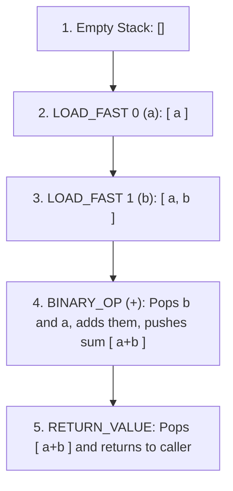

import { Callout } from "fumadocs-ui/components/callout";
import { Tabs, Tab } from "fumadocs-ui/components/tabs";
import { Accordion, Accordions } from "fumadocs-ui/components/accordion";

CPython is an emulation of a computer processor implemented entirely in software: a **Virtual Machine (VM)**.

Unlike physical x86 or ARM CPUs which are register-based, **CPython is a Stack Machine**. Instructions push operands onto a virtual evaluation stack, and operators pop them off to compute results.

---

## 1. Disassembling Python with `dis.dis()`

You can view the exact bytecode instructions generated for any Python function using the standard **`dis`** module:

```python
import dis

def add_numbers(a: int, b: int) -> int:
    return a + b

dis.dis(add_numbers)
```

Output:

```text
  1           0 RESUME                   0

  2           2 LOAD_FAST                0 (a)
              4 LOAD_FAST                1 (b)
              6 BINARY_OP                0 (+)
             10 RETURN_VALUE
```

### Deconstructing the Stack Operations:



---

## 2. Inside `ceval.c`: The Central Evaluation Loop

At the center of CPython sits a massive C source file: `Python/ceval.c`. Inside it lives the core function:

```c
// Simplified excerpt from Python/ceval.c
PyObject* _PyEval_EvalFrameDefault(PyThreadState *tstate, InterpreterFrame *frame) {
    for (;;) {
        opcode = NEXTOP();
        switch (opcode) {
            case LOAD_FAST:
                PUSH(GETLOCAL(oparg));
                DISPATCH();
            case BINARY_OP:
                right = POP();
                left = TOP();
                SET_TOP(PyNumber_Add(left, right));
                DISPATCH();
            case RETURN_VALUE:
                return POP();
        }
    }
}
```

The virtual machine runs in an infinite loop: fetching the next bytecode instruction, jumping to the corresponding C handler via a switch statement, manipulating the stack, and advancing the program counter.

---

## 3. The Faster CPython Revolution: PEP 659 & The 3.13 JIT

In recent releases, the CPython core team has radically modernized this execution model:

### Tier 1: Specializing Adaptive Interpreter (Python 3.11+, PEP 659)

Historically, generic instructions like `BINARY_OP` had to dynamically check at runtime whether operands were integers, floats, strings, or custom classes with `__add__`.
In modern CPython, instructions **monitor runtime types**. If a loop consistently adds integers, the generic `BINARY_OP` morphs in place into a specialized instruction: `BINARY_OP_ADD_INT`, skipping dynamic method lookups completely!

### Tier 2: The Copy-and-Patch JIT Compiler (Python 3.13+, PEP 744)

Python 3.13 introduces an experimental **Copy-and-Patch Just-In-Time (JIT) Compiler**:

1. High-frequency loops are recorded as **Tier 2 micro-ops (`uops`) execution traces**.
2. Pre-compiled native machine code templates ("stencils", built using LLVM during CPython compilation) are copied into executable memory.
3. The runtime patches memory addresses and immediate constants directly into the machine code.
4. The CPU then executes **raw native machine instructions** directly on the silicon!

---

## Practice Questions & Challenges

Hone your mental model of the CPython stack machine, bytecode inspection, and JIT specialization:

### Question 1: Output Prediction (LOAD_FAST vs LOAD_GLOBAL Performance)

Compare the disassembled bytecode of these two functions accessing a configuration variable:

```python
import dis

MAX_TIMEOUT = 30

def check_global():
    return MAX_TIMEOUT

def check_local(timeout=MAX_TIMEOUT):
    return timeout

print("--- check_global ---")
dis.dis(check_global)

print("--- check_local ---")
dis.dis(check_local)
```

Which instruction is generated for each function, and why is `LOAD_FAST` substantially faster than `LOAD_GLOBAL` at the C level?

<Accordions>
<Accordion title="Solution & Breakdown">
**Bytecode Comparison:**
```text
--- check_global ---
  2           0 LOAD_GLOBAL              0 (MAX_TIMEOUT)
              2 RETURN_VALUE

--- check_local ---
2 0 LOAD_FAST 0 (timeout)
2 RETURN_VALUE

````

**Explanation:**
1. `check_global` emits `LOAD_GLOBAL`. At the C level, `LOAD_GLOBAL` must perform hash table lookups: first in the module's `__dict__`, and if not found, in the `builtins.__dict__`. While Python 3.11 adds an inline cache to `LOAD_GLOBAL`, it still involves pointer checks and cache validation.
2. `check_local` emits `LOAD_FAST`. Local variables and function arguments are stored in a fixed-size contiguous **C array** (`fastlocals`) directly on the stack frame.
3. Accessing `LOAD_FAST 0` is a raw C array index offset: `frame->localsplus[0]`. It requires zero hashing, zero dictionary lookups, and single-cycle memory reads. Binding globals as default parameter values is a classic high-performance Python micro-optimization!

</Accordion>
</Accordions>

---

### Question 2: Spot and Fix the Bug (Bytecode Tampering and Missing Stack Balance)
A developer attempts to modify a function's bytecode dynamically to skip an authorization check by replacing `POP_JUMP_IF_FALSE` with `NOP` (no operation). However, the program crashes with `SystemError: XXX stack overflow` or returns incorrect values:

```python
import types

def sensitive_action(user, is_admin):
    if not is_admin:
        return "Access Denied"
    return "Secret Admin Data"

# Developer replaces bytecode opcodes naively:
# In CPython 3.12+, simply overwriting jump instructions corrupts stack alignment!
````

Explain why altering raw bytecode bytes without recomputing stack depth causes CPython to crash, and what API should be used instead.

<Accordions>
<Accordion title="Solution & Breakdown">
**The Root Cause:**
CPython bytecode verification enforces strict stack balance invariants:
1. Every opcode has a defined stack effect (e.g. `LOAD_CONST` pushes 1, `BINARY_OP` pops 2 and pushes 1, `POP_JUMP_IF_FALSE` pops 1).
2. The code object header contains `co_stacksize`—the exact maximum stack depth statically computed by the compiler.
3. If you replace an opcode that consumes stack items (like `POP_JUMP_IF_FALSE`) with `NOP` (which does nothing), the evaluation stack leaves dangling, unconsumed items. The stack pointer drifts on every loop iteration until it overflows the allocated C frame buffer, resulting in a fatal `SystemError` or core dump.

**The Fix:**
Never patch raw bytecode byte arrays directly in production. Use higher-level bytecode assembler/disassembler libraries like `bytecode` or rewrite the Abstract Syntax Tree (AST) using `ast.NodeTransformer` before compiling!

</Accordion>
</Accordions>

---

### Question 3: Architecture Deep-Dive (Register Machines vs Stack Machines)

Why did CPython choose a **Stack Machine** architecture over a **Register Machine** (like the LuaJIT VM or Dalvik/Android VM)? What are the advantages and drawbacks?

<Accordions>
<Accordion title="Solution & Breakdown">
**Stack Machine (CPython, JVM):**
- **Simplicity of Code Generation:** Emitting instructions from an AST is straightforward. Traversing an expression tree recursively and emitting `PUSH` and `POP` requires almost zero compiler complexity.
- **Instruction Density:** Instructions do not need to encode source and destination register numbers. Many opcodes are only 1 or 2 bytes long (e.g. `BINARY_OP`, `RETURN_VALUE`).
- **Drawback:** High instruction count and memory traffic. Simple arithmetic (`a + b`) requires three instructions (`LOAD_FAST a`, `LOAD_FAST b`, `BINARY_OP`) and multiple pushes/pops on the stack.

**Register Machine (LuaJIT, Dalvik):**

- **How it works:** Instructions explicitly name virtual registers: `ADD R1, R2, R3`.
- **Advantage:** Fewer instructions executed per operation. Matches modern x86/ARM hardware registers much closer, enabling faster execution in pure interpreters.
- **Drawback:** Larger instruction encoding size and much more complex compiler passes (register allocation, graph coloring algorithms).

</Accordion>
</Accordions>

---

### Question 4: Hands-On Challenge (Bytecode Instruction Analyzer)

Write a function `analyze_function_opcodes(func)` that uses `dis.get_instructions(func)` to inspect any Python function and return a dictionary summarizing:

- Total number of instructions.
- Frequency count of each opcode name.
- Whether the function performs any dynamic global lookups (`LOAD_GLOBAL`).

<Accordions>
<Accordion title="Solution & Breakdown">
```python
import dis
from collections import Counter
from typing import Callable, Dict, Any

def analyze_function_opcodes(func: Callable) -> Dict[str, Any]:
instructions = list(dis.get_instructions(func))
op_counts = Counter(instr.opname for instr in instructions)

    has_globals = "LOAD_GLOBAL" in op_counts
    global_names = [
        instr.argval for instr in instructions
        if instr.opname == "LOAD_GLOBAL"
    ]

    return {
        "function_name": func.__name__,
        "total_instructions": len(instructions),
        "opcode_counts": dict(op_counts),
        "has_global_lookups": has_globals,
        "referenced_globals": list(set(global_names))
    }

# Verification

def sample_task(x: int) -> float:
import math
return math.sqrt(x) + 42.0

analysis = analyze_function_opcodes(sample_task)
print(f"Function: {analysis['function_name']}")
print(f"Total Opcodes: {analysis['total_instructions']}")
print(f"Has Global Lookups: {analysis['has_global_lookups']}")
print(f"Referenced Globals: {analysis['referenced_globals']}")

````

</Accordion>
</Accordions>

---

### Question 5: Code Challenge (Building a Stack Machine VM in Pure Python)
Implement a minimal virtual stack machine `MiniVM` that executes a list of bytecode instructions:
1. Supports instructions:
   - `("LOAD_CONST", value)`: Pushes `value` onto evaluation stack.
   - `("STORE_NAME", name)`: Pops value and stores in variable environment dictionary.
   - `("LOAD_NAME", name)`: Pushes value of variable from environment onto stack.
   - `("ADD", None)`: Pops two values, adds them, and pushes result.
   - `("PRINT", None)`: Pops and prints top value.
   - `("HALT", None)`: Stops execution.
2. Runs the program to calculate `(15 + 25)` and store in `result`.

<Accordions>
<Accordion title="Solution & Breakdown">
```python
class MiniVM:
    def __init__(self):
        self.stack = []
        self.environment = {}

    def run(self, bytecode: list[tuple[str, any]]):
        pc = 0  # Program counter
        while pc < len(bytecode):
            opcode, arg = bytecode[pc]
            pc += 1

            if opcode == "LOAD_CONST":
                self.stack.append(arg)
            elif opcode == "STORE_NAME":
                val = self.stack.pop()
                self.environment[arg] = val
            elif opcode == "LOAD_NAME":
                if arg not in self.environment:
                    raise NameError(f"Undefined variable: '{arg}'")
                self.stack.append(self.environment[arg])
            elif opcode == "ADD":
                right = self.stack.pop()
                left = self.stack.pop()
                self.stack.append(left + right)
            elif opcode == "PRINT":
                val = self.stack.pop()
                print(f"[VM OUTPUT] {val}")
            elif opcode == "HALT":
                break
            else:
                raise ValueError(f"Unknown instruction: {opcode}")

# Verification Program:
# a = 15
# b = 25
# result = a + b
# print(result)
program = [
    ("LOAD_CONST", 15),
    ("STORE_NAME", "a"),
    ("LOAD_CONST", 25),
    ("STORE_NAME", "b"),
    ("LOAD_NAME", "a"),
    ("LOAD_NAME", "b"),
    ("ADD", None),
    ("STORE_NAME", "result"),
    ("LOAD_NAME", "result"),
    ("PRINT", None),
    ("HALT", None)
]

vm = MiniVM()
vm.run(program)
print("VM Memory State:", vm.environment)
assert vm.environment["result"] == 40
````

</Accordion>
</Accordions>

---

## Summary Reference

- **Stack Machine**: CPython uses an evaluation stack (`PUSH` and `POP`) rather than hardware CPU registers.
- **`dis.dis(fn)`**: Disassembles functions into readable bytecode instructions.
- **`ceval.c`**: The central evaluation loop in CPython source code.
- **PEP 659 (Adaptive Specialization)**: Dynamically replaces generic opcodes with type-specialized fast paths.
- **PEP 744 (Copy-and-Patch JIT)**: Compiles frequent uop execution traces into native machine code.
