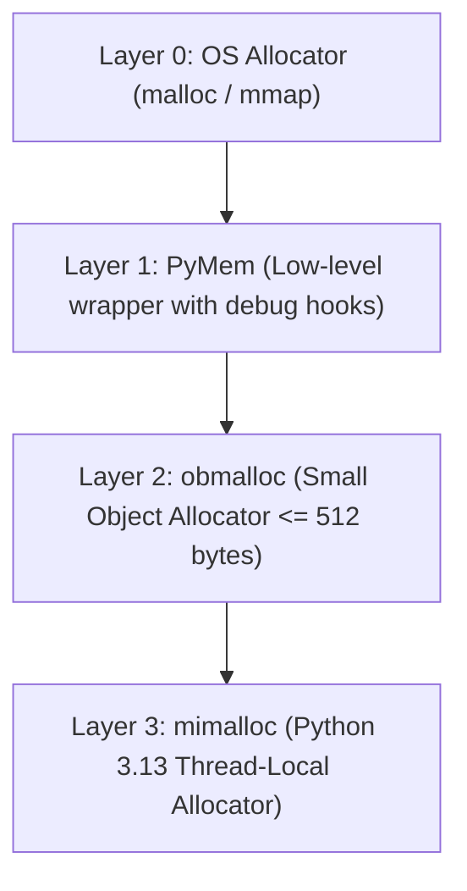
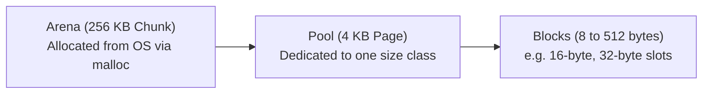

import { Callout } from "fumadocs-ui/components/callout";
import { Tabs, Tab } from "fumadocs-ui/components/tabs";
import { Accordion, Accordions } from "fumadocs-ui/components/accordion";

In CPython, every variable you assign points to a C structure defined in the CPython source code.

Understanding this C-level struct layout and Python's custom **`obmalloc` memory allocator** demystifies why Python objects have memory overhead and how the runtime achieves fast small-object allocation.

---

## 1. Anatomy of a `PyObject` (`Include/object.h`)

Every Python object begins with a standardized C header defined by `PyObject`:

```c
// Simplified excerpt from Include/object.h
struct _object {
    _PyObject_HEAD_EXTRA  // Doubly-linked list pointers for GC tracking
    Py_ssize_t ob_refcnt; // 64-bit integer reference count
    PyTypeObject *ob_type;// Pointer to the object's type descriptor
};
```

For variable-length collections (like strings, lists, tuples), CPython uses **`PyVarObject`**, which appends a length field:

```c
struct _varobject {
    PyObject ob_base;
    Py_ssize_t ob_size;   // Number of items in collection
};
```

### Why Does an Integer Take 28 Bytes in Python?

In C, an integer takes 4 or 8 bytes. In Python:

```python
import sys

x = 42
print("Size of integer 42 in RAM:", sys.getsizeof(x), "bytes")
```

Output:

```text
Size of integer 42 in RAM: 28 bytes
```

Where did 28 bytes come from?

- `ob_refcnt`: 8 bytes
- `ob_type`: 8 bytes
- `ob_size`: 8 bytes (since Python integers have arbitrary precision)
- Numeric digits array: 4 bytes
- Total: **28 bytes**!

---

## 2. The Multi-Tier Memory Allocator (`obmalloc`)

Making an operating system system call (`malloc` / `free`) for every tiny integer or string would introduce crippling overhead. CPython implements a multi-tier memory hierarchy:



### How `obmalloc` Manages Small Allocations:

For allocations of **512 bytes or less**, CPython bypasses the OS allocator using a three-tiered spatial structure:



1. **Arenas (256 KB)**: Large memory chunks requested from the OS via `malloc()`.
2. **Pools (4 KB)**: An arena is carved into 4 KB subdivisions called pools. Each pool is dedicated to a specific **size class** (e.g., 32-byte objects).
3. **Blocks (8 to 512 bytes)**: A pool is partitioned into equal-sized slots called blocks. Allocating a 32-byte object simply grabs a free block pointer from a singly linked list in $O(1)$ time!

---

## 3. Python 3.13 & Microsoft `mimalloc`

In Python 3.13, CPython integrated Microsoft's high-performance **`mimalloc`** allocator.

`mimalloc` provides thread-local free lists and decentralized heap management, eliminating the global lock contention that would otherwise cripple **free-threaded Python builds (PEP 703)** when hundreds of threads allocate objects concurrently.

---

## Practice Questions & Challenges

Deepen your understanding of CPython C-structures, object sizing, and low-level memory allocation:

### Question 1: Output Prediction (Integer Interning & Small Integer Cache)

What does the identity operator `is` return in the following two comparisons, and why?

```python
a = 250
b = 250
print("250 is 250:", a is b)

x = 1000
y = 1000
print("1000 is 1000:", x is y)
```

<Accordions>
<Accordion title="Solution & Breakdown">
**Output (in interactive shell / standard CPython):**
```text
250 is 250: True
1000 is 1000: False
```

**Explanation:**

1. CPython pre-allocates an array of small integer objects at startup for integers in the range `[-5, 256]`.
2. Any time your code creates an integer in this range (such as `250`), CPython simply returns a pointer to the existing pre-allocated singleton object. Hence `a is b` is `True` (they share the identical C `PyObject*` pointer address).
3. For numbers outside this range (like `1000`), CPython allocates a brand-new `PyLongObject` in memory. `x` and `y` hold different heap addresses, so `x is y` is `False`!
   _(Note: In a single compiled file or code block, compiler constant folding may reuse the same constant within the module code object, but dynamically generated numbers like `int("1000") is int("1000")` will always be `False`)._
   </Accordion>
</Accordions>

---

### Question 2: Spot and Fix the Bug (ctypes Raw Pointer Memory Corruption)

A systems engineer uses `ctypes` to read the C `ob_refcnt` directly from a Python object, but inadvertently corrupts the memory header, causing an immediate segmentation fault:

```python
import ctypes

def inspect_and_modify_refcount(obj):
    # Retrieve memory address
    address = id(obj)

    # Cast address to a C Py_ssize_t pointer (ob_refcnt is the first field)
    refcnt_ptr = ctypes.cast(address, ctypes.POINTER(ctypes.c_ssize_t))
    print("Direct refcount from C struct:", refcnt_ptr.contents.value)

    # CRITICAL BUG: Manually overwriting ob_refcnt!
    refcnt_ptr.contents.value = 0  # Forces crash when memory freed!
```

Explain why manually tampering with `ob_refcnt` causes undefined behavior and write a safe inspection script that reads both `ob_refcnt` and `ob_type` without modifying struct state.

<Accordions>
<Accordion title="Solution & Breakdown">
**The Root Cause:**
Setting `ob_refcnt = 0` via raw pointer bypasses Python's deallocation routines. The next time the garbage collector or allocator visits the arena block or Python tries to release the object, it encounters an inconsistent free list, leading to memory double-frees and catastrophic Segmentation Faults (SIGSEGV).

**Safe Read-Only C Struct Definition:**

```python
import ctypes
import sys

# Define matching C structure for PyObject
class PyObjectStruct(ctypes.Structure):
    pass

PyObjectStruct._fields_ = [
    ("ob_refcnt", ctypes.c_ssize_t),
    ("ob_type", ctypes.c_void_p)
]

def safely_inspect_c_header(obj):
    ptr = ctypes.cast(id(obj), ctypes.POINTER(PyObjectStruct))
    refcnt = ptr.contents.ob_refcnt
    type_ptr = ptr.contents.ob_type

    print(f"Object: {obj}")
    print(f"- ob_refcnt (C struct): {refcnt}")
    print(f"- ob_type (C pointer):  {hex(type_ptr)}")
    print(f"- Verified type address: {hex(id(type(obj)))}")

# Verification
sample = [10, 20, 30]
safely_inspect_c_header(sample)
```

</Accordion>
</Accordions>

---

### Question 3: Architecture Deep-Dive (Why mimalloc Replaces Traditional obmalloc in Free-Threaded Python)

Why was Microsoft's `mimalloc` chosen to replace or augment `obmalloc` for Python 3.13's free-threaded build (PEP 703)? What makes traditional `obmalloc` unsuitable for multi-threaded scaling without a GIL?

<Accordions>
<Accordion title="Solution & Breakdown">
**The obmalloc Concurrency Bottleneck:**
- In standard CPython, `obmalloc` is **not thread-safe**. It relied entirely on the **Global Interpreter Lock (GIL)** to prevent concurrent threads from mutating the same Arena, Pool, and free-block linked lists.
- If the GIL is disabled, every call to allocate or free an object (even a temporary float or integer) would require acquiring an operating system mutex lock.
- Under high multi-threaded concurrency (e.g. 32 worker threads), threads would spend 80% of their execution time stalled waiting on memory allocator locks!

**How mimalloc Solves This:**

- **Thread-Local Heaps:** Each thread allocates memory from its own dedicated thread-local cache without acquiring locks.
- **Atomic Free Lists:** When Thread A frees an object that was originally allocated by Thread B, `mimalloc` uses lock-free atomic CAS (Compare-And-Swap) queues to return the memory to Thread B's deferred free list.
- **Zero Lock Contention:** Python threads can allocate and deallocate billions of objects in parallel with linear performance scaling.
  </Accordion>
</Accordions>

---

### Question 4: Hands-On Challenge (Deep Memory Size Profiler for Nested Objects)

Python's `sys.getsizeof()` is shallow: for a list of dictionaries, it only counts the bytes of the pointers in the list, not the dictionaries or the strings they contain!

Implement a recursive memory size calculator `total_deep_size(obj)` that traverses nested containers (lists, dicts, tuples, sets) and custom objects, counting total heap bytes while tracking visited `id(obj)` to prevent infinite loops on circular references.

<Accordions>
<Accordion title="Solution & Breakdown">
```python
import sys
from collections.abc import Mapping, Container

def total_deep_size(obj, seen=None) -> int:
"""Recursively calculates deep memory footprint of any Python data structure."""
if seen is None:
seen = set()

    obj_id = id(obj)
    if obj_id in seen:
        return 0
    seen.add(obj_id)

    size = sys.getsizeof(obj)

    # Traverse mappings (dicts)
    if isinstance(obj, Mapping):
        for k, v in obj.items():
            size += total_deep_size(k, seen)
            size += total_deep_size(v, seen)
    # Traverse sequence containers (excluding strings/bytes which are raw buffers)
    elif isinstance(obj, (list, tuple, set, frozenset)):
        for item in obj:
            size += total_deep_size(item, seen)
    # Traverse custom class instances
    elif hasattr(obj, "__dict__"):
        size += total_deep_size(obj.__dict__, seen)
    elif hasattr(obj, "__slots__"):
        for slot in obj.__slots__:
            if hasattr(obj, slot):
                size += total_deep_size(getattr(obj, slot), seen)

    return size

# Verification

nested_data = {
"users": [
{"id": 1, "name": "Alice", "tags": {"admin", "staff"}},
{"id": 2, "name": "Bob", "tags": {"guest"}}
]
}

print("Shallow size: ", sys.getsizeof(nested_data), "bytes")
print("Total deep size:", total_deep_size(nested_data), "bytes")
assert total_deep_size(nested_data) > 1000

````
</Accordion>
</Accordions>

---

### Question 5: Code Challenge (Simulating Arena-Pool-Block Memory Allocation)
Build an educational simulation class `ToyObmalloc` that mimics `obmalloc`:
1. Manages a fixed memory pool of 1024 bytes.
2. Carves it into 32-byte blocks.
3. Maintains a free list of available block indices.
4. Provides `allocate() -> int` returning block index in $O(1)$ time and `free(index)` returning it to the pool in $O(1)$ time.
5. Raises `MemoryError` when all blocks in the pool are exhausted.

<Accordions>
<Accordion title="Solution & Breakdown">
```python
class ToyObmallocPool:
    BLOCK_SIZE = 32
    TOTAL_BYTES = 1024
    NUM_BLOCKS = TOTAL_BYTES // BLOCK_SIZE  # 32 blocks

    def __init__(self):
        # Simulated raw memory buffer
        self.buffer = bytearray(self.TOTAL_BYTES)
        # Singly linked free list represented as a Python list of indices
        self.free_list = list(range(self.NUM_BLOCKS))
        self.allocated_count = 0

    def allocate(self) -> int:
        """Grabs next available block in O(1) time."""
        if not self.free_list:
            raise MemoryError("Pool full: All 32-byte blocks in arena pool exhausted!")

        block_idx = self.free_list.pop()
        self.allocated_count += 1
        return block_idx

    def free(self, block_idx: int):
        """Returns block to free list in O(1) time."""
        if block_idx < 0 or block_idx >= self.NUM_BLOCKS:
            raise ValueError(f"Invalid block index: {block_idx}")

        # Zero out memory for security
        start = block_idx * self.BLOCK_SIZE
        self.buffer[start : start + self.BLOCK_SIZE] = b"\x00" * self.BLOCK_SIZE

        self.free_list.append(block_idx)
        self.allocated_count -= 1

# Verification
pool = ToyObmallocPool()
allocated_blocks = []

# Allocate all 32 blocks
for _ in range(32):
    allocated_blocks.append(pool.allocate())

print(f"Allocated {len(allocated_blocks)} blocks. Free count: {len(pool.free_list)}")

# 33rd allocation should raise MemoryError
try:
    pool.allocate()
except MemoryError as err:
    print("Caught expected pool exhaustion:", err)

# Free block 5 and re-allocate
pool.free(allocated_blocks[5])
new_block = pool.allocate()
print(f"Re-allocated released block: {new_block}")
assert new_block == allocated_blocks[5]
````

</Accordion>
</Accordions>

---

## Summary Reference

- **`PyObject`**: The base C struct header of every Python object containing `ob_refcnt` and `ob_type`.
- **`obmalloc`**: CPython's dedicated allocator for objects $\le 512$ bytes.
- **Hierarchy**: Arenas (256 KB) → Pools (4 KB) → Blocks (8–512 B).
- **`mimalloc`**: Modern allocator integrated in Python 3.13 to enable scalable multi-threaded allocations without lock contention.
