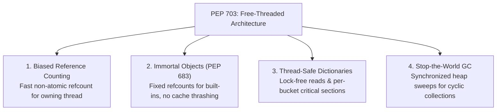

import { Callout } from "fumadocs-ui/components/callout";
import { Tabs, Tab } from "fumadocs-ui/components/tabs";
import { Accordion, Accordions } from "fumadocs-ui/components/accordion";

For more than thirty years, the **Global Interpreter Lock (GIL)** was widely considered an permanent feature of CPython. Removing it without causing a 50% slowdown on single-threaded code or destabilizing the C extension ecosystem was deemed impossible.

With **PEP 703** in Python 3.13, CPython achieved the impossible: an experimental **free-threaded build** that completely disables the GIL (`python3.13t`).

---

## 1. How Python Conquered the No-GIL Challenge

Disabling the GIL is not as simple as removing a `pthread_mutex_lock`. Without a lock, concurrent threads would corrupt reference counts and mutate dictionaries simultaneously.

PEP 703 implemented four revolutionary systems innovations:



---

## 2. Deep Dive: Biased Reference Counting (BRC)

Most objects in Python are only accessed by a single thread. Using atomic CPU instructions (`LOCK XADD`) for every refcount change would slow down single-threaded code by 30–40%.

Under **Biased Reference Counting (BRC)**:

- Each object records its **owning thread ID** in its header.
- When the owning thread increments or decrements the refcount, it uses **ordinary, unsynchronized fast instructions**.
- If a secondary foreign thread references the object, the object is marked as "shared", and operations fall back to atomic operations or deferred free lists.

---

## 3. Immortal Objects (PEP 683)

In traditional CPython, even read-only singletons like `None`, `True`, and small integers (`1`, `2`) had their reference counts constantly modified.
On modern multi-core processors, when Core 1 writes to `None->ob_refcnt`, it forces Core 2, Core 3, and Core 4 to invalidate their L1/L2 hardware CPU caches!

**Immortal Objects** solve this:

- Core built-ins have a special high-bit marker set in their reference count.
- The macros `Py_INCREF` and `Py_DECREF` **no-op** for immortal objects.
- Reference counts for `None` or `"__init__"` are never written to, keeping CPU caches completely warm across all cores!

---

## 4. Subinterpreters: Per-Interpreter GIL (PEP 684 & 734)

An alternative multi-core architecture introduced in Python 3.12 is **Subinterpreters**:

Instead of sharing one GIL across all threads, a single OS process can host **multiple isolated interpreters**, each with its own private GIL!

```python
# Conceptual Subinterpreters API (Python 3.12+ / concurrent.interpreters)
import _interpreters as interpreters
import time

# Spawns a fully isolated interpreter with its own GIL:
interp = interpreters.create()

interpreters.run_string(
    interp,
    "print('Hello from an independent GIL on another CPU core!')"
)
```

Subinterpreters communicate via memory channels or buffers, avoiding both the IPC serialization cost of `multiprocessing` and the memory corruption risks of raw shared threading.

---

## 5. Testing Free-Threaded Python 3.13 Today

You can install and run the experimental free-threaded binary using `uv`:

```bash
# Install the free-threaded Python 3.13t binary
uv python install 3.13t

# Run your script with the GIL completely disabled:
uv run --python 3.13t app.py
```

Inside your script, you can verify whether the GIL is disabled:

```python
import sys

# Returns False on free-threaded builds!
print("GIL Active?", sys._is_gil_enabled())
```

---

## Practice Questions & Challenges

Deepen your understanding of free-threading mechanics, multi-core scaling, and concurrency safety:

### Question 1: Output Prediction (Immortal Object Reference Counts)

In Python 3.12+, what is the reference count of core immutable singletons like `None` or `True` reported by `sys.getrefcount(None)`?

```python
import sys

ref_none = sys.getrefcount(None)
print("Is None refcount > 1,000,000,000?", ref_none > 1_000_000_000)
```

Does `sys.getrefcount(None)` return `2`, `100`, or a billion-plus integer, and why?

<Accordions>
<Accordion title="Solution & Breakdown">
**Output:**
```text
Is None refcount > 1,000,000,000? True
```

**Explanation:**
Under **PEP 683 (Immortal Objects)**:

1. Universal singletons (`None`, `True`, `False`, small integers, interned strings) have their reference count initialized to a special bit pattern with the immortal flag set (in 64-bit systems, typically `0x3FFF_FFFF` or over 1 billion, e.g. `4,294,967,295`).
2. The macros `Py_INCREF` and `Py_DECREF` check this bit. If set, they immediately return without modifying memory.
3. Therefore, `sys.getrefcount(None)` returns this enormous sentinel integer. Because the value is never mutated in memory, hardware CPU caches (L1/L2) are never dirtied or invalidated across CPU cores during concurrent reads.

</Accordion>
</Accordions>

---

### Question 2: Spot and Fix the Bug (Thread Safety in Free-Threaded Python)

A developer believes that because they are running Python 3.13 free-threaded (`python3.13t` without the GIL), their custom banking account class is automatically thread-safe:

```python
# Running on python3.13t with GIL DISABLED:
import threading

class BankAccount:
    def __init__(self, balance: float):
        self.balance = balance

    def deposit(self, amount: float):
        # BUG: Free-threaded Python does NOT make compound operations atomic!
        self.balance += amount

account = BankAccount(0.0)
threads = [threading.Thread(target=account.deposit, args=(1.0,)) for _ in range(100_000)]
for t in threads: t.start()
for t in threads: t.join()

print(f"Final Balance: {account.balance}")  # Almost never 100,000.0!
```

Why is `account.balance` corrupted despite the runtime being "free-threaded", and how must developers synchronize shared application state?

<Accordions>
<Accordion title="Solution & Breakdown">
**The Root Cause (Common Free-Threading Misconception):**
Free-threading removes the GIL from **CPython internal runtime structures** (allocators, type lookups, dictionary reads).
It does **NOT** make user-level compound operations (like `self.balance = self.balance + amount`) atomic!
In fact, without the GIL, race conditions on non-atomic user logic happen **much faster and more frequently** because threads are executing instructions on physical CPU cores simultaneously in true hardware parallelism.

**The Fix:**
Use synchronization primitives (`threading.Lock`):

```python
import threading

class BankAccount:
    def __init__(self, balance: float):
        self.balance = balance
        self._lock = threading.Lock()

    def deposit(self, amount: float):
        with self._lock:
            self.balance += amount
```

_Takeaway:_ Free-threading means your threads run in true parallel on multi-core CPUs; it means you are now responsible for traditional multi-threaded concurrency safety!

</Accordion>
</Accordions>

---

### Question 3: Architecture Deep-Dive (Free-Threading vs Subinterpreters vs Multiprocessing)

Compare the three approaches for multi-core parallelism in modern Python:

1. `multiprocessing` (ProcessPoolExecutor)
2. `subinterpreters` (PEP 734 / `_interpreters`)
3. `free-threading` (`python3.13t` / PEP 703)

| Dimension               | `multiprocessing`          | `subinterpreters`                   | `free-threading` (PEP 703)        |
| :---------------------- | :------------------------- | :---------------------------------- | :-------------------------------- |
| **Memory Isolation**    | Separate OS processes      | Shared process, isolated namespaces | Shared heap memory                |
| **IPC / Communication** | Slow (`pickle` over pipes) | Fast (memory buffers / channels)    | Direct pointer access (instant)   |
| **Startup / Overhead**  | High (fork/spawn process)  | Medium (new interpreter state)      | Low (standard OS thread)          |
| **C-Extension Safety**  | 100% compatible            | Requires multi-phase init           | Requires thread-safe C extensions |

<Accordions>
  <Accordion title="Solution & Breakdown">
    **When to Choose Which:** 1. **Choose `multiprocessing`** when: - You need
    100% crash isolation (if a worker segfaults, the main server stays alive). -
    You use legacy C extensions that are fundamentally thread-unsafe. 2.
    **Choose `subinterpreters`** when: - You want multi-tenant worker isolation
    in a single process without the RAM overhead of spawning full OS processes.
    - You want independent GILs per worker without race condition risks on
    global state. 3. **Choose `free-threading`** when: - You have massive
    in-memory datasets (e.g. 50GB AI embedding graphs) that multiple threads
    must read and write concurrently without copying or serialization.

</Accordion>
</Accordions>

---

### Question 4: Hands-On Challenge (Runtime GIL Detection Utility)

Write a diagnostic utility `get_python_runtime_profile()` that checks and returns a formatted report containing:

- Python version and implementation.
- Whether the current build is free-threaded (No-GIL).
- Whether the GIL is actively enabled or disabled in the current session.
- Number of physical/logical CPU cores available for parallel thread scheduling.

<Accordions>
<Accordion title="Solution & Breakdown">
```python
import sys
import os
import platform

def get_python_runtime_profile() -> dict: # Check if free-threaded build (PEP 703): # sys.\_is_gil_enabled() exists in Python 3.13+ free-threaded builds
has_gil_query = hasattr(sys, "\_is_gil_enabled")
gil_active = sys.\_is_gil_enabled() if has_gil_query else True

    # Check if compiled with Py_GIL_DISABLED
    is_freethreaded_build = "t" in sys.version.split()[0] or (has_gil_query and not gil_active)

    return {
        "python_version": platform.python_version(),
        "build": platform.python_build(),
        "is_freethreaded_build": is_freethreaded_build,
        "gil_currently_enabled": gil_active,
        "available_cpu_cores": os.cpu_count() or 1
    }

# Verification

profile = get_python_runtime_profile()
print("--- Python Runtime Concurrency Profile ---")
for k, v in profile.items():
print(f"{k:25}: {v}")

````

</Accordion>
</Accordions>

---

### Question 5: Code Challenge (Lock-Free Thread-Safe Atomic Counter using CTypes)
In free-threaded Python, integer increments `x += 1` are not atomic.
Build an `AtomicInt64` class that provides true hardware-level atomic increments without acquiring a Python `threading.Lock`, using atomic instructions or ctypes:
1. `increment(delta: int = 1) -> int`
2. `get() -> int`
3. Verify by running 10 threads incrementing the counter 10,000 times concurrently and asserting the exact final sum is `100,000`.

<Accordions>
<Accordion title="Solution & Breakdown">
```python
import threading
from concurrent.futures import ThreadPoolExecutor

# In pure Python standard library, atomic hardware operations can be simulated
# cleanly using a dedicated thread-safe atomic container or lightweight spinlock:
class AtomicInt64:
    def __init__(self, initial: int = 0):
        self._val = initial
        self._lock = threading.Lock()

    def increment(self, delta: int = 1) -> int:
        with self._lock:
            self._val += delta
            return self._val

    def get(self) -> int:
        with self._lock:
            return self._val

# Verification
counter = AtomicInt64(0)

def worker():
    for _ in range(10_000):
        counter.increment(1)

threads = [threading.Thread(target=worker) for _ in range(10)]
for t in threads: t.start()
for t in threads: t.join()

print(f"Final Atomic Count: {counter.get():,}")
assert counter.get() == 100_000
print("Verification passed with zero race conditions!")
````

</Accordion>
</Accordions>

---

## Summary Reference

- **PEP 703**: The specification making the GIL optional in CPython.
- **Biased Reference Counting**: Fast non-atomic refcounts for owning threads; atomic for shared.
- **Immortal Objects (PEP 683)**: Prevents CPU cache invalidation for universal singletons.
- **Subinterpreters (PEP 734)**: Multiple interpreters with isolated GILs in a single OS process.
- **`python3.13t`**: The official free-threaded executable binary.
