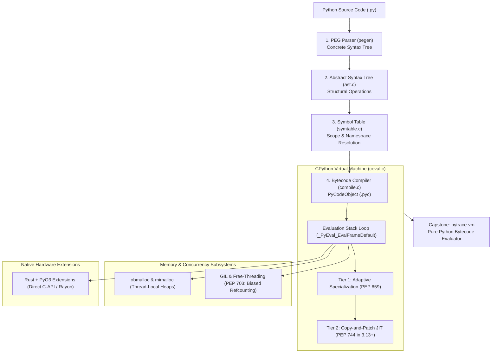

import { Callout } from "fumadocs-ui/components/callout";
import { Steps, Step } from "fumadocs-ui/components/steps";
import { Tabs, Tab } from "fumadocs-ui/components/tabs";

Welcome to **Stage 4: CPython Runtime Internals & Systems Engineering**.

In this final stage, you open the hood of the CPython C codebase itself (`github.com/python/cpython`) to understand how high-level abstractions map down to physical hardware registers, bytecode stacks, and memory arenas.

---

## Why Learn CPython Internals?

Most developers treat Python as a black box: text goes in, output comes out. However, mastering the runtime internals transforms how you engineer software:

1. **No Runtime Behavior is Mysterious**: When you understand `PyObject` headers, reference counters, and the symbol table, you can explain exactly why small integers are singletons, why variable scopes bind the way they do, and where memory leaks come from.
2. **Predict Performance Characteristics**: Knowing whether an instruction maps to `LOAD_FAST` (direct C array lookup) or `LOAD_GLOBAL` (hash table lookup with inline caching) lets you write inherently performant code without guessing.
3. **Bridge High-Level Logic to Native Speed**: With modern tools like **PyO3** and **Maturin**, writing native Rust extensions that release the GIL is no longer restricted to C compiler wizards.

---

## The Big Picture: The CPython Execution Engine

---

## Systems Architecture Decision Matrix

When optimizing or scaling Python systems in production, use this matrix to choose your engineering path:

| When your constraint is...       | Typical Scenario                                 | Recommended Architecture                 | Why?                                                                                    |
| :------------------------------- | :----------------------------------------------- | :--------------------------------------- | :-------------------------------------------------------------------------------------- |
| **Hot CPU Loop (Algorithmic)**   | String distance, parsing, crypto, compression    | **Rust + PyO3** (`maturin`)              | Memory-safe native CPU speed; releases the GIL via `py.allow_threads`.                  |
| **Multi-Core Data Sharing**      | Large in-memory ML graphs, embeddings            | **Free-Threaded Python 3.13t** (PEP 703) | Eliminates GIL overhead with `mimalloc` and biased reference counting.                  |
| **Isolated Parallel Execution**  | Multi-tenant SaaS plugins, untrusted jobs        | **Subinterpreters** (PEP 734)            | Independent GIL per interpreter without multi-process IPC memory duplication.           |
| **Dynamic AST Instrumentation**  | Linters, query rewrite engines, security sandbox | **`ast.NodeTransformer`**                | Modifies program semantics at compile-time before bytecode generation.                  |
| **Runtime Bottleneck Diagnosis** | Undiagnosed lag in live servers                  | **`dis` + `py-spy`**                     | Inspects raw opcode distribution and thread stack frames with zero production overhead. |

---

## Stage 4 Roadmap

<Steps>
<Step>
### [01. The CPython Compilation Pipeline](/docs/learn-python/04-systems-internals/01-cpython-execution-pipeline)
Navigate the CPython source tree: follow human-written code through the PEG Parser (`pegen`), Abstract Syntax Tree (`ast.c`), Symbol Table (`symtable.c`), and Control Flow Graph compiler (`compile.c`). Build custom compile-time AST transformers.
</Step>

<Step>
  ### [02. Bytecode & The Virtual Stack
  Machine](/docs/learn-python/04-systems-internals/02-bytecode-and-stack-machine)
  Deconstruct Python code objects (`PyCodeObject`) with `dis.dis()`. Step inside
  the evaluation loop (`_PyEval_EvalFrameDefault` in `ceval.c`), understand Tier
  1 Adaptive Specialization (PEP 659), and examine the Python 3.13
  Copy-and-Patch JIT (PEP 744).
</Step>

<Step>
  ### [03. PyObject Anatomy & The Multi-Tier
  Allocator](/docs/learn-python/04-systems-internals/03-pyobject-and-memory-allocator)
  Inspect the fundamental `PyObject` C header (`ob_refcnt`, `ob_type`), and
  learn how CPython avoids OS syscall overhead using the 3-tiered `obmalloc`
  hierarchy (Arenas $\rightarrow$ Pools $\rightarrow$ Blocks). Understand how
  Microsoft's `mimalloc` enables scalable thread-local allocations.
</Step>

<Step>
  ### [04. The GIL, Subinterpreters &
  Free-Threading](/docs/learn-python/04-systems-internals/04-gil-and-free-threaded-python)
  Understand the historical mechanics of the Global Interpreter Lock,
  Per-Interpreter GILs (PEP 684/734), and the free-threaded CPython build
  (`python3.13t` / PEP 703): Biased Reference Counting (BRC), Immortal Objects
  (PEP 683), and lock-free container operations.
</Step>

<Step>
  ### [05. Native Extensions with Rust &
  PyO3](/docs/learn-python/04-systems-internals/05-native-extensions-with-pyo3)
  Supercharge Python bottlenecks by building native, thread-safe extensions
  using Rust, **PyO3**, and `maturin`. Learn how PyO3 manages `PyObject`
  ownership, and release the GIL with `py.allow_threads` to unlock true
  multi-core CPU parallelism.
</Step>

<Step>
### [Capstone: pytrace-vm Bytecode Emulator](/docs/learn-python/04-systems-internals/capstone-bytecode-vm)
The ultimate systems test: construct a working virtual machine in pure Python that parses real `CodeType` bytecode objects and implements the CPython evaluation stack loop (`LOAD_CONST`, `STORE_NAME`, `BINARY_OP`, `POP_JUMP_IF_FALSE`, `RETURN_VALUE`).
</Step>
</Steps>
