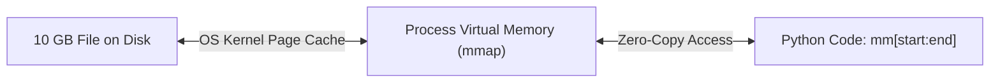

import { Callout } from "fumadocs-ui/components/callout";
import { Tabs, Tab } from "fumadocs-ui/components/tabs";
import { Accordion, Accordions } from "fumadocs-ui/components/accordion";

Attempting to read a 10 GB file into memory with `file.read()` will trigger an operating system memory exhaustion crash (`MemoryError`).

In this recipe, we compare two high-performance production patterns: **Chunked Buffer Streaming** and **Zero-Copy Memory-Mapped Files (`mmap`)**.

---

## Pattern 1: Chunked Buffer Streaming

For sequential operations like computing cryptographic hashes or encrypting files, process the file in fixed 64 KB buffers using the walrus operator:

```python
import hashlib
from pathlib import Path

def compute_sha256_constant_memory(file_path: Path, chunk_size: int = 65536) -> str:
    """Computes SHA-256 checksum of any size file using 64 KB of RAM."""
    hasher = hashlib.sha256()

    with file_path.open("rb") as f:
        # Walrus operator reads fixed 64 KB chunks until end of file:
        while chunk := f.read(chunk_size):
            hasher.update(chunk)

    return hasher.hexdigest()
```

This function can process a 100 GB database backup while using only **64 KB of RAM**.

---

## Pattern 2: Zero-Copy Memory-Mapped Files (`mmap`)

When you need random access to inspect, slice, or search inside a massive binary file, **`mmap`** maps the disk file directly into your process's **virtual address space**:



The operating system kernel pages bytes into physical RAM on demand when accessed, completely bypassing user-space copy buffers!

```python
import mmap
from pathlib import Path

def find_binary_signature(file_path: Path, signature: bytes) -> int:
    """Finds byte offset of a signature inside a multi-gigabyte file instantly."""
    with file_path.open("rb") as f:
        # Create read-only memory map:
        with mmap.mmap(f.fileno(), length=0, access=mmap.ACCESS_READ) as mm:
            # Slices and searches occur directly on OS kernel pages:
            offset = mm.find(signature)
            return offset

# Example usage:
file = Path("sample_data.bin")
file.write_bytes(b"HEADER_PADDING" + b"\xDE\xAD\xBE\xEF" + b"FOOTER")

offset = find_binary_signature(file, b"\xDE\xAD\xBE\xEF")
print("Found signature at byte offset:", offset)
```

Output:

```text
Found signature at byte offset: 14
```

---

## Slicing Without Copying: `memoryview`

When extracting sub-buffers from binary data or an `mmap`, Python's default slicing `bytes[0:1000]` creates a new copy of the bytes in memory.

A **`memoryview`** creates a pointer wrapper that references the existing underlying buffer:

```python
data = bytearray(b"X" * 1_000_000)

# 1. Standard slice: Allocates 1 MB of new memory
copied = data[0:500_000]

# 2. memoryview slice: Zero-copy pointer manipulation (0 bytes allocated!)
view = memoryview(data)
sub_view = view[0:500_000]

print("Sub-view length:", len(sub_view))
```

Output:

```text
Sub-view length: 500000
```

---

## Practice Questions & Challenges

Hone your low-level I/O efficiency, buffer management, and memory-mapping expertise:

### Question 1: Output Prediction (Modifying Memory-Mapped Files In-Place)

What happens to the file on disk when you write to a memory map opened with `access=mmap.ACCESS_WRITE`?

```python
import mmap
import tempfile

with tempfile.NamedTemporaryFile(delete=False) as tmp:
    tmp.write(b"HELLO WORLD")
    tmp_path = tmp.name

with open(tmp_path, "r+b") as f:
    with mmap.mmap(f.fileno(), 0, access=mmap.ACCESS_WRITE) as mm:
        mm[0:5] = b"SUPER"
        mm.flush()  # Flushes dirty pages to disk

with open(tmp_path, "rb") as f:
    print("Disk file contents:", f.read())
```

<Accordions>
<Accordion title="Solution & Breakdown">
**Output:**
```text
Disk file contents: b'SUPER WORLD'
```

**Explanation:**

1. Opening `mmap` with `access=mmap.ACCESS_WRITE` maps the underlying file directly into the process's writable virtual memory.
2. Mutating the slice `mm[0:5] = b"SUPER"` updates the memory page in the OS page cache.
3. Invoking `mm.flush()` forces the kernel to sync dirty memory pages down to physical disk blocks.
4. Subsequent reads directly from the file reflect the modified bytes without ever performing traditional `f.seek()` or `f.write()`!

</Accordion>
</Accordions>

---

### Question 2: Spot and Fix the Bug (Truncated Empty File mmap Error)

A developer attempts to memory-map a newly created output file to write structured records, but the program crashes with `ValueError: cannot mmap an empty file` (or `mmap: Invalid argument` on Linux/Windows):

```python
import mmap
from pathlib import Path

out_path = Path("output.bin")
# Creates empty 0-byte file:
out_path.touch()

with out_path.open("r+b") as f:
    # BUG: Crashes on 0-byte file!
    with mmap.mmap(f.fileno(), length=0) as mm:
        mm.write(b"Some binary payload")
```

Why cannot empty files be memory-mapped, and how do you pre-allocate file capacity using `truncate()` or `os.posix_fallocate()`?

<Accordions>
<Accordion title="Solution & Breakdown">
**The Root Cause:**
The OS kernel cannot map an address range of length zero into virtual memory pages. An `mmap` call requires a file size $\ge 1$ byte.

**The Fix:**
Pre-allocate the file size using `f.truncate(size)` before initializing `mmap`:

```python
import mmap
from pathlib import Path

out_path = Path("output.bin")

TARGET_SIZE = 1024 * 1024  # 1 MB

with out_path.open("w+b") as f:
    # 1. Pre-allocate disk space:
    f.truncate(TARGET_SIZE)

    # 2. Map the 1 MB buffer into virtual memory:
    with mmap.mmap(f.fileno(), length=TARGET_SIZE, access=mmap.ACCESS_WRITE) as mm:
        mm[0:19] = b"Some binary payload"
        mm.flush()

print(f"Successfully allocated and wrote to {out_path} ({out_path.stat().st_size:,} bytes)")
```

</Accordion>
</Accordions>

---

### Question 3: Architecture Deep-Dive (Zero-Copy Socket Transfers with sendfile vs mmap)

Explain how Linux/Unix `os.sendfile()` achieves true **zero-copy** networking compared to reading from disk and writing to a socket in user space:

```text
Standard Read/Write:
Disk -> Kernel Page Cache -> User Space Buffer -> Kernel Socket Buffer -> NIC

Zero-Copy sendfile:
Disk -> Kernel Page Cache ------------------------> Kernel Socket Buffer -> NIC
```

<Accordions>
<Accordion title="Solution & Breakdown">
**Traditional I/O Transfer:**
1. `f.read()` executes a syscall, copying data from disk into the OS kernel page cache.
2. The kernel copies bytes across the user/kernel space barrier into Python's process heap buffer.
3. `sock.send()` executes another syscall, copying bytes from Python memory back into kernel socket buffers.
4. Total: **4 context switches and 2 redundant CPU memory copies**.

**Zero-Copy (`os.sendfile(out_fd, in_fd, ...)`):**

1. The kernel transfers DMA pointers directly from the page cache into the network interface controller (NIC) buffer via scatter-gather DMA.
2. Data **never crosses into user space**; CPU instructions never touch the bytes.
3. This delivers maximum network throughput (saturating 40Gbps+ network cards) with minimal CPU utilization.

</Accordion>
</Accordions>

---

### Question 4: Hands-On Challenge (Fast Multi-Gigabyte Line Counter using mmap)

Implement a function `count_file_lines_mmap(filepath: str) -> int` that counts newline characters (`b'\n'`) in a multi-gigabyte log file using `mmap.find()`, achieving orders-of-magnitude faster performance than Python `for line in f:`.

<Accordions>
<Accordion title="Solution & Breakdown">
```python
import mmap
from pathlib import Path

def count_file_lines_mmap(filepath: Path) -> int:
if not filepath.exists() or filepath.stat().st_size == 0:
return 0

    lines = 0
    with filepath.open("rb") as f:
        with mmap.mmap(f.fileno(), 0, access=mmap.ACCESS_READ) as mm:
            # Memory map find executes at raw C pointer speed
            pos = -1
            while (pos := mm.find(b"\n", pos + 1)) != -1:
                lines += 1

            # Check if trailing line has no trailing newline:
            if mm[-1:] != b"\n":
                lines += 1

    return lines

# Verification

import tempfile
sample_log = b"line 1\nline 2\nline 3\nline 4"

with tempfile.NamedTemporaryFile(delete=False) as tmp:
tmp.write(sample_log)
tmp_path = Path(tmp.name)

count = count_file_lines_mmap(tmp_path)
print("Total counted lines:", count)
assert count == 4

````

</Accordion>
</Accordions>

---

### Question 5: Code Challenge (Zero-Copy Circular Ring Buffer with memoryview)
Implement a memory-efficient circular byte ring buffer `MemoryViewRingBuffer(capacity: int)` that:
1. Allocates a single underlying `bytearray(capacity)` once at initialization.
2. Provides `write(data: bytes)` and `read(n: int) -> memoryview`.
3. Slices the buffer using zero-copy `memoryview` without allocating fresh `bytes` objects on reads.
4. Manages read/write pointers and handles wraparound.

<Accordions>
<Accordion title="Solution & Breakdown">
```python
class MemoryViewRingBuffer:
    def __init__(self, capacity: int):
        self.capacity = capacity
        self.buffer = bytearray(capacity)
        self.view = memoryview(self.buffer)
        self.write_pos = 0
        self.read_pos = 0
        self.size = 0

    def write(self, data: bytes):
        n = len(data)
        if n > self.capacity - self.size:
            raise BufferError("Ring buffer overflow: insufficient capacity")

        first_chunk = min(n, self.capacity - self.write_pos)
        self.buffer[self.write_pos : self.write_pos + first_chunk] = data[:first_chunk]

        second_chunk = n - first_chunk
        if second_chunk > 0:
            self.buffer[0 : second_chunk] = data[first_chunk:]

        self.write_pos = (self.write_pos + n) % self.capacity
        self.size += n

    def read_contiguous(self, n: int) -> memoryview:
        """Returns a zero-copy memoryview slice of up to n available bytes."""
        if n > self.size:
            raise BufferError("Ring buffer underflow: requested more bytes than available")

        # Contiguous slice up to buffer edge
        chunk_len = min(n, self.capacity - self.read_pos)
        slice_view = self.view[self.read_pos : self.read_pos + chunk_len]

        self.read_pos = (self.read_pos + chunk_len) % self.capacity
        self.size -= chunk_len
        return slice_view

# Verification
ring = MemoryViewRingBuffer(10)
ring.write(b"HELLO")
v1 = ring.read_contiguous(5)
print("Read slice (zero-copy):", bytes(v1))
assert bytes(v1) == b"HELLO"

ring.write(b"WORLD123")
v2 = ring.read_contiguous(5)
print("Read slice across ring:", bytes(v2))
````

</Accordion>
</Accordions>

---

## Summary Reference

- **Chunked reads**: `while chunk := f.read(65536):` processes files of any size in constant RAM.
- **`mmap`**: Maps disk files directly to virtual memory for fast, random, zero-copy searching and slicing.
- **`memoryview`**: Allows slicing of byte buffers without allocating memory copies.
