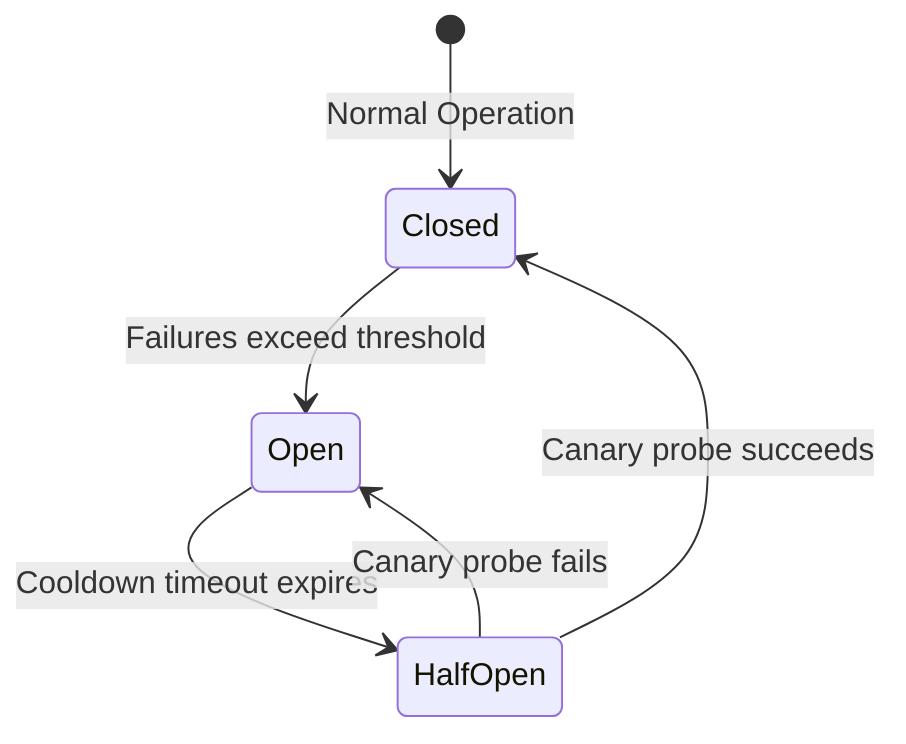

import { Callout } from "fumadocs-ui/components/callout";
import { Tabs, Tab } from "fumadocs-ui/components/tabs";
import { Accordion, Accordions } from "fumadocs-ui/components/accordion";

In distributed microservices, network connections are fundamentally unreliable. Transient timeouts, dropped TCP packets, and HTTP 503 errors are everyday realities.

However, naive retry loops (e.g. retrying every 1 second) create the **Thundering Herd Problem**: when an upstream database recovers, thousands of clients retry at the exact same millisecond, immediately crashing the service again!

---

## 1. Exponential Backoff with Full Jitter

The industry standard algorithm (formalized by AWS Architecture) calculates backoff delay using randomized jitter:

```text
sleep = random_uniform(0, min(max_cap, base * 2 ^ attempt))
```

```python
import asyncio
import random
from collections.abc import Callable
from typing import TypeVar

T = TypeVar("T")

async def retry_with_jitter[T](
    coro_func: Callable[[], asyncio.Future[T]],
    max_attempts: int = 5,
    base_delay: float = 0.5,
    max_delay: float = 10.0
) -> T:
    """Retries an async operation using exponential backoff with full jitter."""
    for attempt in range(1, max_attempts + 1):
        try:
            return await coro_func()
        except (ConnectionError, TimeoutError) as err:
            if attempt == max_attempts:
                print(f"[!] Max attempts ({max_attempts}) reached. Failing.")
                raise

            # Calculate jittered sleep time:
            calculated_backoff = min(max_delay, base_delay * (2 ** (attempt - 1)))
            sleep_time = random.uniform(0, calculated_backoff)

            print(
                f"[Attempt {attempt}/{max_attempts}] Error: {err}. "
                f"Retrying in {sleep_time:.2f}s (Jittered backoff)..."
            )
            await asyncio.sleep(sleep_time)

    raise RuntimeError("Unreachable")
```

---

## 2. The Circuit Breaker Pattern

When a remote service is down hard, retrying every request is wasteful and slows down user response times. A **Circuit Breaker** detects persistent failures and fails fast immediately:



```python
import time

class CircuitBreakerOpenError(Exception):
    """Raised when the circuit breaker rejects requests."""
    pass

class CircuitBreaker:
    def __init__(self, failure_threshold: int = 3, recovery_time: float = 5.0):
        self.failure_threshold = failure_threshold
        self.recovery_time = recovery_time
        self.failure_count = 0
        self.state = "CLOSED"
        self.last_state_change = time.time()

    def can_execute(self) -> bool:
        if self.state == "OPEN":
            if time.time() - self.last_state_change > self.recovery_time:
                self.state = "HALF-OPEN"
                return True
            return False
        return True

    def record_success(self):
        self.failure_count = 0
        self.state = "CLOSED"

    def record_failure(self):
        self.failure_count += 1
        if self.failure_count >= self.failure_threshold:
            self.state = "OPEN"
            self.last_state_change = time.time()
            print("[CIRCUIT BREAKER] Tripped to OPEN state! Failing fast.")
```

---

## Practice Questions & Challenges

Deepen your distributed systems resiliency, backoff mathematics, and failure domain management:

### Question 1: Output Prediction (Deterministic vs Jittered Sleep Bounds)

For a retry loop with `base_delay = 1.0`, `max_delay = 8.0`, and full jitter `random.uniform(0, min(max_delay, base_delay * (2 ** attempt)))`:
What are the minimum and maximum possible sleep times for:

1. Attempt 1?
2. Attempt 3?
3. Attempt 10?

<Accordions>
<Accordion title="Solution & Breakdown">
**Boundaries:**
1. **Attempt 1:**
   - Raw exponential backoff: $1.0 \times 2^1 = 2.0\text{s}$.
   - Full jitter range: **$[0.0\text{s}, 2.0\text{s}]$**.
2. **Attempt 3:**
   - Raw exponential backoff: $1.0 \times 2^3 = 8.0\text{s}$.
   - Full jitter range: **$[0.0\text{s}, 8.0\text{s}]$**.
3. **Attempt 10:**
   - Raw exponential backoff: $1.0 \times 2^{10} = 1024.0\text{s}$.
   - Capped by `max_delay = 8.0s`.
   - Full jitter range: **$[0.0\text{s}, 8.0\text{s}]$**.

**Takeaway:**
Without `max_delay`, exponential backoff quickly balloons to hours. The ceiling ensures retries remain responsive while jitter ensures 10,000 competing clients are uniformly distributed over the 8-second recovery window.

</Accordion>
</Accordions>

---

### Question 2: Spot and Fix the Bug (Retrying Non-Idempotent HTTP POST Requests)

A payment service wraps an external bank gateway in a generic retry decorator that retries on all network timeouts:

```python
import httpx

@retry_with_jitter(max_attempts=3)
async def process_credit_card_charge(user_id: str, amount: float):
    # BUG: If the bank server processed the charge but the response dropped,
    # retrying charges the user's card a second or third time!
    async with httpx.AsyncClient() as client:
        resp = await client.post("https://api.bank.com/charge", json={"user": user_id, "amount": amount})
        return resp.json()
```

Explain the difference between idempotent and non-idempotent operations, and implement the industry-standard fix: **Idempotency Keys**.

<Accordions>
<Accordion title="Solution & Breakdown">
**The Root Cause (Double-Billing Hazard):**
HTTP `POST` is non-idempotent: repeating the request creates multiple independent transactions on the server. If a network packet drops *after* the payment gateway processed the credit card, retrying charges the card twice!

**The Fix (Idempotency Key Header):**
Generate a unique deterministic UUID for the transaction intent upfront and attach it as an `Idempotency-Key` HTTP header. The remote payment gateway records this key; if duplicate requests arrive with the same key, it returns the cached result of the original charge rather than charging again:

```python
import uuid
import httpx

async def safe_charge_card(user_id: str, amount: float, idempotency_key: str = None):
    # Deterministic or unique UUID generated per user checkout session:
    if idempotency_key is None:
        idempotency_key = str(uuid.uuid4())

    headers = {"Idempotency-Key": idempotency_key}

    # Now safe to retry across network drops:
    async def _do_charge():
        async with httpx.AsyncClient(timeout=10.0) as client:
            resp = await client.post(
                "https://api.bank.com/v1/charge",
                json={"user": user_id, "amount": amount},
                headers=headers
            )
            resp.raise_for_status()
            return resp.json()

    return await retry_with_jitter(_do_charge, max_attempts=3)
```

</Accordion>
</Accordions>

---

### Question 3: Architecture Deep-Dive (Decorrelated Jitter vs Full Jitter vs Equal Jitter)

In Marc Brooker's seminal AWS Architecture paper on exponential backoff, three jitter algorithms are evaluated:

1. **Full Jitter**: `sleep = uniform(0, min(cap, base * 2^attempt))`
2. **Equal Jitter**: `half = min(cap, base * 2^attempt) / 2; sleep = half + uniform(0, half)`
3. **Decorrelated Jitter**: `sleep = min(cap, uniform(base, previous_sleep * 3))`

Why does **Decorrelated Jitter** often yield the shortest total completion time under extreme contention?

<Accordions>
  <Accordion title="Solution & Breakdown">
    **Comparison:** - **Full Jitter:** - High randomness. However, the sleep
    time can occasionally be very close to `0.0s`, causing an immediate retry
    before the upstream service has begun to recover. - **Equal Jitter:** -
    Guarantees at least a 50% baseline sleep, preventing near-zero instant
    retries while adding jitter to the remaining half. - **Decorrelated
    Jitter:** - Rather than calculating sleep strictly from the attempt counter
    ($2^N$), it scales proportionally to the **previous sleep duration**
    (`uniform(base, prev * 3)`). - Clients decouple from synchronized lockstep
    completely, producing a Poisson-like arrival distribution at the target
    service. Total aggregate retry time is minimized while contention variance
    drops to near zero.

</Accordion>
</Accordions>

---

### Question 4: Hands-On Challenge (Circuit Breaker Decorator for Async Functions)

Implement an `@async_circuit_breaker(failure_threshold=3, recovery_time=2.0)` decorator that:

1. Wraps an async function.
2. Tracks failures (`Exception`).
3. If failures exceed threshold, trips the breaker to `OPEN` and immediately raises `CircuitBreakerOpenError` without invoking the underlying function.
4. After `recovery_time`, allows a canary execution (`HALF-OPEN`); if successful, resets to `CLOSED`.

<Accordions>
<Accordion title="Solution & Breakdown">
```python
import asyncio
import functools
import time

class CircuitBreakerOpenError(Exception):
pass

def async_circuit_breaker(failure_threshold: int = 3, recovery_time: float = 2.0):
def decorator(func):
state = "CLOSED"
failures = 0
last_failure_time = 0.0

        @functools.wraps(func)
        async def wrapper(*args, **kwargs):
            nonlocal state, failures, last_failure_time

            # 1. Check Circuit State
            if state == "OPEN":
                if time.monotonic() - last_failure_time > recovery_time:
                    state = "HALF-OPEN"
                    print("[CircuitBreaker] Transitioning to HALF-OPEN: testing canary probe...")
                else:
                    raise CircuitBreakerOpenError("Circuit is OPEN: failing fast to protect dependency!")

            # 2. Execute Probe
            try:
                result = await func(*args, **kwargs)
                if state == "HALF-OPEN":
                    print("[CircuitBreaker] Canary succeeded! Resetting circuit to CLOSED.")
                    state = "CLOSED"
                    failures = 0
                return result
            except Exception as e:
                failures += 1
                last_failure_time = time.monotonic()
                if failures >= failure_threshold or state == "HALF-OPEN":
                    state = "OPEN"
                    print(f"[CircuitBreaker] Breaker tripped to OPEN after {failures} failures!")
                raise e

        return wrapper
    return decorator

# Verification

@async_circuit_breaker(failure_threshold=2, recovery_time=0.2)
async def unstable_service(fail: bool):
if fail:
raise ConnectionResetError("Remote server down")
return "Service healthy"

async def main():
for i in range(4):
try:
await unstable_service(fail=True)
except Exception as e:
print(f"Call {i+1} failed:", type(e).**name**)

    print("Attempting call during cooldown:")
    try:
        await unstable_service(fail=False)
    except CircuitBreakerOpenError as e:
        print("Fast-failed:", e)

    await asyncio.sleep(0.3)
    print("Canary probe after cooldown:")
    res = await unstable_service(fail=False)
    print("Result:", res)

asyncio.run(main())

````

</Accordion>
</Accordions>

---

### Question 5: Code Challenge (Resilient HTTP Client with Fallback Cache and Jitter)
Build a resilient fetching client `ResilientAPIClient` that:
1. Implements `get_with_fallback(url: str, fallback_data: dict) -> dict`.
2. Attempts to fetch data with 3 jittered retries on 5xx/network errors.
3. If all retries fail, catches the error and returns `fallback_data` with a `"stale": True` metadata flag instead of failing the request.

<Accordions>
<Accordion title="Solution & Breakdown">
```python
import asyncio
import random
from typing import Dict, Any

class ResilientAPIClient:
    def __init__(self, max_retries: int = 3, base_delay: float = 0.05):
        self.max_retries = max_retries
        self.base_delay = base_delay

    async def _mock_remote_call(self, url: str) -> Dict[str, Any]:
        # Simulates network failure
        raise TimeoutError(f"Connection timeout contacting {url}")

    async def get_with_fallback(
        self,
        url: str,
        fallback_data: Dict[str, Any]
    ) -> Dict[str, Any]:
        for attempt in range(1, self.max_retries + 1):
            try:
                # In production: resp = await httpx_client.get(url)
                data = await self._mock_remote_call(url)
                return {"data": data, "stale": False}
            except (TimeoutError, ConnectionError) as err:
                if attempt == self.max_retries:
                    print(f"[ResilientAPIClient] All {self.max_retries} attempts failed for {url}. Serving fallback cache!")
                    return {"data": fallback_data, "stale": True, "error": str(err)}

                sleep_time = random.uniform(0.01, self.base_delay * (2 ** attempt))
                await asyncio.sleep(sleep_time)

# Verification
async def main():
    client = ResilientAPIClient(max_retries=3, base_delay=0.01)
    fallback_cache = {"price": 100.0, "currency": "USD"}

    result = await client.get_with_fallback("https://api.market.com/rates", fallback_cache)
    print("Client Response:", result)
    assert result["stale"] is True
    assert result["data"]["price"] == 100.0

asyncio.run(main())
````

</Accordion>
</Accordions>

---

## Key Best Practices

- **Never retry non-idempotent operations blindly**: Only retry operations where repeating the call is safe (e.g. `GET`, idempotent `PUT`), never duplicate payment transactions!
- **Always add jitter**: Randomization breaks up lockstep synchronization across multiple microservice clients.
- **Fail Fast with Circuit Breakers**: Protect your application from hanging when dependencies suffer outages.
