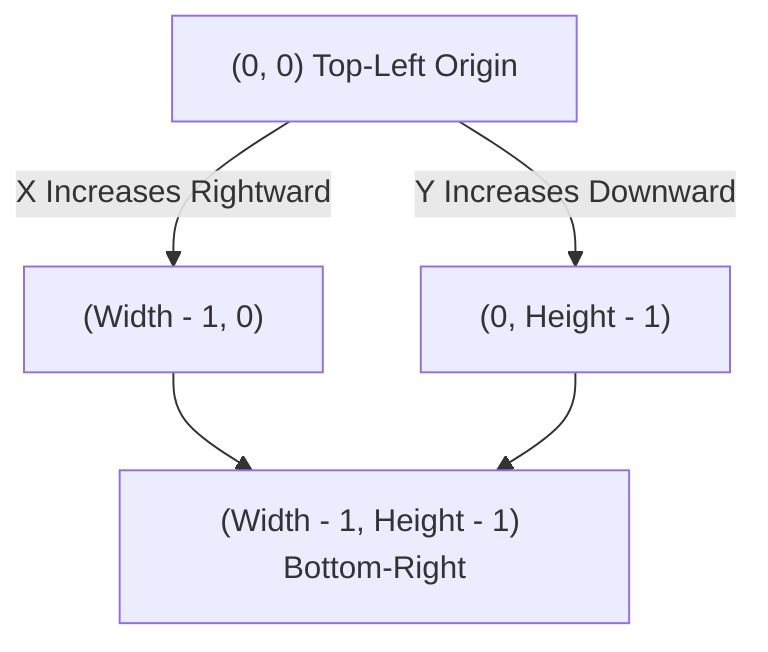
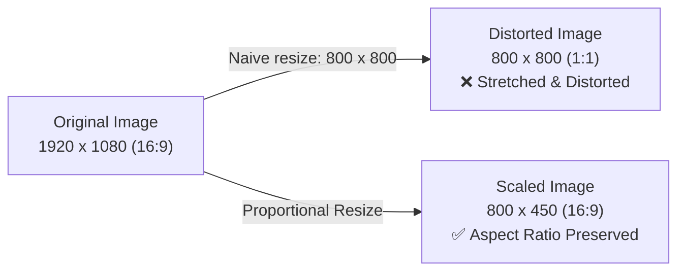
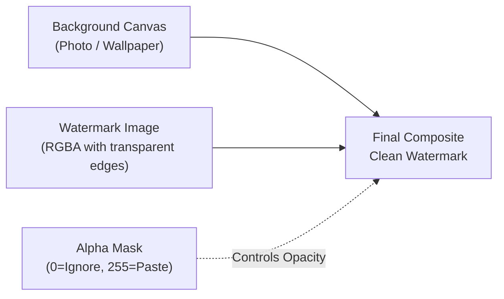

import { Callout } from "fumadocs-ui/components/callout";
import { Tabs, Tab } from "fumadocs-ui/components/tabs";
import { Accordion, Accordions } from "fumadocs-ui/components/accordion";
import { Steps, Step } from "fumadocs-ui/components/steps";

In graphic design and digital media operations, nothing is more soul-crushing than opening desktop editing software like Photoshop or GIMP to perform the exact same repetitive task on hundreds of images.

Whether it is batch-resizing thousands of high-resolution camera photos for an e-commerce catalog, stamping a transparent copyright logo across an entire portfolio, creating social media OpenGraph cards, or converting heavy raw formats into optimized WebP assets, doing it manually is a waste of human creativity.

Python can perform these operations across thousands of files in seconds.

The premier library for digital image manipulation in Python is **Pillow** (the modern, actively maintained successor to the legacy Python Imaging Library, **PIL**). In this guide, you will master programmatic graphic design and computer vision automation.

---

## 1. The Digital Image Mental Model

To control images with code, you must understand how computers represent visual data in memory.

### The 2D Pixel Grid & Cartesian Coordinates

An image is a two-dimensional grid of tiny colored dots called **pixels** (picture elements).

In traditional mathematics, the Cartesian coordinate origin $(0, 0)$ sits at the bottom-left corner, and $Y$ increases as you move upward. **In computer graphics, the coordinate system is flipped vertically**:



- **X Coordinate**: Represents horizontal distance, starting at `0` on the left edge and increasing to `width - 1` on the right edge.
- **Y Coordinate**: Represents vertical distance, starting at `0` on the top edge and increasing to `height - 1` on the bottom edge.

### The Bounding Box Tuple `(left, upper, right, lower)`

Whenever Pillow asks for a rectangular region (such as when cropping or measuring text), it expects a 4-integer tuple:

```python
box = (left, upper, right, lower)
```

<Callout type="info" title="Half-Open Interval Rule">
Just like Python's slice syntax `list[start:stop]`, bounding boxes in Pillow are **half-open intervals**:
- `left` is the leftmost pixel column included (inclusive).
- `upper` is the topmost pixel row included (inclusive).
- `right` is the first pixel column **excluded** (exclusive).
- `lower` is the first pixel row **excluded** (exclusive).

Therefore:

- $\text{Box Width} = \text{right} - \text{left}$
- $\text{Box Height} = \text{lower} - \text{upper}$
  </Callout>

### Color Models: Grayscale, RGB & RGBA

Pillow handles various color spaces (known as **modes**):

1. **`'L'` (Luminance / Grayscale)**: Each pixel is a single integer from `0` (pitch black) to `255` (pure white).
2. **`'RGB'` (Truecolor)**: Each pixel is a 3-tuple `(R, G, B)` representing Red, Green, and Blue intensities from `0` to `255`. Combining them allows over $16.7$ million unique colors ($256 \times 256 \times 256$).
   - `(0, 0, 0)`: Pure Black
   - `(255, 255, 255)`: Pure White
   - `(255, 0, 0)`: Pure Red
   - `(0, 255, 0)`: Pure Green
   - `(0, 0, 255)`: Pure Blue
3. **`'RGBA'` (Truecolor with Transparency)**: Each pixel is a 4-tuple `(R, G, B, A)`, where the fourth value represents the **Alpha** (transparency) channel:
   - `A = 0`: 100% Transparent (completely invisible).
   - `A = 255`: 100% Opaque (solid color).
   - `A = 128`: 50% Semi-transparent glass effect.

---

## 2. Getting Started with Pillow (`PIL`)

### Installation & Workspace Setup

Install Pillow using `uv` or `pip`:

```bash
uv add pillow
# or: pip install pillow
```

<Callout type="warn" title="Importing Pillow">
Even though the package is installed as `pillow`, the internal Python module name remains `PIL` for backward compatibility. Always import from `PIL`:
```python
# Correct:
from PIL import Image

# Incorrect (will raise ModuleNotFoundError):

import pillow
```
</Callout>

### Loading, Inspecting & Saving Images

```python
from pathlib import Path
from PIL import Image

# 1. Open an existing image file using a safe context manager:
with Image.open("sample.jpg") as img:
    # 2. Inspect image properties:
    print(f"Dimensions (W x H): {img.size}")    # e.g., (1920, 1080)
    print(f"Width:              {img.width}")   # 1920
    print(f"Height:             {img.height}")  # 1080
    print(f"Format:             {img.format}")  # 'JPEG'
    print(f"Color Mode:         {img.mode}")    # 'RGB'

    # 3. Save to modern WebP format with optimization:
    img.save("optimized.webp", format="WEBP", quality=80, optimize=True)
    print("Saved optimized WebP image successfully.")
```

### The RGBA to JPEG Pitfall

A common error encountered by developers occurs when converting a transparent PNG or WebP into a JPEG:

```python
# This will crash!
transparent_logo = Image.open("logo.png")  # mode: 'RGBA'
transparent_logo.save("logo.jpg")          # OSError: cannot write mode RGBA as JPEG
```

**The Cause**: The JPEG specification does not support an Alpha transparency channel. Trying to write RGBA pixels directly to JPEG causes Pillow to crash.

**The Solution**: Composite the RGBA image onto a solid background color (e.g. white) before saving:

```python
def save_rgba_as_jpeg(rgba_img: Image.Image, output_path: str, background_color=(255, 255, 255)) -> None:
    """Safely converts an RGBA image to RGB JPEG on a solid background."""
    # 1. Create a solid background matching image dimensions:
    background = Image.new("RGB", rgba_img.size, background_color)

    # 2. Paste RGBA image using its own alpha channel as a mask:
    background.paste(rgba_img, (0, 0), mask=rgba_img.split()[3])

    # 3. Save as JPEG:
    background.save(output_path, "JPEG", quality=90)

with Image.open("logo.png") as logo:
    save_rgba_as_jpeg(logo.convert("RGBA"), "logo.jpg")
```

---

## 3. Core Geometric Transformations

Image manipulation frequently involves resizing dimensions, extracting crops, and rotating orientations.

### Resizing vs. Aspect Ratio Preservation

The simplest way to resize is `img.resize((new_width, new_height))`. However, if you arbitrarily set both width and height, your image will stretch or squash unnaturally:



To preserve the exact aspect ratio, compute the missing dimension mathematically:

$$\text{new\_height} = \text{int}\left(\text{old\_height} \times \frac{\text{new\_width}}{\text{old\_width}}\right)$$

```python
from PIL import Image

def resize_proportional(img: Image.Image, target_width: int) -> Image.Image:
    """Scales an image to target_width while preserving original proportions."""
    aspect_ratio = img.height / img.width
    target_height = int(target_width * aspect_ratio)

    # Use Resampling.LANCZOS for superior, sharp downsampling quality:
    return img.resize((target_width, target_height), Image.Resampling.LANCZOS)
```

### Choosing Resampling Filters

When resizing pixels, Pillow must calculate how to blend or interpolate adjacent colors:

| Filter                    | Speed                 | Visual Quality      | Best Use Case                                          |
| :------------------------ | :-------------------- | :------------------ | :----------------------------------------------------- |
| **`Resampling.NEAREST`**  | Instant               | Low (Pixelated)     | Pixel art, retro 8-bit game sprites.                   |
| **`Resampling.BILINEAR`** | Fast                  | Moderate            | Fast video frame preprocessing.                        |
| **`Resampling.BICUBIC`**  | Moderate              | Very Good           | General scaling and photo enlargement.                 |
| **`Resampling.LANCZOS`**  | Computationally Heavy | **Highest (Crisp)** | High-quality web image optimization (standard choice). |

### In-Place Thumbnail Generation with `thumbnail()`

If your goal is to generate a small preview thumbnail that fits within a maximum bounding box without exceeding it, use `.thumbnail()`:

```python
with Image.open("large_photo.jpg") as img:
    # thumbnail() modifies the image IN-PLACE and preserves aspect ratio!
    # If the image is 1920x1080, fitting inside (300, 300) produces (300, 168):
    img.thumbnail((300, 300), Image.Resampling.LANCZOS)
    img.save("thumb.jpg")
    print(f"Thumbnail dimensions: {img.size}")
```

### Cropping Regions & The Center-Crop Algorithm

Cropping extracts a rectangular sub-region defined by a bounding box `(left, upper, right, lower)`:

```python
with Image.open("photo.jpg") as img:
    # Extract a 400x300 rectangle starting at X=100, Y=150:
    crop_box = (100, 150, 500, 450)
    cropped = img.crop(crop_box)
    cropped.save("cropped.jpg")
```

#### Production Utility: Smart Center-Crop

In modern web design, profile avatars and card thumbnails often require exact square dimensions (e.g. 500x500). If you resize a wide landscape photo directly to a square, it distorts.

The proper engineering approach is to calculate the center square and crop the excess edges away:

```python
from PIL import Image

def center_crop_square(img: Image.Image) -> Image.Image:
    """Crops the maximum centered square out of any rectangular image."""
    width, height = img.size
    min_dim = min(width, height)

    # Calculate crop coordinates centered around image midpoint:
    left = (width - min_dim) // 2
    top = (height - min_dim) // 2
    right = left + min_dim
    bottom = top + min_dim

    return img.crop((left, top, right, bottom))

with Image.open("landscape.jpg") as img:
    square_avatar = center_crop_square(img)
    square_avatar = square_avatar.resize((500, 500), Image.Resampling.LANCZOS)
    square_avatar.save("avatar_500x500.jpg")
```

### Rotating, Transposing & Handling Smartphone EXIF Tags

You can rotate images by arbitrary degree angles using `.rotate()`:

```python
with Image.open("photo.jpg") as img:
    # expand=True expands the canvas so corners are not clipped!
    rotated = img.rotate(45, expand=True, fillcolor="white")
    rotated.save("rotated_45.jpg")
```

#### Transposition Shortcuts

For standard $90^\circ$ increments or axis mirroring, `.transpose()` is faster and lossless:

```python
# Flip horizontally (mirror reflection):
flipped_h = img.transpose(Image.Transpose.FLIP_LEFT_RIGHT)

# Flip vertically (upside-down):
flipped_v = img.transpose(Image.Transpose.FLIP_TOP_BOTTOM)

# Rotate exactly 90 degrees clockwise:
rotated_90 = img.transpose(Image.Transpose.ROTATE_270)
```

#### The Smartphone Camera EXIF Rotation Trap

When people take photos on mobile phones, the camera sensor records the raw pixel data in landscape orientation and writes a tiny metadata tag (**EXIF Orientation**) indicating how the phone was held (e.g., upside down or vertical).

Standard Pillow `Image.open()` ignores this tag, resulting in sideways photos!

Use `ImageOps.exif_transpose()` to normalize camera orientation automatically:

```python
from PIL import Image, ImageOps

def open_auto_oriented(image_path: str) -> Image.Image:
    """Opens an image and automatically applies smartphone EXIF rotation tags."""
    img = Image.open(image_path)
    return ImageOps.exif_transpose(img)
```

---

## 4. Compositing, Pasting & Alpha Transparency

Compositing is the technique of combining two or more images into a single finished product. This is how watermarks, sticker overlays, and collage layouts are built.

### Pasting Images onto a Canvas

```python
from PIL import Image

# 1. Create a blank white canvas (Width=800, Height=600):
canvas = Image.new("RGBA", (800, 600), (255, 255, 255, 255))

# 2. Open an asset to paste:
with Image.open("badge.png") as badge:
    # 3. Paste badge at coordinate X=50, Y=100:
    canvas.paste(badge, (50, 100))
```

### The #1 Pillow Trap: Ugly Black Rectangles on Transparent PNGs

If you run the snippet above on a transparent PNG badge, you will notice an ugly black or gray box surrounding your logo!

**The Cause**: By default, `.paste(image, (x, y))` copies raw color values without honoring the alpha channel. Transparent pixels (where `Alpha = 0`) are written directly over the background as solid black.

**The Solution**: You must pass the foreground image as its own **transparency mask**:

```python
# WRONG (Produces black box around transparent pixels):
canvas.paste(transparent_logo, (50, 100))

# CORRECT (Passes logo as mask; transparent pixels are preserved perfectly):
canvas.paste(transparent_logo, (50, 100), mask=transparent_logo)
```



---

## 5. Drawing Shapes & Vector Graphics with `ImageDraw`

Pillow's `ImageDraw` module allows you to draw vector geometric primitives (rectangles, lines, circles, and polygons) directly onto pixel buffers.

```python
from PIL import Image, ImageDraw

# Create a clean white canvas:
canvas = Image.new("RGBA", (600, 400), "white")
draw = ImageDraw.Draw(canvas)

# 1. Draw a diagonal line:
draw.line([(20, 20), (200, 100)], fill="royalblue", width=4)

# 2. Draw a solid rectangle with an outline:
draw.rectangle([50, 150, 250, 300], fill="gold", outline="darkorange", width=3)

# 3. Draw a modern rounded rectangle:
draw.rounded_rectangle([300, 50, 550, 180], radius=20, fill="emerald", outline="teal", width=2)

# 4. Draw a circle / ellipse:
draw.ellipse([320, 220, 460, 360], fill="crimson", outline="black", width=2)

# 5. Draw a polygon (triangle):
draw.polygon([(480, 360), (580, 360), (530, 240)], fill="purple")

canvas.save("vector_primitives.png")
```

---

## 6. Typography & Text Rendering with `ImageFont`

Rendering text onto images is fundamental for creating social media banners, automated certificates, meme generators, and photo timestamps.

### Loading Custom TrueType (`.ttf`) / OpenType (`.otf`) Fonts

Pillow's default bitmap font (`ImageFont.load_default()`) is tiny, pixelated, and cannot be resized. For professional typography, load any standard `.ttf` or `.otf` font file:

```python
from PIL import Image, ImageDraw, ImageFont

canvas = Image.new("RGB", (800, 300), (30, 41, 59))  # Dark slate background
draw = ImageDraw.Draw(canvas)

# Load a TrueType font at 42pt:
# (Substitute with any font installed on your system or inside your project)
try:
    font = ImageFont.truetype("arial.ttf", size=42)
except OSError:
    font = ImageFont.load_default()

# Render text at X=50, Y=120:
draw.text((50, 120), "Automated Typography with Python", font=font, fill="white")
canvas.save("typography.png")
```

### Exact Text Centering with `draw.textbbox()`

<Callout type="warn" title="Deprecated API Alert">
Older tutorials instruct you to use `draw.textsize(text, font)`. **This method has been permanently removed in modern Pillow versions.**

Always use `draw.textbbox((0, 0), text, font=font)` in modern code.

</Callout>

`textbbox` returns a 4-element tuple `(left, top, right, bottom)` measuring the exact bounding box of the rendered text string:

$$\text{text\_width} = \text{right} - \text{left}, \quad \text{text\_height} = \text{bottom} - \text{top}$$

To center text perfectly inside any bounding container:

$$x = \frac{\text{canvas\_width} - \text{text\_width}}{2}, \quad y = \frac{\text{canvas\_height} - \text{text\_height}}{2}$$

```python
from PIL import Image, ImageDraw, ImageFont

def render_centered_banner(text: str, canvas_size=(800, 250), bg_color="#1e293b", text_color="#f8fafc") -> Image.Image:
    canvas = Image.new("RGB", canvas_size, bg_color)
    draw = ImageDraw.Draw(canvas)

    font = ImageFont.truetype("arial.ttf", size=36)

    # 1. Compute text bounding dimensions:
    bbox = draw.textbbox((0, 0), text, font=font)
    text_width = bbox[2] - bbox[0]
    text_height = bbox[3] - bbox[1]

    # 2. Compute centered coordinates:
    x = (canvas.width - text_width) // 2
    y = (canvas.height - text_height) // 2

    # 3. Draw text:
    draw.text((x, y), text, font=font, fill=text_color)
    return canvas

banner = render_centered_banner("MASTER PYTHON AUTOMATION")
banner.save("centered_banner.png")
```

### Drop Shadows for Readability Over Busy Photos

When writing text over complex, multi-colored photographic backgrounds, plain text often becomes unreadable. A clean graphic design technique is adding a subtle dark drop-shadow:

```python
def draw_text_with_shadow(
    draw: ImageDraw.ImageDraw,
    position: tuple[int, int],
    text: str,
    font: ImageFont.FreeTypeFont,
    fill: str = "white",
    shadow_color: str = "black",
    offset: int = 3
) -> None:
    x, y = position
    # 1. Draw shadow offset by a few pixels:
    draw.text((x + offset, y + offset), text, font=font, fill=shadow_color)
    # 2. Draw crisp foreground text:
    draw.text((x, y), text, font=font, fill=fill)
```

---

## 7. Pixel Manipulation, Filters & Color Adjustments

### Direct Pixel Access

You can inspect and alter individual pixels by coordinate:

```python
from PIL import Image

with Image.open("photo.jpg") as img:
    # Read color at coordinate (X=100, Y=50):
    r, g, b = img.getpixel((100, 50))
    print(f"Pixel RGB: ({r}, {g}, {b})")

    # Modify pixel to bright red:
    img.putpixel((100, 50), (255, 0, 0))
```

### Built-in Convolution Filters with `ImageFilter`

Pillow includes classic image processing convolution matrices:

```python
from PIL import Image, ImageFilter

with Image.open("photo.jpg") as img:
    # 1. Gaussian Blur (useful for background cards):
    blurred = img.filter(ImageFilter.GaussianBlur(radius=8))
    blurred.save("blurred.jpg")

    # 2. Edge Detection:
    edges = img.filter(ImageFilter.FIND_EDGES)
    edges.save("edges.jpg")

    # 3. Sharpening:
    sharpened = img.filter(ImageFilter.SHARPEN)
    sharpened.save("sharpened.jpg")
```

### Color, Contrast & Brightness with `ImageEnhance`

The `ImageEnhance` module provides intuitive scalar multipliers ($1.0 = \text{no change}$, $<1.0 = \text{decrease}$, $>1.0 = \text{increase}$):

```python
from PIL import Image, ImageEnhance

with Image.open("photo.jpg") as img:
    # 1. Increase color saturation by 50% (vibrant colors):
    vibrant = ImageEnhance.Color(img).enhance(1.5)

    # 2. Boost contrast by 25%:
    high_contrast = ImageEnhance.Contrast(vibrant).enhance(1.25)

    # 3. Fine-tune brightness:
    final = ImageEnhance.Brightness(high_contrast).enhance(1.05)
    final.save("enhanced.jpg")
```

---

## 8. Capstone Project 1: Industrial Batch Watermark & Brand Stamper

Let's build a core project from _Automate the Boring Stuff with Python_: **The Batch Logo Stamper**.

**The Problem**: You have an `input_photos/` folder containing hundreds of product or event photos with different resolutions, aspect ratios, and orientations. You need to:

1. Resize every photo so its width never exceeds `1920` pixels.
2. Automatically scale your company logo watermark to exactly `15%` of the photo's width.
3. Paste the transparent watermark in the bottom-right corner with 24-pixel padding.
4. Export web-optimized WebP files to `output_watermarked/`.

```python
"""
batch_watermark.py - Industrial batch resizing and watermarking engine.
Inspired by 'Automate the Boring Stuff with Python'.
"""
from pathlib import Path
from PIL import Image, ImageOps

SUPPORTED_EXTENSIONS = {".jpg", ".jpeg", ".png", ".webp"}

def process_watermark_batch(
    photos_dir: Path,
    watermark_path: Path,
    output_dir: Path,
    max_width: int = 1920
) -> None:
    output_dir.mkdir(parents=True, exist_ok=True)

    # 1. Load transparent watermark asset:
    if not watermark_path.exists():
        raise FileNotFoundError(f"Watermark not found at: {watermark_path}")

    raw_watermark = Image.open(watermark_path).convert("RGBA")

    # 2. Iterate through all image files:
    photo_files = [p for p in photos_dir.iterdir() if p.suffix.lower() in SUPPORTED_EXTENSIONS]
    print(f"Found {len(photo_files)} photos to process in '{photos_dir.name}'.")

    for idx, photo_path in enumerate(photo_files, start=1):
        print(f"[{idx}/{len(photo_files)}] Processing: {photo_path.name}...")

        with Image.open(photo_path) as raw_img:
            # Normalize mobile camera EXIF orientation:
            img = ImageOps.exif_transpose(raw_img)

            # Step A: Proportional Resize if image exceeds max_width:
            if img.width > max_width:
                aspect = img.height / img.width
                new_height = int(max_width * aspect)
                img = img.resize((max_width, new_height), Image.Resampling.LANCZOS)

            # Convert to RGBA for clean alpha compositing:
            composite_base = img.convert("RGBA")

            # Step B: Dynamically scale watermark to 15% of photo width:
            target_wm_width = max(int(composite_base.width * 0.15), 100)
            wm_aspect = raw_watermark.height / raw_watermark.width
            target_wm_height = int(target_wm_width * wm_aspect)

            scaled_wm = raw_watermark.resize(
                (target_wm_width, target_wm_height),
                Image.Resampling.LANCZOS
            )

            # Step C: Compute bottom-right coordinates with 24px margin:
            margin = 24
            paste_x = composite_base.width - target_wm_width - margin
            paste_y = composite_base.height - target_wm_height - margin

            # Step D: Paste watermark using its own alpha mask:
            composite_base.paste(scaled_wm, (paste_x, paste_y), mask=scaled_wm)

            # Step E: Save to output directory as WebP:
            output_file = output_dir / f"{photo_path.stem}_watermarked.webp"
            composite_base.save(output_file, "WEBP", quality=85, optimize=True)
            print(f"  ✓ Saved -> {output_file.name}")

    print(f"\nBatch processing complete! All assets saved in '{output_dir.resolve()}'.")

if __name__ == "__main__":
    # Example execution:
    process_watermark_batch(
        photos_dir=Path("input_photos"),
        watermark_path=Path("assets/logo.png"),
        output_dir=Path("output_watermarked")
    )
```

---

## 9. Capstone Project 2: Automated Social Media Banner Generator

In this capstone, we will build an automated generator that creates standard `1200x630` OpenGraph preview images for blog posts, documentation pages, or YouTube thumbnails.

```python
"""
og_banner_generator.py - Generates 1200x630 social preview banners.
"""
from pathlib import Path
from PIL import Image, ImageDraw, ImageFont

def generate_social_card(
    category: str,
    title: str,
    author: str,
    output_path: Path
) -> Path:
    width, height = 1200, 630

    # 1. Create dark canvas with a subtle gradient:
    card = Image.new("RGB", (width, height), (15, 23, 42))  # Dark Navy
    draw = ImageDraw.Draw(card)

    # Draw decorative vertical accent line on left edge:
    draw.rectangle([0, 0, 16, height], fill="#38bdf8")  # Sky Blue accent

    # 2. Load Fonts:
    try:
        font_badge = ImageFont.truetype("arial.ttf", size=24)
        font_title = ImageFont.truetype("arial.ttf", size=60)
        font_meta  = ImageFont.truetype("arial.ttf", size=28)
    except OSError:
        font_badge = font_title = font_meta = ImageFont.load_default()

    # 3. Draw Category Badge (Rounded Pill):
    badge_text = category.upper()
    b_box = draw.textbbox((0, 0), badge_text, font=font_badge)
    b_w = b_box[2] - b_box[0]
    b_h = b_box[3] - b_box[1]

    badge_x, badge_y = 80, 80
    pill_padding_x, pill_padding_y = 20, 10
    pill_rect = [
        badge_x,
        badge_y,
        badge_x + b_w + (pill_padding_x * 2),
        badge_y + b_h + (pill_padding_y * 2)
    ]
    draw.rounded_rectangle(pill_rect, radius=12, fill="#0284c7")
    draw.text((badge_x + pill_padding_x, badge_y + pill_padding_y - 2), badge_text, font=font_badge, fill="white")

    # 4. Multi-Line Title Wrapping Engine:
    max_title_width = 1000
    words = title.split()
    lines = []
    current_line = []

    for word in words:
        test_line = " ".join(current_line + [word])
        t_box = draw.textbbox((0, 0), test_line, font=font_title)
        if (t_box[2] - t_box[0]) <= max_title_width:
            current_line.append(word)
        else:
            if current_line:
                lines.append(" ".join(current_line))
            current_line = [word]
    if current_line:
        lines.append(" ".join(current_line))

    # Draw Title Lines:
    title_start_y = 180
    line_spacing = 80
    for idx, line in enumerate(lines[:3]):  # Limit to 3 lines
        draw.text((80, title_start_y + (idx * line_spacing)), line, font=font_title, fill="#f8fafc")

    # 5. Draw Footer (Author & Brand info):
    divider_y = height - 120
    draw.line([(80, divider_y), (width - 80, divider_y)], fill="#334155", width=2)

    draw.text((80, height - 80), f"Written by {author}", font=font_meta, fill="#94a3b8")
    draw.text((width - 320, height - 80), "Python Cookbook Series", font=font_meta, fill="#38bdf8")

    # Save optimized card:
    output_path.parent.mkdir(parents=True, exist_ok=True)
    card.save(output_path, "PNG")
    print(f"Generated card -> {output_path}")
    return output_path

if __name__ == "__main__":
    generate_social_card(
        category="Python Automation",
        title="Web Scraping, Image Processing & Automated Communications",
        author="Senior Architect",
        output_path=Path("og_preview.png")
    )
```

---

## 10. Common Debugging Traps & Solutions

<Accordions>
<Accordion title="Trap 1: DecompressionBombError when Loading Giant Images">
**The Problem**: Calling `Image.open()` on a massive panorama or high-res scan crashes with `PIL.Image.DecompressionBombError: Image size (150000000 pixels) exceeds limit of 89478485 pixels, could be decompression bomb DOS attack`.

**The Cause**: Pillow includes a built-in safety shield against malicious images engineered to consume all system RAM.

**The Fix**: If you trust the source files, increase or disable the limit safely:

```python
from PIL import Image

# Disable the pixel bomb limit for trusted batch jobs:
Image.MAX_IMAGE_PIXELS = None
```

</Accordion>

<Accordion title="Trap 2: Rotated Images Have Black Triangular Corners">
**The Problem**: Calling `img.rotate(30)` clips the original corners and leaves ugly black background fills.

**The Cause**: By default, `.rotate()` preserves original canvas dimensions, clipping protruding edges and filling newly exposed areas with default black.

**The Fix**: Pass `expand=True` and specify a clean `fillcolor`:

```python
# Expands canvas so entire rotated image fits; fills background with white:
rotated = img.rotate(30, expand=True, fillcolor=(255, 255, 255))
```

</Accordion>

<Accordion title="Trap 3: Memory Leaks in Large Batch Processing Loops">
**The Problem**: Processing 10,000 photos in a loop causes your computer's RAM usage to steadily climb until the operating system terminates the Python script.

**The Cause**: Pillow images retain file descriptors and internal raster buffers if not explicitly closed.

**The Fix**: Always use context managers or explicitly call `.close()`:

```python
for file_path in image_paths:
    with Image.open(file_path) as img:
        # Perform transformations...
        processed = img.resize(...)
        processed.save(...)
    # File descriptor and buffer released here!
```

</Accordion>
</Accordions>

---

## 11. Hands-On Practice Exercises

### Exercise 1: Format Converter CLI

Write a Python function `convert_folder_to_webp(folder_path: Path, quality: int = 80) -> int` that scans a directory for `.jpg` and `.png` files, converts them to `.webp`, deletes the originals, and returns the total number of converted images.

<Accordions>
<Accordion title="View Exercise 1 Solution">
```python
from pathlib import Path
from PIL import Image

def convert_folder_to_webp(folder_path: Path, quality: int = 80) -> int:
converted_count = 0
for file in folder_path.iterdir():
if file.suffix.lower() in {".jpg", ".jpeg", ".png"}:
with Image.open(file) as img:
target_path = file.with_suffix(".webp") # Handle RGBA conversion if saving as lossy webp:
img.save(target_path, "WEBP", quality=quality, optimize=True)
converted_count += 1 # Remove original file after context manager closes:
file.unlink()
print(f"Converted {file.name} -> {target_path.name}")

    return converted_count

````
</Accordion>
</Accordions>

### Exercise 2: Circular Avatar Mask Generator
Write a function `make_circular_avatar(image_path: Path, size: int = 256) -> Image.Image` that takes an image of any aspect ratio, crops the center square, resizes it to `size x size`, and masks the edges into a transparent circle (PNG).

<Accordions>
<Accordion title="View Exercise 2 Solution">
```python
from pathlib import Path
from PIL import Image, ImageDraw

def make_circular_avatar(image_path: Path, size: int = 256) -> Image.Image:
    with Image.open(image_path) as raw_img:
        # 1. Center crop square:
        min_dim = min(raw_img.width, raw_img.height)
        left = (raw_img.width - min_dim) // 2
        top = (raw_img.height - min_dim) // 2
        square = raw_img.crop((left, top, left + min_dim, top + min_dim))

        # 2. Resize to target dimension:
        square = square.resize((size, size), Image.Resampling.LANCZOS).convert("RGBA")

        # 3. Create anti-aliased circular alpha mask:
        mask = Image.new("L", (size, size), 0)
        draw = ImageDraw.Draw(mask)
        draw.ellipse((0, 0, size, size), fill=255)

        # 4. Apply mask to image:
        output = Image.new("RGBA", (size, size), (0, 0, 0, 0))
        output.paste(square, (0, 0), mask=mask)
        return output
````

</Accordion>
</Accordions>

---

## Stage 5 Progression

Now that you can extract data from the web and manipulate graphic media assets, proceed to the final lesson to learn how to dispatch automated notifications, reports, and emergency alerts directly to inboxes and mobile phones:

**[Next Lesson: Automated Communications: SMTP Email & SMS Alerts →](/docs/learn-python/05-practical-automation/03-email-and-sms-automation)**
