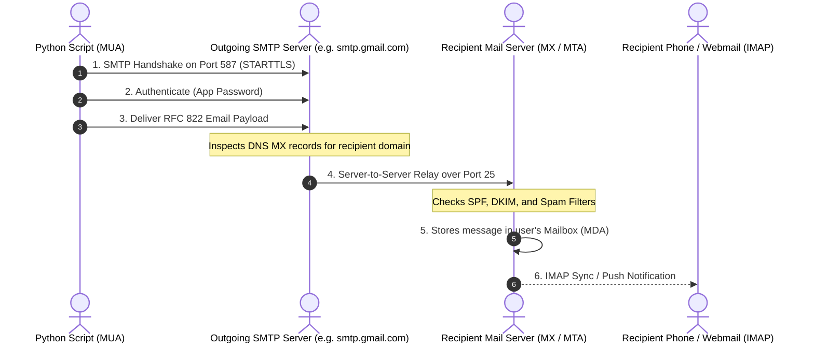
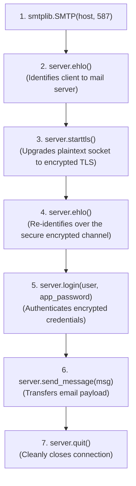
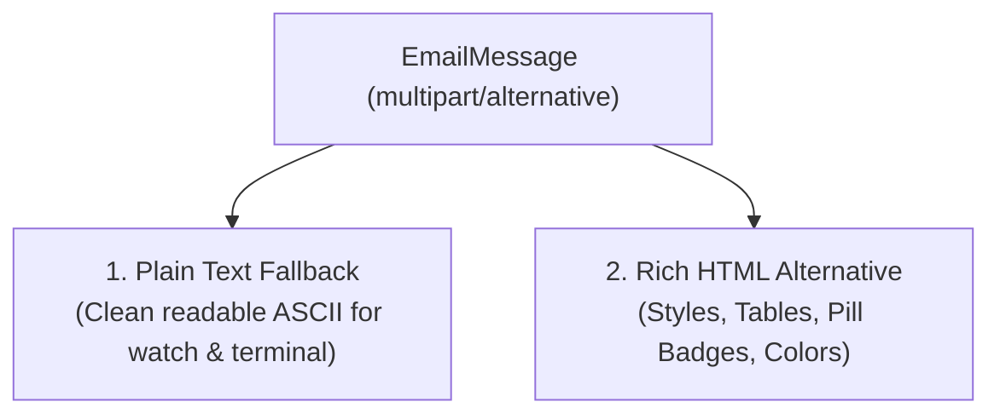
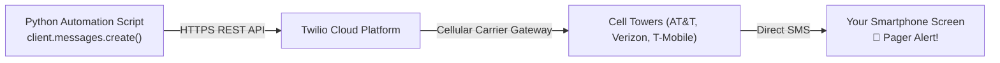

import { Callout } from "fumadocs-ui/components/callout";
import { Tabs, Tab } from "fumadocs-ui/components/tabs";
import { Accordion, Accordions } from "fumadocs-ui/components/accordion";
import { Steps, Step } from "fumadocs-ui/components/steps";

An automation script that runs silently in the dark is only half as useful as one that can communicate with the outside world.

Imagine writing a web scraper that detects a 50% price drop on an airline ticket you've been tracking, or a watchdog script that detects your production web server has crashed. If the script simply prints a message to a terminal window you aren't looking at, the opportunity is lost or the outage persists.

To make automation truly autonomous, your Python programs must be capable of reaching out to you wherever you are:

- Dispatching structured **HTML morning briefings** to your email inbox.
- Attaching generated PDF invoices or CSV financial reports.
- Querying your inbox to process incoming customer support requests.
- Sending urgent **SMS text messages** directly to your mobile phone when critical thresholds are breached.

In this comprehensive guide, modeled on the communication chapters of Al Sweigart's **_Automate the Boring Stuff with Python_**, you will learn the protocols, security best practices, and code patterns needed to build enterprise-grade automated notification systems.

---

## 1. The Internet Messaging Architecture & Mental Model

Before sending a single packet, you need to understand how the internet delivers email and how modern security protocols govern communications.

### How Email Travels: MTA vs. MUA vs. MDA

Email does not travel directly from your computer to your friend's laptop. It relies on a federated network of mail servers:



1. **MUA (Mail User Agent)**: The client application that authors and submits messages (e.g., Apple Mail, Thunderbird, or our Python script).
2. **SMTP Server (Simple Mail Transfer Protocol)**: The outgoing post office responsible for sending messages.
3. **IMAP / POP3 Server (Internet Message Access Protocol)**: The mailbox storage server where incoming messages wait to be retrieved or queried.

### Ports & Encryption Standards

| Port         | Protocol               | Encryption Standard       | Usage Context                                                                                                                                                    |
| :----------- | :--------------------- | :------------------------ | :--------------------------------------------------------------------------------------------------------------------------------------------------------------- |
| **Port 25**  | SMTP                   | Plaintext / Opportunistic | Server-to-server relay. **Blocked by almost all residential ISPs and cloud providers (AWS, Azure) to prevent spam.**                                             |
| **Port 587** | **SMTP (Recommended)** | **STARTTLS**              | **The modern industry standard for client submission.** Connection starts in plaintext and is upgraded immediately to encrypted TLS before credentials are sent. |
| **Port 465** | SMTPS                  | Implicit SSL/TLS          | Connection is wrapped in SSL from the very first byte. Common alternative for Gmail and Yahoo.                                                                   |
| **Port 993** | IMAP                   | Implicit SSL/TLS          | Securely retrieving and searching incoming emails from a remote mailbox.                                                                                         |

### The Authentication Problem: Why Regular Passwords Fail

If you try to log into `smtp.gmail.com` using your standard Google account password, your script will immediately fail with:

```
smtplib.SMTPAuthenticationError: (535, b'5.7.8 Username and Password not accepted.')
```

**Why this happens**: Modern email providers enforce Multi-Factor Authentication (2FA) and OAuth2 security protocols. They explicitly block automated "less secure apps" from using primary account passwords.

**The Solution: App Passwords**:
An **App Password** is a unique, randomly generated 16-character passcode that grants a specific script permission to bypass 2FA without exposing your primary account credentials.

<Tabs items={['Google / Gmail', 'Microsoft Outlook', 'Fastmail / Custom SMTP']}>
<Tab value="Google / Gmail">
1. Go to your **Google Account** settings (`myaccount.google.com`).
2. Navigate to the **Security** tab.
3. Ensure **2-Step Verification** is turned ON.
4. Search for **App Passwords** in the search bar.
5. Create a new app named `Python Automation` and copy the generated 16-character string (e.g., `abcd efgh ijkl mnop`).
</Tab>
<Tab value="Microsoft Outlook">
1. Sign in to **Microsoft Account Security** (`account.microsoft.com/security`).
2. Select **Advanced Security Options**.
3. Under **App Passwords**, click **Create a new app password**.
4. Copy the generated password for your script.
</Tab>
<Tab value="Fastmail / Custom SMTP">
1. Navigate to **Settings** -> **Password & Security**.
2. Click **New App Password**.
3. Grant `SMTP` (Send Mail) and `IMAP` (Read Mail) scopes.
</Tab>
</Tabs>

### Safe Credential Management with `.env`

<Callout type="warn" title="Never Hardcode Passwords!">
  Never, under any circumstances, write your email password directly inside a
  `.py` file. If you accidentally commit your code to a public GitHub
  repository, automated bots will scrape your credentials within 30 seconds and
  use your account to send hundreds of thousands of spam emails, getting your
  domain permanently blacklisted.
</Callout>

Store your secrets in a local `.env` file that is excluded in `.gitignore`:

```ini
# .env file (DO NOT COMMIT TO GIT)
SMTP_HOST=smtp.gmail.com
SMTP_PORT=587
EMAIL_SENDER=myautomation@gmail.com
EMAIL_PASSWORD=abcdefghijklmnop
ALERT_RECIPIENT=engineer@example.com
```

Load them securely in Python using `python-dotenv`:

```bash
uv add python-dotenv
# or: pip install python-dotenv
```

```python
import os
from pathlib import Path
from dotenv import load_dotenv

# Load variables from .env file:
load_dotenv()

SMTP_HOST = os.getenv("SMTP_HOST", "smtp.gmail.com")
SMTP_PORT = int(os.getenv("SMTP_PORT", 587))
EMAIL_USER = os.environ["EMAIL_SENDER"]
EMAIL_PASS = os.environ["EMAIL_PASSWORD"]
```

---

## 2. Sending Plain Text Email with `smtplib`

Python includes the `smtplib` module in its standard library. It handles the low-level network socket communication with the mail transfer agent.

### The Low-Level SMTP Handshake Sequence



Here is a minimal, robust implementation using a context manager:

```python
import smtplib
import os
from email.message import EmailMessage
from dotenv import load_dotenv

load_dotenv()

def send_simple_test_email() -> None:
    # 1. Create the message container:
    msg = EmailMessage()
    msg["Subject"] = "Automated Test from Python"
    msg["From"] = os.environ["EMAIL_SENDER"]
    msg["To"] = os.environ["ALERT_RECIPIENT"]
    msg.set_content(
        "Hello from Python!\n\n"
        "This is an automated test message sent via smtplib and STARTTLS.\n"
        "If you are reading this, your SMTP configuration is 100% operational."
    )

    # 2. Connect to the SMTP server:
    smtp_host = os.getenv("SMTP_HOST", "smtp.gmail.com")
    smtp_port = int(os.getenv("SMTP_PORT", 587))

    try:
        print(f"Connecting to {smtp_host}:{smtp_port}...")
        with smtplib.SMTP(smtp_host, smtp_port, timeout=15.0) as server:
            # Send EHLO greeting:
            server.ehlo()
            # Upgrade connection to secure TLS:
            server.starttls()
            server.ehlo()

            # Authenticate:
            server.login(os.environ["EMAIL_SENDER"], os.environ["EMAIL_PASSWORD"])

            # Send message:
            server.send_message(msg)
            print("✓ Email successfully dispatched!")

    except smtplib.SMTPAuthenticationError:
        print("❌ Authentication failed. Check your email address and 16-character App Password.")
    except smtplib.SMTPConnectError:
        print("❌ Failed to connect to SMTP host. Check host name and port.")
    except Exception as err:
        print(f"❌ Unexpected error occurred: {err}")

if __name__ == "__main__":
    send_simple_test_email()
```

---

## 3. Structuring Messages with `email.message.EmailMessage`

In older tutorials, you will see code importing `from email.mime.text import MIMEText` and `from email.mime.multipart import MIMEMultipart`.

<Callout type="info" title="Modern Python Standard: PEP 3156">
  Python 3.6 introduced the unified **`EmailMessage`** class, which replaces the
  clunky legacy `MIME*` classes with a cleaner, dictionary-like interface.
  Always use `from email.message import EmailMessage`.
</Callout>

### Essential Email Headers

Emails contain metadata headers that guide mail clients on how to display and route messages:

```python
from email.message import EmailMessage

msg = EmailMessage()

# Displayed in inbox subject line:
msg["Subject"] = "Weekly Sales & Inventory Digest"

# Sender header with friendly name:
msg["From"] = "Automation Bot <noreply@mycompany.com>"

# Primary recipients (single string or comma-separated list):
msg["To"] = "ceo@mycompany.com, cto@mycompany.com"

# Carbon Copy (visible to all recipients):
msg["Cc"] = "manager@mycompany.com"

# Blind Carbon Copy (hidden from header; received silently):
msg["Bcc"] = "audit-log@mycompany.com"

# Where responses are sent if recipient clicks 'Reply':
msg["Reply-To"] = "support-desk@mycompany.com"

# Priority flags:
msg["X-Priority"] = "1"  # 1 = Highest, 3 = Normal, 5 = Lowest
```

---

## 4. Rich Multi-Part HTML Emails with Inline Styling

Plain text emails are functional, but executive reports, newsletters, and customer notifications require professional typography, colored alert badges, tables, and branding.

### The Multipart/Alternative Architecture

Never send an email containing _only_ HTML. If a recipient views the email on a smartwatch, an e-ink reader, or an accessible screen reader, raw HTML looks like broken gibberish.

The proper standard is **`multipart/alternative`**:

1. First, set a plain text fallback.
2. Second, attach an HTML alternative version.

Mail clients will automatically display the richest format they support:



### HTML Email Constraints (The Golden Rules)

Web development rules do not apply to email clients. Desktop Microsoft Outlook still uses the Word HTML rendering engine from 2007!

<Callout type="warn" title="HTML Email Engineering Rules">
1. **Never use external CSS stylesheets** (`<link rel="stylesheet">`). They will be stripped.
2. **Never use CSS Flexbox or CSS Grid**. They will completely break in Microsoft Outlook.
3. **Always use inline styles** (`<td style="padding: 12px; background-color: #f8fafc;">`).
4. **Use classic HTML tables for multi-column layouts**.
5. **Always specify fallback web-safe fonts** (`font-family: -apple-system, BlinkMacSystemFont, 'Segoe UI', Roboto, Helvetica, Arial, sans-serif;`).
</Callout>

Here is a complete script demonstrating a responsive HTML email:

```python
import os
import smtplib
from email.message import EmailMessage
from dotenv import load_dotenv

load_dotenv()

def send_html_report() -> None:
    msg = EmailMessage()
    msg["Subject"] = "🚀 Production Deploy Succeeded: v2.4.1"
    msg["From"] = f"CI/CD Bot <{os.environ['EMAIL_SENDER']}>"
    msg["To"] = os.environ["ALERT_RECIPIENT"]

    # 1. Plain text fallback:
    plain_content = (
        "Deployment Notification\n\n"
        "Version: v2.4.1\n"
        "Status: SUCCESSFUL\n"
        "Environment: Production (us-east-1)\n"
        "Tests Passed: 142/142 (100%)\n"
        "Deployment Duration: 2m 45s\n"
    )
    msg.set_content(plain_content)

    # 2. Rich HTML alternative with inline CSS:
    html_content = """
    <!DOCTYPE html>
    <html>
      <body style="margin: 0; padding: 0; background-color: #f1f5f9; font-family: -apple-system, BlinkMacSystemFont, 'Segoe UI', Roboto, sans-serif;">
        <table width="100%" cellpadding="0" cellspacing="0" style="padding: 40px 20px;">
          <tr>
            <td align="center">
              <table width="600" cellpadding="0" cellspacing="0" style="background-color: #ffffff; border-radius: 8px; overflow: hidden; box-shadow: 0 4px 6px rgba(0,0,0,0.05);">
                <!-- Header -->
                <tr>
                  <td style="background-color: #0f172a; padding: 24px 32px;">
                    <h2 style="margin: 0; color: #ffffff; font-size: 20px;">Continuous Delivery Pipeline</h2>
                  </td>
                </tr>
                <!-- Body -->
                <tr>
                  <td style="padding: 32px;">
                    <span style="background-color: #dcfce7; color: #15803d; padding: 4px 12px; border-radius: 9999px; font-size: 13px; font-weight: 600; text-transform: uppercase;">
                      Deployment Successful
                    </span>
                    <h3 style="margin: 16px 0 8px 0; color: #1e293b;">Release v2.4.1 is live</h3>
                    <p style="color: #64748b; font-size: 15px; line-height: 1.5; margin: 0 0 24px 0;">
                      All automated unit, integration, and end-to-end regression test suites completed without errors.
                    </p>

                    <!-- Metrics Table -->
                    <table width="100%" cellpadding="10" cellspacing="0" style="border: 1px solid #e2e8f0; border-radius: 6px; font-size: 14px;">
                      <tr style="background-color: #f8fafc; border-bottom: 1px solid #e2e8f0;">
                        <td style="color: #64748b; font-weight: 600;">Environment</td>
                        <td style="color: #0f172a; font-weight: 500;">Production (AWS us-east-1)</td>
                      </tr>
                      <tr style="border-bottom: 1px solid #e2e8f0;">
                        <td style="color: #64748b; font-weight: 600;">Test Coverage</td>
                        <td style="color: #0f172a; font-weight: 500;">142 / 142 Passing (100%)</td>
                      </tr>
                      <tr>
                        <td style="color: #64748b; font-weight: 600;">Duration</td>
                        <td style="color: #0f172a; font-weight: 500;">2 minutes 45 seconds</td>
                      </tr>
                    </table>
                  </td>
                </tr>
                <!-- Footer -->
                <tr>
                  <td style="background-color: #f8fafc; padding: 16px 32px; border-top: 1px solid #e2e8f0; font-size: 12px; color: #94a3b8; text-align: center;">
                    Dispatched automatically by Python Worker Daemon. Do not reply directly.
                  </td>
                </tr>
              </table>
            </td>
          </tr>
        </table>
      </body>
    </html>
    """
    msg.add_alternative(html_content, subtype="html")

    # 3. Dispatch via SMTP:
    with smtplib.SMTP(os.getenv("SMTP_HOST", "smtp.gmail.com"), 587) as server:
        server.starttls()
        server.login(os.environ["EMAIL_SENDER"], os.environ["EMAIL_PASSWORD"])
        server.send_message(msg)
        print("✓ Rich HTML deploy report sent successfully!")

if __name__ == "__main__":
    send_html_report()
```

---

## 5. Attaching Binary Files (PDFs, Spreadsheets, ZIPs, CSVs)

Real automation scripts often generate files that must be attached to the message:

- Financial CSV data.
- Generated PDF contracts or invoices.
- Compressed log archives (`.zip`).
- Generated diagnostic graphs (`.png`).

### Dynamic MIME-Type Sniffing

To attach a file, you must tell the email client its **MIME type** (e.g. `application/pdf`, `image/png`, `text/csv`).

Python's built-in `mimetypes` module can determine this automatically from the file extension:

```python
import mimetypes
from pathlib import Path

file_path = Path("reports/quarterly_audit.pdf")

# Guess MIME type:
mime_type, _ = mimetypes.guess_type(file_path)
print(f"Guessed MIME Type: {mime_type}")  # Output: application/pdf

# Split into maintype ('application') and subtype ('pdf'):
maintype, subtype = mime_type.split("/", 1)
```

### Production Utility: Universal Email Dispatcher

Here is a comprehensive, reusable helper function that handles plain text, rich HTML, and any arbitrary list of file attachments:

```python
import mimetypes
import os
import smtplib
from email.message import EmailMessage
from pathlib import Path
from typing import Sequence

def send_automated_email(
    to: str | list[str],
    subject: str,
    text_body: str,
    html_body: str | None = None,
    attachments: Sequence[Path] | None = None,
    cc: str | list[str] | None = None,
) -> bool:
    """Dispatches a multi-part email with optional HTML and binary attachments."""
    msg = EmailMessage()
    msg["Subject"] = subject
    msg["From"] = f"Automation Service <{os.environ['EMAIL_SENDER']}>"

    # Handle multiple recipients:
    msg["To"] = ", ".join(to) if isinstance(to, list) else to
    if cc:
        msg["Cc"] = ", ".join(cc) if isinstance(cc, list) else cc

    # Set base text content:
    msg.set_content(text_body)

    # Attach rich HTML if provided:
    if html_body:
        msg.add_alternative(html_body, subtype="html")

    # Attach files:
    if attachments:
        for file_path in attachments:
            file_path = Path(file_path)
            if not file_path.exists():
                print(f"Warning: Attachment '{file_path}' does not exist; skipping.")
                continue

            # Guess MIME type:
            mime_type, _ = mimetypes.guess_type(file_path)
            if mime_type is None:
                # Default generic binary octet-stream:
                maintype, subtype = "application", "octet-stream"
            else:
                maintype, subtype = mime_type.split("/", 1)

            # Read binary payload:
            with open(file_path, "rb") as f:
                file_bytes = f.read()

            msg.add_attachment(
                file_bytes,
                maintype=maintype,
                subtype=subtype,
                filename=file_path.name,
            )
            print(f"  Attached file: {file_path.name} ({len(file_bytes):,} bytes)")

    # Transmit over SMTP:
    try:
        with smtplib.SMTP(os.getenv("SMTP_HOST", "smtp.gmail.com"), 587, timeout=20.0) as server:
            server.starttls()
            server.login(os.environ["EMAIL_SENDER"], os.environ["EMAIL_PASSWORD"])
            server.send_message(msg)
            print(f"✓ Email '{subject}' dispatched to {msg['To']}")
            return True
    except Exception as err:
        print(f"❌ Failed to dispatch email: {err}")
        return False
```

---

## 6. Receiving & Searching Emails via IMAP

While SMTP sends messages, **IMAP (Internet Message Access Protocol)** allows your script to connect to your mailbox, query unread emails, read subjects, and auto-download attachments.

Python provides the built-in `imaplib` module.

### Searching and Fetching Unread Emails

```python
import email
import imaplib
import os
from pathlib import Path
from dotenv import load_dotenv

load_dotenv()

def process_inbox_invoices(download_folder: Path = Path("inbox_invoices")) -> None:
    download_folder.mkdir(parents=True, exist_ok=True)

    imap_host = os.getenv("IMAP_HOST", "imap.gmail.com")
    print(f"Connecting to IMAP server at {imap_host}:993...")

    # 1. Connect over SSL:
    with imaplib.IMAP4_SSL(imap_host, 993) as mail:
        # 2. Authenticate:
        mail.login(os.environ["EMAIL_SENDER"], os.environ["EMAIL_PASSWORD"])

        # 3. Select folder ('INBOX' is standard):
        mail.select("INBOX")

        # 4. Search for unread messages containing 'Invoice' in subject:
        # IMAP search criteria syntax: (UNSEEN SUBJECT "Invoice")
        status, message_ids = mail.search(None, '(UNSEEN SUBJECT "Invoice")')

        id_list = message_ids[0].split()
        print(f"Found {len(id_list)} matching unread invoice emails.")

        for msg_id in id_list:
            # 5. Fetch raw email bytes (RFC 822 standard):
            status, data = mail.fetch(msg_id, "(RFC822)")
            raw_email = data[0][1]

            # 6. Parse bytes into an EmailMessage object:
            msg = email.message_from_bytes(raw_email)
            print(f"\nProcessing Email ID {msg_id.decode()}:")
            print(f"  From:    {msg['From']}")
            print(f"  Subject: {msg['Subject']}")
            print(f"  Date:    {msg['Date']}")

            # 7. Extract attachments:
            for part in msg.walk():
                # Check if this part is a file attachment:
                if part.get_content_disposition() == "attachment":
                    filename = part.get_filename()
                    if filename:
                        target_file = download_folder / filename
                        with open(target_file, "wb") as f:
                            f.write(part.get_payload(decode=True))
                        print(f"  ✓ Downloaded attachment: {filename}")

if __name__ == "__main__":
    process_inbox_invoices()
```

---

## 7. Sending Instant SMS & Text Messages via Twilio

Email is fantastic for long reports and non-urgent summaries. However, if your database server catches fire at 3:00 AM, an email sitting quietly in an inbox will not wake you up.

For mission-critical alerts, you need direct **SMS text messages**.

### The Twilio Architecture

**Twilio** is the world's leading cloud communications platform. It provides an API that connects your Python scripts directly to global telecom cellular networks:



### Setting Up Twilio

1. Create a free account at [twilio.com](https://www.twilio.com).
2. From the Twilio Console, copy:
   - **Account SID** (e.g., `ACXXXXXXXXXXXXXXXXXXXXXXXXXXXXXXXX`)
   - **Auth Token** (e.g., `your_auth_token_here`)
   - **Twilio Virtual Phone Number** (e.g., `+18005550199`)
3. Install the official Twilio Python SDK:
   ```bash
   uv add twilio
   # or: pip install twilio
   ```

### Sending an SMS Alert

```python
import os
from twilio.base.exceptions import TwilioRestException
from twilio.rest import Client
from dotenv import load_dotenv

load_dotenv()

def send_emergency_sms(alert_text: str, recipient_phone: str) -> bool:
    """Dispatches an urgent SMS to a mobile phone using Twilio."""
    account_sid = os.environ["TWILIO_ACCOUNT_SID"]
    auth_token = os.environ["TWILIO_AUTH_TOKEN"]
    twilio_number = os.environ["TWILIO_PHONE_NUMBER"]

    try:
        # 1. Initialize client:
        client = Client(account_sid, auth_token)

        # 2. Dispatch SMS (phone numbers must be in E.164 format: +1XXXXXXXXXX):
        message = client.messages.create(
            body=f"🚨 ALERT: {alert_text}",
            from_=twilio_number,
            to=recipient_phone
        )

        print(f"✓ SMS dispatched successfully! SID: {message.sid}")
        return True

    except TwilioRestException as err:
        print(f"❌ Twilio API Error: {err.msg} (Code: {err.code})")
        return False

if __name__ == "__main__":
    send_emergency_sms(
        alert_text="Database replication lag exceeded 300s! Immediate investigation required.",
        recipient_phone="+12025550143"
    )
```

---

## 8. Free Instant Notifications: Discord & Telegram Webhooks

If you don't want to pay for telecom SMS fees, modern developers frequently use **Webhooks** to send instant push notifications directly to their phones via Discord or Telegram.

### Sending Rich Discord Webhook Embeds

Discord webhooks require no complex authentication libraries—just a standard HTTP `requests.post()` call:

```python
import requests

def send_discord_alert(webhook_url: str, title: str, description: str, is_error: bool = False) -> None:
    # Red for errors (#ef4444), Green for success (#22c55e):
    color_int = 15680580 if is_error else 2278750

    payload = {
        "embeds": [
            {
                "title": title,
                "description": description,
                "color": color_int,
                "footer": {"text": "Python Automation Watchdog"}
            }
        ]
    }

    response = requests.post(webhook_url, json=payload, timeout=5.0)
    response.raise_for_status()
    print("✓ Discord webhook notification dispatched!")
```

---

## 9. Scheduling Tasks: Automating Execution

A Python script only runs when executed. To make your automation truly autonomous, you must schedule it to run automatically on a recurring timer.

### Option A: Pure Python Scheduling with `schedule`

For scripts meant to run inside a continuous daemon process:

```bash
uv add schedule
```

```python
import time
import schedule

def morning_briefing():
    print("Running 8:00 AM executive digest...")
    # call your email sending functions here

# Define scheduling rules:
schedule.every().day.at("08:00").do(morning_briefing)
schedule.every(30).minutes.do(lambda: print("Heartbeat: Server OK"))

print("Scheduler daemon running. Press Ctrl+C to terminate.")
while True:
    schedule.run_pending()
    time.sleep(1)
```

### Option B: Operating System Schedulers

For production environments, relying on a Python `while True` loop is fragile (if your computer restarts, the script dies). Use native operating system schedulers:

- **Linux / macOS (`cron`)**:
  Open crontab: `crontab -e`
  Run script every morning at 7:30 AM:
  ```bash
  30 7 * * * /usr/bin/python3 /home/user/scripts/daily_report.py >> /home/user/logs/cron.log 2>&1
  ```
- **Windows Task Scheduler**:
  Use `schtasks.exe` or the Windows Task Scheduler GUI to trigger `python.exe` on logon or at scheduled times.

---

## 10. Capstone Project 1: Automated Daily Financial & Weather Briefing

Let's build an end-to-end automated digest directly inspired by _Automate the Boring Stuff with Python_.

**The Goal**: Every morning, the script queries a weather forecast, compiles a beautifully styled HTML email summary with status badges, and dispatches it to your inbox:

```python
"""
morning_digest.py - Automated daily weather and intelligence briefing.
"""
from datetime import datetime
import os
import smtplib
from email.message import EmailMessage
import requests
from dotenv import load_dotenv

load_dotenv()

def fetch_weather_forecast(city: str = "New York") -> dict:
    """Fetches real-time weather metrics from Open-Meteo free API."""
    # Open-Meteo provides free public weather data (no API key required):
    geo_url = f"https://geocoding-api.open-meteo.com/v1/search?name={city}&count=1"
    geo_res = requests.get(geo_url, timeout=10.0).json()

    if not geo_res.get("results"):
        return {"city": city, "temp": "N/A", "wind": "N/A"}

    lat = geo_res["results"][0]["latitude"]
    lon = geo_res["results"][0]["longitude"]

    weather_url = f"https://api.open-meteo.com/v1/forecast?latitude={lat}&longitude={lon}&current_weather=true"
    weather_res = requests.get(weather_url, timeout=10.0).json()
    current = weather_res["current_weather"]

    return {
        "city": city,
        "temp": f"{current['temperature']}°C",
        "wind": f"{current['windspeed']} km/h",
    }

def send_morning_digest() -> None:
    today_str = datetime.now().strftime("%A, %B %d, %Y")
    weather = fetch_weather_forecast("San Francisco")

    msg = EmailMessage()
    msg["Subject"] = f"☕ Morning Intelligence Digest - {today_str}"
    msg["From"] = f"Daily Briefing <{os.environ['EMAIL_SENDER']}>"
    msg["To"] = os.environ["ALERT_RECIPIENT"]

    # Plain text:
    msg.set_content(
        f"Morning Digest for {today_str}\n\n"
        f"Weather for {weather['city']}:\n"
        f"Temperature: {weather['temp']}\n"
        f"Windspeed:   {weather['wind']}\n"
    )

    # Responsive HTML Template:
    html = f"""
    <!DOCTYPE html>
    <html>
      <body style="font-family: -apple-system, BlinkMacSystemFont, 'Segoe UI', Roboto, sans-serif; background-color: #f8fafc; padding: 40px 10px; margin: 0;">
        <table align="center" width="600" cellpadding="0" cellspacing="0" style="background-color: #ffffff; border-radius: 12px; border: 1px solid #e2e8f0; overflow: hidden;">
          <tr>
            <td style="background-color: #0f172a; padding: 30px; text-align: left;">
              <h1 style="color: #ffffff; margin: 0; font-size: 22px;">☕ Morning Briefing</h1>
              <p style="color: #94a3b8; margin: 6px 0 0 0; font-size: 14px;">{today_str}</p>
            </td>
          </tr>
          <tr>
            <td style="padding: 30px;">
              <h3 style="color: #1e293b; margin: 0 0 16px 0;">Local Forecast: {weather['city']}</h3>
              <table width="100%" cellpadding="12" cellspacing="0" style="background-color: #f1f5f9; border-radius: 8px;">
                <tr>
                  <td width="50%">
                    <span style="color: #64748b; font-size: 12px; text-transform: uppercase;">Temperature</span><br/>
                    <strong style="color: #0f172a; font-size: 24px;">{weather['temp']}</strong>
                  </td>
                  <td width="50%">
                    <span style="color: #64748b; font-size: 12px; text-transform: uppercase;">Wind Speed</span><br/>
                    <strong style="color: #0f172a; font-size: 24px;">{weather['wind']}</strong>
                  </td>
                </tr>
              </table>
              <p style="color: #475569; font-size: 14px; margin-top: 24px; line-height: 1.6;">
                Automated tasks scheduled for today: <strong>3 tasks queued</strong>. Web scraping daemons report all nodes operational.
              </p>
            </td>
          </tr>
        </table>
      </body>
    </html>
    """
    msg.add_alternative(html, subtype="html")

    with smtplib.SMTP(os.getenv("SMTP_HOST", "smtp.gmail.com"), 587) as server:
        server.starttls()
        server.login(os.environ["EMAIL_SENDER"], os.environ["EMAIL_PASSWORD"])
        server.send_message(msg)
        print("✓ Morning digest dispatched successfully!")

if __name__ == "__main__":
    send_morning_digest()
```

---

## 11. Capstone Project 2: High-Availability Server Watchdog with Escalating Alerts

In this capstone, we will build a production watchdog that monitors a fleet of web services. If a service fails:

1. It records the failure in a local error log.
2. If down for **3 consecutive checks**, it emails an incident report to the sysadmin team.
3. If down for **5 consecutive checks**, it escalates to an emergency **SMS text alert** directly to the on-call engineer's phone via Twilio.

```python
"""
server_watchdog.py - Multi-tier automated server health monitor with SMS escalation.
"""
from dataclasses import dataclass
from datetime import datetime
import os
import time
import requests
from dotenv import load_dotenv

# Import our helper functions from earlier sections:
# from email_utils import send_automated_email
# from twilio_utils import send_emergency_sms

load_dotenv()

@dataclass
class ServiceTarget:
    name: str
    url: str
    failure_count: int = 0
    is_down: bool = False

SERVICES_TO_MONITOR = [
    ServiceTarget("Production API", "https://httpbin.org/status/200"),
    ServiceTarget("Payment Gateway", "https://httpbin.org/status/200"),
    ServiceTarget("Authentication Service", "https://httpbin.org/status/500"),  # Simulated failure
]

def check_service_health(target: ServiceTarget) -> bool:
    """Sends an HTTP GET request to check service responsiveness."""
    try:
        response = requests.get(target.url, timeout=5.0)
        return response.status_code == 200
    except requests.RequestException:
        return False

def run_watchdog_monitor(poll_interval_seconds: int = 10, max_cycles: int = 3) -> None:
    print(f"Starting Server Watchdog. Monitoring {len(SERVICES_TO_MONITOR)} services...")

    for cycle in range(1, max_cycles + 1):
        timestamp = datetime.now().strftime("%Y-%m-%d %H:%M:%S")
        print(f"\n--- Health Check Cycle {cycle} at {timestamp} ---")

        for service in SERVICES_TO_MONITOR:
            is_healthy = check_service_health(service)

            if is_healthy:
                if service.is_down:
                    print(f"💚 RECOVERY: '{service.name}' is back online!")
                    service.is_down = False
                    service.failure_count = 0
                else:
                    print(f"✓ Healthy: '{service.name}'")
            else:
                service.failure_count += 1
                service.is_down = True
                print(f"⚠️ FAILURE [{service.failure_count}]: '{service.name}' is unresponsive!")

                # Escalation Tier 1: 2 consecutive failures -> Email Sysadmins
                if service.failure_count == 2:
                    print(f"  --> Dispatching Warning Email for '{service.name}'...")
                    # send_automated_email(to="sysadmin@example.com", subject=f"Warning: {service.name} Down", ...)

                # Escalation Tier 2: 3+ consecutive failures -> Emergency SMS to On-Call Phone
                elif service.failure_count >= 3:
                    print(f"  --> 🚨 ESCALATING: Dispatching Emergency SMS via Twilio to On-Call Engineer!")
                    # send_emergency_sms(f"CRITICAL: {service.name} has failed {service.failure_count} checks!", "+12025550143")

        time.sleep(poll_interval_seconds)

if __name__ == "__main__":
    run_watchdog_monitor(poll_interval_seconds=2, max_cycles=3)
```

---

## 12. Common Debugging Traps & Solutions

<Accordions>
<Accordion title="Trap 1: Gmail SMTPServerDisconnected: Connection unexpectedly closed">
**The Problem**: Calling `smtplib.SMTP("smtp.gmail.com", 465)` hangs or throws `SMTPServerDisconnected`.

**The Cause**: Port `465` requires implicit SSL wrapping from the first millisecond. If you connect with standard `smtplib.SMTP()` instead of `smtplib.SMTP_SSL()`, the handshake fails.

**The Fix**:

- For Port `587`: Use `smtplib.SMTP(...)` followed by `server.starttls()`.
- For Port `465`: Use `smtplib.SMTP_SSL(...)`.
  </Accordion>

<Accordion title="Trap 2: Emails Landing in Spam / Junk Folders">
**The Problem**: Your script dispatches emails successfully, but recipients never see them because they are routed to Spam.

**The Cause**: Mail servers use Bayesian filters and DNS validation:

1. Missing `From` or `To` headers.
2. Subject lines containing spam trigger words (`"FREE $$$"`, `"ACT NOW"`, ALL CAPS).
3. Sending from an IP address lacking proper DNS **SPF (Sender Policy Framework)** and **DKIM (DomainKeys Identified Mail)** records.

**The Fix**: Use reputable SMTP relays (SendGrid, Postmark, AWS SES, or authenticated Gmail), always set both plain text and HTML bodies, and verify DNS records.

</Accordion>

<Accordion title="Trap 3: Twilio RestException 21211: Invalid Phone Number">
**The Problem**: Twilio rejects an SMS dispatch with `TwilioRestException: [HTTP 400] 21211: The 'To' number is not a valid phone number.`

**The Cause**: Phone numbers must strictly follow the international **E.164 format**:

- Includes `+` sign.
- Includes country code (`1` for USA/Canada, `44` for UK, `91` for India).
- No spaces, dashes, or parentheses.
- Example: `+12025550143` (not `(202) 555-0143`).
  </Accordion>
</Accordions>

---

## 13. Hands-On Practice Exercises

### Exercise 1: CSV Log Emailer

Write a Python function `email_error_logs(log_path: Path, recipient: str)` that checks if a log file contains any lines starting with `[ERROR]`. If errors are found, it compiles an email, attaches the raw `.log` file, and sends it to the recipient.

<Accordions>
<Accordion title="View Exercise 1 Solution">
```python
import os
import smtplib
from email.message import EmailMessage
from pathlib import Path

def email_error_logs(log_path: Path, recipient: str) -> bool:
if not log_path.exists():
return False

    with open(log_path, "r", encoding="utf-8") as f:
        log_lines = f.readlines()

    error_lines = [line for line in log_lines if "[ERROR]" in line]
    if not error_lines:
        print("No errors detected; skipping email notification.")
        return False

    msg = EmailMessage()
    msg["Subject"] = f"⚠️ Alert: {len(error_lines)} Errors Detected in {log_path.name}"
    msg["From"] = os.environ["EMAIL_SENDER"]
    msg["To"] = recipient

    body = f"The watchdog detected {len(error_lines)} errors:\n\n" + "".join(error_lines[:10])
    msg.set_content(body)

    with open(log_path, "rb") as f:
        msg.add_attachment(f.read(), maintype="text", subtype="plain", filename=log_path.name)

    with smtplib.SMTP(os.getenv("SMTP_HOST", "smtp.gmail.com"), 587) as server:
        server.starttls()
        server.login(os.environ["EMAIL_SENDER"], os.environ["EMAIL_PASSWORD"])
        server.send_message(msg)
        print("✓ Error log email dispatched successfully!")
        return True

````
</Accordion>
</Accordions>

### Exercise 2: Telegram Bot Push Alert
Write a function `send_telegram_alert(bot_token: str, chat_id: str, message: str) -> bool` using `requests.post()` that dispatches a Markdown message to a Telegram channel or user.

<Accordions>
<Accordion title="View Exercise 2 Solution">
```python
import requests

def send_telegram_alert(bot_token: str, chat_id: str, message: str) -> bool:
    url = f"https://api.telegram.org/bot{bot_token}/sendMessage"
    payload = {
        "chat_id": chat_id,
        "text": message,
        "parse_mode": "Markdown"
    }
    try:
        res = requests.post(url, json=payload, timeout=5.0)
        res.raise_for_status()
        print("✓ Telegram alert dispatched!")
        return True
    except requests.RequestException as err:
        print(f"❌ Telegram alert failed: {err}")
        return False
````

</Accordion>
</Accordions>

---

## Stage 5 Wrap-Up: You Are Now an Automation Engineer

Congratulations! You have completed all three core pillars of **Stage 5: Practical Automation & Scripting**:

1. **Web Scraping & Crawling**: You can programmatically download, parse, and extract structured data from any website or SPA.
2. **Image Manipulation with Pillow**: You can transform, crop, composite, watermark, and generate graphic banners across thousands of media files.
3. **Automated Communications**: You can dispatch rich HTML reports, attach generated files, query incoming emails, and send emergency SMS text notifications.

By combining these skills, you can automate virtually any digital task your work or life demands.
