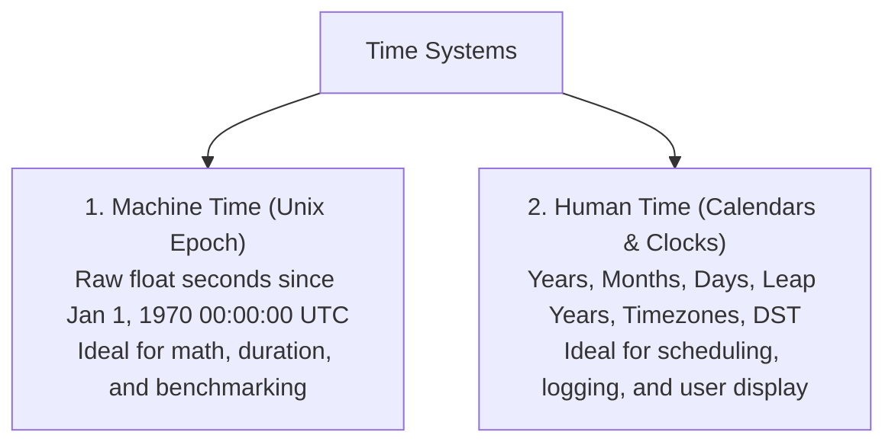
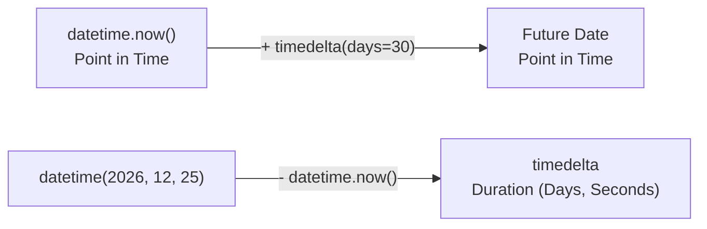
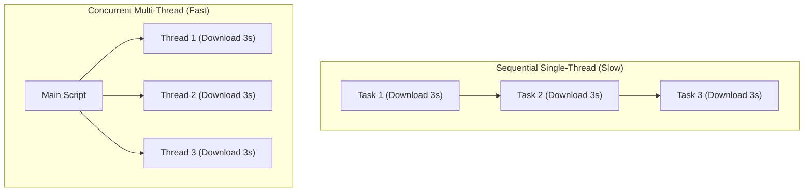

import { Callout } from "fumadocs-ui/components/callout";
import { Tabs, Tab } from "fumadocs-ui/components/tabs";
import { Accordion, Accordions } from "fumadocs-ui/components/accordion";
import { Steps, Step } from "fumadocs-ui/components/steps";

A standalone automation script that only runs when manually triggered from a terminal requires human intervention. To achieve true autonomy, software must be aware of **time**, capable of performing work concurrently in the background, and able to orchestrate other desktop applications on your operating system.

Whether it is benchmarking the execution speed of your algorithms, scheduling an e-commerce scraper to run every night at 11:59 PM, launching a backup script concurrently without freezing your user interface, or triggering system alerts, Python provides powerful tools in its standard library.

In this lesson, modeled on Chapter 17 of Al Sweigart's **_Automate the Boring Stuff with Python_**, you will master the `time`, `datetime`, `threading`, and `subprocess` modules.

---

## 1. The Temporal Mental Model: Computer Time vs. Human Time

Before writing time-dependent code, you must understand how operating systems measure time.



1. **Machine Time (The Unix Epoch)**:
   Computers do not natively understand months, days of the week, or Daylight Saving Time. Instead, operating systems measure time as a single continuous counter: **the number of seconds that have elapsed since midnight on January 1, 1970 (UTC)**. This moment is known as the **Unix Epoch**.
2. **Human Time (Calendar Objects)**:
   Humans measure time in years, calendar months of irregular lengths (28 to 31 days), leap seconds, and political timezone offsets. Converting between the two requires specialized calendar math.

---

## 2. The `time` Module: Raw Seconds & High-Precision Profiling

Python's built-in `time` module is your primary interface for raw epoch timestamps, execution pausing, and performance measurement.

### Reading the Epoch Clock with `time.time()`

Calling `time.time()` returns the current timestamp as a floating-point number representing seconds since January 1, 1970:

```python
import time

epoch_now = time.time()
print(f"Current Epoch Timestamp: {epoch_now}")
# Output: Current Epoch Timestamp: 1729645200.412853
```

Because timestamps are plain floating-point numbers, you can subtract one timestamp from another to calculate elapsed duration:

```python
import time

def calculate_product_sum() -> int:
    """Calculates the sum of products for the first 100,000 integers."""
    total = 0
    for i in range(1, 100_001):
        total += i * 2
    return total

# 1. Capture starting timestamp:
start_time = time.time()

# 2. Execute workload:
result = calculate_product_sum()

# 3. Capture ending timestamp and subtract:
end_time = time.time()
elapsed_seconds = end_time - start_time

print(f"Calculation Result: {result}")
print(f"Time Taken:         {elapsed_seconds:.6f} seconds")
```

### High-Precision Benchmarking: `time.perf_counter()`

<Callout type="warn" title="Why time.time() is Unreliable for Benchmarks">
  `time.time()` reads the operating system's system clock. If your computer
  syncs with an NTP network time server in the middle of your benchmark, or if
  Daylight Saving Time adjusts the clock backward by an hour, `time.time()` can
  produce distorted—or even negative—measurements!
</Callout>

For measuring code execution speed, always use **`time.perf_counter()`**:

- It provides the highest available resolution timer on your CPU.
- It is **monotonic** (it is guaranteed to move strictly forward and is never affected by system clock adjustments).

```python
import time

start_clock = time.perf_counter()

# Workload:
data = [x ** 2 for x in range(1_000_000)]

end_clock = time.perf_counter()
print(f"Elapsed wall-clock time: {(end_clock - start_clock) * 1000:.3f} ms")
```

### Pausing Execution with `time.sleep()`

`time.sleep(seconds)` temporarily halts the execution of the current Python thread. During sleep, your script consumes virtually zero CPU cycles because the operating system deschedules the process:

```python
import time

print("Commencing launch countdown:")
for count in range(3, 0, -1):
    print(f"  {count}...")
    time.sleep(1.0)  # Pause for exactly 1.0 second

print("🚀 Liftoff!")
```

---

## 3. The `datetime` Module: Calendars, Arithmetic & Timezones

While `time` is ideal for duration, the `datetime` module is engineered for human calendars, appointments, formatting, and scheduling.

### Representing Moments in Time: `datetime.datetime`

```python
from datetime import datetime, date, time as dt_time

# 1. Current local date and time:
now = datetime.now()
print(f"Current Date/Time: {now}")
# Output: 2026-10-23 14:30:15.829104

# 2. Inspect individual calendar fields:
print(f"Year:   {now.year}")
print(f"Month:  {now.month}")
print(f"Day:    {now.day}")
print(f"Hour:   {now.hour}")
print(f"Minute: {now.minute}")
print(f"Second: {now.second}")

# 3. Constructing an exact specific date:
apollo_landing = datetime(1969, 7, 20, 20, 17, 40)
print(f"Apollo 11 Landing: {apollo_landing}")
```

### Date Arithmetic with `timedelta`

A `datetime` represents a **point in time**, whereas a `timedelta` represents a **span of duration**:



```python
from datetime import datetime, timedelta

current_time = datetime.now()

# 1. Calculate future dates:
thirty_days_later = current_time + timedelta(days=30)
print(f"30 Days from now: {thirty_days_later.strftime('%Y-%m-%d')}")

# 2. Calculate past dates:
two_weeks_ago = current_time - timedelta(weeks=2)
print(f"2 Weeks ago:      {two_weeks_ago.strftime('%Y-%m-%d')}")

# 3. Calculate distance between two dates:
new_year = datetime(current_time.year + 1, 1, 1)
time_until_new_year = new_year - current_time

print(f"Days until New Year:    {time_until_new_year.days} days")
print(f"Total seconds remaining: {time_until_new_year.total_seconds():,.0f} seconds")
```

### Parsing & Formatting Strings (`strftime` vs `strptime`)

Remember this mnemonic:

- **`strftime`**: String **From** Time (Formats a datetime object into a readable string).
- **`strptime`**: String **Parse** Time (Parses a raw text string into a structured datetime object).

#### Format Directives Reference Table

| Directive | Meaning                      | Example Output |
| :-------- | :--------------------------- | :------------- |
| **`%Y`**  | 4-digit Year                 | `2026`         |
| **`%y`**  | 2-digit Year                 | `26`           |
| **`%m`**  | 2-digit Month (01–12)        | `10`           |
| **`%B`**  | Full Month Name              | `October`      |
| **`%b`**  | Abbreviated Month Name       | `Oct`          |
| **`%d`**  | 2-digit Day of Month (01–31) | `23`           |
| **`%H`**  | 24-hour clock hour (00–23)   | `14`           |
| **`%I`**  | 12-hour clock hour (01–12)   | `02`           |
| **`%p`**  | AM / PM marker               | `PM`           |
| **`%M`**  | 2-digit Minute (00–59)       | `30`           |
| **`%S`**  | 2-digit Second (00–59)       | `45`           |
| **`%A`**  | Full Day of Week             | `Friday`       |

```python
from datetime import datetime

# Formatting with strftime():
now = datetime.now()
formatted_report_date = now.strftime("%A, %B %d, %Y at %I:%M %p")
print(formatted_report_date)
# Output: Friday, October 23, 2026 at 02:30 PM

# Parsing with strptime():
raw_log_entry = "2026-10-23 09:15:32"
parsed_date = datetime.strptime(raw_log_entry, "%Y-%m-%d %H:%M:%S")
print(f"Parsed Year: {parsed_date.year}, Hour: {parsed_date.hour}")
```

### Modern Timezones with Python 3.9+ `zoneinfo`

Older Python code relied on the external `pytz` package. Modern Python includes native timezone support via `zoneinfo`:

```python
from datetime import datetime
from zoneinfo import ZoneInfo

# Create timezone-aware moments:
utc_time = datetime.now(ZoneInfo("UTC"))
tokyo_time = utc_time.astimezone(ZoneInfo("Asia/Tokyo"))
new_york_time = utc_time.astimezone(ZoneInfo("America/New_York"))

print(f"UTC:      {utc_time.strftime('%H:%M %Z')}")
print(f"Tokyo:    {tokyo_time.strftime('%H:%M %Z')}")
print(f"New York: {new_york_time.strftime('%H:%M %Z')}")
```

---

## 4. Multithreading for Responsive Automation

Imagine your script needs to download 50 files from different web servers. If you do this sequentially in a single thread, each download blocks the next one, taking minutes to complete.

**Multithreading** allows Python to run multiple tasks concurrently by switching execution whenever a thread is blocked waiting for network I/O, disk writes, or timers:



### Spawning Threads with `threading.Thread`

```python
import threading
import time

def background_worker(task_name: str, duration: float) -> None:
    print(f"[{task_name}] Commenced on thread {threading.current_thread().name}...")
    time.sleep(duration)
    print(f"[{task_name}] Completed after {duration} seconds!")

# 1. Create independent thread objects:
# target: function to run; args: tuple of positional arguments
thread_a = threading.Thread(target=background_worker, args=("Download Images", 2.0))
thread_b = threading.Thread(target=background_worker, args=("Process CSV Data", 1.0))

# 2. Launch threads into execution:
thread_a.start()
thread_b.start()

print("Main thread continues executing without waiting!")

# 3. Join threads (waits for background threads to finish before moving on):
thread_a.join()
thread_b.join()

print("All background workloads have completed.")
```

### Daemon Threads

By default, Python will keep your program alive until **every thread terminates**. If you spawn a background thread with an infinite `while True:` loop (e.g., a file watcher), your script will never exit!

Setting `daemon=True` tells Python that this thread is a background helper. When the main program finishes, **daemon threads are terminated immediately**:

```python
import threading
import time

def heartbeat_monitor():
    while True:
        print("  [Heartbeat] Service OK...")
        time.sleep(1.0)

# Mark as a daemon thread:
monitor_thread = threading.Thread(target=heartbeat_monitor, daemon=True)
monitor_thread.start()

# Main program does work for 3 seconds, then exits:
time.sleep(3.0)
print("Main program exiting. Daemon thread terminates automatically.")
```

---

## 5. Launching External Desktop Programs with `subprocess`

A key automation superpower is having Python control and trigger other software installed on your computer.

<Callout type="warn" title="Deprecation Notice: Avoid os.system()">
  Older tutorials use `os.system("command")`. This is dangerous, prone to
  shell-injection vulnerabilities, and cannot capture output cleanly. Always use
  the modern standard library **`subprocess`** module.
</Callout>

### Launching Programs with `subprocess.run()`

`subprocess.run()` launches a program, waits for it to complete, and captures its return code:

```python
import subprocess
import sys

# Run Python to print its version:
result = subprocess.run(
    [sys.executable, "--version"],
    capture_output=True,  # Capture stdout and stderr
    text=True,            # Decode bytes to string
    check=True            # Raise exception if command fails
)

print(f"Command Output: {result.stdout.strip()}")
print(f"Exit Status:    {result.returncode}")
```

### Non-Blocking Process Spawning with `subprocess.Popen`

If you want to launch a desktop application (like Notepad, Calculator, or a media player) and have Python **continue running immediately** without freezing, use `subprocess.Popen`:

```python
import subprocess
import sys

# Launch a text editor in the background:
if sys.platform == "win32":
    # On Windows: Launch Notepad
    proc = subprocess.Popen(["notepad.exe"])
elif sys.platform == "darwin":
    # On macOS: Launch TextEdit
    proc = subprocess.Popen(["open", "-a", "TextEdit"])
else:
    # On Linux: Launch Gedit / Nano
    proc = subprocess.Popen(["gedit"])

print(f"Launched application with Process ID (PID): {proc.pid}")
print("Python script continues executing without waiting for Notepad to close!")
```

### Opening Files in Default OS Viewers

To open a file (e.g., an image, PDF, or HTML page) in whatever application the user has registered as default:

```python
import os
import subprocess
import sys
from pathlib import Path

def open_in_default_app(file_path: Path) -> None:
    """Cross-platform helper to open a file with default OS desktop viewer."""
    file_str = str(file_path.resolve())

    if sys.platform == "win32":
        os.startfile(file_str)
    elif sys.platform == "darwin":
        subprocess.run(["open", file_str], check=True)
    else:
        subprocess.run(["xdg-open", file_str], check=True)

# Example: Open an image in default photo viewer:
# open_in_default_app(Path("screenshot.png"))
```

---

## 6. Task Scheduling Architectures

Automated scripts must run at predictable intervals without human initiation.

### In-Process Scheduling with the `schedule` Library

The `schedule` library provides an elegant human-readable API for scheduling recurring Python functions:

```bash
uv add schedule
# or: pip install schedule
```

```python
import time
import schedule

def daily_cleanup_job():
    print(f"[{time.strftime('%X')}] Purging temporary cache files...")

def hourly_metric_poll():
    print(f"[{time.strftime('%X')}] Polling server metrics...")

# Define schedule rules:
schedule.every().day.at("02:00").do(daily_cleanup_job)
schedule.every(10).minutes.do(hourly_metric_poll)
schedule.every().monday.at("09:00").do(lambda: print("Weekly sync!"))

print("Task Scheduler active. Press Ctrl+C to stop.")
try:
    while True:
        schedule.run_pending()
        time.sleep(1)
except KeyboardInterrupt:
    print("Scheduler terminated by user.")
```

### Production Operating System Schedulers

For scripts meant to run on servers or desktop workstations across reboots, use native OS task schedulers:

<Tabs items={['Windows Task Scheduler', 'Linux / macOS (cron)']}>
<Tab value="Windows Task Scheduler">
Windows includes **Task Scheduler** (`taskschd.msc`). You can configure tasks via the GUI or the command line using `schtasks`:

```powershell
# Create a scheduled task to run script every day at 08:30 AM:
schtasks /create /tn "DailyPythonDigest" /tr "C:\Python312\python.exe C:\scripts\digest.py" /sc daily /st 08:30
```

</Tab>
<Tab value="Linux / macOS (cron)">
Unix systems use the **cron daemon**. Edit your user schedule with `crontab -e`:

```cron
# ┌───────────── minute (0 - 59)
# │ ┌───────────── hour (0 - 23)
# │ │ ┌───────────── day of month (1 - 31)
# │ │ │ ┌───────────── month (1 - 12)
# │ │ │ │ ┌───────────── day of week (0 - 6) (Sunday to Saturday)
# │ │ │ │ │
# 30 8 * * * /usr/bin/python3 /home/user/scripts/digest.py >> /home/user/logs/cron.log 2>&1
```

</Tab>
</Tabs>

---

## 7. Capstone Project 1: The Precision Multi-Lap Super-Stopwatch

Let's build a classic project directly from _Automate the Boring Stuff with Python_: **The Multi-Lap Stopwatch**.

**The Goal**: Track total elapsed time and individual lap splits every time the user hits Enter, displaying formatted splits and cleanly capturing `KeyboardInterrupt` (`Ctrl+C`):

```python
"""
stopwatch.py - A precision multi-lap stopwatch CLI.
Inspired by 'Automate the Boring Stuff with Python'.
"""
import time

def run_stopwatch() -> None:
    print("=" * 50)
    print("         PRECISION MULTI-LAP STOPWATCH")
    print("=" * 50)
    print("Instructions:")
    print("  • Press ENTER to record a new lap.")
    print("  • Press CTRL+C to stop and display final summary.\n")

    input("Press ENTER to start the timer...")
    start_time = time.perf_counter()
    last_lap_time = start_time
    lap_number = 1
    laps_recorded = []

    print("\nTimer running! Recording laps:")
    try:
        while True:
            input()
            now = time.perf_counter()
            lap_duration = now - last_lap_time
            total_duration = now - start_time

            lap_record = f"Lap #{lap_number:02d}: Split {lap_duration:6.2f}s | Total {total_duration:6.2f}s"
            print(lap_record, end="")
            laps_recorded.append((lap_number, lap_duration, total_duration))

            lap_number += 1
            last_lap_time = now

    except KeyboardInterrupt:
        # Handle Ctrl+C cleanly:
        total_time = time.perf_counter() - start_time
        print("\n\n" + "=" * 50)
        print("                FINAL SUMMARY")
        print("=" * 50)
        print(f"Total Laps Completed: {len(laps_recorded)}")
        print(f"Total Session Time:   {total_time:.2f} seconds")

        if laps_recorded:
            fastest_lap = min(laps_recorded, key=lambda x: x[1])
            slowest_lap = max(laps_recorded, key=lambda x: x[1])
            print(f"Fastest Lap:          Lap #{fastest_lap[0]} ({fastest_lap[1]:.2f}s)")
            print(f"Slowest Lap:          Lap #{slowest_lap[0]} ({slowest_lap[1]:.2f}s)")
        print("Stopwatch session terminated.")

if __name__ == "__main__":
    run_stopwatch()
```

---

## 8. Capstone Project 2: Automated Nightly Backup & Cleanup Dispatcher

This end-to-end production script:

1. Zips a designated folder into a timestamped archive (`backup_YYYY_MM_DD.zip`).
2. Deletes old backup files older than 30 days using `timedelta`.
3. Runs the archiving concurrently on a background thread so the UI remains responsive.

```python
"""
nightly_backup.py - Automated directory archiving and rotation daemon.
"""
from datetime import datetime, timedelta
from pathlib import Path
import threading
import time
import zipfile

def create_timestamped_archive(source_dir: Path, backup_vault: Path) -> Path:
    backup_vault.mkdir(parents=True, exist_ok=True)
    timestamp = datetime.now().strftime("%Y_%m_%d_%H%M%S")
    archive_name = backup_vault / f"backup_{source_dir.name}_{timestamp}.zip"

    print(f"[{datetime.now():%X}] Starting compression of '{source_dir}'...")
    start_time = time.perf_counter()

    with zipfile.ZipFile(archive_name, "w", zipfile.ZIP_DEFLATED) as zip_out:
        for file_path in source_dir.rglob("*"):
            if file_path.is_file():
                # Write file with relative path inside zip:
                arcname = file_path.relative_to(source_dir)
                zip_out.write(file_path, arcname)

    elapsed = time.perf_counter() - start_time
    size_mb = archive_name.stat().st_size / (1024 * 1024)
    print(f"[{datetime.now():%X}] Created '{archive_name.name}' ({size_mb:.2f} MB in {elapsed:.2f}s)")
    return archive_name

def prune_ancient_backups(backup_vault: Path, retention_days: int = 30) -> int:
    cutoff_date = datetime.now() - timedelta(days=retention_days)
    pruned_count = 0

    for zip_file in backup_vault.glob("backup_*.zip"):
        # Inspect file modification time:
        mod_time = datetime.fromtimestamp(zip_file.stat().st_mtime)
        if mod_time < cutoff_date:
            zip_file.unlink()
            print(f"Pruned expired backup: {zip_file.name} (Dated: {mod_time:%Y-%m-%d})")
            pruned_count += 1

    return pruned_count

def run_backup_job() -> None:
    source = Path("project_data")
    vault = Path("backups")
    source.mkdir(exist_ok=True)

    # Spawn in background worker thread:
    worker = threading.Thread(
        target=lambda: (create_timestamped_archive(source, vault), prune_ancient_backups(vault, 30))
    )
    worker.start()
    worker.join()
    print("Nightly maintenance pipeline complete!")

if __name__ == "__main__":
    run_backup_job()
```

---

## 9. Common Debugging Traps & Solutions

<Accordions>
<Accordion title="Trap 1: TypeError comparing offset-naive and offset-aware datetimes">
**The Problem**: Code throws `TypeError: can't compare offset-naive and offset-aware datetimes`.

**The Cause**: One `datetime` has a timezone attached (`ZoneInfo("UTC")`), while the other is a "naive" local timestamp with no timezone metadata.

**The Fix**: Always normalize both datetimes to the same timezone:

```python
from datetime import datetime, timezone

# Ensure both are UTC:
aware_now = datetime.now(timezone.utc)
normalized_past = past_dt.astimezone(timezone.utc)
diff = aware_now - normalized_past
```

</Accordion>

<Accordion title="Trap 2: Subprocess Freezing due to Buffer Deadlock">
**The Problem**: Calling `proc = subprocess.Popen(...)` hangs permanently on large commands.

**The Cause**: If the spawned program writes a large amount of text to stdout/stderr and you don't read it, the OS pipe buffer fills up (typically 64 KB), causing the child process to block forever.

**The Fix**: Use `proc.communicate()` or `subprocess.run(capture_output=True)`, which drain the OS pipes safely in memory.

</Accordion>

<Accordion title="Trap 3: Daemon Threads Exiting Mid-Write">
**The Problem**: Your file writes or database updates are corrupt because a daemon thread was abruptly killed.

**The Cause**: When the main thread reaches the end of the script, daemon threads are terminated immediately without executing `finally:` blocks or flushing file buffers.

**The Fix**: For critical I/O tasks, keep threads non-daemon and call `thread.join()`.

</Accordion>
</Accordions>

---

## 10. Hands-On Practice Exercises

### Exercise 1: Countdown Timer & Alarm

Write a function `countdown_alarm(seconds: int)` that prints the remaining time every second. When the countdown reaches `0`, it rings the terminal bell (`print('\a')`) and opens a celebration webpage in the default browser.

<Accordions>
<Accordion title="View Exercise 1 Solution">
```python
import time
import webbrowser

def countdown_alarm(seconds: int) -> None:
for remaining in range(seconds, 0, -1):
mins, secs = divmod(remaining, 60)
print(f"Time Remaining: {mins:02d}:{secs:02d}", end="\r")
time.sleep(1.0)

    print("\n⏰ BEEP BEEP! Time is up!")
    print("\a")  # System alert sound
    webbrowser.open("https://en.wikipedia.org/wiki/Alarm_clock")

````
</Accordion>
</Accordions>

### Exercise 2: Parallel Web Pinger
Write a script that takes a list of 5 website URLs and pings all 5 simultaneously using 5 separate `threading.Thread` workers, printing how many milliseconds each took to respond.

<Accordions>
<Accordion title="View Exercise 2 Solution">
```python
import threading
import time
import requests

def ping_site(url: str) -> None:
    t0 = time.perf_counter()
    try:
        res = requests.get(url, timeout=5.0)
        latency = (time.perf_counter() - t0) * 1000
        print(f"✓ {url:<30} -> Status {res.status_code} ({latency:.1f} ms)")
    except Exception as e:
        print(f"❌ {url:<30} -> Failed ({e})")

sites = [
    "https://www.python.org",
    "https://httpbin.org/get",
    "https://github.com",
    "https://en.wikipedia.org",
    "https://www.google.com"
]

threads = [threading.Thread(target=ping_site, args=(s,)) for s in sites]
for t in threads: t.start()
for t in threads: t.join()
print("All sites checked.")
````

</Accordion>
</Accordions>

---

## Stage 5 Progression

Now that you can manage time, execute background threads, and launch external programs, proceed to the next lesson to learn how to manipulate Excel spreadsheets and cloud Google Sheets:

**[Next Lesson: Working with Excel Spreadsheets & Google Sheets →](/docs/learn-python/05-practical-automation/05-working-with-excel-and-spreadsheets)**
