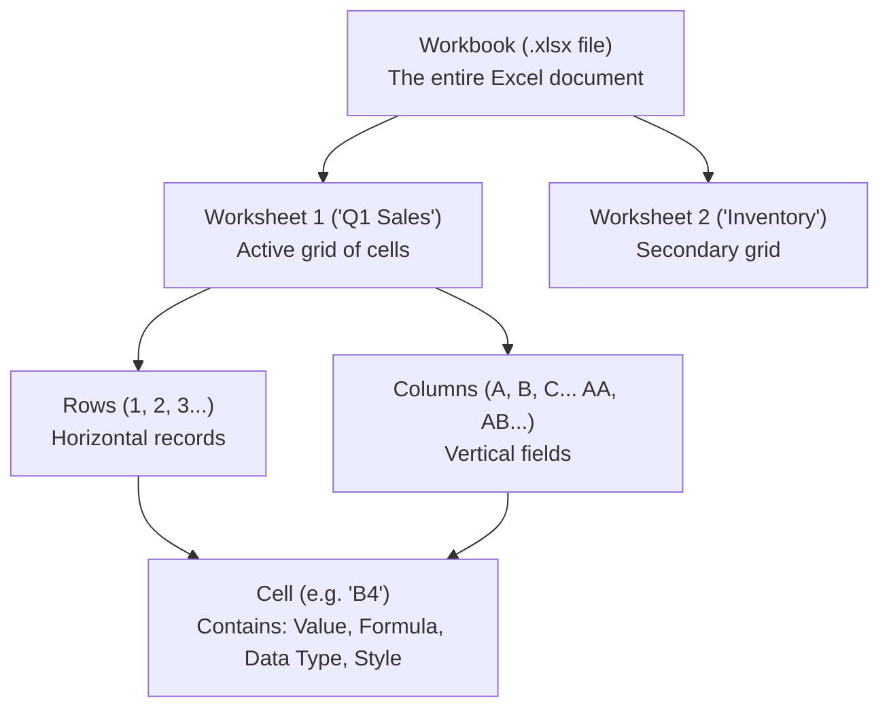
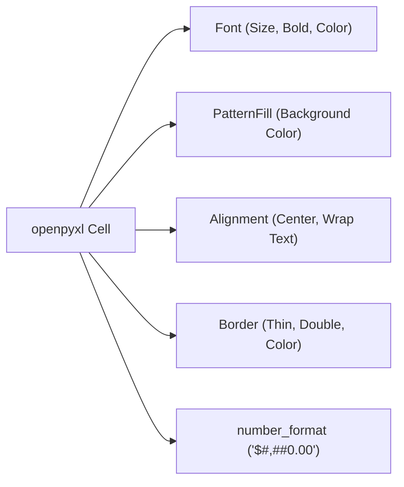

import { Callout } from "fumadocs-ui/components/callout";
import { Tabs, Tab } from "fumadocs-ui/components/tabs";
import { Accordion, Accordions } from "fumadocs-ui/components/accordion";
import { Steps, Step } from "fumadocs-ui/components/steps";

Spreadsheets are the universal lingua franca of global commerce. Financial analysts, operations managers, HR departments, and marketing teams run multinational enterprises using Microsoft Excel and Google Sheets.

Yet, working with spreadsheets manually is notoriously error-prone. A human manually copying and pasting numbers across hundreds of monthly sales reports inevitably fat-fingers a decimal, deletes a formula, or spends hours performing mechanical data entry that a computer could finish in two seconds.

In this lesson, modeled on Chapters 13 and 14 of Al Sweigart's **_Automate the Boring Stuff with Python_**, you will learn to read, write, format, chart, and automate Excel (`.xlsx`) files using **`openpyxl`**, as well as synchronize cloud spreadsheets using **`gspread`**.

---

## 1. The Spreadsheet Mental Model

An Excel file is not a flat text file like CSV; it is a rich, compressed XML archive containing multiple interlocking data structures:



1. **Workbook**: The entire spreadsheet file (saved with the `.xlsx` extension).
2. **Worksheet (Sheet)**: An individual page or grid tab within the workbook.
3. **Column**: Vertical strips labeled with letters: `A` to `Z`, then `AA` to `ZZ`, up to `XFD` (16,384 columns).
4. **Row**: Horizontal strips labeled with numbers: `1` to `1,048,576`.
5. **Cell**: The intersection of a column and row, denoted by coordinate notation like `C5` (Column C, Row 5). A cell holds a **value**, an optional **formula**, and **formatting metadata** (font, borders, fill color).

---

## 2. Reading Excel Files with `openpyxl`

The premier library for manipulating Excel 2010+ (`.xlsx`) files in Python is **`openpyxl`**.

### Installation

```bash
uv add openpyxl
# or: pip install openpyxl
```

### Loading Workbooks & Inspecting Sheets

```python
import openpyxl

# 1. Open an existing Excel workbook:
wb = openpyxl.load_workbook("sales_data.xlsx")

# 2. Inspect available sheet names:
print(f"Available Sheets: {wb.sheetnames}")
# Output: ['January', 'February', 'March', 'Summary']

# 3. Access sheets by title:
jan_sheet = wb["January"]

# 4. Access the currently active sheet:
active_sheet = wb.active
print(f"Active Sheet Title: {active_sheet.title}")
```

### Accessing Cells: Bracket vs. Method Notation

There are two primary ways to access cells in `openpyxl`:

```python
import openpyxl

wb = openpyxl.load_workbook("sales_data.xlsx")
sheet = wb.active

# Technique 1: Coordinate String (A1 Notation)
cell_a1 = sheet["A1"]
print(f"Cell {cell_a1.coordinate}: {cell_a1.value}")

# Technique 2: Row & Column Numbers (1-Indexed)
# Ideal for nested loops!
cell_b2 = sheet.cell(row=2, column=2)
print(f"Row 2, Column 2 value: {cell_b2.value}")
```

<Callout type="warn" title="Critical Trap: 1-Indexed Coordinates">
  Unlike standard Python lists and strings which are **0-indexed**, Excel rows
  and columns in `openpyxl` are **1-indexed**! - Column `A` is `column=1` (not
  `0`). - Row `1` is `row=1` (not `0`). Passing `row=0` will raise an
  `IndexError`.
</Callout>

### Coordinate Conversion Utilities

When writing loops, you often need to convert between column numbers (`27`) and Excel letters (`AA`):

```python
from openpyxl.utils import get_column_letter, column_index_from_string

# Convert number to letter:
print(get_column_letter(1))    # 'A'
print(get_column_letter(27))   # 'AA'
print(get_column_letter(900))  # 'AHP'

# Convert letter to number:
print(column_index_from_string('A'))   # 1
print(column_index_from_string('AA'))  # 27
```

### Slicing Ranges & Iterating Rows

```python
import openpyxl

wb = openpyxl.load_workbook("sales_data.xlsx")
sheet = wb.active

print(f"Total Dimensions: {sheet.max_row} Rows x {sheet.max_column} Columns")

# 1. Slice a rectangular block of cells:
# sheet['A1':'C3'] returns a tuple of row tuples:
for row_cells in sheet["A1":"C3"]:
    row_values = [cell.value for cell in row_cells]
    print(f"Row data: {row_values}")

# 2. Iterate all rows using iter_rows(values_only=True):
# values_only=True returns raw data instead of Cell objects (much faster!):
for row in sheet.iter_rows(min_row=2, max_row=5, min_col=1, max_col=3, values_only=True):
    product, units, price = row
    print(f"Product: {product} | Revenue: ${units * price:.2f}")
```

### The Formula Trap: `data_only=False` vs `data_only=True`

If a cell contains a formula like `=SUM(B2:B10)`:

- By default (`data_only=False`), `cell.value` returns the literal string: `"=SUM(B2:B10)"`.
- If you open with `data_only=True`, `cell.value` returns the **evaluated cached number** (e.g. `450.00`).

```python
# To inspect the formula text:
wb_formulas = openpyxl.load_workbook("sales.xlsx", data_only=False)
print(wb_formulas.active["B11"].value)  # Output: '=SUM(B2:B10)'

# To read the calculated mathematical total:
wb_values = openpyxl.load_workbook("sales.xlsx", data_only=True)
print(wb_values.active["B11"].value)    # Output: 450.00
```

---

## 3. Writing & Modifying Spreadsheets

### Creating New Workbooks from Scratch

```python
import openpyxl

# 1. Create a blank workbook:
wb = openpyxl.Workbook()

# The workbook starts with one default sheet named 'Sheet':
sheet = wb.active
sheet.title = "Q4 Financials"

# 2. Create additional sheets:
sheet_inventory = wb.create_sheet(title="Warehouse Inventory")
sheet_first = wb.create_sheet(title="Executive Summary", index=0)  # Insert as first tab

print(f"Sheets: {wb.sheetnames}")
# Output: ['Executive Summary', 'Q4 Financials', 'Warehouse Inventory']
```

### Populating Cells & Appending Rows

You can assign values to individual cells or append entire rows of data at the bottom of the worksheet:

```python
import openpyxl

wb = openpyxl.Workbook()
sheet = wb.active
sheet.title = "Product Catalog"

# Write headers:
sheet["A1"] = "SKU"
sheet["B1"] = "Product Name"
sheet["C1"] = "Unit Price"
sheet["D1"] = "Stock Qty"
sheet["E1"] = "Total Value"

# Append multiple data rows in bulk:
products = [
    ["PROD-001", "Mechanical Keyboard", 120.00, 45],
    ["PROD-002", "Ergonomic Mouse",     65.50,  80],
    ["PROD-003", "4K Ultra-Wide Monitor", 450.00, 15],
    ["PROD-004", "USB-C Docking Station", 89.99, 120],
]

for row in products:
    sheet.append(row)

# Add native dynamic Excel formulas:
for row_idx in range(2, 2 + len(products)):
    # Formula multiplies Unit Price (Col C) by Stock Qty (Col D):
    sheet[f"E{row_idx}"] = f"=C{row_idx}*D{row_idx}"

# Total Row at the bottom:
last_row = 2 + len(products)
sheet[f"A{last_row}"] = "TOTAL INVENTORY VALUE"
sheet[f"E{last_row}"] = f"=SUM(E2:E{last_row - 1})"

# Save the workbook to disk:
wb.save("inventory_report.xlsx")
print("Workbook saved successfully!")
```

---

## 4. Professional Styling & Formatting

Raw unstyled spreadsheets look amateurish. `openpyxl.styles` allows you to apply corporate fonts, colored header fills, number formats, borders, and column autosizing.



### Complete Styling Demonstration

```python
import openpyxl
from openpyxl.styles import Font, PatternFill, Alignment, Border, Side
from openpyxl.utils import get_column_letter

wb = openpyxl.Workbook()
sheet = wb.active
sheet.title = "Executive P&L"

# 1. Define Design Tokens:
HEADER_FONT = Font(name="Segoe UI", size=11, bold=True, color="FFFFFF")
HEADER_FILL = PatternFill(start_color="1E293B", end_color="1E293B", fill_type="solid")  # Dark Slate
CURRENCY_FORMAT = "$#,##0.00"
THIN_BORDER = Border(
    left=Side(style='thin', color='CBD5E1'),
    right=Side(style='thin', color='CBD5E1'),
    top=Side(style='thin', color='CBD5E1'),
    bottom=Side(style='thin', color='CBD5E1')
)

# 2. Write and Style Header Row:
headers = ["Department", "Q1 Budget", "Q1 Actual", "Variance", "Status"]
sheet.append(headers)

for col_idx in range(1, len(headers) + 1):
    cell = sheet.cell(row=1, column=col_idx)
    cell.font = HEADER_FONT
    cell.fill = HEADER_FILL
    cell.alignment = Alignment(horizontal="center", vertical="center")
    cell.border = THIN_BORDER
sheet.row_dimensions[1].height = 26

# 3. Add Sample Financial Records:
rows_data = [
    ["Engineering", 150000, 142000],
    ["Marketing",    80000,  88500],
    ["Operations",   45000,  41200],
    ["HR",           30000,  29100],
]

for idx, (dept, budget, actual) in enumerate(rows_data, start=2):
    variance_formula = f"=B{idx}-C{idx}"
    status_formula = f'=IF(D{idx}>=0, "Under Budget", "Over Budget")'
    sheet.append([dept, budget, actual, variance_formula, status_formula])

    # Format currency columns:
    for col_letter in ["B", "C", "D"]:
        sheet[f"{col_letter}{idx}"].number_format = CURRENCY_FORMAT
        sheet[f"{col_letter}{idx}"].border = THIN_BORDER

# 4. Auto-Fit Column Widths based on longest content:
for col in sheet.columns:
    max_len = max(len(str(cell.value or '')) for cell in col)
    col_letter = get_column_letter(col[0].column)
    sheet.column_dimensions[col_letter].width = max(max_len + 4, 12)

# 5. Freeze Header Pane (Row 1 stays fixed during scroll):
sheet.freeze_panes = "A2"

wb.save("executive_pl_styled.xlsx")
print("Styled workbook generated!")
```

---

## 5. Automated Data Visualizations & Charts with `openpyxl.chart`

Python can embed native interactive Excel charts directly into workbooks without opening Excel:

```python
import openpyxl
from openpyxl.chart import BarChart, Reference, Series

wb = openpyxl.Workbook()
sheet = wb.active
sheet.title = "Quarterly Revenue"

# 1. Populate Sample Category Data:
data = [
    ["Product", "Q1 Sales", "Q2 Sales"],
    ["Laptops",   45000, 52000],
    ["Monitors",  28000, 31000],
    ["Keyboards", 12000, 14500],
    ["Headsets",   8500,  9200],
]

for row in data:
    sheet.append(row)

# 2. Configure Native Excel Bar Chart:
chart = BarChart()
chart.type = "col"             # Column bar chart
chart.style = 10               # Clean Excel chart palette
chart.title = "Hardware Sales Performance"
chart.y_axis.title = "Revenue (USD)"
chart.x_axis.title = "Product Category"
chart.width = 16
chart.height = 10

# 3. Define Data and Category References:
# Data values are in columns 2 to 3, rows 1 to 5:
data_ref = Reference(sheet, min_col=2, min_row=1, max_col=3, max_row=5)
# Category labels are in column 1, rows 2 to 5:
categories_ref = Reference(sheet, min_col=1, min_row=2, max_row=5)

chart.add_data(data_ref, titles_from_data=True)
chart.set_categories(categories_ref)

# 4. Insert Chart onto Worksheet at cell E2:
sheet.add_chart(chart, "E2")

wb.save("sales_with_barchart.xlsx")
print("Generated native Excel chart successfully!")
```

---

## 6. Cloud Spreadsheets: Google Sheets Automation with `gspread`

While `openpyxl` operates on local `.xlsx` files, modern remote teams collaborate on **Google Sheets**.

Using the **`gspread`** library, Python can read, write, and synchronize cloud spreadsheets in real time.

### Architecture: Service Account Authentication


1. Create a Google Cloud project and enable the **Google Sheets API** and **Google Drive API**.
2. Create a **Service Account** and download its JSON key file (`service_account.json`).
3. Open your Google Sheet in your web browser and click **Share**. Share it with the service account's client email (e.g. `automation-bot@my-project.iam.gserviceaccount.com`).

```bash
uv add gspread
# or: pip install gspread
```

### Reading & Updating Google Sheets

```python
import gspread

# 1. Authenticate using service account JSON:
gc = gspread.service_account(filename="service_account.json")

# 2. Open spreadsheet by name or URL:
sh = gc.open("Company Operations Dashboard")
worksheet = sh.sheet1

# 3. Read all data as structured dictionary records:
records = worksheet.get_all_records()
for record in records:
    print(record)

# 4. Update specific cells:
worksheet.update_cell(row=2, col=3, value=99.50)

# 5. Append a new row to the cloud sheet:
worksheet.append_row(["Warehouse B", "Restock Complete", "2026-10-23"])
print("Cloud spreadsheet successfully updated!")
```

---

## 7. Capstone Project 1: The Automated Census & Demographic Analyzer

Let's build a classic project directly from _Automate the Boring Stuff with Python_: **The Census Data Calculator**.

**The Problem**: You have an Excel spreadsheet containing census data with thousands of rows: Tract Code, State, County, and Population. You need to calculate the total population and number of census tracts for each county, and export a clean summary spreadsheet.

```python
"""
census_analyzer.py - Aggregates census tracts into county totals.
Inspired by 'Automate the Boring Stuff with Python'.
"""
from pathlib import Path
import openpyxl

def generate_census_summary(input_file: Path, output_file: Path) -> None:
    print(f"Loading '{input_file.name}'...")
    wb = openpyxl.load_workbook(input_file, data_only=True)
    sheet = wb.active

    # Structure: county_data[state][county] = {'tracts': int, 'pop': int}
    county_data = {}

    print("Reading rows and aggregating census data...")
    # Assume: Col 2 = State Abbr, Col 3 = County Name, Col 4 = Population
    for row in range(2, sheet.max_row + 1):
        state = sheet[f"B{row}"].value
        county = sheet[f"C{row}"].value
        pop = sheet[f"D{row}"].value or 0

        if not state or not county:
            continue

        county_data.setdefault(state, {})
        county_data[state].setdefault(county, {"tracts": 0, "pop": 0})

        county_data[state][county]["tracts"] += 1
        county_data[state][county]["pop"] += int(pop)

    print("Writing aggregated summary workbook...")
    out_wb = openpyxl.Workbook()
    out_sheet = out_wb.active
    out_sheet.title = "County Summary"

    # Headers:
    out_sheet.append(["State", "County", "Census Tracts", "Total Population"])

    for state, counties in sorted(county_data.items()):
        for county, stats in sorted(counties.items()):
            out_sheet.append([state, county, stats["tracts"], stats["pop"]])

    out_wb.save(output_file)
    print(f"Summary generated successfully in '{output_file.name}'!")

if __name__ == "__main__":
    # Example execution (assuming censuspopdata.xlsx exists)
    # generate_census_summary(Path("censuspopdata.xlsx"), Path("census_summary.xlsx"))
    pass
```

---

## 8. Capstone Project 2: Multi-Sheet Financial Dashboard Generator

This production script creates a multi-sheet corporate financial workbook:

1. Tab 1: **Transactions** (Raw ledger data).
2. Tab 2: **Summary** (Auto-calculated totals using native Excel formulas).
3. Tab 3: Formatted with corporate colors, currency symbols, and an embedded column bar chart.

```python
"""
financial_dashboard_generator.py - Generates an executive P&L dashboard.
"""
from pathlib import Path
import openpyxl
from openpyxl.chart import BarChart, Reference
from openpyxl.styles import Font, PatternFill, Alignment, Border, Side
from openpyxl.utils import get_column_letter

def build_executive_financial_dashboard(output_path: Path) -> Path:
    wb = openpyxl.Workbook()

    # -------------------------------------------------------------
    # TAB 1: RAW TRANSACTION LEDGER
    # -------------------------------------------------------------
    ws_ledger = wb.active
    ws_ledger.title = "Ledger"

    ledger_headers = ["Transaction ID", "Date", "Region", "Category", "Amount"]
    ws_ledger.append(ledger_headers)

    raw_transactions = [
        ["TX-1001", "2026-10-01", "North America", "Software", 45000],
        ["TX-1002", "2026-10-03", "Europe",        "Software", 32000],
        ["TX-1003", "2026-10-05", "Asia Pacific",  "Hardware", 28000],
        ["TX-1004", "2026-10-08", "North America", "Services", 15000],
        ["TX-1005", "2026-10-12", "Europe",        "Hardware", 41000],
        ["TX-1006", "2026-10-15", "Asia Pacific",  "Software", 39000],
    ]
    for row in raw_transactions:
        ws_ledger.append(row)

    # Format Currency column:
    for r in range(2, 2 + len(raw_transactions)):
        ws_ledger[f"E{r}"].number_format = "$#,##0.00"

    # -------------------------------------------------------------
    # TAB 2: EXECUTIVE SUMMARY & CHART
    # -------------------------------------------------------------
    ws_summary = wb.create_sheet(title="Executive Summary", index=0)

    # Header Styling
    HEAD_FONT = Font(name="Segoe UI", size=11, bold=True, color="FFFFFF")
    HEAD_FILL = PatternFill(start_color="0F172A", end_color="0F172A", fill_type="solid")

    ws_summary["A1"] = "Regional Revenue Summary"
    ws_summary["A1"].font = Font(name="Segoe UI", size=16, bold=True, color="0F172A")

    summary_headers = ["Region", "Total Revenue"]
    ws_summary.append([])  # Blank row
    ws_summary.append(summary_headers)  # Row 3

    for c in range(1, 3):
        cell = ws_summary.cell(row=3, column=c)
        cell.font = HEAD_FONT
        cell.fill = HEAD_FILL

    # Formula References linking to Ledger tab:
    regions = ["North America", "Europe", "Asia Pacific"]
    for idx, reg in enumerate(regions, start=4):
        # SUMIF formula: =SUMIF(Ledger!C2:C7, "Region", Ledger!E2:E7)
        formula = f'=SUMIF(Ledger!$C$2:$C$7, "{reg}", Ledger!$E$2:$E$7)'
        ws_summary.append([reg, formula])
        ws_summary[f"B{idx}"].number_format = "$#,##0.00"

    # Embed Bar Chart:
    chart = BarChart()
    chart.type = "col"
    chart.title = "Revenue by Territory"
    chart.style = 11
    chart.y_axis.title = "USD ($)"

    data_ref = Reference(ws_summary, min_col=2, min_row=3, max_row=6)
    cats_ref = Reference(ws_summary, min_col=1, min_row=4, max_row=6)
    chart.add_data(data_ref, titles_from_data=True)
    chart.set_categories(cats_ref)

    ws_summary.add_chart(chart, "D3")

    # Auto-adjust column widths:
    for ws in [ws_ledger, ws_summary]:
        for col in ws.columns:
            max_len = max(len(str(cell.value or '')) for cell in col)
            ws.column_dimensions[get_column_letter(col[0].column)].width = max(max_len + 4, 14)

    wb.save(output_path)
    print(f"Executive dashboard generated -> {output_path}")
    return output_path

if __name__ == "__main__":
    build_executive_financial_dashboard(Path("executive_dashboard.xlsx"))
```

---

## 9. Common Debugging Traps & Solutions

<Accordions>
<Accordion title="Trap 1: PermissionError: [Errno 13] Permission denied when saving">
**The Problem**: Calling `wb.save("file.xlsx")` crashes with `PermissionError: [Errno 13] Permission denied`.

**The Cause**: You currently have `file.xlsx` open in Microsoft Excel on your computer. Excel places a write-lock on the file, preventing Python from overwriting it.

**The Fix**: Close Excel before running your Python script, or save to a temporary timestamped file name.

</Accordion>

<Accordion title="Trap 2: Formula results return None instead of numbers">
**The Problem**: You open an Excel file with `openpyxl.load_workbook(path, data_only=True)`, but `cell.value` is `None` instead of the calculated number.

**The Cause**: `openpyxl` does **not** evaluate formula math itself. It relies on the cached calculation generated the last time Microsoft Excel saved the file. If Python created the formula and Excel hasn't opened and saved it yet, the cached value is `None`.

**The Fix**: To calculate formulas outside Excel, either use a calculation engine like `formulas` (`pip install formulas`) or open and save the workbook via Excel or LibreOffice.

</Accordion>

<Accordion title="Trap 3: Styles Applied to Entire Column Exhaust Memory">
**The Problem**: Setting formatting on `sheet.column_dimensions['A']` causes memory usage to explode or creates giant 50 MB files.

**The Cause**: Applying borders or fills to an entire unbounded column attempts to style all 1,048,576 rows!

**The Fix**: Only iterate and style rows up to `sheet.max_row`.

</Accordion>
</Accordions>

---

## 10. Hands-On Practice Exercises

### Exercise 1: Blank Row Inserter

Write a function `insert_blank_rows(file_path: Path, start_row: int, count: int)` that reads a spreadsheet, inserts `count` blank rows starting at `start_row`, and saves the updated workbook.

<Accordions>
<Accordion title="View Exercise 1 Solution">
```python
from pathlib import Path
import openpyxl

def insert_blank_rows(file_path: Path, start_row: int, count: int) -> None:
wb = openpyxl.load_workbook(file_path)
sheet = wb.active # openpyxl has a built-in insert_rows method:
sheet.insert_rows(idx=start_row, amount=count)
wb.save(file_path)
print(f"Inserted {count} blank rows starting at row {start_row}.")

````
</Accordion>
</Accordions>

### Exercise 2: Multiplication Table Maker
Write a script `make_multiplication_table(n: int, output_file: Path)` that generates an $N \times N$ multiplication table in Excel. Row 1 and Column A should be bold headers with dark gray fill, and the inner cells should contain formulas multiplying row by column (e.g. `=$A2*B$1`).

<Accordions>
<Accordion title="View Exercise 2 Solution">
```python
from pathlib import Path
import openpyxl
from openpyxl.styles import Font, PatternFill
from openpyxl.utils import get_column_letter

def make_multiplication_table(n: int, output_file: Path) -> None:
    wb = openpyxl.Workbook()
    sheet = wb.active
    sheet.title = f"{n}x{n} Table"

    BOLD_FONT = Font(bold=True)
    GRAY_FILL = PatternFill(start_color="E2E8F0", end_color="E2E8F0", fill_type="solid")

    # 1. Write Header Row & Column:
    for i in range(1, n + 1):
        col_letter = get_column_letter(i + 1)
        # Column Header:
        cell_col = sheet[f"{col_letter}1"]
        cell_col.value = i
        cell_col.font = BOLD_FONT
        cell_col.fill = GRAY_FILL

        # Row Header:
        cell_row = sheet[f"A{i + 1}"]
        cell_row.value = i
        cell_row.font = BOLD_FONT
        cell_row.fill = GRAY_FILL

    # 2. Write Formulas:
    for r in range(2, n + 2):
        for c in range(2, n + 2):
            col_letter = get_column_letter(c)
            # Use absolute row and column references ($A2 * B$1):
            sheet[f"{col_letter}{r}"] = f"=$A{r}*{col_letter}$1"

    wb.save(output_file)
    print(f"Saved {n}x{n} table to {output_file.name}")

if __name__ == "__main__":
    make_multiplication_table(12, Path("multiplication_12x12.xlsx"))
````

</Accordion>
</Accordions>

---

## Stage 5 Progression

Now that you can automate Excel spreadsheets and cloud Google Sheets, proceed to the next lesson to master programmatic document processing for PDFs and Word documents:

**[Next Lesson: Working with PDF & Word Documents →](/docs/learn-python/05-practical-automation/06-working-with-pdf-and-word-documents)**
