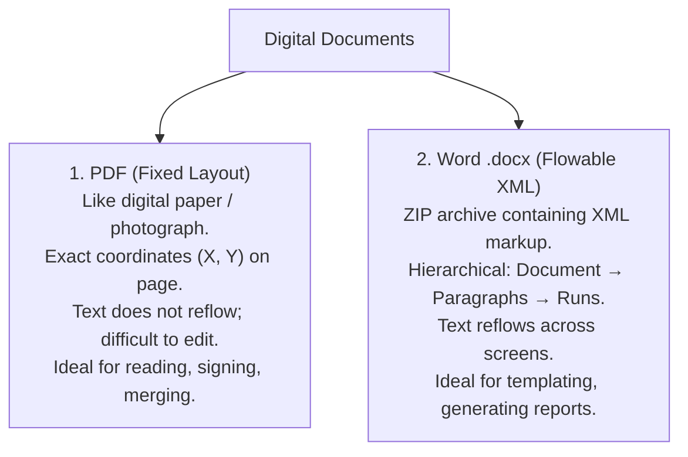
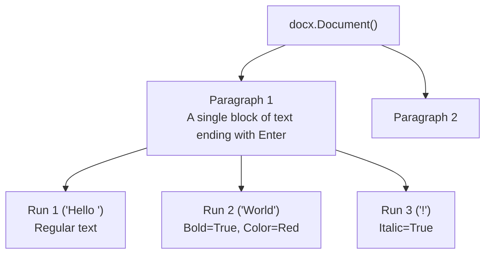

import { Callout } from "fumadocs-ui/components/callout";
import { Tabs, Tab } from "fumadocs-ui/components/tabs";
import { Accordion, Accordions } from "fumadocs-ui/components/accordion";
import { Steps, Step } from "fumadocs-ui/components/steps";

In business and legal operations, documents are the ultimate deliverable. Contracts, financial statements, academic papers, and technical manuals are distributed across two dominant formats:

1. **PDF (Portable Document Format)**: The universal standard for static, non-editable viewing and printing.
2. **Microsoft Word (`.docx`)**: The standard for dynamic, editable rich-text authoring.

Manually editing hundreds of documents—such as merging 50 individual PDF scan pages into a single binder, password-protecting tax documents, or generating 300 personalized client invitation letters—is agonizingly slow.

In this lesson, modeled on Chapter 15 of Al Sweigart's **_Automate the Boring Stuff with Python_**, you will learn to programmatically slice, merge, watermark, and encrypt PDFs using modern **`pypdf`**, and author beautifully formatted Word documents using **`python-docx`**.

---

## 1. The Document Automation Mental Model

PDFs and Word documents represent two completely opposite engineering philosophies:



- **Why PDFs are hard to edit**: A PDF is essentially a vector printing program. It places characters at absolute physical coordinates (e.g. "draw the letter 'A' at coordinate $X=72, Y=144$"). A PDF does not natively know where "sentences" or "paragraphs" begin or end.
- **Why Word documents are easy to template**: A `.docx` file is a zipped archive of XML files. Text is organized into **Paragraphs** and **Runs**, which Python can easily inspect, replace, and append.

---

## 2. PDF Automation with Modern `pypdf`

<Callout type="warn" title="Package Ecosystem Note: Use pypdf">
  Older tutorials instruct you to install `PyPDF2` or `PyPDF4`. In late 2022,
  the original author and maintainers reunited and merged everything back into
  the modern, actively maintained **`pypdf`** package. Always use `pypdf`.
</Callout>

### Installation

```bash
uv add pypdf
# or: pip install pypdf
```

### Reading PDFs & Extracting Text

```python
import pypdf

# 1. Open the PDF file:
reader = pypdf.PdfReader("annual_report.pdf")

# 2. Inspect document metadata:
print(f"Total Pages: {len(reader.pages)}")
print(f"Is Encrypted: {reader.is_encrypted}")

# 3. Read text from Page 1 (0-indexed):
first_page = reader.pages[0]
page_text = first_page.extract_text()
print("--- Page 1 Content Preview ---")
print(page_text[:300])  # Print first 300 characters
```

### Searching for Keywords Across Multi-Page Documents

```python
import pypdf

def search_pdf_keyword(pdf_path: str, keyword: str) -> list[int]:
    """Scans all pages and returns a list of page numbers matching keyword."""
    reader = pypdf.PdfReader(pdf_path)
    matching_pages = []

    for page_idx, page in enumerate(reader.pages, start=1):
        text = page.extract_text()
        if keyword.lower() in text.lower():
            matching_pages.append(page_idx)

    print(f"Keyword '{keyword}' found on pages: {matching_pages}")
    return matching_pages
```

### Rotating Pages

You can rotate pages in $90^\circ$ increments using `.rotate()`:

```python
import pypdf

reader = pypdf.PdfReader("scanned_receipt.pdf")
writer = pypdf.PdfWriter()

for page in reader.pages:
    # Rotate 90 degrees clockwise:
    page.rotate(90)
    writer.add_page(page)

with open("rotated_output.pdf", "wb") as f:
    writer.write(f)
print("Rotated pages saved successfully.")
```

### Merging Multiple PDFs with `PdfMerger`

The most common real-world PDF task is binding multiple distinct PDF files into a single unified book:

```python
from pathlib import Path
import pypdf

def merge_pdf_directory(pdf_files: list[Path], output_path: Path) -> None:
    merger = pypdf.PdfMerger()

    for pdf in pdf_files:
        print(f"Appending '{pdf.name}'...")
        merger.append(str(pdf))

    with open(output_path, "wb") as f_out:
        merger.write(f_out)

    merger.close()
    print(f"Merged {len(pdf_files)} files into '{output_path.name}'!")

# Example:
# merge_pdf_directory([Path("cover.pdf"), Path("body.pdf"), Path("appendix.pdf")], Path("bound_book.pdf"))
```

### Overlaying Watermarks & Stamps

Pillow can watermark images, but how do you stamp a transparent "CONFIDENTIAL" watermark onto vector PDF pages?

`pypdf` allows you to take one PDF page and merge it over another page like an acetate sheet:

```python
import pypdf

def apply_pdf_watermark(source_pdf: str, watermark_pdf: str, output_pdf: str) -> None:
    # 1. Load source document and watermark stamp:
    reader = pypdf.PdfReader(source_pdf)
    watermark_reader = pypdf.PdfReader(watermark_pdf)
    watermark_page = watermark_reader.pages[0]

    writer = pypdf.PdfWriter()

    # 2. Iterate through every page and merge the watermark overlay:
    for page in reader.pages:
        page.merge_page(watermark_page)
        writer.add_page(page)

    # 3. Write final stamped document:
    with open(output_pdf, "wb") as out_file:
        writer.write(out_file)

    print(f"Stamped watermark on all {len(reader.pages)} pages -> '{output_pdf}'")
```

### Encrypting & Decrypting Sensitive Documents

You can protect sensitive financial or medical records with military-grade AES encryption:

```python
import pypdf

# 1. Encrypting a PDF:
reader = pypdf.PdfReader("sensitive_payroll.pdf")
writer = pypdf.PdfWriter()

for page in reader.pages:
    writer.add_page(page)

# Set password:
writer.encrypt(user_password="SuperSecretPassword123")

with open("encrypted_payroll.pdf", "wb") as f:
    writer.write(f)
print("PDF encrypted with AES password.")

# 2. Decrypting a PDF:
locked_reader = pypdf.PdfReader("encrypted_payroll.pdf")
if locked_reader.is_encrypted:
    # Unlock with password:
    locked_reader.decrypt("SuperSecretPassword123")
    print(f"Unlocked! Page count: {len(locked_reader.pages)}")
```

---

## 3. Word Document Processing with `python-docx`

While PDFs are read-only presentations, Microsoft Word (`.docx`) is designed for programmatic generation.

### Installation

```bash
uv add python-docx
# or: pip install python-docx
```

### The Word Document Hierarchy: Paragraphs & Runs

To manipulate Word documents, you must understand its object model:



- **Paragraph**: A block of text starting on a new line (created whenever a user presses `Enter`).
- **Run**: A contiguous span of text inside a paragraph that shares the **exact same formatting** (font, bold, italic, color). Whenever the style changes, Word starts a new Run!

### Reading Word Documents

```python
import docx

doc = docx.Document("meeting_notes.docx")

print(f"Total Paragraphs: {len(doc.paragraphs)}")

# Print text of every paragraph:
for idx, para in enumerate(doc.paragraphs):
    if para.text.strip():
        print(f"[{idx}] {para.text}")
```

### Creating Formatted Documents from Scratch

```python
import docx
from docx.shared import Inches, Pt, RGBColor
from docx.enum.text import WD_ALIGN_PARAGRAPH

# 1. Initialize a new Word document:
doc = docx.Document()

# 2. Add Headings (Levels 0 is Title, 1-4 are hierarchical headers):
title = doc.add_heading("Executive Project Proposal", level=0)
title.alignment = WD_ALIGN_PARAGRAPH.CENTER

# 3. Add Paragraphs and Styled Runs:
p1 = doc.add_paragraph("This proposal outlines the deployment architecture for our ")
# Append bold run:
run_bold = p1.add_run("Automated Cloud Pipeline")
run_bold.bold = True
run_bold.font.color.rgb = RGBColor(2, 132, 199)  # Sky Blue

# Append italic run:
run_italic = p1.add_run(" (Version 3.2).")
run_italic.italic = True

# 4. Add Section Heading:
doc.add_heading("Key Deliverables", level=1)

# 5. Add Bullet Lists and Numbered Lists:
doc.add_paragraph("High-throughput web scraping engine", style="List Bullet")
doc.add_paragraph("Pillow image processing pipeline", style="List Bullet")
doc.add_paragraph("SMTP automated communication gateway", style="List Bullet")

# 6. Insert Tables:
table = doc.add_table(rows=1, cols=3)
table.style = "Table Grid"

# Header Row:
hdr_cells = table.rows[0].cells
hdr_cells[0].text = "Phase"
hdr_cells[1].text = "Timeline"
hdr_cells[2].text = "Owner"

# Add Data Rows:
table.add_row().cells[0].text = "Stage 1: Architecture"
table.rows[1].cells[1].text = "2 Weeks"
table.rows[1].cells[2].text = "Lead Architect"

# 7. Add Page Break:
doc.add_page_break()
doc.add_paragraph("This text appears on Page 2.")

# Save document:
doc.save("generated_proposal.docx")
print("Word document generated successfully!")
```

---

## 4. Capstone Project 1: The Universal PDF Binder & Watermarker CLI

Let's build a comprehensive PDF utility tool:

- Scans an `input_pdfs/` folder for all PDF files.
- Merges them in alphabetical order.
- Stamps a semi-transparent "OFFICIAL ARCHIVE" watermark on every page.
- Encrypts the final output with a secure password.

```python
"""
pdf_binder.py - Merges, watermarks, and encrypts PDF documents.
Inspired by 'Automate the Boring Stuff with Python'.
"""
from pathlib import Path
import pypdf

def build_pdf_binder(
    input_dir: Path,
    watermark_path: Path,
    output_path: Path,
    password: str
) -> None:
    # 1. Collect all PDF files in folder:
    pdf_files = sorted([p for p in input_dir.glob("*.pdf")])
    if not pdf_files:
        print(f"No PDF files found in '{input_dir}'.")
        return

    print(f"Found {len(pdf_files)} PDF files to merge:")
    for f in pdf_files:
        print(f"  • {f.name}")

    # 2. Merge into temporary writer:
    writer = pypdf.PdfWriter()

    # Load watermark page:
    wm_reader = pypdf.PdfReader(watermark_path)
    wm_page = wm_reader.pages[0]

    total_pages = 0
    for pdf_path in pdf_files:
        reader = pypdf.PdfReader(pdf_path)
        for page in reader.pages:
            # Stamp watermark overlay:
            page.merge_page(wm_page)
            writer.add_page(page)
            total_pages += 1

    # 3. Encrypt output:
    writer.encrypt(user_password=password)

    # 4. Write final bound file:
    output_path.parent.mkdir(parents=True, exist_ok=True)
    with open(output_path, "wb") as f_out:
        writer.write(f_out)

    print(f"\n✓ Successfully created bound PDF ({total_pages} pages) -> '{output_path.name}'")
    print(f"✓ Protected with password: '{password}'")

if __name__ == "__main__":
    # Example execution:
    # build_pdf_binder(
    #     input_dir=Path("input_reports"),
    #     watermark_path=Path("watermark.pdf"),
    #     output_path=Path("bound_confidential_archive.pdf"),
    #     password="SecretArchive2026"
    # )
    pass
```

---

## 5. Capstone Project 2: Automated Personalized Invitation Generator

In this capstone, we write a script that reads a list of guests from a Python dictionary (or CSV), and automatically generates customized, beautifully formatted Word invitation letters for every attendee.

```python
"""
invitation_generator.py - Generates custom Word documents from template data.
"""
from pathlib import Path
import docx
from docx.shared import Inches, Pt, RGBColor
from docx.enum.text import WD_ALIGN_PARAGRAPH

GUESTS = [
    {"name": "Dr. Sarah Connor", "seat": "Table 1A", "tier": "VIP Speaker"},
    {"name": "Prof. Alan Turing", "seat": "Table 2B", "tier": "Distinguished Guest"},
    {"name": "Grace Hopper",      "seat": "Table 1A", "tier": "Keynote Honoree"},
    {"name": "Ada Lovelace",      "seat": "Table 3C", "tier": "VIP Attendee"},
]

def generate_guest_invitations(output_dir: Path) -> None:
    output_dir.mkdir(parents=True, exist_ok=True)

    for guest in GUESTS:
        doc = docx.Document()

        # Configure 1-inch margins:
        for section in doc.sections:
            section.top_margin = Inches(1.0)
            section.bottom_margin = Inches(1.0)
            section.left_margin = Inches(1.0)
            section.right_margin = Inches(1.0)

        # Header Badge:
        hdr = doc.add_paragraph()
        hdr_run = hdr.add_run("ANNUAL COMPUTER SCIENCE GALA 2026")
        hdr_run.font.size = Pt(10)
        hdr_run.font.bold = True
        hdr_run.font.color.rgb = RGBColor(100, 116, 139)
        hdr.alignment = WD_ALIGN_PARAGRAPH.CENTER

        # Title:
        title = doc.add_heading("Official Invitation", level=1)
        title.alignment = WD_ALIGN_PARAGRAPH.CENTER

        doc.add_paragraph()  # Spacing

        # Personalized Salutation:
        p_body = doc.add_paragraph()
        p_body.add_run(f"Dear {guest['name']},\n\n").bold = True
        p_body.add_run(
            "It is our distinct honor to invite you to the annual Computer Science "
            "Leadership Gala celebrating breakthroughs in artificial intelligence, "
            "automated data architectures, and distributed systems.\n\n"
        )
        p_body.add_run(
            "Please present this invitation document at registration for entry into the ballroom."
        )

        # Details Box (Table):
        table = doc.add_table(rows=3, cols=2)
        table.style = "Light Shading Accent 1"
        table.rows[0].cells[0].text = "Guest Name"
        table.rows[0].cells[1].text = guest["name"]
        table.rows[1].cells[0].text = "Pass Tier"
        table.rows[1].cells[1].text = guest["tier"]
        table.rows[2].cells[0].text = "Assigned Seating"
        table.rows[2].cells[1].text = guest["seat"]

        doc.add_paragraph()

        # Signature Block:
        sig = doc.add_paragraph("Warmest regards,\n\n")
        sig.add_run("The Executive Organizing Committee\n").bold = True
        sig.add_run("Computer Science Cookbook Foundation")

        # Clean file name:
        clean_name = guest["name"].replace(" ", "_").replace(".", "")
        file_path = output_dir / f"Invitation_{clean_name}.docx"
        doc.save(file_path)
        print(f"Generated invitation -> {file_path.name}")

    print(f"\nAll {len(GUESTS)} invitations generated in '{output_dir.resolve()}'.")

if __name__ == "__main__":
    generate_guest_invitations(Path("invitations_output"))
```

---

## 6. Common Debugging Traps & Solutions

<Accordions>
<Accordion title="Trap 1: pypdf extracts garbled text or empty string">
**The Problem**: Calling `page.extract_text()` returns an empty string `""` or unreadable gibberish symbols.

**The Cause**: The PDF is a **scanned document** (a collection of raster images without embedded font characters) or uses proprietary font encoding matrices.

**The Fix**: If the PDF is a scan, pure PDF parsers cannot read it; you must run **OCR (Optical Character Recognition)** using tools like `tesseract` (`pytesseract`).

</Accordion>

<Accordion title="Trap 2: python-docx text replacement breaks styling">
**The Problem**: You try to replace `"{{NAME}}"` in a Word document with a guest's name, but `paragraph.text.replace()` strips all your bolding, colors, and fonts!

**The Cause**: Assigning to `paragraph.text` wipes out all underlying `Run` objects and replaces them with a single unstyled text block.

**The Fix**: You must iterate through `paragraph.runs` and perform replacement inside individual runs, or use specialized templating libraries like `docxtpl`.

</Accordion>

<Accordion title="Trap 3: Sliced PDFs have giant file sizes">
**The Problem**: You extracted 1 page from a 100-page PDF, but the output file is still 50 MB!

**The Cause**: The source PDF contains shared fonts, color profiles, or embedded images that are carried over into the new document.

**The Fix**: Modern `pypdf` supports `writer.compress_identical_objects()` to strip duplicated and unused resource streams.

</Accordion>
</Accordions>

---

## 7. Hands-On Practice Exercises

### Exercise 1: PDF Page Slicer

Write a function `slice_pdf(source: Path, start_page: int, end_page: int, output_path: Path)` that extracts a range of pages (1-indexed inclusive) and saves them to a new PDF.

<Accordions>
<Accordion title="View Exercise 1 Solution">
```python
from pathlib import Path
import pypdf

def slice_pdf(source: Path, start_page: int, end_page: int, output_path: Path) -> None:
reader = pypdf.PdfReader(source)
writer = pypdf.PdfWriter()

    # Convert 1-indexed to 0-indexed:
    for idx in range(start_page - 1, end_page):
        if idx < len(reader.pages):
            writer.add_page(reader.pages[idx])

    with open(output_path, "wb") as f:
        writer.write(f)

    print(f"Extracted pages {start_page} to {end_page} -> '{output_path.name}'")

````
</Accordion>
</Accordions>

### Exercise 2: Word to Plain-Text Dumper
Write a function `docx_to_text(docx_path: Path, txt_output: Path)` that reads all paragraphs and table contents from a Word document and writes them to a plain UTF-8 text file.

<Accordions>
<Accordion title="View Exercise 2 Solution">
```python
from pathlib import Path
import docx

def docx_to_text(docx_path: Path, txt_output: Path) -> None:
    doc = docx.Document(docx_path)
    lines = []

    for p in doc.paragraphs:
        if p.text.strip():
            lines.append(p.text)

    for table in doc.tables:
        for row in table.rows:
            row_str = " | ".join(cell.text.strip() for cell in row.cells)
            lines.append(row_str)

    with open(txt_output, "w", encoding="utf-8") as f:
        f.write("\n\n".join(lines))

    print(f"Dumped text to '{txt_output.name}'")
````

</Accordion>
</Accordions>

---

## Stage 5 Progression

Now that you can automate documents, PDFs, and spreadsheets, proceed to the final lesson to learn how to control the physical mouse cursor and keyboard directly on your computer:

**[Next Lesson: GUI Automation: Mouse & Keyboard Control with PyAutoGUI →](/docs/learn-python/05-practical-automation/07-gui-automation-mouse-and-keyboard-control)**
