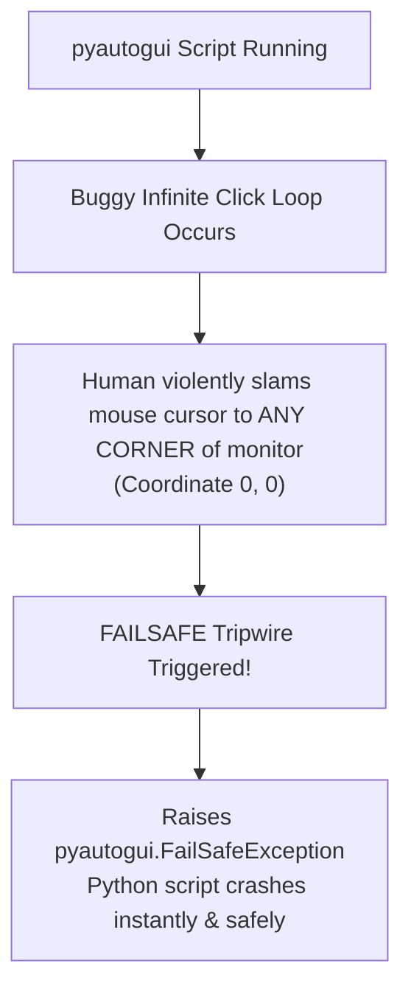
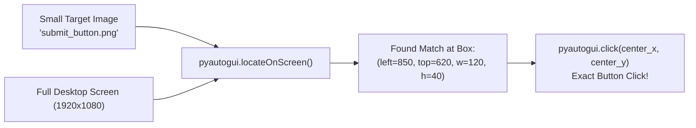
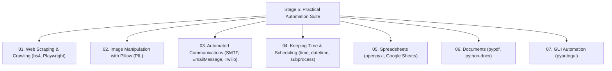

import { Callout } from "fumadocs-ui/components/callout";
import { Tabs, Tab } from "fumadocs-ui/components/tabs";
import { Accordion, Accordions } from "fumadocs-ui/components/accordion";
import { Steps, Step } from "fumadocs-ui/components/steps";

Throughout this curriculum, you have learned to automate software using clean, structured abstractions: REST APIs, HTML DOM trees, pixel raster buffers, and database connections.

But what happens when you encounter legacy enterprise software built in 2004 that has no API, no command-line interface, and cannot be scraped? Or desktop games and canvas applications that don't expose HTML elements?

When all other programmatic interfaces fail, you have one final superpower: **GUI Automation (Graphical User Interface Automation)**.

By taking direct programmatic control of the physical mouse cursor and keyboard, Python can click buttons, type text, navigate menus, and interact with _any_ program running on your monitor exactly as a human would.

In this lesson, modeled on Chapter 20 of Al Sweigart's **_Automate the Boring Stuff with Python_**, you will master **`pyautogui`**.

---

## 1. The Safety Tripwire: Fail-Safes & Emergency Aborts

<Callout type="warn" title="CRITICAL SAFETY WARNING: Read This First!">
  GUI automation scripts can easily spiral out of control. If you write a buggy
  `while True:` loop that clicks the mouse every 10 milliseconds, the script
  will steal your cursor focus. You won't be able to click "Stop" in your code
  editor, open Task Manager, or close the window! You could be locked out of
  your own computer!
</Callout>

To prevent catastrophic runaways, `pyautogui` includes two mandatory, non-negotiable safety features:



### 1. The Fail-Safe Corner Tripwire

By default, **`pyautogui.FAILSAFE = True`** is enabled.

Whenever you slam your mouse cursor into any of the four absolute corners of your screen (such as top-left `(0, 0)`), `pyautogui` throws a `pyautogui.FailSafeException` and immediately terminates the program. **Never set this to `False`!**

### 2. Built-in Pauses

`pyautogui.PAUSE` instructs Python to pause for a fraction of a second after _every single_ function call. This prevents scripts from moving faster than your operating system can render windows:

```python
import pyautogui

# Set a 0.25-second breathing room between every mouse click or key press:
pyautogui.PAUSE = 0.25

# Ensure fail-safe is active:
pyautogui.FAILSAFE = True
```

---

## 2. Screen Coordinates & Resolution

PyAutoGUI models your monitor as an $X, Y$ coordinate grid where origin `(0, 0)` sits at the **top-left corner**:

```python
import pyautogui

# 1. Inspect screen resolution:
width, height = pyautogui.size()
print(f"Screen Resolution: {width} x {height}")
# Output: Screen Resolution: 1920 x 1080

# 2. Inspect current live mouse cursor coordinate:
current_x, current_y = pyautogui.position()
print(f"Mouse is currently at: X={current_x}, Y={current_y}")
```

### The Live Coordinate Tracker Utility (`mouseNow.py`)

In _Automate the Boring Stuff_, Al Sweigart introduces one of the most useful diagnostic scripts: **`mouseNow.py`**.

As you move your physical mouse across the screen, it continuously prints the current $(X, Y)$ coordinate and the RGB color under your cursor in real time:

```python
"""
mouseNow.py - Displays the mouse cursor's current position and pixel color.
Inspired by 'Automate the Boring Stuff with Python'.
"""
import sys
import pyautogui

def track_mouse() -> None:
    print("Press Ctrl+C to terminate live tracking.")
    try:
        while True:
            # Get coordinates:
            x, y = pyautogui.position()
            # Get pixel RGB:
            pixel_color = pyautogui.pixel(x, y)

            position_str = (
                f"X: {str(x).rjust(4)} Y: {str(y).rjust(4)} | "
                f"RGB: ({str(pixel_color[0]).rjust(3)}, "
                f"{str(pixel_color[1]).rjust(3)}, "
                f"{str(pixel_color[2]).rjust(3)})"
            )
            # Print with carriage return '\r' to update the same terminal line:
            print(position_str, end="\r")
            sys.stdout.flush()

    except KeyboardInterrupt:
        print("\nLive mouse tracking stopped.")

if __name__ == "__main__":
    track_mouse()
```

---

## 3. Controlling the Mouse

### Moving the Cursor: Absolute vs. Relative

```python
import pyautogui

# 1. Absolute Movement: Move cursor to coordinate (800, 400) over 1.5 seconds:
pyautogui.moveTo(800, 400, duration=1.5)

# 2. Relative Movement: Nudge cursor 100px right and 50px down from current position:
pyautogui.moveRel(100, 50, duration=0.5)

# 3. Human-like Easing Curves:
# Starts slow, accelerates, and decelerates into position:
pyautogui.moveTo(500, 500, duration=1.0, tween=pyautogui.easeInOutQuad)
```

### Mouse Clicks & Drags

```python
import pyautogui

# 1. Standard Left-Click:
pyautogui.click(x=300, y=250)

# 2. Right-Click (context menu):
pyautogui.rightClick(x=500, y=500)

# 3. Double-Click:
pyautogui.doubleClick(x=200, y=150)

# 4. Drag-and-Drop:
# Click and drag from current position to (600, 600):
pyautogui.dragTo(600, 600, duration=1.0, button='left')
```

### Drawing Spirals in MS Paint

Here is a classic demonstration: Open Microsoft Paint or an online canvas, position your cursor in the drawing area, and run this script to draw a geometric square spiral:

```python
import time
import pyautogui

print("Open MS Paint and click inside the canvas within 5 seconds...")
time.sleep(5)

# Click to ensure canvas window has focus:
pyautogui.click()

distance = 300
change = 20

while distance > 0:
    pyautogui.dragRel(distance, 0, duration=0.1)        # Move right
    distance -= change
    pyautogui.dragRel(0, distance, duration=0.1)        # Move down
    pyautogui.dragRel(-distance, 0, duration=0.1)       # Move left
    distance -= change
    pyautogui.dragRel(0, -distance, duration=0.1)       # Move up
```

### Scrolling the Mouse Wheel

```python
import pyautogui

# Scroll UP 500 clicks:
pyautogui.scroll(500)

# Scroll DOWN 300 clicks:
pyautogui.scroll(-300)
```

---

## 4. Controlling the Keyboard

### Typing Strings with Natural Delays

The `pyautogui.write()` (or `typewrite()`) function sends simulated keystrokes. Passing an `interval` argument adds a delay between keystrokes to mimic human typing:

```python
import time
import pyautogui

time.sleep(2)  # Time to switch to target window

# Type text with 0.08s delay between characters:
pyautogui.write("Automating the boring stuff with Python!", interval=0.08)
```

### Pressing Special Keys

Standard strings cannot represent keys like `Enter`, `Shift`, `Backspace`, or `F1`. You pass these as string names:

```python
import pyautogui

# Press Enter:
pyautogui.press("enter")

# Press Tab twice:
pyautogui.press(["tab", "tab"])

# Press Escape:
pyautogui.press("esc")
```

#### Special Key Names Reference

| Key Name                 | Physical Key    | Key Name          | Physical Key  |
| :----------------------- | :-------------- | :---------------- | :------------ |
| `'enter'`                | Enter / Return  | `'backspace'`     | Backspace     |
| `'tab'`                  | Tab key         | `'space'`         | Spacebar      |
| `'esc'`                  | Escape key      | `'delete'`        | Delete key    |
| `'up'`, `'down'`         | Arrow keys      | `'home'`, `'end'` | Home / End    |
| `'pageup'`, `'pagedown'` | Page Navigation | `'f1'`–`'f12'`    | Function Keys |
| `'capslock'`             | Caps Lock       | `'ctrl'`, `'alt'` | Modifier Keys |

### Hotkeys & Keyboard Shortcuts

Pressing multiple keys simultaneously (e.g. `Ctrl+C` to copy, `Alt+Tab` to switch windows, or `Ctrl+Shift+Esc` to open Task Manager) is simplified with `.hotkey()`:

```python
import pyautogui

# Select All (Ctrl+A):
pyautogui.hotkey("ctrl", "a")

# Copy (Ctrl+C):
pyautogui.hotkey("ctrl", "c")

# Switch application window (Alt+Tab):
pyautogui.hotkey("alt", "tab")
```

---

## 5. Computer Vision & Screen Recognition

Hardcoding $(X, Y)$ pixel coordinates is fragile. If someone runs your script on a monitor with a different resolution, or if an operating system update moves a button 20 pixels to the right, your script will click the wrong spot.

**Computer Vision solves this.** You give Python a small screenshot of the button you want to click, and PyAutoGUI scans your monitor, finds where that image appears on screen, and clicks its center!



### Installing OpenCV for High-Speed Visual Recognition

For fast, fuzzy image matching, install `opencv-python`:

```bash
uv add opencv-python
# or: pip install opencv-python
```

### Locating & Clicking Buttons by Image

```python
import pyautogui

try:
    # 1. Search the screen for 'submit_btn.png':
    # confidence=0.9 allows 10% pixel tolerance for slight rendering anti-aliasing:
    location = pyautogui.locateOnScreen("submit_btn.png", confidence=0.9)

    if location is not None:
        print(f"Found button at coordinates: {location}")

        # 2. Compute center of bounding box and click:
        center_point = pyautogui.center(location)
        pyautogui.click(center_point)
        print("✓ Successfully clicked button via visual recognition!")
    else:
        print("Button not visible on screen.")

except pyautogui.ImageNotFoundException:
    print("Could not locate button on screen.")
```

#### The Ultimate One-Line Shortcut:

PyAutoGUI allows passing the image file name directly to `.click()`:

```python
# Finds image on screen and clicks its center in a single call:
pyautogui.click("submit_btn.png")
```

### Inspecting Pixel Colors with `pixelMatchesColor`

Before clicking a button, you can verify whether it is active (e.g., green) or disabled (e.g., gray):

```python
import pyautogui

# Check if pixel at (500, 300) matches expected RGB color with tolerance:
is_ready = pyautogui.pixelMatchesColor(500, 300, (34, 197, 94), tolerance=10)
if is_ready:
    print("System indicator is GREEN. Proceeding...")
    pyautogui.click(500, 300)
```

---

## 6. Capstone Project 1: The "Looking Busy" Mouse Jiggler

During long automated compilation tasks or remote testing runs, corporate laptops often aggressively enter sleep mode or lock the screen after 5 minutes of inactivity.

This capstone creates an intelligent **Mouse Jiggler** with a **Human Sentinel**:

- Every 2 minutes, it gently nudges the cursor 2 pixels back and forth.
- If it detects that a _human_ touched the mouse, it pauses and waits.

```python
"""
mouse_jiggler.py - Prevents screen sleep with human intervention detection.
"""
from datetime import datetime
import time
import pyautogui

def run_jiggler(interval_seconds: int = 120) -> None:
    print("=" * 55)
    print("        SENTINEL MOUSE JIGGLER ACTIVE")
    print("=" * 55)
    print("Instructions:")
    print("  • Jiggles mouse every 2 minutes to keep display active.")
    print("  • Slam cursor into ANY CORNER to trigger FAILSAFE abort.")
    print("  • Press Ctrl+C in terminal to stop.\n")

    try:
        while True:
            # Record position:
            initial_pos = pyautogui.position()

            # Wait for interval:
            time.sleep(interval_seconds)

            current_pos = pyautogui.position()

            # If mouse hasn't moved since last check (human is away):
            if current_pos == initial_pos:
                print(f"[{datetime.now():%X}] Inactivity detected. Nudging cursor...")
                # Nudge 2 pixels right, then 2 pixels left:
                pyautogui.moveRel(2, 0, duration=0.2)
                pyautogui.moveRel(-2, 0, duration=0.2)
            else:
                print(f"[{datetime.now():%X}] Human activity detected; skipping jiggle.")

    except KeyboardInterrupt:
        print("\nJiggler deactivated by user.")
    except pyautogui.FailSafeException:
        print("\nFail-safe triggered! Cursor moved to corner. Terminated.")

if __name__ == "__main__":
    run_jiggler(interval_seconds=10)
```

---

## 7. Capstone Project 2: Automated Desktop Form Submitter

In this capstone, we automate data entry into a desktop application or web form without an API:

1. Reads structured applicant records.
2. Focuses the form window.
3. Tabs through input fields, typing data with human intervals.
4. Locates the visual "Submit" button using image recognition and clicks it.

```python
"""
form_filler.py - Automated GUI form entry bot.
Inspired by 'Automate the Boring Stuff with Python'.
"""
from dataclasses import dataclass
import time
import pyautogui

@dataclass
class FormEntry:
    name: str
    email: str
    role: str
    notes: str

SAMPLE_APPLICANTS = [
    FormEntry("Alice Smith", "alice@example.com", "DevOps Engineer", "Excellent Kubernetes skills"),
    FormEntry("Bob Jones",   "bob@example.com",   "Security Lead",    "CISSP certified"),
    FormEntry("Carol White", "carol@example.com", "Data Architect",   "PostgreSQL specialist"),
]

def submit_form_data(entries: list[FormEntry]) -> None:
    print("Form filler active. Click your browser form window within 5 seconds...")
    time.sleep(5)

    for idx, person in enumerate(entries, start=1):
        print(f"[{idx}/{len(entries)}] Entering record for {person.name}...")

        # 1. Type Name:
        pyautogui.write(person.name, interval=0.04)
        pyautogui.press("tab")

        # 2. Type Email:
        pyautogui.write(person.email, interval=0.04)
        pyautogui.press("tab")

        # 3. Type Role:
        pyautogui.write(person.role, interval=0.04)
        pyautogui.press("tab")

        # 4. Type Notes:
        pyautogui.write(person.notes, interval=0.04)
        pyautogui.press("tab")

        # 5. Submit Form (hit Enter or find submit button visually):
        pyautogui.press("enter")

        # Pause for form submission animation:
        time.sleep(2.0)

        # Navigate back to fresh form (e.g. click 'Submit another response'):
        # pyautogui.click('submit_another.png')
        print(f"  ✓ Record for {person.name} submitted!")

if __name__ == "__main__":
    # submit_form_data(SAMPLE_APPLICANTS)
    pass
```

---

## 8. Common Debugging Traps & Solutions

<Accordions>
<Accordion title="Trap 1: Display Scaling / Retina Coordinate Mismatches">
**The Problem**: Your script clicks slightly off-target (e.g., 20 pixels down and to the right of where the button actually is).

**The Cause**: Windows display scaling (e.g., 125% or 150% DPI scaling) or macOS Retina 2x pixel doubling causes virtual coordinates to differ from physical hardware pixels.

**The Fix**: In Windows display settings, set display scaling to **100%**, or use `pyautogui.locateCenterOnScreen()` which automatically handles display scaling factors.

</Accordion>

<Accordion title="Trap 2: Background Windows Stealing Keyboard Focus">
**The Problem**: Your script starts typing passwords or sensitive text into the wrong application window.

**The Cause**: Another application (like an incoming Slack notification or system alert) stole window focus while `pyautogui.write()` was executing.

**The Fix**: Always explicitly click inside the target input box or verify the window title using `pygetwindow` before initiating keystrokes.

</Accordion>

<Accordion title="Trap 3: locateOnScreen fails due to dark mode / font anti-aliasing">
**The Problem**: `pyautogui.locateOnScreen("button.png")` raises `ImageNotFoundException` even though the button is clearly visible.

**The Cause**: Subtle operating system anti-aliasing or slight color theme differences prevent a 100% exact pixel match.

**The Fix**: Always supply `confidence=0.8` or `confidence=0.9` (requires `opencv-python`) to allow tolerant visual matching.

</Accordion>
</Accordions>

---

## 9. Hands-On Practice Exercises

### Exercise 1: Quick Screen-Region Clipper

Write a function `clip_screen_box(left: int, top: int, width: int, height: int, output_file: str)` that takes a screenshot of only the specified bounding box region and saves it as a PNG.

<Accordions>
<Accordion title="View Exercise 1 Solution">
```python
import pyautogui

def clip_screen_box(left: int, top: int, width: int, height: int, output_file: str) -> None: # region parameter expects: (left, top, width, height)
snippet = pyautogui.screenshot(region=(left, top, width, height))
snippet.save(output_file)
print(f"Saved clipped screen region -> {output_file}")

if **name** == "**main**":
clip_screen_box(100, 100, 400, 300, "screen_clip.png")

````
</Accordion>
</Accordions>

### Exercise 2: Automated Window Switcher & Refresher
Write a script that presses `Alt+Tab` to switch to your previous window, waits 0.5 seconds, presses `F5` to refresh the browser, and switches back.

<Accordions>
<Accordion title="View Exercise 2 Solution">
```python
import time
import pyautogui

def switch_and_refresh() -> None:
    # Switch to previous window:
    pyautogui.hotkey("alt", "tab")
    time.sleep(0.5)

    # Send Refresh key:
    pyautogui.press("f5")
    time.sleep(0.5)

    # Switch back:
    pyautogui.hotkey("alt", "tab")
    print("Refreshed target window.")

if __name__ == "__main__":
    switch_and_refresh()
````

</Accordion>
</Accordions>

---

## Stage 5 Master Summary

Congratulations! You have now completed the entire **Stage 5: Practical Automation & Scripting** curriculum:



You now possess the complete toolkit to eliminate manual digital toil forever:

1. **Web**: Turn any public website into a structured API.
2. **Media**: Batch process, crop, and watermark thousands of visual assets.
3. **Communications**: Dispatch alerts and executive briefings via email and SMS.
4. **Time**: Schedule background recurring jobs and launch desktop programs.
5. **Spreadsheets**: Process corporate Excel workbooks and sync cloud Google Sheets.
6. **Documents**: Merge, watermark, and encrypt PDFs and author Word docs.
7. **GUI**: Control the physical mouse and keyboard when no APIs exist.
