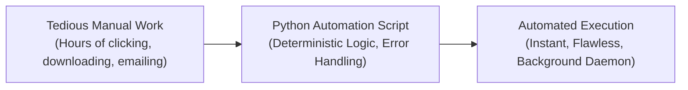

import { Callout } from "fumadocs-ui/components/callout";
import { Steps, Step } from "fumadocs-ui/components/steps";
import { Tabs, Tab } from "fumadocs-ui/components/tabs";

Welcome to **Stage 5: Practical Automation & Scripting**.

Computer science education often spends months teaching theoretical algorithms, abstract object hierarchies, and compiler internals before ever showing students how to solve an actual daily chore.

This track flips that paradigm on its head. Inspired by Al Sweigart’s landmark classic, **_Automate the Boring Stuff with Python_**, this stage is designed to make your computer work for **you**.

Instead of manually clicking through hundreds of web pages, opening image editing tools to crop dozens of product photos, or manually typing confirmation emails, you will write concise, robust Python scripts that eliminate digital toil forever.

---

## The Automation Mental Model

Computers are extraordinarily fast, tirelessly consistent, and completely devoid of boredom. Humans, by contrast, are creative, strategic, and easily exhausted by repetitive point-and-click tasks.



Whenever you find yourself performing a repetitive task on a computer for more than 15 minutes:

1. **Identify the Pattern**: What input data triggers the action? What steps are repeated? What output is expected?
2. **Select the Right Abstraction**: Is it an HTTP endpoint, an HTML DOM tree, a raw pixel matrix, or a mail transfer protocol?
3. **Write the Script**: Automate the flow defensively with error handling and logging.
4. **Schedule & Forget**: Hand execution over to a background scheduler (`cron`, Windows Task Scheduler, or cloud workers).

---

## Stage 5 Syllabus & Progression

<Steps>
<Step>
### 01. Web Scraping & Automated Crawling

**[Start this lesson →](/docs/learn-python/05-practical-automation/01-web-scraping-and-crawling)**

Transform the entire World Wide Web into your personal structured database.

- Launching automated browser searches with standard library `webbrowser`.
- Downloading web assets reliably with `requests` and modern `httpx` (handling HTTP/2, streaming large binary assets, and defensive status code checking).
- Parsing HTML DOM hierarchies and mastering CSS Selectors with `BeautifulSoup4` (`bs4`).
- Navigating nested tables, relative URL resolution, and multi-page pagination crawlers.
- Taming modern JavaScript-heavy Single Page Applications (SPAs) with headless browser automation via **Playwright**.
- Defensive scraping: User-Agent spoofing, respectful rate limits, exponential backoff, and avoiding anti-bot blocks.
- **Capstones**: The Automated XKCD Comic Archiver and an E-Commerce Price Drop Watchdog.

</Step>

<Step>
### 02. Image Manipulation with Pillow

**[Start this lesson →](/docs/learn-python/05-practical-automation/02-image-manipulation-with-pillow)**

Programmatic computer vision and graphic design with the industry-standard **Pillow** (`PIL`) library.

- Digital image foundations: The 2D pixel Cartesian coordinate grid (`(0, 0)` at top-left) and the RGBA color model.
- Loading, inspecting metadata, format conversions (JPEG, PNG, WebP), and lossless optimization.
- Core geometric transformations: Non-distorting aspect ratio resizing, high-quality Lanczos resampling, thumbnail generation, precision bounding-box cropping, and EXIF camera rotation handling.
- Alpha transparency masks and compositing foreground elements seamlessly onto backgrounds.
- Vector rendering with `ImageDraw`: Lines, rounded rectangles, polygons, and custom color palettes.
- Typography with `ImageFont`: Loading TrueType (`.ttf`) / OpenType (`.otf`) fonts, mathematical text centering formulas, and multi-line wrapping.
- **Capstones**: Industrial Batch Watermark & Branding Stamper, and an Automated Social Media OpenGraph Banner Generator.

</Step>

<Step>
### 03. Automated Communications: SMTP Email & SMS Alerts

**[Start this lesson →](/docs/learn-python/05-practical-automation/03-email-and-sms-automation)**

Connect your Python scripts directly to your inbox, smartphone, and messaging channels.

- Internet mail architecture: The difference between SMTP (sending) and IMAP (receiving).
- Network security and encryption: TLS/STARTTLS on Port `587` vs SSL on Port `465`, App Passwords, and credential isolation via environment variables.
- Modern email construction with Python's standard `email.message.EmailMessage` (replacing legacy MIME boilerplate).
- Building rich multi-part HTML emails with inline CSS and embedded brand assets (`cid:`).
- Safe binary file attachment processing with dynamic MIME-type sniffing (`mimetypes`).
- Querying and archiving inboxes via `imaplib` / `imapclient`.
- Instant emergency text messaging to any mobile phone via the **Twilio REST API**.
- Zero-cost alternative webhook alerting via Discord and Telegram bots.
- **Capstones**: Automated Morning Financial & Weather Digest, and an Uptime Server Health Watchdog with Emergency SMS Escalation.

</Step>

<Step>
### 04. Keeping Time, Scheduling Tasks & Launching Programs

**[Start this lesson →](/docs/learn-python/05-practical-automation/04-keeping-time-scheduling-tasks-and-launching-programs)**

Orchestrate the operating system clock, background threads, and external desktop programs.

- The Unix Epoch and monotonic precision benchmarking with `time.perf_counter()`.
- Date arithmetic, spans, and offsets with `datetime.datetime` and `timedelta`.
- Non-blocking concurrent execution using `threading.Thread` and background daemon threads.
- Launching and controlling desktop applications using `subprocess.Popen` and `subprocess.run`.
- Cross-platform task scheduling via `schedule`, Windows Task Scheduler, and Unix `cron`.
- **Capstones**: The Precision Multi-Lap Super-Stopwatch, and an Automated Nightly Backup & Cleanup Dispatcher.

</Step>

<Step>
### 05. Working with Excel Spreadsheets & Google Sheets

**[Start this lesson →](/docs/learn-python/05-practical-automation/05-working-with-excel-and-spreadsheets)**

Automate corporate data pipelines across local `.xlsx` workbooks and cloud Google Sheets.

- Navigating workbooks, sheets, rows, and cells using `openpyxl`.
- Dynamic native Excel formulas, auto-evaluations, and the `data_only` distinction.
- Corporate styling: Fonts, pattern fills, borders, currency formatting, auto-column widths, and frozen panes.
- Embedding native Excel interactive column, bar, and line charts directly from code.
- Cloud Google Sheets synchronization with service accounts and `gspread`.
- **Capstones**: The Census & Demographic Aggregator, and a Multi-Sheet Executive Financial Dashboard Generator.

</Step>

<Step>
### 06. Working with PDF & Word Documents

**[Start this lesson →](/docs/learn-python/05-practical-automation/06-working-with-pdf-and-word-documents)**

Programmatic document generation, publishing, and security.

- Fixed-layout PDF inspection, keyword scanning, and page extraction with modern `pypdf`.
- Slicing, rotating, merging multi-file documents, and stamping transparent vector watermarks.
- Protecting sensitive documents with military-grade AES encryption.
- Flowable XML authoring in Microsoft Word (`.docx`) using `python-docx` (Paragraphs, Runs, Bullet Lists, Tables, and Images).
- **Capstones**: The Universal PDF Binder & Watermarker CLI, and an Automated Personalized Invitation Generator.

</Step>

<Step>
### 07. GUI Automation: Mouse & Keyboard Control with PyAutoGUI

**[Start this lesson →](/docs/learn-python/05-practical-automation/07-gui-automation-mouse-and-keyboard-control)**

The ultimate fallback when applications lack APIs, command lines, or HTML elements.

- Absolute and relative mouse cursor movement, easing curves, clicks, double-clicks, and dragging.
- Simulating natural human keystrokes, special function keys, and complex modifier hotkeys.
- The mandatory safety net: The `pyautogui.FAILSAFE` corner tripwire and execution pauses.
- Computer vision screen recognition: Locating buttons on monitor screens visually via OpenCV sub-image matching.
- **Capstones**: The "Looking Busy" Mouse Jiggler with Human Activity Sentinel, and an Automated Desktop Form Submitter.

</Step>
</Steps>

---

## Modern Python Automation Toolchain

In this stage, we leverage modern, fast Python libraries. You can install all necessary dependencies into a virtual environment using `uv` or `pip`:

<Tabs items={['uv (Recommended)', 'pip standard']}>
<Tab value="uv (Recommended)">
```bash
# Initialize a new automation workspace
uv init python-automation
cd python-automation

# Add web scraping suite

uv add requests httpx beautifulsoup4 lxml playwright

# Install Playwright browser binaries

uv run playwright install chromium

# Add image processing suite

uv add pillow

# Add communication and scheduling suite

uv add twilio python-dotenv schedule

# Add document and spreadsheet suite

uv add openpyxl pypdf python-docx gspread

# Add desktop GUI automation suite

uv add pyautogui opencv-python

````
</Tab>
<Tab value="pip standard">
```bash
# Create and activate a virtual environment
python -m venv .venv
source .venv/bin/activate  # On Windows: .venv\Scripts\activate

# Install all automation packages
pip install requests httpx beautifulsoup4 lxml playwright pillow twilio python-dotenv schedule openpyxl pypdf python-docx gspread pyautogui opencv-python

# Install Playwright browser binaries
playwright install chromium
````

</Tab>
</Tabs>

---

## Pedagogical Principles of this Track

1. **Zero Fluff, Maximum Utility**: Every code example is immediately applicable to real-world workflows you encounter at work or in personal projects.
2. **Complete, Self-Contained Scripts**: We avoid fragmented three-line snippets that leave you wondering where imports go. Every script is complete, runnable, and defensively programmed.
3. **Modern Python Standards**: We use modern Python 3.12+ patterns—including `pathlib.Path`, f-strings, context managers (`with`), strict type hints, and the latest standard library `EmailMessage` API.
4. **Defensive Programming**: Real automation must run silently in the background without crashing when a network blips or a website layout changes. You will learn to handle exceptions, retry failed requests, and log errors cleanly.
