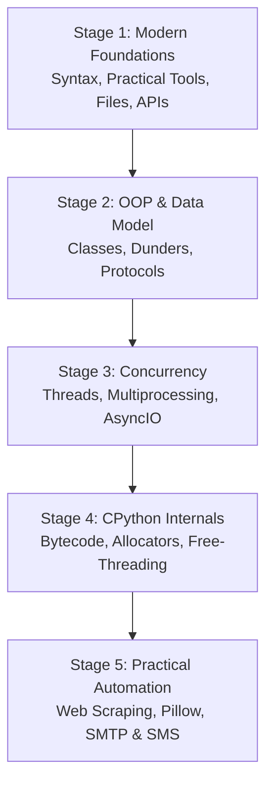

import { Callout } from "fumadocs-ui/components/callout";
import { Tabs, Tab } from "fumadocs-ui/components/tabs";

Python is one of the most powerful and versatile programming languages in the world. Every day, engineers use it across three major industry pillars:

1. **Automation & Scripting**: Eliminating repetitive manual toil, parsing thousands of documents or spreadsheets in seconds, and orchestrating cloud infrastructure.
2. **Artificial Intelligence & Machine Learning**: Building large language model pipelines, vector search engines, autonomous agents, and predictive recommendation systems.
3. **Web Applications & High-Throughput APIs**: Building scalable web services and platforms (from Instagram and Dropbox to modern FastAPI microservices).

This curriculum is engineered to guide you from your very first line of code all the way to understanding **CPython virtual machine bytecode**, **free-threaded parallelism (PEP 703)**, and **custom memory allocators**, while strictly adhering to modern **Python 3.12 and 3.13+** standards.

---

## Curriculum Tracks

The curriculum is structured into progressive engineering tracks:



### 1. Stage 1: Modern Foundations

**[Open Stage 1: Fundamentals →](/docs/learn-python/01-fundamentals)**

- **Core Mechanics & Data Types**: Dynamic typing, memory allocations, `int`, `float`, `str`, `bool`, and input conversion.
- **String Precision**: Visual index maps, bidirectional indexing ($0$ and $-1$), and slicing rules.
- **Sequences & Collections**: Lists, Tuples, Dictionaries, and Sets with time complexities and pattern matching.
- **Functions, Errors & Resilience**: `def`, LEGB scope, reading tracebacks, and defensive `try / except / else / finally`.
- **Practical Engineering**: Modern `src/` layout, virtual environments (`uv`, `.venv`), cross-platform `pathlib.Path`, safe file I/O with context managers (`with open(...)`), and modular architecture.
- **Libraries & Data Pipelines**: Exploring the standard library, installing PyPI packages with `uv`, processing JSON/CSV data safely, and nested data structure modeling.
- **Quick Reference**: Comprehensive cheat sheet grouping all core operations, collections, and file I/O.
- **Stage 1 Capstone**: `logpeek` — High-throughput streaming log analytics CLI ($O(1)$ memory).

### 2. Stage 2: The Python Data Model & OOP

**[Open Stage 2: Intermediate →](/docs/learn-python/02-intermediate)**

- **Classes & Objects Foundations**: Blueprint model, `__init__`, demystifying `self`, namespaces (`__dict__`), and method types.
- **The Four Pillars of OOP**: Encapsulation (`_protected`, `__private`, `@property`), Abstraction (`abc.ABC`), Inheritance, and Polymorphism (Duck Typing & operator overloading).
- **Advanced OOP Architecture**: Multiple inheritance, Diamond Problem, C3 Linearization (MRO), Mixins, and "Composition over Inheritance".
- **The Dunder Protocol Matrix**: `__repr__`, `__str__`, `__len__`, `__getitem__`, and object protocols.
- **First-Class Functions & Decorators**: Closures, lexical scope cells, and parametric decorators (`ParamSpec`).
- **Generators & Iteration**: `yield`, `yield from`, and lazy streaming pipelines.
- **Descriptors & Modern Dataclasses**: Attribute lookup precedence, data descriptors, and `@dataclass(slots=True)`.
- **Applied Ecosystem & Networking**: Industrial text parsing with regular expressions (`re`), zero-width lookarounds, and consuming live REST APIs with `httpx`.
- **Enterprise Patterns & Error Architecture**: Reimagined GoF patterns (Strategy, Factory, Observer, Adapter), custom domain exception trees, structured error payloads, and ExceptionGroups (PEP 654).
- **Stage 2 Capstone**: `active-lite` — Declarative mini-ORM with SQLite and transaction context managers.

### 3. Stage 3: Concurrency, Architecture & Metaprogramming

**[Open Stage 3: Advanced →](/docs/learn-python/03-advanced)**

- **Metaclasses & Class Factories**: `type()`, `__init_subclass__`, and schema validation engines.
- **Concurrency Matrix**: OS Threads vs Multiprocessing vs AsyncIO cooperative multitasking.
- **Modern AsyncIO**: The event loop, socket selectors, structured concurrency with `TaskGroup` and `except*` (PEP 654).
- **Memory Profiling**: Reference counting, cyclic garbage collection (`gc`), and `tracemalloc`.
- **Stage 3 Capstone**: `tiny-redis` — In-memory non-blocking RESP server & async crawler.

### 4. Stage 4: Systems & CPython Internals

**[Open Stage 4: Systems & Internals →](/docs/learn-python/04-systems-internals)**

- **CPython Pipeline**: Source code → PEG Parser → AST → Symbol Table → Bytecode.
- **Evaluation Stack Machine**: How `ceval.c` evaluates opcodes, specialized instructions (PEP 659), and JIT (PEP 744).
- **Memory Architecture**: `PyObject`, Arenas, Pools, Blocks (`obmalloc`), and `mimalloc` in Python 3.13.
- **The Free-Threaded Future**: Eliminating the GIL (`--disable-gil` PEP 703) and Subinterpreters (PEP 734).
- **Native Extensions**: Accelerating critical hot paths in Rust via **PyO3** and `maturin`.
- **Stage 4 Capstone**: `pytrace-vm` — Miniature bytecode disassembler and stack evaluator.

### 5. Stage 5: Practical Automation & Scripting

**[Open Stage 5: Practical Automation →](/docs/learn-python/05-practical-automation)**

- **Web Scraping & Automated Crawling**: Downloading assets with `requests` / `httpx`, parsing HTML DOM trees with `BeautifulSoup4` CSS selectors, handling pagination, and dynamic Single-Page Application (SPA) browser automation via **Playwright**.
- **Digital Image Manipulation with Pillow**: 2D pixel coordinates, RGBA color models, aspect-ratio preserving resizing, bounding box cropping, alpha compositing masks, vector geometry with `ImageDraw`, typography with `ImageFont`, and industrial batch watermarking.
- **Automated Communications**: SMTP protocol handshakes, TLS/STARTTLS security, App Passwords, modern `email.message.EmailMessage`, rich multi-part HTML email layouts with inline CSS, dynamic MIME-sniffed attachments, IMAP inbox search, and instant SMS alerts via **Twilio**.
- **Time, Scheduling & Processes**: Unix epoch benchmarking, `datetime` and `timedelta` arithmetic, non-blocking concurrent workers with `threading.Thread`, application orchestration via `subprocess`, and task scheduling with `schedule` and `cron`.
- **Spreadsheets & Document Publishing**: Automated Excel processing with `openpyxl`, formula generation, formatting, native charting, cloud Google Sheets sync (`gspread`), PDF merging/watermarking/encryption with `pypdf`, and Word document authoring (`python-docx`).
- **Desktop GUI Automation**: Simulating human mouse clicks, keyboard strokes, hotkeys, and computer vision on-screen button recognition via `pyautogui` with fail-safe tripwires.
- **Stage 5 Capstones**: The XKCD Comic Archiver, E-Commerce Price Watchdog, Batch Logo Stamper, Uptime Watchdog, Multi-Lap Stopwatch, Executive Financial Dashboard, Universal PDF Binder, and Sentinel Mouse Jiggler.

---

## Modern Python Toolchain: `uv` & `ruff`

In modern Python engineering, legacy fragmented tools (`pip`, `virtualenv`, `poetry`, `flake8`, `black`) have been replaced by ultra-fast, Rust-powered developer tooling:

<Tabs items={['uv (Project & Dependencies)', 'ruff (Lint & Format)', 'pyproject.toml']}>
<Tab value="uv (Project & Dependencies)">
```bash
# Install uv (cross-platform single binary)
curl -LsSf https://astral.sh/uv/install.sh | sh

# Initialize a modern Python 3.12+ project

uv init my-project
cd my-project

# Add dependencies with instant resolution

uv add pytest rich

# Run your project in an isolated managed virtual environment

uv run app.py

````
</Tab>

<Tab value="ruff (Lint & Format)">
```bash
# Check code against 40+ linter rule sets in milliseconds
uv run ruff check .

# Automatically fix lint violations and organize imports
uv run ruff check --fix .

# Format code with the ultra-fast Black-compatible formatter
uv run ruff format .
````

</Tab>

<Tab value="pyproject.toml">
```toml
[project]
name = "cs-cookbook-python"
version = "0.1.0"
description = "Modern Python Master Curriculum Examples"
readme = "README.md"
requires-python = ">=3.12"
dependencies = [
    "pytest>=8.0.0",
    "rich>=13.0.0",
]

[tool.ruff]
line-length = 88
target-version = "py312"

[tool.ruff.lint]
select = ["E", "F", "I", "UP", "B", "SIM"]

```
</Tab>
</Tabs>

---

## The Golden Rule

> *"Don't try to memorize anything in this curriculum — that's what the cheat sheets and documentation are for. Focus on building the **mental model** of what the computer and interpreter are actually doing under the hood. Within a few weeks of writing code every day, it will all become muscle memory."*

Jump right in: start with **[01. Why Python & Modern Setup](/docs/learn-python/01-fundamentals/01-why-python-and-setup)**.
```
